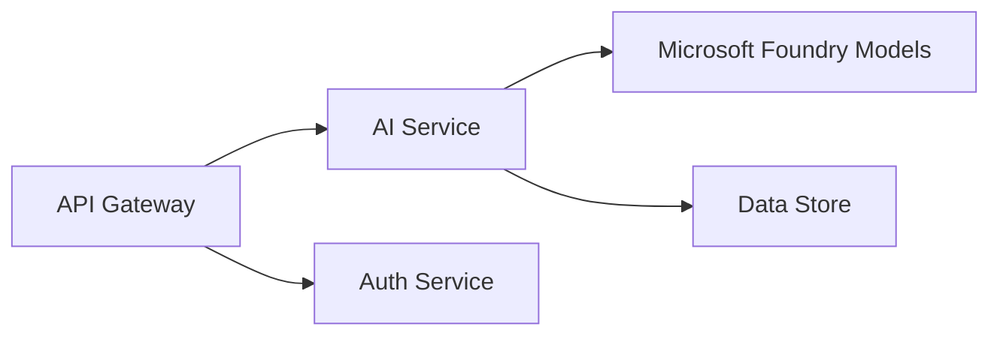
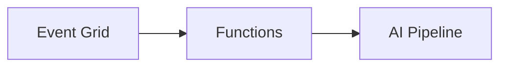

# Kapitola 8: Produkčné a podnikové vzory

**📚 Kurz**: [AZD pre začiatočníkov](../../README.md) | **⏱️ Trvanie**: 2-3 hodiny | **⭐ Zložitosť**: Pokročilý

---

## Prehľad

Táto kapitola pokrýva podnikové vzory pripravené na nasadenie, spevňovanie bezpečnosti, monitorovanie a optimalizáciu nákladov pre produkčné AI záťaže.

Ide o architektonický referenčný materiál, nie o úplnú šablónu na produkčné nasadenie. Príklady vynechávajú integračné detaily, ktoré je potrebné dodať a otestovať vo vlastnej aplikácii; prečítanie kontrolného zoznamu negarantuje pripravenosť na produkciu.

> **Kontrola vydania (2026-11-04):** AI CLI usmernenie bolo overené proti dokumentácií/zdrojom `azd 1.37.2`, agentov `1.0.0-beta.23` a vyhodnotení `1.0.0-beta.2`. Pozrite si [zmeny a opravy vydania](production-ai-practices.md#recent-release-changes-and-fixes) pre požiadavky kompatibility a detaily migrácie; nejde o validáciu živého nasadenia.

## Ciele učenia

Po dokončení tejto kapitoly budete vedieť:
- Nasadiť odolné aplikácie v viacerých regiónoch
- Implementovať podnikové bezpečnostné vzory
- Konfigurovať komplexné monitorovanie
- Optimalizovať náklady vo veľkom meradle
- Nastaviť CI/CD pipeline s AZD

---

## 📚 Lekcie

| # | Lekcia | Popis | Čas |
|---|--------|-------------|------|
| 1 | [Produkčné praktiky AI](production-ai-practices.md) | Podnikové vzory nasadenia | 90 min |

---

## 🚀 Produkčný kontrolný zoznam

- [ ] Viacregionálne nasadenie pre odolnosť
- [ ] Spravovaná identita pre autentifikáciu (bez kľúčov)
- [ ] Application Insights pre monitorovanie
- [ ] Nastavené rozpočty a upozornenia na náklady
- [ ] Povolené bezpečnostné skenovanie
- [ ] Integrácia CI/CD pipeline
- [ ] Plán obnovy po havárii

---

## 🏗️ Architektonické vzory

### Vzor 1: Microservices AI



### Vzor 2: Event-Driven AI



---

## 🔐 Najlepšie bezpečnostné postupy

```bicep
// Illustrative properties from different resources, NOT a standalone Bicep file.
// Attach identity to the application host:
identity: {
  type: 'SystemAssigned'
}

// AI account properties (also require private endpoints, DNS and app connectivity):
properties: {
  publicNetworkAccess: 'Disabled'
  networkAcls: {
    defaultAction: 'Deny'
  }
}
```

---

## 💰 Optimalizácia nákladov

| Stratégia | Hlavné obmedzenie |
|----------|---------|
| Škálovanie na nulu (Container Apps) | Vyžaduje vhodný spúšťač; ostatné služby stále spôsobujú náklady |
| Použitie spotrebných vrstiev pre vývoj | Porovnajte ceny vybranej služby a pracovnú záťaž |
| Plánované škálovanie | Škálujte cez podporovanú infraštruktúru/automatizáciu |
| Rezervácie/kapacita na požiadanie | Iba ak je podporované; záväzky môžu zvyšovať nečinné náklady |

Použite [kompletný vzor rozpočtového zdroja](production-ai-practices.md#2-cost-monitoring-and-budgets) s platným dátumom začiatku, rozsahom fakturácie, príjemcami a povoleniami. Rozpočet posiela upozornenia; neobmedzuje výdavky. Úspory závisia od meranej spotreby a nie sú garantované ako percentá.

---

## 📊 Nastavenie monitoringu

```bash
# Open the Application Insights logs view (requires configured monitoring)
azd monitor --logs

# Check Application Insights
azd monitor --overview

# View metrics
az monitor metrics list --resource <resource-id>
```

---

## 🔗 Navigácia

| Smer | Kapitola |
|-----------|---------|
| **Predchádzajúca** | [Kapitola 7: Riešenie problémov](../chapter-07-troubleshooting/README.md) |
| **Kurz dokončený** | [Domovská stránka kurzu](../../README.md) |

---

## 📖 Súvisiace zdroje

- [Sprievodca AI Agentmi](../chapter-02-ai-development/agents.md)
- [Application Insights](../chapter-06-pre-deployment/application-insights.md)
- [Riešenia viacerých agentov](../chapter-05-multi-agent/README.md)
- [Príklad Microservices](../../examples/microservices/README.md)

---

<!-- CO-OP TRANSLATOR DISCLAIMER START -->
**Vyhlásenie o zodpovednosti**:
Tento dokument bol preložený pomocou AI prekladateľskej služby [Co-op Translator](https://github.com/Azure/co-op-translator). Hoci sa snažíme o presnosť, vezmite prosím na vedomie, že automatické preklady môžu obsahovať chyby alebo nepresnosti. Pôvodný dokument v jeho natívnom jazyku by mal byť považovaný za autoritatívny zdroj. Pre kritické informácie sa odporúča profesionálny ľudský preklad. Nie sme zodpovední za žiadne nedorozumenia alebo nesprávne interpretácie vyplývajúce z použitia tohto prekladu.
<!-- CO-OP TRANSLATOR DISCLAIMER END -->