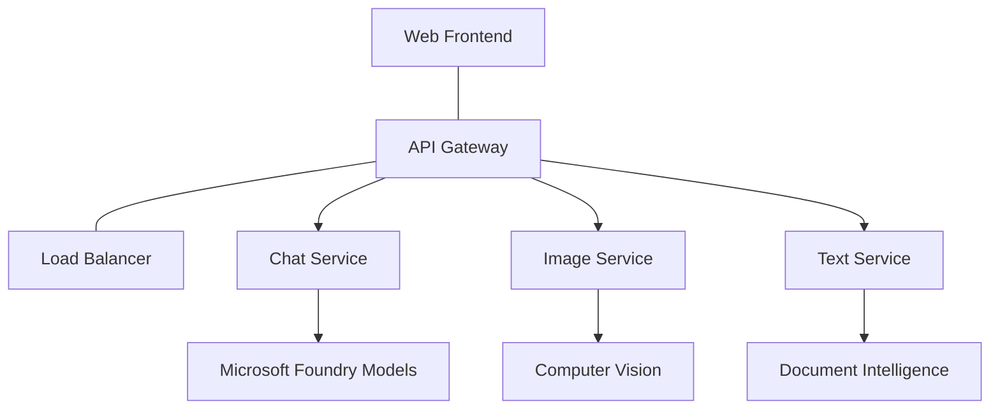

# Najlepšie postupy pre produkčné AI záťaže s AZD

**Navigácia kapitol:**
- **📚 Domov kurzu**: [AZD pre začiatočníkov](../../README.md)
- **📖 Aktuálna kapitola**: Kapitola 8 - Produkčné a podnikové vzory
- **⬅️ Predchádzajúca kapitola**: [Kapitola 7: Riešenie problémov](../chapter-07-troubleshooting/debugging.md)
- **⬅️ Súvisiace**: [AI Workshop Lab](../chapter-02-ai-development/ai-workshop-lab.md)
- **🎯 Kurz dokončený**: [AZD pre začiatočníkov](../../README.md)

## Prehľad

Tento návod vysvetľuje produkčné AI dizajnové vzory pomocou Azure Developer CLI (AZD). Je to referenčný dizajn, nie nasaditeľná aplikácia alebo produkčná certifikácia.

**Príkladové hranice:** Pokiaľ nie je výslovne popísané ako kompletné, fragmenty Bicep predpokladajú parametre a odkazované zdroje z obsahujúcej šablóny. Vynechávajú hostiteľské obrazy/plány, identity, priradenia rolí, DNS, výstupy a ďalšiu potrebnú integráciu. YAML cesty služieb a hook/test skripty sú ilustračné súbory na vytvorenie vo **vlastnej aplikácii**; nie sú súčasťou tohto kurzu. Použite funkčný vzor AZD ako základ, skompilujte kompletnú infraštruktúru a vyskúšajte ju v izolovanom prostredí pred produkciou.

## Kľúčové riešené výzvy

Bežné problémy v produkcii zahŕňajú nasadenia viacerých služieb, správu identity a tajomstiev, škálovanie, kontrolu nákladov a monitorovanie. Tu sa nepokladá za prokázanú prevalenciu.

## Architektonické vzory pre produkčnú AI

### Vzor 1: Microservices AI architektúra

**Kedy použiť**: Zložité AI aplikácie s viacerými schopnosťami



**Implementácia AZD**:

```yaml
# azure.yaml
name: enterprise-ai-platform
services:
  web:
    project: ./web
    host: staticwebapp
  api-gateway:
    project: ./api-gateway
    host: containerapp
  chat-service:
    project: ./services/chat
    host: containerapp
  vision-service:
    project: ./services/vision
    host: containerapp
  text-service:
    project: ./services/text
    host: containerapp
```

### Vzor 2: Udalosťami riadené AI spracovanie

**Kedy použiť**: Hromadné spracovanie, analýza dokumentov, asynchrónne pracovné postupy

```bicep
// Event Hub for AI processing pipeline
resource eventHub 'Microsoft.EventHub/namespaces@2024-01-01' = {
  name: eventHubNamespaceName
  location: location
  sku: {
    name: 'Standard'
    tier: 'Standard'
    capacity: 1
  }
}

// Service Bus for reliable message processing
resource serviceBus 'Microsoft.ServiceBus/namespaces@2024-01-01' = {
  name: serviceBusNamespaceName
  location: location
  sku: {
    name: 'Premium'
    tier: 'Premium'
    capacity: 1
  }
}

// Function App for processing
resource functionApp 'Microsoft.Web/sites@2023-01-01' = {
  name: functionAppName
  location: location
  kind: 'functionapp,linux'
  properties: {
    siteConfig: {
      appSettings: [
        {
          name: 'FUNCTIONS_EXTENSION_VERSION'
          value: '~4'
        }
        {
          name: 'AZURE_OPENAI_ENDPOINT'
          value: '@Microsoft.KeyVault(VaultName=${keyVault.name};SecretName=openai-endpoint)'
        }
      ]
    }
  }
}
```

Toto vytvára fragmenty názvových priestorov, nie huby, fronty, odbery alebo spúšťače funkcií. Na spustiteľnú funkciu je potrebný aj hostiteľský plán, konfigurácia runtime/úložiska, priradená identita, RBAC a prístup k sieti. Odkaz na Key Vault potrebuje oprávnenie na čítanie tajomstva; samotná URL koncového bodu nie je prihlasovací údaj.

## Premýšľanie o zdraví AI agenta

Keď sa tradičná webová aplikácia rozbije, príznaky sú známe: stránka sa nenačíta, API vráti chybu alebo nasadenie zlyhá. AI-aplikácie sa môžu rozbiť rovnakými spôsobmi — ale môžu sa tiež správať jemnejšie, bez zrejmých chybových hlášok.

Táto sekcia pomáha vybudovať mentálny model na monitorovanie AI záťaží, aby ste vedeli, kam sa pozrieť, keď niečo nefunguje správne.

### Ako sa zdravie agenta líši od zdravia tradičnej aplikácie

Tradičné aplikácie môžu mať tiež jemné chyby správnosti. AI agent pridáva nedeterministickú kvalitu odpovedí k bežným obavám o dostupnosť a správnosť. Zdravie agenta si predstavte v dvoch vrstvách:

| Vrstva | Čomu venovať pozornosť | Kde sa pozrieť |
|-------|------------------------|-----------------|
| **Zdravie infraštruktúry** | Beží služba? Sú zdroje nasadené? Sú koncové body dostupné? | `azd monitor`, zdravotný stav zdrojov v Azure portáli, logy kontajnerov/aplikácií |
| **Zdravie správania** | Reaguje agent presne? Sú odpovede včasné? Je model volaný správne? | Application Insights stopa, metriky latencie volaní modelu, logy kvality odpovedí |

Zdravie infraštruktúry je známe — je rovnaké pre akúkoľvek aplikáciu azd. Zdravie správania je nová vrstva, ktorú zavádzajú AI záťaže.

### Kde sa pozrieť, keď sa AI aplikácie nesprávajú podľa očakávaní

Ak vaša AI aplikácia neprináša očakávané výsledky, tu je konceptuálny kontrolný zoznam:

1. **Začnite so základmi.** Beží aplikácia? Dosiahne svoje závislosti? Skontrolujte `azd monitor` a zdravotný stav zdrojov rovnako ako pri akejkoľvek aplikácii.
2. **Skontrolujte pripojenie modelu.** Volá vaša aplikácia úspešne AI model? Neúspešné alebo časovo vypršané volania modelu sú najčastejšou príčinou problémov s AI aplikáciami a objavia sa v logoch aplikácie.
3. **Bezpečne skontrolujte vstupy a zakotvenie.** Nesprávne odpovede môžu byť spôsobené vyhľadávaním, inštrukciami, obmedzeniami modelu alebo vykonávaním nástrojov. Používajte prístupom kontrolované, redigované diagnostické údaje; v produkcii neaktivujte bezbrehé logovanie výziev/odpovedí.
4. **Preskúmajte latenciu odpovedí.** Volania AI modelov sú pomalšie než typické API volania. Ak sa aplikácia zdá pomalá, skontrolujte, či sa zvýšili časy odozvy modelu — to môže naznačovať obmedzovanie, kapacitné limity alebo preťaženie na úrovni regiónu.
5. **Sledujte signály nákladov.** Neočakávané špičky v používaní tokenov alebo API volaní môžu znamenať slučku, nesprávne nakonfigurovanú výzvu alebo nadmerné opakovania.

Nie je potrebné ihneď ovládať nástroje monitorovania. Kľúčový záver je, že AI aplikácie pridávajú ďalšiu vrstvu správania na monitorovanie a vstavané monitorovanie azd (`azd monitor`) vám poskytuje východiskový bod na skúmanie oboch vrstiev.

---

## Najlepšie bezpečnostné postupy

### 1. Model zabezpečenia Zero-Trust

**Implementačná stratégia**:
- Žiadna komunikácia medzi službami bez autentifikácie
- Všetky API volania používajú spravované identity
- Sieťová izolácia s privátnymi koncovými bodmi
- Prístupové práva s minimálnymi privilégiami

```bicep
// Managed Identity for each service
resource chatServiceIdentity 'Microsoft.ManagedIdentity/userAssignedIdentities@2023-01-31' = {
  name: 'chat-service-identity'
  location: location
}

// Role assignments with minimal permissions
resource openAIUserRole 'Microsoft.Authorization/roleAssignments@2022-04-01' = {
  scope: openAIAccount
  name: guid(openAIAccount.id, chatServiceIdentity.id, '5e0bd9bd-7b93-4f28-af87-19fc36ad61bd')
  properties: {
    roleDefinitionId: subscriptionResourceId('Microsoft.Authorization/roleDefinitions', '5e0bd9bd-7b93-4f28-af87-19fc36ad61bd')
    principalId: chatServiceIdentity.properties.principalId
    principalType: 'ServicePrincipal'
  }
}
```

### 2. Bezpečná správa tajomstiev

**Vzorec integrácie s Key Vault**:

```bicep
// Key Vault with proper access policies
resource keyVault 'Microsoft.KeyVault/vaults@2023-02-01' = {
  name: keyVaultName
  location: location
  properties: {
    tenantId: tenant().tenantId
    sku: {
      family: 'A'
      name: 'standard' // Premium is needed for HSM-backed keys, not ordinary secrets
    }
    enableRbacAuthorization: true  // Use RBAC instead of access policies
    enablePurgeProtection: true    // Prevent accidental deletion
    enableSoftDelete: true
    softDeleteRetentionInDays: 90
  }
}

// Optional legacy key-auth alternative; omit when using Entra ID.
resource openAIKeySecret 'Microsoft.KeyVault/vaults/secrets@2023-02-01' = {
  parent: keyVault
  name: 'openai-api-key'
  properties: {
    value: openAIAccount.listKeys().key1
    attributes: {
      enabled: true
    }
  }
}
```

Priraďte runtime identitu `Key Vault Secrets User` v príslušnom rozsahu a pripojte ju k hostiteľovi; samotné `enableRbacAuthorization` nepridelené žiadny prístup. Uprednostnite autentifikáciu spravovaných identít OpenAI s `disableLocalAuth: true`. Nepovinný kľúčový tajný údaj dáva zmysel len pre zámerne povolený účet s kľúčom a zriaďovací princíp musí mať povolenie na zápis tajomstiev.

### 3. Sieťová bezpečnosť

**Konfigurácia súkromného koncového bodu**:

```bicep
// Virtual Network for AI services
resource virtualNetwork 'Microsoft.Network/virtualNetworks@2023-04-01' = {
  name: vnetName
  location: location
  properties: {
    addressSpace: {
      addressPrefixes: ['10.0.0.0/16']
    }
    subnets: [
      {
        name: 'ai-services-subnet'
        properties: {
          addressPrefix: '10.0.1.0/24'
          privateEndpointNetworkPolicies: 'Disabled'
        }
      }
      {
        name: 'app-services-subnet'
        properties: {
          addressPrefix: '10.0.2.0/24'
          delegations: [
            {
              name: 'Microsoft.Web/serverFarms'
              properties: {
                serviceName: 'Microsoft.Web/serverFarms'
              }
            }
          ]
        }
      }
    ]
  }
}

// Private endpoints for all AI services
resource openAIPrivateEndpoint 'Microsoft.Network/privateEndpoints@2023-04-01' = {
  name: '${openAIAccountName}-pe'
  location: location
  properties: {
    subnet: {
      id: virtualNetwork.properties.subnets[0].id
    }
    privateLinkServiceConnections: [
      {
        name: 'openai-connection'
        properties: {
          privateLinkServiceId: openAIAccount.id
          groupIds: ['account']
        }
      }
    ]
  }
}
```

Súkromné koncové body vyžadujú aj skupiny privátnych DNS zón/prepojenia VNet a integráciu aplikácií do VNet. Nezabraňujú automaticky verejnému prístupu: po overení súkromnej konektivity a prístupu k nasadeniu explicitne zakažte verejný prístup AI účtu.

## Výkon a škálovanie

### 1. Stratégie automatického škálovania

**Automatické škálovanie Container Apps**:

```bicep
resource containerApp 'Microsoft.App/containerApps@2023-05-01' = {
  name: containerAppName
  location: location
  properties: {
    configuration: {
      ingress: {
        external: true
        targetPort: 8000
        transport: 'http'
      }
    }
    template: {
      scale: {
        minReplicas: 2  // Always have 2 instances minimum
        maxReplicas: 50 // Scale up to 50 for high load
        rules: [
          {
            name: 'http-scaling'
            http: {
              metadata: {
                concurrentRequests: '20'  // Scale when >20 concurrent requests
              }
            }
          }
          {
            name: 'cpu-scaling'
            custom: {
              type: 'cpu'
              metadata: {
                type: 'Utilization'
                value: '70'  // Scale when CPU >70%
              }
            }
          }
        ]
      }
    }
  }
}
```

### 2. Stratégie kešovania

**Redis keš pre AI odpovede**:

```bicep
// Legacy Azure Cache for Redis example (not recommended for new deployments)
resource redisCache 'Microsoft.Cache/redis@2023-04-01' = {
  name: redisCacheName
  location: location
  properties: {
    sku: {
      name: 'Premium'
      family: 'P'
      capacity: 1
    }
    enableNonSslPort: false
    minimumTlsVersion: '1.2'
    redisConfiguration: {
      'maxmemory-policy': 'allkeys-lru'
    }
    // Sharding distributes data; replication/failover provides availability.
    shardCount: 2
  }
}

// Cache configuration in application
var cacheConnectionString = '${redisCache.properties.hostName}:6380,password=${redisCache.listKeys().primaryKey},ssl=True,abortConnect=False'
```

Azure Cache for Redis Basic/Standard/Premium je na [ceste k ukončeniu](https://learn.microsoft.com/azure/azure-cache-for-redis/retirement-faq). Používajte Azure Managed Redis pre nové návrhy a jeho zdokumentované SKU, identitu a TLS konfiguráciu, namiesto kopírovania tohto zastaraného zdroja do nového produkčného systému. Riadiaci riadok connection-string je nefunkčný zástupný symbol, nie prihlasovací údaj. Kľúče keša rozdeľujte podľa autorizácie, modelu/inštrukcií a verzie vyhľadávania, s expiráciou; zdieľaný keš iba na čítanie môže odhaliť dáta iného používateľa.

### 3. Vyvažovanie záťaže a riadenie prenosu

**Application Gateway s WAF**:

```bicep
// Application Gateway with Web Application Firewall
resource applicationGateway 'Microsoft.Network/applicationGateways@2023-04-01' = {
  name: appGatewayName
  location: location
  properties: {
    sku: {
      name: 'WAF_v2'
      tier: 'WAF_v2'
      capacity: 2
    }
    webApplicationFirewallConfiguration: {
      enabled: true
      firewallMode: 'Prevention'
      ruleSetType: 'OWASP'
      ruleSetVersion: '3.2'
    }
    // Backend pools for AI services
    backendAddressPools: [
      {
        name: 'ai-services-pool'
        properties: {
          backendAddresses: [
            {
              fqdn: '${containerApp.properties.configuration.ingress.fqdn}'
            }
          ]
        }
      }
    ]
  }
}
```

Toto je čiastočný zdroj gateway: skutočné nasadenie potrebuje aj podsieť gateway/IP konfiguráciu, front-end IP adresy a porty, TLS poslucháče/certifikáty, nastavenia HTTP backendu/probe, smerovacie pravidlá a priority, a preskúmanú politiku WAF. TLS hostname/SNI a autentifikácia musia zodpovedať backendu Container App.

## 💰 Optimalizácia nákladov

### 1. Správne priradenie zdrojov

**Konfigurácie špecifické pre prostredie**:

Tieto názvy sú **ilustratívne vstupy vlastných šablón**, nie automatické nastavenia AZD. Najskôr ich mapujte do `infra/main.parameters.json`/Bicep a nastavení hostiteľa. Napríklad vzor RAG používa `AZURE_SEARCH_SERVICE_SKU` a `AZURE_OPENAI_CHATGPT_DEPLOYMENT_CAPACITY`, nielen všeobecné názvy nižšie. Pamäť Container Apps nastavte na podporovanú jednotku ako `1Gi` v skutočnom zdroji. Zmeny infraštruktúry aplikujte pomocou `azd up` alebo `azd provision`; samotné `azd deploy` neuplatní Bicep zmeny.

```bash
# Development environment
azd env new development
azd env set AZURE_OPENAI_SKU "S0"
azd env set AZURE_OPENAI_CAPACITY 10
azd env set AZURE_SEARCH_SKU "basic"
azd env set CONTAINER_CPU 0.5
azd env set CONTAINER_MEMORY 1.0

# Production environment  
azd env new production
azd env set AZURE_OPENAI_SKU "S0"
azd env set AZURE_OPENAI_CAPACITY 100
azd env set AZURE_SEARCH_SKU "standard"
azd env set CONTAINER_CPU 2.0
azd env set CONTAINER_MEMORY 4.0
```

### 2. Monitorovanie nákladov a rozpočty

```bicep
// Supply the first day of the current UTC month, e.g. 2026-11-01T00:00:00Z.
param budgetStartDate string

// Cost management and budgets
resource budget 'Microsoft.Consumption/budgets@2024-08-01' = {
  name: 'ai-workload-budget'
  properties: {
    timePeriod: {
      startDate: budgetStartDate
    }
    timeGrain: 'Monthly'
    amount: 2000  // In the billing currency, not necessarily USD
    category: 'Cost'
    notifications: {
      warning: {
        enabled: true
        operator: 'GreaterThan'
        threshold: 80
        contactEmails: [
          'finance@company.com'
          'engineering@company.com'
        ]
        contactRoles: [
          'Owner'
          'Contributor'
        ]
      }
      critical: {
        enabled: true
        operator: 'GreaterThan'
        threshold: 95
        contactEmails: [
          'cto@company.com'
        ]
      }
    }
  }
}
```

Nahraďte príkladových príjemcov a skontrolujte rozsah/oprávnenia. Upozornenia rozpočtu používajú oneskorené fakturačné údaje a neumiestňujú strop výdavkov.

### 3. Optimalizácia používania tokenov

**Správa nákladov OpenAI**:

Toto je len heuristika založená na znakoch pre UI náhľad, **nie** validátor limitu tokenov modelu. Produkčný kód musí používať tokenizér zodpovedajúci nasadenému modelu a zohľadniť systémové inštrukcie, schémy nástrojov, históriu a rozpočet výstupu. Odmietnite príliš veľkú správu používateľa namiesto tichého orezania.

```typescript
// Application-level token optimization
class TokenOptimizer {
  private readonly maxTokens = 4000;
  private readonly reserveTokens = 500;
  
  optimizePrompt(userInput: string, context: string): string {
    const availableTokens = this.maxTokens - this.reserveTokens;
    if (this.estimateTokens(userInput) + 8 >= availableTokens) {
      throw new Error("User input exceeds the illustrative prompt budget");
    }
    const estimatedTokens = this.estimateTokens(userInput + context) + 8;
    
    if (estimatedTokens > availableTokens) {
      // Truncate context, not user input
      context = this.truncateContext(context, Math.max(0, availableTokens - this.estimateTokens(userInput) - 8));
    }
    
    return `${context}\n\nUser: ${userInput}`;
  }
  
  private estimateTokens(text: string): number {
    // Rough estimation: 1 token ≈ 4 characters
    return Math.ceil(text.length / 4);
  }

  private truncateContext(text: string, estimatedBudget: number): string {
    return text.slice(0, Math.max(0, estimatedBudget) * 4);
  }
}
```

## Monitorovanie a pozorovateľnosť

### 1. Komplexné Application Insights

```bicep
// Application Insights with advanced features
resource applicationInsights 'Microsoft.Insights/components@2020-02-02' = {
  name: applicationInsightsName
  location: location
  kind: 'web'
  properties: {
    Application_Type: 'web'
    WorkspaceResourceId: logAnalyticsWorkspace.id
    SamplingPercentage: 100  // Ingestion setting; review cost and SDK sampling separately
    DisableIpMasking: false  // Retain IP masking
  }
}

// Custom metrics for AI operations
resource aiMetricAlerts 'Microsoft.Insights/metricAlerts@2018-03-01' = {
  name: 'ai-high-error-rate'
  location: 'global'
  properties: {
    description: 'Alert when failed request count exceeds 10 in five minutes'
    severity: 2
    enabled: true
    scopes: [
      applicationInsights.id
    ]
    evaluationFrequency: 'PT1M'
    windowSize: 'PT5M'
    criteria: {
      'odata.type': 'Microsoft.Azure.Monitor.SingleResourceMultipleMetricCriteria'
      allOf: [
        {
          name: 'high-error-rate'
          metricName: 'requests/failed'
          operator: 'GreaterThan'
          threshold: 10
          timeAggregation: 'Count'
        }
      ]
    }
  }
}
```

### 2. AI-špecifické monitorovanie

**Vlastné dashboardy pre AI metriky**:

```json
{
  "dashboard": {
    "name": "AI Application Monitoring",
    "tiles": [
      {
        "name": "OpenAI Request Volume",
        "query": "dependencies | where target contains 'openai' | summarize count() by bin(timestamp, 5m)"
      },
      {
        "name": "AI Response Latency",
        "query": "dependencies | where target contains 'openai' | summarize avg(duration) by bin(timestamp, 5m)"
      },
      {
        "name": "Token Usage",
        "query": "customMetrics | where name == 'openai_tokens_used' | summarize sum(value) by bin(timestamp, 1h)"
      },
      {
        "name": "Cost per Hour",
        "query": "customMetrics | where name == 'openai_cost' | summarize sum(value) by bin(timestamp, 1h)"
      }
    ]
  }
}
```

Tento JSON je náčrt definovaný aplikáciou, nie importovateľná schéma dashboardu Azure portálu. Dotazy na tokeny/náklady vyžadujú, aby vaša aplikácia emitovala tie isté vlastné metriky; nie sú vytvorené AZD. Prispôsobte filtre závislostí podľa skutočných názvov endpoint/span modelu.

### 3. Kontroly zdravia a monitorovanie prevádzkyschopnosti

```bicep
// Application Insights availability tests
resource availabilityTest 'Microsoft.Insights/webtests@2022-06-15' = {
  name: 'ai-app-availability-test'
  location: location
  tags: {
    'hidden-link:${applicationInsights.id}': 'Resource'
  }
  properties: {
    SyntheticMonitorId: 'ai-app-availability-test'
    Name: 'AI Application Availability Test'
    Description: 'Tests AI application endpoints'
    Enabled: true
    Frequency: 300  // 5 minutes
    Timeout: 120    // 2 minutes
    Kind: 'standard'
    Locations: [
      {
        Id: 'us-east-2-azr'
      }
      {
        Id: 'us-west-2-azr'
      }
    ]
    Request: {
      RequestUrl: 'https://${webApp.properties.defaultHostName}/health'
      HttpVerb: 'GET'
      FollowRedirects: true
      ParseDependentRequests: false
    }
    ValidationRules: {
      ExpectedHttpStatusCode: 200
      SSLCheck: true
      SSLCertRemainingLifetimeCheck: 7
    }
  }
}
```

## Obnova po havárii a vysoká dostupnosť

Prechádzajúci test predpokladá existujúci App Service `webApp` a Application Insights zdroj. Štandardné testy dostupnosti sú spoplatnené a vyžadujú dosiahnuteľný endpoint; aplikácie iba pre súkromné použitie potrebujú vhodný súkromný dizajn monitorovania. Testy URL ping sú zastarané; používajte [štandardné testy dostupnosti](https://learn.microsoft.com/azure/azure-monitor/app/availability).

### 1. Viac-regionálne nasadenie

```yaml
# azure.yaml - Multi-region configuration
name: ai-app-multiregion
services:
  api-primary:
    project: ./api
    host: containerapp
    env:
      AZURE_REGION: eastus
  api-secondary:
    project: ./api
    host: containerapp
    env:
      AZURE_REGION: westus2
```

```bicep
// Separate App Service topology, not the Container Apps declarations above
resource trafficManager 'Microsoft.Network/trafficManagerProfiles@2022-04-01' = {
  name: trafficManagerProfileName
  location: 'global'
  properties: {
    profileStatus: 'Enabled'
    trafficRoutingMethod: 'Priority'
    dnsConfig: {
      relativeName: trafficManagerProfileName
      ttl: 30
    }
    monitorConfig: {
      protocol: 'HTTPS'
      port: 443
      path: '/health'
      intervalInSeconds: 30
      toleratedNumberOfFailures: 3
      timeoutInSeconds: 10
    }
    endpoints: [
      {
        name: 'primary-endpoint'
        type: 'Microsoft.Network/trafficManagerProfiles/azureEndpoints'
        properties: {
          targetResourceId: primaryAppService.id
          endpointStatus: 'Enabled'
          priority: 1
        }
      }
      {
        name: 'secondary-endpoint'
        type: 'Microsoft.Network/trafficManagerProfiles/azureEndpoints'
        properties: {
          targetResourceId: secondaryAppService.id
          endpointStatus: 'Enabled'
          priority: 2
        }
      }
    ]
  }
}
```

Premenné prostredia nevyberajú umiestnenia zdrojov. IaC musí nasadiť odlišné regionálne hosty a viazať každú službu štítkami `resourceName` alebo `azd-service-name`. Príklad Traffic Manager je **samostatná topológia App Service** (`primaryAppService`/`secondaryAppService`), nie smerovanie pre deklarácie Container Apps. Container Apps vyžaduje vhodne nakonfigurovaný externý endpoint/front door, TLS/smerovanie vlastnej domény a sondy zdravia.

### 2. Zálohovanie a obnova dát

```bicep
// Backup configuration for critical data
resource backupVault 'Microsoft.DataProtection/backupVaults@2023-05-01' = {
  name: backupVaultName
  location: location
  identity: {
    type: 'SystemAssigned'
  }
  properties: {
    storageSettings: [
      {
        datastoreType: 'VaultStore'
        type: 'LocallyRedundant'
      }
    ]
  }
}

```

Samotný trezor nezálohuje nič. Nakonfigurujte **podporovanú politiku a inštanciu zálohy špecifickú pre záťaž**, zdrojové povolenia, uchovávanie a testy obnovy podľa [matíc podpory Azure Backup](https://learn.microsoft.com/azure/backup/backup-support-matrix). Neexistuje univerzálna politika Azure Backup pre nasadenia hostovaných Azure OpenAI modelov. Uchovávajte definície infraštruktúry/modelu v zdrojovom riadení; chráňte nahrané dokumenty, dáta aplikácií a artefakty doladenia pomocou funkcií záloh/exportu každej podporovanej služby. Jasne definujte a otestujte RPO/RTO.

## Integrácia DevOps a CI/CD

### 1. GitHub Actions Workflow

```yaml
# .github/workflows/deploy-ai-app.yml
name: Deploy AI Application

on:
  push:
    branches: [main]
  pull_request:
    branches: [main]

jobs:
  test:
    runs-on: ubuntu-latest
    steps:
      - uses: actions/checkout@v4
      
      - name: Setup Python
        uses: actions/setup-python@v4
        with:
          python-version: '3.11'
          
      - name: Install dependencies
        run: |
          pip install -r requirements.txt
          pip install pytest
          
      - name: Run tests
        run: pytest tests/
        
      - name: AI Safety Tests
        run: |
          python scripts/test_ai_safety.py
          python scripts/validate_prompts.py

```

Toto je **len testovacia časť** workflow a predpokladá, že ste vytvorili `requirements.txt`, `tests/` a dva bezpečnostné skripty. Pridajte autentifikované úlohy poskytovania/nasadenia OIDC z [Konfigurácia CI/CD pipeline](#cicd-pipeline-configuration) s `needs: test`, dôveryhodným push/manual triggerom a chránenými GitHub prostrediami. Nenasadzujte nedôveryhodný pull-request kód s cloudovými povereniami. Čerstvý runner nemá vybrané lokálne prostredie AZD; zadajte vstupy prostredia/prihlásenia/umiestnenia a používajte `azd auth login`, nie len `azure/login`.

### 2. Validácia infraštruktúry

```bash
# scripts/validate_infrastructure.sh
#!/bin/bash
set -euo pipefail

echo "Validating AI infrastructure deployment..."

# Requires Azure CLI login and the resource group selected explicitly.
: "${AZURE_RESOURCE_GROUP:?Set AZURE_RESOURCE_GROUP}"
: "${AZURE_OPENAI_NAME:?Set AZURE_OPENAI_NAME}"
: "${AZURE_OPENAI_CHAT_DEPLOYMENT:?Set the actual deployment name}"

# A successful empty list is not proof that resources exist.
types=("Microsoft.CognitiveServices/accounts" "Microsoft.Search/searchServices"
       "Microsoft.Storage/storageAccounts" "Microsoft.KeyVault/vaults")
for resource_type in "${types[@]}"; do
    count=$(az resource list --resource-group "$AZURE_RESOURCE_GROUP" \
        --resource-type "$resource_type" --query "length(@)" -o tsv)
    if [[ "$count" -lt 1 ]]; then
        echo "ERROR: No $resource_type found in $AZURE_RESOURCE_GROUP"
        exit 1
    fi
done

# Validate OpenAI model deployments
echo "Validating OpenAI model deployments..."
state=$(az cognitiveservices account deployment show \
  --name "$AZURE_OPENAI_NAME" --resource-group "$AZURE_RESOURCE_GROUP" \
  --deployment-name "$AZURE_OPENAI_CHAT_DEPLOYMENT" \
  --query "properties.provisioningState" -o tsv)
if [[ "$state" != "Succeeded" ]]; then
    echo "ERROR: Required model deployment is not provisioned successfully"
    exit 1
fi

echo "Infrastructure validation completed successfully!"
```

Očakávané: nulový výstup a správa o dokončení iba vtedy, keď všetky očakávané typy existujú a pomenované nasadenie modelu je zriadené. Tento test kontroluje stav inventára/poskytnutia, **nie** zdravie zdrojov, presnú topológiu, RBAC, sieťovú dosiahnuteľnosť alebo správanie modelu. Prispôsobte očakávané typy architektúre a potom vykonajte samostatný autentifikovaný test pripravenosti aplikácie.

## Kontrolný zoznam produkčnej pripravenosti

### Bezpečnosť ✅
- [ ] Všetky služby používajú spravované identity
- [ ] Tajomstvá uložené v Key Vault
- [ ] Súkromné koncové body nakonfigurované
- [ ] Implementované sieťové bezpečnostné skupiny
- [ ] RBAC s minimálnymi privilégiami
- [ ] WAF povolený na verejných koncových bodoch

### Výkon ✅
- [ ] Nakonfigurované automatické škálovanie
- [ ] Implementované kešovanie
- [ ] Nastavenie vyvažovania záťaže
- [ ] CDN pre statický obsah
- [ ] Poolovanie pripojení k databáze
- [ ] Optimalizácia používania tokenov

### Monitorovanie ✅
- [ ] Nakonfigurované Application Insights
- [ ] Definované vlastné metriky
- [ ] Nastavené pravidlá upozornení
- [ ] Vytvorený dashboard
- [ ] Implementované kontroly zdravia
- [ ] Politiky uchovávania logov

### Spoľahlivosť ✅
- [ ] Viac-regionálne nasadenie
- [ ] Plán zálohovania a obnovy
- [ ] Implementované obmedzovače porúch
- [ ] Nakonfigurované politiky opakovaní
- [ ] Graceful degradácia
- [ ] Endpointy kontrol zdravia

### Správa nákladov ✅
- [ ] Nakonfigurované upozornenia rozpočtu
- [ ] Správne priradenie zdrojov
- [ ] Aplikované zľavy pre vývoj/testovanie
- [ ] Zakúpené rezervované inštancie
- [ ] Dashboard na monitorovanie nákladov
- [ ] Pravidelné hodnotenia nákladov

### Súlad ✅
- [ ] Splnené požiadavky na umiestnenie dát
- [ ] Povolené auditovacie logovanie
- [ ] Aplikované politiky súladu
- [ ] Implementované bezpečnostné štandardy
- [ ] Pravidelné bezpečnostné hodnotenia
- [ ] Plán riešenia incidentov

## Výkonnostné benchmarky

### Ilustratívne produkčné ciele

Toto sú príkladné SLO na dohodnutie a záťažové testovanie, nie merané benchmarky alebo záruky. Latencia odpovede závisí na modeli/dĺžke výstupu; mesačné výdavky za tokeny závisia od prevádzky a cien, nie iba od počtu tokenov.

| Metrika | Cieľ | Monitorovanie |
|--------|--------|------------|
| **Čas odozvy** | < 2 sekundy | Application Insights |
| **Dostupnosť** | 99,9 % | Monitorovanie prevádzkyschopnosti |
| **Miera chýb** | < 0,1 % | Logy aplikácie |
| **Výdavky na model** | < 500 USD/mesiac (príklad rozpočtu) | Správa nákladov |
| **Súbežní používatelia** | 1000+ | Záťažové testovanie |
| **Čas obnovenia** | < 1 hodina | Testy obnovy po havárii |

### Testovanie záťaže

Nižšie je náčrt rozhrania pre skript na testovanie záťaže, ktorý **musíte implementovať**; tento repozitár neposkytuje `scripts/load_test.py`. Definujte záťažové požiadavky, autentifikáciu, reprezentatívne pracovné zaťaženie, percentilové latencie/overenia chýb a limit výdavkov vo vašom vybranom nástroji na testovanie záťaže pred jeho spustením:

```bash
# Load testing script for AI applications
python scripts/load_test.py \
  --endpoint https://your-ai-app.azurewebsites.net \
  --concurrent-users 100 \
  --duration 300 \
  --ramp-up 60
```

## 🤝 Najlepšie postupy komunity

Na základe spätnej väzby komunity Microsoft Foundry Discord:

### Najlepšie odporúčania od komunity:

1. **Začnite postupne, škálujte postupne**: Začnite s jednoduchými SKU a škálujte podľa skutočného používania
2. **Sledujte všetko**: Nastavte komplexné monitorovanie od prvého dňa
3. **Automatizujte bezpečnosť**: Používajte infraštruktúru ako kód pre konzistentnú bezpečnosť
4. **Testujte dôkladne**: Zahrňte testovanie špecifické pre AI do vášho pipeline
5. **Plánujte náklady**: Sledujte používanie tokenov a nastavte si rozpočtové upozornenia včas

### Bežné chyby, ktorým sa treba vyhnúť:

- ❌ Tvrdé zakódovanie API kľúčov v kóde
- ❌ Nenastavenie správneho monitorovania
- ❌ Ignorovanie optimalizácie nákladov
- ❌ Netestovanie scenárov zlyhania
- ❌ Nasadenie bez zdravotných kontrol

## Príkazy a rozšírenia AZD AI CLI

AZD obsahuje rastúci súbor AI-špecifických príkazov a rozšírení, ktoré zjednodušujú produkčné AI pracovné postupy. Tieto nástroje prepojujú vývoj lokálne s produkčným nasadením AI pracovných záťaží.

> **Aktualizácia Foundry GA (2026-11-09):** Balík `microsoft.foundry` dosiahol **1.0 / všeobecnú dostupnosť** dňa [5. novembra 2026](https://devblogs.microsoft.com/azure-sdk/microsoft-foundry-azure-developer-cli-ga/). Používajte **`azd >= 1.37.0`** pre tento pracovný postup. Skoršie recenzie `azd 1.37.2`, agents beta.23 a evaluations beta.2 sú nižšie zachované ako história migrácie, nie aktuálna verzia balíka. Toto je dokumentačná/revízna kontrola, nie validácia živého nasadenia ani tvrdenie, že každé voliteľné rozšírenie, API alebo ukážková funkcia je GA.

### Rozšírenia AZD pre AI

AZD využíva systém rozšírení na pridanie AI-špecifických funkcií. Inštalujte a spravujte rozšírenia pomocou:

```bash
# List all available extensions (including AI)
azd extension list

# Inspect installed versions
azd version
azd ext list --installed

# Install the GA Foundry bundle
azd ext install microsoft.foundry

# Install the separate Foundry evaluations extension
azd extension install azure.ai.evaluations

# Install the fine-tuning extension
azd extension install azure.ai.finetune

# Install the custom models extension
azd extension install azure.ai.models

# Upgrade the Foundry bundle
azd ext upgrade microsoft.foundry
```

**Dostupné AI rozšírenia:**

| Rozšírenie | Účel | Stav |
|-----------|---------|--------|
| `microsoft.foundry` | Meta-balík inštalujúci sedem základných rozšírení nižšie; nemá vlastnú skupinu príkazov | GA balík 1.0 |
| `azure.ai.agents` | `azd ai agent`: nastavenie agentov, lokálne spustenie a prevádzka | Súčasť balíka; verzionované samostatne |
| `azure.ai.connections` | `azd ai connection`: prepojenia projektov | Súčasť balíka; verzionované samostatne |
| `azure.ai.inspector` | `azd ai inspector`: lokálne rozhranie Agent Inspector | Súčasť balíka; verzionované samostatne |
| `azure.ai.projects` | `azd ai project`: projektové zdroje a nasadenia modelov | Súčasť balíka; verzionované samostatne |
| `azure.ai.routines` | `azd ai routine`: plány a spúšťače | Súčasť balíka; verzionované samostatne |
| `azure.ai.skills` | `azd ai skill`: znovu použiteľné behaviorálne pravidlá | Súčasť balíka; verzionované samostatne |
| `azure.ai.toolboxes` | `azd ai toolbox`: verzované kolekcie nástrojov | Súčasť balíka; verzionované samostatne |
| `azure.ai.evaluations` | Evaluačné datasety, evaluátori, eval skupiny a behy | Samostatná inštalácia/vydanie |
| `azure.ai.dataset` | Registrácia datasetov a verzovanie | Samostatná inštalácia/vydanie |
| `azure.ai.finetune` | Foundry doladenie modelov | Samostatná inštalácia/vydanie |
| `azure.ai.models` | Foundry vlastné modely | Samostatná inštalácia/vydanie |

Samostatná inštalácia `azure.ai.agents` zostáva podporovaná a nainštaluje závislosti; balík je predvolený pre GA pracovný postup. GA balík nie je zárukou celkového vydania voliteľných funkcií jeho komponentov. Pozrite si [balenie a overenie rozšírení](https://learn.microsoft.com/azure/foundry/agents/how-to/install-cli-foundry-extensions) a pred ich použitím si prezrite nainštalovanú pomoc príkazov.

> Najskôr aktualizujte jadro CLI pomocou `azd update` alebo príslušnej [metódy inštalácie/aktualizácie](https://learn.microsoft.com/azure/developer/azure-developer-cli/install-azd), potom spustite `azd ext upgrade microsoft.foundry`. Samostatne inštalované evaluácie aktualizujte podľa potreby pomocou `azd ext upgrade azure.ai.evaluations`. Neexistuje žiadny jadrový `azd upgrade` príkaz. V produkčnej automatizácii zaznamenávajte a kontrolujte samostatne verzionované rozšírenia; aktualizácia automaticky nemanipuluje staré nastavenia.

### Nedávne zmeny a opravy vydania

| Vydanie | Čo sa mení pre tento kurz |
|---------|------------------------------|
| `microsoft.foundry` 1.0 GA (2026-11-05) | Predvolené na balík so siedmimi rozšíreniami, uchovávajú sa nastavenia agenta/nasadenia v `azure.yaml`, testovanie lokálne s Agent Inspector, nahrávanie kódu pre vzdialenú Foundry zostavu. Evaluácie inštalujte samostatne a znova nainštalujte potrebné rozšírenia na CI runneroch. |
| `azd 1.37.0` | Pridáva stabilné deployment-preview API a opravuje prepisovanie nesúvisiacich `azure.yaml` nastavení pri úpravách rozšírení. |
| `azd 1.37.1` | Opravuje propagáciu Ctrl+C cez rozšírenia a rozlišuje zrušenie/timeouty od generických zlyhaní. |
| `azd 1.37.2` | Zlepšuje validáciu provisioning: kritické upozornenia majú predvolene hodnotu **Nie**, bez potvrdenia zlyháva v bezobslužných spusteniach, zrušenie preskakuje post-provision hooky. Tiež opravuje neriešené environmentálne hodnoty v deny listoch Deployment Stacks, keď je táto alfa funkcia povolená. |
| Agents `beta.22` | Migruje evaluáciu na `azd ai eval`, mení optimalizáciu na GA v1 API, vyžaduje množné `toolboxes`, a separuje managed-harness, voice a long-running preview opt-in. Opravuje výber modelu podľa prostredia a autentifikáciu toolboxu. |
| Agents `beta.23` | Zverejňuje `init --harness`; opravuje výstup odpovedí A2A 0.3, neplatné cesty/pomeložky prompt-agent medzi infraštruktúrnymi vrstvami, diagnostiku timeoutu pri aktivácii a zneplatnené developer RBAC upozornenia. |
| Evaluations `beta.2` | Vyžaduje camelCase konfiguráciu evaluácie, pridáva statické/simulované autorovanie konverzácie a explicitné lokálne zdroje súborov, opravuje spracovanie identity/verzie datasetu, kvalitu brány a diagnostiku zlyhaných behov. |

Timeout aktivácie agenta **neznamená** zlyhanie nasadenia: pred opakovaným pokusom skontrolujte verziu a jej stav. Developer RBAC upozornenia môžu pretrvávať aj po úspešnom provisioningu; vyriešte chýbajúci prístup pred spustením ako daný developer.

Beta riadky vyššie opisujú skoršie opravy a hranice migrácie, nie požiadavku fixovať nové projekty na tieto verzie.

Zdroje: [Foundry GA oznámenie](https://devblogs.microsoft.com/azure-sdk/microsoft-foundry-azure-developer-cli-ga/), [AZD vydania](https://github.com/Azure/azure-dev/releases), [agents beta.23 vydanie](https://github.com/Azure/azure-dev/releases/tag/azd-ext-azure-ai-agents_1.0.0-beta.23), [agents beta.22 migrácia](https://github.com/Azure/azure-dev/releases/tag/azd-ext-azure-ai-agents_1.0.0-beta.22), a [evaluations beta.2 vydanie](https://github.com/Azure/azure-dev/releases/tag/azd-ext-azure-ai-evaluations_1.0.0-beta.2).

**Čo sú zabalené `skills` a `connections` rozšírenia?**

Tieto sú inštalované s jadrovým balíkom, ale slúžia rôznym účelom:

- **`azure.ai.skills`** — **zručnosť** balíkuje znovu použiteľné behaviorálne pravidlá pre agentov. Zdieľajte schválené pokyny medzi agentmi namiesto ich kopírovania. Zručnosť sama o sebe neimplementuje žiadny nástroj ani nepridáva prístup k dátam; na vykonávanie nástrojov používajte toolboxy a aplikačný kód.
- **`azure.ai.connections`** — **prepojenie** je spravovaný odkaz z vášho Foundry projektu na externý zdroj, ktorý agenti potrebujú — dátový zdroj (napr. Azure AI Search), nástrojové rozhranie alebo iná služba. Prepojenia centralizujú *kde* a *ako* agenti pristupujú k dátam, takže prihlasovacie údaje a koncové body žijú na jednom spravovanom mieste namiesto roztrúsenia v kóde.

Nemusíte konfigurovať každú zabalenú schopnosť na nasadenie vášho prvého agenta. Použite zručnosti keď agenti zdieľajú behaviorálne pravidlá a prepojenia keď zdieľajú externé zdroje.

### Inicializácia projektov agentov s `azd ai agent init`

Príkaz `azd ai agent init` vytvára projekt agenta Microsoft Foundry. Pre spustiteľný príklad nasadenia kódu s Python 3.13+ a aktuálnym uv postupujte podľa [GA ukážky hosťovaného agenta](../chapter-02-ai-development/microsoft-foundry-integration.md#hosted-agent-walkthrough-ga). Nižšie uvedené príkazy namiesto toho ukazujú prijatie **vlastnej** aktuálnej šablóny projektu `azure.yaml`; pomenovaná lokálna šablóna nie je súčasťou tohto kurzu:

```bash
# Initialize a new agent project from a local project template
azd ai agent init --template ./templates/support-agent/azure.yaml

# Initialize and target a specific Foundry project
azd ai agent init --template ./templates/support-agent/azure.yaml --project-id <foundry-project-id>

# Adopt the template into a different directory
azd ai agent init --template ./templates/support-agent/azure.yaml --src ./agents/my-agent
```

**Hlavné prepínače:**

| Prepínač | Popis |
|------|-------------|
| `-t, --template` | Cesta alebo podporovaný GitHub URI k projektovému dokumentu `azure.yaml` |
| `-p, --project-id` | Existujúce ID Microsoft Foundry projektu pre vaše azd prostredie |
| `-s, --src` | Zdrojový adresár pre generovaných agentov alebo cieľový adresár pri prijímaní projektu |
| `--deploy-mode code` | Nahrať zdroj pre vzdialenú Foundry zostavu namiesto lokálnej kontajnerovej zostavy |
| `--model-deployment` | Použiť existujúce pomenované nasadenie modelu počas inicializácie |
| `--kind` | Inicializovať `hosted`, `prompt` alebo preview `prompt-voice` agenta |
| `--harness` | Nepovinný spustiteľný rámec pre `--kind prompt`; vyžaduje svoju prevíznu aktiváciu |
| `-e, --environment` | Prostredie azd na použitie |

`--manifest`/`-m` je zastaraný alias pre `--template`/`-t`; premenovanie prepínača neprevádza starý manifest na aktuálny projektový dokument. `--host containerapp` nie je aktuálny prepínač agent-init. Pre obyčajnú Container Apps aplikáciu použite `azd init --template` s šablónou deklarujúcou `host: containerapp`.

Pre existujúci projekt s presne jednou službou `azure.ai.project`, `azd ai agent add support-agent --file ./agents/support-agent.yaml` pridá alebo aktualizuje priamu definíciu agenta bez provisioningu alebo nasadenia. Runtime príkazy odmietajú staré implicitné definície `agent.yaml`/AgentManifest a vnorené definície služby `config:`; migrujte ich na aktuálnu službu `azure.ai.agent`. Keď init vytlačí `cd` ďalší krok, spustite ho pred `azd up`: init nemení váš shell adresár.

**Tip do produkcie**: Použite `--project-id` na priame prepojenie s existujúcim Foundry projektom, aby váš kód agenta a cloudové zdroje boli prepojené od začiatku.

#### Nepovinné preview funkcie

Managed harness, voice a long-running invokácia sú nezávisle predvolene deaktivované. Nastavte len prepínač pre funkciu, ktorú potrebujete, v **prostredí shellu/CI procesu**, nie pomocou `azd env set`:

| Funkcia | Prostredie premennej procesu |
|---------|------------------------------|
| Managed harness (`init --kind prompt --harness ...`) | `AZD_ALPHA_ENABLE_AGENTS_MANAGED_HARNESS=true` |
| Hlas (`init --kind prompt-voice`) | `AZD_ALPHA_ENABLE_AGENTS_VOICE=true` |
| Dlhodobé volanie | `AZD_ALPHA_ENABLE_AGENTS_LONG_RUNNING=true` |

Napríklad, použite `export AZD_ALPHA_ENABLE_AGENTS_MANAGED_HARNESS=true` v Bash alebo `$env:AZD_ALPHA_ENABLE_AGENTS_MANAGED_HARNESS = "true"` v PowerShell pred spustením príslušného príkazu. Jeden prepínač neaktivuje ostatné. Pozrite si [uvoľnený README k agentom](https://github.com/Azure/azure-dev/blob/azd-ext-azure-ai-agents_1.0.0-beta.23/cli/azd/extensions/azure.ai.agents/README.md) pre všetky preview prepínače a obmedzenia.

### Správa životného cyklu agenta

Balíková rozšírenie `azure.ai.agents` podporuje lokálne testovanie a operácie s nasadenými agentmi. `azure.ai.evaluations` inštalujte samostatne na meranie kvality:

```bash
# Start the local agent and Agent Inspector (leave running)
azd ai agent run

# From a second terminal in the project directory
azd ai agent invoke --local "Explain how this agent is deployed."

# Invoke a deployed agent and view server response timing
# (total latency and time to first byte)
azd ai agent invoke

# Show the live endpoint configuration before changing it
azd ai agent endpoint show

# Download the deployed source of a code-based hosted agent
# (with SHA-256 verification)
azd ai agent code download

# Delete a hosted agent and all of its versions
# (--force terminates active sessions)
azd ai agent delete --force
```

**Životný cyklus zhrnutý:**

| Fáza | Príkaz | Produkčné použitie |
|-------|---------|----------------|
| Lokálny test | `azd ai agent run`, potom `azd ai agent invoke --local "Test prompt"` | Skontrolujte požiadavky a odpovede pred nasadením; volania Azure modelu sa stále účtujú |
| Nasadenie | `azd deploy` | V režime kódu zostavte nahraný zdroj vzdialene v Foundry |
| Testovanie | `azd ai agent invoke` | Overte odpovede a zmerajte latenciu pred vydaním |
| Diagnostika | `azd ai agent doctor`, `azd ai agent monitor --follow` | Skontrolujte nastavenia/oprávnenia a sledujte logy agenta |
| Inšpekcia | `azd ai agent endpoint show` | Prezrite autentifikáciu/konfiguráciu endpointu; včas zistite kritické zmeny |
| Meranie | `azd ai eval init`, `generate`, `run start` | Definujte, nasadzujte a spúšťajte opakovateľné evaluácie |
| Vylepšenie | `azd ai agent optimize --eval <evaluation-name> --optimize-model <optimizer-deployment>` | Opätovne použite kompatibilnú evaluáciu na optimalizáciu agenta |
| Obnova | `azd ai agent code download` | Získajte presný nasadený zdroj pre audit alebo návrat späť |
| Ukončenie | `azd ai agent delete --force` | Čisté odstránenie agenta a jeho verzií |

> Spustite `azd ai agent --help` na prezretie príkazov vo vašej nainštalovanej verzii. Balík je GA; samostatne stavané preview funkcie sú stále voliteľné. Pred vyčistením rozlišujte mazanie agenta od mazania projektu: `azd down` vymaže zdrojovú skupinu novo vytvoreného projektu, ale ponechá zdroje opätovne použitého projektu. Postupujte podľa [návodu na čistenie](../chapter-02-ai-development/microsoft-foundry-integration.md#7-clean-up-deliberately).

`endpoint show` podporuje hosťovaných, prompt a hlasových agentov, ale aktualizácie endpointu sú len pre hostovaných; agenti workflow nie sú podporovaní. Sťahovanie kódu a príklad ukončenia hosťovaného agenta vyššie nie sú univerzálne operácie pre každý typ agenta.

#### Migrácia evaluácie a kontrola kvality

Od agentov **1.0.0-beta.22 (2026-10-23)** poskytujú staré príkazy `azd ai agent eval` pokyny na migráciu namiesto pôvodného workflow evaluácie. Nekopírujte staré príklady `eval generate --dataset ...`: evaluácia je teraz pod **`azd ai eval`**.

V inicializovanom projekte agenta sa autentifikujte s `azd auth login`, potvrďte vybrané prostredie/projekt Foundry a nainštalujte `azure.ai.evaluations`. Na modelové hodnotenie je potrebné nasadenie modelu rozhodcu; generovanie a simulácia rozhovoru môžu vyžadovať vlastný výber modelu a spôsobiť dodatočné náklady.

```bash
# Generate a draft rubric and dataset from the deployed agent
azd ai eval generate

# After reviewing the assets, configure a named evaluation
azd ai eval init --name quality

# Review generated files, then register datasets, evaluators, and eval groups
azd up

# Start an evaluation and wait for its results
azd ai eval run start --eval quality --wait

# Inspect runs and available test-case output
azd ai eval run list
azd ai eval run show <run-id>
azd ai eval run output list <run-id>
```

Pre príklad oznámenia GA počas generovania vyberte **Dataset and evaluator** a **Turn**, potom pri inicializácii vyberte tieto recenzované aktíva a model rozhodcu. Postupujte podľa vytlačených ďalších krokov namiesto predpokladu, že generované aktíva sú už zaregistrované. Môžete tiež inicializovať voči existujúcej recenzovanej sade údajov/rubrike bez generovania nových dát. Konfigurácia hodnotenia sa obyčajne nachádza v `evals/azure.eval.yaml`, na ktorú odkazuje služba `azure.ai.eval` v `azure.yaml`. Kľúče sú v **camelCase** (`evaluationLevel`, `maxSamples`, `initializationParameters`, `dataMapping`); staré kľúče v snake_case sa odmietajú. Cesty v rámci odkázanej konfigurácie sa riešia relatívne k tomuto súboru, nie k koreňu repozitára.

Pri hodnotení rozhovorov vyberte **static** na hodnotenie dokončených prepisov bez spustenia agenta, alebo **simulation** na generovanie rozhovorov zo scénarových semien. Simulácia potrebuje cieľ agenta, simulačný model a samostatný výber modelu rozhodcu. Pre nepoháňané príkazy poskytnite vstupy uvedené v `azd ai eval init --help` a `azd ai eval generate --help`; nepredpokladajte, že generovací model je zároveň rozhodca alebo simulátor.

Pre CI nakonfigurujte explicitnú kvalitatívnu politiku použitím `azd ai eval run start --help` (`--fail-on`) a považujte nenulový exit hostiteľa za zlyhanie. Dokončené spustenie nie je automaticky kvalitatívnym úspechom. Skontrolujte zlyhané/chybné riadky a diagnostiku; chýbajúce alebo nekonzistentné počty výsledkov nie sú dôkazom úspechu. Registrované dataset-y si zachovávajú svoju identitu/verziu služby; `--max-samples` nemôže vybrať podmnožinu registrovaného datasetu. Zverejnite menší dataset úmyselne, alebo použite podporovaný lokálny zdroj súborov.

```bash
# Example CI policy: at least 90% of all test cases must pass
azd ai eval run start --eval quality --wait --no-prompt --fail-on "pass-rate=0.9"
```

Brána pomeru úspechu používa počet úspešných prípadov delený celkovým počtom prípadov; zlyhané, chybné, preskočené a inak neúspešné riadky proti nej idú. Nespojujte bránu s `--no-wait`, ktorá vracia pred dostupnosťou verdiktu.

#### Migrácia konfigurácie optimalizácie

Optimalizácia teraz používa GA v1 API. Na znovupoužitie kompatibilného **na úrovni ťahu, podporovaného datasetom** hodnotenia z nového pracovného postupu:

```bash
# Replace placeholders with the evaluation name and optimizer model deployment
azd ai agent optimize --eval-config ./evals/azure.eval.yaml --eval <evaluation-name> --optimize-model <optimizer-deployment>
```

`--eval` vyberá hodnotenie; `--eval-config` vyberá jeho konfiguračný súbor (vrátane definícií založených na súbore). `--config` namiesto toho prijíma **samostatný optimalizačný API požiadavok** v YAML alebo JSON. Neposielajte starý agent `eval.yaml` ani nový `azure.eval.yaml` do `--config` a nespojovať `--config` s `--eval`/`--eval-config`. Hodnotenia rozhovorov, podporované trasami alebo simulácie nie sú zameniteľné s optimalizačnou skratkou založenou na datasete; použite podporovaný formát optimalizačnej požiadavky pre tieto scenáre. Skontrolujte kandidátov pred ich aplikovaním alebo nasadením.

Viac informácií v [referencii hodnotení pre recenzované vydanie](https://github.com/Azure/azure-dev/blob/azd-ext-azure-ai-evaluations_1.0.0-beta.2/cli/azd/extensions/azure.ai.evaluations/README.md) a [zdroji príkazu optimalizácie pre recenzované vydanie](https://github.com/Azure/azure-dev/blob/azd-ext-azure-ai-agents_1.0.0-beta.23/cli/azd/extensions/azure.ai.agents/internal/cmd/optimize.go).

#### Náhľad nasadenia hostovaného agenta len na čítanie

Pre existujúce prostredie viazané na Foundry s jednotnou `azure.ai.agent` službou `kind: hosted` porovnajte podporovanú konfiguráciu pred nasadením:

```bash
azd deploy <service-name> --preview --no-prompt
```

Tento náhľad neimplementuje agenta. Nie je to kompletný rozdiel v infraštruktúre/bezpečnosti: agenti pre prompt/hlas/pracovné postupy, staré rozloženia konfigurácie a niektoré hostované nastavenia sú mimo jeho rozsahu. Výsledok `unknown` nie je schválením na nasadenie. Neexistuje samostatný príkaz `azd ai agent deploy` ani agent `--dry-run`; použite hlavný pracovný postup nasadenia.

### Protokol modelového kontextu (MCP) s `azd mcp`

AZD obsahuje zabudovanú podporu MCP servera (Alpha), ktorá umožňuje AI agentom a nástrojom interagovať s vašimi Azure zdrojmi prostredníctvom štandardizovaného protokolu:

```bash
# Start the MCP server for your project
azd mcp start

# Review current Copilot consent rules for tool execution
azd copilot consent list
```

MCP server vystavuje kontext vášho azd projektu — prostredia, služby a Azure zdroje — AI-poháňaným vývojovým nástrojom. Toto umožňuje:

- **AI-podporované nasadenie**: Nechajte kódovacie agentov dopytovať stav projektu a spúšťať nasadenia
- **Objavovanie zdrojov**: AI nástroje môžu objaviť, aké Azure zdroje váš projekt používa
- **Správa prostredí**: Agentom umožňuje prepínať medzi vývojovým/testovacím/produkčným prostredím

### Generovanie infraštruktúry pomocou `azd infra generate`

Pre produkčné AI záťaže môžete generovať a prispôsobovať Infraštruktúru ako Kód namiesto spoliehania sa na automatické poskytovanie:

```bash
# Generate supported infrastructure for this project type
azd infra generate
```

Podpora závisí od projektu/hostiteľa a inštalovaných poskytovateľov; nie je to všeobecný príkaz na reverzné inžinierstvo ľubovoľných Azure zdrojov ani sľub generovať Bicep aj Terraform. Spustite `azd infra generate --help` a skontrolujte generovaný formát. Kde je podporované, zápis IaC na disk vám umožní:
- Preskúmať a auditovať infraštruktúru pred nasadením
- Pridať vlastné bezpečnostné politiky (sieťové pravidlá, súkromné koncové body)
- Integrovať s existujúcimi procesmi revízie IaC
- Verziovať infraštruktúrne zmeny oddelene od kódu aplikácie

### Háčiky životného cyklu produkcie

Háčiky AZD umožňujú vložiť vlastnú logiku do každej fázy životného cyklu nasadenia — kritické pre produkčné AI pracovné postupy:

```yaml
# azure.yaml - Production hooks example
name: ai-production-app
hooks:
  preprovision:
    shell: sh
    run: scripts/validate-quotas.sh    # Check AI model quota before provisioning
  postprovision:
    shell: sh
    run: scripts/verify-networking.sh  # Verify IaC-provisioned private connectivity
  predeploy:
    shell: sh
    run: scripts/run-ai-safety-tests.sh  # Run prompt safety checks
  postdeploy:
    shell: sh
    run: scripts/smoke-test.sh           # Verify agent responses post-deploy
services:
  agent-api:
    project: ./src/agent
    host: containerapp
    hooks:
      predeploy:
        shell: sh
        run: scripts/validate-model-access.sh  # Per-service hook
```

```bash
# Run a specific hook manually during development
azd hooks run predeploy
```

**Odporúčané produkčné háčiky pre AI záťaže:**

| Háčik | Použitie |
|------|----------|
| `preprovision` | Overenie kvót predplatného pre kapacitu AI modelu |
| `postprovision` | Overenie súkromného pripojenia a požadovaných výstupov zdrojov |
| `predeploy` | Spustenie testov bezpečnosti AI, overenie šablón promptov |
| `postdeploy` | Testovanie odpovedí agenta, overenie konektivity modelu |

### Konfigurácia CI/CD pipeline

Najprv overte projekt lokálne a dokončite úspešný `azd up`. Potom použite `azd pipeline config` na pripojenie ku GitHub Actions alebo Azure Pipelines so zabezpečenou Azure autentifikáciou:

```bash
# Configure CI/CD pipeline (interactive)
azd pipeline config

# Configure with a specific provider
azd pipeline config --provider github
```

Tento príkaz:
- Vytvorí alebo nakonfiguruje identitu pipeline; skontrolujte jej generovaný rozsah/opravenia rolí namiesto predpokladu najnižších oprávnení
- Nakonfiguruje federované poverenia (žiadne uložené tajomstvá)
- Vygeneruje alebo aktualizuje váš súbor definície pipeline
- Nastaví požadované premenné prostredia vo vašom CI/CD systéme

#### Krok za krokom: váš prvý GitHub Actions pipeline

Tu je úplný návod od fungujúceho azd projektu po automatizované nasadenia pri každom pushi.

**1. Uistite sa, že váš projekt je na GitHub**

```bash
git init
git add .
git commit -m "Initial azd project"
gh repo create my-ai-app --private --source=. --push
```

**2. Spustite konfiguráciu pipeline**

```bash
azd pipeline config --provider github
```

azd interaktívne:
- Spýta sa, ktoré Azure predplatné a prostredie má byť cieľom
- Vytvorí Entra **app registration + service principal** pre pipeline
- Nastaví **federované poverenia (OIDC)** — GitHub sa autentifikuje do Azure s krátkodobými tokenmi a **žiadne tajomstvá nie sú uložené**
- Pošle požadované **premenné** do vášho GitHub repozitára (`AZURE_CLIENT_ID`, `AZURE_TENANT_ID`, `AZURE_SUBSCRIPTION_ID`, `AZURE_ENV_NAME`, `AZURE_LOCATION`)

**3. Pochopte vygenerovaný pracovný postup**

Pre podporovanú šablónu nakonfigurujte/skontrolujte `.github/workflows/azure-dev.yml`. Nasledujúci príklad Foundry ponecháva nastavenia checkoutu, OIDC prihlásenia a cieľového prostredia a inštaluje GA balík plus hodnotenia na runneri. Pridajte požiadavky nástroja pre vašu aplikáciu a poskytovateľa infraštruktúry; pre Terraform ponechajte jej generované nastavenie, remote-state a autentifikačné kroky. Vyberte a pripevnite recenzovanú verziu AZD na 1.37.0 alebo vyššiu; toto je výňatok z minimálnej verzie pre oznámenie.

```yaml
# .github/workflows/azure-dev.yml
on:
  push:
    branches: [ main ]
  workflow_dispatch:        # lets you run it manually too

permissions:
  id-token: write           # required for OIDC federated login
  contents: read

concurrency:
  group: foundry-production-deployment
  cancel-in-progress: false

jobs:
  build:
    runs-on: ubuntu-latest
    env:
      AZURE_CLIENT_ID: ${{ vars.AZURE_CLIENT_ID }}
      AZURE_TENANT_ID: ${{ vars.AZURE_TENANT_ID }}
      AZURE_SUBSCRIPTION_ID: ${{ vars.AZURE_SUBSCRIPTION_ID }}
      AZURE_ENV_NAME: ${{ vars.AZURE_ENV_NAME }}
      AZURE_LOCATION: ${{ vars.AZURE_LOCATION }}
    steps:
      - uses: actions/checkout@v4
      - name: Install azd
        uses: Azure/setup-azd@v2
        with:
          version: 1.37.0
      - name: Install Foundry extensions
        run: azd ext install microsoft.foundry azure.ai.evaluations
      - name: Log in with OIDC
        run: azd auth login --client-id "$AZURE_CLIENT_ID" --federated-credential-provider "github" --tenant-id "$AZURE_TENANT_ID"
      - name: Provision infrastructure
        run: azd provision --no-prompt
      - name: Deploy application
        run: azd deploy --no-prompt
      - name: Evaluate deployed agent
        run: azd ai eval run start --eval quality --wait --no-prompt --fail-on "pass-rate=0.9"
```

Hodnotiaci krok vyžaduje commitnutý `evals/azure.eval.yaml`, jeho referenciu služby v `azure.yaml`, recenzované netajné testovacie aktíva a prístup pipeline k referencovaným datasetom, hodnotiteľom a modelovým nasadeniam. Nakonfigurujte hodnotenie `quality` pred povolením tohto kroku; vynechajte krok aj inštaláciu hodnotení, ak ich projekt nepoužíva. Samotné dokončené spustenie nie je kvalitatívnou bránou: tento príklad vyžaduje aspoň 90 % úspešnosť zo všetkých prípadov.

Použite samostatné AZD prostredie a vhodné schválenia pre každú fázu. Skupina súbežnosti serializuje iba tento pracovný postup, nie ostatné nástroje alebo repozitáre, ktoré aktualizujú rovnakého agenta. Udeľte požadované oprávnenia zdrojov a Foundry identite pipeline a uložte nevyhnutné runtime poverenia do tajomstiev, nie do commitnutej konfigurácie. Pre špecifické požiadavky poskytovateľa si pozrite [kompletný Foundry CI/CD sprievodca](https://learn.microsoft.com/azure/foundry/agents/how-to/set-up-ci-cd-cli).

**4. Overte, že to funguje**

```bash
# Push a change to trigger the pipeline
git commit -am "Trigger pipeline" --allow-empty
git push
```

Otvorte kartu **Actions** vo vašom GitHub repozitári a sledujte automatické spustenie pracovného postupu `azd provision` a `azd deploy`.

> **Prečo sú federované poverenia dôležité:** staršie pipeliny ukladali klientské tajomstvo v GitHub. Federované poverenia OIDC toto tajomstvo úplne odstraňujú — GitHub žiada o krátkodobý token počas behu, čo je bezpečnejšie a nie je potrebné to otáčať alebo zverejňovať. Toto je predvolené nastavenie, ktoré `azd pipeline config` zavádza.

> **Tajomstvá vs. premenné:** nesenzitívne identifikátory (`AZURE_CLIENT_ID` atď.) sa ukladajú do repozitárových **premenných**. Ak vaša aplikácia naozaj potrebuje tajomstvo pri build-e, pridajte ho ako GitHub **tajomstvo** a odkazujte sa naň cez `${{ secrets.NAME }}` — ale uprednostnite Key Vault + riadenú identitu počas behu (pozri [Kapitolu 3](../chapter-03-configuration/authsecurity.md)).

**Produkčný pracovný postup s konfiguráciou pipeline:**

```bash
# 1. Set up production environment
azd env new production
azd env set AZURE_OPENAI_CAPACITY 100

# 2. Configure the pipeline
azd pipeline config --provider github

# 3. Review the generated trigger, provisioning/deployment steps, and approvals
```

#### Krok za krokom: Azure DevOps Pipelines

Preferujete Azure DevOps pred GitHub Actions? azd ho podporuje natívne cez poskytovateľa `azdo`. Priebeh je takmer identický — azd vygeneruje súbor pipeline, vytvorí servisné pripojenie a prepojí autentifikáciu.

**1. Uistite sa, že máte projekt Azure DevOps**

Potrebujete organizáciu a projekt na `https://dev.azure.com/<your-org>`. Vygenerujte Personal Access Token (PAT) s právami **Build (Čítať a spúšťať)**, **Code (Čítať a zapisovať)** a **Service Connections (Čítať, dotazovať a spravovať)** — azd vás na to vyzve.

**2. Nakonfigurujte pipeline**

```bash
azd pipeline config --provider azdo
```

azd:
- Požiada o vašu Azure DevOps organizáciu a projekt
- Vytvorí (alebo znovu použije) **servisné pripojenie** k Azure pomocou service principal
- Nastaví **workload identity federation (OIDC)** tak, že sa neukladá klientské tajomstvo
- Nakonfiguruje definíciu pipeline (bežne `.azdo/pipelines/azure-dev.yml`) zo šablóny projektu

**3. Skontrolujte vygenerovanú pipeline**

Použite vygenerovanú pipeline projektu vrátane jeho **Azure servisného pripojenia a AZD autentifikačných krokov**. Oficiálny [sprievodca nastavením Azure Pipelines](https://learn.microsoft.com/azure/developer/azure-developer-cli/pipeline-azure-pipelines) ukazuje níže uvedený inštalačný fragment; toto je iba **inštalácia**, nie spustiteľný autentifikovaný pracovný postup nasadenia:

```yaml
# .azdo/pipelines/azure-dev.yml (installer fragment only)
trigger:
  - main

pool:
  vmImage: ubuntu-latest

steps:
  - task: setup-azd@0
    displayName: Install azd
```

Nainštalujte rozšírenie AZD Azure DevOps, ak táto úloha nie je dostupná vo vašej organizácii. Pre Foundry úlohy overte AZD 1.37.0+ a nainštalujte `microsoft.foundry` na runner, plus `azure.ai.evaluations`, keď sú hodnotenia potrebné. Nekopírujte holé `azd provision`/`azd deploy` shell kroky bez autentifikácie: konfigurované servisné pripojenie automaticky neprihlási každý proces do AZD. Postupujte podľa OIDC prihlásenia a autorizovaného kontextu úlohy vygenerovanej šablóny a poskytnite vybrané prostredie/predplatné/umiestnenie.

**4. Odkiaľ pochádzajú premenné**

azd ukladá hodnoty prostredia (`AZURE_ENV_NAME`, `AZURE_LOCATION`, `AZURE_SUBSCRIPTION_ID`) ako **skupinu premenných** v Azure DevOps, aby ich pipeline mohla čítať. Môžete ich zobraziť a upravovať v **Pipelines → Library**.

> **Rovnaký prínos OIDC ako na GitHub:** poskytovateľ `azdo` tiež predvolene nastavuje workload identity federation, takže sa v servisnom pripojení neukladá klientské tajomstvo — Azure DevOps vymieňa krátkodobý token počas behu. Poskytnite `--auth-type client-credentials` iba ak vaša organizácia ešte nemôže používať OIDC.

**5. Spustite to**

```bash
git commit -am "Add Azure DevOps pipeline" --allow-empty
git push
```

Otvorte **Pipelines** v Azure DevOps, aby ste sledovali spustenie `azd provision` a `azd deploy`.

### Pridávanie komponentov s `azd add`

Postupne pridávajte Azure služby do existujúceho projektu:

```bash
# Add a new service component interactively
azd add
```

Toto je obzvlášť užitočné na rozširovanie produkčných AI aplikácií — napríklad pridanie služby vektorového vyhľadávania, nového agentného koncového bodu alebo monitorovacej komponenty do existujúceho nasadenia.

## Ďalšie zdroje

- **Azure Well-Architected Framework**: [Pokyny pre AI záťaže](https://learn.microsoft.com/azure/well-architected/ai/)
- **Microsoft Foundry Dokumentácia**: [Oficiálne dokumenty](https://learn.microsoft.com/azure/ai-studio/)
- **Community šablóny**: [Azure vzory](https://github.com/Azure-Samples)
- **Discord komunita**: [#Azure kanál](https://discord.gg/microsoft-azure)
- **Agent Skills pre Azure**: [microsoft/github-copilot-for-azure na skills.sh](https://skills.sh/microsoft/github-copilot-for-azure) - Opakovane použiteľné schopnosti agentov pre Azure AI, Foundry, nasadenie, optimalizáciu nákladov a diagnostiku. Nainštalujte v editore:
  ```bash
  npx skills add microsoft/github-copilot-for-azure
  ```

---

**Navigácia kapitol:**
- **📚 Domov kurzu**: [AZD pre začiatočníkov](../../README.md)
- **📖 Aktuálna kapitola**: Kapitola 8 - Produkčné & podnikové vzory
- **⬅️ Predchádzajúca kapitola**: [Kapitola 7: Riešenie problémov](../chapter-07-troubleshooting/debugging.md)
- **⬅️ Tiež súvisiace**: [AI Workshop Lab](../chapter-02-ai-development/ai-workshop-lab.md)
- **🎯 Kurz ukončený**: [AZD Pre začiatočníkov](../../README.md)

**Pamätajte**: Produkčné AI pracovné záťaže vyžadujú dôkladné plánovanie, monitorovanie a neustálu optimalizáciu. Začnite s týmito vzormi a prispôsobte ich svojim špecifickým požiadavkám.

---

<!-- CO-OP TRANSLATOR DISCLAIMER START -->
**Vyhlásenie o zodpovednosti**:
Tento dokument bol preložený pomocou AI prekladateľskej služby [Co-op Translator](https://github.com/Azure/co-op-translator). Hoci sa snažíme o presnosť, vezmite prosím na vedomie, že automatické preklady môžu obsahovať chyby alebo nepresnosti. Pôvodný dokument v jeho natívnom jazyku by mal byť považovaný za autoritatívny zdroj. Pre kritické informácie sa odporúča profesionálny ľudský preklad. Nie sme zodpovední za žiadne nedorozumenia alebo nesprávne interpretácie vyplývajúce z použitia tohto prekladu.
<!-- CO-OP TRANSLATOR DISCLAIMER END -->