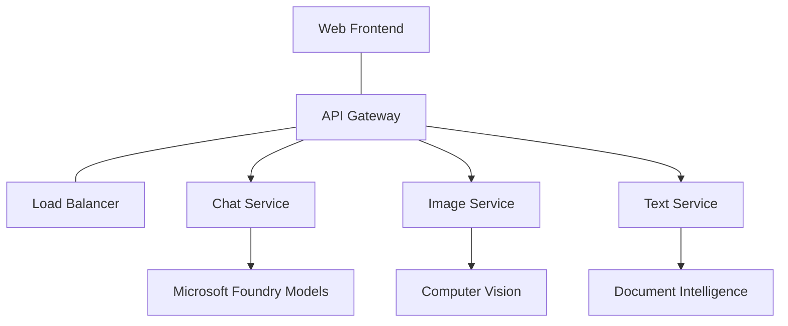

# Najlepšie postupy pre produkčné zaťaženie AI s AZD

**Navigácia kapitolou:**
- **📚 Domov kurzu**: [AZD pre začiatočníkov](../../README.md)
- **📖 Aktuálna kapitola**: Kapitola 8 - Produkčné a podnikové vzory
- **⬅️ Predchádzajúca kapitola**: [Kapitola 7: Riešenie problémov](../chapter-07-troubleshooting/debugging.md)
- **⬅️ Súvisiace tiež**: [AI Workshop Lab](../chapter-02-ai-development/ai-workshop-lab.md)
- **🎯 Kurz dokončený**: [AZD pre začiatočníkov](../../README.md)

## Prehľad

Tento sprievodca vysvetľuje produkčné dizajnové vzory AI pomocou Azure Developer CLI (AZD). Je to dizajnový referenčný materiál, nie nasaditeľná aplikácia ani produkčná certifikácia.

**Príkladové hranice:** Pokiaľ nie je výslovne opísané ako kompletné, fragmenty Bicep predpokladajú parametre a referencované zdroje z obsahujúcej šablóny. Vynechávajú hostiteľské obrázky/plány, identity, priradenia rolí, DNS, výstupy a iné potrebné integrácie. Cesty služieb YAML a hook/test skripty sú ilustračné súbory na vytvorenie vo **vašej vlastnej aplikácii**; nie sú dodávané týmto kurzom. Použite funkčný AZD vzor ako základ, skompilujte kompletnú infraštruktúru a otestujte v izolovanom prostredí pred produkciou.

## Kľúčové riešené výzvy

Bežné produkčné obavy zahŕňajú nasadenie viacerých služieb, správu identity a tajomstiev, škálovanie, kontrolu nákladov a monitorovanie. Neuvádza sa tu žiadna meraná prevalencia.

## Architektonické vzory pre produkčné AI

### Vzor 1: Mikroslužbová AI architektúra

**Kedy používať**: Zložité AI aplikácie s viacerými schopnosťami



**Implementácia v AZD**:

```yaml
# azure.yaml
name: enterprise-ai-platform
services:
  web:
    project: ./web
    host: staticwebapp
  api-gateway:
    project: ./api-gateway
    host: containerapp
  chat-service:
    project: ./services/chat
    host: containerapp
  vision-service:
    project: ./services/vision
    host: containerapp
  text-service:
    project: ./services/text
    host: containerapp
```

### Vzor 2: Event-driven spracovanie AI

**Kedy používať**: Hromadné spracovanie, analýza dokumentov, asynchrónne pracovné postupy

```bicep
// Event Hub for AI processing pipeline
resource eventHub 'Microsoft.EventHub/namespaces@2024-01-01' = {
  name: eventHubNamespaceName
  location: location
  sku: {
    name: 'Standard'
    tier: 'Standard'
    capacity: 1
  }
}

// Service Bus for reliable message processing
resource serviceBus 'Microsoft.ServiceBus/namespaces@2024-01-01' = {
  name: serviceBusNamespaceName
  location: location
  sku: {
    name: 'Premium'
    tier: 'Premium'
    capacity: 1
  }
}

// Function App for processing
resource functionApp 'Microsoft.Web/sites@2023-01-01' = {
  name: functionAppName
  location: location
  kind: 'functionapp,linux'
  properties: {
    siteConfig: {
      appSettings: [
        {
          name: 'FUNCTIONS_EXTENSION_VERSION'
          value: '~4'
        }
        {
          name: 'AZURE_OPENAI_ENDPOINT'
          value: '@Microsoft.KeyVault(VaultName=${keyVault.name};SecretName=openai-endpoint)'
        }
      ]
    }
  }
}
```

Toto vytvára fragmenty namespacov, nie huby, fronty, predplatné alebo triggerov funkcií. Spustiteľná funkcia tiež vyžaduje hostingový plán, runtime/konfiguráciu úložiska, pripojenú identitu, RBAC a sieťový prístup. Referencia Key Vault vyžaduje povolenie na čítanie tajomstva; samotná URL koncového bodu nie je poverenie.

## Premýšľanie o zdraví AI agenta

Keď sa tradičná webová aplikácia rozbije, symptómy sú známe: stránka sa nenačíta, API vracia chybu alebo nasadenie zlyhá. AI aplikácie môžu zlyhať rovnakými spôsobmi — ale aj sa môžu prejavovať jemnejšími spôsobmi, ktoré nevytvárajú zrejmé chybové správy.

Táto časť vám pomôže vytvoriť mentálny model pre monitorovanie AI záťaží, aby ste vedeli, kde hľadať, keď niečo nevyzerá správne.

### Ako sa zdravie agenta líši od zdravia tradičnej aplikácie

Tradičné aplikácie môžu mať tiež jemné chyby správnosti. AI agent pridáva náhodnú kvalitu odpovede k bežným obavám o dostupnosť a správnosť. Premýšľajte o zdraví agenta v dvoch vrstvách:

| Vrstva | Čo sledovať | Kde hľadať |
|-------|--------------|---------------|
| **Zdravie infraštruktúry** | Beží služba? Sú zdroje provisionované? Sú koncové body dostupné? | `azd monitor`, zdravie zdrojov v Azure Portáli, logy kontajnerov/aplikácie |
| **Zdravie správania** | Agent odpovedá presne? Sú odpovede načas? Je model správne volaný? | Application Insights stopovanie, metriky latencie volaní modelu, logy kvality odpovedí |

Zdravie infraštruktúry je známe — je rovnaké pre každú aplikáciu azd. Zdravie správania je nová vrstva, ktorú zavádzajú AI záťaže.

### Kde hľadať, keď sa AI aplikácie správajú nečakane

Ak vaša AI aplikácia neprodukuje očakávané výsledky, tu je koncepčný kontrolný zoznam:

1. **Začnite od základov.** Beží aplikácia? Môže dosiahnuť svoje závislosti? Skontrolujte `azd monitor` a zdravie zdrojov, rovnako ako by ste to robili pri akejkoľvek aplikácii.
2. **Skontrolujte pripojenie k modelu.** Volá vaša aplikácia úspešne AI model? Neúspešné alebo časovo prekročené volania modelu sú najčastejšou príčinou problémov AI aplikácií a zobrazia sa vo vašich aplikačných logoch.
3. **Bezpečne preskúmajte vstup a zakotvenie.** Nesprávne odpovede môžu vyplývať z načítania, inštrukcií, obmedzení modelu alebo vykonávania nástrojov. Používajte diagnostické údaje s riadeným prístupom a redigované; neaktivujte bez rozdielu logovanie promptov/odpovedí v produkcii.
4. **Preskúmajte latenciu odpovedí.** Volania AI modelu sú pomalšie ako typické API volania. Ak sa aplikácia zdá byť pomalá, skontrolujte, či sa zvýšila doba odozvy modelu — to môže naznačovať obmedzenie, kapacitné limity alebo preťaženie na úrovni regiónu.
5. **Sledujte signály nákladov.** Neočakávané špičky v používaní tokenov alebo API volaní môžu naznačovať slučku, nesprávne nakonfigurovaný prompt alebo nadmerné opakovania.

Nemusíte hneď ovládať nástroje observability. Kľúčové zistenie je, že AI aplikácie majú extra vrstvu správania na sledovanie a zabudované monitorovanie azd (`azd monitor`) vám dáva východiskový bod na vyšetrovanie oboch vrstiev.

---

## Najlepšie bezpečnostné postupy

### 1. Zero-Trust bezpečnostný model

**Implementačná stratégia**:
- Žiadna komunikácia služba-služba bez autentifikácie
- Všetky API volania používajú spravované identity
- Sieťová izolácia s privátnymi koncovými bodmi
- Prístupy s najmenšími privilégiami

```bicep
// Managed Identity for each service
resource chatServiceIdentity 'Microsoft.ManagedIdentity/userAssignedIdentities@2023-01-31' = {
  name: 'chat-service-identity'
  location: location
}

// Role assignments with minimal permissions
resource openAIUserRole 'Microsoft.Authorization/roleAssignments@2022-04-01' = {
  scope: openAIAccount
  name: guid(openAIAccount.id, chatServiceIdentity.id, '5e0bd9bd-7b93-4f28-af87-19fc36ad61bd')
  properties: {
    roleDefinitionId: subscriptionResourceId('Microsoft.Authorization/roleDefinitions', '5e0bd9bd-7b93-4f28-af87-19fc36ad61bd')
    principalId: chatServiceIdentity.properties.principalId
    principalType: 'ServicePrincipal'
  }
}
```

### 2. Bezpečná správa tajomstiev

**Vzor integrácie Key Vault**:

```bicep
// Key Vault with proper access policies
resource keyVault 'Microsoft.KeyVault/vaults@2023-02-01' = {
  name: keyVaultName
  location: location
  properties: {
    tenantId: tenant().tenantId
    sku: {
      family: 'A'
      name: 'standard' // Premium is needed for HSM-backed keys, not ordinary secrets
    }
    enableRbacAuthorization: true  // Use RBAC instead of access policies
    enablePurgeProtection: true    // Prevent accidental deletion
    enableSoftDelete: true
    softDeleteRetentionInDays: 90
  }
}

// Optional legacy key-auth alternative; omit when using Entra ID.
resource openAIKeySecret 'Microsoft.KeyVault/vaults/secrets@2023-02-01' = {
  parent: keyVault
  name: 'openai-api-key'
  properties: {
    value: openAIAccount.listKeys().key1
    attributes: {
      enabled: true
    }
  }
}
```

Priraďte runtime identitu `Key Vault Secrets User` v príslušnej oblasti a pripojte ju k hostiteľovi; samotné `enableRbacAuthorization` nepridáva prístup. Preferujte autentifikáciu spravovanej identity OpenAI s `disableLocalAuth: true`. Voliteľný kľúčový tajomstvo má zmysel iba pre zákazníka s vedome zapnutým kľúčom a provisioningový principal musí mať povolenie zapisovať tajomstvá.

### 3. Sieťová bezpečnosť

**Konfigurácia privátneho koncového bodu**:

```bicep
// Virtual Network for AI services
resource virtualNetwork 'Microsoft.Network/virtualNetworks@2023-04-01' = {
  name: vnetName
  location: location
  properties: {
    addressSpace: {
      addressPrefixes: ['10.0.0.0/16']
    }
    subnets: [
      {
        name: 'ai-services-subnet'
        properties: {
          addressPrefix: '10.0.1.0/24'
          privateEndpointNetworkPolicies: 'Disabled'
        }
      }
      {
        name: 'app-services-subnet'
        properties: {
          addressPrefix: '10.0.2.0/24'
          delegations: [
            {
              name: 'Microsoft.Web/serverFarms'
              properties: {
                serviceName: 'Microsoft.Web/serverFarms'
              }
            }
          ]
        }
      }
    ]
  }
}

// Private endpoints for all AI services
resource openAIPrivateEndpoint 'Microsoft.Network/privateEndpoints@2023-04-01' = {
  name: '${openAIAccountName}-pe'
  location: location
  properties: {
    subnet: {
      id: virtualNetwork.properties.subnets[0].id
    }
    privateLinkServiceConnections: [
      {
        name: 'openai-connection'
        properties: {
          privateLinkServiceId: openAIAccount.id
          groupIds: ['account']
        }
      }
    ]
  }
}
```

Privátne koncové body tiež vyžadujú skupiny súkromných DNS zón/VNet prepojenia a integráciu aplikácie do VNetu. Nezablokujú verejný prístup automaticky: výslovne zakažte verejný sieťový prístup AI účtu po overení privátnej konektivity a prístupu na nasadenie.

## Výkon a škálovanie

### 1. Stratégiu automatického škálovania

**Automatické škálovanie Container Apps**:

```bicep
resource containerApp 'Microsoft.App/containerApps@2023-05-01' = {
  name: containerAppName
  location: location
  properties: {
    configuration: {
      ingress: {
        external: true
        targetPort: 8000
        transport: 'http'
      }
    }
    template: {
      scale: {
        minReplicas: 2  // Always have 2 instances minimum
        maxReplicas: 50 // Scale up to 50 for high load
        rules: [
          {
            name: 'http-scaling'
            http: {
              metadata: {
                concurrentRequests: '20'  // Scale when >20 concurrent requests
              }
            }
          }
          {
            name: 'cpu-scaling'
            custom: {
              type: 'cpu'
              metadata: {
                type: 'Utilization'
                value: '70'  // Scale when CPU >70%
              }
            }
          }
        ]
      }
    }
  }
}
```

### 2. Stratégiu cacheovania

**Redis Cache pre AI odpovede**:

```bicep
// Legacy Azure Cache for Redis example (not recommended for new deployments)
resource redisCache 'Microsoft.Cache/redis@2023-04-01' = {
  name: redisCacheName
  location: location
  properties: {
    sku: {
      name: 'Premium'
      family: 'P'
      capacity: 1
    }
    enableNonSslPort: false
    minimumTlsVersion: '1.2'
    redisConfiguration: {
      'maxmemory-policy': 'allkeys-lru'
    }
    // Sharding distributes data; replication/failover provides availability.
    shardCount: 2
  }
}

// Cache configuration in application
var cacheConnectionString = '${redisCache.properties.hostName}:6380,password=${redisCache.listKeys().primaryKey},ssl=True,abortConnect=False'
```

Azure Cache pre Redis Basic/Standard/Premium je na [ceste k ukončeniu](https://learn.microsoft.com/azure/azure-cache-for-redis/retirement-faq). Používajte Azure Managed Redis pre nové návrhy a jeho dokumentovanú konfiguráciu SKU, identity a TLS, namiesto kopírovania tohto zastaraného zdroja do nového produkčného systému. Riadok s connection-stringom je nefunkčné zástupné miesto, nie poverenie. Rozdeľujte kľúče cache podľa autorizácie, modelu/inštrukcií a verzie načítania, s expiráciou; zdieľaná cache iba na čítanie môže odhaliť dáta iného používateľa.

### 3. Vyrovnávanie záťaže a manažment prevádzky

**Application Gateway s WAF**:

```bicep
// Application Gateway with Web Application Firewall
resource applicationGateway 'Microsoft.Network/applicationGateways@2023-04-01' = {
  name: appGatewayName
  location: location
  properties: {
    sku: {
      name: 'WAF_v2'
      tier: 'WAF_v2'
      capacity: 2
    }
    webApplicationFirewallConfiguration: {
      enabled: true
      firewallMode: 'Prevention'
      ruleSetType: 'OWASP'
      ruleSetVersion: '3.2'
    }
    // Backend pools for AI services
    backendAddressPools: [
      {
        name: 'ai-services-pool'
        properties: {
          backendAddresses: [
            {
              fqdn: '${containerApp.properties.configuration.ingress.fqdn}'
            }
          ]
        }
      }
    ]
  }
}
```

Toto je čiastočný zdroj brány: skutočné nasadenie tiež potrebuje konfigurovať gateway subnet/IP, frontend IP adresy a porty, TLS poslucháče/certifikáty, backend HTTP nastavenia/probíjače, pravidlá smerovania a priority a pozretú WAF politiku. TLS hostname/SNI a autentifikácia musia zodpovedať backendu Container App.

## 💰 Optimalizácia nákladov

### 1. Správne nastavenie veľkosti zdrojov

**Konfigurácie špecifické pre prostredie**:

Tieto názvy sú **ilustratívne vstupy vlastnej šablóny**, nie automatické nastavenia AZD. Každý namapujte najprv do `infra/main.parameters.json`/Bicep a konfigurácie hostiteľa. Napríklad vzor RAG používa `AZURE_SEARCH_SERVICE_SKU` a `AZURE_OPENAI_CHATGPT_DEPLOYMENT_CAPACITY`, nie všeobecné názvy nižšie. Poskytnite pamäť Container Apps v podporovanej jednotke ako `1Gi` v skutočnom zdroji. Aplikujte infraštruktúrne zmeny pomocou `azd up` alebo `azd provision`; samotné `azd deploy` nezmeny Bicep neuplatní.

```bash
# Development environment
azd env new development
azd env set AZURE_OPENAI_SKU "S0"
azd env set AZURE_OPENAI_CAPACITY 10
azd env set AZURE_SEARCH_SKU "basic"
azd env set CONTAINER_CPU 0.5
azd env set CONTAINER_MEMORY 1.0

# Production environment  
azd env new production
azd env set AZURE_OPENAI_SKU "S0"
azd env set AZURE_OPENAI_CAPACITY 100
azd env set AZURE_SEARCH_SKU "standard"
azd env set CONTAINER_CPU 2.0
azd env set CONTAINER_MEMORY 4.0
```

### 2. Monitorovanie nákladov a rozpočty

```bicep
// Supply the first day of the current UTC month, e.g. 2026-11-01T00:00:00Z.
param budgetStartDate string

// Cost management and budgets
resource budget 'Microsoft.Consumption/budgets@2024-08-01' = {
  name: 'ai-workload-budget'
  properties: {
    timePeriod: {
      startDate: budgetStartDate
    }
    timeGrain: 'Monthly'
    amount: 2000  // In the billing currency, not necessarily USD
    category: 'Cost'
    notifications: {
      warning: {
        enabled: true
        operator: 'GreaterThan'
        threshold: 80
        contactEmails: [
          'finance@company.com'
          'engineering@company.com'
        ]
        contactRoles: [
          'Owner'
          'Contributor'
        ]
      }
      critical: {
        enabled: true
        operator: 'GreaterThan'
        threshold: 95
        contactEmails: [
          'cto@company.com'
        ]
      }
    }
  }
}
```

Nahraďte príkladových príjemcov a skontrolujte rozsah/povolenia. Upozornenia rozpočtu používajú oneskorené fakturačné údaje a neukladajú výdajový limit.

### 3. Optimalizácia používania tokenov

**Správa nákladov OpenAI**:

Toto je len heuristika založená na znakoch pre ukážku UI, **nie** validátor limitu tokenov modelu. Produkčný kód musí používať tokenizer vhodný pre nasadený model a zohľadniť systémové inštrukcie, schémy nástrojov, históriu a rozpočet výstupu. Odmietnite príliš veľkú správu používateľa namiesto tichého orezania.

```typescript
// Application-level token optimization
class TokenOptimizer {
  private readonly maxTokens = 4000;
  private readonly reserveTokens = 500;
  
  optimizePrompt(userInput: string, context: string): string {
    const availableTokens = this.maxTokens - this.reserveTokens;
    if (this.estimateTokens(userInput) + 8 >= availableTokens) {
      throw new Error("User input exceeds the illustrative prompt budget");
    }
    const estimatedTokens = this.estimateTokens(userInput + context) + 8;
    
    if (estimatedTokens > availableTokens) {
      // Truncate context, not user input
      context = this.truncateContext(context, Math.max(0, availableTokens - this.estimateTokens(userInput) - 8));
    }
    
    return `${context}\n\nUser: ${userInput}`;
  }
  
  private estimateTokens(text: string): number {
    // Rough estimation: 1 token ≈ 4 characters
    return Math.ceil(text.length / 4);
  }

  private truncateContext(text: string, estimatedBudget: number): string {
    return text.slice(0, Math.max(0, estimatedBudget) * 4);
  }
}
```

## Monitorovanie a observabilita

### 1. Komplexné Application Insights

```bicep
// Application Insights with advanced features
resource applicationInsights 'Microsoft.Insights/components@2020-02-02' = {
  name: applicationInsightsName
  location: location
  kind: 'web'
  properties: {
    Application_Type: 'web'
    WorkspaceResourceId: logAnalyticsWorkspace.id
    SamplingPercentage: 100  // Ingestion setting; review cost and SDK sampling separately
    DisableIpMasking: false  // Retain IP masking
  }
}

// Custom metrics for AI operations
resource aiMetricAlerts 'Microsoft.Insights/metricAlerts@2018-03-01' = {
  name: 'ai-high-error-rate'
  location: 'global'
  properties: {
    description: 'Alert when failed request count exceeds 10 in five minutes'
    severity: 2
    enabled: true
    scopes: [
      applicationInsights.id
    ]
    evaluationFrequency: 'PT1M'
    windowSize: 'PT5M'
    criteria: {
      'odata.type': 'Microsoft.Azure.Monitor.SingleResourceMultipleMetricCriteria'
      allOf: [
        {
          name: 'high-error-rate'
          metricName: 'requests/failed'
          operator: 'GreaterThan'
          threshold: 10
          timeAggregation: 'Count'
        }
      ]
    }
  }
}
```

### 2. Monitorovanie špecifické pre AI

**Vlastné dashboardy pre AI metriky**:

```json
{
  "dashboard": {
    "name": "AI Application Monitoring",
    "tiles": [
      {
        "name": "OpenAI Request Volume",
        "query": "dependencies | where target contains 'openai' | summarize count() by bin(timestamp, 5m)"
      },
      {
        "name": "AI Response Latency",
        "query": "dependencies | where target contains 'openai' | summarize avg(duration) by bin(timestamp, 5m)"
      },
      {
        "name": "Token Usage",
        "query": "customMetrics | where name == 'openai_tokens_used' | summarize sum(value) by bin(timestamp, 1h)"
      },
      {
        "name": "Cost per Hour",
        "query": "customMetrics | where name == 'openai_cost' | summarize sum(value) by bin(timestamp, 1h)"
      }
    ]
  }
}
```

Tento JSON je návrh definovaný aplikáciou, nie importovateľná schéma dashboardu Azure portálu. Dotazy tokenov/nákladov vyžadujú, aby vaša aplikácia vydávala tieto presné vlastné metriky; nevytvára ich AZD. Prispôsobte filtre závislostí pre vaše skutočné názvy koncových bodov/span modelu.

### 3. Kontroly zdravia a monitorovanie doby prevádzky

```bicep
// Application Insights availability tests
resource availabilityTest 'Microsoft.Insights/webtests@2022-06-15' = {
  name: 'ai-app-availability-test'
  location: location
  tags: {
    'hidden-link:${applicationInsights.id}': 'Resource'
  }
  properties: {
    SyntheticMonitorId: 'ai-app-availability-test'
    Name: 'AI Application Availability Test'
    Description: 'Tests AI application endpoints'
    Enabled: true
    Frequency: 300  // 5 minutes
    Timeout: 120    // 2 minutes
    Kind: 'standard'
    Locations: [
      {
        Id: 'us-east-2-azr'
      }
      {
        Id: 'us-west-2-azr'
      }
    ]
    Request: {
      RequestUrl: 'https://${webApp.properties.defaultHostName}/health'
      HttpVerb: 'GET'
      FollowRedirects: true
      ParseDependentRequests: false
    }
    ValidationRules: {
      ExpectedHttpStatusCode: 200
      SSLCheck: true
      SSLCertRemainingLifetimeCheck: 7
    }
  }
}
```

## Obnova po havárii a vysoká dostupnosť

Predchádzajúci test predpokladá existujúcu službu App Service `webApp` a zdroj Application Insights. Štandardné testy dostupnosti sú účtovateľné a vyžadujú dostupný koncový bod; aplikácie iba s privátnym prístupom potrebujú vhodný dizajn súkromného monitorovania. URL ping testy sú zastarané; použite [štandardné testy dostupnosti](https://learn.microsoft.com/azure/azure-monitor/app/availability).

### 1. Nasadenie do viacerých regiónov

```yaml
# azure.yaml - Multi-region configuration
name: ai-app-multiregion
services:
  api-primary:
    project: ./api
    host: containerapp
    env:
      AZURE_REGION: eastus
  api-secondary:
    project: ./api
    host: containerapp
    env:
      AZURE_REGION: westus2
```

```bicep
// Separate App Service topology, not the Container Apps declarations above
resource trafficManager 'Microsoft.Network/trafficManagerProfiles@2022-04-01' = {
  name: trafficManagerProfileName
  location: 'global'
  properties: {
    profileStatus: 'Enabled'
    trafficRoutingMethod: 'Priority'
    dnsConfig: {
      relativeName: trafficManagerProfileName
      ttl: 30
    }
    monitorConfig: {
      protocol: 'HTTPS'
      port: 443
      path: '/health'
      intervalInSeconds: 30
      toleratedNumberOfFailures: 3
      timeoutInSeconds: 10
    }
    endpoints: [
      {
        name: 'primary-endpoint'
        type: 'Microsoft.Network/trafficManagerProfiles/azureEndpoints'
        properties: {
          targetResourceId: primaryAppService.id
          endpointStatus: 'Enabled'
          priority: 1
        }
      }
      {
        name: 'secondary-endpoint'
        type: 'Microsoft.Network/trafficManagerProfiles/azureEndpoints'
        properties: {
          targetResourceId: secondaryAppService.id
          endpointStatus: 'Enabled'
          priority: 2
        }
      }
    ]
  }
}
```

Premenné prostredia nevyberajú polohy zdrojov. IaC musí provisionovať samostatných regionálnych hostiteľov a viazať každú službu značkami `resourceName` alebo `azd-service-name`. Príklad Traffic Managera je **samostatná topológia App Service** (`primaryAppService`/`secondaryAppService`), nie smerovanie pre deklarácie Container Apps. Container Apps vyžaduje vhodne nakonfigurovaný externý koncový bod/front door, TLS/vlastné smerovanie domén a probing zdravia.

### 2. Zálohovanie a obnova dát

```bicep
// Backup configuration for critical data
resource backupVault 'Microsoft.DataProtection/backupVaults@2023-05-01' = {
  name: backupVaultName
  location: location
  identity: {
    type: 'SystemAssigned'
  }
  properties: {
    storageSettings: [
      {
        datastoreType: 'VaultStore'
        type: 'LocallyRedundant'
      }
    ]
  }
}

```

Samotná trezor nezálohuje nič. Nakonfigurujte **pracovnú podporovanú politiku a zálohovací inštanciu**, zdrojové povolenia, uchovávanie a obnovu podľa [matíc podpor Azure Backup](https://learn.microsoft.com/azure/backup/backup-support-matrix). Neexistuje žiadna generická politika Azure Backup pre hosting Azure OpenAI modelov. Uchovávajte definície infraštruktúry/modelov v zdrojovom riadení; chráňte nahrané dokumenty, aplikačné dáta a artefakty doladovania pomocou podporovaných zálohovacích/exportných funkcií zálohovacích služieb. Explicitne definujte a testujte RPO/RTO.

## Integrácia DevOps a CI/CD

### 1. GitHub Actions workflow

```yaml
# .github/workflows/deploy-ai-app.yml
name: Deploy AI Application

on:
  push:
    branches: [main]
  pull_request:
    branches: [main]

jobs:
  test:
    runs-on: ubuntu-latest
    steps:
      - uses: actions/checkout@v4
      
      - name: Setup Python
        uses: actions/setup-python@v4
        with:
          python-version: '3.11'
          
      - name: Install dependencies
        run: |
          pip install -r requirements.txt
          pip install pytest
          
      - name: Run tests
        run: pytest tests/
        
      - name: AI Safety Tests
        run: |
          python scripts/test_ai_safety.py
          python scripts/validate_prompts.py

```

Toto je **len testovacia časť** workflow a predpokladá, že ste vytvorili `requirements.txt`, `tests/` a dva bezpečnostné skripty. Pridajte autentifikované úlohy provisioning/nasadenia OIDC z [Konfigurácie CI/CD Pipeline](#cicd-pipeline-configuration) s `needs: test`, dôveryhodným spustením push/manual trigger a chráneným prostredím GitHubu. Nenasadzujte nedôveryhodný pull-request kód s cloudovými povereniami. Čerstvý runner nemá vybrané lokálne AZD prostredie; poskytnite vstupy prostredia/predplatného/umiestnenia a používajte `azd auth login`, nie iba `azure/login`.

### 2. Validácia infraštruktúry

```bash
# scripts/validate_infrastructure.sh
#!/bin/bash
set -euo pipefail

echo "Validating AI infrastructure deployment..."

# Requires Azure CLI login and the resource group selected explicitly.
: "${AZURE_RESOURCE_GROUP:?Set AZURE_RESOURCE_GROUP}"
: "${AZURE_OPENAI_NAME:?Set AZURE_OPENAI_NAME}"
: "${AZURE_OPENAI_CHAT_DEPLOYMENT:?Set the actual deployment name}"

# A successful empty list is not proof that resources exist.
types=("Microsoft.CognitiveServices/accounts" "Microsoft.Search/searchServices"
       "Microsoft.Storage/storageAccounts" "Microsoft.KeyVault/vaults")
for resource_type in "${types[@]}"; do
    count=$(az resource list --resource-group "$AZURE_RESOURCE_GROUP" \
        --resource-type "$resource_type" --query "length(@)" -o tsv)
    if [[ "$count" -lt 1 ]]; then
        echo "ERROR: No $resource_type found in $AZURE_RESOURCE_GROUP"
        exit 1
    fi
done

# Validate OpenAI model deployments
echo "Validating OpenAI model deployments..."
state=$(az cognitiveservices account deployment show \
  --name "$AZURE_OPENAI_NAME" --resource-group "$AZURE_RESOURCE_GROUP" \
  --deployment-name "$AZURE_OPENAI_CHAT_DEPLOYMENT" \
  --query "properties.provisioningState" -o tsv)
if [[ "$state" != "Succeeded" ]]; then
    echo "ERROR: Required model deployment is not provisioned successfully"
    exit 1
fi

echo "Infrastructure validation completed successfully!"
```

Predpoklad: nulový exit a správa o dokončení iba ak existujú všetky očakávané typy a pomenované nasadenie modelu je provisionované. Toto kontroluje stav inventára/provisioningu, **nie** zdravie zdrojov, presnú topológiu, RBAC, dostupnosť siete alebo správanie modelu. Prispôsobte očakávané typy vašej architektúre a potom vykonajte samostatný autentifikovaný test pripravenosti aplikácie.

## Kontrolný zoznam pripravenosti do produkcie

### Bezpečnosť ✅
- [ ] Všetky služby používajú spravované identity
- [ ] Tajomstvá uložené v Key Vault
- [ ] Nakonfigurované privátne koncové body
- [ ] Implementované sieťové bezpečnostné skupiny
- [ ] RBAC s najmenšími privilégiami
- [ ] WAF povolený na verejných koncových bodoch

### Výkon ✅
- [ ] Nakonfigurované auto-škálovanie
- [ ] Implementované cacheovanie
- [ ] Nastavené vyrovnávanie záťaže
- [ ] CDN pre statický obsah
- [ ] Pooling pripojenia k databáze
- [ ] Optimalizácia používania tokenov

### Monitorovanie ✅
- [ ] Nakonfigurovaný Application Insights
- [ ] Definované vlastné metriky
- [ ] Nastavené pravidlá upozornení
- [ ] Vytvorený dashboard
- [ ] Implementované kontroly zdravia
- [ ] Politiky uchovávania logov

### Spoľahlivosť ✅
- [ ] Nasadenie do viacerých regiónov
- [ ] Plán zálohy a obnovy
- [ ] Implementované circuit breakery
- [ ] Nakonfigurované retry politiky
- [ ] Postupné degradovanie
- [ ] Koncové body kontrol zdravia

### Správa nákladov ✅
- [ ] Nakonfigurované upozornenia rozpočtu
- [ ] Správna veľkosť zdrojov
- [ ] Uplatnené zľavy na vývoj/testovanie
- [ ] Zakúpené rezervované inštancie
- [ ] Dashboard monitorovania nákladov
- [ ] Pravidelné revízie nákladov

### Dodržiavanie predpisov ✅
- [ ] Splnené požiadavky na lokalizáciu dát
- [ ] Povolené auditovací logovanie
- [ ] Aplikované politiky dodržiavania predpisov
- [ ] Implementované bezpečnostné štandardy
- [ ] Pravidelné bezpečnostné hodnotenia
- [ ] Plán reakcie na incidenty

## Výkonnostné benchmarky

### Ilustratívne produkčné ciele

Toto sú príkladné SLO na rokovanie a záťažové testovanie, nie merané benchmarky alebo záruky. Latencia odpovede závisí od modelu/dĺžky výstupu; mesačné používanie tokenov závisí od prevádzky a cien, nie len od počtu tokenov.

| Metrika | Cieľ | Monitorovanie |
|--------|--------|------------|
| **Doba odpovede** | < 2 sekundy | Application Insights |
| **Dostupnosť** | 99,9% | Monitorovanie doby prevádzky |
| **Miera chýb** | < 0,1 % | Aplikačné logy |
| **Náklady na model** | < 500 $/mesiac (príklad rozpočtu) | Správa nákladov |
| **Súčasní používatelia** | 1000+ | Záťažové testovanie |
| **Čas obnovy** | < 1 hodina | Testy obnovy po havárii |

### Testovanie záťaže

Nasleduje náčrt rozhrania pre skript na testovanie záťaže, ktorý **musíte implementovať**; táto repozitár neobsahuje `scripts/load_test.py`. Pred jeho spustením v nástroji na testovanie záťaže definujte požiadavky na záťaž, autentifikáciu, reprezentatívne pracovné záťaže, percentilové asercie latencie/chýb a maximálny rozpočet:

```bash
# Load testing script for AI applications
python scripts/load_test.py \
  --endpoint https://your-ai-app.azurewebsites.net \
  --concurrent-users 100 \
  --duration 300 \
  --ramp-up 60
```

## 🤝 Najlepšie postupy v komunite

Na základe spätnej väzby komunity Microsoft Foundry Discord:

### Najhlavnejšie odporúčania komunity:

1. **Začnite s malým, škálujte postupne**: Začnite s jednoduchými SKU a podľa skutočného používania zvyšujte kapacitu
2. **Monitorujte všetko**: Nastavte komplexný monitoring od prvého dňa
3. **Automatizujte bezpečnosť**: Používajte infraštruktúru ako kód pre konzistentnú bezpečnosť
4. **Testujte dôkladne**: Zahŕňajte testovanie špecifické pre AI vo vašom pipeleine
5. **Plánujte náklady**: Sledujte použitie tokenov a včas nastavte upozornenia na rozpočet

### Bežné úskalia, ktorým sa treba vyhnúť:

- ❌ Tvrdé zakódovanie API kľúčov v kóde
- ❌ Nenastavenie správneho monitoringu
- ❌ Ignorovanie optimalizácie nákladov
- ❌ Netestovanie scenárov zlyhania
- ❌ Nasadenie bez kontrol zdravia

## Príkazy AZD AI CLI a rozšírenia

AZD obsahuje rastúci súbor príkazov a rozšírení špecifických pre AI, ktoré zjednodušujú pracovné toky AI v produkcii. Tieto nástroje preklenujú priepasť medzi lokálnym vývojom a produkčným nasadením AI záťaží.

> **Kontrola vydania (2026-11-04):** Nižšie uvedené pokyny CLI boli overené voči publikovaným vydaniam `azd` **1.37.2**, `azure.ai.agents` **1.0.0-beta.23** a `azure.ai.evaluations` **1.0.0-beta.2**. Agenti beta.23 vyžadujú `azd >= 1.37.0`; evaluácie beta.2 vyžadujú `azd >= 1.33.0`. Použite aspoň verziu 1.37.0 pre kombinovaný pracovný tok. Toto je revízia dokumentácie/zdroja, nie validácia živej Azure nasadenia.

### Rozšírenia AZD pre AI

AZD používa systém rozšírení pre pridanie AI-špecifických schopností. Inštalujte a spravujte rozšírenia pomocou:

```bash
# List all available extensions (including AI)
azd extension list

# Inspect installed extension details
azd version
azd extension show azure.ai.agents

# Install the Foundry agents extension
azd extension install azure.ai.agents

# Install the separate Foundry evaluations extension
azd extension install azure.ai.evaluations

# Install the fine-tuning extension
azd extension install azure.ai.finetune

# Install the custom models extension
azd extension install azure.ai.models

# Upgrade all installed extensions
azd extension upgrade --all
```

**Dostupné AI rozšírenia:**

| Rozšírenie | Účel | Stav |
|-----------|--------|-------|
| `azure.ai.agents` | Správa služby Foundry Agent | Náhľad |
| `azure.ai.evaluations` | Dátové súbory evaluácií, evaluátori, eval skupiny a behy | Náhľad |
| `azure.ai.skills` | Znovupoužiteľné schopnosti agenta | Náhľad |
| `azure.ai.connections` | Foundry pripojenia (zdroje dát, nástroje) | Náhľad |
| `azure.ai.finetune` | Ladenie modelov Foundry | Náhľad |
| `azure.ai.models` | Vlastné modely Foundry | Náhľad |
| `azure.coding-agent` | Konfigurácia kódujúceho agenta | Dostupné |

> Spustite `azd extension list --installed` a `azd extension show azure.ai.evaluations` na kontrolu nainštalovaných verzií. Najprv aktualizujte jadro CLI pomocou [inštrukcií na inštaláciu/aktualizáciu](https://learn.microsoft.com/azure/developer/azure-developer-cli/install-azd) (pre inštaláciu cez Windows winget: `winget upgrade Microsoft.Azd`), potom spustite `azd extension upgrade --all`. Neexistuje žiadny hlavný príkaz `azd upgrade`. Pred aktualizáciou produkčnej automatizácie si prezrite zmeny, ktoré môžu preraziť; nepripusťte, že aktualizácia rozšírenia zachová starý formát príkazov alebo konfigurácie.

### Nedávne zmeny a opravy vo vydaniach

| Vydanie | Čo sa mení pre tento kurz |
|---------|-------------------------|
| `azd 1.37.0` | Pridáva stabilné preview API nasadenia a opravuje, že úpravy rozšírení prepísali nesúvisiace nastavenia `azure.yaml`. |
| `azd 1.37.1` | Opravuje šírenie Ctrl+C medzi rozšíreniami a rozlišuje zrušenie/timeouty od všeobecných zlyhaní. |
| `azd 1.37.2` | Zlepšuje validáciu provisioningu: kritické varovania sú predvolene **Nie**, neprejdú bez potvrdenia pri bezobslužných spusteniach a zrušenie preskakuje hooky po provisningu. Tiež opravuje nerešpektovanie hodnôt prostredia v deny listoch Deployment Stacks keď je povolená alfa funkcia. |
| Agenti `beta.22` | Migrácia evaluácie na `azd ai eval`, zmena optimalizácie na GA v1 API, vyžaduje množné `toolboxes` a rozdeľuje managed-harness, hlasové a dlhodobé preview opt-iny. Opravuje špecifický výber modelov pre prostredia a autentifikáciu nástrojovej skrinky. |
| Agenti `beta.23` | Odhaľuje `init --harness`; opravuje výstup odpovedí A2A 0.3, neplatné cesty/moduly prompt-agenta cez vrstvy infraštruktúry, diagnostiku timeoutu aktivácie a zadržané varovania RBAC vývojára. |
| Evaluácie `beta.2` | Vyžaduje camelCase konfiguráciu evaluácie, pridáva statické/simulované tvorenie konverzácií a explicitné lokálne súbory zdrojov, opravuje spracovanie identity/verzie dátových súborov, počty quality-gate a diagnostiku neúspešných spustení. |

Timeout aktivácie agenta **neznamená** zlyhanie nasadenia: skontrolujte pokusnú verziu a jej stav pred opakovaním. Varovania RBAC vývojára môžu zostať aj po úspešnom provisioningu; vyriešte chýbajúci prístup pred volaním ako tento vývojár.

Zdroje: [AZD vydania](https://github.com/Azure/azure-dev/releases), [agents beta.23 vydanie](https://github.com/Azure/azure-dev/releases/tag/azd-ext-azure-ai-agents_1.0.0-beta.23), [agents beta.22 migrácia](https://github.com/Azure/azure-dev/releases/tag/azd-ext-azure-ai-agents_1.0.0-beta.22), a [evaluations beta.2 vydanie](https://github.com/Azure/azure-dev/releases/tag/azd-ext-azure-ai-evaluations_1.0.0-beta.2).

**Čo sú novšie rozšírenia `skills` a `connections`?**

Dve preview rozšírenia sa objavili spolu s nástrojmi agenta a stojí za to ich poznať aj ako začiatočník:

- **`azure.ai.skills`** — **schopnosť** je znovupoužiteľná kapacita (zabalený nástroj alebo správanie), ktorú môžete pripojiť k jednému alebo viacerým agentom namiesto opakovaného implementovania. Predstavte si to ako spoločný stavebný blok: definujte "vyhľadávanie v dokumentácii" alebo "vyhľadávanie objednávky" schopnosť raz a potom ju znovu používajte naprieč agentmi. To udržiava viacagentové systémy (Kapitola 5) konzistentné a zabraňuje kopírovaniu.
- **`azure.ai.connections`** — **pripojenie** je spravovaný odkaz z vášho Foundry projektu na externý zdroj, ktorý agenti potrebujú — zdroj dát (napríklad Azure AI Search), endpoint nástroja alebo inú službu. Pripojenia centralizujú *kde* a *ako* agenti pristupujú k dátam, takže poverenia a endpointy sú na jednom kontrolovanom mieste namiesto roztrúsených v kóde.

Nepotrebujete ich na nasadenie prvých agentov — zostaňte pri `azure.ai.agents` počas učenia. Použite `skills`, keď začnete duplikovať ten istý nástroj naprieč agentmi, a `connections`, keď viacerí agenti zdieľajú ten istý zdroj dát.

### Inicializácia agentových projektov s `azd ai agent init`

Príkaz `azd ai agent init` nakliká Microsoft Foundry agentový projekt. Použite aktuálnu šablónu projektu `azure.yaml`, nie implicitný legacy agent manifest:

```bash
# Initialize a new agent project from a local project template
azd ai agent init --template ./templates/support-agent/azure.yaml

# Initialize and target a specific Foundry project
azd ai agent init --template ./templates/support-agent/azure.yaml --project-id <foundry-project-id>

# Adopt the template into a different directory
azd ai agent init --template ./templates/support-agent/azure.yaml --src ./agents/my-agent
```

**Kľúčové prepínače:**

| Prepínač | Popis |
|---------|--------|
| `-t, --template` | Cesta alebo podporovaný GitHub URI k projektu dokumentu `azure.yaml` |
| `-p, --project-id` | Existujúce Microsoft Foundry ID projektu pre vaše azd prostredie |
| `-s, --src` | Zdrojový adresár pre generovaných agentov alebo cieľový adresár pri adopcii projektu |
| `--kind` | Inicializujte `hosted`, `prompt` alebo preview `prompt-voice` agenta |
| `--harness` | Nepovinný spúšťací harness pre `--kind prompt`; vyžaduje jeho preview opt-in |
| `-e, --environment` | azd prostredie, ktoré sa má použiť |

`--manifest`/`-m` je zastaraný alias pre `--template`/`-t`; zmena názvu prepínača neprevádza starý manifest na aktuálny projektový dokument. `--host containerapp` nie je aktuálny prepínač agent-init. Pre bežnú aplikáciu Container Apps používajte `azd init --template` so šablónou deklarujúcou `host: containerapp`.

Pre existujúci projekt s práve jednou službou `azure.ai.project`, `azd ai agent add support-agent --file ./agents/support-agent.yaml` pridá alebo aktualizuje priame definovanie agenta bez provisioningu alebo nasadenia. Runtime príkazy odmietajú legacy implicitné `agent.yaml`/AgentManifest a vnorené definície služieb `config:`; migrujte ich na aktuálnu službu `azure.ai.agent`. Keď init vypíše krok `cd`, spustite ho pred `azd up`: init nemení adresár shellu.

**Tip pre produkciu**: Použite `--project-id` na priame spojenie s existujúcim Foundry projektom, čím udržíte váš agentový kód a cloudové zdroje od začiatku prepojené.

#### Nepovinné preview funkcie

Managed harness, hlas a dlhodobé volanie sú samostatne predvolene vypnuté. Nastavte len prepínač pre funkciu, ktorú potrebujete v **prostredí shell/CI procesu**, nie cez `azd env set`:

| Funkcia | Premenná prostredia procesu |
|---------|---------------------------|
| Managed harness (`init --kind prompt --harness ...`) | `AZD_ALPHA_ENABLE_AGENTS_MANAGED_HARNESS=true` |
| Hlas (`init --kind prompt-voice`) | `AZD_ALPHA_ENABLE_AGENTS_VOICE=true` |
| Dlhodobé volanie | `AZD_ALPHA_ENABLE_AGENTS_LONG_RUNNING=true` |

Napríklad použite `export AZD_ALPHA_ENABLE_AGENTS_MANAGED_HARNESS=true` v Bashe alebo `$env:AZD_ALPHA_ENABLE_AGENTS_MANAGED_HARNESS = "true"` v PowerShell pred spustením príslušného príkazu. Jeden prepínač nenahradí ostatné. Pozrite si [released agents README](https://github.com/Azure/azure-dev/blob/azd-ext-azure-ai-agents_1.0.0-beta.23/cli/azd/extensions/azure.ai.agents/README.md) pre všetky preview prepínače a obmedzenia.

### Správa cyklu života agenta

Použite `azure.ai.agents` na testovanie, inšpekciu, optimalizáciu a vyradenie agentov, a samostatné rozšírenie `azure.ai.evaluations` na meranie kvality:

```bash
# Invoke a deployed agent and view server response timing
# (total latency and time to first byte)
azd ai agent invoke

# Show the live endpoint configuration before changing it
azd ai agent endpoint show

# Download the deployed source of a code-based hosted agent
# (with SHA-256 verification)
azd ai agent code download

# Delete a hosted agent and all of its versions
# (--force terminates active sessions)
azd ai agent delete --force
```

**Životný cyklus na prvý pohľad:**

| Fáza | Príkaz | Použitie v produkcii |
|-------|--------|-----------------------|
| Test | `azd ai agent invoke` | Overenie odpovedí a meranie latencie pred vydaním |
| Inšpekcia | `azd ai agent endpoint show` | Kontrola autentifikácie/konfigurácie endpointu; včasná detekcia zlomených zmien |
| Meranie | `azd ai eval init`, `generate`, `run start` | Definovanie, nasadenie a vykonávanie opakovateľných evaluácií |
| Zlepšovanie | `azd ai agent optimize --eval <evaluation-name> --optimize-model <optimizer-deployment>` | Znovupoužitie kompatibilnej evaluácie na optimalizáciu agenta |
| Obnova | `azd ai agent code download` | Získanie presného nasadeného zdroja pre audit/rollback |
| Vyradenie | `azd ai agent delete --force` | Čisté odobratie agenta a jeho verzií |

> Ide o preview príkazy a môžu sa meniť medzi vydaniami rozšírení. Spustite `azd ai agent --help` pre zobrazenie presných podpríkazov vo vašej nainštalovanej verzii.

`endpoint show` podporuje hostovaných, prompt a hlasových agentov, ale aktualizácie endpointov sú len pre hostovaných; workflow agenti nie sú podporovaní. Sťahovanie kódu a príklad vyradenia hostovaného agenta nie sú všeobecné operácie pre každý typ agenta.

#### Migrácia evaluácie a kontroly kvality

Od agentov **1.0.0-beta.22 (2026-10-23)** legacy príkazy `azd ai agent eval` poskytujú namiesto bývalého pracovného toku evaluácie migračné pokyny. Nekopírujte staré príklady `eval generate --dataset ...`: evaluácia teraz býva pod **`azd ai eval`**.

V inicializovanom agentovom projekte sa autentifikujte s `azd auth login`, potvrďte zvolené prostredie/Foundry projekt a nainštalujte `azure.ai.evaluations`. Pre nasadenie modelu sudcu je potrebný model na skórovanie; generovanie a simulácia konverzácie môžu vyžadovať vlastný výber modelov a spôsobiť dodatočné poplatky.

```bash
# Scaffold evals/ and wire an azure.ai.eval service into azure.yaml
azd ai eval init

# Optionally synthesize a rubric and dataset from the agent
azd ai eval generate

# Review generated files, then register datasets, evaluators, and eval groups
azd up

# Start an evaluation and wait for its results
azd ai eval run start --wait

# Inspect runs and available test-case output
azd ai eval run list
azd ai eval run show <run-id>
azd ai eval run output list <run-id>
```

Postupujte podľa interaktívnych výberov a vypísaných ďalších krokov namiesto toho, aby ste predpokladali, že generované prostriedky sú už zaregistrované. Konfigurácia evaluácie obvykle býva v `evals/azure.eval.yaml`, na ktorú odkazuje služba `azure.ai.eval` v `azure.yaml`. Kľúče sú **camelCase** (`evaluationLevel`, `maxSamples`, `initializationParameters`, `dataMapping`); staré kľúče v snake_case sa odmietajú. Cesty v rámci referencovanej konfigurácie sa vyriešia relatívne k danému súboru, nie ku koreňu repozitára.

Pre evaluácie konverzácií vyberte **statické** na hodnotenie dokončených prepísaní bez vyvolania agenta, alebo **simuláciu** na generovanie konverzácií zo scénaristických podnetov. Simulácia vyžaduje cieľ agenta, simulačný model a samostatný výber modelu sudcu. Pre bezobslužné príkazy poskytnite vstupy podľa `azd ai eval init --help` a `azd ai eval generate --help`; nepředpokladajte, že generujúci model je zároveň sudca alebo simulátor.

Pre CI konfigurujte explicitnú politiku kvality pomocou `azd ai eval run start --help` (`--fail-on`) a považujte ne-nulový výstup hostiteľa za zlyhanie. Dokončený beh automaticky neznamená úspešnú kvalitu. Prezrite neúspešné/chybné riadky a diagnostiku; chýbajúce alebo nekonzistentné počty výsledkov nie sú dôkazom úspechu. Registrované datasety si zachovávajú svoju identitu/verziu služby; `--max-samples` nemôže subsetovať registrovaný dataset. Publikujte menší dataset vedome alebo používajte podporovaný lokálny zdroj súborov.

```bash
# Example CI policy: at least 90% of all test cases must pass
azd ai eval run start --wait --fail-on "pass-rate=0.9"
```

Brána pass-rate počíta prešlé testovacie prípady delené celkovým počtom testovacích prípadov; neúspešné, chybné, preskočené a inak neprešlé riadky sa počítajú proti nej. Nekombinujte bránu s `--no-wait`, ktorá vracia predtým, než je dostupný verdikt.

#### Migrácia konfigurácie optimalizácie

Optimalizácia teraz používa GA v1 API. Pre znovupoužitie kompatibilnej **turn-level, dataset-backed** evaluácie z nového pracovného toku:

```bash
# Replace placeholders with the evaluation name and optimizer model deployment
azd ai agent optimize --eval-config ./evals/azure.eval.yaml --eval <evaluation-name> --optimize-model <optimizer-deployment>
```

`--eval` vyberá hodnotenie; `--eval-config` vyberá jeho konfiguračný súbor (vrátane definícií založených na súboroch). `--config` namiesto toho prijíma **samostatnú optimalizačnú API požiadavku** v YAML alebo JSON. Neposielajte starého agenta `eval.yaml` alebo nového `azure.eval.yaml` do `--config` a nezdružujte `--config` s `--eval`/`--eval-config`. Hodnotenia konverzácií, založené na zázname alebo simulácii nie sú zamieňateľné s optimalizačnou skratkou založenou na dátovej sade; pre tieto scenáre použite podporovaný formát optimalizačnej požiadavky. Pred aplikovaním alebo nasadením si skontrolujte kandidátov.

Pozrite si [referenciu hodnotení pre recenzovanú verziu](https://github.com/Azure/azure-dev/blob/azd-ext-azure-ai-evaluations_1.0.0-beta.2/cli/azd/extensions/azure.ai.evaluations/README.md) a [zdrojový kód príkazu optimalizácie pre recenzovanú verziu](https://github.com/Azure/azure-dev/blob/azd-ext-azure-ai-agents_1.0.0-beta.23/cli/azd/extensions/azure.ai.agents/internal/cmd/optimize.go) pre presné možnosti.

#### Náhľad nasadenia hosťovaného agenta iba na čítanie

Pre existujúce prostredie viazané na Foundry s jednotnou `azure.ai.agent` službou `kind: hosted` porovnajte podporovanú konfiguráciu pred nasadením:

```bash
azd deploy <service-name> --preview --no-prompt
```

Tento náhľad neprenáša agenta. Nie je to úplný rozdiel infraštruktúry/bezpečnosti: agenti prompt/hlas/pracovné postupy, staršie usporiadanie konfigurácie a niektoré hosťované nastavenia sú mimo jeho rozsahu. Výsledok `unknown` nie je povolením na nasadenie. Nie je samostatný príkaz `azd ai agent deploy` alebo agent `--dry-run`; použite základný postup nasadenia.

### Protokol kontextu modelu (MCP) s `azd mcp`

AZD obsahuje vstavanú podporu MCP servera (alpha), ktorá umožňuje AI agentom a nástrojom komunikovať s vašimi Azure zdrojmi prostredníctvom štandardizovaného protokolu:

```bash
# Start the MCP server for your project
azd mcp start

# Review current Copilot consent rules for tool execution
azd copilot consent list
```

MCP server sprístupňuje kontext vášho azd projektu — prostredia, služby a Azure zdroje — AI riadeným vývojovým nástrojom. To umožňuje:

- **Nasadenie asistované AI**: Nech kódovacie agenti dotazujú stav vášho projektu a spúšťajú nasadenia
- **Objavovanie zdrojov**: AI nástroje môžu objaviť, aké Azure zdroje váš projekt používa
- **Správa prostredí**: Agenti môžu prepínať medzi vývojovým/testovacím/produkčným prostredím

### Generovanie infraštruktúry s `azd infra generate`

Pre produkčné AI záťaže môžete generovať a prispôsobovať infraštruktúru ako kód namiesto spoliehania sa na automatické poskytovanie:

```bash
# Generate supported infrastructure for this project type
azd infra generate
```

Podpora závisí od projektu/hostiteľa a nainštalovaných poskytovateľov; toto nie je všeobecný príkaz na spätné inžinierstvo pre ľubovoľné Azure zdroje ani záväzok generovať zároveň Bicep aj Terraform. Spustite `azd infra generate --help` a skontrolujte generovaný formát. Kde je podporovaný, zápis IaC na disk vám umožňuje:
- Kontrolovať a auditovať infraštruktúru pred nasadením
- Pridať vlastné bezpečnostné politiky (sieťové pravidlá, súkromné koncové body)
- Integrovať s existujúcimi procesmi revízie IaC
- Riadiť verzie infraštruktúrnych zmien oddelene od aplikačného kódu

### Produkčné životné cykly háky

AZD háky umožňujú vložiť vlastnú logiku do každého štádia životného cyklu nasadenia — kľúčové pre produkčné AI pracovné postupy:

```yaml
# azure.yaml - Production hooks example
name: ai-production-app
hooks:
  preprovision:
    shell: sh
    run: scripts/validate-quotas.sh    # Check AI model quota before provisioning
  postprovision:
    shell: sh
    run: scripts/verify-networking.sh  # Verify IaC-provisioned private connectivity
  predeploy:
    shell: sh
    run: scripts/run-ai-safety-tests.sh  # Run prompt safety checks
  postdeploy:
    shell: sh
    run: scripts/smoke-test.sh           # Verify agent responses post-deploy
services:
  agent-api:
    project: ./src/agent
    host: containerapp
    hooks:
      predeploy:
        shell: sh
        run: scripts/validate-model-access.sh  # Per-service hook
```

```bash
# Run a specific hook manually during development
azd hooks run predeploy
```

**Odporúčané produkčné háky pre AI záťaže:**

| Háčik | Prípad použitia |
|------|--------------|
| `preprovision` | Overiť kvóty predplatného pre kapacitu AI modelu |
| `postprovision` | Overiť súkromné pripojenie a požadované výstupy zdrojov |
| `predeploy` | Spustiť testy AI bezpečnosti, overiť šablóny promptov |
| `postdeploy` | Rýchly test odpovedí agenta, overiť pripojenie modelu |

### Konfigurácia CI/CD pipeline

Použite `azd pipeline config` na pripojenie vášho projektu ku GitHub Actions alebo Azure Pipelines so zabezpečenou autentifikáciou Azure:

```bash
# Configure CI/CD pipeline (interactive)
azd pipeline config

# Configure with a specific provider
azd pipeline config --provider github
```

Tento príkaz:
- Vytvorí alebo nastaví identitu pipeline; skontrolujte vygenerovaný rozsah úloh/oprávnení namiesto predpokladu najnižších práv
- Konfiguruje federované poverenia (žiadne uložené tajomstvá)
- Generuje alebo aktualizuje váš definičný súbor pipeline
- Nastaví požadované premenné prostredia vo vašom CI/CD systéme

#### Krok za krokom: vaša prvá GitHub Actions pipeline

Tu je kompletný návod od fungujúceho azd projektu po automatické nasadenia pri každom pushi.

**1. Uistite sa, že váš projekt je na GitHub**

```bash
git init
git add .
git commit -m "Initial azd project"
gh repo create my-ai-app --private --source=. --push
```

**2. Spustite konfiguráciu pipeline**

```bash
azd pipeline config --provider github
```

azd interaktívne:
- Položí otázku, ktoré Azure predplatné a prostredie cieľovať
- Vytvorí Entra **registrovanie aplikácie + servisný účet** pre pipeline
- Nastaví **federované poverenia (OIDC)** — aby sa GitHub autentifikoval do Azure s krátkodobými tokenmi a **žiadne tajomstvá sa neukladajú**
- Odošle požadované **premenné** do vášho GitHub repozitára (`AZURE_CLIENT_ID`, `AZURE_TENANT_ID`, `AZURE_SUBSCRIPTION_ID`, `AZURE_ENV_NAME`, `AZURE_LOCATION`)

**3. Pochopte vygenerovaný pracovný tok**

Pre podporovanú šablónu nakonfigurujte/skontrolujte `.github/workflows/azure-dev.yml`. Kľúčové časti vyzerajú takto (šablóna musí dodať nástroje a parametre prostredia aplikácie):

```yaml
# .github/workflows/azure-dev.yml
on:
  push:
    branches: [ main ]
  workflow_dispatch:        # lets you run it manually too

permissions:
  id-token: write           # required for OIDC federated login
  contents: read

jobs:
  build:
    runs-on: ubuntu-latest
    env:
      AZURE_CLIENT_ID: ${{ vars.AZURE_CLIENT_ID }}
      AZURE_TENANT_ID: ${{ vars.AZURE_TENANT_ID }}
      AZURE_SUBSCRIPTION_ID: ${{ vars.AZURE_SUBSCRIPTION_ID }}
      AZURE_ENV_NAME: ${{ vars.AZURE_ENV_NAME }}
      AZURE_LOCATION: ${{ vars.AZURE_LOCATION }}
    steps:
      - uses: actions/checkout@v4
      - name: Install azd
        uses: Azure/setup-azd@v2
      - name: Log in with OIDC
        run: azd auth login --client-id "$AZURE_CLIENT_ID" --federated-credential-provider "github" --tenant-id "$AZURE_TENANT_ID"
      - name: Provision infrastructure
        run: azd provision --no-prompt
      - name: Deploy application
        run: azd deploy --no-prompt
```

**4. Overte jeho funkčnosť**

```bash
# Push a change to trigger the pipeline
git commit -am "Trigger pipeline" --allow-empty
git push
```

Otvorte kartu **Actions** vo vašom GitHub repozitári a sledujte, ako sa pracovný tok spustí automaticky `azd provision` a `azd deploy`.

> **Prečo sú federované poverenia dôležité:** staršie pipeline ukladali klientské tajomstvo v GitHub. OIDC federované poverenia toto tajomstvo úplne odstraňujú — GitHub na požiadanie runtime žiada krátkodobý token, čo je bezpečnejšie a netreba nič rotovať alebo únikom. Toto je predvolené nastavenie, ktoré `azd pipeline config` vytvára.

> **Tajomstvá vs. premenné:** nešifrované identifikátory (`AZURE_CLIENT_ID`, atď.) patria do premenných **repozitára**. Ak vaša aplikácia skutočne potrebuje tajomstvo v čase zostavovania, pridajte ho ako GitHub **secret** a odkazujte sa naň pomocou `${{ secrets.NAME }}`—ale uprednostnite Key Vault + spravovanú identitu počas behu (pozri [Kapitolu 3](../chapter-03-configuration/authsecurity.md)).

**Produkčný pracovný tok s konfiguráciou pipeline:**

```bash
# 1. Set up production environment
azd env new production
azd env set AZURE_OPENAI_CAPACITY 100

# 2. Configure the pipeline
azd pipeline config --provider github

# 3. Review the generated trigger, provisioning/deployment steps, and approvals
```

#### Krok za krokom: Azure DevOps Pipelines

Uprednostňujete Azure DevOps pred GitHub Actions? azd ho natívne podporuje pomocou providera `azdo`. Priebeh je takmer identický—azd generuje súbor pipeline, vytvorí service connection a nastaví autentifikáciu.

**1. Uistite sa, že máte Azure DevOps projekt**

Potrebujete organizáciu a projekt na `https://dev.azure.com/<your-org>`. Vygenerujte Personal Access Token (PAT) s oprávneniami **Build (Read & execute)**, **Code (Read & write)** a **Service Connections (Read, query & manage)** — azd si oň pýta.

**2. Konfigurujte pipeline**

```bash
azd pipeline config --provider azdo
```

azd:
- Požiada o organizáciu a projekt Azure DevOps
- Vytvorí (alebo znovu použije) **service connection** do Azure pomocou service principal
- Nastaví **workload identity federation (OIDC)**, takže sa neukladá žiaden client secret
- Nastaví definíciu pipeline (bežne `.azdo/pipelines/azure-dev.yml`) z pipeline šablóny projektu

**3. Skontrolujte vygenerovanú pipeline**

Použite vygenerovanú pipeline projektu vrátane **Azure service connection a AZD autentifikačných krokov**. Oficiálny [sprievodca nastavením Azure Pipelines](https://learn.microsoft.com/azure/developer/azure-developer-cli/pipeline-azure-pipelines) ukazuje inštalačný fragment nižšie; toto je **len inštalácia**, nie spustiteľný autentifikovaný deployment workflow:

```yaml
# .azdo/pipelines/azure-dev.yml (installer fragment only)
trigger:
  - main

pool:
  vmImage: ubuntu-latest

steps:
  - task: setup-azd@0
    displayName: Install azd
```

Nainštalujte rozšírenie AZD Azure DevOps, ak táto úloha nie je dostupná vo vašej organizácii. Nekopírujte holé `azd provision`/`azd deploy` shell kroky bez autentifikácie: mať nakonfigurovaný service connection neznamená automatické prihlásenie každého procesu do AZD. Dodržiavajte OIDC login a autorizovaný kontext úlohy podľa vygenerovanej šablóny a zadajte vybraný environment/predplatné/umiestnenie.

**4. Odkiaľ sa berú premenné**

azd ukladá hodnoty prostredia (`AZURE_ENV_NAME`, `AZURE_LOCATION`, `AZURE_SUBSCRIPTION_ID`) ako **variable group** v Azure DevOps, aby ich pipeline mohla čítať. Môžete ich prezrieť a upraviť v **Pipelines → Library**.

> **Rovnaký OIDC benefit ako GitHub:** provider `azdo` tiež štandardne konfiguruje workload identity federation, takže sa v service connection neukladá žiaden client secret—Azure DevOps počas behu vymení krátkodobý token. Preposielajte `--auth-type client-credentials` len ak vaša organizácia ešte nevie používať OIDC.

**5. Spustite to**

```bash
git commit -am "Add Azure DevOps pipeline" --allow-empty
git push
```

Otvorte **Pipelines** v Azure DevOps a sledujte spustenie `azd provision` a `azd deploy`.

### Pridávanie komponentov pomocou `azd add`

Postupne pridávajte Azure služby do existujúceho projektu:

```bash
# Add a new service component interactively
azd add
```

Toto je obzvlášť užitočné pri rozširovaní produkčných AI aplikácií – napríklad pridanie vektorovej vyhľadávacej služby, nového agent endpointu alebo monitorovacieho komponentu do existujúceho deploymentu.

## Ďalšie zdroje

- **Azure Well-Architected Framework**: [Návod na AI záťaže](https://learn.microsoft.com/azure/well-architected/ai/)
- **Microsoft Foundry Dokumentácia**: [Oficiálne dokumenty](https://learn.microsoft.com/azure/ai-studio/)
- **Community Templates**: [Azure Samples](https://github.com/Azure-Samples)
- **Communita na Discorde**: [#Azure kanál](https://discord.gg/microsoft-azure)
- **Agent Skills pre Azure**: [microsoft/github-copilot-for-azure na skills.sh](https://skills.sh/microsoft/github-copilot-for-azure) - Znovu použiteľné agent skills pre Azure AI, Foundry, deployment, optimalizáciu nákladov a diagnostiku. Inštalujte vo vašom editore:
  ```bash
  npx skills add microsoft/github-copilot-for-azure
  ```

---

**Navigácia kapitol:**
- **📚 Domov kurzu**: [AZD pre začiatočníkov](../../README.md)
- **📖 Súčasná kapitola**: Kapitola 8 - Produkčné & podnikové vzory
- **⬅️ Predchádzajúca kapitola**: [Kapitola 7: Riešenie problémov](../chapter-07-troubleshooting/debugging.md)
- **⬅️ Súvisiace tiež**: [AI Workshop Lab](../chapter-02-ai-development/ai-workshop-lab.md)
- **🎯 Kurz dokončený**: [AZD pre začiatočníkov](../../README.md)

**Pamätajte:** Produkčné AI záťaže vyžadujú starostlivé plánovanie, monitorovanie a kontinuálnu optimalizáciu. Začnite týmito vzormi a prispôsobte ich svojim konkrétnym požiadavkám.

---

<!-- CO-OP TRANSLATOR DISCLAIMER START -->
**Vyhlásenie o zodpovednosti**:
Tento dokument bol preložený pomocou AI prekladateľskej služby [Co-op Translator](https://github.com/Azure/co-op-translator). Hoci sa snažíme o presnosť, vezmite prosím na vedomie, že automatické preklady môžu obsahovať chyby alebo nepresnosti. Pôvodný dokument v jeho natívnom jazyku by mal byť považovaný za autoritatívny zdroj. Pre kritické informácie sa odporúča profesionálny ľudský preklad. Nie sme zodpovední za žiadne nedorozumenia alebo nesprávne interpretácie vyplývajúce z použitia tohto prekladu.
<!-- CO-OP TRANSLATOR DISCLAIMER END -->