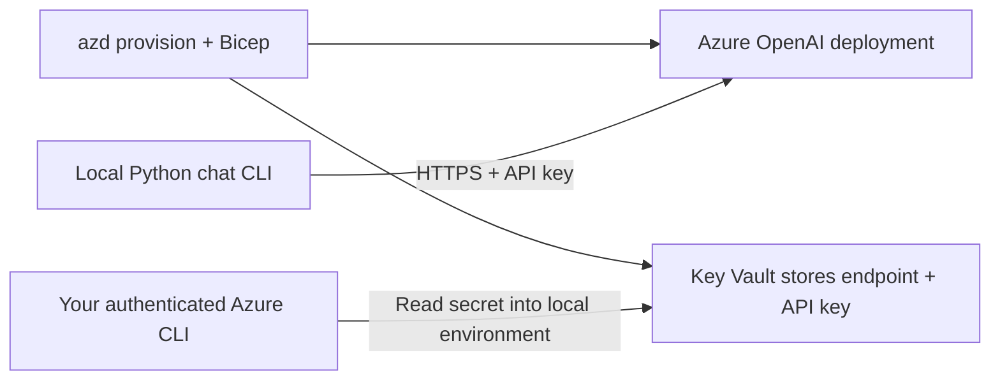

# Azure OpenAI Chat — Lokálny CLI a infraštruktúra AZD

**Úroveň:** Stredne pokročilý · **Čas:** 35–60 minút vrátane nastavenia

Tento príklad nasadí **Azure OpenAI zdroj a Key Vault**, potom spustí
interaktívny Python chat CLI **na vašom zariadení**. Nehostuje webovú aplikáciu
ani kontajnerovú aplikáciu. Predvolený model je `gpt-4.1`, verzia `2025-04-14`, s
kapacitou nasadenia `GlobalStandard` 20. Skontrolujte aktuálnu dostupnosť a kvótu vo
vybranom regióne pred nasadením; dátumy životného cyklu modelu sa môžu meniť.

## Ciele učenia sa

- Nasadiť infraštruktúru modelu pomocou Bicep a azd.
- Získať API kľúč z Key Vault bez jeho vloženia do výstupov nasadenia.
- Posielať Chat Completions požiadavky a udržiavať históriu konverzácie.
- Interpretovať počty tokenov a obmedzenia odhadov nákladov.



V tomto príklade nie je integrovaná správa identity runtime, viacreionový failover, vlastný
limitátor frekvencie, streaming mód ani hostovaný výpočtový výkon. OpenAI SDK
vykoná maximálne dva pokusy o opätovné vykonanie pri opakovateľných chybách; CLI hlási zostávajúce chyby.

## Predpoklady

- Súčasný stabilný [azd](https://learn.microsoft.com/azure/developer/azure-developer-cli/install-azd)
  (v čase recenzie vydanie: 1.37.2).
- [Azure CLI](https://learn.microsoft.com/cli/azure/install-azure-cli).
- Python **3.10+** (odporúča sa 3.11) a virtuálne prostredie.
- Azure predplatné s oprávnením vytvárať Cognitive Services a Key Vault
  zdroje, nasadzovať modely a čítať tajomstvá z kľúčovej skrinky.
- Regionálna dostupnosť a `GlobalStandard` kvóta pre `gpt-4.1`. Požiadavky na prístup
  závisia od predplatného a funkcií; nie je garantovaný časový rámec schválenia.

```bash
azd version
az version
python --version
azd auth login
az login
```

Ide o samostatné overovacie relácie. Pred spustením nižšie uvedených príkazov vyberte rovnaké predplatné v oboch
nástrojoch.

## Rýchly štart (Bash)

Spustite z koreňového adresára repozitára:

```bash
cd examples/azure-openai-chat
azd env new myopenai
azd provision
```

Vyberte podporovaný región. Nasadenie vytvorí skupinu zdrojov, OpenAI účet,
nasadenie modelu, Key Vault a `openai-endpoint`/`openai-api-key` tajomstvá.
Nie sú tu **žiadne služby na nasadenie** v `azure.yaml`.

Načítajte výstupy, ktoré nie sú tajné, a načítajte tajnú hodnotu do svojho aktuálneho shellu:

```bash
export AZURE_OPENAI_ENDPOINT="$(azd env get-value AZURE_OPENAI_ENDPOINT)"
export AZURE_OPENAI_MODEL="$(azd env get-value AZURE_OPENAI_MODEL)"
KV_NAME="$(azd env get-value AZURE_KEY_VAULT_NAME)"
export AZURE_OPENAI_API_KEY="$(az keyvault secret show \
  --vault-name "$KV_NAME" --name openai-api-key --query value --output tsv)"

python -m venv .venv
source .venv/bin/activate
python -m pip install -r src/requirements.txt
python src/chat.py
```

V PowerShell aktivujte pomocou `.\.venv\Scripts\Activate.ps1` a priraďte premenné prostredia
pomocou `$env:AZURE_OPENAI_ENDPOINT = azd env get-value AZURE_OPENAI_ENDPOINT`
(a podobne pre model). Kľúč API získajte pomocou
`$env:AZURE_OPENAI_API_KEY = az keyvault secret show --vault-name $KV_NAME --name openai-api-key --query value -o tsv`.
Najskôr nastavte `$KV_NAME = azd env get-value AZURE_KEY_VAULT_NAME`.

Nezobrazujte, nezadávajte ani nevkladajte kľúč API do hlásení o problémoch. CLI číta proces
premenné prostredia; **nevyhľadáva** tajomstvá v Key Vault ani nenačíta súbory `.env`.
`config.py` overuje koncový bod, limit tokenov a teplotu pri štarte.

Očakávaný výstup (obsah a použitie sa líšia):

```text
Azure OpenAI Chat Application
Model: gpt-4.1
...
You: Say hello in one sentence.
Assistant: Hello! How can I help you today?
[Tokens: ... | Cost: $...]
```

Príkazy: `stats` zobrazuje súčty, `clear` vymaže históriu konverzácie a
`quit`/`exit` ukončí reláciu. Neexistujú príkazy `--stream`, `--show-tokens`, `tokens`,
alebo `cost`.

## Overiť nasadenie

Po načítaní vyššie uvedených shell premenných:

```bash
curl --fail-with-body \
  "${AZURE_OPENAI_ENDPOINT%/}/openai/deployments/${AZURE_OPENAI_MODEL}/chat/completions?api-version=2024-10-21" \
  -H "Content-Type: application/json" \
  -H "api-key: $AZURE_OPENAI_API_KEY" \
  -d '{"messages":[{"role":"user","content":"Say hello!"}],"max_tokens":50}'

az keyvault secret list --vault-name "$KV_NAME" --query "[].name" -o table
```

Úspech: API vracia HTTP 200 s `choices[0].message.content` a `usage`;
vault zobrazuje `openai-api-key` a `openai-endpoint`. Úspešné nasadenie ARM
samé o sebe neoveruje inferenciu.

## Súbory a konfigurácia

```text
azure.yaml                         # Infrastructure-only AZD project
infra/main.bicep                   # Subscription deployment
infra/main.parameters.json         # Environment, location, principal ID
infra/resources/openai.bicep       # Account + model
infra/resources/keyvault.bicep     # Vault + deploying user's secret access policy
infra/resources/secrets.bicep      # Writes secrets, no key output
src/chat.py                        # Interactive CLI
src/config.py                      # Environment validation
src/requirements.txt               # Python packages
```

Ak chcete zmeniť pridelený model/verziu/kapacitu, upravte predvolené hodnoty v
`infra/main.bicep` a spustite `azd provision`. Nastavenie `AZURE_OPENAI_MODEL` vo vašom
shelli vyberá len **existujúci názov nasadenia**; nenasadzuje iný model.

| Premenná runtime | Predvolené / zdroj |
|---|---|
| `AZURE_OPENAI_ENDPOINT` | Povinné; azd výstup bez tajomstiev |
| `AZURE_OPENAI_API_KEY` | Povinné; načítať z Key Vault |
| `AZURE_OPENAI_MODEL` | `gpt-4.1`; názov nasadenia Azure |
| `AZURE_OPENAI_MAX_TOKENS` | 800 (overovací rozsah 1–4096) |
| `AZURE_OPENAI_TEMPERATURE` | 0,7 (rozsah 0–2) |
| `AZURE_OPENAI_INPUT_PRICE_PER_1K` | 0,002 USD; ilustračná sadzba za nevyrovnaný vstup |
| `AZURE_OPENAI_OUTPUT_PRICE_PER_1K` | 0,008 USD; ilustračná sadzba za výstup |

## Náklady a bezpečnostné obmedzenia

Zobrazenie nákladov je **odhad**, nie fakturácia Azure. Násobí používanie tokenov API
nastavenými sadzbami a nezohľadňuje zľavy za vyrovnaný vstup,
regionálne/SKU rozdiely, dane, zmeny cien alebo neúspešné/opakované volania.
Prekryte **obe sadzby**, keď používate iný model alebo SKU a overte aktuálne
[ceny Azure OpenAI](https://azure.microsoft.com/pricing/details/cognitive-services/openai-service/).

Ilustratívne, 100 požiadaviek používajúcich 500 nevyrovnaných vstupných a 200 výstupných tokenov
pri predvolených sadzbách stojí `100 × (500/1000 × .002 + 200/1000 × .008) = $0.26`.
Operácie a ukladanie do Key Vaultu účtujú sa samostatne. Nie je tu žiadny pevný poplatok 50 $/mesiac
za toto lokálne CLI a v šablóne nie je hosťovaný výpočtový proces.

Vault používa prístupovú politiku pre nasadzujúcu entitu; nie je to RBAC alebo
príklad aplikácie s riadenou identitou. Verejné koncové body a autentifikácia pomocou API kľúča
sa používajú na výučbu. Pred prispôsobením na produkciu obmedzte povolenia a pridajte príslušné identity/sieťové
kontroly.

## Praktické cvičenia

### 1. Overiť kontext a resetovať ho

**Začiatok:** spustenie CLI. **Cieľ:** pozorovať históriu.
Povedzte „Zapamätaj si slovo cedar,“ potom sa opýtajte „Aké slovo som ťa požiadal, aby si si zapamätal?“
Spustite `stats`; dva úspešné kroky by mali byť započítané ako dve vymenené správy.
Spustite `clear` a `stats`; vymenené správy by mali byť nula (súčet tokenov zostáva).
Presné znenie modelu nie je deterministické.

### 2. Zmeniť limit odpovede

**Začiatok:** ukončite CLI, pričom používate ten istý shell.
Spustite `export AZURE_OPENAI_MAX_TOKENS=100`, reštartujte `python src/chat.py` a požiadajte o
krátke vysvetlenie azd. Skontrolujte, či banner zobrazuje 100.
Obnovte pomocou `unset AZURE_OPENAI_MAX_TOKENS`. Menší limit odpovede neznižuje
už odoslané tokeny histórie.

### Bežné problémy

- **Chýbajúce premenné prostredia:** provisioning neexportuje hodnoty shellu;
  zopakujte kroky exportu. Nový terminál ich opäť potrebuje.
- **403 čítanie Key Vault:** overte predplatné/prihlásenie Azure CLI a hlavný účet
  v politike prístupu k úložisku. Zmeny politiky môžu chvíľu trvať, kým sa prejavia.
- **404 inference:** skontrolujte názov nasadenia, endpoint a stav nasadenia.
- **429 inference:** počkajte na reset limitov; overte regionálnu kvótu modelu.
  CLI odstráni zlyhané kroky z histórie, takže opakovanie ich nezdvojnásobí.
- **Dĺžka kontextu:** príklad neobmedzuje dlhé rozhovory; použite `clear`.
- **Model nedostupný/odstavený:** skontrolujte aktuálnu dostupnosť modelu a aktualizujte
  model/verziu/SKU spoločne; API verzia a verzia modelu sú odlišné nastavenia.

## Vyčistenie a ďalšie kroky

```bash
azd down
unset AZURE_OPENAI_API_KEY
```

Retencia soft-delete v Key Vault je sedem dní; vyprázdnenie vyžaduje samostatné povolenia.
Neexistuje žiadna zavedená testovacia sada; neprevádzajte neexistujúci príkaz `pytest tests/`.
Pred rozšírením kódu pridajte simulované API testy.

[Príklady kontajnerov](../../../../examples/container-app) · [Návrh maloobchodnej architektúry](../retail-scenario.md) ·
[Domovská stránka kurzu](../../README.md) · [Nahlásiť problém](https://github.com/microsoft/AZD-for-beginners/issues)

---

<!-- CO-OP TRANSLATOR DISCLAIMER START -->
**Vyhlásenie o zodpovednosti**:
Tento dokument bol preložený pomocou AI prekladateľskej služby [Co-op Translator](https://github.com/Azure/co-op-translator). Hoci sa snažíme o presnosť, vezmite prosím na vedomie, že automatické preklady môžu obsahovať chyby alebo nepresnosti. Pôvodný dokument v jeho natívnom jazyku by mal byť považovaný za autoritatívny zdroj. Pre kritické informácie sa odporúča profesionálny ľudský preklad. Nie sme zodpovední za žiadne nedorozumenia alebo nesprávne interpretácie vyplývajúce z použitia tohto prekladu.
<!-- CO-OP TRANSLATOR DISCLAIMER END -->