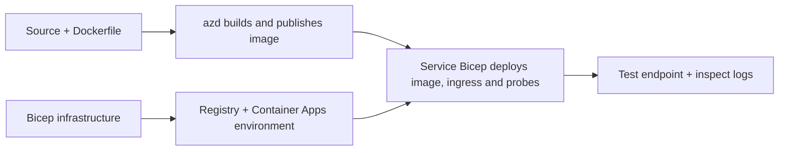

# Príklady nasadenia Container App pomocou AZD

Tento adresár obsahuje dva vzorové príklady s ukážkovým kódom, Dockerfile,
infraštruktúrou v Bicep a `azure.yaml`. Žiadny nie je pripravený pre produkciu.

## Vyberte príklad

| Príklad | Čo je implementované | Predpoklady |
|---|---|---|
| [Jednoduché Flask API](../../../../examples/container-app/simple-flask-api) | Jednoduché Python CRUD API, položky v pamäti, health probe, škálovanie HTTP | Základné znalosti CLI a HTTP |
| [Dva mikroservisy](../../../../examples/container-app/microservices) | Node.js gateway, interná read-only Python produktová služba, telemetria a škálovanie | Najskôr dokončiť vzor s jednou službou |

Počítajte s 30–60 minútami vrátane nastavenia a overenia. Časy provisioning v Azure sa líšia.

## Predpoklady

- [Azure Developer CLI](https://learn.microsoft.com/azure/developer/azure-developer-cli/install-azd)
- [Azure CLI](https://learn.microsoft.com/cli/azure/install-azure-cli) pre verifikačné príkazy
- Docker s bežiacim démonom pre build týchto kontajnerových obrazov
- Predplatné Azure s oprávneniami na vytváranie zdrojov a dostatočnou regionálnou kvótou
- Bash pre shellové príklady alebo ekvivalentné PowerShell príkazy

```bash
azd version
az version
docker info
azd auth login
az login
```

Tieto dva nástroje majú oddelené prihlasovacie relácie. Používajte aktuálny stabilný azd; aktuálne
vydanie v čase revízie je 1.37.2. Staršie minimálne verzie nie sú
zárukou kompatibility.

## Rýchly štart

Z koreňového adresára repozitára:

```bash
cd examples/container-app/simple-flask-api
azd env new flask-demo
azd up
API_URL=$(azd env get-value API_ENDPOINT)
curl --fail-with-body "${API_URL}/health"
```

Očakávajte: HTTP 200 s `"status": "healthy"`. Nasledujte README vzoru na vytvorenie,
čítanie, aktualizáciu a odstránenie položky a prehliadanie logov.



Počiatočný provisioning používa verejný obraz hello-world na porte 80. Parametre Bicep špecifické pre službu umožňujú, aby
`azd deploy` nahradil tento obraz vytvoreným aplikačným obrázkom
a správnym portom/probami aplikácie (8000 pre Flask/produkt, 8080 pre gateway).
Tieto súbory si ponechajte s ich `azure.yaml` `module` nastaveniami.

## Konfigurácia: čo mení čo

`azure.yaml` vyberá zdrojové adresáre, jazyky, hostiteľov a moduly nasadenia.
CPU/pamäť kontajnera, prístup, probe, počet replík a pravidlá škálovania sú definované
v **Bicep**, nie ľubovoľnými `resources`, `scale` alebo `regions` vlastnosťami služby.

`azd env set SOME_VALUE ...` ukladá hodnotu lokálne. Mení len nasadený
zdroj, keď parameter, mapovanie prostredia alebo hook explicitne využíva túto
hodnotu. Tieto príklady nevyužívajú `MAX_REPLICAS`, `SCALE_TO_ZERO_TIMEOUT`,
`CONTAINER_APP_REPLICA_TYPE` ani vlastné canary nastavenia z azd environment hodnôt.
Upravte príslušný Bicep a spustite `azd up` na znovu-provisioning a deploy.

Neumiestňujte zdroj aplikácie pod `infra/`. `project` musí ukazovať na zdrojový
adresár obsahujúci Dockerfile a manifest závislostí.

## Monitorovanie a náklady

- `azd monitor --logs` otvorí zobrazenie portálu; nie je to prúd terminálových logov.
  Použite `az containerapp logs show --follow` s aktuálnym názvom zdroja.
- Jednoduché API zapisuje stdout logy zbierané cez Container Apps/Log Analytics.
  Jeho provisionovaný Application Insights zdroj nie je automaticky instrumentovaný.
- Mikroservisný gateway používa Node.js SDK pre Application Insights; Python
  služba exportuje aplikačné logové stopy. Kompletné Python request/dependency sledovanie
  nie je nakonfigurované.
- Škálovanie na nulu môže znížiť náklady na výpočty, ale registry a ingest/storage logov
  môžu stále spôsobiť poplatky. Prednastavenia mikroservisov ponechávajú repliky bežať.
  Odhadnite svoj región a využitie v
  [Azure pricing calculator](https://azure.microsoft.com/pricing/calculator/).

## Pokročilé vzory — nie sú súčasťou implementácií

Toto sú návrhy dizajnu, nie dodatočné lokálne projekty alebo kopíruj-a-spusti kúsky:

- **Perzistentné dáta a autentifikácia:** nahraďte uloženie v pamäti a pridajte
  Microsoft Entra ID autentifikáciu/autorizáciu pred produkciou.
- **Blue-green/canary:** použite režim viacerých revízií Container Apps, štítky revízií,
  váhy prevádzky, overenie zdravia a rollback procedúry.
  Tieto vzory neobsahujú azd konfiguráciu `deploymentStrategy: canary`.
  Pozrite si [revision management](https://learn.microsoft.com/azure/container-apps/revisions).
- **Multi-region:** vytvorte samostatné prostredia a aplikácie v Bicep a navrhnite
  globálne smerovanie a konzistenciu dát. Zoznam služieb `regions` nie je mechanizmus
  nasadenia v azd.
- **Queue workers:** pridajte zdroj pracovníka, závislosti, frontové zdroje, spravovanú
  identitu s rolami na dátovej rovine a autentifikované pravidlo škálovania. Nekopírujte
  prázdnu cestu `src/worker` s očakávaním spustiteľného projektu.
- **Dapr:** provisionujte komponenty, nakonfigurujte sidecar, nainštalujte príslušné SDK
  a implementujte spracovanie chýb stavu/pub-sub.
- **Tajomstvá:** používajte spravovanú identitu a priradenie rolí, kde je to možné. Samotné
  vytvorenie Key Vaultu nezaručuje aplikáciám prístup ani načítanie tajomstiev.

## Vyčistenie

Z adresára vzoru:

```bash
azd down
```

Skontrolujte výzvy na vymazanie a potvrďte odstránenie dedikovanej skupiny zdrojov.
Nepoužívajte tieto príklady ako produkčný základ bez dodatočného návrhu a testov.

[Index príkladov](../README.md) · [Domov kurzu](../../README.md) ·
[Dokumentácia Container Apps](https://learn.microsoft.com/azure/container-apps/) ·
[Nahlásiť problém](https://github.com/microsoft/AZD-for-beginners/issues)

---

<!-- CO-OP TRANSLATOR DISCLAIMER START -->
**Vyhlásenie o zodpovednosti**:
Tento dokument bol preložený pomocou AI prekladateľskej služby [Co-op Translator](https://github.com/Azure/co-op-translator). Hoci sa snažíme o presnosť, vezmite prosím na vedomie, že automatické preklady môžu obsahovať chyby alebo nepresnosti. Pôvodný dokument v jeho natívnom jazyku by mal byť považovaný za autoritatívny zdroj. Pre kritické informácie sa odporúča profesionálny ľudský preklad. Nie sme zodpovední za žiadne nedorozumenia alebo nesprávne interpretácie vyplývajúce z použitia tohto prekladu.
<!-- CO-OP TRANSLATOR DISCLAIMER END -->