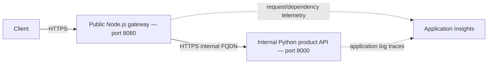

# Mikroservisy s dvoma službami — Azure Container Apps

**Úroveň:** Stredne pokročilý · **Doba:** 45–60 minút vrátane nastavenia

Tento ukážkový príklad implementuje **Node.js API Gateway** a **len na čítanie Python
Product Service**. Sú zahrnuté zdrojové kódy, Dockerfiles, Bicep a konfigurácia azd.
Nie je to systém pripravený pre produkčné prostredie.

## Čo sa naučíte

- Nasadiť dve služby nezávisle.
- Použiť interný backend FQDN cez HTTPS.
- Overiť odpovede úspechu, nenájdenia a nedostupnej služby.
- Pochopiť telemetriu a nezávislé škálovacie hranice.



Produktový katalóg obsahuje päť pevných produktov v pamäti. Neexistujú **POST,
PUT ani DELETE spracovatelia**, databáza, Service Bus, objednávková / používateľská / notifikačná služba,
C# ani Go kód. To sú nápady na budúci vývoj, nie zahrnuté funkcie.
Brána neautentifikuje používateľov; interný prístup nie je náhradou
za autorizáciu aplikácie.

## Predpoklady

Najskôr dokončite [jednoduché Flask API](../../../../../examples/container-app/simple-flask-api).
Nainštalujte aktuálne stabilné azd (v čase recenzie uverejnené vydanie: 1.37.2), Azure CLI
a Docker s bežiacim démonom. Potrebujete Azure predplatné, oprávnenia na vytváranie zdrojov
a regionálnu kvótu pre Container Apps.

```bash
azd version
az version
docker info
azd auth login
az login
```

Použite rovnaké predplatné v oboch nástrojoch CLI. Nižšie uvedené príkazy sú pre Bash.

## Nasadenie a overenie

Zo základného adresára repozitára:

```bash
cd examples/container-app/microservices
azd env new microservices-demo
azd up
GATEWAY_URL=$(azd env get-value API_GATEWAY_URL)
RG_NAME=$(azd env get-value AZURE_RESOURCE_GROUP)
GATEWAY_NAME=$(azd env get-value API_GATEWAY_NAME)
PRODUCT_NAME=$(azd env get-value PRODUCT_SERVICE_NAME)

curl --fail-with-body "${GATEWAY_URL}/health"
curl --fail-with-body "${GATEWAY_URL}/api/products"
curl --fail-with-body "${GATEWAY_URL}/api/products/1"
curl -i "${GATEWAY_URL}/api/products/999"
```

**Úspech:** health 200; list 200 s **piatimi** produktmi; produkt 1 je laptop
s cenou 999,99 a zásobou 50; neznámy produkt vracia 404.
Popisy sú zahrnuté v odpovediach; časové pečiatky sa líšia.

Počiatočné nasadenie používa verejné hello-world obrazy na porte 80, takže sa nesnaží
sťahovať neexistujúce obrazy z prázdneho registra. Service-špecifické Bicep moduly
a parametrové súbory ich nahrádzajú zostavenými obrazmi a portmi/probami aplikácie počas
`azd deploy`. Hlavné parametre zachovávajú názvy uverejnených obrazov pre neskoršie nasadenie.

## Služby a sieť

| Služba | Exponované koncové body | Predvolené zdroje |
|---|---|---|
| Brána | GET `/`, `/health`, `/api/products`, `/api/products/:id` | 1 vCPU, 2 GiB, 2–20 replík |
| Produkt | GET `/`, `/health`, `/products`, `/products/<id>` | 0,5 vCPU, 1 GiB, 1–10 replík |

Produktový prístup má `external: false` a `allowInsecure: false`. Bicep injektuje
`PRODUCT_SERVICE_URL=https://<actual-internal-fqdn>` do brány. HTTP by
presmerovalo; HTTPS zodpovedá nakonfigurovanému prístupu. Krátky DNS názov musí zodpovedať
**skutočnému názvu Container App**, nie logickému názvu služby `product-service`.
Nepokúšajte sa volať internú URL priamo zo svojho laptopu.

Brána má päťsekundový timeout pre volania produktov. Chýbajúce ID produktov
sa prejavia ako 404; chyby prenosu/iné chyby backendu vracajú 503. Brána
`/health` kontroluje iba bránu, nie dostupnosť backendu.

## Súbory a konfigurácia

```text
azure.yaml
infra/main.bicep
infra/main.parameters.json
infra/abbreviations.json
infra/core/container-apps-environment.bicep
infra/core/monitor.bicep
infra/app/api-gateway.bicep
infra/app/api-gateway.parameters.json
infra/app/product-service.bicep
infra/app/product-service.parameters.json
src/api-gateway/{app.js,package.json,Dockerfile}
src/product-service/{main.py,requirements.txt,Dockerfile}
```

Škálovanie, CPU/pamäť, porty a probe sa nastavujú v `infra/app/*.bicep`. Zmeňte tieto
súbory a spustite `azd up` na použitie infraštruktúry a opätovné nasadenie. V tomto príklade neexistuje
`GATEWAY_MAX_REPLICAS` parameter prostredia.

Pre zmeny len kódu:

```bash
azd deploy product-service
azd deploy api-gateway
```

Node obraz používa Node 22; Python obraz používa Python 3.11. Obe sa viažu na
`0.0.0.0`. Prístupy/proby používajú port 8080 (brána) a 8000 (produkt).

## Lokálny vývoj s Dockerom

Spustite z tohto adresára príkladu. Použite užívateľom definovanú sieť, **nie `localhost`
aby jeden kontajner mohol dosiahnuť druhý**:

```bash
docker network create azd-microservices-demo
docker build -t local-product ./src/product-service
docker build -t local-gateway ./src/api-gateway
docker run -d --name azd-product --network azd-microservices-demo local-product
docker run -d --name azd-gateway --network azd-microservices-demo \
  -p 8080:8080 -e PRODUCT_SERVICE_URL=http://azd-product:8000 local-gateway
curl --fail-with-body http://localhost:8080/api/products
```

Očakávané: päť produktov. HTTP sa používa len pre túto lokálnu Docker sieť.

```bash
docker stop azd-product azd-gateway
docker rm azd-product azd-gateway
docker network rm azd-microservices-demo
```

## Monitorovanie

```bash
az containerapp logs show --name "$GATEWAY_NAME" --resource-group "$RG_NAME" --follow
# In a separate terminal:
az containerapp logs show --name "$PRODUCT_NAME" --resource-group "$RG_NAME" --tail 100
```

`azd monitor --logs` otvorí portál; nevysiela terminálové logy.
Node SDK zbiera požiadavky/závislosti brány. Pythonov `AzureLogHandler`
exportuje **logové stopy**, nie automatické Flask požiadavky, SQL závislosti ani úplné
distribuované stopy. OpenCensus je zastarané SDK; preferujte Azure Monitor OpenTelemetry
pri rozširovaní tohto príkladu.

V Application Insights Logs generujte požiadavky a preskúmajte:

```kusto
requests
| where timestamp > ago(1h)
| where name contains "products"
| summarize RequestCount=count(), AvgDuration=avg(duration) by bin(timestamp, 5m)
```

Pre správy Python aplikácie:

```kusto
traces
| where timestamp > ago(1h)
| where message contains "products"
| project timestamp, message, severityLevel
```

Povoliť oneskorenie príjmu a vzorkovanie; neočakávajte presný počet požiadaviek ani
garantovanú latenciu. Nie sú nakonfigurované žiadne vlastné výstrahy ani panely.

## Praktické cvičenia

### Cvičenie 1: Úprava katalógu

**Východiskový bod:** `src/product-service/main.py`.
**Cieľ:** overiť nezávislé nasadenie služby.
Zmeňte stav zásob Laptopu z 50 na 49 v pevnom `products` zozname, spustite
`azd deploy product-service`, potom požiadajte o `${GATEWAY_URL}/api/products/1`.

**Kritériá úspechu / riešenie:** HTTP 200 s `"stock":49`. Obnovte 50 a nasadte znovu.
**Bežný problém:** úprava brány namiesto služby, ktorá vlastní katalóg.
Toto mení zdrojové údaje, nie trvalú inventárnu databázu.

### Cvičenie 2: Overenie konfigurácie replík

**Východiskový bod:** `infra/app/product-service.bicep`.
**Cieľ:** pozorovať infraštruktúrnu zmenu bez hádania automatického škálovania.
Zmeňte `minReplicas: 1` na `minReplicas: 2`, spustite `azd up`, potom:

```bash
az containerapp show --name "$PRODUCT_NAME" --resource-group "$RG_NAME" \
  --query properties.template.scale -o json
```

**Kritériá úspechu:** konfigurovaný minimálny počet je 2 a maximum zostáva 10.
Obnovte minimum na 1 a spustite `azd up`.
**Bežný problém:** samotné `azd deploy` nemení nezávislú spoločnú
infraštruktúru. Nenastavujte `maxReplicas` na nulu ako simuláciu zlyhania.
Toto overuje konfiguráciu, nie záťažový test alebo garantovaný okamžitý počet replík.

### Cvičenie 3: Testovanie správy nedostupnej služby lokálne

**Východiskový bod:** oba lokálne Docker kontajnery vyššie bežia.
**Cieľ:** rozlíšiť zlyhanie backendu od neexistujúceho produktu.
Zastavte iba produktový kontajner:

```bash
docker stop azd-product
curl -i http://localhost:8080/api/products
docker start azd-product
curl --fail-with-body http://localhost:8080/api/products
```

**Kritériá úspechu:** počas zastavenia brána vracia 503 s
`"error":"Product service unavailable"`; po reštarte zoznam vracia 200.
V prípade potreby zopakujte po krátkom oneskorení štartu.
**Bežný problém:** zastavenie brány testuje iné zlyhanie (žiadna HTTP odpoveď).

## Náklady a medzery v produkcii

Predvolené minimálne repliky udržiavajú výpočtový výkon v chode. Denník a monitorovanie tiež prichádzajú
s poplatkami. Neexistuje validovaný pevný celkový poplatok 50 $ / mesiac: odhadnite regionálne CPU/pamäť,
hodiny replík, požiadavky, registráciu a uchovávanie logov v
[Azure kalkulačke cen](https://azure.microsoft.com/pricing/calculator/).
Naučené zdroje vymažte rýchlo.

Produkčná práca zahŕňa autentifikáciu/autorizáciu, riadené identifikátory s rozsahom,
trvalé údaje, validáciu vstupu/odpovede, podporovanú inštrumentáciu observability,
testy záťaže/zlyhania, CI/CD, výstrahy a postupy obnovy. Pridanie objednávkovej
služby, fronty alebo databázy je samostatná úloha implementácie, nie dokončené
cvičenie alebo funkcia už dostupná tu.

## Riešenie problémov a vyčistenie

- **Obraz nenájdený počas prvého nasadenia:** bootstrap by mal použiť verejný obraz;
  overte predvolené hodnoty hlavných parametrov obrazu a mapovanie modulov nasadenia.
- **503 produkty:** skontrolujte logy produktu, revíziu obrazu a injektovanú internú HTTPS URL.
- **404 neočakávaná cesta:** produktové API je len na čítanie; overte trasu, nie neexistujúci spracovateľ CRUD.
- **Žiadna telemetria:** skontrolujte pripojovacie reťazce runtime bez ich vystavenia a
  povoľte oneskorenie príjmu. Python požiadavkové tabuľky nie sú naplnené jeho logovacím handlerom.

Z tohto adresára príkladu:

```bash
azd down
```

Prečítajte si výzvy na odstránenie a overte, že je zrušená vyhradená skupina zdrojov.

[Predchádzajúce: Flask API](../../../../../examples/container-app/simple-flask-api) · [Ďalšie: Databázová aplikácia](../../../../../examples/database-app) ·
[Vývoj AI](../../../docs/chapter-02-ai-development/README.md) ·
[Domov kurzu](../../../README.md) · [Nahlásiť problém](https://github.com/microsoft/AZD-for-beginners/issues)

---

<!-- CO-OP TRANSLATOR DISCLAIMER START -->
**Vyhlásenie o zodpovednosti**:
Tento dokument bol preložený pomocou AI prekladateľskej služby [Co-op Translator](https://github.com/Azure/co-op-translator). Hoci sa snažíme o presnosť, vezmite prosím na vedomie, že automatické preklady môžu obsahovať chyby alebo nepresnosti. Pôvodný dokument v jeho natívnom jazyku by mal byť považovaný za autoritatívny zdroj. Pre kritické informácie sa odporúča profesionálny ľudský preklad. Nie sme zodpovední za žiadne nedorozumenia alebo nesprávne interpretácie vyplývajúce z použitia tohto prekladu.
<!-- CO-OP TRANSLATOR DISCLAIMER END -->