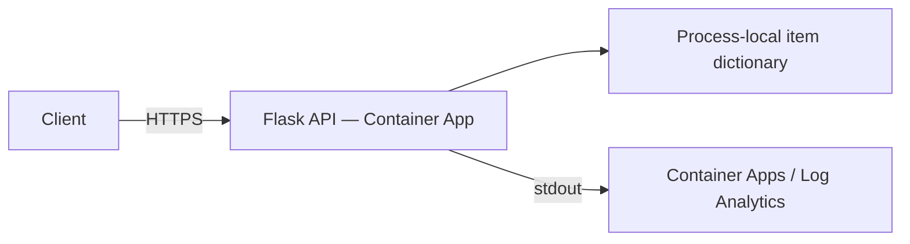

# Jednoduché Flask API — Azure Container Apps

**Úroveň:** Začiatočník · **Čas:** 30–45 minút vrátane nastavenia

Nasadte Python Flask CRUD API pomocou Azure Developer CLI (azd). Zdrojový kód, Dockerfile,
Bicep a parametre nasadenia sú zahrnuté. Toto je **učebný príklad**, nie
produkčne pripravené API.

## Čo sa naučíte

- Vytvoriť a publikovať kontajner cez azd.
- Konfigurovať vstup a liveness/readiness sondy.
- Overiť CRUD odpovede a skontrolovať logy aplikácie.
- Pochopiť, prečo je dáta v pamäti nevhodné pre trvácne aplikácie.



**Dôležité:** položky sú držané v jednom procese. Predvolené je **jeden Gunicorn worker,
0–1 replík**, zámerne sa vyhýbame nekonzistentným dátam medzi workerami/replikami.
Položky sa strácajú pri reštarte, zmene revízie alebo škálovaní na nulu. Zvýšenie počtu replík
vyžaduje zdieľané trvalé úložisko. API nemá autentifikáciu ani autorizáciu.

## Predpoklady

- [Aktuálne stabilný azd](https://learn.microsoft.com/azure/developer/azure-developer-cli/install-azd)
  (v čase recenzie vydaná verzia: 1.37.2).
- [Azure CLI](https://learn.microsoft.com/cli/azure/install-azure-cli) na overenie.
- Docker s bežiacim démonom; je potrebný na predvolené lokálne zostavenie obrazu.
- Azure predplatné, oprávnenia na vytváranie zdrojov a regionálny kvóta Container Apps.
- Bash pre príkazy nižšie (alebo ekvivalent PowerShell).
- Python 3.11 pre voliteľný lokálny vývoj.

```bash
azd version
az version
docker info
azd auth login
az login
```

CLI nástroje majú samostatné prihlasovacie relácie. Použite rovnaké predplatné v oboch.

## Rýchly začiatok

Z koreňového adresára repozitára:

```bash
cd examples/container-app/simple-flask-api
azd env new flask-demo
azd up
API_URL=$(azd env get-value API_ENDPOINT)
RG_NAME=$(azd env get-value AZURE_RESOURCE_GROUP)
API_NAME=$(azd env get-value API_NAME)
curl --fail-with-body "${API_URL}/health"
```

Očakávané: HTTP 200 a JSON s `"status":"healthy"`,
`"service":"simple-flask-api"` a aktuálny UTC časový údaj.
Provisioning a zostavenie obrazu zvyčajne trvá niekoľko minút; doby sa líšia.

Počiatočné provisionovanie používa verejný hello-world obraz počúvajúci na porte 80.
`azure.yaml` vyberá `infra/app/api.bicep` a jeho zodpovedajúci súbor parametrov pre
nasadenie služby, čo prepína obraz, vstup a sondy na port 8000.
Neodstraňujte tieto parametre nasadenia.

## Overenie CRUD

Spustite nasledujúce postupne, kým zostáva aktívna tá istá replika:

```bash
# Create: HTTP 201; note the returned id (1 for a fresh process).
curl -i -X POST "${API_URL}/api/items" \
  -H "Content-Type: application/json" \
  -d '{"name":"Test Item","description":"My first item"}'

# Read list: HTTP 200, total 1 in a fresh process.
curl --fail-with-body "${API_URL}/api/items"

# Replace 1 if your create response returned another id.
curl --fail-with-body "${API_URL}/api/items/1"
curl -i -X PUT "${API_URL}/api/items/1" \
  -H "Content-Type: application/json" -d '{"name":"Updated Item"}'
curl -i -X DELETE "${API_URL}/api/items/1"
curl -i "${API_URL}/api/items/1"
```

Úspech: POST 201, čítanie/PUT 200, DELETE 204 bez tela, potom chýbajúca položka 404.
Zle vytvorený/neobjektový JSON alebo prázdne meno vracia 400.
Ak položka zmizne medzi požiadavkami, skontrolujte reštart alebo škálovanie na nulu;
toto je zámerné obmedzenie v pamäti, nie perzistencia.

| Koncový bod | Metódy |
|---|---|
| `/` | GET — informácie o službe |
| `/health` | GET — liveness/readiness |
| `/api/items` | GET, POST |
| `/api/items/{id}` | GET, PUT, DELETE |

## Logy a konfigurácia

```bash
az containerapp logs show --name "$API_NAME" --resource-group "$RG_NAME" --follow
```

Očakávané: spustenie Gunicorn, prístupové logy požiadaviek a správy aplikácie.
`azd monitor --logs` otvorí portalový náhľad; neodvádza stream do terminálu.
Application Insights je provisionovaný, ale **nie je instrumentovaný týmto Flask kódom**;
používajte Container Apps/Log Analytics pre stdout logy.

Upravte `infra/app/api.bicep` pre CPU/pamäť, limity replík alebo škálovacie pravidlá, potom
spustite `azd up`. Predvolené sú 0.5 vCPU, 1 GiB, minimálne 0 / maximálne 1 replika a
HTTP práh 50 súbežných požiadaviek. Škálovanie na nulu môže pridať oneskorenie pri studenom štarte.

Ľubovoľné `azd env set MAX_REPLICAS`, `API_KEY`, `LOG_LEVEL` alebo
Hodnoty `SCALE_TO_ZERO_TIMEOUT` **nie sú prepojené s touto šablónou alebo aplikáciou**.
Nastavenie hodnoty automaticky nevytvára premennú runtime prostredia.
Image explicitne viaže port 8000; ak meníte port, aktualizujte Dockerfile, Bicep ingress a sondy
spoločne.

## Súbory

```text
azure.yaml
infra/main.bicep
infra/main.parameters.json
infra/app/container-apps.bicep       # Environment, registry, monitoring
infra/app/api.bicep                  # App, ingress, probes, scale settings
infra/app/api.parameters.json        # Image and resource values for azd deploy
src/app.py
src/Dockerfile
src/requirements.txt
```

## Lokálny vývoj

Zo zložky s príkladom:

```bash
python -m venv .venv
source .venv/bin/activate  # PowerShell: .\.venv\Scripts\Activate.ps1
python -m pip install -r src/requirements.txt
python src/app.py
```

V inom termináli otestujte `http://localhost:8000/health` a CRUD endpointy.
Alebo vytvorte a spustite skutočný image:

```bash
docker build -t flask-api:local ./src
docker run --rm -p 8000:8000 flask-api:local
```

Pri zmenách iba v kóde po prvom nasadení spustite `azd deploy api`.
Pri zmenách v Bicep spustite `azd up` na nové vytvorenie a nasadenie.

## Praktické cvičenia

### 1. Overenie odmietnutia nesprávnych vstupov

**Východiskový bod:** nasadené API, `API_URL` vyššie.
**Cieľ:** overiť, že API odmieta neplatné JSON tvary a chýbajúce mená.

```bash
curl -i -X POST "${API_URL}/api/items" \
  -H "Content-Type: application/json" -d '[]'
curl -i -X POST "${API_URL}/api/items" \
  -H "Content-Type: application/json" -d '{"name":""}'
```

**Kritériá úspechu / riešenie:** obe vrátia 400 s JSON chybou, nie 500.
**Bežný problém:** vynechanie hlavičky JSON content-type.

### 2. Pridanie endpointu iba na čítanie

**Výchozí bod:** `src/app.py`. **Cieľ:** rozšíriť a znovu nasadiť API.
Pridajte to pred blok `if __name__ == '__main__':`:

```python
@app.route('/version', methods=['GET'])
def version():
    return jsonify({'version': '1.0.0'})
```

Spustite `azd deploy api`, potom `curl --fail-with-body "${API_URL}/version"`.
**Kritériá úspechu:** HTTP 200 a `{"version":"1.0.0"}`.
**Bežný problém:** umiestnenie routy za blokujúci volaním `app.run()` pri
testovaní pomocou `python src/app.py`.

### Kontrolný bod znalostí

Prečo je jeden worker nedostatočný pre trvanlivé údaje? Pretože aj jeden proces stratí
svoj slovník pri reštarte. Produkčná verzia potrebuje perzistentné zdieľané úložisko,
autentifikáciu, autorizáciu, migrácie, testy a prevádzkové monitorovanie.

## Náklady a riešenie problémov

Toto nie je garantované nasadenie za 0 $: základný registry a ukladanie/zber logov
môžu generovať poplatky aj keď je výpočtový výkon aplikácie nulový. Použite
[kalkulačku cien](https://azure.microsoft.com/pricing/calculator/) pre vašu oblasť.

- **Zlyhanie buildovania Dockeru:** overte `docker info`, sieťový prístup a závislosti.
- **Nezdravá aplikácia:** skontrolujte konzolové/systémové logy a overte zhodu portu image, ingress
  a sond. Zástupca nesmie byť sondovaný na Flask porte.
- **403 / oprávnenia:** overte oprávnenia na predplatné a vytváranie zdrojov.
- **Položky miznú:** stav v pamäti sa resetuje pri reštarte/škálovaní na nulu; pridajte databázu
  pre trvanlivé správanie.

## Upratovanie a ďalšie kroky

```bash
azd down
```

Skontrolujte výzvu na vymazanie a overte odstránenie vyhradenej skupiny zdrojov.
Nepoužívajte ničivé upratovanie na skupinu zdrojov obsahujúcu nesúvisiace dáta.

[Ďalej: Databázová aplikácia](../../../../../examples/database-app) · [Mikroslužby](../../../../../examples/container-app/microservices) ·
[Prehľad kontajnerov](../README.md) · [Domov kurzu](../../../README.md) ·
[Nahlásiť problém](https://github.com/microsoft/AZD-for-beginners/issues)

---

<!-- CO-OP TRANSLATOR DISCLAIMER START -->
**Vyhlásenie o zodpovednosti**:
Tento dokument bol preložený pomocou AI prekladateľskej služby [Co-op Translator](https://github.com/Azure/co-op-translator). Hoci sa snažíme o presnosť, vezmite prosím na vedomie, že automatické preklady môžu obsahovať chyby alebo nepresnosti. Pôvodný dokument v jeho natívnom jazyku by mal byť považovaný za autoritatívny zdroj. Pre kritické informácie sa odporúča profesionálny ľudský preklad. Nie sme zodpovední za žiadne nedorozumenia alebo nesprávne interpretácie vyplývajúce z použitia tohto prekladu.
<!-- CO-OP TRANSLATOR DISCLAIMER END -->