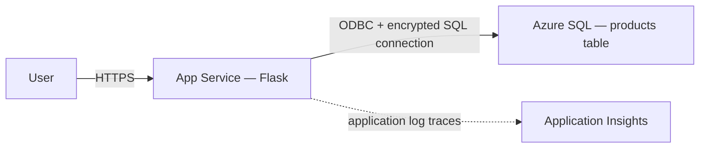

# Flask a Azure SQL na App Service

**Úroveň:** Stredne pokročilý · **Čas:** 30–60 minút vrátane predpokladov

Tento príklad nasadzuje Python Flask čítaciu API na **Linux App Service** a základnú
Azure SQL databázu. Zdrojový kód, Bicep a konfigurácia azd sú zahrnuté. Je to
učebná aplikácia, nie architektúra databázy pripravená na produkciu.

## Čo sa naučíte

- Poskytnutie zdrojov App Service, SQL a monitoringu pomocou Bicep.
- Konfigurácia zašifrovanej konektivity SQL bez ukladania poverení.
- Inicializácia schémy pred spustením pracovníkov Gunicorn.
- Overenie seedovaných dát, odpovedí pri nenájdení a zdravotného stavu databázy.



Zdroje: vyhradená skupina zdrojov, plán B1 pre Linux App Service, Python 3.11 Web
App, SQL server a Basic 2-GB databáza, Application Insights a Log Analytics.
Web App používa **nasadenie zdrojového kódu/ZIP a inštaláciu závislostí Oryx**;
`azd deploy` nekompiluje ani nenasadzuje voliteľný Dockerfile.

## Predpoklady

- Aktuálna stabilná verzia [azd](https://learn.microsoft.com/azure/developer/azure-developer-cli/install-azd)
  (v čase kontroly vydaná verzia: 1.37.2).
- [Azure CLI](https://learn.microsoft.com/cli/azure/install-azure-cli) na overenie.
- Predplatné Azure, oprávnenia na vytvorenie uvedených zdrojov a regionálny limit.
- Python **3.11** pre lokálny vývoj; vložené `pyodbc==5.0.1` môže vyžadovať
  natívne nástroje na kompiláciu vo vyšších verziách Pythonu.
- Microsoft ODBC Driver 18 (alebo 17) pre SQL Server na lokálnych strojoch. `pip install
  pyodbc` neinštaluje systémový ovládač. Pozrite
  [inštaláciu ODBC](https://learn.microsoft.com/sql/connect/odbc/download-odbc-driver-for-sql-server).
- Docker len ak testujete voliteľný kontajner lokálne.

```bash
azd version
az version
azd auth login
az login
```

Používajte to isté predplatné v oboch nástrojoch. Príkazy nižšie sú pre Bash.

## Nasadenie

Zo koreňa repozitára:

```bash
cd examples/database-app
azd env new sql-demo
azd provision
azd deploy
WEB_URL=$(azd env get-value WEB_APP_URI)
WEB_NAME=$(azd env get-value WEB_APP_NAME)
RG_NAME=$(azd env get-value AZURE_RESOURCE_GROUP)
```

Vyberte podporovaný región. `sqlAdminLogin` má predvolenú hodnotu `sqladmin`; požadovaný
`sqlAdminPassword` je bezpečný parameter. Zadajte silné heslo, keď budete vyzvaní.
Uchovávajte prihlasovacie údaje mimo Git a správ chýb. Aktuálne pripojenie
interpolácia reťazcov očakáva heslo bez oddeľovačov pripojovacieho reťazca, ako je
`;`; pred použitím takýchto hodnôt upravte úniky.

Bicep nastavuje štartovací príkaz, ktorý spustí `init_database()` **pred** začiatkom
pracovníkov Gunicorn. Je to potrebné, pretože importovanie `app:app` nevykoná
blok `if __name__ == '__main__'` v Pythone. Na novej databáze inicializácia
vytvorí `products` a vloží päť riadkov. Je to jednoduchá vzdelávacia ukážka, nie
rámec pre súbežné migrácie; pred škálovaním inštancií použite riadne migrácie.

Aplikácia vyberá nainštalovaný Microsoft ODBC Driver 18, potom 17, ak pripojovací
reťazec explicitne nemení ovládač. Ak neexistuje žiadny z nich, štart zlyhá s
akčnou chybou inštalácie. Overte dostupnosť ovládača vo vybranom
runtime App Service namiesto predpokladania.

## Overenie

```bash
curl --fail-with-body "${WEB_URL}/"
curl --fail-with-body "${WEB_URL}/health"
curl --fail-with-body "${WEB_URL}/products"
curl --fail-with-body "${WEB_URL}/products/1"
curl -i "${WEB_URL}/products/999"
```

Očakávané:

- `/` vráti informácie o koncovom bode.
- `/health` vráti 200 s `{"status":"healthy","database":"connected"}`.
- `/products` vráti päť inicializovaných produktov na novej databáze.
- `/products/1` vráti Laptop s cenou 1299.99.
- Neexistujúci produkt vráti 404 s `{"error":"Product not found"}`.

API je len na čítanie. Neexistuje žiadna cesta POST/PUT/DELETE ani používateľské rozhranie prehliadača.
Zlyhanie pripojenia k databáze vráti 503 z `/health`; nie je to úspech.

## Súbory a konfigurácia

```text
azure.yaml                         # Python App Service source deployment
infra/main.bicep
infra/main.parameters.json
infra/abbreviations.json
infra/resources/sql-server.bicep
infra/resources/sql-database.bicep
infra/resources/app-service-plan.bicep
infra/resources/web-app.bicep       # Settings + initialization/startup command
infra/resources/app-insights.bicep
src/web/app.py
src/web/requirements.txt
src/web/Dockerfile                 # Optional local container, not the azd target
.env.sample
```

`SQL_CONNECTION_STRING` je odovzdaný ako zabezpečený parameter Bicep do modulu Web App
a uložený v nastaveniach App Service, nie v výstupoch nasadenia.
`APPLICATIONINSIGHTS_CONNECTION_STRING` konfiguruje export protokolov.
`SCM_DO_BUILD_DURING_DEPLOYMENT=true` povoľuje inštaláciu závislostí na strane servera.
Nastavenie ľubovoľných hodnôt `azd env` automaticky nemení nastavenia aplikácie.

Pravidlo `0.0.0.0` SQL firewall-u umožňuje pripojenie z **Azure služieb,
vrátane predplatných iných zákazníkov**, podliehajúcich SQL autentifikácii. Nie je
obmedzené len na túto aplikáciu alebo predplatné. Verejný prístup k SQL sieti je povolený.
Pred produkciou používajte odstupňované sieťovanie a identitu aplikácie bez práv administrátora.

## Lokálny vývoj

Použite Python 3.11 a nainštalovaný Microsoft SQL ODBC ovládač:

```bash
python -m venv .venv
source .venv/bin/activate  # PowerShell: .\.venv\Scripts\Activate.ps1
python -m pip install -r src/web/requirements.txt
export SQL_CONNECTION_STRING='Server=tcp:YOUR_SERVER.database.windows.net,1433;Database=YOUR_DATABASE;UID=YOUR_USER;PWD=YOUR_PASSWORD;Encrypt=yes;TrustServerCertificate=no;Connection Timeout=30;'
python src/web/app.py
```

Nahrádzajte zástupné znaky bezpečne. Skopírovaný súbor `.env` sa **nedá automaticky načítať**
touto aplikáciou. Namiesto toho exportujte premenné v aktuálnom shelle.
Pre Azure SQL z notebooku dočasne povoľte len svoju vlastnú verejnú IP adresu:

```bash
SQL_SERVER=$(azd env get-value SQL_SERVER_NAME)
MY_IP=YOUR_PUBLIC_IP
az sql server firewall-rule create -g "$RG_NAME" -s "$SQL_SERVER" \
  -n AllowMyLearningIP --start-ip-address "$MY_IP" --end-ip-address "$MY_IP"
```

Po testovaní pravidlo odstráňte:

```bash
az sql server firewall-rule delete -g "$RG_NAME" -s "$SQL_SERVER" -n AllowMyLearningIP
```

Nepovinný test kontajnera z tohto príkladového adresára:

```bash
docker build -t sql-flask:local src/web
docker run --rm -p 8000:8000 -e SQL_CONNECTION_STRING sql-flask:local
```

Tento obraz inštaluje ovládač Driver 18 pomocou balíkového repozitára Debian 12 zodpovedajúceho jeho
základni Bookworm, inicializuje databázu raz a potom spustí Gunicorn.

## Monitorovanie a riešenie problémov

Povoliť/tailovať aplikačné logy systému súborov App Service pri diagnostike spustenia:

```bash
az webapp log config --name "$WEB_NAME" --resource-group "$RG_NAME" \
  --application-logging filesystem --level information
az webapp log tail --name "$WEB_NAME" --resource-group "$RG_NAME"
```

Tento kód exportuje **logové trasovania** aplikácie cez starší OpenCensus handler.
Neaktivuje automatické trasovanie požiadaviek/zmieniek Flasku, Live Metrics,
SQL auditovanie, diagnostické nastavenia ani upozornenia. Tie vyžadujú samostatné nastavenie.
Pre novú inštrumentáciu uprednostnite Azure Monitor OpenTelemetry.

V Application Insights Logs, po vykonaní API požiadaviek:

```kusto
traces
| where timestamp > ago(1h)
| where message contains "products" or message contains "Health check"
| project timestamp, message, severityLevel
```

Počkajte na oneskorenie ingestovania. Aktivita v tabuľke požiadaviek alebo Live Metrics nie je kritériom dokončenia
pre túto len logovaciu inštrumentáciu.

- **Chýbajúci ovládač:** skontrolujte `pyodbc.drivers()` v runtime a nainštalujte
  podporovaný Microsoft ODBC ovládač. Samotný Python balík nestačí.
- **Zlyhanie pripojenia:** skontrolujte SQL nastavenia, prihlasovacie údaje, firewall a vybraný
  odber. Nezakazujte šifrovanie, aby ste obišli chybu.
- **Chýbajúca tabuľka produktov:** potvrďte, že bol nasadený Bicep štartovací príkaz;
  spustenie `gunicorn app:app` samostatne vynecháva inicializáciu.
- **Zlyhanie zostavenia balíka:** používajte Python 3.11 alebo zabezpečte natívne požiadavky na zostavenie.
- **Dáta s nulovou cenou:** nula je platná desatinná cena; musí sa serializovať ako 0.0,
  nie `null`.

## Praktické cvičenia

### Cvičenie 1: Overenie správania pri chýbajúcom produkte

**Východiskový bod:** nasadené API a `WEB_URL` vyššie.
**Cieľ:** rozlíšiť chýbajúci riadok od nefunkčnej databázy.
Požiadajte `/health` a `/products/999` pomocou vyššie uvedených príkazov.
**Kritériá úspechu / odpoveď:** stav 200, neexistujúci produkt 404 (nie 500 alebo 503).
**Bežný problém:** predpokladať, že odpoveď not-found dokazuje, že SQL pripojenie je nefunkčné.

### Cvičenie 2: Zmena zaznamenanej hodnoty

**Východiskový bod:** Azure SQL Query Editor, pripojený k ukážkovej databáze.
**Cieľ:** ukázať, že údaje API sa ukladajú do SQL, nie do pamäte procesu.

```sql
UPDATE products SET price = 0 WHERE id = 1;
SELECT id, name, price FROM products WHERE id = 1;
```

Požiadajte `${WEB_URL}/products/1`. **Kritériá úspechu:** cena je `0.0`, nie `null`.
Vráťte hodnotu:

```sql
UPDATE products SET price = 1299.99 WHERE id = 1;
```

**Bežný problém:** úprava Python seed listu neaktualizuje riadky už v SQL.
Nepoužívajte cvičenia schémy/dát na produkčnej databáze.

### Cvičenie 3: Pridanie endpointu na čítanie počtu

**Východiskový bod:** `src/web/app.py`.
**Cieľ:** rozšíriť API pomocou agregovanej query bez parametrov.
Pridajte toto pred blok `if __name__ == '__main__':`:

```python
@app.route('/product-count')
def product_count():
    from contextlib import closing
    with closing(get_db_connection()) as conn, closing(conn.cursor()) as cursor:
        cursor.execute("SELECT COUNT(*) FROM products")
        return jsonify({'count': cursor.fetchone()[0]})
```

Spustite `azd deploy web`, potom požiadajte `${WEB_URL}/product-count`.
**Kritériá úspechu:** 200 so `{"count":5}` na neporušenej seedovanej databáze.
**Bežný problém:** zmena cesty, ale zabudnutie znovu nasadiť.
Pre produkciu pridajte správu chýb/testy; toto krátke cvičenie je zamerané na query.

## Náklady, medzery v produkcii a čistenie

B1 App Service a Basic databáza sa účtujú počas provisioningu. Zastavenie
Web App **nezastaví** účtovanie App Service plánu. Logy a úložisko môžu pridať náklady.
Použite [Azure pricing calculator](https://azure.microsoft.com/pricing/calculator/)
pre aktuálne regionálne ceny. Prechod na F1 tiež vyžaduje deaktiváciu `alwaysOn`;
nie je to viacriadková náhrada. SQL serverless nie je automaticky zadarmo.

Produkčná práca zahŕňa least-privilege app identitu (nie SQL admina),
autentifikáciu/autorizáciu, súkromnú sieť, bezpečné migrácie, kontrolu pooling/lifecycle pripojenia,
telemetriu, audit, upozornenia, testy a postupy obnovy.
Redis caching a ďalšie tabuľky sú vývojové nápady, nie implementované cvičenia.

Z tohto príkladového adresára:

```bash
azd down
```

Prezrite si výzvu na zmazanie a overte, že je odobraná vyhradená skupina zdrojov.
Nezmazávajte skupiny obsahujúce nesúvisiace dáta.

[Príklady kontajnerov](../../../../examples/container-app) ·
[Vývoj AI](../../docs/chapter-02-ai-development/README.md) ·
[Domov kurzu](../../README.md) · [Nahlásiť problém](https://github.com/microsoft/AZD-for-beginners/issues)

---

<!-- CO-OP TRANSLATOR DISCLAIMER START -->
**Vyhlásenie o zodpovednosti**:
Tento dokument bol preložený pomocou AI prekladateľskej služby [Co-op Translator](https://github.com/Azure/co-op-translator). Hoci sa snažíme o presnosť, vezmite prosím na vedomie, že automatické preklady môžu obsahovať chyby alebo nepresnosti. Pôvodný dokument v jeho natívnom jazyku by mal byť považovaný za autoritatívny zdroj. Pre kritické informácie sa odporúča profesionálny ľudský preklad. Nie sme zodpovední za žiadne nedorozumenia alebo nesprávne interpretácie vyplývajúce z použitia tohto prekladu.
<!-- CO-OP TRANSLATOR DISCLAIMER END -->