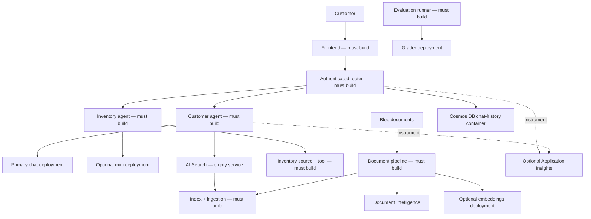

# Viacagentová zákaznícka podpora — architektonický plán pre maloobchod

**Kapitola 5: Viacagentové AI riešenia**

- [Domov kurzu](../README.md)
- [Kapitola 5](../docs/chapter-05-multi-agent/README.md)
- [Predpoklad: Integrácia AI](../docs/chapter-02-ai-development/microsoft-foundry-integration.md)
- [Ďalej: Plánovanie kapacity](../docs/chapter-06-pre-deployment/capacity-planning.md)
- [ARM infraštruktúrny kostra](retail-multiagent-arm-template/README.md)

> **Príručka architektúry, nie funkčná aplikácia.** Jediné súbory
> implementácie pre maloobchod sú `azuredeploy.json`, `azuredeploy.parameters.json` a `deploy.sh` v
> `retail-multiagent-arm-template/`. Kontajnery router/frontend sú len ukážkové.
> Lokálne neexistuje žiadny maloobchodný agent, UI, pipeline na získavanie dát,
> vyhodnocovač, skener ani testovacia sada aplikácie.

## Prehľad

**Cieľ:** navrhnúť systém zákazníckej podpory s agentom pre zákazníka a agentom pre inventár,
identifikovať, čo infraštruktúra poskytuje, a naplánovať chýbajúce aplikačné
kontrakty a overovanie.

**Publikum:** vývojári, ktorí dokončili lokálne
[chatové ukážky](../../../examples/azure-openai-chat) a [ukážku dvoch služieb v kontajneri](../../../examples/container-app/microservices).
Vyčleňte 2–3 hodiny na štúdium architektúry. Vývoj aplikácie je samostatný
projekt: 80–120 hodín vývoja je orientačný plánovací odhad pre
skúsených vývojárov, **nie záruka dodania**; produkčné vyladenie, testy,
bezpečnostná kontrola a prevádzka si vyžadujú ďalšiu prácu.

### Výsledky učenia

- Vysvetliť smerovanie, zakladanie, povolenia nástrojov a vlastníctvo konverzácie.
- Rozlíšiť identifikátory modelu, mená deploymentu, verzie API a verzie ARM.
- Navrhnúť získavanie a vyhľadávanie dokumentov s kompatibilnými rozmermi vektorov.
- Definovať overiteľné funkčné, hodnotiace a požiadavky na obnovu po zlyhaní.
- Oddeliť voliteľné architektonické ciele od zdrojov, ktoré sú skutočne poskytované.

## Architektúra riešenia



Toto je **cieľová aplikácia architektúra**, nie diagram bežiacich agentských
služieb. ARM kostra vytvára len základné služby a dve kontajnery zástupcov.
Front Door, registrácia, spravované identity, priradenia rolí,
súkromné koncové body, prechod na záložný systém, instrumentácia aplikácie a upozornenia nie sú zahrnuté.

### Zodpovednosti a kontrakty

| Komponent | Požadované správanie | Dôkazy pred označením za dokončené |
|---|---|---|
| Frontend | Autentifikácia užívateľov, vykreslenie chatu, bezpečný upload dokumentov | UI a upload testy, prístupné chyby |
| Router | Autorizácia požiadaviek, výber agenta, limitované volania nástrojov/timeouty | Testy smerovania, autorizácie, testy zlyhaní |
| Agent zákazníka | Zakladá odpovede podľa politík/produktov na schválených zdrojoch | Správne citácie, vyhýbanie sa odpovediam pri absencii dát |
| Inventory tool | Číta autoritatívny stav zásob s obmedzenými povoleniami | Deterministické testy stavu; bez vymyslenej dostupnosti |
| Pipeline pre dokumenty | Extrahuje, rozdeľuje na časti, vkladá, indexuje, aktualizuje/maže | Indexované testovacie dáta a správanie pri opakovaní/odmietnutí |
| Ukladanie konverzácií | Izoluje užívateľov, vynucuje retenciu | Testy autorizácie medzu užívateľmi a TTL |
| Spúšťač hodnotenia | Porovnáva výstupy so základom pravdy a rubrikou | Pokrytie, počet zlyhaní, reprodukovateľné správy |

Predstavte si router ako recepčný pult a nástroje ako obmedzené interné systémy:
výber špecialistu neznamená autorizáciu prístupu ku všetkým záznamom zákazníka.
Vynucujte identitu a povolenia v aplikačnom kóde a dátových službách, nie v promptoch.

## Infraštruktúra vs. aplikácia

Pred spustením si prečítajte [README ku kostre](retail-multiagent-arm-template/README.md).
Uvádza presné zdroje, režimy, náklady a obmedzenia.

| Logické použitie | Názov ARM deploymentu | Model / verzia | Predvolený región |
|---|---|---|---|
| Chat zákazníka | `gpt-4.1-chat` | `gpt-4.1` / `2025-04-14` | `eastus2` |
| Inventár | `gpt-4.1-mini-inventory` | `gpt-4.1-mini` / `2025-04-14` | `westus2`, voliteľné |
| Vkladanie | `text-embedding-ada-002` | `text-embedding-ada-002` / `2` | `francecentral`, voliteľné |
| Hodnotenie | `gpt-4.1-grader` | `gpt-4.1` / `2025-04-14` | Predvolený primárny región |

Skontrolujte dostupnosť modelu/verzie/SKU a kvótu v **každom regióne**. Chat/mini/grader
používajú `GlobalStandard`; embeddings používajú `Standard`. Mapovanie kapacitných jednotiek na TPM
je špecifické pre model. Nepridávajte rôzne kapacitné jednotky ako univerzálnu zábezpeku kvóty.

Argument `model` pre požiadavku Azure OpenAI je **názov deploymentu**, nie
nevyhnutne identifikátor modelu v katalógu. Verzia API dátovej roviny `2024-10-21`
sa líši od verzie modelu `2025-04-14` a zdroja ARM `apiVersion`.
Nedá sa opraviť nedostupný model iba zmenou verzie API dátovej roviny.

`--no-multi-region` preskakuje sekundárne a embeddings účty. Primárny chat a
nezávislý grader účet zostávajú. Samostatné účty modelov neumožňujú automatický
prechod na záložný systém; to vyžaduje aplikačné smerovanie, kompatibilné deploymenty,
kontrolu stavu, limity opakovaní a kontrolu umiestnenia dát.

## Plán implementácie

### 1. Začnite s jednou otestovanou interakciou

Pred provisionovaním veľkej kostry použite lokálnu chatovú ukážku na nadviazanie
inferenčného spojenia. Definujte jednu reprezentatívnu otázku zákazníka, schválený
zdroj odpovede, očakávanú citáciu a správanie pri zlyhaní, keď zdroj chýba.

### 2. Definujte smerovanie a hranice nástrojov

Vytvorte vlastný zdrojový kód routera, manifest závislostí, Dockerfile a testy. Ilustratívny
kontrakt môže byť `POST /chat` s `{"message":"...","conversation_id":"..."}`.
**Tento endpoint je návrh dizajnu; nie je implementovaný ARM šablónou.**

Overujte typy/limity tela, odvodzujte identitu užívateľa z autentifikácie, vynucujte
vlastníctvo konverzácie, použite timeouty požiadaviek a vracajte významné chybové kódy.
Nepokladajte HTTP zlyhania alebo prázdne odpovede za úspešné výsledky agenta.

### 3. Implementujte zakladanie a získavanie dát

ARM šablóna nevytvára vyhľadávací index. Toto je **referenčný JSON
fragment na prispôsobenie vo vašom vlastnom definovaní indexu**, nie súbor už v repozitári:

```json
{
  "name": "retail-product-index",
  "fields": [
    {"name": "id", "type": "Edm.String", "key": true},
    {"name": "title", "type": "Edm.String", "searchable": true},
    {"name": "content", "type": "Edm.String", "searchable": true},
    {"name": "category", "type": "Edm.String", "filterable": true},
    {
      "name": "content_vector",
      "type": "Collection(Edm.Single)",
      "searchable": true,
      "dimensions": 1536,
      "vectorSearchProfile": "retail-profile"
    }
  ],
  "vectorSearch": {
    "algorithms": [{"name": "retail-hnsw", "kind": "hnsw"}],
    "profiles": [{"name": "retail-profile", "algorithm": "retail-hnsw"}]
  }
}
```

Profil priraďuje vektorové pole k algoritmu. Rozmery musia zodpovedať
skutočnému výstupu embeddingu (1536 pre tento `ada-002` deployment). Pre Python retrieval
používajte `azure.search.documents.models.VectorizedQuery` namiesto neúplného
slovníka bez vektorového druhu dopytu:

```python
# Reference function only: supply an authenticated async SearchClient and an embedding.
from azure.search.documents.models import VectorizedQuery

async def retrieve(search_client, embedding):
    results = await search_client.search(
        search_text=None,
        vector_queries=[VectorizedQuery(
            vector=embedding,
            k_nearest_neighbors=5,
            fields="content_vector"
        )],
        select=["id", "title", "content"]
    )
    return [document async for document in results]
```

Vytvorte samostatnú implementáciu ingestie, ktorá:

1. Autorizuje prístup k nahrávaniu a overuje typ a veľkosť obsahu.
2. Číta súkromné blob-y pomocou autentifikovaných SDK volaní. Súkromná URL blobu sama o sebe
   nie je čitateľný vstup pre Document Intelligence; odosielajte stiahnuté bajty s
   `AnalyzeDocumentRequest(bytes_source=...)` alebo použite adekvátne obmedzený,
   krátkodobý SAS po preskúmaní požiadaviek na prístup.
3. Extrahuje text, rozdelí ho na časti vo vyhovujúcich limitov embeddingu a generuje embeddingy.
4. Vytvára stabilné platné kľúče dokumentov a nahráva časti s zodpovedajúcimi vektormi.
5. Kontroluje výsledky indexovania na dokument, spracováva opakovania požiadaviek a aktualizuje/maže zastarané dáta.

Nevložitajte ľubovoľné používateľské kľúče/hodnoty do OData filtrov. Používajte zoznam povolených polí,
overujte typy hodnôt a escapujte úvodzovky v reťazcoch. Boolean a numerické filtre potrebujú
typované literály, nie reťazce v úvodzovkách.

### 4. Základňa pre web

**Bing Search v7 bol ukončený 11. augusta 2025.** Starý zdroj `Microsoft.Bing/accounts`
a príklady `api.bing.microsoft.com/v7.0/search` nie sú podporovanou
implementačnou cestou. Vyhodnoťte aktuálne podporovanú integráciu základne v
Microsoft Foundry, jej SDK, povolenia, fakturáciu a požiadavky na citácie;
tu nie je implementovaná. Nie je to náhrada priamo za ukončený endpoint.

### 5. Pridajte telemetriu a hodnotenie

Vytvorenie Application Insights neznamená instrumentovanie kódu. Používajte podporovanú Azure Monitor
OpenTelemetry instrumentáciu pri vývoji novej aplikácie, propagujte trasovací
kontext medzi službami a vyhýbajte sa logovaniu používateľských promptov, dokumentov alebo tajomstiev.
Skracovanie dopytu **anonymizáciu nezabezpečuje**.

Merajte trvanie požiadaviek, zlyhania smerovania/nástrojov, relevantnosť vyhľadávania, správnosť citácií,
využitie tokenov a vyhýbanie sa odpovediam. Ukladajte základné inventárne/politické fakty
spolu s hodnotiacimi prípadmi: hodnotiaci nemôže spoľahlivo určiť faktickú presnosť
len na základe otázky a odpovede.

Deployment hodnotiaceho nástroja nie je spúšťač hodnotenia. Implementujte verziovanú rubriku,
štruktúrovaný výstup/overovanie schémy, kontroly rozsahu skóre, počty zlyhaní prenosu,
a prípady so spätnou väzbou od ľudí. Ohláste neúplné/chybné prípady osobitne; neprerábajte
ich na úspešné známky ani ich potichu nezaraďujte ako odpovede modelu s nulovou kvalitou.

Rovnako niekoľko kontrol kľúčových slov nie je bezpečnostná certifikácia. Neúspešná HTTP
požiadavka, chýbajúca testovacia stratégia alebo prázdna odpoveď musí spôsobiť, že test je **nejednoznačný alebo
neúspešný**, nie poskytnúť skóre „100 % bezpečné“. Vykonajte autorizované testovanie s vhodnými
nástrojmi a ľudskou kontrolou pred akýmkoľvek tvrdením o pripravenosti do výroby.

### 6. Nasaďte svoju aplikáciu

Vytvorte vlastné zdrojové adresáre, manifesty, testy, registry a povolenia na sťahovanie obrázkov.
Nahraďte zástupné symboly zostavenými obrázkami a aktualizujte ingress/probes tak,
aby zodpovedali posluchovej porte každej aplikácie. Nakonfigurujte runtime premenné prostredia v Bicep
alebo explicitné podporované mapovanie azd prostredia.

Neexistuje žiadny generický `config` slovník pod službou azd, ktorý by automaticky
vytváral runtime premenné prostredia. `azd env set` mení iba zdroje, ktoré
explicitne tieto hodnoty spotrebúvajú. Žiadne canary, zoznam regiónov ani dolaďovací hák nie sú
implementované v tomto skelete.

## Praktické cvičenia v dizajne

Toto sú **architektonické cvičenia**, nie nároky na vykonateľný štartovací kód pre maloobchod.

### Cvičenie 1: Overte hranicu

**Východiskový bod:** tri súbory v `retail-multiagent-arm-template/`.
**Cieľ:** rozlíšiť provisioning od funkcionality aplikácie.
Otvorte `azuredeploy.json`, nájdite oba kontajnerové obrazce a hodnoty `targetPort`,
potom vypíšte komponenty aplikácie chýbajúce v repozitári.

**Kritériá úspechu / odpoveď:** oba obrazce sú zástupné hello-world počúvajúce
na porte 80; agenti, chat UI, router handlery, index/ingestovanie, evaluátor a skener
chýbajú. Úspešný zástupný koreňový požiadavok nevaliduje `/chat`.
**Bežný problém:** interpretovanie mien zdrojov ako `retail-router` ako fungujúceho kódu.

### Cvičenie 2: Sledovanie konfigurácie vektorov

**Východiskový bod:** index JSON vyššie.
**Cieľ:** pochopiť vzťah pole → profil → algoritmus.
Identifikujte, ktoré hodnoty sa musia zmeniť pri prechode na embedding model s
odlišnou výstupnou dimenziou, potom naštudujte funkciu `retrieve`.

**Kritériá úspechu / odpoveď:** zmente pole `dimensions` na skutočnú dĺžku vektora;
majte `vectorSearchProfile` zosúladené s deklarovaným profilom a jeho algoritmom;
dopyt `fields` musí pomenovať vektorové pole. Regenerujte existujúce dokumentové vektory
keď sa embedding model zmení.
**Bežný problém:** meniť iba meno modelu a ponechať nekompatibilné vektory.

### Cvičenie 3: Definujte test zlyhania

**Východiskový bod:** tabuľka zodpovedností.
**Cieľ:** zabrániť falošnému úspechu.
Napíšte očakávané správanie pre nedostupné API inventára, index vyhľadávania bez
zodpovedajúcich dokumentov a hodnotiacu požiadavku vracajúcu HTTP 503.

**Kritériá úspechu / odpoveď:** žiadne vymyslené hodnoty inventára; explicitné zdržanie sa alebo
eskalácia, keď kontext chýba; hodnotenie hlási zlyhanie transportu skôr
než úspech kvality alebo bezpečnosti. Pridajte vykonateľné testy pri budovaní aplikácie.
**Bežný problém:** zachytávanie každej výnimky a pokračovanie s prázdnou odpoveďou.

## Náklady, riešenie problémov a čistenie

- Infrastruktúra má priebežné poplatky aj pri prázdnych indexoch vyhľadávania a zástupných
  aplikáciách. Používajte aktuálne regionálne ceny; ani „minimálne“ ani viac regiónov neznamená zadarmo.
- Náklady na tokeny závisia od modelu, cachovaného/necachovaného vstupu, výstupu a SKU nasadenia.
  Smerovanie môže ušetriť peniaze iba ak meraná pracovná záťaž a výsledky kvality to ospravedlňujú;
  pevná úspora 60–80 % nie je zaručená.
- Pred provisioningom skontrolujte dostupnosť modelu a kvótu; rozlíšte chyby povolení,
  názvu nasadenia, regiónu, verzie modelu a verzie API.
- Nespúšťajte chýbajúce `setup-data.sh`, evaluátor CLI ani príkazy `pytest tests/`.
  Ich implementácie sú súčasťou vášho vývojového backlogu.
- Skelet je iba pre ARM: riaďte sa jeho
  [inštrukciami na overovanie a čistenie](retail-multiagent-arm-template/README.md).
  `azd down` neovláda tieto zdroje.

## Súvisiace zdroje

- [Fungujúci lokálny chat príklad](../../../examples/azure-openai-chat)
- [Fungujúci príklad s dvomi službami v kontajneri](../../../examples/container-app/microservices)
- [AI Search vektorové indexy](https://learn.microsoft.com/azure/search/vector-search-how-to-create-index)
- [Dokumentácia Container Apps](https://learn.microsoft.com/azure/container-apps/)
- [Riešenie problémov](../docs/chapter-07-troubleshooting/common-issues.md)
- [Nahlásiť problém](https://github.com/microsoft/AZD-for-beginners/issues)

---

<!-- CO-OP TRANSLATOR DISCLAIMER START -->
**Vyhlásenie o zodpovednosti**:
Tento dokument bol preložený pomocou AI prekladateľskej služby [Co-op Translator](https://github.com/Azure/co-op-translator). Hoci sa snažíme o presnosť, vezmite prosím na vedomie, že automatické preklady môžu obsahovať chyby alebo nepresnosti. Pôvodný dokument v jeho natívnom jazyku by mal byť považovaný za autoritatívny zdroj. Pre kritické informácie sa odporúča profesionálny ľudský preklad. Nie sme zodpovední za žiadne nedorozumenia alebo nesprávne interpretácie vyplývajúce z použitia tohto prekladu.
<!-- CO-OP TRANSLATOR DISCLAIMER END -->