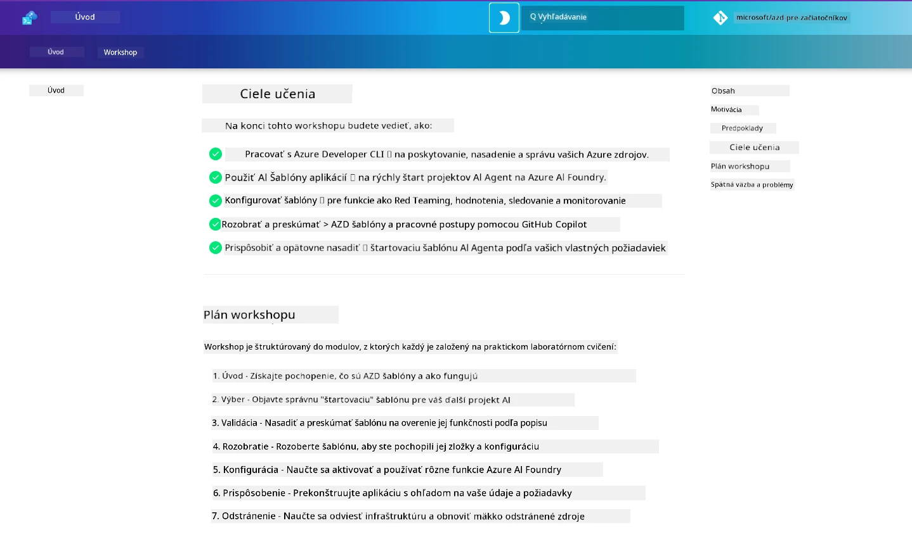

<div align="center">
  <div style="background: linear-gradient(135deg, #0078d4, #106ebe); border-radius: 10px; padding: 20px; margin: 20px 0; box-shadow: 0 4px 15px rgba(0, 120, 212, 0.3); border: 2px solid #005a9e;">
    <h2 style="color: white; margin: 0; font-size: 24px; text-shadow: 1px 1px 2px rgba(0,0,0,0.3);">
      🎯 Workshop AZD pre vývojárov umelej inteligencie
    </h2>
    <p style="color: white; margin: 10px 0 0 0; font-size: 16px; text-shadow: 1px 1px 2px rgba(0,0,0,0.3);">
      <strong>Praktický workshop na tvorbu AI aplikácií s Azure Developer CLI.</strong><br>
      Dokončite 7 modulov a zvládnite AZD šablóny a pracovné postupy nasadzovania AI.
    </p>
    <div style="margin-top: 15px;">
      <span style="background: rgba(255,255,255,0.2); padding: 5px 10px; border-radius: 15px; color: white; font-size: 14px;">
        📅 Zdrojové pokyny skontrolované: november 2026
      </span>
    </div>
  </div>
</div>

# Workshop AZD pre vývojárov umelej inteligencie

Vitajte na praktickom workshope na učenie sa Azure Developer CLI (AZD) so zameraním na nasadzovanie AI aplikácií. Tento workshop vám pomôže získať praktické pochopenie AZD šablón v 3 krokoch:

1. **Objavovanie** - nájdite šablónu, ktorá je pre vás vhodná.
1. **Nasadenie** - nasadiť a overiť, že to funguje
1. **Prispôsobenie** - upravte a iterujte, aby to bolo vaše!

Počas tohto workshopu vám tiež predstavíme základné nástroje a pracovné postupy pre vývojárov, ktoré vám pomôžu zefektívniť váš kompletný vývojový proces.

<br/>

## Sprievodca v prehliadači

Lekcie workshopu sú v Markdown. Môžete ich prechádzať priamo na GitHube - alebo spustiť náhľad v prehliadači, ako je znázornené na snímke obrazovky nižšie.



Na použitie tejto možnosti - si vytvorte fork repozitára do vášho profilu a spustite GitHub Codespaces. Keď je terminál VS Code aktívny, zadajte tento príkaz:

Tento náhľad v prehliadači funguje v GitHub Codespaces, dev kontajneroch alebo lokálnom klone s nainštalovaným Pythonom a MkDocs.

```bash title="" linenums="0"
python -m pip install -r requirements-dev.txt
python -m mkdocs serve --config-file workshop/mkdocs.yml
```

Spúšťajte tieto príkazy z **koreňového adresára kurzu**, nie z osobitne inicializovaného AI príkladu. Nechajte náhľad na popredí, aby boli chyby viditeľné; zastavíte ho stlačením Ctrl+C. Pre kontrolu stránky bez jej spustenia použite `python -m mkdocs build --strict --config-file workshop/mkdocs.yml`.

O niekoľko sekúnd sa zobrazí vyskakovacie okno. Vyberte možnosť `Open in browser`. Webový sprievodca sa teraz otvorí v novej záložke prehliadača. Niektoré výhody tohto náhľadu:

1. **Vstavané vyhľadávanie** - rýchlo nájdite kľúčové slová alebo lekcie.
1. **Ikona kopírovania** - ponechajte kurzor nad blokmi kódu pre túto možnosť
1. **Prepínanie témy** - prepínajte medzi tmavou a svetlou témou
1. **Získajte pomoc** - kliknite na ikonu Discordu v pätičke a pripojte sa!

<br/>

## Prehľad workshopu

**Trvanie:** 3-4 hodiny  
**Úroveň:** Začiatočník až mierne pokročilý  
**Predpoklady:** Znalosť Azure, konceptov umelej inteligencie, VS Code a nástrojov príkazového riadku.

Tento workshop je praktický, učíte sa priamo prácou. Po dokončení cvičení odporúčame prejsť AZD pre začiatočníkov, aby ste pokračovali vo vzdelávaní o bezpečnostných a produktívnych postupoch.

| Čas| Modul  | Cieľ |
|:---|:---|:---|
| 15 min | [Úvod](docs/instructions/0-Introduction.md) | Nastaviť rámec, pochopiť ciele |
| 30 min | [Výber AI šablóny](docs/instructions/1-Select-AI-Template.md) | Preskúmať možnosti a vybrať štartér | 
| 30 min | [Overenie AI šablóny](docs/instructions/2-Validate-AI-Template.md) | Nasadiť predvolenú riešenie do Azure |
| 30 min | [Rozbor AI šablóny](docs/instructions/3-Deconstruct-AI-Template.md) | Preskúmať štruktúru a konfiguráciu |
| 30 min | [Konfigurácia AI šablóny](docs/instructions/4-Configure-AI-Template.md) | Aktivovať a vyskúšať dostupné funkcie |
| 30 min | [Prispôsobenie AI šablóny](docs/instructions/5-Customize-AI-Template.md) | Prispôsobiť šablónu vašim potrebám |
| 30 min | [Rozobratie infraštruktúry](docs/instructions/6-Teardown-Infrastructure.md) | Vyčistiť a uvoľniť zdroje |
| 15 min | [Zhrnutie a ďalšie kroky](docs/instructions/7-Wrap-up.md) | Vzdelávacie zdroje, výzva z workshopu |

<br/>

## Čo sa naučíte

Považujte AZD šablónu za vzdelávacie pieskovisko na preskúmanie rôznych schopností a nástrojov pre kompletný vývoj na Microsoft Foundry. Po skončení tohto workshopu by ste mali mať intuitívny prehľad o rôznych nástrojoch a konceptoch v tomto kontexte.

| Koncept  | Cieľ |
|:---|:---|
| **Azure Developer CLI** | Pochopenie príkazov a pracovných postupov nástroja |
| **AZD šablóny**| Pochopenie štruktúry projektu a konfigurácie |
| **Azure AI Agent**| Nasadenie a provision projektov Microsoft Foundry |
| **Azure AI Search**| Umožniť kontextové inžinierstvo s agentmi |
| **Pozorovateľnosť**| Preskúmať trasovanie, monitorovanie a hodnotenia |
| **Red Teaming**| Preskúmať protivnícke testovanie a opatrenia |

<br/>

## Štruktúra workshopu

Workshop je štruktúrovaný tak, aby vás previedol od objavovania šablóny, po nasadenie, analýzu a prispôsobenie - s použitím oficiálnej [Začíname s AI agentmi](https://github.com/Azure-Samples/get-started-with-ai-agents) štartovacej šablóny ako základ.

### [Modul 1: Výber AI šablóny](docs/instructions/1-Select-AI-Template.md) (30 min)

- Čo sú AI šablóny?
- Kde nájdem AI šablóny?
- Ako začať stavať AI agentov?
- **Cvičenie**: Rýchly štart v Codespaces alebo dev kontajneri

### [Modul 2: Overenie AI šablóny](docs/instructions/2-Validate-AI-Template.md) (30 min)

- Aká je architektúra AI šablóny?
- Aký je vývojový pracovný postup AZD?
- Ako získať pomoc pri vývoji s AZD?
- **Cvičenie**: Nasadiť a overiť AI agentov

### [Modul 3: Rozbor AI šablóny](docs/instructions/3-Deconstruct-AI-Template.md) (30 min)

- Preskúmajte vaše prostredie v `.azure/` 
- Preskúmajte nastavenia zdrojov v `infra/` 
- Preskúmajte vašu AZD konfiguráciu v `azure.yaml`s
- **Cvičenie**: Upravte premenné prostredia a znovu nasadte

### [Modul 4: Konfigurácia AI šablóny](docs/instructions/4-Configure-AI-Template.md) (30 min)
- Preskúmajte: Generovanie s rozšírením o vyhľadávanie (Retrieval Augmented Generation)
- Preskúmajte: Hodnotenie agenta a Red Teaming
- Preskúmajte: Trasovanie a monitorovanie
- **Cvičenie**: Preskúmajte AI agenta + pozorovateľnosť 

### [Modul 5: Prispôsobenie AI šablóny](docs/instructions/5-Customize-AI-Template.md) (30 min)
- Definujte: PRD s požiadavkami scénára
- Konfigurujte: Premenné prostredia pre AZD
- Implementujte: Životné háky (Lifecycle Hooks) pre pridanie úloh
- **Cvičenie**: Prispôsobte šablónu pre môj scenár

### [Modul 6: Rozobratie infraštruktúry](docs/instructions/6-Teardown-Infrastructure.md) (30 min)
- Zhrnutie: Čo sú AZD šablóny?
- Zhrnutie: Prečo používať Azure Developer CLI?
- Ďalšie kroky: Skúste inú šablónu!
- **Cvičenie**: Deprovision infraštruktúry a upratovanie

<br/>

## Výzva workshopu

Chcete si dať ďalšiu výzvu? Tu sú niektoré návrhy projektov - alebo nám podeľte svoje nápady!

| Projekt | Popis |
|:---|:---|
|1. **Rozbor zložitej AI šablóny** | Použite pracovný postup a nástroje, ktoré sme popísali, a pokúste sa nasadiť, overiť a prispôsobiť inú AI riešenú šablónu. _Čo ste sa naučili?_|
|2. **Prispôsobenie podľa vášho scenára**  | Skúste napísať PRD (dokument požiadaviek na produkt) pre iný scenár. Potom použite GitHub Copilot vo vašom repozitári štandardnej šablóny v modelovej vetve Agenta - a požiadajte ho o generovanie pracovného postupu prispôsobenia. _Čo ste sa naučili? Ako by ste mohli tieto návrhy zlepšiť?_|
| | |

## Máte spätnú väzbu?

1. Vytvorte issue v tomto repozitári - označte ho `Workshop` pre ľahšiu orientáciu.
1. Pripojte sa k Discordu Microsoft Foundry - spojiť sa s kolegami!


| | | 
|:---|:---|
| **📚 Domov kurzu**| [AZD Pre začiatočníkov](../README.md)|
| **📖 Dokumentácia** | [Začnite s AI šablónami](https://learn.microsoft.com/en-us/azure/ai-foundry/how-to/develop/ai-template-get-started)|
| **🛠️ AI šablóny** | [Microsoft Foundry šablóny](https://ai.azure.com/templates) |
|**🚀 Ďalšie kroky** | [Začať workshop](#workshop-overview) |
| | |

<br/>

---

**Navigácia:** [Hlavný kurz](../README.md) | [Úvod](docs/instructions/0-Introduction.md) | [Modul 1: Výber šablóny](docs/instructions/1-Select-AI-Template.md)

**Ste pripravení začať tvoriť AI aplikácie s AZD?**

[Začať workshop: Úvod →](docs/instructions/0-Introduction.md)

---

<!-- CO-OP TRANSLATOR DISCLAIMER START -->
**Vyhlásenie o zodpovednosti**:
Tento dokument bol preložený pomocou AI prekladateľskej služby [Co-op Translator](https://github.com/Azure/co-op-translator). Hoci sa snažíme o presnosť, vezmite prosím na vedomie, že automatické preklady môžu obsahovať chyby alebo nepresnosti. Pôvodný dokument v jeho natívnom jazyku by mal byť považovaný za autoritatívny zdroj. Pre kritické informácie sa odporúča profesionálny ľudský preklad. Nie sme zodpovední za žiadne nedorozumenia alebo nesprávne interpretácie vyplývajúce z použitia tohto prekladu.
<!-- CO-OP TRANSLATOR DISCLAIMER END -->