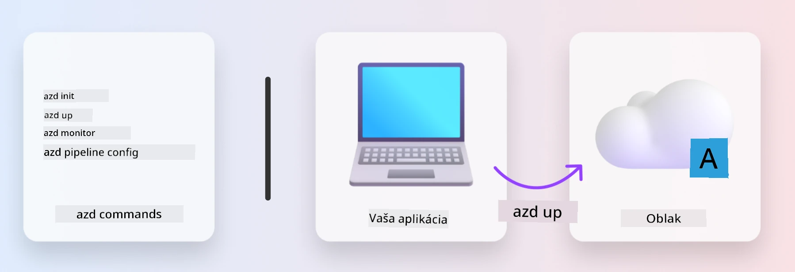
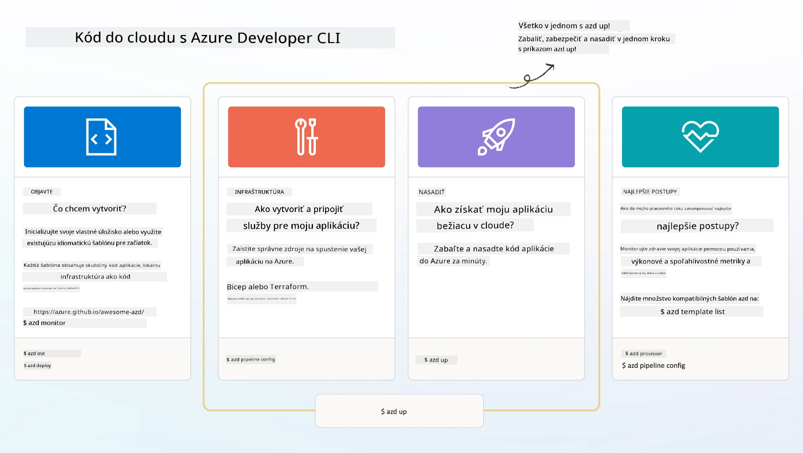

# 1. Vyberte šablónu

!!! tip "NA KONCI TOHTO MODULU BUDETE VEDIEŤ"

    - [ ] Describe what AZD templates are
    - [ ] Discover and use AZD templates for AI
    - [ ] Get started with the AI Agents template
    - [ ] **Lab 1:** AZD Quickstart in Codespaces or a dev container

---

## 1. Analógia staviteľa

Vytvoriť modernú podnikateľskú AI aplikáciu _od základov_ môže byť náročné. Je to trochu ako stavať svoj nový domov sám, tehlu po tehle. Áno, dá sa to urobiť! Ale nie je to najefektívnejší spôsob, ako dosiahnuť požadovaný výsledok! 

Namiesto toho často začíname s existujúcim _plánom dizajnu_ a spolupracujeme s architektom na jeho prispôsobení podľa našich osobných požiadaviek. A presne takýto prístup treba zvoliť pri budovaní inteligentných aplikácií. Najprv nájdite dobrú dizajnovú architektúru, ktorá vyhovuje vášmu problému. Potom spolupracujte s riešiteľským architektom na prispôsobení a vývoji riešenia pre váš konkrétny scénar.

Ale kde nájdeme tieto plány dizajnu? A ako nájsť architekta, ktorý je ochotný nás naučiť, ako tieto plány vlastnoručne prispôsobiť a nasadiť? V tomto workshope na tieto otázky odpovieme tým, že vám predstavíme tri technológie:

1. [Azure Developer CLI](https://aka.ms/azd) - open-source nástroj, ktorý zrýchľuje cestu vývojára od lokálneho vývoja (build) po nasadenie v cloude (ship).
1. [Microsoft Foundry Templates](https://ai.azure.com/templates) - štandardizované open-source repozitáre obsahujúce vzorový kód, infraštruktúru a konfiguračné súbory na nasadenie architektúry AI riešenia.
1. [GitHub Copilot Agent Mode](https://code.visualstudio.com/docs/copilot/chat/chat-agent-mode) - programovací agent založený na znalostiach Azure, ktorý nás vie viesť v navigácii kódu a vykonávaní zmien - pomocou prirodzeného jazyka.

S týmito nástrojmi v rukách teraz môžeme _objaviť_ správnu šablónu, _nasadiť_ ju pre overenie funkčnosti a _prispôsobiť_ ju podľa našich špecifických scenárov. Poďme sa do toho pustiť a naučiť sa, ako tieto nástroje fungujú.


---

## 2. Azure Developer CLI

Nástroj príkazového riadku [Azure Developer CLI](https://learn.microsoft.com/en-us/azure/developer/azure-developer-cli/) (alebo `azd`) je open-source nástroj, ktorý vám môže zrýchliť cestu od kódu ku cloudu pomocou súboru priateľských príkazov pre vývojárov, ktoré fungujú konzistentne vo vašom IDE (vývoj) a CI/CD (devops) prostredí.

S `azd` môže vaša cesta nasadenia vyzerať jednoducho takto:

- `azd init` - Inicializuje nový AI projekt z existujúcej šablóny AZD.
- `azd up` - Zabezpečí infraštruktúru a nasadí vašu aplikáciu v jednom kroku.
- `azd monitor` - Poskytne monitorovanie a diagnostiku v reálnom čase pre nasadenú aplikáciu.
- `azd pipeline config` - Nastaví CI/CD pipelines pre automatické nasadenie do Azure.

**🎯 | CVIČENIE**: <br/> Preskúmajte teraz nástroj príkazového riadku `azd` vo vašom aktuálnom prostredí workshopu. Môže to byť GitHub Codespaces, vývojový kontajner alebo lokálna klonovaná kópia s nainštalovanými predpokladmi. Začnite zadaním tohto príkazu, aby ste videli, čo nástroj dokáže:

```bash title="" linenums="0"
azd help
```



---

## 3. Šablóna AZD

Aby `azd` dokázal toto, musí vedieť, akú infraštruktúru má zabezpečiť, aké nastavenia konfigurácie uplatniť a akú aplikáciu nasadiť. Tu prichádzajú na rad [AZD šablóny](https://learn.microsoft.com/en-us/azure/developer/azure-developer-cli/azd-templates?tabs=csharp).

AZD šablóny sú open-source repozitáre, ktoré kombinujú ukážkový kód s infraštruktúrou a konfiguračnými súbormi potrebnými na nasadenie architektúry riešenia.
Použitím prístupu _Infrastructure-as-Code_ (IaC) umožňujú, aby definície zdrojov a konfiguračné nastavenia boli verzované (rovnako ako zdrojový kód aplikácie) - čím vytvárajú znovupoužiteľné a konzistentné pracovné postupy medzi používateľmi daného projektu.

Pri vytváraní alebo opätovnom použití AZD šablóny pre _váš_ scenár zvážte tieto otázky:

1. Čo budujete? → Existuje šablóna, ktorá má počiatočný kód pre tento scenár?
1. Ako je vaše riešenie navrhnuté? → Existuje šablóna s potrebnými zdrojmi?
1. Ako je vaše riešenie nasadené? → Myslite na `azd deploy` s pred- a po-spracovacími hákmi!
1. Ako ho môžete ešte viac optimalizovať? → Myslite na vstavané monitorovanie a automatizačné pipeline!

**🎯 | CVIČENIE**: <br/> 
Navštívte galériu [Awesome AZD](https://azure.github.io/awesome-azd/) a použite filtre na preskúmanie viac ako 250 dostupných šablón. Skúste nájsť takú, ktorá vyhovuje _vašim_ požiadavkám na scenár.



---

## 4. AI Šablóny aplikácií

Pre aplikácie poháňané AI Microsoft poskytuje špecializované šablóny so **Microsoft Foundry** a **Foundry Agents**. Tieto šablóny zrýchľujú cestu k vývoju inteligentných aplikácií pripravených na produkciu.

### Šablóny Microsoft Foundry & Foundry Agents

Vyberte si šablónu nižšie na nasadenie. Každá šablóna je dostupná v [Awesome AZD](https://azure.github.io/awesome-azd/) a môže byť inicializovaná jediným príkazom.

| Šablóna | Popis | Príkaz nasadenia |
|----------|-------------|----------------|
| **[AI Chat with RAG](https://github.com/Azure-Samples/azure-search-openai-demo)** | Chatová aplikácia založená na vyhľadávaní | `azd init -t Azure-Samples/azure-search-openai-demo .` |
| **[Get Started with AI Agents](https://github.com/Azure-Samples/get-started-with-ai-agents)** | Chatová aplikácia založená na agentoch; používaná počas workshopu | `azd init -t Azure-Samples/get-started-with-ai-agents .` |
| **[Get Started with AI Chat](https://github.com/Azure-Samples/get-started-with-ai-chat)** | Začiatočná AI chat aplikácia | `azd init -t Azure-Samples/get-started-with-ai-chat .` |

Toto sú alternatívy: inicializujte **jednu** šablónu vo vlastnom prázdnom adresári. Príznak `.` vyberá tento adresár; ak ho na súčasných verziách AZD vynecháte, vytvorí sa podadresár pomenovaný podľa šablóny. Inicializácia stiahne projekt; `azd up` vykoná fakturovateľné nasadenie po tom, čo skontrolujete predpoklady, zdroje, podporu regiónu a kvóty.

### Rýchly štart

1. **Prezrite si šablóny**: Navštívte [https://azure.github.io/awesome-azd/](https://azure.github.io/awesome-azd/) a filtrovať podľa `AI`, `Agents`, alebo `Microsoft Foundry`
2. **Vyberte šablónu**: Zvoľte takú, ktorá vyhovuje vášmu prípadu použitia
3. **Inicializujte**: Spustite príkaz `azd init` pre vybranú šablónu
4. **Nasadte**: Spustite `azd up` na zabezpečenie infraštruktúry a nasadenie

**🎯 | CVIČENIE**: <br/>
Vyberte šablónu z hore uvedených na základe vášho scenára:

- **Pokračujete v tomto workshope?** → Vyberte **Get Started with AI Agents**
- **Budujete chat založený na vyhľadávaní?** → Preskúmajte samostatne **AI Chat with RAG**
- **Potrebujete inú architektúru?** → Vyhľadajte v galérii a overte si aktuálny repozitár, stav implementácie a predpoklady

```bash title="Initialize the workshop template in an empty directory" linenums="0"
azd init -t Azure-Samples/get-started-with-ai-agents .
azd auth login
azd up
```

!!! info "Preskúmajte viac šablón"
    Galéria [Awesome AZD](https://azure.github.io/awesome-azd/) obsahuje viac než 250 šablón. Použite filtre na nájdenie šablón, ktoré vyhovujú vašim špecifickým požiadavkám na jazyk, framework a Azure služby.

---

<!-- CO-OP TRANSLATOR DISCLAIMER START -->
**Vyhlásenie o zodpovednosti**:
Tento dokument bol preložený pomocou AI prekladateľskej služby [Co-op Translator](https://github.com/Azure/co-op-translator). Hoci sa snažíme o presnosť, vezmite prosím na vedomie, že automatické preklady môžu obsahovať chyby alebo nepresnosti. Pôvodný dokument v jeho natívnom jazyku by mal byť považovaný za autoritatívny zdroj. Pre kritické informácie sa odporúča profesionálny ľudský preklad. Nie sme zodpovední za žiadne nedorozumenia alebo nesprávne interpretácie vyplývajúce z použitia tohto prekladu.
<!-- CO-OP TRANSLATOR DISCLAIMER END -->