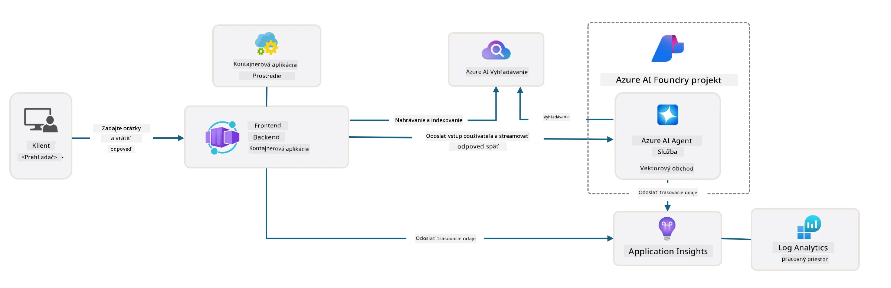
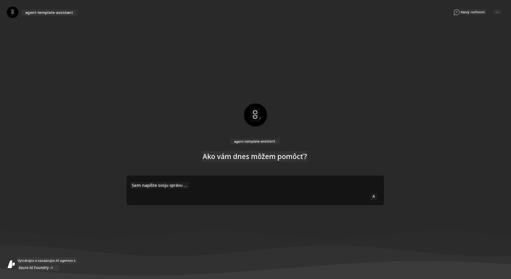

# 2. Overenie šablóny

> Zdrojové vedenie bolo skontrolované voči AZD 1.37.2 a aktuálnemu príkladu 4. novembra 2026. Snímky obrazovky sú ilustračné; navigácia v portáli, prednastavenia šablóny a dostupnosť služieb sa môžu zmeniť. Táto kontrola nevykonala živé nasadenie Azure.

!!! tip "NA KONCI TOHTO MODULU BUDETE SCHOPNÍ"

    - [ ] Identify the sample's prerequisites and intended resources
    - [ ] Deploy the selected template into an intentional environment
    - [ ] Verify the application and agent behavior separately from deployment success
    - [ ] **Lab 2:** Record evidence of a working baseline, or an actionable deployment blocker

---

## 1. Skontrolujte predpoklady

Rozhranie príkazového riadku [Azure Developer CLI](https://learn.microsoft.com/azure/developer/azure-developer-cli/) spravuje nasadenie aplikácií pomocou konfigurácie, infraštruktúry a kódu šablóny. Skontrolujte svoju nainštalovanú verziu:

```bash
azd version
```

Použite v prípade potreby [aktuálne pokyny na inštaláciu/aktualizáciu](https://learn.microsoft.com/azure/developer/azure-developer-cli/install-azd). Recenzovaný príklad deklaruje AZD `>=1.14.0`, ale odporúča sa aktuálna podporovaná verzia. Voliteľné AI rozšírenia majú samostatné požiadavky na verziu; normálny pracovný tok `azd up` v tomto príklade nevyžaduje rozšírenie agentov.

Pred vytvorením prečítajte nastavenie [Azure účtu](https://github.com/Azure-Samples/get-started-with-ai-agents/blob/main/docs/azure_account_setup.md) a [príručku nasadenia](https://github.com/Azure-Samples/get-started-with-ai-agents/blob/main/docs/deployment.md) vzorového príkladu. Overte svoj predplatný plán, povolenia, dostupnosť modelu, regionálnu kvótu a očakávané poplatky. Bezplatný Azure účet nezaručuje prístup ani bezplatné používanie pre každú požadovanú službu.

## 2. Otvorte vybraný príklad

Použite repozitár [Začať s AI agentmi](https://github.com/Azure-Samples/get-started-with-ai-agents) inicializovaný v Module 1. Ak ste ho neinicializovali, zvoľte jednu z týchto alternatív:

- Otvorte [Codespace pre vzorový príklad](https://github.com/codespaces/new/Azure-Samples/get-started-with-ai-agents).
- Naklonujte vzorový príklad a postupujte podľa jeho lokálnej/dev-container konfigurácie.
- V **prázdnom adresári** spustite:

```bash
azd init --template Azure-Samples/get-started-with-ai-agents .
```

Neinicializujte druhú šablónu nad existujúcim projektom. Ďalšie príkazy spúšťajte z koreňového adresára vzorového príkladu obsahujúceho `azure.yaml`, nie z koreňa repozitára kurzu.

Vzorový príklad hosťuje chatovaciu aplikáciu poháňanú agentom v Container Apps a zabezpečuje potrebné Foundry zdroje. Skontrolujte súčasnú architektúru a voliteľné služby namiesto toho, aby ste považovali starý screenshot za presný inventár zdrojov.



## 3. Nasadzujte zámerne

```bash
azd auth login
azd up
```

Skontrolujte výzvy:

1. Vyberte jedinečný názov prostredia AZD.
2. Vyberte zamýšľaný predplatný program, nie len ktorýkoľvek predplatný program, ktorý je ponúknutý ako prvý.
3. Vyberte región podporovaný požadovaným modelom/verziou/SKU a vašou kvótou.
4. Prečítajte si výstup zo zabezpečenia, nasadenia a post-nasadenia hooku.

Skontrolované predvolené hodnoty zahŕňajú `gpt-5-mini`, verziu `2025-08-07` a `GlobalStandard`. Skontrolujte svoju inicializovanú šablónu a [podporované kombinácie modelu/regiónu](https://learn.microsoft.com/azure/ai-services/agents/concepts/model-region-support). Žiadny región nie je univerzálne zaručený ako funkčný.

Doba nasadenia sa líši. Ak zabezpečenie zlyhá, zachovajte chybu a opravte jej príčinu pred opätovným pokusom. Nezmazávajte nasadenie ani trvalo nevymažte prostriedky ako všeobecný krok na riešenie problémov.

## 4. Validujte aplikáciu

```bash
azd show
```

Otvorte koncový bod pre `api_and_frontend`, alebo nájdite Container App v skupine prostriedkov nasadenia v [Azure portáli](https://portal.azure.com/). Postupujte podľa pokynov k vzorovej autentifikácii/prístupu, ak je potrebné sa prihlásiť; nevyplaťte autentifikáciu, aby prešiel len rýchly test.



Vyskúšajte niekoľko [ukážkových otázok](https://github.com/Azure-Samples/get-started-with-ai-agents/blob/main/docs/sample_questions.md):

- Všeobecná faktická otázka.
- Otázka, na ktorú by mala byť odpoveď v nahraných dokumentoch vzorky.
- Otázka, na ktorú nie je možné odpovedať z tých dokumentov.

Overte, či sa načíta používateľské rozhranie, či API odpovedá, či načítanie používa očakávané údaje, či citácie zodpovedajú zdrojovému obsahu a či sú nepodporované otázky spracované správne. Úspešná správa `azd up` sama o sebe tieto výsledky nezaručuje.

## 5. Skontrolujte nasadeného agenta

Otvorte svoj projekt v [Foundry portáli](https://ai.azure.com/). V prehľadávanom portálovom toku vyberte **Build**, potom **Agents** a vyhľadajte agenta vytvoreného podľa ukážky. Navigačné označenia sa môžu zmeniť.

Zaznamenajte si:

- Meno a verziu agenta.
- Jeho nakonfigurované nasadenie modelu.
- Skutočné pokyny a povolené nástroje.
- Ktoré súbory alebo vyhľadávací index sú pripojené a či bolo nastavenie úspešné.

Prehľadávaná ukážka používa identifikátor agenta vo forme `agent_name:agent_version` pre svoje hodnotiace testy. Nekopírujte klasický identifikátor agenta/vlákna zo starej snímky obrazovky do novšieho API toku.

Porovnajte nahrané dokumenty s `src/files/` vo vašej inicializovanej revízii. Skoršie snímky obrazovky ukázali 32 súborov; tento počet nie je garantovaný ako aktuálny predvolený. Overte akúkoľvek odpoveď o ukážkových zákazníkoch/produktoch voči skutočným syntetickým zdrojovým údajom a na tento účel nenahrávajte skutočné zákaznícke údaje.

## 6. Porovnajte s playgroundom

Otvorte playground vybraného agenta vo Foundry a položte tú istú otázku na načítanie. Porovnajte nakonfigurovanú verziu agenta, nástroje, citácie a kvalitu odpovede s nasadenou aplikáciou.

Odpovede sú pravdepodobnostné; presná zhoda slov za slovom nie je kritériom. Ak sú výsledky výrazne odlišné, skontrolujte, či aplikácia a playground cielia na rovnaký projekt, agenta/verziu a zdroj poznatkov.

## 7. Skontrolujte predpoklady pozorovateľnosti

Ukážkový [návod na pozorovateľnosť](https://github.com/Azure-Samples/get-started-with-ai-agents/blob/main/docs/observability.md) je zdrojom pravdy pre nastavenie trasovania, hodnotenia a red-teamingu.

V zrevidovaných predvolených nastaveniach infraštruktúry je Application Insights povolený, ale **klientské trasovanie je zakázané** (`ENABLE_AZURE_MONITOR_TRACING=false`). Vytvorenie monitorovacieho zdroja nedokazuje, že aplikácia exportuje trasovanie. Modul 5 pokrýva povolenie trasovania a generovanie testovacej požiadavky.

Na vyšetrovanie chýb pri spustení/API použite aplikačné protokoly Container App. Vo Foundry skontrolujte dostupné pohľady trasovania a monitorovania agenta. Záznamy hodnotení vyžadujú relevantnú konfiguráciu, podporovaných hodnotiteľov/región a skutočné požiadavky; nie je zaručené, že sa automaticky zobrazia pri každom spustení.

Nechajte zachytávanie obsahu výziev/odpovedí zakázané, pokiaľ nebola preskúmaná jeho ochrana súkromia, uchovávanie, prístup a požiadavky na redigovanie.

## 8. Pochopte hodnoty prostredia

AZD ukladá vybrané prostredie pod `.azure/<environment-name>/`. Trvalé vstupy a výstupy nasadenia je možné prečítať pomocou:

```bash
azd env list
azd env get-value AZURE_ENV_NAME
azd env get-value AZURE_LOCATION
```

`azd env get-values` vypisuje všetky hodnoty, ktoré môžu obsahovať citlivú konfiguráciu. Nevkladajte tento výstup do verejných problémov ani protokolov.

AZD používa vybrané prostredie pri spúšťaní svojich príkazov/hákov, zatiaľ čo premenné prostredia procesu môžu tiež ovplyvňovať príkazy a šablóny. Toto **neexportuje hodnoty do nadriadenej konzoly ani do každého samostatne spusteného Python procesu.** Nasledujte ukážkové [lokálne pokyny na vývoj](https://github.com/Azure-Samples/get-started-with-ai-agents/blob/main/docs/local_development.md).

Predvolené hodnoty šablón sa môžu aplikovať v `infra/main.parameters.json` bez toho, aby sa zobrazovali ako explicitné lokálne hodnoty. Nastavenie ľubovoľnej premennej nemení infraštruktúru, ak ju šablóna nepoužíva.

Napríklad na explicitný výber zrevidovaných predvolieb modelu:

```bash
azd env set AZURE_AI_AGENT_MODEL_NAME gpt-5-mini
azd env set AZURE_AI_AGENT_MODEL_VERSION 2025-08-07
azd env set AZURE_AI_AGENT_DEPLOYMENT_SKU GlobalStandard
azd provision --preview
azd up
```

Najskôr si preverte kompatibilitu, kapacitu, dostupnosť a plánované zmeny. Aktualizácie infraštruktúry vyžadujú poskytovanie; samotný `azd deploy` nestačí. Podporované zmeny modelu zvyčajne nevyžadujú rozobranie celej aplikácie.

`azd env refresh` načíta výstupy nasadenia pre prístupné prostredie; neprekonštruuje všetky vlastné vstupy, nesynchronizuje tajomstvá ani nenahrádza správu konfigurácie.

## 9. Zaznamenajte svoju základnú hodnotu

- [ ] Overené správne prostredie, predplatné, región a model.
- [ ] Poskytnutie, nasadenie a požadované nastavenia háčikov prebehli bez nevyriešených chýb.
- [ ] Overený prístup k aplikácii, chat, získavanie a citácie.
- [ ] Identifikovaný agent/verzia a zdroj poznatkov.
- [ ] Zdokumentované predpoklady sledovateľnosti a všetky zostávajúce blokátory.

Pokračujte na [Deštrukciu šablóny](3-Deconstruct-AI-Template.md).

---

<!-- CO-OP TRANSLATOR DISCLAIMER START -->
**Vyhlásenie o zodpovednosti**:
Tento dokument bol preložený pomocou AI prekladateľskej služby [Co-op Translator](https://github.com/Azure/co-op-translator). Hoci sa snažíme o presnosť, vezmite prosím na vedomie, že automatické preklady môžu obsahovať chyby alebo nepresnosti. Pôvodný dokument v jeho natívnom jazyku by mal byť považovaný za autoritatívny zdroj. Pre kritické informácie sa odporúča profesionálny ľudský preklad. Nie sme zodpovední za žiadne nedorozumenia alebo nesprávne interpretácie vyplývajúce z použitia tohto prekladu.
<!-- CO-OP TRANSLATOR DISCLAIMER END -->