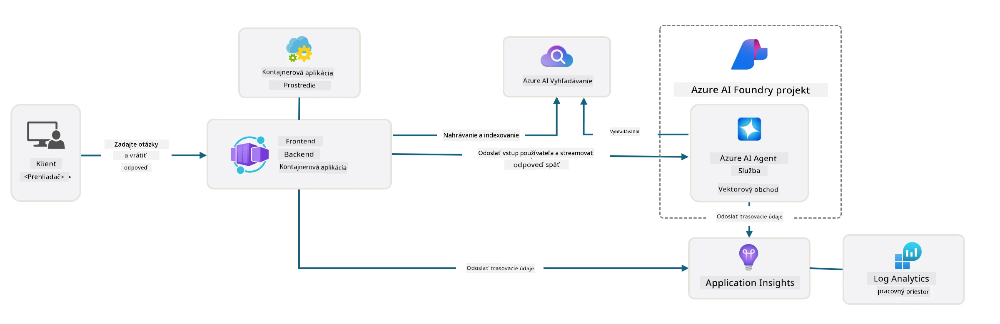

# 3. Dekonštrukcia šablóny

!!! tip "NA KONCI TOHTO MODULU BUDETE SCHOPNÍ"

    - [ ] Use GitHub Copilot and optional MCP tools for Azure documentation and read-only exploration
    - [ ] Identify the template's application, infrastructure, configuration, and test entry points
    - [ ] Verify generated explanations against actual repository files
    - [ ] **Lab 3:** Trace one request and one configuration input through the project

---

## 1. Aktivujte GitHub Copilot

Otvorte inicializovaný vzor AI vo VS Code a zapnite [GitHub Copilot](https://code.visualstudio.com/docs/copilot/chat/chat-agent-mode). Prihláste sa s účtom, ktorý má oprávnený plán; limity používania sa líšia. Požiadajte Copilota, aby vysvetlil repozitár pred autorizovaním zmien.

### Voliteľné MCP servery

Tieto služby môžu poskytovať ďalšie nástroje:

- [Azure MCP Server](https://learn.microsoft.com/azure/developer/azure-mcp-server/overview)
- [Microsoft Learn MCP Server](https://learn.microsoft.com/training/support/mcp)

Vo VS Code si preštudujte [návod na konfiguráciu MCP](https://code.visualstudio.com/docs/copilot/chat/mcp-servers) a vytvorte `.vscode/mcp.json`, ak je to potrebné:

```json
{
  "servers": {
    "Azure MCP Server": {
      "type": "stdio",
      "command": "npx",
      "args": ["-y", "@azure/mcp@latest", "server", "start"]
    },
    "microsoft.docs.mcp": {
      "type": "http",
      "url": "https://learn.microsoft.com/api/mcp"
    }
  }
}
```

Príkaz `npx` vyžaduje podporovanú inštaláciu Node.js/npm a sťahuje spustiteľný kód. Prejdite si balík a pripnite schválenú verziu pre reprodukovateľné tímové nastavenie. Spustite servery pomocou ovládacích prvkov MCP vo VS Code a preskúmajte ich dostupné nástroje; názvy sa môžu meniť medzi verziami.

**Autentifikácia je separátna.** Pre AZD používajte `azd auth login`. Postupujte podľa zdokumentovaného autentifikačného toku Azure MCP pre jeho nástroje; samotné prihlásenie AZD nezabezpečuje MCP reláciu. Používajte `az login` samostatne, keď cvičenie alebo hák volajú Azure CLI.

Skúste výzvy len na čítanie:

1. „Použite Microsoft Learn MCP na nájdenie dokumentácie konfigurácie Azure Developer CLI.“
2. „Vysvetlite `azure.yaml` tohto repozitára; uveďte súbory, ktoré implementujú každý hák.“
3. „Používajúc dostupné nástroje Azure MCP, vymenujte moje nasadené prostriedky bez toho, aby ste čokoľvek menili.“

Skontrolujte vybraný tenant/predplatné a každý navrhovaný volací nástroj. Neschvaľujte vytváranie, mazanie alebo zmeny prístupu k zdrojom iba kvôli preskúmaniu architektúry.

## 2. Pochopte architektúru

Vzor hosťuje Python FastAPI backend a React/TypeScript frontend v Azure Container Apps. Backend komunikuje s agentom v projekte Microsoft Foundry. Získavanie a observabilita závisia od povolených funkcií šablóny a úspešnej konfigurácie; nie sú zaručené len preto, že bola aplikácia nasadená.



Porovnajte tento diagram so [súčasným sprievodcom nasadením upstream](https://github.com/Azure-Samples/get-started-with-ai-agents/blob/main/docs/deployment.md) a vašimi reálnymi zdrojmi. Skontrolujte nakonfigurované nasadenie modelu, nástroje agenta, spravovanú identitu, priradenia rolí a voliteľné prostriedky AI Search/Application Insights.

**Cvičenie:** Požiadajte Copilota, aby sledoval požiadavku chatu z frontendu cez API do Foundry, s odkazmi na súbory a funkcie. Otvorte tieto odkazy a overte vysvetlenie. Nevyvodzujte implementovanú autentifikáciu, smerovanie alebo autorizáciu iba z diagramu.

## 3. Štruktúra repozitára

Nasledujúce vybrané cesty boli skontrolované vo vzore 4. novembra 2026. Vaša inicializovaná revízia zostáva zdrojom pravdy:

```text
get-started-with-ai-agents/
  azure.yaml
  docker-compose.yaml
  requirements-dev.txt
  .devcontainer/
  infra/
    main.bicep
    main.parameters.json
    api.bicep
    core/
  src/
    Dockerfile
    pyproject.toml
    requirements.txt
    api/
      main.py
      routes.py
      search_index_manager.py
    frontend/
      package.json
      src/
    files/
  scripts/
    validate_env_vars.sh
    validate_env_vars.ps1
    postdeploy.sh
    postdeploy.ps1
  tests/
    test_evaluation.py
    test_red_teaming.py
  docs/
    deployment.md
    deploy_customization.md
    ai_search.md
    observability.md
    local_development.md
    troubleshooting.md
```

### Infraštruktúra a konfigurácia

`infra/main.bicep` orchesteruje zdroje; `main.parameters.json` spája vstupy šablóny s hodnotami prostredia AZD. `azure.yaml` vyberá aplikačnú službu a životné háky. Sledujte vstup ako `USE_AZURE_AI_SEARCH_SERVICE` cez tieto súbory, aby ste zistili, čo sa skutočne mení.

### Aplikácia a identita

Prečítajte si `src/api/` a `src/frontend/` spolu. Identifikujte, kde je agent vytvorený alebo načítaný, kde sa konfigurujú inštrukcie/nástroje a ktorú identitu používa každý Azure volanie. Vzorkové súbory pod `src/files/` sú demonštračné dáta, nie produkčný katalóg alebo model autorizácie.

### Testy a observabilita

Aktuálne vstupné body pre hodnotenie a red-team sú pod `tests/`; staršie odkazy `evals/` a `airedteaming/` sú pre tento vzor neaktuálne. Prečítajte si `docs/observability.md` pre predpoklady a náklady pred spustením testov v cloude. Tieto Python testy sú oddelené od voliteľného rozšírenia `azure.ai.evaluations` AZD.

## 4. Overte si svoje zistenia

- Identifikujte API cestu, interakciu agenta a kód pre získavanie pre jednu vzorovú otázku.
- Vysvetlite, ktorá identita pristupuje do Foundry a ktorá konfigurácia vyberá jej koncový bod.
- Nájdite skutočné skripty pre pre-deploy a post-deploy a ich správanie pri spracovaní chýb.
- Vymenujte závislosti alebo voliteľné funkcie, ktoré vo vašom nasadení chýbajú.

Pokračujte do [Konfigurácia šablóny](4-Configure-AI-Template.md).

---

<!-- CO-OP TRANSLATOR DISCLAIMER START -->
**Vyhlásenie o zodpovednosti**:
Tento dokument bol preložený pomocou AI prekladateľskej služby [Co-op Translator](https://github.com/Azure/co-op-translator). Hoci sa snažíme o presnosť, vezmite prosím na vedomie, že automatické preklady môžu obsahovať chyby alebo nepresnosti. Pôvodný dokument v jeho natívnom jazyku by mal byť považovaný za autoritatívny zdroj. Pre kritické informácie sa odporúča profesionálny ľudský preklad. Nie sme zodpovední za žiadne nedorozumenia alebo nesprávne interpretácie vyplývajúce z použitia tohto prekladu.
<!-- CO-OP TRANSLATOR DISCLAIMER END -->