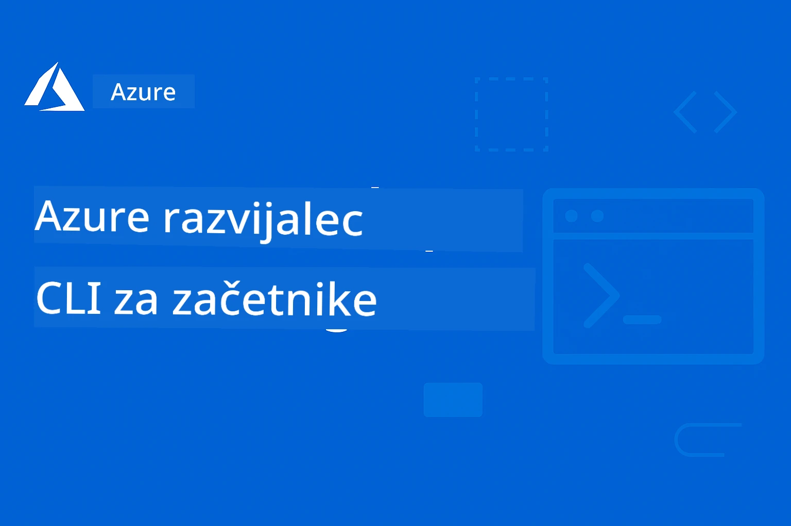

# AZD za začetnike: Strukturirana učna pot

 

[](https://GitHub.com/microsoft/azd-for-beginners/watchers/)
[](https://GitHub.com/microsoft/azd-for-beginners/network/)
[](https://GitHub.com/microsoft/azd-for-beginners/stargazers/)

[](https://discord.com/invite/nkVh3dp)
[](https://discord.gg/nTYy5BXMWG)

---

### Avtomatski prevodi (vedno posodobljeno)

<!-- CO-OP TRANSLATOR LANGUAGES TABLE START -->
[Arabic](../ar/README.md) | [Bengali](../bn/README.md) | [Bulgarian](../bg/README.md) | [Burmese (Myanmar)](../my/README.md) | [Chinese (Simplified)](../zh-CN/README.md) | [Chinese (Traditional, Hong Kong)](../zh-HK/README.md) | [Chinese (Traditional, Macau)](../zh-MO/README.md) | [Chinese (Traditional, Taiwan)](../zh-TW/README.md) | [Croatian](../hr/README.md) | [Czech](../cs/README.md) | [Danish](../da/README.md) | [Dutch](../nl/README.md) | [Estonian](../et/README.md) | [Finnish](../fi/README.md) | [French](../fr/README.md) | [German](../de/README.md) | [Greek](../el/README.md) | [Hebrew](../he/README.md) | [Hindi](../hi/README.md) | [Hungarian](../hu/README.md) | [Indonesian](../id/README.md) | [Italian](../it/README.md) | [Japanese](../ja/README.md) | [Kannada](../kn/README.md) | [Khmer](../km/README.md) | [Korean](../ko/README.md) | [Lithuanian](../lt/README.md) | [Malay](../ms/README.md) | [Malayalam](../ml/README.md) | [Manipuri (Meitei Mayek)](../mni/README.md) | [Marathi](../mr/README.md) | [Nepali](../ne/README.md) | [Nigerian Pidgin](../pcm/README.md) | [Norwegian](../no/README.md) | [Persian (Farsi)](../fa/README.md) | [Polish](../pl/README.md) | [Portuguese (Brazil)](../pt-BR/README.md) | [Portuguese (Portugal)](../pt-PT/README.md) | [Punjabi (Gurmukhi)](../pa/README.md) | [Romanian](../ro/README.md) | [Russian](../ru/README.md) | [Serbian (Cyrillic)](../sr/README.md) | [Slovak](../sk/README.md) | [Slovenian](./README.md) | [Spanish](../es/README.md) | [Swahili](../sw/README.md) | [Swedish](../sv/README.md) | [Tagalog (Filipino)](../tl/README.md) | [Tamil](../ta/README.md) | [Telugu](../te/README.md) | [Thai](../th/README.md) | [Turkish](../tr/README.md) | [Ukrainian](../uk/README.md) | [Urdu](../ur/README.md) | [Vietnamese](../vi/README.md)

> **Raje kloniraš lokalno?**
>
> Ta repozitorij vključuje več kot 50 jezikovnih prevodov, kar pomembno poveča velikost prenosa. Če želite klonirati brez prevodov, uporabite sparse checkout:
>
> **Bash / macOS / Linux:**
> ```bash
> git clone --filter=blob:none --sparse https://github.com/microsoft/AZD-for-beginners.git
> cd AZD-for-beginners
> git sparse-checkout set --no-cone '/*' '!translations' '!translated_images'
> ```
>
> **CMD (Windows):**
> ```cmd
> git clone --filter=blob:none --sparse https://github.com/microsoft/AZD-for-beginners.git
> cd AZD-for-beginners
> git sparse-checkout set --no-cone "/*" "!translations" "!translated_images"
> ```
>
> Tako boste dobili vse, kar potrebujete za dokončanje tečaja, z veliko hitrejšim prenosom.
<!-- CO-OP TRANSLATOR LANGUAGES TABLE END -->

## 🆕 Kaj je novega v azd danes

> 📌 Ta tečaj je preverjen za **`azd 1.27.1`** (julij 2026). Za preverbo gradnje zaženite `azd version`, za pridobitev najnovejšega pa `azd upgrade`.

Azure Developer CLI je prerasel tradicionalne spletne aplikacije in API-je. Danes je azd edino orodje za razmestitev **katerekoli** aplikacije v Azure—vključno z AI-podprtimi aplikacijami in inteligentnimi agenti.

To za vas pomeni:

- **AI agenti so zdaj uradni azd delovni obremenitvi.** Lahko inicializirate, razmestite in upravljate projekte AI agentov z istim znanim delovnim tokom `azd init` → `azd up`.
- **Popoln cikel življenja agenta iz CLI.** Razširitev `azure.ai.agents` pokriva celotno pot—`azd ai agent init` za gradnjo okvira, `azd ai agent invoke` za testiranje (z izpisom časa odziva), `azd ai agent eval generate` in `azd ai agent optimize` za merjenje in izboljšanje kakovosti ter `azd ai agent delete` za čiščenje.
- **Več gradnikov AI.** Nove predogledne razširitve—`azure.ai.skills` in `azure.ai.connections`—vam omogočajo upravljanje ponovno uporabnih agentnih veščin in povezav Foundry neposredno z azd.
- **Integracija Microsoft Foundry** prinaša uvajanje modelov, gostovanje agentov in konfiguracijo AI storitev neposredno v ekosistem azd predlog.
- **Bolj gladke vsakdanje osnove.** Nedavne izdaje so naredile `azd init` idempotentne (varne za ponovni zagon), omogočile avtomatično čiščenje starih žetonov za `azd auth login` in dodale prijazen poziv za prvo nastavitev `azd tool`.
- **Osnovni delovni tok ni spremenjen.** Ne glede na to ali razmestite todo aplikacijo, mikro storitev ali multi-agentno AI rešitev, so ukazi enaki.

> **Opomba za uporabnike Aspire:** Microsoft zdaj izdelek preprosto imenuje **Aspire** (prej ".NET Aspire"). Podpora za azd Aspire je nespremenjena—spremenilo se je le ime.

Če ste že uporabljali azd, je podpora AI naravna razširitev—ne ločeno orodje ali napredna pot. Če začenjate od začetka, se boste naučili en delovni tok, ki deluje za vse.

---

## 🚀 Kaj je Azure Developer CLI (azd)?

**Azure Developer CLI (azd)** je za razvijalce prijazno orodje ukazne vrstice, ki olajša razmestitev aplikacij v Azure. Namesto ročnega ustvarjanja in povezovanja ducatov Azure virov lahko z enim ukazom razmestite cele aplikacije.

### Čarobnost `azd up`

```bash
# This single command does everything:
# ✅ Creates all Azure resources  
# ✅ Configures networking and security
# ✅ Builds your application code
# ✅ Deploys to Azure
# ✅ Gives you a working URL
azd up
```

**To je to!** Ni klikov po Azure Portal, ni kompleksnih ARM predlog za učenje, ni ročnih nastavitev—le delujoče aplikacije v Azure.

---

## ❓ Azure Developer CLI vs Azure CLI: Kakšna je razlika?

To je najpogostejše vprašanje začetnikov. Tukaj je preprosti odgovor:

| Funkcija | **Azure CLI (`az`)** | **Azure Developer CLI (`azd`)** |
|---------|---------------------|--------------------------------|
| **Namen** | Upravljanje posameznih Azure virov | Razmestitev celih aplikacij |
| **Miselnost** | Osredotočenost na infrastrukturo | Osredotočenost na aplikacije |
| **Primer** | `az webapp create --name myapp...` | `azd up` |
| **Učna krivulja** | Potrebno poznati Azure storitve | Potrebno poznati aplikacijo |
| **Najbolj primerno za** | DevOps, infrastrukturo | Razvijalce, prototipiranje |

### Enostavna primerjava

- **Azure CLI** je kot imeti vse orodje za gradnjo hiše - kladiva, žage, žeblji. Lahko zgradite karkoli, a morate poznati gradbeništvo.
- **Azure Developer CLI** je kot najem izvajalca - opisujete, kaj želite, on pa prevzame gradnjo.

### Kdaj uporabiti katerega

| Primer | Uporabite to |
|--------|----------|
| "Želim hitro razmestiti spletno aplikacijo" | `azd up` |
| "Moram ustvariti samo shranjevalni račun" | `az storage account create` |
| "Gradim celotno AI aplikacijo" | `azd init --template azure-search-openai-demo` |
| "Rad bi odpravil napako na določenem Azure viru" | `az resource show` |
| "Hočem produkcijsko pripravljen razmestitev v nekaj minutah" | `azd up --environment production` |

### Delata skupaj!

AZD uporablja Azure CLI v ozadju. Lahko uporabljate obe:
```bash
# Deploy your app with AZD
azd up

# Then fine-tune specific resources with Azure CLI
az webapp config set --name myapp --always-on true
```

---

## 🌟 Poiščite predloge v Awesome AZD

Ne začnite iz nič! **Awesome AZD** je skupnostna zbirka predlog, pripravljenih za razmestitev:

| Vir | Opis |
|-----|-------|
| 🔗 [**Awesome AZD galerija**](https://azure.github.io/awesome-azd/) | Brskajte med 200+ predlogi z enim klikom za razmestitev |
| 🔗 [**Pošlji predlogo**](https://github.com/Azure/awesome-azd/issues) | Prispevaj svojo predlogo skupnosti |
| 🔗 [**GitHub repozitorij**](https://github.com/Azure/awesome-azd) | Ocenjujte in raziskujte izvorno kodo |

### Priljubljene AI predloge iz Awesome AZD

```bash
# RAG Chat with Microsoft Foundry Models + AI Search
azd init --template azure-search-openai-demo

# Quick AI Chat Application
azd init --template openai-chat-app-quickstart

# AI Agents with Foundry Agents
azd init --template get-started-with-ai-agents
```

---

## 🎯 Začetek v 3 korakih

Pred začetkom preverite, da je vaš računalnik pripravljen za predlogo, ki jo želite razmestiti:

**Windows:**
```powershell
.\validate-setup.ps1
```

**macOS / Linux:**
```bash
bash ./validate-setup.sh
```

Če kateri od potrebnih pregledov ne uspe, ga najprej popravite, potem nadaljujte s hitrim zagonom.

### Korak 1: Namestite AZD (2 minuti)

**Windows:**
```powershell
winget install microsoft.azd
```

**macOS:**
```bash
brew tap azure/azd && brew install azd
```

**Linux:**
```bash
curl -fsSL https://aka.ms/install-azd.sh | bash
```

### Korak 2: Avtentikacija za AZD

```bash
# Optional if you plan to use Azure CLI commands directly in this course
az login

# Required for AZD workflows
azd auth login
```

Če niste prepričani, katero potrebujete, sledite celotnemu postopku v [Namestitev in nastavitve](docs/chapter-01-foundation/installation.md#authentication-setup).

### Korak 3: Razmestite svojo prvo aplikacijo

```bash
# Initialize from a template
azd init --template todo-nodejs-mongo

# Deploy to Azure (creates everything!)
azd up
```

**🎉 To je to!** Vaša aplikacija je sedaj živa na Azure.

### Čiščenje (ne pozabite!)

```bash
# Remove all resources when done experimenting
azd down --force --purge
```

---

## 📚 Kako uporabljati ta tečaj

Ta tečaj je zasnovan za **postopno učenje** - začnite tam, kjer ste udobni in napredujte:

| Vaše izkušnje | Začnite tukaj |
|--------------|-------------|
| **Popoln nov v Azure** | [Poglavje 1: Osnove](#-chapter-1-foundation--quick-start) |
| **Poznate Azure, novi za AZD** | [Poglavje 1: Osnove](#-chapter-1-foundation--quick-start) |
| **Želite razmestiti AI aplikacije** | [Poglavje 2: AI-prva razvoj](#-chapter-2-ai-first-development-recommended-for-ai-developers) |
| **Želite praktične vaje** | [🎓 Interaktivna delavnica](workshop/README.md) - 3-4 ure vodene vaje |
| **Potrebujete produkcijske vzorce** | [Poglavje 8: Produkcija & podjetje](#-chapter-8-production--enterprise-patterns) |

### Hitra namestitev

1. **Razvejajte ta repozitorij**: [](https://GitHub.com/microsoft/azd-for-beginners/fork)
2. **Klonirajte ga**: `git clone https://github.com/YOUR-USERNAME/azd-for-beginners.git`
3. **Pridobite pomoč**: [Azure Discord skupnost](https://discord.com/invite/ByRwuEEgH4)

> **Raje kloniraš lokalno?**

> Ta repozitorij vključuje več kot 50 jezikovnih prevodov, kar pomembno poveča velikost prenosa. Če želite klonirati brez prevodov, uporabite sparse checkout:
> ```bash
> git clone --filter=blob:none --sparse https://github.com/microsoft/AZD-for-beginners.git
> cd AZD-for-beginners
> git sparse-checkout set --no-cone '/*' '!translations' '!translated_images'
> ```
> Tako boste dobili vse, kar potrebujete za dokončanje tečaja, z veliko hitrejšim prenosom.


## Pregled tečaja

Obvladajte Azure Developer CLI (azd) skozi strukturirana poglavja, zasnovana za postopno učenje. **Poseben poudarek na razmestitvi AI aplikacij z integracijo Microsoft Foundry.**

### Zakaj je ta tečaj bistven za sodobne razvijalce

Na podlagi ugotovitev skupnosti Microsoft Foundry Discord, **45 % razvijalcev želi uporabljati AZD za AI delovne obremenitve**, vendar se soočajo z izzivi:
- Kompleksne arhitekture AI z več storitvami
- Najboljše prakse razmestitve AI v produkcijo  
- Integracija in konfiguracija AI storitev v Azure
- Optimizacija stroškov za AI delovne obremenitve
- Odpravljanje težav specifičnih za AI razmestitev

### Cilji učenja

S končanjem tega strukturiranega tečaja boste:
- **Obvladali osnove AZD:** Osnovni pojmi, namestitev in konfiguracija
- **Razmestili AI aplikacije:** Uporabili AZD s storitvami Microsoft Foundry
- **Implementirajte infrastrukturo kot kodo**: upravljajte vire Azure s predlogami Bicep
- **Odpravljanje težav pri nameščanju**: rešujte pogoste težave in odpravljajte napake
- **Optimizirajte za produkcijo**: varnost, skaliranje, spremljanje in upravljanje stroškov
- **Zgradite rešitve z več agenti**: nameščajte kompleksne AI arhitekture

## Pred pričetkom: Računi, dostop in predpostavke

Preden začnete s Poglavjem 1, poskrbite, da imate naslednje pripravljeno. Koraki namestitve v nadaljevanju tega vodiča predvidevajo, da so ti osnovni pogoji že urejeni.

- **Naročnina Azure**: Uporabite lahko obstoječo naročnino s službe ali svojega računa, ali ustvarite [brezplačni preizkus](https://aka.ms/azurefreetrial) za začetek.
- **Dovoljenje za ustvarjanje virov Azure**: Za večino vaj bi morali imeti vsaj dostop **Contributor** na ciljni naročnini ali skupini virov. Nekatera poglavja lahko tudi predvidevajo, da lahko ustvarjate skupine virov, upravljane identitete in RBAC dodelitve.
- [**GitHub račun**](https://github.com): Uporaben je za forkanje repozitorija, sledenje lastnim spremembam in uporabo GitHub Codespaces za delavnico.
- **Predpogoji za izvajanje predlog**: Nekatere predloge zahtevajo lokalna orodja, kot so Node.js, Python, Java ali Docker. Pred pričetkom zaženite validator nastavitev, da zgodaj odkrijete manjkajoča orodja.
- **Osnovno poznavanje terminala**: Ni potrebno biti strokovnjak, vendar morate znati uporabljati ukaze, kot so `git clone`, `azd auth login` in `azd up`.

> **Delate v podjetniški naročnini?**
> Če vaš Azure okolje upravlja skrbnik, predhodno potrdite, da lahko nameščate vire v naročnini ali skupini virov, ki jo nameravate uporabljati. Če ne, zaprosite za testno naročnino ali dostop Contributor pred začetkom.

> **Nov na Azure?**
> Začnite s svojo lastno preizkusno naročnino Azure ali naročnino po porabi na https://aka.ms/azurefreetrial, da lahko vaj pripravljate od začetka do konca brez čakanja na odobritve na ravni najemnika.

## 🗺️ Zemljevid tečaja: Hitro krmarjenje po poglavjih

Vsako poglavje ima svojo README datoteko s cilji učenja, hitrimi začetki in vajami:

| Poglavje | Tema | Lekcije | Trajanje | Zahtevnost |
|---------|-------|---------|----------|------------|
| **[Poglavje 1: Osnove](docs/chapter-01-foundation/README.md)** | Začetek | [Osnove AZD](docs/chapter-01-foundation/azd-basics.md) &#124; [Namestitev](docs/chapter-01-foundation/installation.md) &#124; [Prvi projekt](docs/chapter-01-foundation/first-project.md) | 30-45 min | ⭐ |
| **[Poglavje 2: AI razvoj](docs/chapter-02-ai-development/README.md)** | AI-prve aplikacije | [Integracija Foundry](docs/chapter-02-ai-development/microsoft-foundry-integration.md) &#124; [AI agenti](docs/chapter-02-ai-development/agents.md) &#124; [Nameščanje modela](docs/chapter-02-ai-development/ai-model-deployment.md) &#124; [Delavnica](docs/chapter-02-ai-development/ai-workshop-lab.md) | 1-2 h | ⭐⭐ |
| **[Poglavje 3: Konfiguracija](docs/chapter-03-configuration/README.md)** | Avtentikacija in varnost | [Konfiguracija](docs/chapter-03-configuration/configuration.md) &#124; [Avtentikacija in varnost](docs/chapter-03-configuration/authsecurity.md) | 45-60 min | ⭐⭐ |
| **[Poglavje 4: Infrastruktura](docs/chapter-04-infrastructure/README.md)** | IaC in nameščanje | [Vodič za nameščanje](docs/chapter-04-infrastructure/deployment-guide.md) &#124; [Provisoniranje](docs/chapter-04-infrastructure/provisioning.md) | 1-1,5 h | ⭐⭐⭐ |
| **[Poglavje 5: Več agentov](docs/chapter-05-multi-agent/README.md)** | Rešitve AI z več agenti | [Prodajni scenarij](examples/retail-scenario.md) &#124; [Vzorce koordinacije](docs/chapter-06-pre-deployment/coordination-patterns.md) | 2-3 h | ⭐⭐⭐⭐ |
| **[Poglavje 6: Pred nameščanjem](docs/chapter-06-pre-deployment/README.md)** | Načrtovanje in preverjanje | [Preverjanje pred poletom](docs/chapter-06-pre-deployment/preflight-checks.md) &#124; [Načrtovanje zmogljivosti](docs/chapter-06-pre-deployment/capacity-planning.md) &#124; [Izbira SKU](docs/chapter-06-pre-deployment/sku-selection.md) &#124; [App Insights](docs/chapter-06-pre-deployment/application-insights.md) | 1 h | ⭐⭐ |
| **[Poglavje 7: Odpravljanje težav](docs/chapter-07-troubleshooting/README.md)** | Debug & popravila | [Pogoste težave](docs/chapter-07-troubleshooting/common-issues.md) &#124; [Odpravljanje napak](docs/chapter-07-troubleshooting/debugging.md) &#124; [Težave z AI](docs/chapter-07-troubleshooting/ai-troubleshooting.md) | 1-1,5 h | ⭐⭐ |
| **[Poglavje 8: Produkcija](docs/chapter-08-production/README.md)** | Podjetniški vzorci | [Prakse v produkciji](docs/chapter-08-production/production-ai-practices.md) | 2-3 h | ⭐⭐⭐⭐ |
| **[🎓 Delavnica](workshop/README.md)** | Praktična vaja | [Uvod](workshop/docs/instructions/0-Introduction.md) &#124; [Izbira](workshop/docs/instructions/1-Select-AI-Template.md) &#124; [Preverjanje](workshop/docs/instructions/2-Validate-AI-Template.md) &#124; [Dekonstrukcija](workshop/docs/instructions/3-Deconstruct-AI-Template.md) &#124; [Konfiguracija](workshop/docs/instructions/4-Configure-AI-Template.md) &#124; [Prilagoditev](workshop/docs/instructions/5-Customize-AI-Template.md) &#124; [Razstavitev](workshop/docs/instructions/6-Teardown-Infrastructure.md) &#124; [Zaključek](workshop/docs/instructions/7-Wrap-up.md) | 3-4 h | ⭐⭐ |

**Skupna dolžina tečaja:** ~10-14 ur | **Napredovanje veščin:** Začetnik → Pripravljen za produkcijo

---

## 📚 Učna poglavja

*Izberite učni program glede na raven izkušenj in cilje*

### 🚀 Poglavje 1: Osnove in hiter začetek
**Predpogoji**: Naročnina Azure, osnovno znanje ukazne vrstice  
**Trajanje**: 30-45 minut  
**Zahtevnost**: ⭐

#### Kaj se boste naučili
- Razumevanje osnov Azure Developer CLI
- Namestitev AZD na vaši platformi
- Vaša prva uspešna namestitev

#### Učni viri
- **🎯 Začnite tukaj**: [Kaj je Azure Developer CLI?](#what-is-azure-developer-cli)
- **📖 Teorija**: [Osnove AZD](docs/chapter-01-foundation/azd-basics.md) - Osnovni pojmi in terminologija
- **⚙️ Nastavitev**: [Namestitev in nastavitev](docs/chapter-01-foundation/installation.md) - Vodniki za platformo
- **🛠️ Praktično**: [Vaš prvi projekt](docs/chapter-01-foundation/first-project.md) - Korak za korakom
- **📋 Hitri pregled**: [Ukazni prevarant](resources/cheat-sheet.md)

#### Praktične vaje
```bash
# Quick installation check
azd version

# Deploy your first application
azd init --template todo-nodejs-mongo
azd up
```

**💡 Rezultat poglavja**: Uspešno namestite preprosto spletno aplikacijo v Azure z uporabo AZD

**✅ Preverjanje uspeha:**
```bash
# After completing Chapter 1, you should be able to:
azd version              # Shows installed version
azd init --template todo-nodejs-mongo  # Initializes project
azd up                  # Deploys to Azure
azd show                # Displays running app URL
# Application opens in browser and works
azd down --force --purge  # Cleans up resources
```

**📊 Časovna investicija:** 30-45 minut  
**📈 Raven znanja po zaključku:** Lahko neodvisno nameščate osnovne aplikacije
**📈 Raven znanja po zaključku:** Lahko neodvisno nameščate osnovne aplikacije

---

### 🤖 Poglavje 2: Razvoj AI-prve (Priporočeno za AI razvijalce)
**Predpogoji**: Dokončano Poglavje 1  
**Trajanje**: 1-2 uri  
**Zahtevnost**: ⭐⭐

#### Kaj se boste naučili
- Integracija Microsoft Foundry z AZD
- Nameščanje AI-podprtih aplikacij
- Razumevanje konfiguracij AI storitev

#### Učni viri
- **🎯 Začnite tukaj**: [Microsoft Foundry integracija](docs/chapter-02-ai-development/microsoft-foundry-integration.md)
- **🤖 AI Agenti**: [Vodnik za AI agente](docs/chapter-02-ai-development/agents.md) - Namestite inteligentne agente z AZD
- **📖 Vzorci**: [Nameščanje AI modela](docs/chapter-02-ai-development/ai-model-deployment.md) - Nameščanje in upravljanje AI modelov
- **🛠️ Delavnica**: [AI delavnica](docs/chapter-02-ai-development/ai-workshop-lab.md) - Pripravite AI rešitve za AZD
- **🎥 Interaktivni vodič**: [Gradiva za delavnico](workshop/README.md) - Učenje preko brskalnika z MkDocs * DevContainer okolje
- **📋 Predloge**: [Microsoft Foundry predloge](#featured-microsoft-foundry-templates)
- **📝 Primeri**: [Primeri nameščanja AZD](examples/README.md)

#### Praktične vaje
```bash
# Deploy your first AI application
azd init --template azure-search-openai-demo
azd up

# Try additional AI templates
azd init --template openai-chat-app-quickstart
azd init --template agent-openai-python-prompty
```

**💡 Rezultat poglavja**: Namestite in konfigurirate AI-podprto aplikacijo za klepet z RAG zmožnostmi

**✅ Preverjanje uspeha:**
```bash
# After Chapter 2, you should be able to:
azd init --template azure-search-openai-demo
azd up
# Test the AI chat interface
# Ask questions and get AI-powered responses with sources
# Verify search integration works
azd monitor  # Check Application Insights shows telemetry
azd down --force --purge
```

**📊 Časovna investicija:** 1-2 uri  
**📈 Raven znanja po zaključku:** Lahko nameščate in konfigurirate AI aplikacije pripravljene za produkcijo  
**💰 Ozaveščenost o stroških:** Poznate razvojne stroške $80-150/mesec, produkcijske stroške $300-3500/mesec

#### 💰 Stroškovne premisleke za AI nameščanja

**Razvojno okolje (ocenjeno $80-150/mesec):**
- Microsoft Foundry modeli (Po porabi): $0-50/mesec (odvisno od uporabe žetonov)
- AI Search (Osnovni nivo): $75/mesec
- Container Applications (Poraba): $0-20/mesec
- Shramba (Standard): $1-5/mesec

**Produkcijsko okolje (ocenjeno $300-3.500+/mesec):**
- Microsoft Foundry modeli (PTU za stabilno zmogljivost): $3.000+/mesec ALI Plačilo po porabi za visoko količino
- AI Search (Standardni nivo): $250/mesec
- Container Apps (Namenski): $50-100/mesec
- Application Insights: $5-50/mesec
- Shramba (Premium): $10-50/mesec

**💡 Nasveti za optimizacijo stroškov:**
- Za učenje uporabljajte **Brezplačni nivo** Microsoft Foundry modelov (vključeni Azure OpenAI 50.000 žetonov/mesec)
- Za razporejanje virov, ki se ne uporabljajo, zaženite `azd down`
- Začnite z obračunom po porabi, na PTU nadgradite samo za produkcijo
- Za oceno stroškov pred nameščanjem uporabite `azd provision --preview`
- Vključite samodejno skaliranje: plačajte le za dejansko uporabo

**Spremljanje stroškov:**
```bash
# Check estimated monthly costs
azd provision --preview

# Monitor actual costs in Azure Portal
az consumption budget list --resource-group <your-rg>
```

---

### ⚙️ Poglavje 3: Konfiguracija in avtentikacija
**Predpogoji**: Dokončano Poglavje 1  
**Trajanje**: 45-60 minut  
**Zahtevnost**: ⭐⭐

#### Kaj se boste naučili
- Konfiguracija in upravljanje okolij
- Najboljše prakse avtentikacije in varnosti
- Poimenovanje virov in organizacija

#### Učni viri
- **📖 Konfiguracija**: [Vodič za konfiguracijo](docs/chapter-03-configuration/configuration.md) - Nastavitev okolja
- **🔐 Varnost**: [Vzorce avtentikacije in upravljane identitete](docs/chapter-03-configuration/authsecurity.md) - Vzorci avtentikacije
- **📝 Primeri**: [Primer baze podatkov](examples/database-app/README.md) - Primeri uporabe AZD z bazami podatkov

#### Praktične vaje
- Konfigurirajte več okolij (razvojno, testno, produkcijsko)
- Nastavite avtentikacijo z upravljano identiteto
- Izvedite okoljsko specifične konfiguracije

**💡 Rezultat poglavja**: Upravljajte več okolij z ustrezno avtentikacijo in varnostjo

---

### 🏗️ Poglavje 4: Infrastruktura kot koda in nameščanje
**Predpogoji**: Dokončana Poglavja 1-3  
**Trajanje**: 1-1,5 ure  
**Zahtevnost**: ⭐⭐⭐

#### Kaj se boste naučili
- Napredni vzorci nameščanja
- Infrastruktura kot koda z Bicep
- Strategije zagotavljanja virov

#### Učni viri
- **📖 Nameščanje**: [Vodič za nameščanje](docs/chapter-04-infrastructure/deployment-guide.md) - Celotni delovni tokovi
- **🏗️ Provisoniranje**: [Provisoniranje virov](docs/chapter-04-infrastructure/provisioning.md) - Upravljanje virov v Azure
- **📝 Primeri**: [Primer Container aplikacije](../../examples/container-app) - Nameščanja zabojniških aplikacij

#### Praktične vaje
- Ustvarite lastne predloge Bicep
- Namestite aplikacije z več storitvami
- Izvedite strategije modro-zelene (blue-green) distribucije

**💡 Rezultat poglavja**: Namestite kompleksne več-storitvene aplikacije z lastnimi predlogami infrastrukture

---

### 🎯 Poglavje 5: AI rešitve z več agenti (Napredno)
**Predpogoji**: Dokončana Poglavja 1-2  
**Trajanje**: 2-3 ure  
**Zahtevnost**: ⭐⭐⭐⭐

#### Kaj se boste naučili
- Vzorci več-agentne arhitekture
- Orkestracija in koordinacija agentov
- Produkcijsko pripravljena AI nameščanja

#### Učni viri
- **🤖 Poudarjen projekt**: [Rešitev z več agenti v maloprodaji](examples/retail-scenario.md) - Celotna izvedba
- **🛠️ ARM predloge**: [Paket ARM predlog](../../examples/retail-multiagent-arm-template) - Nameščanje z enim klikom
- **📖 Arhitektura**: [Vzorce koordinacije z več agenti](docs/chapter-06-pre-deployment/coordination-patterns.md) - Vzorci

#### Praktične vaje
```bash
# Deploy the complete retail multi-agent solution
cd examples/retail-multiagent-arm-template
./deploy.sh

# Explore agent configurations
az deployment group show --resource-group <rg-name> --name <deployment-name>
```

**💡 Rezultat poglavja**: Namestitev in upravljanje produkcijsko pripravljene AI rešitve z več agenti s strankami in agenti za inventar

---

### 🔍 Poglavje 6: Preverjanje in načrtovanje pred nameščanjem
**Predpogoji**: Dokončano Poglavje 4  
**Trajanje**: 1 ura  
**Zahtevnost**: ⭐⭐

#### Kaj se boste naučili
- Načrtovanje zmogljivosti in preverjanje virov
- Strategije izbire SKU
- Pred-letalski pregledi in avtomatizacija

#### Učni viri
- **📊 Načrtovanje**: [Načrtovanje zmogljivosti](docs/chapter-06-pre-deployment/capacity-planning.md) - Preverjanje virov
- **💰 Izbira**: [Izbira SKU-jev](docs/chapter-06-pre-deployment/sku-selection.md) - Stroškovno učinkovite izbire
- **✅ Validacija**: [Predzagonski pregledi](docs/chapter-06-pre-deployment/preflight-checks.md) - Avtomatizirani skripti

#### Praktične vaje
- Zaženite skripte za preverjanje zmogljivosti
- Optimizirajte izbor SKU-jev za stroške
- Izvedite avtomatizirane preglede pred implementacijo

**💡 Rezultat poglavja**: Preverite in optimizirajte implementacije pred izvedbo

---

### 🚨 Poglavje 7: Odpravljanje težav in razhroščevanje
**Predpogoji**: Zaključeno katerokoli poglavje o implementaciji  
**Čas trajanja**: 1-1,5 ure  
**Zapletenost**: ⭐⭐

#### Kaj se boste naučili
- Sistematični pristopi k razhroščevanju
- Pogoste težave in rešitve
- Odpravljanje težav specifičnih za AI

#### Viri za učenje
- **🔧 Pogoste težave**: [Pogoste težave](docs/chapter-07-troubleshooting/common-issues.md) - Pogosta vprašanja in rešitve
- **🕵️ Razhroščevanje**: [Vodnik za razhroščevanje](docs/chapter-07-troubleshooting/debugging.md) - Strategije korak za korakom
- **🤖 AI težave**: [Specifično odpravljanje težav AI](docs/chapter-07-troubleshooting/ai-troubleshooting.md) - Težave z AI storitvami

#### Praktične vaje
- Diagnosticirajte neuspehe implementacije
- Odpravite težave z avtentifikacijo
- Razhroščite povezljivost AI storitev

**💡 Rezultat poglavja**: Neodvisno diagnosticirajte in odpravite pogoste težave pri implementaciji

---

### 🏢 Poglavje 8: Produkcijski in poslovni vzorci
**Predpogoji**: Zaključena poglavja 1–4  
**Čas trajanja**: 2-3 ure  
**Zapletenost**: ⭐⭐⭐⭐

#### Kaj se boste naučili
- Strategije produkcijskih implementacij
- Vzorce varnosti za podjetja
- Nadzor in optimizacija stroškov

#### Viri za učenje
- **🏭 Produkcija**: [Najboljše prakse AI produkcije](docs/chapter-08-production/production-ai-practices.md) - Poslovni vzorci
- **📝 Primeri**: [Primer mikrostoritev](../../examples/microservices) - Kompleksne arhitekture
- **📊 Nadzor**: [Integracija Application Insights](docs/chapter-06-pre-deployment/application-insights.md) - Nadzor

#### Praktične vaje
- Uvedite varnostne vzorce za podjetja
- Nastavite celovit nadzor
- Implementirajte v produkcijo z ustreznim upravljanjem

**💡 Rezultat poglavja**: Implementirajte aplikacije pripravljene za produkcijo z vsemi zmogljivostmi

---

## 🎓 Pregled delavnice: Izkušnja praktičnega učenja

> **⚠️ STATUS DELAVNICE: Aktivni razvoj**  
> Gradiva za delavnico so trenutno v razvoju in izpopolnjevanju. Osnovni moduli so funkcionalni, nekateri napredni deli pa še niso dokončani. Aktivno delamo na zaključku vsebine. [Spremljaj napredek →](workshop/README.md)

### Interaktivni materiali delavnice
**Celovito praktično učenje z orodji v brskalniku in vodene vaje**

Naši materiali delavnice ponujajo strukturirano, interaktivno učno izkušnjo, ki dopolnjuje zgornji učni načrt po poglavjih. Delavnica je namenjena tako samostojnemu učenju kot tudi vodenim seansam.

#### 🛠️ Funkcije delavnice
- **Vmesnik v brskalniku**: Celotna delavnica na platformi MkDocs z iskanjem, kopiranjem in temami
- **Integracija GitHub Codespaces**: Nastavitev razvojnega okolja z enim klikom
- **Strukturirana pot učenja**: 8-modulne vodene vaje (3-4 ure skupaj)
- **Postopna metodologija**: Uvod → Izbira → Validacija → Razgradnja → Konfiguracija → Prilagoditev → Čiščenje → Zaključek
- **Interaktivno DevContainer okolje**: Prednastavljena orodja in odvisnosti

#### 📚 Struktura modula delavnice
Delavnica sledi **8-modulni progresivni metodologiji**, ki vas vodi od odkrivanja do vladajoče implementacije:

| Modul | Tema | Kaj boste počeli | Trajanje |
|--------|-------|----------------|----------|
| **0. Uvod** | Pregled delavnice | Razumevanje učnih ciljev, predpogojev in strukture delavnice | 15 min |
| **1. Izbira** | Odkritje predlog | Raziščite predloge AZD in izberite pravi AI predlog za vaš scenarij | 20 min |
| **2. Validacija** | Implementacija in preverjanje | Implementirajte predlogo z `azd up` in preverite delovanje infrastrukture | 30 min |
| **3. Razgradnja** | Razumevanje strukture | Uporabite GitHub Copilot za raziskovanje arhitekture predloge, datotek Bicep in organizacije kode | 30 min |
| **4. Konfiguracija** | Poglobljen pogled v azure.yaml | Obvladajte konfiguracijo `azure.yaml`, življenjske klice in spremenljivke okolja | 30 min |
| **5. Prilagoditev** | Prilagodite si jo | Omogočite AI Search, sledenje, ocenjevanje in prilagodite za vaš scenarij | 45 min |
| **6. Čiščenje** | Čiščenje | Varen razklad virov z `azd down --purge` | 15 min |
| **7. Zaključek** | Naslednji koraki | Pregled dosežkov, ključnih konceptov in nadaljevanje učenja | 15 min |

**Potek delavnice:**
```
Introduction → Selection → Validation → Deconstruction → Configuration → Customization → Teardown → Wrap-up
     ↓            ↓           ↓              ↓               ↓              ↓            ↓           ↓
  Overview    Find the     Deploy &      Explore        Master         Customize     Clean up    Review &
             right        verify        code &        azure.yaml      for your      resources   next steps
             template                   structure                     scenario
```

#### 🚀 Začetek delavnice
```bash
# Option 1: GitHub Codespaces (Recommended)
# Click "Code" → "Create codespace on main" in the repository

# Option 2: Local Development
git clone https://github.com/microsoft/azd-for-beginners.git
cd azd-for-beginners/workshop
# Follow the setup instructions in workshop/README.md
```

#### 🎯 Učni rezultati delavnice
Z zaključkom delavnice bodo udeleženci:
- **Implementirali produkcijske AI aplikacije**: Uporaba AZD z Microsoft Foundry storitvami
- **Obvladali večagentne arhitekture**: Implementacija usklajenih AI agentov
- **Vpeljali varnostne najboljše prakse**: Konfiguracija avtentikacije in nadzora dostopa
- **Optimizirali za skaliranje**: Oblikovanje stroškovno učinkovitih in zmogljivih implementacij
- **Odpravljali težave z implementacijo**: Neodvisno reševanje pogostih težav

#### 📖 Viri delavnice
- **🎥 Interaktivni vodnik**: [Gradiva delavnice](workshop/README.md) - Okolje za učenje v brskalniku
- **📋 Navodila po modulih**:
  - [0. Uvod](workshop/docs/instructions/0-Introduction.md) - Pregled delavnice in cilji
  - [1. Izbira](workshop/docs/instructions/1-Select-AI-Template.md) - Iskanje in izbor AI predlog
  - [2. Validacija](workshop/docs/instructions/2-Validate-AI-Template.md) - Implementacija in preverjanje predlog
  - [3. Razgradnja](workshop/docs/instructions/3-Deconstruct-AI-Template.md) - Raziskovanje arhitekture predloge
  - [4. Konfiguracija](workshop/docs/instructions/4-Configure-AI-Template.md) - Obvladovanje azure.yaml
  - [5. Prilagoditev](workshop/docs/instructions/5-Customize-AI-Template.md) - Prilagoditev po meri
  - [6. Čiščenje](workshop/docs/instructions/6-Teardown-Infrastructure.md) - Čiščenje virov
  - [7. Zaključek](workshop/docs/instructions/7-Wrap-up.md) - Pregled in nadaljnji koraki
- **🛠️ AI laborarij delavnice**: [AI laboratorij delavnice](docs/chapter-02-ai-development/ai-workshop-lab.md) - AI osredotočene vaje
- **💡 Hiter začetek**: [Vodnik za nastavitev delavnice](workshop/README.md#quick-start) - Konfiguracija okolja

**Popolno za**: Podjetna usposabljanja, univerzitetne tečaje, samostojno učenje in bootcampe za razvijalce.

---

## 📖 Poglobljeno: Zmožnosti AZD

Poleg osnov ponuja AZD zmogljive funkcije za produkcijske implementacije:

- **Implementacije na osnovi predlog** - Uporaba vnaprej pripravljenih predlog za običajne aplikacijske vzorce
- **Infrastruktura kot koda** - Upravljanje Azure virov z Bicep ali Terraform  
- **Integrirani delovni tokovi** - Nemoteno zagotavljanje, implementacija in nadzor aplikacij
- **Prijazno do razvijalcev** - Optimizirano za produktivnost in izkušnjo razvijalcev

### **AZD + Microsoft Foundry: Popolno za AI implementacije**

**Zakaj AZD za AI rešitve?** AZD rešuje največje izzive za AI razvijalce:

- **Predloge pripravljene za AI** - Vnaprej konfigurirane predloge za Microsoft Foundry modele, Azure AI storitve in ML obremenitve
- **Varnostne AI implementacije** - Vgrajeni varnostni vzorci za AI storitve, API ključe in modele endpointov  
- **Produkcijski AI vzorci** - Najboljše prakse za skalabilne, stroškovno učinkovite AI aplikacije
- **Celoviti AI delovni tokovi** - Od razvoja modelov do produkcijske implementacije z ustreznim nadzorom
- **Optimizacija stroškov** - Pametne strategije dodeljevanja in skaliranja virov za AI obremenitve
- **Microsoft Foundry integracija** - Nemotena povezava s katalogom Microsoft Foundry modelov in endpointi

---

## 🎯 Knjižnica predlog in primerov

### Izpostavljeno: Microsoft Foundry predloge
**Začnite tukaj, če uvajate AI aplikacije!**

> **Opomba:** Te predloge prikazujejo različne AI vzorce. Nekatere so zunanje Azure vzorci, druge so lokalne implementacije.

| Predloga | Poglavje | Zapletenost | Storitve | Tip |
|----------|---------|------------|----------|------|
| [**Začetek z AI klepetom**](https://github.com/Azure-Samples/get-started-with-ai-chat) | Poglavje 2 | ⭐⭐ | AzureOpenAI + Azure AI Model Inference API + Azure AI Search + Azure Container Apps + Application Insights | Zunanja |
| [**Začetek z AI agenti**](https://github.com/Azure-Samples/get-started-with-ai-agents) | Poglavje 2 | ⭐⭐ | Foundry agenti + AzureOpenAI + Azure AI Search + Azure Container Apps + Application Insights| Zunanja |
| [**Azure Search + OpenAI demo**](https://github.com/Azure-Samples/azure-search-openai-demo) | Poglavje 2 | ⭐⭐ | AzureOpenAI + Azure AI Search + App Service + Storage | Zunanja |
| [**OpenAI klepet aplikacija hiter začetek**](https://github.com/Azure-Samples/openai-chat-app-quickstart) | Poglavje 2 | ⭐ | AzureOpenAI + Container Apps + Application Insights | Zunanja |
| [**Agent OpenAI Python Prompty**](https://github.com/Azure-Samples/agent-openai-python-prompty) | Poglavje 5 | ⭐⭐⭐ | AzureOpenAI + Azure Functions + Prompty | Zunanja |
| [**Contoso Chat RAG**](https://github.com/Azure-Samples/contoso-chat) | Poglavje 8 | ⭐⭐⭐⭐ | AzureOpenAI + AI Search + Cosmos DB + Container Apps | Zunanja |
| [**Retail večagentna rešitev**](examples/retail-scenario.md) | Poglavje 5 | ⭐⭐⭐⭐ | AzureOpenAI + AI Search + Storage + Container Apps + Cosmos DB | **Lokalna** |

### Izpostavljeno: Popolni učni scenariji
**Predloge aplikacij pripravljene za produkcijo, povezane z učnimi poglavji**

| Predloga | Učno poglavje | Zapletenost | Ključna vsebina |
|----------|------------------|------------|--------------|
| [**openai-chat-app-quickstart**](https://github.com/Azure-Samples/openai-chat-app-quickstart) | Poglavje 2 | ⭐ | Osnovni AI vzorci implementacije |
| [**azure-search-openai-demo**](https://github.com/Azure-Samples/azure-search-openai-demo) | Poglavje 2 | ⭐⭐ | Implementacija RAG z Azure AI Search |
| [**ai-document-processing**](https://github.com/Azure-Samples/ai-document-processing) | Poglavje 4 | ⭐⭐ | Integracija Dokumentne inteligence |
| [**agent-openai-python-prompty**](https://github.com/Azure-Samples/agent-openai-python-prompty) | Poglavje 5 | ⭐⭐⭐ | Agentni okvir in klic funkcij |
| [**contoso-chat**](https://github.com/Azure-Samples/contoso-chat) | Poglavje 8 | ⭐⭐⭐ | Poslovna AI orkestracija |
| [**retail-multi-agent-solution**](examples/retail-scenario.md) | Poglavje 5 | ⭐⭐⭐⭐ | Večagentna arhitektura z agenti za stranke in zalogo |

### Vrste primerov za učenje

> **📌 Lokalni proti zunanjim primerom:**  
> **Lokalni primeri** (v tem repozitoriju) = Takoj pripravljeni za uporabo  
> **Zunanji primeri** (Azure vzorci) = Kloniranje iz povezanih repozitorijev

#### Lokalni primeri (takoj pripravljeni za uporabo)
- [**Retail večagentna rešitev**](examples/retail-scenario.md) - Popolna produkcijska implementacija z ARM predlogami
  - Večagentna arhitektura (agenti za stranke + zalogo)
  - Celovit nadzor in ocenjevanje
  - Implementacija z enim klikom preko ARM predloge

#### Lokalni primeri - aplikacije v kontejnerjih (poglavja 2-5)
**Celoviti primeri implementacij kontejnerjev v tem repozitoriju:**
- [**Primeri aplikacij v kontejnerjih**](examples/container-app/README.md) - Popoln vodič za implementacije v kontejnerjih
  - [Preprosto Flask API](../../examples/container-app/simple-flask-api) - Osnovni REST API z možnostjo skaliranja na nič
  - [Arhitektura mikrostoritev](../../examples/container-app/microservices) - Produkcijska večstoritevna implementacija
  - Hitri začetek, produkcija in napredni vzorci implementacij
  - Vodič za nadzor, varnost in optimizacijo stroškov

#### Zunanji primeri - preproste aplikacije (poglavja 1-2)
**Klonirajte te repozitorije Azure vzorcev za začetek:**
- [Preprosta spletna aplikacija - Node.js + MongoDB](https://github.com/Azure-Samples/todo-nodejs-mongo) - Osnovni vzorci implementacij
- [Statična spletna stran - React SPA](https://github.com/Azure-Samples/todo-csharp-sql-swa-func) - Implementacija statične vsebine
- [Aplikacija v kontejnerju - Python Flask](https://github.com/Azure-Samples/container-apps-store-api-microservice) - Implementacija REST API

#### Zunanji primeri - integracija podatkovnih baz (poglavja 3-4)  
- [Podatkovna aplikacija - C# + SQL](https://github.com/Azure-Samples/todo-csharp-sql) - Vzorce povezljivosti baz podatkov
- [Funkcije + Cosmos DB](https://github.com/Azure-Samples/todo-python-mongo-swa-func) - Brezstrežni podatkovni delovni tok

#### Zunanji primeri - napredni vzorci (poglavja 4-8)
- [Java mikrostoritev](https://github.com/Azure-Samples/java-microservices-aca-lab) - Večstoritevne arhitekture
- [Container Apps opravil](https://github.com/Azure-Samples/container-apps-jobs) - Ozadinsko obdelavo  
- [Podjetni ML proces](https://github.com/Azure-Samples/mlops-v2) - Produkcijski ML vzorci

### Zbirke zunanjih predlog
- [**Uradna galerija AZD predlog**](https://azure.github.io/awesome-azd/) - Kurirana zbirka uradnih in skupnostnih predlog
- [**Predloge Azure Developer CLI**](https://learn.microsoft.com/en-us/azure/developer/azure-developer-cli/azd-templates) - Dokumentacija predlog Microsoft Learn
- [**Direktorij primerov**](examples/README.md) - Lokalni primeri za učenje s podrobnimi razlagami

---

## 📚 Viri za učenje in reference

### Hitre reference
- [**Ukazni hiter priročnik**](resources/cheat-sheet.md) - Osnovni ukazi azd po poglavjih
- [**Slovar izrazov**](resources/glossary.md) - Azure in azd terminologija  
- [**Pogosta vprašanja**](resources/faq.md) - Pogosta vprašanja po učnih poglavjih
- [**Študijski vodič**](resources/study-guide.md) - Celovite vaje za vadbo

### Delavnice z vajami
- [**Delavnica AI laboratorij**](docs/chapter-02-ai-development/ai-workshop-lab.md) - Naredite vaše AI rešitve pripravljene za razmestitev z AZD (2-3 ure)
- [**Interaktivna delavnica**](workshop/README.md) - Vodene vaje z 8 moduli z MkDocs in GitHub Codespaces
  - Poteka po vrstnem redu: Uvod → Izbira → Preverjanje → Razčlenitev → Konfiguracija → Prilagoditev → Razgradnja → Zaključek

### Zunanje učne vire
- [Dokumentacija Azure Developer CLI](https://learn.microsoft.com/en-us/azure/developer/azure-developer-cli/)
- [Azure Architecture Center](https://learn.microsoft.com/en-us/azure/architecture/)
- [Azure cenilnik](https://azure.microsoft.com/pricing/calculator/)
- [Azure status](https://status.azure.com/)

### Spretnosti AI agenta za vaš urejevalnik
- [**Microsoft Azure spretnosti na skills.sh**](https://skills.sh/microsoft/github-copilot-for-azure) - 37 odprtih spretnosti agentov za Azure AI, Foundry, razmestitev, diagnostiko, optimizacijo stroškov in še več. Namestite jih v GitHub Copilot, Cursor, Claude Code ali katerikoli podprti agent:
  ```bash
  npx skills add microsoft/github-copilot-for-azure
  ```

---

## 🔧 Hiter vodnik za odpravljanje težav

**Pogoste težave začetnikov in hitre rešitve:**

<details>
<summary><strong>❌ "azd: ukaz ni najden"</strong></summary>

```bash
# Install AZD first
# Windows (PowerShell):
winget install microsoft.azd

# macOS:
brew tap azure/azd && brew install azd

# Linux:
curl -fsSL https://aka.ms/install-azd.sh | bash

# Verify installation
azd version
```
</details>

<details>
<summary><strong>❌ "Naročnina ni najdena" ali "Naročnina ni nastavljena"</strong></summary>

```bash
# List available subscriptions
az account list --output table

# Set default subscription
az account set --subscription "<subscription-id-or-name>"

# Set for AZD environment
azd env set AZURE_SUBSCRIPTION_ID "<subscription-id>"

# Verify
az account show
```
</details>

<details>
<summary><strong>❌ "InsufficientQuota" ali "Kvota je presežena"</strong></summary>

```bash
# Try different Azure region
azd env set AZURE_LOCATION "westus2"
azd up

# Or use smaller SKUs in development
# Edit infra/main.parameters.json:
{
  "sku": "B1"  // Instead of "P1V2"
}
```
</details>

<details>
<summary><strong>❌ "azd up" spodleti na polovici</strong></summary>

```bash
# Option 1: Clean and retry
azd down --force --purge
azd up

# Option 2: Just fix infrastructure
azd provision

# Option 3: Check detailed status
azd show

# Option 4: Check logs in Azure Monitor
azd monitor --logs
```
</details>

<details>
<summary><strong>❌ "Avtentikacija ni uspela" ali "Žeton je potekel"</strong></summary>

```bash
# Re-authenticate for AZD
azd auth logout
azd auth login

# Optional: refresh Azure CLI too if you are running az commands
az logout
az login

# Verify authentication
az account show
```
</details>

<details>
<summary><strong>❌ "Vir že obstaja" ali konflikti imen</strong></summary>

```bash
# AZD generates unique names, but if conflict:
azd down --force --purge

# Then retry with fresh environment
azd env new dev-v2
azd up
```
</details>

<details>
<summary><strong>❌ Razmestitev predloge traja predolgo</strong></summary>

**Normalni časi čakanja:**
- Preprosta spletna aplikacija: 5-10 minut
- Aplikacija z bazo podatkov: 10-15 minut
- AI aplikacije: 15-25 minut (Priprava OpenAI je počasna)

```bash
# Check progress
azd show

# If stuck >30 minutes, check Azure Portal:
azd monitor --overview
# Look for failed deployments
```
</details>

<details>
<summary><strong>❌ "Dostop zavrnjen" ali "Prepovedano"</strong></summary>

```bash
# Check your Azure role
az role assignment list --assignee $(az account show --query user.name -o tsv)

# You need at least "Contributor" role
# Ask your Azure admin to grant:
# - Contributor (for resources)
# - User Access Administrator (for role assignments)
```
</details>

<details>
<summary><strong>❌ Ne najdem URL razmeščene aplikacije</strong></summary>

```bash
# Show all service endpoints
azd show

# Or open Azure Portal
azd monitor

# Check specific service
azd env get-values
# Look for *_URL variables
```
</details>

### 📚 Polni viri za odpravljanje težav

- **Vodnik po pogostih težavah:** [Podrobne rešitve](docs/chapter-07-troubleshooting/common-issues.md)
- **Težave specifične za AI:** [Odpravljanje težav AI](docs/chapter-07-troubleshooting/ai-troubleshooting.md)
- **Vodnik za odpravljanje napak:** [Korak za korakom odpravljanje napak](docs/chapter-07-troubleshooting/debugging.md)
- **Poiščite pomoč:** [Azure Discord](https://discord.gg/microsoft-azure) #azure-developer-cli

---

## 🎓 Zaključek tečaja in potrdilo

### Spremljanje napredka
Spremljajte svoj napredek v učenju skozi vsako poglavje:

- [ ] **Poglavje 1**: Osnove in hiter začetek ✅
- [ ] **Poglavje 2**: AI-pristop razvoj ✅  
- [ ] **Poglavje 3**: Konfiguracija in avtentikacija ✅
- [ ] **Poglavje 4**: Infrastruktura kot koda in razmestitev ✅
- [ ] **Poglavje 5**: Večagentne AI rešitve ✅
- [ ] **Poglavje 6**: Preverjanje in načrtovanje pred razmestitvijo ✅
- [ ] **Poglavje 7**: Odpravljanje težav in odpravljanje napak ✅
- [ ] **Poglavje 8**: Produkcijski in podjetniški vzorci ✅

### Preverjanje znanja
Po zaključku vsakega poglavja preverite svoje znanje z:
1. **Praktična vaja**: Izvedite razmestitev iz poglavja
2. **Pregled znanja**: Preglejte oddelek FAQ za vaše poglavje
3. **Skupnostna razprava**: Delite svoje izkušnje v Azure Discord
4. **Naslednje poglavje**: Nadaljujte na naslednjo stopnjo zahtevnosti

### Prednosti zaključka tečaja
Po zaključku vseh poglavij boste imeli:
- **Produktivne izkušnje**: Razmeščene prave AI aplikacije v Azure
- **Poklicne spretnosti**: Sposobnost razmestitve na ravni podjetja  
- **Priznanje skupnosti**: Aktiven član razvijalske skupnosti Azure
- **Napredovanje v karieri**: Iskana strokovnost pri AZD in AI razmestitvah

---

## 🤝 Skupnost in podpora

### Pridobite pomoč in podporo
- **Tehnične težave**: [Prijava hroščev in zahteve za funkcionalnosti](https://github.com/microsoft/azd-for-beginners/issues)
- **Vprašanja o učenju**: [Microsoft Azure Discord skupnost](https://discord.gg/microsoft-azure) in [](https://discord.gg/nTYy5BXMWG)
- **Pomoč specifična za AI**: Pridružite se [](https://discord.gg/nTYy5BXMWG)
- **Dokumentacija**: [Uradna dokumentacija Azure Developer CLI](https://learn.microsoft.com/en-us/azure/developer/azure-developer-cli/)

### Vpogledi skupnosti iz Microsoft Foundry Discorda

**Nedavni izidi ankete na kanalu #Azure:**
- **45 %** razvijalcev želi uporabljati AZD za AI naloge
- **Glavni izzivi**: Večstoriteljske razmestitve, upravljanje poverilnic, pripravljenost za produkcijo  
- **Najbolj zahtevano**: AI-specifične predloge, vodiči za odpravljanje težav, dobre prakse

**Pridružite se naši skupnosti za:**
- Delitev izkušenj z AZD + AI in pomoč
- Dostop do zgodnjih predogledov novih AI predlog
- Prispevanje k najboljšim praksam AI razmestitve
- Vplivanje na prihodnji razvoj AI + AZD funkcij

### Prispevanje v tečaj
Dobrodošle so vaše prispevke! Prosimo, preberite naš [Vodič za prispevke](CONTRIBUTING.md) za informacije o:
- **Izboljšave vsebine**: Izboljšajte obstoječa poglavja in primere
- **Novi primeri**: Dodajte primere iz resničnega sveta in predloge  
- **Prevajanje**: Pomagajte vzdrževati večjezično podporo
- **Prijave hroščev**: Izboljšajte točnost in jasnost
- **Standardi skupnosti**: Sledite našim vključujočim pravilom skupnosti

---

## 📄 Informacije o tečaju

### Licenca
Ta projekt je licenciran pod licenco MIT - podrobnosti najdete v datoteki [LICENSE](../../LICENSE).

### Sorodni Microsoft učni viri

Naša ekipa pripravlja tudi druge celovite učne tečaje:

<!-- CO-OP TRANSLATOR OTHER COURSES START -->
### LangChain
[](https://aka.ms/langchain4j-for-beginners)
[](https://aka.ms/langchainjs-for-beginners?WT.mc_id=m365-94501-dwahlin)
[](https://github.com/microsoft/langchain-for-beginners?WT.mc_id=m365-94501-dwahlin)
---

### Azure / Edge / MCP / Agenti
[](https://github.com/microsoft/AZD-for-beginners?WT.mc_id=academic-105485-koreyst)
[](https://github.com/microsoft/edgeai-for-beginners?WT.mc_id=academic-105485-koreyst)
[](https://github.com/microsoft/mcp-for-beginners?WT.mc_id=academic-105485-koreyst)
[](https://github.com/microsoft/ai-agents-for-beginners?WT.mc_id=academic-105485-koreyst)

---
 
### Serija Generativni AI
[](https://github.com/microsoft/generative-ai-for-beginners?WT.mc_id=academic-105485-koreyst)
[-9333EA?style=for-the-badge&labelColor=E5E7EB&color=9333EA)](https://github.com/microsoft/Generative-AI-for-beginners-dotnet?WT.mc_id=academic-105485-koreyst)
[-C084FC?style=for-the-badge&labelColor=E5E7EB&color=C084FC)](https://github.com/microsoft/generative-ai-for-beginners-java?WT.mc_id=academic-105485-koreyst)
[-E879F9?style=for-the-badge&labelColor=E5E7EB&color=E879F9)](https://github.com/microsoft/generative-ai-with-javascript?WT.mc_id=academic-105485-koreyst)

---
 
### Osnovno učenje
[](https://aka.ms/ml-beginners?WT.mc_id=academic-105485-koreyst)
[](https://aka.ms/datascience-beginners?WT.mc_id=academic-105485-koreyst)
[](https://aka.ms/ai-beginners?WT.mc_id=academic-105485-koreyst)
[](https://github.com/microsoft/Security-101?WT.mc_id=academic-96948-sayoung)
[](https://aka.ms/webdev-beginners?WT.mc_id=academic-105485-koreyst)
[](https://aka.ms/iot-beginners?WT.mc_id=academic-105485-koreyst)
[](https://github.com/microsoft/xr-development-for-beginners?WT.mc_id=academic-105485-koreyst)

---
 
### Serija Copilot
[](https://aka.ms/GitHubCopilotAI?WT.mc_id=academic-105485-koreyst)
[](https://github.com/microsoft/mastering-github-copilot-for-dotnet-csharp-developers?WT.mc_id=academic-105485-koreyst)
[](https://github.com/microsoft/CopilotAdventures?WT.mc_id=academic-105485-koreyst)
<!-- CO-OP TRANSLATOR OTHER COURSES END -->

---

## 🗺️ Navigacija po tečaju

**🚀 Pripravljeni za začetek učenja?**

**Začetniki**: Začnite z [Poglavje 1: Osnove in hiter začetek](#-chapter-1-foundation--quick-start)  
**AI razvijalci**: Preskočite na [Poglavje 2: AI-prvi razvoj](#-chapter-2-ai-first-development-recommended-for-ai-developers)  
**Izkušeni razvijalci**: Začnite z [Poglavje 3: Konfiguracija in avtentikacija](#️-chapter-3-configuration--authentication)

**Naslednji koraki**: [Začni Poglavje 1 - Osnove AZD](docs/chapter-01-foundation/azd-basics.md) →

---

<!-- CO-OP TRANSLATOR DISCLAIMER START -->
**Omejitev odgovornosti**:
Ta dokument je bil preveden z uporabo AI prevajalske storitve [Co-op Translator](https://github.com/Azure/co-op-translator). Čeprav si prizadevamo za natančnost, vas prosimo, da upoštevate, da avtomatizirani prevodi lahko vsebujejo napake ali netočnosti. Izvirni dokument v njegovem izvirnem jeziku je treba obravnavati kot avtoritativni vir. Za kritične informacije je priporočljiv strokovni človeški prevod. Ne odgovarjamo za morebitna nesporazume ali napačne interpretacije, ki izhajajo iz uporabe tega prevoda.
<!-- CO-OP TRANSLATOR DISCLAIMER END -->