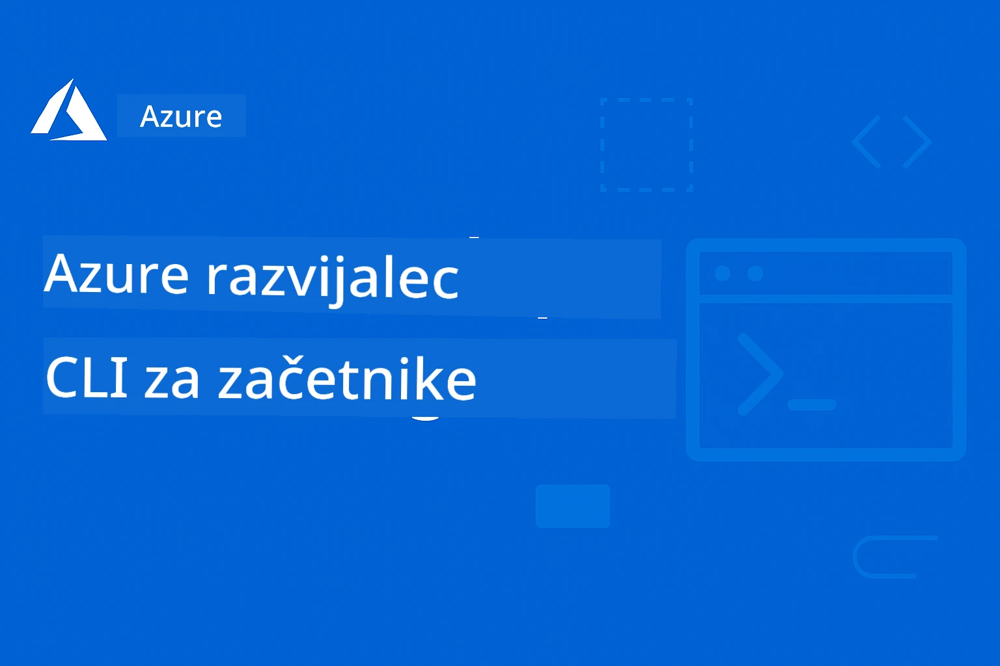

# AZD za začetnike: strukturirano učno potovanje

 

[](https://github.com/microsoft/AZD-for-beginners)
[](https://GitHub.com/microsoft/azd-for-beginners/network/)
[](https://github.com/microsoft/AZD-for-beginners)

[](https://discord.com/invite/nkVh3dp)
[](https://discord.gg/nTYy5BXMWG)

---

### Avtomatizirani prevodi (vedno posodobljeni)

<!-- CO-OP TRANSLATOR LANGUAGES TABLE START -->
[Arabščina](../ar/README.md) | [Bengalščina](../bn/README.md) | [Bolgarščina](../bg/README.md) | [Burmanski (Mjanmar)](../my/README.md) | [Kitajščina (poenostavljena)](../zh-CN/README.md) | [Kitajščina (tradicionalna, Hong Kong)](../zh-HK/README.md) | [Kitajščina (tradicionalna, Macao)](../zh-MO/README.md) | [Kitajščina (tradicionalna, Tajvan)](../zh-TW/README.md) | [Hrvaščina](../hr/README.md) | [Češčina](../cs/README.md) | [Danščina](../da/README.md) | [Nizozemščina](../nl/README.md) | [Estonščina](../et/README.md) | [Finščina](../fi/README.md) | [Francoščina](../fr/README.md) | [Nemščina](../de/README.md) | [Grščina](../el/README.md) | [Hebrejščina](../he/README.md) | [Hindi](../hi/README.md) | [Madžarščina](../hu/README.md) | [Indonezijščina](../id/README.md) | [Italijanščina](../it/README.md) | [Japonščina](../ja/README.md) | [Kannada](../kn/README.md) | [Khmer](../km/README.md) | [Korejščina](../ko/README.md) | [Litovščina](../lt/README.md) | [Malajščina](../ms/README.md) | [Malajalamščina](../ml/README.md) | [Maratščina](../mr/README.md) | [Nepalščina](../ne/README.md) | [Nigerijski pidgin](../pcm/README.md) | [Norveščina](../no/README.md) | [Perzijščina (Farsi)](../fa/README.md) | [Poljščina](../pl/README.md) | [Portugalščina (Brazilija)](../pt-BR/README.md) | [Portugalščina (Portugal)](../pt-PT/README.md) | [Punjabi (Gurmukhi)](../pa/README.md) | [Romunščina](../ro/README.md) | [Ruščina](../ru/README.md) | [Srbščina (cirilica)](../sr/README.md) | [Slovaščina](../sk/README.md) | [Slovenščina](./README.md) | [Španščina](../es/README.md) | [Svahili](../sw/README.md) | [Švedščina](../sv/README.md) | [Tagalog (Filipini)](../tl/README.md) | [Tamilščina](../ta/README.md) | [Telugujščina](../te/README.md) | [Tajščina](../th/README.md) | [Turščina](../tr/README.md) | [Ukrajinščina](../uk/README.md) | [Urdu](../ur/README.md) | [Vietnamščina](../vi/README.md)

> **Raje klonirate lokalno?**
>
> Ta repozitorij vključuje prevode v več kot 50 jezikov, kar znatno poveča velikost prenosa. Za kloniranje brez prevodov uporabite sparse checkout:
>
> **Bash / macOS / Linux:**
> ```bash
> git clone --filter=blob:none --sparse https://github.com/microsoft/AZD-for-beginners.git
> cd AZD-for-beginners
> git sparse-checkout set --no-cone '/*' '!translations' '!translated_images'
> ```
>
> **CMD (Windows):**
> ```cmd
> git clone --filter=blob:none --sparse https://github.com/microsoft/AZD-for-beginners.git
> cd AZD-for-beginners
> git sparse-checkout set --no-cone "/*" "!translations" "!translated_images"
> ```
>
> To vam zagotovi vse, kar potrebujete za dokončanje tečaja s precej hitrejšim prenosom.
<!-- CO-OP TRANSLATOR LANGUAGES TABLE END -->

## 🆕 Kaj je danes novega v azd

> 📌 **Posodobitev Foundry GA (2026-11-09):** Paket **`microsoft.foundry` 1.0 je splošno na voljo**, napovedano 5. novembra 2026 na [novembrski konferenci](https://devblogs.microsoft.com/azure-sdk/microsoft-foundry-azure-developer-cli-ga/). Uporabite **`azd >= 1.37.0`** in ga namestite z `azd ext install microsoft.foundry`. Sledite [vodniku za gostitelja agenta](docs/chapter-02-ai-development/microsoft-foundry-integration.md#hosted-agent-walkthrough-ga) za namestitev, lokalno testiranje in uvajanje. Ta posodobitev temelji na objavljenih navodilih in ne na živi Azure namestitvi; paket GA ne naredi vseh izbirnih funkcij, razširitev ali SDK splošno dostopnih.

Azure Developer CLI podpira številne vrste aplikacij, vključno s spletnimi aplikacijami, API-ji in AI agenti, skozi podprte gostitelje, predloge in razširitve.

Tukaj je, kaj to pomeni za vas:

- **Paket GA za Foundry razvoj.** `microsoft.foundry` namesti sedem osnovnih razširitev, vključno z agenti, projekti in Agent Inspectorjem. Koda agenta in nastavitve uvajanja so skupaj v `azure.yaml`.
- **Testirajte lokalno, nato uvajajte svojo kodo.** Uporabite `azd ai agent init --deploy-mode code`, `azd provision` in `azd ai agent run` za pregled lokalnih zahtevkov in odgovorov. Nato uporabite `azd deploy` za oddaljeno sestavo v Foundry brez lokalne sestave kontejnerja.
- **Merite kakovost ločeno.** Namestite **`azure.ai.evaluations`** za `azd ai eval generate`, `init` in `run start`; ni vključeno v paket. Ohranite pregledane nabor podatkov in kriterije s svojo kodo. Starejši projekti naj sledijo [vodniku za migracijo ocenjevanja in optimizacije](docs/chapter-08-production/production-ai-practices.md#evaluation-migration-and-quality-checks).
- **Ponovna uporaba konfiguracije v CI/CD.** Po uspešnem `azd up` nastavite pipeline z `azd pipeline config`. Namestite paket na izvajalca in ohranite ustvarjene nastavitve pristnosti in okolja.
- **Bolj gladke osnovne dnevne naloge.** Nedavne različice so naredile `azd init` idempotenten (varno ponovni zagon), `azd auth login` samodejno počisti zastarele žetone in dodal prijazno `azd tool` poziv ob prvem zagonu.
- **Osnovni potek dela se ni spremenil.** Ne glede na to, ali uvajate todo aplikacijo, mikrostoritev ali večagentno AI rešitev, so ukazi enaki.

> **Opomba za uporabnike Aspire:** Microsoft zdaj izdelek imenuje preprosto **Aspire** (prej ".NET Aspire"). Podpora za Aspire v azd je nespremenjena – posodobljeno je bilo samo ime.

Če ste že uporabljali azd, je podpora AI naravna razširitev – ne ločeno orodje ali napredna steza. Če začnete iz nič, boste spoznali en potek dela, ki deluje za vse.

---

## 🚀 Kaj je Azure Developer CLI (azd)?

**Azure Developer CLI (azd)** je prijazen ukazni pripomoček za razvijalce, ki poenostavi uvajanje aplikacij v Azure. Namesto ročnega ustvarjanja in povezovanja ducatov Azure virov lahko uvajate celotne aplikacije z enim ukazom.

### Čarobnost `azd up`

```bash
# This single command does everything:
# ✅ Creates all Azure resources  
# ✅ Configures networking and security
# ✅ Builds your application code
# ✅ Deploys to Azure
# ✅ Gives you a working URL
azd up
```

Predloga zagotavlja konfiguracijo aplikacije in infrastrukture. Uspešna namestitev še vedno zahteva podprte storitve/modeli, zadostne kvote in dovoljenja, pravilne vhodne podatke ter preverjanje nameščene aplikacije. `azd up` ne naredi predloge samodejno varne, skladne ali primerne za produkcijo.

---

## ❓ Azure Developer CLI proti Azure CLI: Kakšna je razlika?

To je najpogostejše vprašanje začetnikov. Tukaj je preprost odgovor:

| Značilnost | **Azure CLI (`az`)** | **Azure Developer CLI (`azd`)** |
|---------|---------------------|--------------------------------|
| **Namen** | Upravljanje posameznih Azure virov | Uvajanje popolnih aplikacij |
| **Razmišljanje** | Osredotočeno na infrastrukturo | Osredotočeno na aplikacije |
| **Primer** | `az webapp create --name myapp...` | `azd up` |
| **Učna krivulja** | Mora poznati Azure storitve | Pozna le svojo aplikacijo |
| **Najbolj za** | DevOps, infrastrukturo | Razvijalce, prototipiranje |

### Preprosta primerjava

- **Azure CLI** je kot imeti vsa orodja za gradnjo hiše - kladiva, žage, žeblje. Lahko zgradite karkoli, vendar morate poznati gradbeništvo.
- **Azure Developer CLI** je kot najeti izvajalca - vi opisujete, kaj želite, in oni poskrbijo za gradnjo.

### Kdaj uporabiti katerega

| Scenarij | Uporabite to |
|----------|----------|
| "Želim hitro uvajati svojo spletno aplikacijo" | `azd up` |
| "Potrebujem ustvariti samo račun za shranjevanje" | `az storage account create` |
| "Gradim celotno AI aplikacijo" | `azd init --template azure-search-openai-demo` |
| "Moram odpravljati napake na določenem Azure viru" | `az resource show` |
| "Želim uvajati v svoje nastavljeno produkcijsko okolje" | Preverite konfiguracijo, dostop, stroške in operativne omejitve pred `azd up --environment production` |

### Delujeta skupaj!

AZD in Azure CLI imata ločeno avtentikacijo in konfiguracijo. Za AZD uporabite `azd auth login`, za Azure CLI pa `az login`, kadar ukaz ali diagnostični ukaz posebej zahteva Azure CLI. Lahko uporabljate oba:
```bash
# Deploy your app with AZD
azd up

# Then fine-tune specific resources with Azure CLI
az webapp config set --name myapp --always-on true
```

---

## 🌟 Najdite predloge v Awesome AZD

Ne začnite iz nič! **Awesome AZD** je skupnostna zbirka predlog pripravljenih za uvajanje:

| Vir | Opis |
|----------|-------------|
| 🔗 [**Awesome AZD galerija**](https://azure.github.io/awesome-azd/) | Brskajte med 200+ predlog z enim klikom za uvajanje |
| 🔗 [**Oddajte predlogo**](https://github.com/Azure/awesome-azd/issues) | Prispevajte svojo predlogo skupnosti |
| 🔗 [**GitHub repozitorij**](https://github.com/Azure/awesome-azd) | Dajte zvezdico in raziščite izvorno kodo |

### Priljubljene AI predloge iz Awesome AZD

Izberite eno predlogo v lastnem praznem imeniku; spodnji ukazi so alternative. Zadnji `.` inicializira ta imenik.

```bash
# RAG Chat with Microsoft Foundry Models + AI Search
azd init --template azure-search-openai-demo .

# Quick AI Chat Application
azd init --template openai-chat-app-quickstart .

# AI Agents with Foundry Agents
azd init --template get-started-with-ai-agents .
```

---

## 🎯 Začetek v 3 korakih

Pred začetkom se prepričajte, da je vaš računalnik pripravljen za predlogo, ki jo želite uvesti:

**Windows:**
```powershell
.\validate-setup.ps1
```

**macOS / Linux:**
```bash
bash ./validate-setup.sh
```

Če kateri koli zahtevan pregled ne uspe, ga najprej popravite, nato nadaljujte s hitrim začetkom.

### Korak 1: Namestite AZD (2 minuti)

**Windows:**
```powershell
winget install microsoft.azd
```

**macOS:**
```bash
brew tap azure/azd && brew install azd
```

**Linux:**
```bash
curl -fsSL https://aka.ms/install-azd.sh | bash
```

### Korak 2: Avtentikacija za AZD

```bash
# Optional if you plan to use Azure CLI commands directly in this course
az login

# Required for AZD workflows
azd auth login
```

Če niste prepričani, katerega potrebujete, sledite celotnemu postopku v [Namestitev in nastavitev](docs/chapter-01-foundation/installation.md#authentication-setup).

### Korak 3: Uvajanje vaše prve aplikacije

```bash
# Initialize from a template
azd init --template todo-nodejs-mongo .

# Deploy to Azure (creates everything!)
azd up
```

**🎉 To je to!** Vaša aplikacija je zdaj aktivna na Azure.

### Počistite (ne pozabite!)

```bash
# Remove all resources when done experimenting
azd down --force --purge
```

---

## 📚 Kako uporabljati ta tečaj

Ta tečaj je zasnovan za **postopno učenje** - začnite tam, kjer ste udobni, in napredujte:

| Vaše izkušnje | Začnite tukaj |
|-----------------|------------|
| **Popoln začetnik v Azure** | [1. poglavje: osnove](#-chapter-1-foundation--quick-start) |
| **Poznam Azure, nov v AZD** | [1. poglavje: osnove](#-chapter-1-foundation--quick-start) |
| **Želim uvajati AI aplikacije** | [2. poglavje: AI-prvo programiranje](#-chapter-2-ai-first-development-recommended-for-ai-developers) |
| **Želim praktične vaje** | [🎓 Interaktivna delavnica](workshop/README.md) - 3-4 ure vodene vaje |
| **Potrebujem produkcijske vzorce** | [8. poglavje: produkcija in podjetje](#-chapter-8-production--enterprise-patterns) |

### Hitro nastavljanje

1. **Forkajte ta repozitorij**: [](https://GitHub.com/microsoft/azd-for-beginners/fork)
2. **Klonirajte ga**: `git clone https://github.com/YOUR-USERNAME/azd-for-beginners.git`
3. **Poiščite pomoč**: [Azure Discord skupnost](https://discord.com/invite/ByRwuEEgH4)

> **Raje klonirate lokalno?**

> To skladišče vključuje prevode v več kot 50 jezikih, kar pomembno poveča velikost prenosa. Če želite klonirati brez prevodov, uporabite sparse checkout:
> ```bash
> git clone --filter=blob:none --sparse https://github.com/microsoft/AZD-for-beginners.git
> cd AZD-for-beginners
> git sparse-checkout set --no-cone '/*' '!translations' '!translated_images'
> ```
> Tako dobite vse, kar potrebujete za dokončanje tečaja, z veliko hitrejšim prenosom.


## Pregled tečaja

Obvladajte Azure Developer CLI (azd) skozi strukturirane poglavja, zasnovana za postopno učenje. **Poseben poudarek na uvajanju AI aplikacij z integracijo Microsoft Foundry.**

### Zakaj je ta tečaj ključnega pomena za sodobne razvijalce

Razvijalci, ki uvajajo AI delovne obremenitve, pogosto potrebujejo smernice za:
- Kompleksne večstorivne AI arhitekture
- Najboljše prakse uvajanja AI v produkcijo  
- Integracijo in konfiguracijo Azure AI storitev
- Optimizacijo stroškov za AI delovne obremenitve
- Odpravljanje težav pri uvajanju specifičnih za AI

### Cilji učenja

Z dokončanjem tega strukturiranega tečaja boste:
- **Obvladali AZD osnove**: Osnovni pojmi, namestitev in konfiguracija
- **Uvajali AI aplikacije**: Uporabili AZD z Microsoft Foundry storitvami
- **Implementirali infrastrukturo kot kodo**: Upravljali Azure vire z Bicep predlogami
- **Odpravljali težave pri uvajanju**: Reševali pogoste težave in odpravljali napake
- **Optimizirali za produkcijo**: Varnost, skaliranje, nadzor in upravljanje stroškov
- **Gradili večagentne rešitve**: Uvajali kompleksne AI arhitekture

## Pred začetkom: računi, dostop in predpostavke

Pred začetkom 1. poglavja poskrbite, da imate naslednje elemente. Koraki namestitve kasneje v tem priročniku predvidevajo, da so osnovne stvari že uredjene.

- **Azure naročnina**: Uporabite lahko obstoječo naročnino z dela ali svoj račun, ali pa ustvarite [brezplačni preizkus](https://aka.ms/azurefreetrial) za začetek.
- **Dovoljenje za ustvarjanje Azure virov**: Za večino vaj morate imeti vsaj dostop **Contributor** do ciljne naročnine ali skupine virov. Nekatera poglavja lahko predpostavljajo tudi, da lahko ustvarjate skupine virov, upravljane identitete in RBAC dodelitve.
- [**GitHub račun**](https://github.com): Uporaben za vilice skladišča, sledenje lastnim spremembam in uporabo GitHub Codespaces za delavnico.
- **Pogoj za izvajanje predlog**: Nekatere predloge zahtevajo lokalna orodja, kot so Node.js, Python, Java ali Docker. Pred začetkom zaženite validator namestitve, da zgodaj odkrijete manjkajoča orodja.
- **Osnovno znanje terminala**: Ni potrebno biti strokovnjak, vendar morate biti udobni pri izvajanju ukazov kot so `git clone`, `azd auth login`, in `azd up`.

> **Delate v večji naročnini?**
> Če vaš Azure okolje upravlja administrator, vnaprej preverite, ali lahko uvajate vire v naročnini ali skupini virov, ki jo nameravate uporabiti. Če ne, zahtevajte naročnino za testiranje (sandbox) ali dostop Contributor pred začetkom.

> **Novinec v Azure?**
> Začnite z lastno preizkusno naročnino ali naročnino po porabi na https://aka.ms/azurefreetrial, da lahko opravite vaje od začetka do konca brez čakanja na odobritve na nivoju najemnika.

## 🗺️ Zemljevid tečaja: Hitro krmarjenje po poglavjih

Vsako poglavje ima namenski README z učnimi cilji, hitrimi začetki in vajami:

| Poglavje | Tema | Lekcije | Trajanje | Kompleksnost |
|---------|-------|---------|----------|------------|
| **[Pogl 1: Osnove](docs/chapter-01-foundation/README.md)** | Začetek | [AZD osnove](docs/chapter-01-foundation/azd-basics.md) &#124; [Namestitev](docs/chapter-01-foundation/installation.md) &#124; [Prvi projekt](docs/chapter-01-foundation/first-project.md) | 30-45 min | ⭐ |
| **[Pogl 2: AI razvoj](docs/chapter-02-ai-development/README.md)** | AI-prve aplikacije | [Integracija Foundry](docs/chapter-02-ai-development/microsoft-foundry-integration.md) &#124; [AI agenti](docs/chapter-02-ai-development/agents.md) &#124; [Uvajanje modelov](docs/chapter-02-ai-development/ai-model-deployment.md) &#124; [Delavnica](docs/chapter-02-ai-development/ai-workshop-lab.md) | 1-2 ura | ⭐⭐ |
| **[Pogl 3: Konfiguracija](docs/chapter-03-configuration/README.md)** | Avtentikacija in varnost | [Konfiguracija](docs/chapter-03-configuration/configuration.md) &#124; [Avtentikacija in varnost](docs/chapter-03-configuration/authsecurity.md) | 45-60 min | ⭐⭐ |
| **[Pogl 4: Infrastruktura](docs/chapter-04-infrastructure/README.md)** | IaC in uvajanje | [Priročnik za uvajanje](docs/chapter-04-infrastructure/deployment-guide.md) &#124; [Provisioning](docs/chapter-04-infrastructure/provisioning.md) | 1-1.5 ura | ⭐⭐⭐ |
| **[Pogl 5: Večagentno](docs/chapter-05-multi-agent/README.md)** | AI agentne rešitve | [Scenarij trgovine](examples/retail-scenario.md) &#124; [Vzorec usklajevanja](docs/chapter-06-pre-deployment/coordination-patterns.md) | 2-3 ura | ⭐⭐⭐⭐ |
| **[Pogl 6: Pred uvajanjem](docs/chapter-06-pre-deployment/README.md)** | Načrtovanje in preverjanje | [Preflight kontrole](docs/chapter-06-pre-deployment/preflight-checks.md) &#124; [Načrtovanje kapacitet](docs/chapter-06-pre-deployment/capacity-planning.md) &#124; [Izbira SKU](docs/chapter-06-pre-deployment/sku-selection.md) &#124; [App Insights](docs/chapter-06-pre-deployment/application-insights.md) | 1 ura | ⭐⭐ |
| **[Pogl 7: Odpravljanje težav](docs/chapter-07-troubleshooting/README.md)** | Razhroščevanje in popravki | [Pogoste težave](docs/chapter-07-troubleshooting/common-issues.md) &#124; [Razhroščevanje](docs/chapter-07-troubleshooting/debugging.md) &#124; [Težave AI](docs/chapter-07-troubleshooting/ai-troubleshooting.md) | 1-1.5 ura | ⭐⭐ |
| **[Pogl 8: Produkcija](docs/chapter-08-production/README.md)** | Podjetniški vzorci | [Prakse za produkcijo](docs/chapter-08-production/production-ai-practices.md) | 2-3 ura | ⭐⭐⭐⭐ |
| **[🎓 Delavnica](workshop/README.md)** | Praktična delavnica | [Uvod](workshop/docs/instructions/0-Introduction.md) &#124; [Izbira](workshop/docs/instructions/1-Select-AI-Template.md) &#124; [Validacija](workshop/docs/instructions/2-Validate-AI-Template.md) &#124; [Razstavljanje](workshop/docs/instructions/3-Deconstruct-AI-Template.md) &#124; [Konfiguracija](workshop/docs/instructions/4-Configure-AI-Template.md) &#124; [Prilagoditev](workshop/docs/instructions/5-Customize-AI-Template.md) &#124; [Demontaža](workshop/docs/instructions/6-Teardown-Infrastructure.md) &#124; [Zaključek](workshop/docs/instructions/7-Wrap-up.md) | 3-4 ura | ⭐⭐ |

**Skupno trajanje tečaja:** ~10-14 ur | **Napredovanje veščin:** Začetnik → Pripravljen za produkcijo

---

## 📚 Učna poglavja

*Izberite svojo pot učenja glede na izkušnje in cilje*

### 🚀 Poglavje 1: Osnove in hitri začetek
**Predpogoji**: Azure naročnina, osnovno znanje ukazne vrstice  
**Trajanje**: 30-45 minut  
**Kompleksnost**: ⭐

#### Kaj boste naučili
- Razumevanje osnov Azure Developer CLI
- Namestitev AZD na vašo platformo
- Vaša prva uspešna namestitev

#### Učni viri
- **🎯 Začnite tukaj**: [Kaj je Azure Developer CLI?](#-what-is-azure-developer-cli-azd)
- **📖 Teorija**: [AZD osnove](docs/chapter-01-foundation/azd-basics.md) - Osnovni pojmi in terminologija
- **⚙️ Namestitev**: [Namestitev in nastavitev](docs/chapter-01-foundation/installation.md) - Vodniki specifični za platformo
- **🛠️ Praktično**: [Vaš prvi projekt](docs/chapter-01-foundation/first-project.md) - Korak po korak vadnica
- **📋 Hiter pregled**: [Prikaz ukazov](resources/cheat-sheet.md)

#### Praktične vaje
```bash
# Quick installation check
azd version

# Deploy your first application
azd init --template todo-nodejs-mongo .
azd up
```

**💡 Izid poglavja**: Uspešno uvedite preprosto spletno aplikacijo na Azure z uporabo AZD

**✅ Potrditev uspeha:**
```bash
# After completing Chapter 1, you should be able to:
azd version              # Shows installed version
azd init --template todo-nodejs-mongo  # Initializes project
azd up                  # Deploys to Azure
azd show                # Displays running app URL
# Application opens in browser and works
azd down --force --purge  # Cleans up resources
```

**📊 Časovna investicija:** 30-45 minut  
**📈 Stopnja znanja po:** Lahko samostojno uvajate osnovne aplikacije

---

### 🤖 Poglavje 2: AI-vodni razvoj (Priporočeno za AI razvijalce)
**Predpogoji**: Zaključeno poglavje 1  
**Trajanje**: 1-2 uri  
**Kompleksnost**: ⭐⭐

#### Kaj boste naučili
- Integracija Microsoft Foundry z AZD
- Uvajanje AI-poganjanih aplikacij
- Razumevanje konfiguracij AI storitev

#### Učni viri
- **🎯 Začnite tukaj**: [Integracija Microsoft Foundry](docs/chapter-02-ai-development/microsoft-foundry-integration.md)
- **🤖 AI agenti**: [Vodnik AI agentov](docs/chapter-02-ai-development/agents.md) - Uvajajte inteligentne agente z AZD
- **📖 Vzorci**: [Uvajanje AI modelov](docs/chapter-02-ai-development/ai-model-deployment.md) - Uvajajte in upravljajte AI modele
- **🛠️ Delavnica**: [AI delavnica](docs/chapter-02-ai-development/ai-workshop-lab.md) - Pripravite svoje AI rešitve za AZD
- **🎥 Interaktivni vodič**: [Materiali delavnice](workshop/README.md) - Učenje preko brskalnika z MkDocs * DevContainer okolje
- **📋 Predloge**: [Microsoft Foundry predloge](#featured-microsoft-foundry-templates)
- **📝 Primeri**: [Primeri uvedbe AZD](examples/README.md)

#### Praktične vaje
```bash
# Deploy your first AI application
azd init --template azure-search-openai-demo .
azd up

# Try additional AI templates
azd init --template openai-chat-app-quickstart .
azd init --template agent-openai-python-prompty .
```

**💡 Izid poglavja**: Uvedite in konfigurirajte AI-poganjan klepetalni program z zmožnostmi RAG

**✅ Potrditev uspeha:**
```bash
# After Chapter 2, you should be able to:
azd init --template azure-search-openai-demo .
azd up
# Test the AI chat interface
# Ask questions and get AI-powered responses with sources
# Verify search integration works
azd monitor  # Check Application Insights shows telemetry
azd down --force --purge
```

**📊 Časovna investicija:** 1-2 uri  
**📈 Stopnja znanja po:** Lahko uvajate AI učne aplikacije in določite dodatne zahteve za produkcijsko pripravo
**💰 Zavedanje stroškov:** Razumete stroške razvoja 80-150 $/mesec, produkcijske stroške 300-3500 $/mesec

#### 💰 Stroški uvajanja AI

**Razvojno okolje (ocenjeno 80-150 $/mesec):**
- Microsoft Foundry modeli (po porabi): 0-50 $/mesec (glede na uporabo žetonov)
- AI Search (osnovni razred): 75 $/mesec
- Container Apps (poraba): 0-20 $/mesec
- Shranjevanje (standardno): 1-5 $/mesec

**Produkcijsko okolje (ocenjeno 300-3500+ $/mesec):**
- Microsoft Foundry modeli (PTU za stabilno zmogljivost): 3000+ $/mesec ALI po porabi z velikim obsegom
- AI Search (standardni razred): 250 $/mesec
- Container Apps (namensko): 50-100 $/mesec
- Application Insights: 5-50 $/mesec
- Shranjevanje (premium): 10-50 $/mesec

**💡 Nasveti za optimizacijo stroškov:**
- Preverite cenik inferenc modelov in specifične kredite za račun; Azure OpenAI ne vključuje univerzalnega mesečnega brezplačnega limita 50.000 žetonov
- Zaženite `azd down` za brisanje virov, ko jih ne potrebujete več, po preverjanju izbranega okolja
- Začnite z obračunom po porabi, PTU nadgradite samo za produkcijo
- Uporabite `azd provision --preview` za pregled načrtovane infrastrukture, nato ocenite stroške virov z Azure Kalkulatorjem cen
- Omogočite samodejno skaliranje: plačajte samo za dejansko uporabo

**Nadzor stroškov:**
```bash
# Inspect planned resources (this does not calculate prices)
azd provision --preview

# Monitor actual costs in Azure Portal
az consumption budget list --resource-group <your-rg>
```

---

### ⚙️ Poglavje 3: Konfiguracija in avtentikacija
**Predpogoji**: Zaključeno poglavje 1  
**Trajanje**: 45-60 minut  
**Kompleksnost**: ⭐⭐

#### Kaj boste naučili
- Nastavitev in upravljanje okolja
- Najboljše prakse avtentikacije in varnosti
- Imenovanje in organizacija virov

#### Učni viri
- **📖 Konfiguracija**: [Priročnik za konfiguracijo](docs/chapter-03-configuration/configuration.md) - Nastavitev okolja
- **🔐 Varnost**: [Vzorec avtentikacije in upravljane identitete](docs/chapter-03-configuration/authsecurity.md) - Vzorec avtentikacije
- **📝 Primeri**: [Primer aplikacije z bazo podatkov](examples/database-app/README.md) - Primeri za AZD bazo podatkov

#### Praktične vaje
- Nastavite več okolij (razvojno, testno, produkcijsko)
- Nastavite upravljanje identitete avtentikacije
- Uvedite konfiguracije specifične za okolje

**💡 Izid poglavja**: Upravljajte več okolij z ustrezno avtentikacijo in varnostjo

---

### 🏗️ Poglavje 4: Infrastruktura kot koda in uvajanje
**Predpogoji**: Zaključena poglavja 1-3  
**Trajanje**: 1-1.5 ura  
**Kompleksnost**: ⭐⭐⭐

#### Kaj boste naučili
- Napredni vzorci uvajanja
- Infrastruktura kot koda z Bicep
- Strategije za zagotavljanje virov

#### Učni viri
- **📖 Uvajanje**: [Priročnik za uvajanje](docs/chapter-04-infrastructure/deployment-guide.md) - Celotni delovni tokovi
- **🏗️ Provisioning**: [Upravljanje Azure virov](docs/chapter-04-infrastructure/provisioning.md) - Upravljanje Azure virov
- **📝 Primeri**: [Primer Container aplikacije](../../examples/container-app) - Uvajanje kontejnerjev

#### Praktične vaje
- Ustvarite prilagojene Bicep predloge
- Uvedite večstorivne aplikacije
- Implementirajte strategije modro-zelene uvedbe

**💡 Izid poglavja**: Uvajajte kompleksne večstorivne aplikacije s prilagojenimi predlogami infrastrukture

---

### 🎯 Poglavje 5: Večagentne AI rešitve (Napredno)
**Predpogoji**: Zaključena poglavja 1-2  
**Trajanje**: 2-3 ure  
**Kompleksnost**: ⭐⭐⭐⭐

#### Kaj boste naučili
- Vzorci za večagentno arhitekturo
- Orkestracija in koordinacija agentov
- Produkcijsko pripravljene AI uvedbe

#### Učni viri
- **🤖 Izpostavljena zasnova**: [Rešitev za več agentov za trgovino na drobno](examples/retail-scenario.md) - Arhitekturna zasnova, ne popolna aplikacija
- **🛠️ ARM predloge**: [Paket ARM predlog](../../examples/retail-multiagent-arm-template) - Infrastrukturni temelj; preglej predpogoje in manjkajoče komponente aplikacije
- **📖 Arhitektura**: [Vzorce koordinacije več agentov](docs/chapter-06-pre-deployment/coordination-patterns.md) - Vzorce

#### Praktične vaje
```bash
# Inspect the retail infrastructure scaffold before choosing to deploy it
cd examples/retail-multiagent-arm-template
cat README.md

# After an intentional deployment, inspect infrastructure state
az deployment group show --resource-group <rg-name> --name <deployment-name>
```

**💡 Cilj poglavja**: Razumeti zasnovo več agentov in prepoznati potrebna implementacijska, validacijska in operativna dela, ki presegajo infrastrukturo

---

### 🔍 Poglavje 6: Validacija in načrtovanje pred uvajanjem
**Predpogoji**: Dokončano poglavje 4  
**Trajanje**: 1 ura  
**Zahtevnost**: ⭐⭐

#### Kaj se boste naučili
- Načrtovanje kapacitet in validacija virov
- Strategije izbire SKU
- Preletni pregledi in avtomatizacija

#### Učni viri
- **📊 Načrtovanje**: [Načrtovanje kapacitet](docs/chapter-06-pre-deployment/capacity-planning.md) - Validacija virov
- **💰 Izbira**: [Izbira SKU](docs/chapter-06-pre-deployment/sku-selection.md) - Stroškovno učinkovite izbire
- **✅ Validacija**: [Preletni pregledi](docs/chapter-06-pre-deployment/preflight-checks.md) - Avtomatizirani skripti

#### Praktične vaje
- Zaženi skripte za validacijo kapacitet
- Optimiziraj izbire SKU za stroške
- Izvedi avtomatizirane preletne preglede pred uvajanjem

**💡 Cilj poglavja**: Validirati in optimizirati uvajanja pred izvedbo

---

### 🚨 Poglavje 7: Odpravljanje težav in razhroščevanje
**Predpogoji**: Dokončano katerokoli poglavje o uvajanju  
**Trajanje**: 1-1,5 ure  
**Zahtevnost**: ⭐⭐

#### Kaj se boste naučili
- Sistematični pristopi k razhroščevanju
- Pogoste težave in rešitve
- Odpravljanje težav specifičnih za AI

#### Učni viri
- **🔧 Pogoste težave**: [Pogoste težave](docs/chapter-07-troubleshooting/common-issues.md) - Pogosta vprašanja in rešitve
- **🕵️ Razhroščevanje**: [Vodnik za razhroščevanje](docs/chapter-07-troubleshooting/debugging.md) - Strategije korak za korakom
- **🤖 Težave AI**: [Odpravljanje težav specifičnih za AI](docs/chapter-07-troubleshooting/ai-troubleshooting.md) - Težave pri AI storitvah

#### Praktične vaje
- Diagnoza napak pri uvajanju
- Rešitev težav z avtentikacijo
- Odpravljanje težav s povezljivostjo AI storitev

**💡 Cilj poglavja**: Samostojno diagnosticirati in rešiti pogoste težave pri uvajanju

---

### 🏢 Poglavje 8: Produkcijski in poslovni vzorci
**Predpogoji**: Dokončana poglavja 1-4  
**Trajanje**: 2-3 ure  
**Zahtevnost**: ⭐⭐⭐⭐

#### Kaj se boste naučili
- Strategije produkcijskega uvajanja
- Poslovni varnostni vzorci
- Spremljanje in optimizacija stroškov

#### Učni viri
- **🏭 Produkcija**: [Produkcijske AI najboljše prakse](docs/chapter-08-production/production-ai-practices.md) - Poslovni vzorci
- **📝 Primeri**: [Primer mikrostoritev](../../examples/microservices) - Kompleksne arhitekture
- **📊 Spremljanje**: [Integracija Application Insights](docs/chapter-06-pre-deployment/application-insights.md) - Spremljanje

#### Praktične vaje
- Izvedi varnostne poslovne vzorce
- Nastavi celovito spremljanje
- Uvedi v produkcijo z ustreznim upravljanjem

**💡 Cilj poglavja**: Uvajati poslovno pripravljene aplikacije s polnimi produkcijskimi zmožnostmi

---

## 🎓 Pregled delavnice: Praktična izkušnja učenja

> **⚠️ STATUS DELAVNICE: Aktivni razvoj**  
> Materiali delavnice so trenutno v razvoju in nadgradnji. Osnovni moduli delujejo, napredni deli so delno nepopolni. Aktivno dokončujemo vse vsebine. [Sledi napredku →](workshop/README.md)

### Interaktivni materiali delavnice
**Celovito praktično učenje z orodji v brskalniku in vodenimi vajami**

Naši materiali za delavnico nudijo strukturirano, interaktivno učno izkušnjo, ki dopolnjuje zgornjo vsebino po poglavjih. Delavnica je namenjena tako samostojnemu učenju kot sejem vodenim sejm.

#### 🛠️ Značilnosti delavnice
- **Vmesnik v brskalniku**: Popolna delavnica poganjana z MkDocs, z iskanjem, kopiranjem in tematskimi funkcijami
- **Integracija GitHub Codespaces**: Nastavitev razvojnega okolja z enim klikom
- **Strukturirana učna pot**: 8-modulne vodene vaje (skupaj 3-4 ure)
- **Postopna metodologija**: Uvod → Izbira → Validacija → Razčlenitev → Konfiguracija → Prilagoditev → Odprava → Povzetek
- **Interaktivno razvojno okolje DevContainer**: Prednastavljena orodja in odvisnosti

#### 📚 Struktura modulov delavnice
Delavnica sledi **8-modulni postopni metodologiji**, ki vas vodi od odkrivanja do mojstrstva uvajanja:

| Modul | Tema | Kaj boste naredili | Trajanje |
|--------|-------|----------------|----------|
| **0. Uvod** | Pregled delavnice | Razumeti učne cilje, predpogoje in strukturo delavnice | 15 min |
| **1. Izbira** | Odkritje predlog | Raziskati AZD predloge in izbrati pravo AI predlogo za scenarij | 20 min |
| **2. Validacija** | Uvedba in preverjanje | Uvedi predlogo z `azd up` in validiraj delovanje infrastrukture | 30 min |
| **3. Razčlenitev** | Razumevanje strukture | Uporabi GitHub Copilot za raziskovanje arhitekture predloge, Bicep datotek in organizacije kode | 30 min |
| **4. Konfiguracija** | Poglobljen ogled azure.yaml | Obvladaj konfiguracijo `azure.yaml`, življenjske klice in spremenljivke okolja | 30 min |
| **5. Prilagoditev** | Prilagodi sebi | Omogoči AI iskanje, spremljanje, ocenjevanje in prilagodi za svoj scenarij | 45 min |
| **6. Odprava** | Čiščenje | Varen odjem virov z `azd down --purge` | 15 min |
| **7. Povzetek** | Naslednji koraki | Pregled dosežkov, ključnih pojmov in nadaljevanje učenja | 15 min |

**Potek delavnice:**
```
Introduction → Selection → Validation → Deconstruction → Configuration → Customization → Teardown → Wrap-up
     ↓            ↓           ↓              ↓               ↓              ↓            ↓           ↓
  Overview    Find the     Deploy &      Explore        Master         Customize     Clean up    Review &
             right        verify        code &        azure.yaml      for your      resources   next steps
             template                   structure                     scenario
```

#### 🚀 Začetek delavnice
```bash
# Option 1: GitHub Codespaces (Recommended)
# Click "Code" → "Create codespace on main" in the repository

# Option 2: Local Development
git clone https://github.com/microsoft/azd-for-beginners.git
cd azd-for-beginners/workshop
# Follow the setup instructions in workshop/README.md
```

#### 🎯 Cilji delavnice
S končanjem delavnice bodo udeleženci:
- **Uvedli produkcijske AI aplikacije**: Uporabili AZD z Microsoft Foundry storitvami
- **Obvladali arhitekturo več agentov**: Implementirali koordinirane AI rešitve z več agenti
- **Izvedli varnostnoprakse**: Nastavili avtentikacijo in nadzor dostopa
- **Optimizirali za obseg**: Oblikovali stroškovno učinkovita in zmogljiva uvajanja
- **Odpravljali težave uvajanja**: Samostojno rešili pogoste napake

#### 📖 Viri delavnice
- **🎥 Interaktivni vodnik**: [Materiali delavnice](workshop/README.md) - Učno okolje v brskalniku
- **📋 Navodila po modulih**:
  - [0. Uvod](workshop/docs/instructions/0-Introduction.md) - Pregled delavnice in cilji
  - [1. Izbira](workshop/docs/instructions/1-Select-AI-Template.md) - Iskanje in izbira AI predlog
  - [2. Validacija](workshop/docs/instructions/2-Validate-AI-Template.md) - Uvedba in preverjanje predlog
  - [3. Razčlenitev](workshop/docs/instructions/3-Deconstruct-AI-Template.md) - Raziskovanje arhitekture predloge
  - [4. Konfiguracija](workshop/docs/instructions/4-Configure-AI-Template.md) - Obvladovanje azure.yaml
  - [5. Prilagoditev](workshop/docs/instructions/5-Customize-AI-Template.md) - Prilagoditev lastnemu scenariju
  - [6. Odprava](workshop/docs/instructions/6-Teardown-Infrastructure.md) - Čiščenje virov
  - [7. Povzetek](workshop/docs/instructions/7-Wrap-up.md) - Pregled in nadaljnji koraki
- **🛠️ AI laboratorij delavnice**: [AI laboratorij delavnice](docs/chapter-02-ai-development/ai-workshop-lab.md) - Vaje osredotočene na AI
- **💡 Hiter začetek**: [Vodnik za nastavitev delavnice](workshop/README.md#browser-based-guide) - Konfiguracija okolja

**Popolno za**: Podjetniško usposabljanje, univerzitetne tečaje, samostojno učenje in razvojne bootcampe.

---

## 📖 Poglobljen vpogled: Zmožnosti AZD

Poleg osnovnih funkcij AZD ponuja močne zmožnosti za produkcijska uvajanja:

- **Uvajanja na osnovi predlog** - Uporabi vnaprej zgrajene predloge za običajne vzorce aplikacij
- **Infrastruktura kot koda** - Upravljaj Azure vire s pomočjo Bicep ali Terraform  
- **Integrirani delovni procesi** - Gladko uvajanje, nadzor in spremljanje aplikacij
- **Prijazno do razvijalcev** - Optimizirano za produktivnost in izkušnjo razvijalca

### **AZD + Microsoft Foundry: Popolno za AI uvajanja**

**Zakaj AZD za AI rešitve?** AZD rešuje glavne izzive AI razvijalcev:

- **Predloge pripravljene za AI** - Prednastavljene predloge za Microsoft Foundry modele, Azure AI storitve in ML delovne obremenitve
- **Varnost AI uvajanj** - Vgrajeni varnostni vzorci za AI storitve, API ključe in končne točke modelov  
- **Produkcijski AI vzorci** - Najboljše prakse za skalabilna, stroškovno učinkovita AI uvajanja aplikacij
- **End-to-End AI delovni procesi** - Od razvoja modela do produkcijskega uvajanja z ustreznim spremljanjem
- **Optimizacija stroškov** - Pametna dodelitev virov in strategije skaliranja za AI obremenitve
- **Integracija Microsoft Foundry** - Neprekinjena povezava s katalogom in končnimi točkami Microsoft Foundry modelov

---

## 🎯 Knjižnica predlog in primerov

### Izpostavljeno: Microsoft Foundry predloge
**Začni tukaj, če uvajaš AI aplikacije!**

> **Opomba:** Te predloge prikazujejo različne AI vzorce. Nekatere so zunanje Azure vzorci, druge so lokalne implementacije.

| Predloga | Poglavje | Zahtevnost | Storitve | Vrsta |
|----------|---------|------------|----------|------|
| [**Začni z AI klepetom**](https://github.com/Azure-Samples/get-started-with-ai-chat) | Poglavje 2 | ⭐⭐ | AzureOpenAI + Azure AI Model Inference API + Azure AI Search + Azure Container Apps + Application Insights | Zunanje |
| [**Začni z AI agenti**](https://github.com/Azure-Samples/get-started-with-ai-agents) | Poglavje 2 | ⭐⭐ | Foundry Agents + AzureOpenAI + Azure AI Search + Azure Container Apps + Application Insights| Zunanje |
| [**Azure Search + OpenAI demo**](https://github.com/Azure-Samples/azure-search-openai-demo) | Poglavje 2 | ⭐⭐ | Azure OpenAI + Azure AI Search + Container Apps (privzeto) + Storage | Zunanje |
| [**OpenAI Chat App Hiter začetek**](https://github.com/Azure-Samples/openai-chat-app-quickstart) | Poglavje 2 | ⭐ | AzureOpenAI + Container Apps + Application Insights | Zunanje |
| [**Agent OpenAI Python Prompty**](https://github.com/Azure-Samples/agent-openai-python-prompty) | Poglavje 5 | ⭐⭐⭐ | AzureOpenAI + Azure Functions + Prompty | Zunanje |
| [**Contoso Chat RAG**](https://github.com/Azure-Samples/contoso-chat) | Poglavje 8 | ⭐⭐⭐⭐ | AzureOpenAI + AI Search + Cosmos DB + Container Apps | Zunanje |
| [**Rešitev za več agentov v trgovini na drobno**](examples/retail-scenario.md) | Poglavje 5 | ⭐⭐⭐⭐ | Predlagana arhitektura in infrastruktura; potrebna implementacija aplikacije | **Lokalni načrt** |

### Izpostavljeno: Popolni učni scenariji
**Predloge aplikacij pripravljene za produkcijo, usklajene z učnimi poglavji**

| Predloga | Učno poglavje | Zahtevnost | Ključna naučena tema |
|----------|------------------|------------|--------------|
| [**openai-chat-app-quickstart**](https://github.com/Azure-Samples/openai-chat-app-quickstart) | Poglavje 2 | ⭐ | Osnovni vzorci uvajanja AI |
| [**azure-search-openai-demo**](https://github.com/Azure-Samples/azure-search-openai-demo) | Poglavje 2 | ⭐⭐ | Implementacija RAG z Azure AI Search |
| [**get-started-with-ai-agents**](https://github.com/Azure-Samples/get-started-with-ai-agents) | Poglavje 2 | ⭐⭐ | Agent-podprti klepet in testni primeri po meri |
| [**agent-openai-python-prompty**](https://github.com/Azure-Samples/agent-openai-python-prompty) | Poglavje 5 | ⭐⭐⭐ | Okvir agentov in klic funkcij |
| [**contoso-chat**](https://github.com/Azure-Samples/contoso-chat) | Poglavje 8 | ⭐⭐⭐ | Podjetniška AI orkestracija |
| [**retail-multi-agent-solution**](examples/retail-scenario.md) | Poglavje 5 | ⭐⭐⭐⭐ | Arhitektura z več agenti za stranke in inventar |

### Učenje po vrsti primerov

> **📌 Lokalni vs. Zunanji primeri:**  
> **Lokalni primeri** (v tem repozitoriju) = Preveri README primerov za status izvedbe in predpogoje
> **Zunanji primeri** (Azure vzorci) = Kloniraj iz povezanih repozitorijev

#### Lokalni primeri (pripravljeni za uporabo)
- [**Rešitev za več agentov v trgovini na drobno**](examples/retail-scenario.md) - Arhitekturni načrt z ARM infrastrukturo
  - Predlagane vloge agentov za stranke in inventar
  - Nadzor, ocena in koda aplikacije morajo biti implementirani in preverjeni
  - Samo dodeljevanje virov ne zagotavlja delujoče maloprodajne aplikacije

#### Lokalni primeri - aplikacije v vsebnikih (poglavja 2-5)
**Celoviti primeri uvajanja vsebnikov v tem repozitoriju:**
- [**Primeri aplikacij v vsebnikih**](examples/container-app/README.md) - Popoln vodič za uvajanja vsebnikov
  - [Preprost Flask API](../../examples/container-app/simple-flask-api) - Osnovni REST API z možnostjo skaliranja do ničle
  - [Arhitektura mikrostoritev](../../examples/container-app/microservices) - Dva storitvena učna primera; produkcijska utrditev zahteva dodaten trud
  - Hitri začetki, produkcijski in napredni vzorci uvajanja
  - Navodila za spremljanje, varnost in optimizacijo stroškov

#### Zunanji primeri - preproste aplikacije (poglavja 1-2)
**Kloniraj te Azure vzorčne repozitorije za začetek:**
- [Preprosta spletna aplikacija - Node.js + MongoDB](https://github.com/Azure-Samples/todo-nodejs-mongo) - Osnovni vzorci uvajanja
- [Statična spletna stran - React SPA](https://github.com/Azure-Samples/todo-csharp-sql-swa-func) - Uvajanje statične vsebine
- [Container App - Python Flask](https://github.com/Azure-Samples/container-apps-store-api-microservice) - Namestitev REST API

#### Zunanji primeri - integracija baze podatkov (poglavji 3-4)  
- [Database App - C# + SQL](https://github.com/Azure-Samples/todo-csharp-sql) - Vzorce povezovanja z bazo podatkov
- [Functions + Cosmos DB](https://github.com/Azure-Samples/todo-python-mongo-swa-func) - Brezstrežni podatkovni potek

#### Zunanji primeri - napredni vzorci (poglavja 4-8)
- [Java Microservices](https://github.com/Azure-Samples/java-microservices-aca-lab) - Večstoritevne arhitekture
- [Container Apps Jobs](https://github.com/Azure-Samples/container-apps-jobs) - Ozadinsko procesiranje  
- [Enterprise ML Pipeline](https://github.com/Azure/mlops-v2) - Referenčni vzorci MLOps; ni predloga AZD za neposredno uporabo

### Zbirke zunanjih predlog
- [**Uradna galerija predlog AZD**](https://azure.github.io/awesome-azd/) - Kurirana zbirka uradnih in skupnostnih predlog
- [**Predloge Azure Developer CLI**](https://learn.microsoft.com/en-us/azure/developer/azure-developer-cli/azd-templates) - Dokumentacija predlog Microsoft Learn
- [**Mapa primerov**](examples/README.md) - Lokalni učni primeri z podrobnimi pojasnili

---

## 📚 Učni viri in reference

### Hitre reference
- [**Povzetek ukazov**](resources/cheat-sheet.md) - Ključni ukazi azd organizirani po poglavjih
- [**Slovarček**](resources/glossary.md) - Terminologija Azure in azd  
- [**Pogosta vprašanja**](resources/faq.md) - Pogosta vprašanja organizirana po učnih poglavjih
- [**Študijski vodič**](resources/study-guide.md) - Izčrpne praktične vaje

### Delavnice v živo
- [**AI delavnica v laboratoriju**](docs/chapter-02-ai-development/ai-workshop-lab.md) - Naredite svoje AI rešitve deploy-abilne z AZD (2-3 ure)
- [**Interaktivna delavnica**](workshop/README.md) - 8 modulov vodenih vaj z MkDocs in GitHub Codespaces
  - Sledi: Uvod → Izbor → Validacija → Dekonstrukcija → Konfiguracija → Prilagoditve → Razstavitev → Povzetek

### Zunanji učni viri
- [Dokumentacija Azure Developer CLI](https://learn.microsoft.com/en-us/azure/developer/azure-developer-cli/)
- [Azure Architecture Center](https://learn.microsoft.com/en-us/azure/architecture/)
- [Kalkulator cen Azure](https://azure.microsoft.com/pricing/calculator/)
- [Status Azure](https://status.azure.com/)

### Spretnosti AI agentov za vaš urejevalnik
- [**Microsoft Azure veščine na skills.sh**](https://skills.sh/microsoft/github-copilot-for-azure) - 37 odprtih agentnih veščin za Azure AI, Foundry, namestitev, diagnostiko, optimizacijo stroškov in več. Namestite jih v GitHub Copilot, Cursor, Claude Code ali katerikoli podprti agent:
  ```bash
  npx skills add microsoft/github-copilot-for-azure
  ```

---

## 🔧 Hiter vodnik za odpravljanje težav

**Pogoste težave začetnikov in takojšnje rešitve:**

<details>
<summary><strong>❌ "azd: ukaz ni najden"</strong></summary>

```bash
# Install AZD first
# Windows (PowerShell):
winget install microsoft.azd

# macOS:
brew tap azure/azd && brew install azd

# Linux:
curl -fsSL https://aka.ms/install-azd.sh | bash

# Verify installation
azd version
```
</details>

<details>
<summary><strong>❌ "Nobenega naročniškega paketa ni mogoče najti" ali "Naročniški paket ni nastavljen"</strong></summary>

```bash
# List available subscriptions
az account list --output table

# Set default subscription
az account set --subscription "<subscription-id-or-name>"

# Set for AZD environment
azd env set AZURE_SUBSCRIPTION_ID "<subscription-id>"

# Verify
az account show
```
</details>

<details>
<summary><strong>❌ "InsufficientQuota" ali "Kvota presežena"</strong></summary>

```bash
# Try different Azure region
azd env set AZURE_LOCATION "westus2"
azd up

# Or use smaller SKUs in development
# Edit infra/main.parameters.json:
{
  "sku": "B1"  // Instead of "P1V2"
}
```
</details>

<details>
<summary><strong>❌ "azd up" spodleti na polovici</strong></summary>

```bash
# Option 1: Inspect the error and retry after correcting its cause
azd show
azd up --debug

# Option 2: Just fix infrastructure
azd provision

# Option 3: Check detailed status
azd show

# Option 4: Check logs in Azure Monitor
azd monitor --logs
```
</details>

<details>
<summary><strong>❌ "Avtentikacija ni uspela" ali "Žeton je potekel"</strong></summary>

```bash
# Re-authenticate for AZD
azd auth logout
azd auth login

# Optional: refresh Azure CLI too if you are running az commands
az logout
az login

# Verify authentication
az account show
```
</details>

<details>
<summary><strong>❌ "Vira že obstaja" ali konflikti imen</strong></summary>

```bash
# Inspect the conflicting resource before changing or deleting anything.
# For an isolated new deployment, create a separate environment:
azd env new dev-v2
azd up
```
</details>

<details>
<summary><strong>❌ Namestitev predloge traja predolgo</strong></summary>

**Običajni časi čakanja:**
- Preprosta spletna aplikacija: 5-10 minut
- Aplikacija z bazo podatkov: 10-15 minut
- AI aplikacije: 15-25 minut (upočasnjena priprava OpenAI)

```bash
# Check progress
azd show

# If stuck >30 minutes, check Azure Portal:
azd monitor --overview
# Look for failed deployments
```
</details>

<details>
<summary><strong>❌ "Dostop zavrnjen" ali "Prepovedano"</strong></summary>

```bash
# Check your Azure role
az role assignment list --assignee $(az account show --query user.name -o tsv)

# You need at least "Contributor" role
# Ask your Azure admin to grant:
# - Contributor (for resources)
# - User Access Administrator (for role assignments)
```
</details>

<details>
<summary><strong>❌ Ne more najti URL-ja nameščene aplikacije</strong></summary>

```bash
# Show all service endpoints
azd show

# Or open Azure Portal
azd monitor

# Check specific service
azd env get-values
# Look for *_URL variables
```
</details>

### 📚 Celotni učni viri za odpravljanje težav

- **Vodnik za pogoste težave:** [Podrobne rešitve](docs/chapter-07-troubleshooting/common-issues.md)
- **Težave, specifične za AI:** [Odpravljanje AI težav](docs/chapter-07-troubleshooting/ai-troubleshooting.md)
- **Vodnik za odpravljanje napak:** [Korak za korakom odpravljanje napak](docs/chapter-07-troubleshooting/debugging.md)
- **Dobite pomoč:** [Azure Discord](https://discord.gg/microsoft-azure) #azure-developer-cli

---

## 🎓 Zaključek tečaja in potrdilo

### Spremljanje napredka
Spremljajte svoj napredek pri učenju skozi vsako poglavje:

- [ ] **Poglavje 1**: Osnove in hiter začetek ✅
- [ ] **Poglavje 2**: Razvoj z AI na prvem mestu ✅  
- [ ] **Poglavje 3**: Konfiguracija in avtentikacija ✅
- [ ] **Poglavje 4**: Infrastruktura kot koda in namestitev ✅
- [ ] **Poglavje 5**: Večagentne AI rešitve ✅
- [ ] **Poglavje 6**: Validacija in načrtovanje pred namestitvijo ✅
- [ ] **Poglavje 7**: Odpravljanje težav in razhroščevanje ✅
- [ ] **Poglavje 8**: Produkcijski in podjetniški vzorci ✅

### Preverjanje znanja
Po zaključku vsakega poglavja preverite svoje znanje z:
1. **Praktična vaja**: Izvedba praktične namestitve poglavja
2. **Preverjanje znanja**: Pregled razdelka s pogostimi vprašanji vašega poglavja
3. **Skupnostna razprava**: Delite svoje izkušnje na Azure Discord
4. **Naslednje poglavje**: Prehod na naslednjo stopnjo zahtevnosti

### Koristi zaključka tečaja
Po opravljenih vseh poglavjih boste imeli:
- **Izkušnje s produkcijo**: Deployed real AI applications to Azure
- **Poklicne spretnosti**: Enterprise-ready deployment capabilities  
- **Priznanje skupnosti**: Aktivni član Azure razvijalske skupnosti
- **Napredek v karieri**: Iskan strokovnjak za AZD in AI namestitve

---

## 🤝 Skupnost in podpora

### Pridobite pomoč in podporo
- **Tehnične težave**: [Prijava napak in zahteve za funkcije](https://github.com/microsoft/azd-for-beginners/issues)
- **Vprašanja glede učenja**: [Microsoft Azure Discord skupnost](https://discord.gg/microsoft-azure) in [](https://discord.gg/nTYy5BXMWG)
- **AI-specifična pomoč**: Pridružite se [](https://discord.gg/nTYy5BXMWG)
- **Dokumentacija**: [Uradna dokumentacija Azure Developer CLI](https://learn.microsoft.com/en-us/azure/developer/azure-developer-cli/)

### Vpogledi skupnosti iz Microsoft Foundry Discord

**Teme, o katerih razpravlja skupnost:**
- Večstoritevne namestitve, upravljanje poverilnic in pripravljenost za produkcijo
- AI-specifične predloge, vodniki za odpravljanje težav in najboljše prakse

**Pridružite se naši skupnosti za:**
- Delitev svojih izkušenj z AZD + AI in pridobitev pomoči
- Dostop do zgodnjih predogledov novih AI predlog
- Prispevati k najboljšim praksam za namestitev AI
- Vplivati na razvoj prihodnjih AI + AZD funkcij

### Sodelovanje pri tečaju
Vabimo k sodelovanju! Prosimo, preberite naš [Vodnik za sodelovanje](CONTRIBUTING.md) za podrobnosti o:
- **Izboljšavah vsebine**: Izboljšajte obstoječa poglavja in primere
- **Novih primerih**: Dodajte primere iz resničnega sveta in predloge  
- **Prevajanju**: Pomagajte vzdrževati podporo za več jezikov
- **Poročilih o napakah**: Izboljšajte natančnost in jasnost
- **Standardih skupnosti**: Upoštevajte naše vključujoče smernice skupnosti

---

## 📄 Informacije o tečaju

### Licenca
Ta projekt je licenciran pod licenco MIT - podrobnosti si oglejte v datoteki [LICENSE](../../LICENSE).

### Sorodni Microsoft učni viri

Naša ekipa izdeluje tudi druge obsežne učne tečaje:

<!-- CO-OP TRANSLATOR OTHER COURSES START -->
### LangChain
[](https://aka.ms/langchain4j-for-beginners)
[](https://aka.ms/langchainjs-for-beginners?WT.mc_id=m365-94501-dwahlin)
[](https://github.com/microsoft/langchain-for-beginners?WT.mc_id=m365-94501-dwahlin)
---

### Azure / Edge / MCP / Agenti
[](https://github.com/microsoft/AZD-for-beginners?WT.mc_id=academic-105485-koreyst)
[](https://github.com/microsoft/edgeai-for-beginners?WT.mc_id=academic-105485-koreyst)
[](https://github.com/microsoft/mcp-for-beginners?WT.mc_id=academic-105485-koreyst)
[](https://github.com/microsoft/ai-agents-for-beginners?WT.mc_id=academic-105485-koreyst)

---
 
### Serija Generativni AI
[](https://github.com/microsoft/generative-ai-for-beginners?WT.mc_id=academic-105485-koreyst)
[-9333EA?style=for-the-badge&labelColor=E5E7EB&color=9333EA)](https://github.com/microsoft/Generative-AI-for-beginners-dotnet?WT.mc_id=academic-105485-koreyst)
[-C084FC?style=for-the-badge&labelColor=E5E7EB&color=C084FC)](https://github.com/microsoft/generative-ai-for-beginners-java?WT.mc_id=academic-105485-koreyst)
[-E879F9?style=for-the-badge&labelColor=E5E7EB&color=E879F9)](https://github.com/microsoft/generative-ai-with-javascript?WT.mc_id=academic-105485-koreyst)

---
 
### Osnovno učenje
[](https://aka.ms/ml-beginners?WT.mc_id=academic-105485-koreyst)
[](https://aka.ms/datascience-beginners?WT.mc_id=academic-105485-koreyst)
[](https://aka.ms/ai-beginners?WT.mc_id=academic-105485-koreyst)
[](https://github.com/microsoft/Security-101?WT.mc_id=academic-96948-sayoung)
[](https://aka.ms/webdev-beginners?WT.mc_id=academic-105485-koreyst)
[](https://aka.ms/iot-beginners?WT.mc_id=academic-105485-koreyst)
[](https://github.com/microsoft/xr-development-for-beginners?WT.mc_id=academic-105485-koreyst)

---
 
### Serija Copilot
[](https://aka.ms/GitHubCopilotAI?WT.mc_id=academic-105485-koreyst)
[](https://github.com/microsoft/mastering-github-copilot-for-dotnet-csharp-developers?WT.mc_id=academic-105485-koreyst)
[](https://github.com/microsoft/CopilotAdventures?WT.mc_id=academic-105485-koreyst)
<!-- CO-OP TRANSLATOR OTHER COURSES END -->

---

## 🗺️ Navigacija po tečaju

**🚀 Pripravljeni na začetek učenja?**

**Začetniki**: Začnite s [Poglavjem 1: Osnove in hiter začetek](#-chapter-1-foundation--quick-start)  
**AI razvijalci**: Preskočite na [Poglavje 2: AI-na prvem mestu razvoj](#-chapter-2-ai-first-development-recommended-for-ai-developers)  
**Izkušeni razvijalci**: Začnite z [Poglavjem 3: Konfiguracija in avtentikacija](#️-chapter-3-configuration--authentication)

**Naslednji koraki**: [Začni Poglavje 1 - Osnove AZD](docs/chapter-01-foundation/azd-basics.md) →

---

<!-- CO-OP TRANSLATOR DISCLAIMER START -->
**Omejitev odgovornosti**:
Ta dokument je bil preveden z uporabo AI prevajalske storitve [Co-op Translator](https://github.com/Azure/co-op-translator). Čeprav si prizadevamo za natančnost, vas prosimo, da upoštevate, da avtomatizirani prevodi lahko vsebujejo napake ali netočnosti. Izvirni dokument v njegovem izvirnem jeziku je treba obravnavati kot avtoritativni vir. Za kritične informacije je priporočljiv strokovni človeški prevod. Ne odgovarjamo za morebitna nesporazume ali napačne interpretacije, ki izhajajo iz uporabe tega prevoda.
<!-- CO-OP TRANSLATOR DISCLAIMER END -->