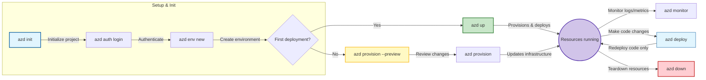
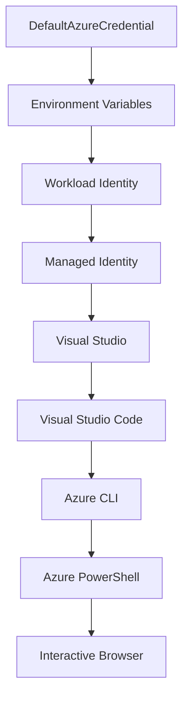

# Osnove AZD - Temeljni koncepti in osnove

**Navigacija po poglavjih:**
- **📚 Domov tečaja**: [AZD za začetnike](../../README.md)
- **📖 Trenutno poglavje**: Poglavje 1 - Osnove in hiter začetek
- **⬅️ Prejšnje**: [Pregled tečaja](../../README.md#-chapter-1-foundation--quick-start)
- **➡️ Naslednje**: [Namestitev in nastavitev](installation.md)
- **🚀 Naslednje poglavje**: [Poglavje 2: AI-First razvoj](../chapter-02-ai-development/microsoft-foundry-integration.md)

## Uvod

> Pregledano glede na `azd 1.37.2` (november 2026). Ukazi bash uporabljajo navedene nadomestne oznake, ki jih morate zamenjati. Predloge potekov dela uporabljajo `.` za inicializacijo trenutnega imenika; brez argumenta imenika inicializacija predloge ustvari podimenik in ne spremeni delovnega imenika ukazne vrstice. Napredni primeri so ilustrativni, niso popolni projekti.

Ta lekcija vas spozna z Azure Developer CLI (azd), zmogljivim orodjem ukazne vrstice, ki pospešuje vašo pot od lokalnega razvoja do namestitve na Azure. Naučili se boste osnovnih konceptov, ključnih funkcij in razumeli, kako azd poenostavlja namestitev aplikacij, ki so narejene za oblak.

## Cilji učenja

Na koncu te lekcije boste:
- Razumeli, kaj je Azure Developer CLI in njegov glavni namen
- Spoznali osnovne koncepte predlog, okolij in storitev
- Raziskali ključne funkcije, vključno z razvojem, ki temelji na predlogah, in infrastrukturo kot kodo
- Razumeli strukturo in potek dela projekta azd
- Pripravljeni za namestitev in konfiguracijo azd v vašem razvojnem okolju

## Rezultati učenja

Po zaključku te lekcije boste lahko:
- Pojasnili vlogo azd v sodobnih potekih dela za razvoj v oblaku
- Prepoznali komponente strukture projekta azd
- Opisali, kako predloge, okolja in storitve sodelujejo
- Razumeli prednosti Infrastrukture kot kode z azd
- Prepoznali različne azd ukaze in njihove namene

## Kaj je Azure Developer CLI (azd)?

Azure Developer CLI (azd) je orodje ukazne vrstice, zasnovano za pospešitev vaše poti od lokalnega razvoja do namestitve na Azure. Poenostavlja postopek gradnje, nameščanja in upravljanja aplikacij, narejenih za oblak na Azure.

### Kaj lahko nameščate z azd?

azd podpira široko paleto delovnih obremenitev – in seznam še raste. Danes lahko z azd namestite:

| Vrsta delovne obremenitve | Primeri | Enak potek dela? |
|--------------------------|---------|-----------------|
| **Tradicionalne aplikacije** | Spletne aplikacije, REST API-ji, statične strani | ✅ `azd up` |
| **Storitve in mikro storitve** | Container Apps, Function Apps, večstoritični backendi | ✅ `azd up` |
| **Aplikacije z AI** | Klepetalne aplikacije z Microsoft Foundry Models, RAG rešitve z AI Search | ✅ `azd up` |
| **Inteligentni agenti** | Agentje gostovani v Foundry, večagentne orkestracije | ✅ `azd up` |

Ključni uvid je, da **cikel življenja azd ostaja enak, ne glede na to, kaj nameščate**. Inicializirate projekt, zagotovite infrastrukturo, namestite kodo, spremljate aplikacijo in počistite – ne glede na to, ali gre za preprosto spletno stran ali sofisticiran AI agent.

Ta kontinuiteta je načrtovana. azd obravnava AI zmogljivosti kot še eno vrsto storitve, ki jo vaša aplikacija lahko uporablja, ne kot nekaj popolnoma drugačnega. Klepetalna točka, ki temelji na Microsoft Foundry Models, je iz vidika azd le še ena storitev za konfiguracijo in namestitev.

### 🎯 Zakaj uporabljati AZD? Primerjava iz prakse

Primerjajmo postavitev preproste spletne aplikacije z bazo podatkov:

#### ❌ BREZ AZD: Ročna namestitev Azure (30+ minut)

**Ilustrativna primerjava v Bashu, ne zagonljiv zagon aplikacije.** Predpostavlja obstoječo kodo aplikacije, unikatna imena virov, Azure CLI overjanje in potrebne razširitve CLI. Uporabite spodnjo vajo s predlogo za podprto pot od začetka do konca.

```bash
# Step 1: Create resource group
az group create --name myapp-rg --location eastus

# Step 2: Create App Service Plan
az appservice plan create --name myapp-plan \
  --resource-group myapp-rg \
  --sku B1 --is-linux

# Step 3: Create Web App
az webapp create --name myapp-web-unique123 \
  --resource-group myapp-rg \
  --plan myapp-plan \
  --runtime "NODE:22-lts"

# Step 4: Create Cosmos DB account (10-15 minutes)
az cosmosdb create --name myapp-cosmos-unique123 \
  --resource-group myapp-rg \
  --kind MongoDB

# Step 5: Create database
az cosmosdb mongodb database create \
  --account-name myapp-cosmos-unique123 \
  --resource-group myapp-rg \
  --name tododb

# Step 6: Create collection
az cosmosdb mongodb collection create \
  --account-name myapp-cosmos-unique123 \
  --resource-group myapp-rg \
  --database-name tododb \
  --name todos

# Step 7: Get connection string
CONN_STR=$(az cosmosdb keys list \
  --name myapp-cosmos-unique123 \
  --resource-group myapp-rg \
  --type connection-strings \
  --query "connectionStrings[0].connectionString" -o tsv)

# Step 8: Configure app settings
az webapp config appsettings set \
  --name myapp-web-unique123 \
  --resource-group myapp-rg \
  --settings MONGODB_URI="$CONN_STR"

# Step 9: Enable logging
az webapp log config --name myapp-web-unique123 \
  --resource-group myapp-rg \
  --application-logging filesystem \
  --detailed-error-messages true

# Step 10: Set up Application Insights
az monitor app-insights component create \
  --app myapp-insights \
  --location eastus \
  --resource-group myapp-rg

# Step 11: Link App Insights to Web App
INSTRUMENTATION_KEY=$(az monitor app-insights component show \
  --app myapp-insights \
  --resource-group myapp-rg \
  --query "instrumentationKey" -o tsv)

az webapp config appsettings set \
  --name myapp-web-unique123 \
  --resource-group myapp-rg \
  --settings APPINSIGHTS_INSTRUMENTATIONKEY="$INSTRUMENTATION_KEY"

# Step 12: Build application locally
npm install
npm run build

# Step 13: Create deployment package
zip -r app.zip . -x "*.git*" "node_modules/*"

# Step 14: Deploy application
az webapp deployment source config-zip \
  --resource-group myapp-rg \
  --name myapp-web-unique123 \
  --src app.zip

# Step 15: Wait and pray it works 🙏
# (No automated validation, manual testing required)
```

**Težave:**
- ❌ 15+ ukazov za zapomniti in izvesti v pravem vrstnem redu
- ❌ 30-45 minut ročnega dela
- ❌ Enostavno je narediti napake (tipkarske, napačni parametri)
- ❌ Pooblastila zahtevajo eksplicitno ravnanje; zapisniki odpravljanja napak in sledenje lupine jih lahko razkrijejo
- ❌ Ni samodejnega razveljavljanja, če kaj ne uspe
- ❌ Težko ponovljivo za člane ekipe
- ❌ Vsakič drugačno (ni ponovljivo)

#### ✅ Z AZD: Avtomatizirana namestitev (5 ukazov, 10-15 minut)

```bash
# Step 1: Initialize from template
azd init --template todo-nodejs-mongo .

# Step 2: Authenticate
azd auth login

# Step 3: Select the environment created during init
azd env select dev

# Step 4: Preview changes (optional but recommended)
azd provision --preview

# Step 5: Deploy everything
azd up

# ✨ Done! Everything is deployed, configured, and monitored
```

**Prednosti:**
- ✅ **5 ukazov** v primerjavi z 15+ ročnimi koraki
- ✅ **10-15 minut** skupnega časa (večinoma čakanja na Azure)
- ✅ **Manj ročnih napak** - dosleden potek dela, ki temelji na predlogah
- ✅ **Varno ravnanje s skrivnostmi** - mnoge predloge uporabljajo Azure-upravljano shranjevanje skrivnosti
- ✅ **Ponovljive namestitve** - enak potek vsakič
- ✅ **Ponovljive definicije infrastrukture** - odvisno od kvot, razpoložljivosti regije in različic predlog
- ✅ **Pripravljen za delo v ekipi** - kdorkoli lahko namesti z istimi ukazi
- ✅ **Infrastruktura kot koda** - predloge Bicep, nadzorovane z različicami
- ✅ **Nadzor, določen s predlogo** - Application Insights, če je vključeno v predlogo

### Čas in zanesljivost

Navedenih časov je ocenjenih in niso merila uspešnosti. azd zmanjša ukaze, ki jih morate usklajevati, vendar ne zagotavlja trajanja namestitve, ne odpravlja napak in ne ponuja samodejnega razveljavljanja aplikacije/baze podatkov. Shranjujte delujoče različice v sistemu za nadzor različic in preizkušajte postopke okrevanja.

## Temeljni koncepti

### Predloge
Predloge so temelj azd. Vsebujejo:
- **Koda aplikacije** - vaša izvorna koda in odvisnosti
- **Definicije infrastrukture** - Azure viri, definirani v Bicep ali Terraform
- **Konfiguracijske datoteke** - nastavitve in spremenljivke okolja
- **Skripte namestitve** - avtomatizirani poteki namestitve

### Okolja
Okolja predstavljajo različne cilje namestitve:
- **Razvoj** - za testiranje in razvoj
- **Predprodukcija** - okolje pred produkcijo
- **Produkcija** - živo proizvodno okolje

Vsako okolje vzdržuje svoje:
- Ime okolja in vrednosti; izolacija virov je odvisna od predloge infrastrukture
- Konfiguracijske nastavitve
- Stanje namestitve

### Storitve
Storitve v `azure.yaml` opisujejo komponente aplikacije, ki jih je mogoče namestiti:
- **Sprednji del** - Spletne aplikacije, enostranske aplikacije (SPA)
- **Zadnji del** - API-ji, mikro storitve

Baze podatkov in shrambe so običajno zagotovljene kot infrastrukturni viri, ne kot izmišljeni gostitelj storitev, kot je `host: postgres`.

## Ključne značilnosti

### 1. Razvoj, ki temelji na predlogah
```bash
# Browse available templates
azd template list

# Initialize from a template
azd init --template "<template-name>" .
```

### 2. Infrastruktura kot koda
- **Bicep** - Azure-jev domensko specifičen jezik
- **Terraform** - orodje za infrastrukturo v več oblakih
- Bicep se prevedeto v ARM predloge; surov ARM JSON ni ločen vgrajen `infra.provider`.

### 3. Integrirani poteki dela
```bash
# Complete deployment workflow
azd up            # Provision + Deploy this is hands off for first time setup

# 🧪 NEW: Preview infrastructure changes before deployment (SAFE)
azd provision --preview    # Simulate infrastructure deployment without making changes

azd provision     # Create Azure resources if you update the infrastructure use this
azd deploy        # Deploy application code or redeploy application code once update
azd down          # Clean up resources
```

#### 🛡️ Varno načrtovanje infrastrukture s predogledom
Ukaz `azd provision --preview` je prelomnica za varne namestitve:
- **Analiza suhega zagona** - Prikaže, kaj bo ustvarjeno, spremenjeno ali izbrisano
- **Brez uporabe infrastrukture** - Pregleduje spremembe ponudnika; najprej preglejte projektne kuke, saj lahko kuke izvajajo ukaze z neželenimi učinki
- **Sodelovanje ekipe** - Delite rezultate predogleda pred namestitvijo
- **Vhod za načrtovanje stroškov** - Preverite predlagane SKU-je in jih nato ocenite z Azure Pricing Calculator; predogled ne izračunava cen

```bash
# Example preview workflow
azd provision --preview           # See what will change
# Review the output, discuss with team
azd provision                     # Apply changes with confidence
```

### 📊 Vizualno: Potek razvoja AZD



**Razlaga poteka dela:**
1. **Init** - Začnite s predlogo ali novim projektom
2. **Auth** - Overite se z Azure
3. **Okolje** - Ustvarite izolirano okolje za namestitev
4. **Preview** - 🆕 Vedno si najprej oglejte spremembe infrastrukture (varna praksa)
5. **Provision** - Ustvarite/posodobite Azure vire
6. **Deploy** - Potisnite kodo aplikacije
7. **Monitor** - Opazujte delovanje aplikacije
8. **Iterate** - Naredite spremembe in znova namestite kodo
9. **Cleanup** - Odstranite vire, ko končate

### 4. Upravljanje okolij
```bash
# Create and manage environments
azd env new "<environment-name>"
azd env select "<environment-name>"
azd env list
```

### 5. Razširitve in AI ukazi

azd uporablja sistem razširitev za dodajanje zmogljivosti, ki presegajo jedro CLI. To je še posebej uporabno za delovne obremenitve AI:

```bash
# List available extensions
azd extension list

# Install the GA Foundry bundle (requires azd >= 1.37.0)
azd ext install microsoft.foundry

# Initialize an AI agent project interactively
azd ai agent init

# Test a deployed agent (shows latency and time-to-first-byte)
azd ai agent invoke

# Start the MCP server for AI-assisted development (Alpha)
azd mcp start
```

**Cikel življenja agenta, do potankosti.** Paket GA `microsoft.foundry` vključuje `azure.ai.agents` in šest drugih jedrnih razširitev. Namestite `azure.ai.evaluations` ločeno za ocenjevanje. Za ta potek uporabljajte `azd >= 1.37.0`. Vsega tega ne potrebujete prvi dan:

| Faza | Ukaz | Kaj počne |
|------|-------|-----------|
| **Scaffold** | `azd ai agent init --template <path-to-azure.yaml>` | Prevzem trenutne predloge projekta agenta |
| **Lokalni zagon** | `azd ai agent run`, nato `azd ai agent invoke --local "Test prompt"` v drugi terminalski seji | Ogled lokalnih aktivnosti v Agent Inspector; klici modela še vedno uporabljajo Azure |
| **Namestitev** | `azd deploy` | Za agente, gostovane v kodi, naložite izvorno kodo za oddaljeno gradnjo Foundry |
| **Testiranje** | `azd ai agent invoke` | Pokličite agenta in si oglejte čas odziva |
| **Meritve** | `azd ai eval init`, `generate`, `run start` | Konfiguracija, namestitev in izvajanje ocen z ločeno razširitvijo |
| **Izboljšanje** | `azd ai agent optimize --eval <evaluation-name> --optimize-model <optimizer-deployment>` | Ponovna uporaba kompatibilne ocene za optimizacijo agenta |
| **Pregled** | `azd ai agent endpoint show` | Ogled konfiguracije živega končnega točke |
| **Čiščenje** | `azd ai agent delete` | Izbrišite gostovanega agenta in vse njegove različice |

> Začnite z [GA predstavitvijo gostovanega agenta](../chapter-02-ai-development/microsoft-foundry-integration.md#hosted-agent-walkthrough-ga), ki pokriva predpogoje, zagotavljanje in varno čiščenje. Razširitve so dodatno opisane v referenci [AZD AI CLI ukazi](../chapter-08-production/production-ai-practices.md#azd-ai-cli-commands-and-extensions).

## 📁 Struktura projekta

Tipična struktura projekta azd:
```
my-app/
├── .azure/                  # Local environments and selected-environment config
│   ├── config.json
│   └── dev/.env
├── .devcontainer/          # Development container config
├── .github/workflows/      # GitHub Actions
├── .vscode/               # VS Code settings
├── infra/                 # Infrastructure code
│   ├── main.bicep        # Main infrastructure template
│   ├── main.parameters.json
│   └── modules/          # Reusable modules
├── src/                  # Application source code
│   ├── api/             # Backend services
│   └── web/             # Frontend application
├── azure.yaml           # azd project configuration
└── README.md
```

## 🔧 Konfiguracijske datoteke

### azure.yaml
Glavna konfiguracijska datoteka projekta:
```yaml
name: my-awesome-app
metadata:
  template: my-template@1.0.0

services:
  web:
    project: ./src/web
    language: js
    host: appservice
  api:
    project: ./src/api
    language: js
    host: appservice

hooks:
  preprovision:
    shell: pwsh
    run: echo "Preparing to provision..."
```

### .azure/config.json
Lokalna izbira privzetega okolja projekta (ilustrativno; upravlja azd):
```json
{
  "defaultEnvironment": "dev"
}
```

## 🎪 Pogosti poteki dela z vajami

> **💡 Nasvet za učenje:** Sledite tem vajam zaporedno, da postopoma razvijete svoje sposobnosti za AZD.

### 🎯 Vaja 1: Inicializirajte svoj prvi projekt

**Cilj:** Ustvarite AZD projekt in raziskujte njegovo strukturo

**Koraki:**
```bash
# Use a proven template
mkdir azd-basics-practice
cd azd-basics-practice
# Choose "dev" for the environment name when prompted
azd init --template todo-nodejs-mongo .

# Explore the generated files
ls -la  # View all files including hidden ones

# Key files created:
# - azure.yaml (main config)
# - infra/ (infrastructure code)
# - src/ (application code)
```

**✅ Uspeh:** Imate imenike azure.yaml, infra/ in src/

---

### 🎯 Vaja 2: Namestitev na Azure

**Cilj:** Dokončajte namestitev od začetka do konca

**Koraki:**
```bash
# 1. Authenticate
azd auth login

# 2. Select the dev environment created in Exercise 1
azd env select dev
azd env set AZURE_LOCATION eastus

# 3. Preview changes (RECOMMENDED)
azd provision --preview

# 4. Deploy everything
azd up

# 5. Verify deployment
azd show    # View your app URL
```

**Pričakovan čas:** 10-15 minut  
**✅ Uspeh:** URL aplikacije se odpre v brskalniku

---

### 🎯 Vaja 3: Več okolij

**Cilj:** Namestitev v dev in staging

**Koraki:**
```bash
# Already have dev, create staging
azd env new staging
azd env set AZURE_LOCATION westus2
azd up

# Switch between them
azd env list
azd env select dev
```

**✅ Uspeh:** Dve ločeni skupini virov v Azure Portalu

**Čiščenje:** Vaja 3 ustvari drugi računljivi namestitveni primer. Po končani uporabi izbrišite oba:

```bash
azd down --environment dev
azd down --environment staging
```

---

### 🛡️ Uničujoče čiščenje: `azd down --force --purge`

Ko želite namenoma izbrisati Azure vire izbranega okolja:

```bash
azd down --force --purge
```

**Kaj počne:**
- `--force`: Brez potrditvenih pozivov
- `--purge`: Prav tako trajno izbriše podprte mehko izbrisane vire (na primer Key Vaults), kjer to omogoča zaščita pred odstranitvijo. Ne izbriše lokalnega imenika `.azure/`.

**Uporabite, kadar:** končate z odvržljivim okoljem. Ne obravnavajte uničujočega čiščenja kot prvega odziva na napako pri overjanju, kvoti ali konfiguraciji.

---

## 🎪 Referenca izvirnega poteka dela

### Začetek novega projekta
```bash
# Method 1: Use existing template
azd init --template todo-nodejs-mongo .

# Method 2: Start from scratch
azd init

# Method 3: Use current directory
azd init .
```

### Razvojni cikel
```bash
# Set up development environment
azd auth login
azd env new dev
azd env select dev

# Deploy everything
azd up

# Make changes and redeploy
azd deploy

# Clean up when done
azd down --force --purge # Deletes this environment's discovered Azure resources; review before forcing deletion.
```

## Razumevanje `azd down --force --purge`
Ukaz `azd down --force --purge` je zmogljiv način za popolno razgradnjo vašega azd okolja in vseh povezanih virov. Tukaj je pregled, kaj posamezna zastavica naredi:
```
--force
```
- Preskoči potrditvene pozive.
- Uporabno za avtomatizacijo ali skriptni zaganjalnik, kjer ročni vnos ni izvedljiv.
- Ne izključuje dovoljenj, zaščite pred čiščenjem ali neuspehov pri brisanju.

```
--purge
```
Trajno izbriše podprte mehko izbrisane vire Azure brez dodatne potrditve. Zaščita pred čiščenjem in dovoljenja še vedno veljajo. Ne odstrani **ne** lokalnih okolij ali mape `.azure/`.


### Zakaj uporabljati oboje?
Oba uporabite samo, ko nameravate izbrisati Azure vire izbranega okolja in trajno izbrisati obnovljive vire. To je destruktivno čiščenje, ne splošno popravilo ali ponastavitev lokalnega stanja.

Še posebej je koristno po ročnem brisanju virov v Azure portalu ali pri menjavi predlog, okolij ali konvencij poimenovanja skupin virov.


### Upravljanje več okolij
```bash
# Create staging environment
azd env new staging
azd env select staging
azd up

# Switch back to dev
azd env select dev

# Compare environments
azd env list
```

## 🔐 Avtentikacija in poverilnice

Razločite avtentikacijo za razmestitev (`azd auth login`) od avtentikacije aplikacijskega SDK (`DefaultAzureCredential`). To sta ločeni zadevi. azd ne uporablja poverilnic Azure CLI privzeto.

### Avtentikacija za Azure CLI (`az login`)

Za azd zaženite `azd auth login`. Naslednji ukazi Azure CLI so po želji in avtenticirajo ukaze `az` ločeno:

```bash
# Interactive login (opens browser)
az login

# Login with specific tenant
az login --tenant "<tenant-id>"

# Login with service principal
az login --service-principal -u "<app-id>" -p "<password>" --tenant "<tenant-id>"

# Check current login status
az account show

# List available subscriptions
az account list --output table

# Set default subscription
az account set --subscription "<subscription-id>"
```

### Potek avtentikacije
1. **Interaktivna prijava**: Odpre privzeti brskalnik za avtentikacijo
2. **Tok kode naprave**: Za okolja brez dostopa do brskalnika
3. **Storitevni glavni račun**: Za avtomatizacijo in CI/CD scenarije
4. **Upravljana identiteta**: Za aplikacije, gostovane v Azure

### Privzeta veriga DefaultAzureCredential

`DefaultAzureCredential` je vrsta poverilnic, ki ponuja poenostavljeno izkušnjo avtentikacije z avtomatskim preizkušanjem več virov poverilnic v določenem vrstnem redu:

#### Veriga poverilnic aplikacijskega SDK

Natančna veriga je odvisna od jezika Azure Identity SDK, različice, nameščenih vtičnikov in možnosti. Ta diagram je konceptualen, ne fiksna zaporedje avtentikacije azd; novejši SDK-ji lahko vključujejo tudi poverilnice Azure Developer CLI.


#### 1. Okoljske spremenljivke
```bash
# Set environment variables for service principal
export AZURE_CLIENT_ID="<app-id>"
export AZURE_CLIENT_SECRET="<password>"
export AZURE_TENANT_ID="<tenant-id>"
```

#### 2. Identiteta delovne obremenitve (Kubernetes/GitHub Actions)
Samodejno se uporablja v:
- Azure Kubernetes Service (AKS) z identiteto delovne obremenitve
- GitHub Actions z OIDC federacijo
- Druge scenarije federirane identitete

#### 3. Upravljana identiteta
Za vire v Azure kot so:
- Virtualni stroji
- App Service
- Azure Functions
- Začetki vsebnikov (Container Instances)

```bash
# Inspect a deployed Container App's configured identity (requires az login)
az containerapp show --name "<app-name>" --resource-group "<rg-name>" --query identity
```

#### 4. Integracija razvojnih orodij
- **Visual Studio**: Samodejno uporablja prijavljen račun
- **VS Code**: Podpora je odvisna od SDK in njegove podpore za posrednika/vtičnike
- **Azure CLI**: Uporablja `az login` poverilnice (najpogostejše za lokalni razvoj)

### Nastavitev avtentikacije AZD

```bash
# Method 1: Direct azd authentication (recommended)
azd auth login

# Method 2: Direct azd authentication
azd auth login --use-device-code  # For headless environments

# Method 3: Check authentication status
azd auth login --check-status

# Method 4: Logout and re-authenticate
azd auth logout
azd auth login
```

### Najboljše prakse avtentikacije

#### Za lokalni razvoj
```bash
# 1. Log in to azd
azd auth login

# 2. Select the subscription for this initialized environment
azd env set AZURE_SUBSCRIPTION_ID "<subscription-id>"

# 3. Check azd sign-in details (read the status message)
azd auth login --check-status
```

#### Za CI/CD cevovode
```yaml
# Partial GitHub Actions steps: assumes checkout, azd installation,
# required AZURE_* environment values, and pipeline secret configuration.
- name: Deploy with azd
  run: |
    azd auth login --client-id ${{ secrets.AZURE_CLIENT_ID }} \
                    --client-secret ${{ secrets.AZURE_CLIENT_SECRET }} \
                    --tenant-id ${{ secrets.AZURE_TENANT_ID }}
    azd up --no-prompt
```

#### Za produkcijsko okolje
- Uporabljajte **Upravljano identiteto** pri izvajanju na virih Azure
- Uporabljajte **Storitevni glavni račun** za avtomatizacijske scenarije
- Izogibajte se shranjevanju poverilnic v kodi ali konfiguracijskih datotekah
- Uporabljajte **Azure Key Vault** za občutljive konfiguracije

### Pogoste težave z avtentikacijo in rešitve

#### Težava: "Nobenega naročniškega računa ni bilo najdenega"
```bash
# Solution: Set default subscription
az account list --output table
az account set --subscription "<subscription-id>"
azd env set AZURE_SUBSCRIPTION_ID "<subscription-id>"
```

#### Težava: "Nezadostne pravice"
```bash
# Solution: Check and assign required roles
az role assignment list --assignee $(az account show --query user.name --output tsv)

# Common required roles:
# - Contributor (for resource management)
# - User Access Administrator (for role assignments)
```

#### Težava: "Žeton je potekel"
```bash
# Solution: Re-authenticate
az logout
az login
azd auth logout
azd auth login
```

### Avtentikacija v različnih scenarijih

#### Lokalni razvoj
```bash
# Personal development account
az login
azd auth login
```

#### Timski razvoj
```bash
# Use specific tenant for organization
az login --tenant contoso.onmicrosoft.com
azd auth login --tenant-id "<tenant-id>"
```

#### Večnajemski scenariji
```bash
# Switch between tenants
az login --tenant tenant1.onmicrosoft.com
azd auth login --tenant-id "<tenant-1-id>"
# Select an environment configured with tenant 1's subscription
azd env select tenant1-dev
# Deploy to tenant 1
azd up

az login --tenant tenant2.onmicrosoft.com  
azd auth login --tenant-id "<tenant-2-id>"
azd env select tenant2-dev
# Deploy to tenant 2
azd up
```

### Varnostne predpostavke

1. **Shranjevanje poverilnic**: Poverilnic nikoli ne shranjujte v izvorno kodo
2. **Omejevanje obsega**: Uporabljajte princip najmanjših privilegijev za storitvene glavne račune
3. **Rotacija žetonov**: Redno rotirajte skrivnosti storitvenih glavnih računov
4. **Revizijska sled**: Spremljajte dejavnosti avtentikacije in uvajanja
5. **Varnost omrežja**: Kjer je mogoče, uporabljajte zasebne končne točke

### Reševanje težav z avtentikacijo

```bash
# Debug authentication issues
azd auth login --check-status
az account show
az account get-access-token

# Common diagnostic commands
whoami                          # Current user context
az ad signed-in-user show      # Microsoft Entra ID user details
az group list                  # Test resource access
```

## Odkritje ukazov

### Odkritje
```bash
azd template list              # Browse templates
azd template list --help       # Template discovery options
azd init --help               # Initialization options
```

### Upravljanje projektov
```bash
azd show                     # Project overview
azd env list                # Available environments and selected default
azd config show            # Configuration settings
```

### Nadzor
```bash
azd monitor                  # Open Azure portal monitoring
azd monitor --logs           # View application logs
azd monitor --live           # View live metrics
azd pipeline config          # Set up CI/CD
```

## Najboljše prakse

### 1. Uporabljajte smiselna imena
```bash
# Good
azd env new production-east
azd init --template todo-nodejs-mongo .

# Avoid
azd env new env1
azd init --template template1 .
```

### 2. Izkoristite predloge
- Začnite z obstoječimi predlogami
- Prilagodite jih svojim potrebam
- Ustvarite ponovno uporabne predloge za svojo organizacijo

### 3. Izolacija okolja
- Uporabljajte ločena okolja za razvoj/test/predelavo (dev/staging/prod)
- Nikoli ne uvajajte neposredno v produkcijo s lokalnega računalnika
- Za produkcijske uvajanja uporabljajte CI/CD cevovode

### 4. Upravljanje konfiguracije
- Uporabljajte upravljano identiteto in Key Vault za skrivnosti; običajne vrednosti `azd env set` so lokalni nešifrirani podatki
- Konfiguracijo hranite v sistemu za verzioniranje
- Dokumentirajte nastavitve specifične za okolje

## Progresija učenja

### Začetnik (1.-2. teden)
1. Namestite azd in se avtenticirajte
2. Uvedite preprosto predlogo
3. Razumite strukturo projekta
4. Naučite se osnovnih ukazov (up, down, deploy)

### Srednje (3.-4. teden)
1. Prilagodite predloge
2. Upravljajte več okolij
3. Razumite infrastrukturo kot kodo
4. Nastavite CI/CD cevovode

### Napredno (5. teden in naprej)
1. Ustvarite lastne predloge
2. Napredni infrastrukturni vzorci
3. Uvajanja v več regijah
4. Konfiguracije na ravni podjetja

## Naslednji koraki

**📖 Nadaljujte z učenjem poglavja 1:**
- [Namestitev in nastavitev](installation.md) - Namestite in konfigurirajte azd
- [Vaš prvi projekt](first-project.md) - Dokončajte praktičen vodič
- [Vodnik po nastavitvah](../chapter-03-configuration/configuration.md) - Napredne možnosti konfiguracije

**🎯 Pripravljeni na naslednje poglavje?**
- [Poglavje 2: Razvoj, usmerjen na AI](../chapter-02-ai-development/microsoft-foundry-integration.md) - Začnite graditi AI aplikacije

## Dodatni viri

- [Pregled Azure Developer CLI](https://learn.microsoft.com/en-us/azure/developer/azure-developer-cli/)
- [Galerija predlog](https://azure.github.io/awesome-azd/)
- [Primeri skupnosti](https://github.com/Azure-Samples)

---

## 🙋 Pogosto zastavljena vprašanja

### Splošna vprašanja

**V: Kakšna je razlika med AZD in Azure CLI?**

O: Azure CLI (`az`) je za upravljanje posameznih virov Azure. AZD (`azd`) je za upravljanje celotnih aplikacij:

```bash
# Azure CLI - Low-level resource management
az webapp create --name myapp --resource-group rg
az sql server create --name myserver --resource-group rg
# ...many more commands needed

# AZD - Application-level management
azd up  # Deploys entire app with all resources
```

**Razmišljajte tako:**
- `az` = Delo s posameznimi kockami Lego
- `azd` = Delo z kompletnimi seti Lego

---

**V: Ali moram poznati Bicep ali Terraform za uporabo AZD?**

O: Ne! Začnite s predlogami:
```bash
# Use existing template - no IaC knowledge needed
azd init --template todo-nodejs-mongo .
azd up
```

Kasneje se lahko naučite Bicepa za prilagajanje infrastrukture. Predloge nudijo delujoče primere za učenje.

---

**V: Koliko stane izvajanje AZD predlog?**

O: Stroški se razlikujejo glede na regijo, SKU, uptime, način baze podatkov in uporabo modela. Razvojno okolje lahko povzroči znatne mesečne stroške tudi, ko je neaktivno; ne domnevajte univerzalnega razpona $50-150:

```bash
# Preview resource changes (not prices)
azd provision --preview

# Always cleanup when not using
azd down --force --purge  # Removes all resources
```

**Pro nasvet:** Uporabljajte brezplačne nivoje, kjer so na voljo:
- App Service: F1 (brezplačni) nivo
- Azure OpenAI: ni splošne garancije brezplačnih žetonov mesečno; preverite trenutno ceno modela in ponudbe
- Cosmos DB: kvalificirani računi s predvidenim pretokom se lahko odločijo za brezplačni nivo; strežniške brezskrbne predloge samodejno niso upravičene

---

**V: Ali lahko uporabljam AZD z obstoječimi viri Azure?**

O: Da, vendar je lažje začeti na novo. AZD najbolje deluje, ko upravlja celoten življenjski cikel. Za obstoječe vire:

```bash
# Option 1: Import existing resources (advanced)
azd init
# Then modify infra/ to reference existing resources

# Option 2: Start fresh (recommended)
azd init --template "<verified-template-name>" .
azd up  # Creates new environment
```

---

**V: Kako lahko delim svoj projekt s sodelavci?**

O: Pošljite AZD projekt v Git (vendar NE mapo .azure):

```bash
# Already in .gitignore by default
.azure/        # Contains secrets and environment data
*.env          # Environment variables

# Team members then:
git clone "<your-repo>"
# Change into the cloned repository before running the remaining commands.
azd auth login
azd env new "<their-name>-dev"
azd up
```

Vsi dobijo enako infrastrukturo iz istih predlog.

---

### Vprašanja o reševanju težav

**V: Ukaz "azd up" se je prekinil na polovici. Kaj naj naredim?**

O: Preverite napako, jo popravite in poskusite znova:

```bash
# Capture detailed diagnostics (redact sensitive values before sharing)
azd up --debug

# Common fixes:

# 1. If quota exceeded:
azd env set AZURE_LOCATION "westus2"  # Try different region

# 2. If resource name conflict:
azd down --force --purge  # Clean slate
azd up  # Retry

# 3. If auth expired:
az login
azd auth login
azd up
```

**Najpogostejša težava:** Izbrana napačna naročnina Azure
```bash
az account list --output table
az account set --subscription "<correct-subscription>"
azd env set AZURE_SUBSCRIPTION_ID "<correct-subscription-id>"
```

---

**V: Kako izvedem le spremembe kode brez ponovnega uvajanja infrastrukture?**

O: Uporabite `azd deploy` namesto `azd up`:

```bash
azd up          # First time: provision + deploy (slow)

# Make code changes...

azd deploy      # Subsequent times: deploy only (fast)
```

Primerjava hitrosti:
- `azd up`: 10-15 minut (uvaja infrastrukturo)
- `azd deploy`: 2-5 minut (samo koda)

---

**V: Ali lahko prilagodim infrastrukturne predloge?**

O: Da! Uredite datoteke Bicep v `infra/`:

```bash
# After azd init
cd infra/
code main.bicep  # Edit in VS Code

# Preview changes
azd provision --preview

# Apply changes
azd provision
```

**Nasvet:** Začnite z majhnim - najprej spremenite SKU-je:
```bicep
// infra/main.bicep
sku: {
  name: 'B1'  // Change to 'P1V2' for production
}
```

---

**V: Kako izbrišem vse, kar je AZD ustvaril?**

O: En ukaz odstrani vse vire:

```bash
azd down --force --purge

# This deletes:
# - Azure resources/resource groups discovered for the selected environment
# - Supported soft-deleted resources, if purge protection allows
# Local .azure files remain; shared/external resources may remain too.
```

**Vedno zaženite ta ukaz, ko:**
- Končate s testiranjem predloge
- Zamenjate projekt
- Želite začeti na novo

**Preverjanje stroškov:** Potrdite brisanje v Azure in preverite za zadržane/skupne vire. Stare stroške je treba še vedno plačati.

---

**V: Kaj, če sem pomotoma izbrisal vire v Azure Portal?**

O: Stanje AZD se lahko izklopi. Pristop "čiste mize":

```bash
# 1. Delete remaining resources only if that is your intent
azd down --force --purge

# 2. Start fresh
azd up

# Alternative: Let AZD detect and fix
azd provision  # Will create missing resources
```

---

### Napredna vprašanja

**V: Ali lahko uporabim AZD v CI/CD cevovodih?**

O: Da! Primer GitHub Actions:

```yaml
# .github/workflows/deploy.yml
name: Deploy with AZD

on:
  push:
    branches: [main]

jobs:
  deploy:
    runs-on: ubuntu-latest
    steps:
      - uses: actions/checkout@v4
      
      - name: Install azd
        run: curl -fsSL https://aka.ms/install-azd.sh | bash
      
      - name: Azure Login
        run: |
          azd auth login \
            --client-id ${{ secrets.AZURE_CLIENT_ID }} \
            --client-secret ${{ secrets.AZURE_CLIENT_SECRET }} \
            --tenant-id ${{ secrets.AZURE_TENANT_ID }}
      
      - name: Deploy
        env:
          AZURE_ENV_NAME: dev
          AZURE_LOCATION: ${{ vars.AZURE_LOCATION }}
          AZURE_SUBSCRIPTION_ID: ${{ vars.AZURE_SUBSCRIPTION_ID }}
        run: azd up --no-prompt
```

---

**V: Kako ravnam s skrivnostmi in občutljivimi podatki?**

O: Uporabljajte Key Vault eksplicitno. `azd env set` zapisuje običajne vrednosti v lokalno okoljsko datoteko; ne ustvarja samodejno trezorja, ne dodeljuje vlog ali ne vstavi skrivnosti v vašo aplikacijo.

```bash
# Interactive: create/select a Key Vault secret and save its reference
azd env set-secret DATABASE_PASSWORD
```

Potrebujete ustrezne pravice do trezorja. Vaša infrastruktura/aplikacija mora še vedno povezati skrivnost s potrošnikom in dodeliti identiteti izvajanja dostop. Ne izpisujte razrešenih skrivnosti v dnevnikih.

**Nikoli ne pošiljajte:**
- `.azure/` mapo (vsebuje podatke o okolju)
- `.env` datoteke (lokalne skrivnosti)
- Povezovalne nize

---

**V: Ali lahko uvajam v več regij?**

O: Da, ustvarite okolje za vsako regijo:

```bash
# East US environment
azd env new prod-eastus
azd env set AZURE_LOCATION eastus
azd up

# West Europe environment
azd env new prod-westeurope
azd env set AZURE_LOCATION westeurope
azd up

# Each environment is independent
azd env list
```

Za resnično večregijske aplikacije prilagodite predloge Bicep za hkratno uvajanje v več regijah.

---

**V: Kje lahko dobim pomoč, če sem obtičal?**

1. **Dokumentacija AZD:** https://learn.microsoft.com/azure/developer/azure-developer-cli/
2. **GitHub Issues:** https://github.com/Azure/azure-dev/issues
3. **Discord:** [Azure Discord](https://discord.gg/microsoft-azure) - kanal #azure-developer-cli
4. **Stack Overflow:** Oznaka `azure-developer-cli`
5. **Ta tečaj:** [Vodnik za reševanje težav](../chapter-07-troubleshooting/common-issues.md)

**Pro nasvet:** Preden vprašate, zaženite:
```bash
azd show       # Shows current state
azd version    # Shows your version
```
Vključite te informacije v vprašanje za hitrejšo pomoč.

---

## 🎓 Kaj sledi?

Zdaj razumete osnove AZD. Izberite svojo pot:

### 🎯 Za začetnike:
1. **Naslednje:** [Namestitev in nastavitev](installation.md) - Namestite AZD na svoj računalnik
2. **Nato:** [Vaš prvi projekt](first-project.md) - Uvedite svojo prvo aplikacijo
3. **Vaja:** Dokončajte vseh 3 vaj v tej lekciji

### 🚀 Za AI razvijalce:
1. **Preskočite na:** [Poglavje 2: Razvoj, usmerjen na AI](../chapter-02-ai-development/microsoft-foundry-integration.md)
2. **Uvedite:** V praznem projektu začnite z `azd init --template get-started-with-ai-chat .`
3. **Učite se:** Gradite med uvajanjem

### 🏗️ Za izkušene razvijalce:
1. **Preglejte:** [Vodnik po nastavitvah](../chapter-03-configuration/configuration.md) - Napredne nastavitve
2. **Raziščite:** [Infrastruktura kot koda](../chapter-04-infrastructure/provisioning.md) - Poglobljen pogled v Bicep
3. **Gradite:** Ustvarite lastne predloge za svoj sklad

---

**Navigacija po poglavjih:**
- **📚 Domov tečaja**: [AZD za začetnike](../../README.md)
- **📖 Trenutno poglavje**: Poglavje 1 - Osnove & hiter začetek  
- **⬅️ Prejšnje**: [Pregled tečaja](../../README.md#-chapter-1-foundation--quick-start)
- **➡️ Naslednje**: [Namestitev in nastavitev](installation.md)
- **🚀 Naslednje poglavje**: [Poglavje 2: Razvoj, usmerjen na AI](../chapter-02-ai-development/microsoft-foundry-integration.md)

---

<!-- CO-OP TRANSLATOR DISCLAIMER START -->
**Omejitev odgovornosti**:
Ta dokument je bil preveden z uporabo AI prevajalske storitve [Co-op Translator](https://github.com/Azure/co-op-translator). Čeprav si prizadevamo za natančnost, vas prosimo, da upoštevate, da avtomatizirani prevodi lahko vsebujejo napake ali netočnosti. Izvirni dokument v njegovem izvirnem jeziku je treba obravnavati kot avtoritativni vir. Za kritične informacije je priporočljiv strokovni človeški prevod. Ne odgovarjamo za morebitna nesporazume ali napačne interpretacije, ki izhajajo iz uporabe tega prevoda.
<!-- CO-OP TRANSLATOR DISCLAIMER END -->