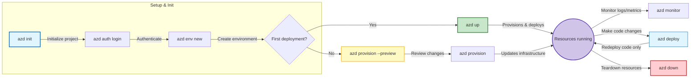
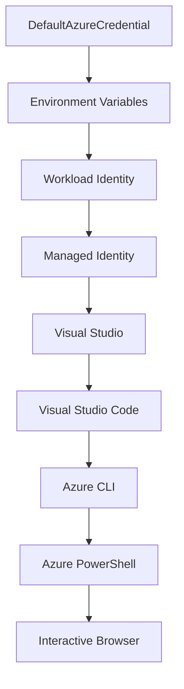

# AZD Osnove - Temeljni koncepti in osnovni pojmi

**Navigacija po poglavju:**
- **📚 Domov tečaja**: [AZD Za začetnike](../../README.md)
- **📖 Trenutno poglavje**: Poglavje 1 - Osnove & Hiter začetek
- **⬅️ Prejšnje**: [Pregled tečaja](../../README.md#-chapter-1-foundation--quick-start)
- **➡️ Naslednje**: [Namestitev in nastavitev](installation.md)
- **🚀 Naslednje poglavje**: [Poglavje 2: AI-prv razvoj](../chapter-02-ai-development/microsoft-foundry-integration.md)

## Uvod

> Preverjeno glede na `azd 1.37.2` (november 2026). Bash ukazi uporabljajo navedene nadomestne znake, ki jih morate zamenjati. Predloge potekov dela uporabljajo `.` za inicializacijo trenutne mape; brez argumenta mape, inicializacija predloge ustvari podmapo in ne spremeni delovne mape ukazne lupine. Napredne izrezke prikazujejo, niso celotni projekti.

Ta lekcija vas uvaja v Azure Developer CLI (azd), zmogljivo orodje ukazne vrstice, ki pospešuje vašo pot od lokalnega razvoja do uvajanja v Azure. Naučili se boste temeljnih konceptov, osnovnih funkcij in razumeli, kako azd poenostavlja uvajanje naravnih oblakov aplikacij.

## Cilji učenja

Do konca te lekcije boste:
- Razumeli, kaj je Azure Developer CLI in njegov glavni namen
- Spoznali temeljne pojme predlog, okolij in storitev
- Raziščite ključne funkcije vključno z razvojem na podlagi predlog in infrastrukturo kot kodo
- Razumeli strukturo azd projekta in potek dela
- Pripravljeni na namestitev in konfiguracijo azd za vaše razvojno okolje

## Rezultati učenja

Po zaključku te lekcije boste lahko:
- Razložili vlogo azd v sodobnih razvojnih potekih za oblak
- Prepoznali komponente strukture projekta azd
- Opisali, kako predloge, okolja in storitve delujejo skupaj
- Razumeli prednosti Infrastrukture kot kode z azd
- Prepoznali različne azd ukaze in njihove namene

## Kaj je Azure Developer CLI (azd)?

Azure Developer CLI (azd) je orodje ukazne vrstice, zasnovano za pospešitev vaše poti od lokalnega razvoja do uvajanja v Azure. Poenostavlja postopek izdelave, uvajanja in upravljanja aplikacij, naravnih oblakov v Azure.

### Kaj lahko uvajate z azd?

azd podpira širok nabor delovnih obremenitev – in seznam nenehno raste. Danes lahko z azd uvajate:

| Vrsta delovne obremenitve | Primeri | Enak potek dela? |
|--------------------------|---------|-------------------|
| **Tradicionalne aplikacije** | Spletne aplikacije, REST API-ji, statične strani | ✅ `azd up` |
| **Storitev in mikrostoritev** | Container Apps, Function Apps, večstoritevni backendi | ✅ `azd up` |
| **Aplikacije z AI** | Čat aplikacije z Microsoft Foundry Models, RAG rešitve z AI Search | ✅ `azd up` |
| **Inteligentni agenti** | Agentje gostovani v Foundry, večagentne orkestracije | ✅ `azd up` |

Ključna spoznanja je, da **cikel življenja azd ostaja enak ne glede na to, kaj uvajate**. Inicializirate projekt, pripravite infrastrukturo, uvajate kodo, spremljate aplikacijo in počistite – ali gre za preprosto spletno stran ali zahtevnega AI agenta.

Ta kontinuiteta je zasnovana. azd obravnava AI zmogljivosti kot še eno obliko storitve, ki jo vaša aplikacija lahko uporablja, ne kot nekaj temeljno drugačnega. Čat vmesnik, podprt z Microsoft Foundry Models, je z vidika azd le še ena storitev za konfiguriranje in uvajanje.

### 🎯 Zakaj uporabljati AZD? Primerjava iz resničnega sveta

Primerjajmo uvajanje preproste spletne aplikacije z bazo podatkov:

#### ❌ BREZ AZD: Ročno uvajanje v Azure (30+ minut)

**Ilustrativen Bash primer, ne aplikacija za zagon.** Predpostavlja obstoječo aplikacijsko kodo, edinstvena imena virov, avtentikacijo preko Azure CLI in morebitne zahtevane razširitve CLI. Uporabite spodnjo vajo predloge za podprt celotni potek.

```bash
# Step 1: Create resource group
az group create --name myapp-rg --location eastus

# Step 2: Create App Service Plan
az appservice plan create --name myapp-plan \
  --resource-group myapp-rg \
  --sku B1 --is-linux

# Step 3: Create Web App
az webapp create --name myapp-web-unique123 \
  --resource-group myapp-rg \
  --plan myapp-plan \
  --runtime "NODE:22-lts"

# Step 4: Create Cosmos DB account (10-15 minutes)
az cosmosdb create --name myapp-cosmos-unique123 \
  --resource-group myapp-rg \
  --kind MongoDB

# Step 5: Create database
az cosmosdb mongodb database create \
  --account-name myapp-cosmos-unique123 \
  --resource-group myapp-rg \
  --name tododb

# Step 6: Create collection
az cosmosdb mongodb collection create \
  --account-name myapp-cosmos-unique123 \
  --resource-group myapp-rg \
  --database-name tododb \
  --name todos

# Step 7: Get connection string
CONN_STR=$(az cosmosdb keys list \
  --name myapp-cosmos-unique123 \
  --resource-group myapp-rg \
  --type connection-strings \
  --query "connectionStrings[0].connectionString" -o tsv)

# Step 8: Configure app settings
az webapp config appsettings set \
  --name myapp-web-unique123 \
  --resource-group myapp-rg \
  --settings MONGODB_URI="$CONN_STR"

# Step 9: Enable logging
az webapp log config --name myapp-web-unique123 \
  --resource-group myapp-rg \
  --application-logging filesystem \
  --detailed-error-messages true

# Step 10: Set up Application Insights
az monitor app-insights component create \
  --app myapp-insights \
  --location eastus \
  --resource-group myapp-rg

# Step 11: Link App Insights to Web App
INSTRUMENTATION_KEY=$(az monitor app-insights component show \
  --app myapp-insights \
  --resource-group myapp-rg \
  --query "instrumentationKey" -o tsv)

az webapp config appsettings set \
  --name myapp-web-unique123 \
  --resource-group myapp-rg \
  --settings APPINSIGHTS_INSTRUMENTATIONKEY="$INSTRUMENTATION_KEY"

# Step 12: Build application locally
npm install
npm run build

# Step 13: Create deployment package
zip -r app.zip . -x "*.git*" "node_modules/*"

# Step 14: Deploy application
az webapp deployment source config-zip \
  --resource-group myapp-rg \
  --name myapp-web-unique123 \
  --src app.zip

# Step 15: Wait and pray it works 🙏
# (No automated validation, manual testing required)
```

**Težave:**
- ❌ Več kot 15 ukazov za zapomniti in izvesti po vrsti
- ❌ 30-45 minut ročnega dela
- ❌ Enostavno je narediti napake (tipkarske napake, napačni parametri)
- ❌ Potrebno je ročno ravnanje z poverilnicami; debug logi in sledljivost lupine lahko razkrijejo informacije
- ❌ Ni avtomatske prekinitve, če kaj spodleti
- ❌ Težko ponovljivo za člane ekipe
- ❌ Vsakič drugačno (ne reproducibilno)

#### ✅ Z AZD: Avtomatizirano uvajanje (5 ukazov, 10-15 minut)

```bash
# Step 1: Initialize from template
azd init --template todo-nodejs-mongo .

# Step 2: Authenticate
azd auth login

# Step 3: Select the environment created during init
azd env select dev

# Step 4: Preview changes (optional but recommended)
azd provision --preview

# Step 5: Deploy everything
azd up

# ✨ Done! Everything is deployed, configured, and monitored
```

**Prednosti:**
- ✅ **5 ukazov** v primerjavi z več kot 15 ročnimi koraki
- ✅ **10-15 minut** celoten čas (večinoma čakanje na Azure)
- ✅ **Manj ročnih napak** – dosleden potek dela na osnovi predlog
- ✅ **Varen način ravnanja s skrivnostmi** – mnoge predloge uporabljajo Azure-upravljano shrambo skrivnosti
- ✅ **Ponovljivo uvajanje** – isti potek dela vsakič
- ✅ **Ponovljive definicije infrastrukture** – odvisno od kvot, razpoložljivosti regije in različic predlog
- ✅ **Pripravljenost za delo v ekipi** – kdorkoli lahko uvede z istimi ukazi
- ✅ **Infrastruktura kot koda** – predloge Bicep pod nadzorom različic
- ✅ **Nadzor definiran v predlogi** – Application Insights, ko je vključeno v predlogo

### Čas in zanesljivost

Časovne ocene zgoraj so približne, ne merila. azd zmanjša ukaze, ki jih morate koordinirati, ne zagotavlja trajanja uvajanja, ne odpravlja napak ali omogoča samodejne prekinitve aplikacije/baze podatkov. Shranjujte delujoče različice v nadzoru virov in preizkušajte postopke obnovitve.

## Temeljni koncepti

### Predloge
Predloge so temelj azd. Vsebujejo:
- **Kodo aplikacije** - vašo izvorno kodo in odvisnosti
- **Definicije infrastrukture** - Azure viri definirani v Bicep ali Terraform
- **Konfiguracijske datoteke** - nastavitve in spremenljivke okolja
- **Skripte uvajanja** - avtomatizirani delovni poteki uvajanja

### Okolja
Okolja predstavljajo različne cilje uvajanja:
- **Razvojno** - za testiranje in razvoj
- **Pred-produkcijsko** - okolje pred produkcijo
- **Produkcijsko** - živo produkcijsko okolje

Vsako okolje ima svoje:
- Ime in vrednosti okolja; izolacija virov je odvisna od predloge infrastrukture
- Nastavitve konfiguracije
- Stanje uvajanja

### Storitev
Storitev v `azure.yaml` opisuje uvajalne komponente aplikacij:
- **Frontend** - spletne aplikacije, SPA
- **Backend** - API-ji, mikrostoritev

Baze podatkov in shranjevanje so običajno zagotovljeni kot viri infrastrukture, ne pa izmišljeni gostitelji storitev, kot je `host: postgres`.

## Ključne funkcije

### 1. Razvoj na podlagi predlog
```bash
# Browse available templates
azd template list

# Initialize from a template
azd init --template "<template-name>" .
```

### 2. Infrastruktura kot koda
- **Bicep** - Azure-jezik specifičen za domeno
- **Terraform** - več-oblačno orodje za infrastrukturo
- Bicep se prevaja v ARM predloge; surov ARM JSON ni ločen vgrajen `infra.provider`.

### 3. Integrirani poteki dela
```bash
# Complete deployment workflow
azd up            # Provision + Deploy this is hands off for first time setup

# 🧪 NEW: Preview infrastructure changes before deployment (SAFE)
azd provision --preview    # Simulate infrastructure deployment without making changes

azd provision     # Create Azure resources if you update the infrastructure use this
azd deploy        # Deploy application code or redeploy application code once update
azd down          # Clean up resources
```

#### 🛡️ Varno načrtovanje infrastrukture z ogledom
Ukaz `azd provision --preview` je prelomnica za varno uvajanje:
- **Analiza poskusnega zagona** - Prikaže, kaj bo ustvarjeno, spremenjeno ali izbrisano
- **Brez uporabe infrastrukture** - Pregleda spremembe ponudnika; najprej preglejte projekte, saj lahko nakloni izvajajo ukaze s stranskimi učinki
- **Sodelovanje ekipe** - Delite rezultate predogleda pred uvajanjem
- **Vhod za načrtovanje stroškov** - Preverite predlagane SKU-je, nato jih ocenite z Azure kalkulatorjem cen; predogled ne izračunava cen

```bash
# Example preview workflow
azd provision --preview           # See what will change
# Review the output, discuss with team
azd provision                     # Apply changes with confidence
```

### 📊 Vizualno: AZD potek razvoja



**Razlaga poteka dela:**
1. **Init** - Začni s predlogo ali novim projektom
2. **Auth** - Avtentikacija v Azure
3. **Environment** - Ustvari izolirano okolje za uvajanje
4. **Preview** - 🆕 Vedno najprej oglej spremembe infrastrukture (varna praksa)
5. **Provision** - Ustvari/posodobi Azure vire
6. **Deploy** - Potisni svojo aplikacijsko kodo
7. **Monitor** - Spremljaj delovanje aplikacije
8. **Iterate** - Naredi spremembe in ponovno uvedi kodo
9. **Cleanup** - Odstrani vire, ko končaš

### 4. Upravljanje okolij
```bash
# Create and manage environments
azd env new "<environment-name>"
azd env select "<environment-name>"
azd env list
```

### 5. Razširitve in AI ukazi

azd uporablja sistem razširitev za dodajanje zmogljivosti, ki presegajo osnovni CLI. To je še posebej uporabno za obremenitve AI:

```bash
# List available extensions
azd extension list

# Install the Foundry agents extension
azd extension install azure.ai.agents

# Initialize an AI agent project interactively
azd ai agent init

# Test a deployed agent (shows latency and time-to-first-byte)
azd ai agent invoke

# Start the MCP server for AI-assisted development (Alpha)
azd mcp start
```

**Cikel življenja agenta, od začetka do konca.** Uporabite `azure.ai.agents` za operacije življenjskega cikla agenta in namestite `azure.ai.evaluations` ločeno za ocenjevanje. Za združeni potek dela uporabite `azd >= 1.37.0`. Vse tega ne potrebujete na prvi dan:

| Stopnja | Ukaz | Kaj naredi |
|--------|-------|------------|
| **Oblikovanje** | `azd ai agent init --template <path-to-azure.yaml>` | Prevzem predloge trenutnega projekta agenta |
| **Testiranje** | `azd ai agent invoke` | Pokliči agenta in oglej čas odziva |
| **Merjenje** | `azd ai eval init`, `generate`, `run start` | Konfiguriraj, uvedi in zaženi ocene z uporabo ločene razširitve |
| **Izboljšava** | `azd ai agent optimize --eval <evaluation-name> --optimize-model <optimizer-deployment>` | Ponovno uporabi združljivo oceno za optimizacijo agenta |
| **Pregled** | `azd ai agent endpoint show` | Oglej si konfiguracijo živega vmesnika |
| **Počisti** | `azd ai agent delete` | Izbriši gostovanega agenta in vse njegove različice |

> Razširitve so podrobno opisane v [Poglavju 2: AI-prvi razvoj](../chapter-02-ai-development/agents.md) in v referenci [AZD AI CLI ukazi](../chapter-08-production/production-ai-practices.md#azd-ai-cli-commands-and-extensions).

## 📁 Struktura projekta

Tipična struktura azd projekta:
```
my-app/
├── .azure/                  # Local environments and selected-environment config
│   ├── config.json
│   └── dev/.env
├── .devcontainer/          # Development container config
├── .github/workflows/      # GitHub Actions
├── .vscode/               # VS Code settings
├── infra/                 # Infrastructure code
│   ├── main.bicep        # Main infrastructure template
│   ├── main.parameters.json
│   └── modules/          # Reusable modules
├── src/                  # Application source code
│   ├── api/             # Backend services
│   └── web/             # Frontend application
├── azure.yaml           # azd project configuration
└── README.md
```

## 🔧 Konfiguracijske datoteke

### azure.yaml
Glavna konfiguracijska datoteka projekta:
```yaml
name: my-awesome-app
metadata:
  template: my-template@1.0.0

services:
  web:
    project: ./src/web
    language: js
    host: appservice
  api:
    project: ./src/api
    language: js
    host: appservice

hooks:
  preprovision:
    shell: pwsh
    run: echo "Preparing to provision..."
```

### .azure/config.json
Izbor privzetega okolja lokalnega projekta (ilustrativno; upravlja azd):
```json
{
  "defaultEnvironment": "dev"
}
```

## 🎪 Pogosti poteki dela s praktičnimi vajami

> **💡 Nasvet za učenje:** Sledite tem vajam po vrsti, da postopoma razvijete svoje AZD spretnosti.

### 🎯 Vaja 1: Inicializirajte svoj prvi projekt

**Cilj:** Ustvarite AZD projekt in raziskujte njegovo strukturo

**Koraki:**
```bash
# Use a proven template
mkdir azd-basics-practice
cd azd-basics-practice
# Choose "dev" for the environment name when prompted
azd init --template todo-nodejs-mongo .

# Explore the generated files
ls -la  # View all files including hidden ones

# Key files created:
# - azure.yaml (main config)
# - infra/ (infrastructure code)
# - src/ (application code)
```

**✅ Uspeh:** Imate direktorije azure.yaml, infra/ in src/

---

### 🎯 Vaja 2: Uvajanje v Azure

**Cilj:** Izvedite celotni postopek uvajanja

**Koraki:**
```bash
# 1. Authenticate
azd auth login

# 2. Select the dev environment created in Exercise 1
azd env select dev
azd env set AZURE_LOCATION eastus

# 3. Preview changes (RECOMMENDED)
azd provision --preview

# 4. Deploy everything
azd up

# 5. Verify deployment
azd show    # View your app URL
```

**Ocenjeni čas:** 10-15 minut  
**✅ Uspeh:** URL aplikacije se odpre v brskalniku

---

### 🎯 Vaja 3: Več okolij

**Cilj:** Uvedite v razvojno in pred-produkcijsko okolje

**Koraki:**
```bash
# Already have dev, create staging
azd env new staging
azd env set AZURE_LOCATION westus2
azd up

# Switch between them
azd env list
azd env select dev
```

**✅ Uspeh:** Dve ločeni skupini virov v Azure Portalu

**Počisti:** Vaja 3 ustvari drugo zaračunljivo uvajanje. Izbrišite oba, ko končate:

```bash
azd down --environment dev
azd down --environment staging
```

---

### 🛡️ Destruktivno čiščenje: `azd down --force --purge`

Ko namerno želite izbrisati Azure vire izbranega okolja:

```bash
azd down --force --purge
```

**Kaj naredi:**
- `--force`: Brez potrditvenih pozivov
- `--purge`: Prav tako trajno izbriše podprte mehko izbrisane vire (npr. Key Vaults), kjer je zaščita pred čiščenjem omogočena. Ne izbriše lokalnega direktorija `.azure/`.

**Uporabite, ko:** končate z okoljem za enkratno uporabo. Ne obravnavajte destruktivnega čiščenja kot prvega odziva na napako avtentikacije, kvote ali konfiguracije.

---

## 🎪 Originalna referenca poteka dela

### Začetek novega projekta
```bash
# Method 1: Use existing template
azd init --template todo-nodejs-mongo .

# Method 2: Start from scratch
azd init

# Method 3: Use current directory
azd init .
```

### Razvojni cikel
```bash
# Set up development environment
azd auth login
azd env new dev
azd env select dev

# Deploy everything
azd up

# Make changes and redeploy
azd deploy

# Clean up when done
azd down --force --purge # Deletes this environment's discovered Azure resources; review before forcing deletion.
```

## Razumevanje `azd down --force --purge`
Ukaz `azd down --force --purge` je zmogljiv način za popolno odstranitev vašega azd okolja in vseh povezanih virov. Tukaj je razčlenitev, kaj posamezna zastavica počne:
```
--force
```
- Preskoči potrditvene pozive.
- Uporabno za avtomatizacijo ali skriptiranje, kjer ročni vnos ni izvedljiv.
- Ne obide dovoljenj, zaščite pred čiščenjem ali neuspeha brisanja.

```
--purge
```
Trajno izbriše podprte Azure vire, ki so bili zmehčano izbrisani, brez dodatnega potrjevanja. Veljajo še vedno zaščita pred čiščenjem in dovoljenja. Ne odstrani **ne** lokalnih okolij ali mape `.azure/`.


### Zakaj uporabljati oboje?
Uporabite oboje samo, ko nameravate izbrisati Azure vire izbranega okolja in izbrisati obnovljive vire. To je destruktivno čiščenje, ne splošno popravilo ali ponastavitev lokalnega stanja.

To je še posebej koristno po ročnem brisanju virov v portalu Azure ali pri menjavi predlog, okolij ali konvencij poimenovanja skupin virov.


### Upravljanje več okolij
```bash
# Create staging environment
azd env new staging
azd env select staging
azd up

# Switch back to dev
azd env select dev

# Compare environments
azd env list
```

## 🔐 Avtentikacija in poverilnice

Razločite avtentikacijo za nameščanje (`azd auth login`) od avtentikacije aplikacijskega SDK (`DefaultAzureCredential`). Sta ločeni. azd privzeto ne uporablja poverilnic Azure CLI.

### Avtentikacija Azure CLI (`az login`)

Za azd zaženite `azd auth login`. Naslednji ukazi Azure CLI so neobvezni in za `az` ukaze omogočajo avtentikacijo posebej:

```bash
# Interactive login (opens browser)
az login

# Login with specific tenant
az login --tenant "<tenant-id>"

# Login with service principal
az login --service-principal -u "<app-id>" -p "<password>" --tenant "<tenant-id>"

# Check current login status
az account show

# List available subscriptions
az account list --output table

# Set default subscription
az account set --subscription "<subscription-id>"
```

### Potek Avtentikacije
1. **Interaktivna prijava**: Odpre vaš privzeti brskalnik za avtentikacijo
2. **Potek z napravo kodo**: Za okolja brez dostopa do brskalnika
3. **Service Principal**: Za avtomatizacijo in scenarije CI/CD
4. **Upravljana identiteta**: Za aplikacije, ki gostujejo v Azure

### Veriga DefaultAzureCredential

`DefaultAzureCredential` je vrsta poverilnic, ki omogoča poenostavljeno izkušnjo avtentikacije z avtomatskim poskusom iz več virov poverilnic v določenem vrstnem redu:

#### Veriga poverilnic Application SDK

Natančna veriga je odvisna od jezika Azure Identity SDK, različice, nameščenih vtičnikov in možnosti. Ta diagram je konceptualen in ne fiksna sekvenca overjanja azd; novejši SDK-ji lahko vključujejo tudi poverilnice Azure Developer CLI.


#### 1. Spremenljivke okolja
```bash
# Set environment variables for service principal
export AZURE_CLIENT_ID="<app-id>"
export AZURE_CLIENT_SECRET="<password>"
export AZURE_TENANT_ID="<tenant-id>"
```

#### 2. Identiteta delovne obremenitve (Kubernetes/GitHub Actions)
Samodejno se uporablja v:
- Azure Kubernetes Service (AKS) z identiteto delovne obremenitve
- GitHub Actions z OIDC federacijo
- Drugi scenariji federirane identitete

#### 3. Upravljana identiteta
Za Azure vire, kot so:
- Virtualni stroji
- App Service
- Azure Functions
- Primerki kontejnerjev

```bash
# Inspect a deployed Container App's configured identity (requires az login)
az containerapp show --name "<app-name>" --resource-group "<rg-name>" --query identity
```

#### 4. Integracija razvijalskih orodij
- **Visual Studio**: Samodejno uporablja prijavljen račun
- **VS Code**: Podpora je odvisna od SDK in podprte nastavitve posrednika/vtičnika
- **Azure CLI**: Uporablja poverilnice `az login` (najpogostejše za lokalni razvoj)

### Nastavitev overjanja AZD

```bash
# Method 1: Direct azd authentication (recommended)
azd auth login

# Method 2: Direct azd authentication
azd auth login --use-device-code  # For headless environments

# Method 3: Check authentication status
azd auth login --check-status

# Method 4: Logout and re-authenticate
azd auth logout
azd auth login
```

### Najboljše prakse overjanja

#### Za lokalni razvoj
```bash
# 1. Log in to azd
azd auth login

# 2. Select the subscription for this initialized environment
azd env set AZURE_SUBSCRIPTION_ID "<subscription-id>"

# 3. Check azd sign-in details (read the status message)
azd auth login --check-status
```

#### Za CI/CD cevovode
```yaml
# Partial GitHub Actions steps: assumes checkout, azd installation,
# required AZURE_* environment values, and pipeline secret configuration.
- name: Deploy with azd
  run: |
    azd auth login --client-id ${{ secrets.AZURE_CLIENT_ID }} \
                    --client-secret ${{ secrets.AZURE_CLIENT_SECRET }} \
                    --tenant-id ${{ secrets.AZURE_TENANT_ID }}
    azd up --no-prompt
```

#### Za produkcijska okolja
- Uporabljajte **Upravljano identiteto**, ko tečete na Azure virih
- Uporabljajte **Service Principal** za avtomatizacijske scenarije
- Izogibajte se shranjevanju poverilnic v kodi ali konfiguracijskih datotekah
- Za občutljivo konfiguracijo uporabljajte **Azure Key Vault**

### Pogoste težave overjanja in rešitve

#### Težava: "Noben naročniški račun ni najden"
```bash
# Solution: Set default subscription
az account list --output table
az account set --subscription "<subscription-id>"
azd env set AZURE_SUBSCRIPTION_ID "<subscription-id>"
```

#### Težava: "Pomanjkljive pravice"
```bash
# Solution: Check and assign required roles
az role assignment list --assignee $(az account show --query user.name --output tsv)

# Common required roles:
# - Contributor (for resource management)
# - User Access Administrator (for role assignments)
```

#### Težava: "Potekel žeton"
```bash
# Solution: Re-authenticate
az logout
az login
azd auth logout
azd auth login
```

### Overjanje v različnih scenarijih

#### Lokalni razvoj
```bash
# Personal development account
az login
azd auth login
```

#### Razvoj ekipe
```bash
# Use specific tenant for organization
az login --tenant contoso.onmicrosoft.com
azd auth login --tenant-id "<tenant-id>"
```

#### Večnajemniški scenariji
```bash
# Switch between tenants
az login --tenant tenant1.onmicrosoft.com
azd auth login --tenant-id "<tenant-1-id>"
# Select an environment configured with tenant 1's subscription
azd env select tenant1-dev
# Deploy to tenant 1
azd up

az login --tenant tenant2.onmicrosoft.com  
azd auth login --tenant-id "<tenant-2-id>"
azd env select tenant2-dev
# Deploy to tenant 2
azd up
```

### Varnostni vidiki

1. **Shranjevanje poverilnic**: Nikoli ne shranjujte poverilnic v izvorni kodi
2. **Omejitev obsega**: Uporabite načelo najmanjših privilegijev za service principale
3. **Rotacija žetonov**: Redno rotirajte skrivnosti service principala
4. **Revizijska sled**: Spremljajte dejavnosti overjanja in uvajanja
5. **Omrežna varnost**: Kjer je mogoče, uporabljajte zasebne končne točke

### Odpravljanje težav pri overjanju

```bash
# Debug authentication issues
azd auth login --check-status
az account show
az account get-access-token

# Common diagnostic commands
whoami                          # Current user context
az ad signed-in-user show      # Microsoft Entra ID user details
az group list                  # Test resource access
```

## Odkritje ukazov

### Odkritje
```bash
azd template list              # Browse templates
azd template list --help       # Template discovery options
azd init --help               # Initialization options
```

### Upravljanje projektov
```bash
azd show                     # Project overview
azd env list                # Available environments and selected default
azd config show            # Configuration settings
```

### Nadzor
```bash
azd monitor                  # Open Azure portal monitoring
azd monitor --logs           # View application logs
azd monitor --live           # View live metrics
azd pipeline config          # Set up CI/CD
```

## Najboljše prakse

### 1. Uporabljajte smiselna imena
```bash
# Good
azd env new production-east
azd init --template todo-nodejs-mongo .

# Avoid
azd env new env1
azd init --template template1 .
```

### 2. Izkoristite predloge
- Začnite z obstoječimi predlogami
- Prilagodite jih svojim potrebam
- Ustvarjajte ponovno uporabne predloge za svojo organizacijo

### 3. Izolacija okolij
- Uporabljajte ločena okolja za razvoj/staging/produkcijo
- Nikoli ne nameščajte neposredno v produkcijo s lokalnega računalnika
- Za produkcijske uvajanja uporabite CI/CD cevovode

### 4. Upravljanje konfiguracije
- Uporabljajte upravljano identiteto in Key Vault za skrivnosti; običajne vrednosti `azd env set` so lokalno shranjene v besedilu
- Hrani konfiguracijo v različičnem nadzoru
- Dokumentirajte nastavitve specifične za okolja

## Napredovanje v učenju

### Začetnik (1.–2. teden)
1. Namestite azd in se overite
2. Namestite preprosto predlogo
3. Razumite strukturo projekta
4. Naučite se osnovnih ukazov (up, down, deploy)

### Srednje (3.–4. teden)
1. Prilagodite predloge
2. Upravljajte več okolij
3. Razumite infrastrukturo kot kodo
4. Nastavite CI/CD cevovode

### Napredno (5. teden in naprej)
1. Ustvarite prilagojene predloge
2. Napredni vzorci infrastrukture
3. Uvajanje v več regijah
4. Organizacijsko napredne konfiguracije

## Naslednji koraki

**📖 Nadaljujte z 1. poglavjem učenja:**
- [Namestitev in nastavitev](installation.md) - Namestite in konfigurirajte azd
- [Vaš prvi projekt](first-project.md) - Dokončajte praktični vodič
- [Vodnik po konfiguraciji](../chapter-03-configuration/configuration.md) - Napredne možnosti konfiguracije

**🎯 Pripravljeni na naslednje poglavje?**
- [2. poglavje: Razvoj z umetno inteligenco](../chapter-02-ai-development/microsoft-foundry-integration.md) - Začnite graditi AI aplikacije

## Dodatni viri

- [Pregled Azure Developer CLI](https://learn.microsoft.com/en-us/azure/developer/azure-developer-cli/)
- [Galerija predlog](https://azure.github.io/awesome-azd/)
- [Vzorec skupnosti](https://github.com/Azure-Samples)

---

## 🙋 Pogosto zastavljena vprašanja

### Splošna vprašanja

**Vprašanje: Kakšna je razlika med AZD in Azure CLI?**

Odgovor: Azure CLI (`az`) je za upravljanje posameznih Azure virov. AZD (`azd`) je za upravljanje celotnih aplikacij:

```bash
# Azure CLI - Low-level resource management
az webapp create --name myapp --resource-group rg
az sql server create --name myserver --resource-group rg
# ...many more commands needed

# AZD - Application-level management
azd up  # Deploys entire app with all resources
```

**Pomislite tako:**
- `az` = Upravljanje posameznih Lego kock
- `azd` = Delo s kompleti Lego kock

---

**Vprašanje: Ali moram znati Bicep ali Terraform za uporabo AZD?**

Odgovor: Ne! Začnite s predlogami:
```bash
# Use existing template - no IaC knowledge needed
azd init --template todo-nodejs-mongo .
azd up
```

Kasneje se lahko naučite Bicep za prilagajanje infrastrukture. Predloge zagotavljajo delujoče primere za učenje.

---

**Vprašanje: Koliko stane poganjanje AZD predlog?**

Odgovor: Stroški se razlikujejo glede na regijo, SKU, čas delovanja, način baze podatkov in uporabo modela. Razvojno okolje lahko povzroči znatne mesečne stroške tudi pri neaktivnosti; ne predpostavljajte univerzalnega razpona 50-150 $:

```bash
# Preview resource changes (not prices)
azd provision --preview

# Always cleanup when not using
azd down --force --purge  # Removes all resources
```

**Profesionalni nasvet:** Uporabljajte brezplačne nivoje, kjer so na voljo:
- App Service: nivo F1 (brezplačen)
- Azure OpenAI: ni splošno zagotovljenega mesečnega brezplačnega števila žetonov; preverite trenutno ceno modela in ponudbe
- Cosmos DB: upravičeni računi z zagotovljeno prepustnostjo se lahko vključijo v brezplačni nivo; brezstrežni predlogi se samodejno ne kvalificirajo

---

**Vprašanje: Ali lahko uporabim AZD z obstoječimi Azure viri?**

Odgovor: Da, vendar je lažje začeti na novo. AZD najbolje deluje, ko upravlja celoten življenjski cikel. Za obstoječe vire:

```bash
# Option 1: Import existing resources (advanced)
azd init
# Then modify infra/ to reference existing resources

# Option 2: Start fresh (recommended)
azd init --template "<verified-template-name>" .
azd up  # Creates new environment
```

---

**Vprašanje: Kako delim svoj projekt s sodelavci?**

Odgovor: Commitajte AZD projekt v Git (vendar NE mapo .azure):

```bash
# Already in .gitignore by default
.azure/        # Contains secrets and environment data
*.env          # Environment variables

# Team members then:
git clone "<your-repo>"
# Change into the cloned repository before running the remaining commands.
azd auth login
azd env new "<their-name>-dev"
azd up
```

Vsakdo dobi enako infrastrukturo iz istih predlog.

---

### Vprašanja o odpravljanju težav

**Vprašanje: "azd up" je spodletel na polovici. Kaj naj naredim?**

Odgovor: Preverite napako, jo popravite, nato poskusite znova:

```bash
# Capture detailed diagnostics (redact sensitive values before sharing)
azd up --debug

# Common fixes:

# 1. If quota exceeded:
azd env set AZURE_LOCATION "westus2"  # Try different region

# 2. If resource name conflict:
azd down --force --purge  # Clean slate
azd up  # Retry

# 3. If auth expired:
az login
azd auth login
azd up
```

**Najpogostejša težava:** Izbran je bil napačen naročniški račun Azure
```bash
az account list --output table
az account set --subscription "<correct-subscription>"
azd env set AZURE_SUBSCRIPTION_ID "<correct-subscription-id>"
```

---

**Vprašanje: Kako lahko uvajam samo spremembe kode brez ponovnega zagotavljanja?**

Odgovor: Uporabite `azd deploy` namesto `azd up`:

```bash
azd up          # First time: provision + deploy (slow)

# Make code changes...

azd deploy      # Subsequent times: deploy only (fast)
```

Primerjava hitrosti:
- `azd up`: 10-15 minut (zagotavlja infrastrukturo)
- `azd deploy`: 2-5 minut (samo koda)

---

**Vprašanje: Ali lahko prilagodim predloge infrastrukture?**

Odgovor: Da! Uredite Bicep datoteke v `infra/`:

```bash
# After azd init
cd infra/
code main.bicep  # Edit in VS Code

# Preview changes
azd provision --preview

# Apply changes
azd provision
```

**Nasvet:** Začnite majhno - najprej spremenite SKU:
```bicep
// infra/main.bicep
sku: {
  name: 'B1'  // Change to 'P1V2' for production
}
```

---

**Vprašanje: Kako izbrišem vse, kar je AZD ustvaril?**

Odgovor: En ukaz odstrani vse vire:

```bash
azd down --force --purge

# This deletes:
# - Azure resources/resource groups discovered for the selected environment
# - Supported soft-deleted resources, if purge protection allows
# Local .azure files remain; shared/external resources may remain too.
```

**Vedno zaženite to, ko:**
- Končate s testiranjem predloge
- Preklapljate na drug projekt
- Želite začeti na novo

**Preverjanje stroškov:** Potrdite izbris v Azure in preverite, ali so še vedno prisotni obdržani/deljeni viri. Predhodno nastali stroški še vedno veljajo.

---

**Vprašanje: Kaj, če po nesreči izbrišem vire v Azure Portalu?**

Odgovor: Stanje AZD se lahko ne sinhronizira. Čisti pristop:

```bash
# 1. Delete remaining resources only if that is your intent
azd down --force --purge

# 2. Start fresh
azd up

# Alternative: Let AZD detect and fix
azd provision  # Will create missing resources
```

---

### Napredna vprašanja

**Vprašanje: Ali lahko uporabljam AZD v CI/CD cevovodih?**

Odgovor: Da! Primer GitHub Actions:

```yaml
# .github/workflows/deploy.yml
name: Deploy with AZD

on:
  push:
    branches: [main]

jobs:
  deploy:
    runs-on: ubuntu-latest
    steps:
      - uses: actions/checkout@v4
      
      - name: Install azd
        run: curl -fsSL https://aka.ms/install-azd.sh | bash
      
      - name: Azure Login
        run: |
          azd auth login \
            --client-id ${{ secrets.AZURE_CLIENT_ID }} \
            --client-secret ${{ secrets.AZURE_CLIENT_SECRET }} \
            --tenant-id ${{ secrets.AZURE_TENANT_ID }}
      
      - name: Deploy
        env:
          AZURE_ENV_NAME: dev
          AZURE_LOCATION: ${{ vars.AZURE_LOCATION }}
          AZURE_SUBSCRIPTION_ID: ${{ vars.AZURE_SUBSCRIPTION_ID }}
        run: azd up --no-prompt
```

---

**Vprašanje: Kako ravnam s skrivnostmi in občutljivimi podatki?**

Odgovor: Izrecno uporabljajte Key Vault. `azd env set` zapisuje običajne vrednosti v lokalno datoteko okolja; samodejno ne ustvari ključavnice, ne dodeli vlog ali ne injicira skrivnosti v vašo aplikacijo.

```bash
# Interactive: create/select a Key Vault secret and save its reference
azd env set-secret DATABASE_PASSWORD
```

Potrebujete ustrezna dovoljenja za ključavnico. Vaša infrastruktura/aplikacija mora še vedno povezati skrivnost s svojim porabnikom in dati dostop identiteti med zagonom. Ne izpisujte rešene vrednosti skrivnosti v dnevnikih.

**Nikoli ne commitajte:**
- Mape `.azure/` (vsebuje podatke okolja)
- Datotek `.env` (lokalne skrivnosti)
- Povezovalnih nizov

---

**Vprašanje: Ali lahko uvajam v več regij?**

Odgovor: Da, ustvarite okolje za regijo:

```bash
# East US environment
azd env new prod-eastus
azd env set AZURE_LOCATION eastus
azd up

# West Europe environment
azd env new prod-westeurope
azd env set AZURE_LOCATION westeurope
azd up

# Each environment is independent
azd env list
```

Za resnične večregijske aplikacije prilagodite Bicep predloge za sočasno uvajanje v več regijah.

---

**Vprašanje: Kje lahko dobim pomoč, če sem zataknjen?**

1. **Dokumentacija AZD:** https://learn.microsoft.com/azure/developer/azure-developer-cli/
2. **GitHub Issues:** https://github.com/Azure/azure-dev/issues
3. **Discord:** [Azure Discord](https://discord.gg/microsoft-azure) - kanal #azure-developer-cli
4. **Stack Overflow:** Tag `azure-developer-cli`
5. **Ta tečaj:** [Vodnik za odpravljanje težav](../chapter-07-troubleshooting/common-issues.md)

**Profesionalni nasvet:** Pred postavljanjem vprašanj zaženite:
```bash
azd show       # Shows current state
azd version    # Shows your version
```
Vključite te informacije v svoje vprašanje za hitrejšo pomoč.

---

## 🎓 Kaj sledi?

Zdaj razumete osnove AZD. Izberite svojo pot:

### 🎯 Za začetnike:
1. **Naslednje:** [Namestitev in nastavitev](installation.md) - Namestite AZD na svoj računalnik
2. **Potem:** [Vaš prvi projekt](first-project.md) - Namestite svojo prvo aplikacijo
3. **Vadba:** Dokončajte vseh 3 vaj v tej lekciji

### 🚀 Za AI razvijalce:
1. **Preskočite na:** [2. poglavje: Razvoj z umetno inteligenco](../chapter-02-ai-development/microsoft-foundry-integration.md)
2. **Uvajajte:** V prazni mapi projekta začnite z `azd init --template get-started-with-ai-chat .`
3. **Učite se:** Gradite medtem ko uvajate

### 🏗️ Za izkušene razvijalce:
1. **Preglejte:** [Vodnik po konfiguraciji](../chapter-03-configuration/configuration.md) - Napredne nastavitve
2. **Raziskujte:** [Infrastruktura kot koda](../chapter-04-infrastructure/provisioning.md) - Poglobljen pregled Bicep
3. **Gradite:** Ustvarite prilagojene predloge za vaš komplet

---

**Navigacija po poglavjih:**
- **📚 Domača stran tečaja**: [AZD za začetnike](../../README.md)
- **📖 Trenutno poglavje**: Poglavje 1 - Osnove in hitri začetek  
- **⬅️ Prej**: [Pregled tečaja](../../README.md#-chapter-1-foundation--quick-start)
- **➡️ Naslednje**: [Namestitev in nastavitev](installation.md)
- **🚀 Naslednje poglavje**: [2. poglavje: Razvoj z umetno inteligenco](../chapter-02-ai-development/microsoft-foundry-integration.md)

---

<!-- CO-OP TRANSLATOR DISCLAIMER START -->
**Omejitev odgovornosti**:
Ta dokument je bil preveden z uporabo AI prevajalske storitve [Co-op Translator](https://github.com/Azure/co-op-translator). Čeprav si prizadevamo za natančnost, vas prosimo, da upoštevate, da avtomatizirani prevodi lahko vsebujejo napake ali netočnosti. Izvirni dokument v njegovem izvirnem jeziku je treba obravnavati kot avtoritativni vir. Za kritične informacije je priporočljiv strokovni človeški prevod. Ne odgovarjamo za morebitna nesporazume ali napačne interpretacije, ki izhajajo iz uporabe tega prevoda.
<!-- CO-OP TRANSLATOR DISCLAIMER END -->