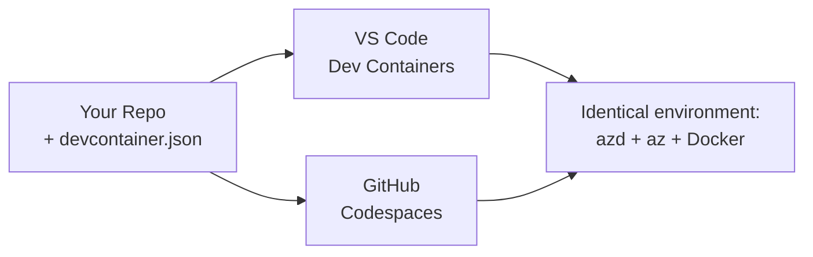

# Dev posode in GitHub Codespaces za azd

**Navigacija po poglavjih:**
- **📚 Domov strani tečaja**: [AZD Za začetnike](../../README.md)
- **📖 Trenutno poglavje**: Poglavje 1 - Osnove in hitri začetek
- **⬅️ Prejšnje**: [Prinesite svojo aplikacijo](bring-your-own-app.md)
- **🚀 Naslednje poglavje**: [Poglavje 2: Razvoj s poudarkom na AI](../chapter-02-ai-development/README.md)

> Cilj pregleda ukazov in konfiguracije: `azd 1.37.2` (november 2026). Izgradnje posod in uvajanja v Azure niso bili izvedeni kot del tega pregleda.

## Uvod

Namestitev azd, ustreznega izvajalnega okolja za jezik, Dockerja in Azure CLI na vsakem računalniku je nadloga – in glavni razlog, da vodič, ki "deluje na mojem računalniku," pri nekaterih drugod ne uspe. **Razvojna posoda** to reši tako, da opiše celotno vašo orodjarno v datoteki. Kdor koli odpre projekt v VS Code ali GitHub Codespaces dobi točno enako okolje, z že nameščenim azd. Ta lekcija vam pokaže, kako dodati eno.

## Cilji učenja

Do konca te lekcije boste:
- Razumeli, kaj je razvojna posoda in kako pomaga pri azd
- Dodali minimalni `.devcontainer/devcontainer.json` k projektu
- Vključili azd, Azure CLI in Docker preko funkcij razvojne posode
- Odprli projekt v GitHub Codespaces ali VS Code

## Rezultati učenja

Po zaključku te lekcije boste znali:
- Ustvariti `devcontainer.json` za azd projekt
- Dodati azd in Azure orodja brez ročne namestitve
- Zagnati `azd up` znotraj posode ali Codespace-a

---

## Kaj je razvojna posoda?

Razvojna posoda je razvojno okolje, osnovano na Dockerju, definirano z datoteko `.devcontainer/devcontainer.json` v vaši repozitoriji. Ko odprete projekt:

- **VS Code** (s pripono Dev Containers) zgradi posodo in se nanjo poveže.
- **GitHub Codespaces** zgradi isto posodo v oblaku in vam omogoči urejevalnik v brskalniku.

Vsak način zagotavlja enaka orodja za vse prispevke – ni več "ali si namestil azd?" težav.



---

## Korak 1: Ustvarite datoteko devcontainer

Ustvarite `.devcontainer/devcontainer.json` v korenu vašega projekta:

```json
{
  "name": "azd-project",
  "image": "mcr.microsoft.com/devcontainers/base:bookworm",
  "features": {
    "ghcr.io/devcontainers/features/azure-cli:1": {},
    "ghcr.io/azure/azure-dev/azd:0": { "version": "1.37.2" },
    "ghcr.io/devcontainers/features/docker-in-docker:2": {},
    "ghcr.io/devcontainers/features/node:1": {}
  },
  "customizations": {
    "vscode": {
      "extensions": [
        "ms-azuretools.azure-dev",
        "ms-azuretools.vscode-bicep"
      ]
    }
  },
  "forwardPorts": [3000],
  "postCreateCommand": "azd version"
}
```

Kaj počne vsak del:

| Ključ | Namen |
|-------|-------|
| `image` | Osnovni operacijski sistem za posodo |
| `features` | Vnaprej pripravljene namestitve — tukaj: Azure CLI, **azd**, Docker in Node.js |
| `customizations.vscode.extensions` | Samodejno namesti razširitve azd in Bicep za VS Code |
| `forwardPorts` | Dovoli dostop do vrat vaše aplikacije iz brskalnika |
| `postCreateCommand` | Izvede se enkrat po zgraditvi posode (tukaj preverjanje delovanja) |

> Verzija funkcije (`azd:0`) in nameščena verzija CLI se razlikujeta. Nastavite možnost `version` funkcije na `"1.37.2"` za določitev verzije CLI; ne uporabljajte verzije CLI kot oznake funkcije.

---

## Korak 2: Prilagodite funkcijo jeziku vaše aplikacije

Zamenjajte funkcijo `node` s tisto, ki jo uporablja vaša aplikacija:

```jsonc
// Python project
"ghcr.io/devcontainers/features/python:1": {},

// .NET project
"ghcr.io/devcontainers/features/dotnet:2": {},

// Java project
"ghcr.io/devcontainers/features/java:1": {},

// Go project
"ghcr.io/devcontainers/features/go:1": {}
```

Ohranite `docker-in-docker` pri lokalnem gradnji slik. Kot alternativa je lahko konfigurirana oddaljena ACR gradnja (`docker.remoteBuild: true`); sam tip gostitelja ne zahteva vedno lokalnega Dockerja.

---

## Korak 3: Odprite projekt

**V VS Code:**
1. Namestite pripono **Dev Containers**.
2. Odprite mapo s projektom.
3. Kliknite **Ponovno odpri v posodi**, ko boste pozvani (ali zaženite *Dev Containers: Reopen in Container*).

**V GitHub Codespaces:**
1. Pushajte repozitorij na GitHub.
2. Kliknite **Code → Codespaces → Create codespace on main**.
3. Počakajte, da se posoda zgradi — azd bo pripravljen v terminalu.

---

## Korak 4: Uvajanje iz znotraj posode

Posoda ima že nameščen azd, zato običajen potek dela preprosto deluje:

```bash
azd auth login --use-device-code   # device code is handy inside Codespaces
azd up
```

> **Zakaj `--use-device-code`?** V oddaljeni posodi ali Codespace-u ni lokalnega brskalnika, kamor bi preusmeril, zato je prijava z uporabo codes naprave zanesljiva pot. V brskalnik boste prilepili kodo za dokončanje prijave.

---

## Pogoste pasti

| Past | Popravek |
|-------|---------|
| `azd up` ne more zgraditi slike | Dodajte funkcijo `docker-in-docker` |
| Prijava v brskalnik se zatakne v Codespaces | Uporabite `azd auth login --use-device-code` |
| Orodja se razlikujejo med sodelavci | Zaklenite CLI preko možnosti `version` v azd funkciji in zaklenite izvajalno okolje jezika |
| Aplikacija ni dosegljiva v brskalniku | Dodajte vrata v `forwardPorts` |

---

## Povzetek

- Razvojna posoda naredi vašo orodjarno azd reproducibilno za vse.
- Dodajte azd, Azure CLI in Docker preko funkcij razvojne posode.
- Prilagodite funkcijo jezika vaši aplikaciji in ohranite `docker-in-docker` za gostitelje posode.
- Pri izvajanju v Codespaces uporabite prijavo z napravo.

---

## 🔗 Navigacija

| Smer | Viri |
|-------|------|
| **Prejšnje** | [Prinesite svojo aplikacijo](bring-your-own-app.md) |
| **Domov poglavja** | [Poglavje 1: Osnove in hitri začetek](README.md) |
| **Naslednje poglavje** | [Poglavje 2: Razvoj s poudarkom na AI](../chapter-02-ai-development/README.md) |

## 📖 Sorodni viri

- [Namestitev & nastavitev](installation.md)
- [Prevodni list ukazov](../../resources/cheat-sheet.md)
- [Uradna specifikacija Dev posod](https://containers.dev/)
- [Funkcija azd Dev Container](https://github.com/Azure/azure-dev/tree/main/ext/devcontainer)

---

<!-- CO-OP TRANSLATOR DISCLAIMER START -->
**Omejitev odgovornosti**:
Ta dokument je bil preveden z uporabo AI prevajalske storitve [Co-op Translator](https://github.com/Azure/co-op-translator). Čeprav si prizadevamo za natančnost, vas prosimo, da upoštevate, da avtomatizirani prevodi lahko vsebujejo napake ali netočnosti. Izvirni dokument v njegovem izvirnem jeziku je treba obravnavati kot avtoritativni vir. Za kritične informacije je priporočljiv strokovni človeški prevod. Ne odgovarjamo za morebitna nesporazume ali napačne interpretacije, ki izhajajo iz uporabe tega prevoda.
<!-- CO-OP TRANSLATOR DISCLAIMER END -->