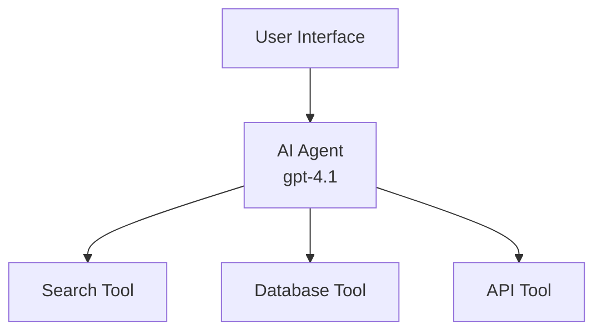
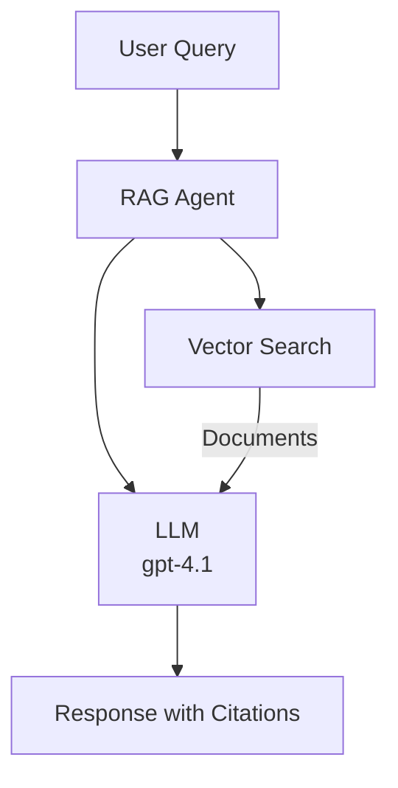
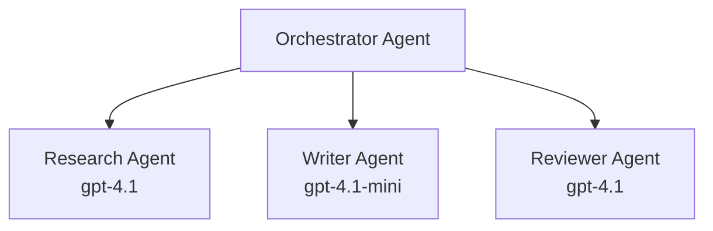

# AI agenti z Azure Developer CLI

**Nadzor poglavij:**
- **📚 Domov tečaja**: [AZD za začetnike](../../README.md)
- **📖 Trenutno poglavje**: Poglavje 2 - Razvoj z mislijo na AI
- **⬅️ Prejšnje**: [Integracija Microsoft Foundry](microsoft-foundry-integration.md)
- **➡️ Naslednje**: [Implementacija AI modela](ai-model-deployment.md)
- **🚀 Napredno**: [Rešitve z več agenti](../../examples/retail-scenario.md)

---

## Uvod

AI agenti so avtonomni programi, ki lahko zaznavajo svoje okolje, sprejemajo odločitve in izvajajo dejanja za dosego določenih ciljev. V nasprotju s preprostimi klepetalnimi roboti, ki odgovarjajo na pozive, agenti lahko:

- **Uporabljajo orodja** - Kličejo API-je, iščejo v podatkovnih bazah, izvajajo kodo
- **Načrtujejo in sklepa** - Razbijejo kompleksne naloge na korake
- **Učijo se iz konteksta** - Ohranjajo spomin in prilagajajo vedenje
- **Sodelujejo** - Delajo z drugimi agenti (sistemi z več agenti)

Ta vodič vam pokaže, kako implementirati AI agente v Azure z uporabo Azure Developer CLI (azd).

Uporaba konteksta pogovora ni učenje modela: trajni spomin, nadzor dostopa in hranjenje morajo biti implementirani/konfigurirani s strani aplikacije.

> **Foundry GA posodobitev (2026-11-09):** Namestite splošno dostopno paketo `microsoft.foundry` 1.0 z `azd >= 1.37.0`. Evaluacije so nameščene ločeno; nekatere izbirne funkcije predogleda in klasičen fragment SDK spodaj niso vključeni v GA prek tega paketa. Ta navodila temeljijo na [GA objavi](https://devblogs.microsoft.com/azure-sdk/microsoft-foundry-azure-developer-cli-ga/) in dokumentaciji, ne na živi Azure implementaciji.

## Cilji učenja

Z dokončanjem tega vodiča boste:
- Spoznali, kaj so AI agenti in kako se razlikujejo od klepetalnih robotov
- Implementirali vnaprej pripravljene predloge AI agentov z uporabo AZD
- Konfigurirali Foundry agente za prilagojene agente
- Izvedli osnovne vzorce agentov (uporaba orodij, RAG, več agentov)
- Nadzorovali in odpravljali napake implementiranih agentov

## Izidi učenja

Po zaključku boste znali:
- Implementirati AI agentne aplikacije v Azure z eno ukazno vrstico
- Konfigurirati orodja in zmogljivosti agentov
- Uporabiti generiranje z nadgradnjo pridobivanja podatkov (RAG) z agenti
- Oblikovati arhitekture z več agenti za kompleksne delovne procese
- Odpravljati najpogostejše probleme pri implementaciji agentov

---

## 🤖 Kaj agenta loči od klepetalnega robota?

| Značilnost | Klepetalni robot | AI agent |
|---------|---------|----------|
| **Vedenje** | Odgovarja na pozive | Izvaja avtonomna dejanja |
| **Orodja** | Lahko uporablja iskanje ali orodja | Običajno uporablja orodja v ciljno usmerjenem zanki |
| **Spomin** | Odvisno od aplikacije | Trajni spomin le, če je eksplicitno implementiran |
| **Načrtovanje** | Enkratni odgovor | Večstopenjsko sklepanje |
| **Sodelovanje** | Ena entiteta | Lahko sodeluje z drugimi agenti |

### Preprosta primerjava

- **Klepetalni robot** = Uporaben osebek, ki odgovarja na vprašanja na informacijskem pultu
- **AI agent** = Osebni asistent, ki lahko kliče, rezervira sestanke in opravlja naloge za vas

---

## 🚀 Hitri začetek: Implementirajte svojega prvega agenta

Izberite eno možnost v **novem praznem delovnem imeniku**. Ukaz `.` inicializira tam; brez eksplicitne poti lahko trenutni AZD ustvari podimenik s predlognim imenom in ne spremeni imenika v vaši lupini. Ločene predloge/okolja hranite v ločenih imenikih.

Časovni in stroškovni okvirji spodaj so informativni, niso potrjeni ponudbe. Pred implementacijo preverite trenutne zahtevane pogoje, cene, kvote modelov in izbirne storitve pri vsakem vzorcu.

### Možnost 1: Predloga Foundry agentov (priporočeno)

```bash
# Initialize the AI agents template
azd init --template get-started-with-ai-agents .

# Deploy to Azure
azd up
```

**Kaj se implementira:** Vzorec določa trenutno infrastrukturo in izbrane možnosti modela, orodij, gostovanja in nadzora virov. Pred zagonom preglejte README in `infra/`; ne domnevajte, da vsaka predloga agentov vključuje Search ali spletni vmesnik.

**Čas:** ~15-20 minut
**Strošek:** ~$100-150/mesec (razvoj)

### Možnost 2: Agentje za ustvarjalno pisanje z Prompty

```bash
# Initialize the Prompty-based agent template
azd init --template https://github.com/Azure-Samples/contoso-creative-writer .

# Deploy to Azure
azd up
```

**Kaj se implementira:** FastAPI/Prompty vzorec z več agenti za pisanje z uporabo Azure OpenAI, Bing Grounding in Azure AI Search. Prejšnji `agent-openai-python-prompty` repozitorij preusmerja sem; ni minimalna predloga vremenskega agenta za Azure Functions. Sledite trenutnemu README za gostovanje, kvote modelov in zahteve Bing Grounding.

**Čas:** ~10-15 minut
**Strošek:** ~$50-100/mesec (razvoj)

### Možnost 3: RAG klepetalni agent

```bash
# Initialize RAG chat template
azd init --template azure-search-openai-demo .

# Deploy to Azure
azd up
```

**Kaj se implementira:**
- ✅ Microsoft Foundry modeli
- ✅ Azure AI Search z vzorčnimi podatki
- ✅ Procesiranje dokumentov
- ✅ Klepetalni vmesnik s sklici

**Čas:** ~15-25 minut
**Strošek:** ~$80-150/mesec (razvoj)

### Možnost 4: Gostovani agent z GA Foundry paketom

Uporabite [celoten vodnik gostovanega agenta](microsoft-foundry-integration.md#hosted-agent-walkthrough-ga) za osnovni vzorec Python Agent Framework Responses API. Ta pot zahtevkov implementacije potrebuje Python 3.13+, trenutno uv, dovoljenja Foundry in regionalno kvoto modelov. Avtentikacijo lokalnih klicev SDK izvedite ločeno z dovoljenji Azure CLI.

```bash
azd auth login
azd ext install microsoft.foundry
```

V praznem imeniku inicializirajte vzorec:

```text
azd ai agent init --template https://github.com/microsoft-foundry/foundry-samples/blob/main/samples/python/hosted-agents/agent-framework/responses/01-basic/azure.yaml --deploy-mode code --src .
```

Izberite nov ali obstoječ projekt, preglejte `azure.yaml` in zaženite `azd provision`. Uporabite `azd ai agent run` za odpiranje Agent Inspectorja in iz druge konzole v istem imeniku zaženite `azd ai agent invoke --local "Explain how this agent is hosted."`. Po lokalni verifikaciji uporabite `azd deploy` in `azd ai agent invoke "Explain how this agent is hosted."` za primerjavo implementiranega odziva. Foundry gradi naloženo izvorno kodo na daljavo; lokalna gradnja kontejnerja ni potrebna.

**Kdaj uporabiti `azd ai agent init` ali `azd init --template`:**

| Pristop | Najbolj za | Kako deluje |
|----------|----------|------|
| `azd init --template` | Začetek z delujočo vzorčno aplikacijo | Klonira celoten predvozni repozitorij s kodo + infrastrukturo |
| `azd ai agent init --template` | Prevzem obstoječega projekta Foundry agentov | Uporablja dokument projekta `azure.yaml` in njegove definicije |

> **Namig:** Možnosti 1-3 začnejo z vsemi aplikacijskimi predlogami; možnost 4 uči delovni tok GA gostovanega agenta. Noben ukaz inicializacije samodejno ne migrira starejših manifestov agentov. Za dodajanje neposredne definicije agenta obstoječemu projektu glejte [navodila za inicializacijo in migracijo](../chapter-08-production/production-ai-practices.md#initializing-agent-projects-with-azd-ai-agent-init).

Namestite `azure.ai.evaluations` ločeno, da ustvarite in pregledate testne podatke/ocenjevalne smernice, konfigurirajte ocenjevanje in ga zaženite s `azd ai eval`. Optimizacija lahko ponovno uporabi združljivo ocenjevanje; pred implementacijo preglejte kandidate. Sledite [delovnemu toku ocenjevanja](../chapter-08-production/production-ai-practices.md#evaluation-migration-and-quality-checks) in [migraciji optimizacije](../chapter-08-production/production-ai-practices.md#optimization-configuration-migration) pred ponovno uporabo starejših primerov. Za čiščenje ostanejo viri že uporabljenega projekta Foundry po `azd down`; za novo ustvarjen projekt pa je skupina virov izbrisana. Glejte [navodila za čiščenje](microsoft-foundry-integration.md#7-clean-up-deliberately).

---

## 🏗️ Vzorec arhitekture agentov

### Vzorec 1: En sam agent z orodji

Najenostavnejši vzorec agentov - en agent, ki lahko uporablja več orodij.



**Najbolj za:**
- Podporne bote za stranke
- Raziskovalne asistente
- Agente za analizo podatkov

**Soroden vzorec aplikacije:** `azure-search-openai-demo` ponazarja RAG, ne generično zanko agenta z poljubnimi orodji.

### Vzorec 2: RAG agent (generiranje z nadgradnjo pridobivanja)

Agent, ki pridobiva relevantne dokumente pred generiranjem odgovorov.



**Najbolj za:**
- Podjetniške baze znanja
- Sisteme za vprašanja in odgovore na dokumente
- Skladnost in pravne raziskave

**AZD predloga:** `azure-search-openai-demo`

### Vzorec 3: Sistem z več agenti

Več specializiranih agentov, ki skupaj delajo na kompleksnih nalogah.



**Najbolj za:**
- Generiranje kompleksnih vsebin
- Večstopenjski delovni tokovi
- Naloge, ki zahtevajo različna strokovna znanja

**Več o:** [Vzorce koordinacije več agentov](../chapter-06-pre-deployment/coordination-patterns.md)

---

## ⚙️ Konfiguriranje orodij agentov

Agenti postanejo močni, ko lahko uporabljajo orodja. Tukaj je, kako konfigurirati pogosta orodja:

### Konfiguracija orodij v Foundry agentih

Ta **klasični fragment Agent Service SDK** cilja na `azure-ai-projects==1.0.0` in `azure-ai-agents==1.1.0` z `azure-identity`. Ni novejša različica agentov/Responses API, ki ga uporabljajo nekateri trenutni Foundry vzorci, niti `azure.ai.agents` AZD razširitev (drugačen paket). Ne mešajte teh generacij API-jev. Nastavite `PROJECT_ENDPOINT` na klasični Foundry projektni konektor in `MODEL_DEPLOYMENT_NAME` na obstoječo podprto implementacijo modela; avtenticirajte lokalno z `az login` in dajte potrebna projektna dovoljenja.

```python
# agent_config.py
import os
from azure.ai.projects import AIProjectClient
from azure.ai.agents.models import FunctionTool
from azure.identity import DefaultAzureCredential

def search_knowledge_base(query: str) -> str:
    """Search the demonstration knowledge base.

    :param query: Search text.
    :return: Matching demonstration information.
    """
    # Local fixture only, not a production search implementation.
    return "Demo policy: returns are accepted within 30 days."

project_client = AIProjectClient(
    endpoint=os.environ["PROJECT_ENDPOINT"],
    credential=DefaultAzureCredential(),
)
search_tool = FunctionTool(functions={search_knowledge_base})
project_client.agents.enable_auto_function_calls(search_tool)
agent = project_client.agents.create_agent(
    model=os.environ["MODEL_DEPLOYMENT_NAME"],
    name="Support Agent",
    instructions="Use search_knowledge_base for policy questions. Label results as demo data.",
    tools=search_tool.definitions,
)
```

Registracija funkcijske sheme ne izvaja Pythona na storitvi. V tem SDK-ju `enable_auto_function_calls` plus `agents.runs.create_and_process(...)` izvaja registrirane povratne klice v vašem odjemalskem procesu. Glejte [izdani primer SDK](https://github.com/Azure/azure-sdk-for-python/blob/azure-ai-agents_1.1.0/sdk/ai/azure-ai-agents/samples/agents_tools/sample_agents_auto_function_call.py). Po koncu zaprite odjemalca in izbrišite demonstracijske agente/niti.

### Konfiguracija okolja

Naslednja imena so **ilustrativni vhodi po meri predloge**, ne vgrajeni AZD preklopniki. Najprej vrednosti povežite skozi `infra/main.parameters.json`, infrastrukturo in aplikacijsko kodo. Samo `azd env set` ne spremeni orodij ali navodil agenta.

```bash
# Set up agent-specific environment variables
azd env set AZURE_OPENAI_MODEL "gpt-4.1"
azd env set AGENT_INSTRUCTIONS "You are a helpful assistant..."
azd env set ENABLE_CODE_INTERPRETER "true"
azd env set ENABLE_FILE_SEARCH "true"

# Apply wired infrastructure and application changes
azd up
```

---

## 📊 Nadzor agentov

### Povezava Application Insights

Če vaša izbrana predloga implementira Application Insights in konfigurira instrumentacijo:

```bash
# Open monitoring dashboard
azd monitor --overview

# Open the Application Insights logs view (not a streaming log tail)
azd monitor --logs

# View live metrics
azd monitor --live
```

### Ključni metri za spremljanje

| Metrična vrednost | Opis | Cilj |
|--------|-------------|--------|
| Zakasnitev odziva | Čas za generiranje odziva | < 5 sekund |
| Poraba tokenov | Toknov na zahtevo | Spremljajte za stroške |
| Uspešnost klica orodja | % uspešnih izvedb orodij | > 95% |
| Stopnja napak | Neuspešni agentni zahtevki | < 1% |
| Zadovoljstvo uporabnikov | Ocene povratnih informacij | > 4.0/5.0 |

### Po meri zapisovanje dnevnikov za agente

```python
import os
from azure.monitor.opentelemetry import configure_azure_monitor
from opentelemetry import trace

# Configure Azure Monitor with OpenTelemetry
configure_azure_monitor(
    connection_string=os.environ["APPLICATIONINSIGHTS_CONNECTION_STRING"]
)

tracer = trace.get_tracer(__name__)

def log_agent_interaction(user_query, agent_response, tools_used, latency_ms):
    with tracer.start_as_current_span("agent_interaction") as span:
        span.set_attributes({
            "query_length": len(user_query),  # Do not log raw prompts or personal data
            "response_length": len(agent_response),
            "tools_used": tools_used,
            "latency_ms": latency_ms
        })
```

> **Opomba:** Namestite potreben paket: `pip install azure-monitor-opentelemetry`. Prinaša odvisnosti OpenTelemetry; prostor imen za uvoz ni pogoj za namestitev paketa imenovanega `opentelemetry`.

---

## 💰 Stroški uporabe

### Ocenjeni mesečni stroški po vzorcu

To so informativni načrtovalni okvirji, ne ponudbe ali stroškovni plafoni. Regija, tokeni modela, Search/compute SKU-ji, seje orodij, shranjevanje in promet lahko presegajo te vrednosti. Pred `azd up` preverite nasvete o stroških in Azure cene vzorca.

| Vzorec | Razvojno okolje | Produkcija |
|---------|-----------------|------------|
| En agent | $50-100 | $200-500 |
| RAG agent | $80-150 | $300-800 |
| Več agentov (2-3 agenti) | $150-300 | $500-1,500 |
| Podjetniški več agentov | $300-500 | $1,500-5,000+ |

### Nasveti za optimizacijo stroškov

1. **Uporabite gpt-4.1-mini za preproste naloge** (le če vaša predloga porabi ta vhod)
   ```bash
   azd env set AZURE_OPENAI_MODEL "gpt-4.1-mini"
   ```

2. **Izvedite scoped caching za varna, ponavljajoča se iskanja.** Vključite najemniško/uporabniško avtentikacijo, implementacijo modela, navodila in različico pridobivanja v ključ predpomnilnika; nastavite potek. Ne delite zasebnih odgovorov pogovora skozi globalni predpomnilnik samo za poizvedbe. Predmet SDK agenta nima generične metode `agent.run()`.

3. **Nastavite omejitve tokenov na izvedbo**
   ```python
   # Set max_completion_tokens when running the agent, not during creation
   run = project_client.agents.runs.create_and_process(
       thread_id=thread.id,
       agent_id=agent.id,
       max_completion_tokens=1000  # Budget across the run; may finish as incomplete
   )
   ```

4. **Pomaknite upravičene Container Apps na ničelno uporabo, ko niso aktivne**
   ```bash
   # Custom-template input: must map to template.scale.minReplicas
   azd env set MIN_REPLICAS "0"
   ```
   Spremembo infrastrukture izvedite z `azd provision` ali `azd up`. Pomik na nič ne ustavi iskanja, shranjevanja ali stroškov modela/orodja.

---

## 🔧 Reševanje težav z agenti

### Pogoste težave in rešitve

<details>
<summary><strong>❌ Agent ne odgovarja na klice orodij</strong></summary>

```bash
# Inspect the application deployment (not the agent's registered tools)
azd show

# Verify OpenAI deployment
az cognitiveservices account deployment list \
  --name $AZURE_OPENAI_NAME \
  --resource-group $RG_NAME

# Check agent logs
azd monitor --logs
```

**Pogosti vzroki:**
- Neujemanje podpisa funkcije orodja
- Manjkajo potrebna dovoljenja
- Nedosegljiv API konektor
</details>

<details>
<summary><strong>❌ Visoka zakasnitev odgovorov agenta</strong></summary>

```bash
# Check Application Insights for bottlenecks
azd monitor --live

# Consider using a faster model
azd env set AZURE_OPENAI_MODEL "gpt-4.1-mini"
azd up
```

**Nasveti za optimizacijo:**
- Uporabljajte pretočne odzive
- Uvedite predpomnjenje odgovorov
- Zmanjšajte velikost kontekstnega okna
</details>

<details>
<summary><strong>❌ Agent vrača napačne ali halucinirane informacije</strong></summary>

```python
# Improve with better system prompts
instructions = """
You are a helpful assistant. IMPORTANT:
- Only answer based on provided context
- If you don't know, say "I don't know"
- Always cite your sources
- Never make up information
"""

# Use these instructions in the agent definition.
# For classic file search, first upload/index documents in a vector store,
# then use FileSearchTool(vector_store_ids=[...]) and pass both its
# .definitions and .resources when creating the agent.
```
Navodila in pridobivanje zmanjšujeta tveganje; nobeno ne zagotavlja faktografskih odgovorov. Ocenjujte utemeljena in svenamenska vprašanja glede na znane odgovore.
</details>

<details>
<summary><strong>❌ Napake zaradi prekoračitve omejitve tokenov</strong></summary>

```python
# Implement context window management
def truncate_context(messages, max_tokens=8000, model="gpt-4.1"):
    """Approximate content-only budget for objects with .content strings."""
    import tiktoken
    encoding = tiktoken.encoding_for_model(model)
    total_tokens = 0
    truncated = []
    
    for msg in reversed(messages):
        msg_tokens = len(encoding.encode(msg.content))
        if total_tokens + msg_tokens > max_tokens:
            break
        truncated.insert(0, msg)
        total_tokens += msg_tokens
    
    return truncated
```
Ta pripomoček izključuje sheme vlog/orodij, sistemska navodila, slikovne tokene in režijske podatke protokola. Rezervirajte prostor za te in za zaključek; ne delite parov klic-orodje/rezultat in ne zavrzite potrebnih sistemskih navodil. Namestite `tiktoken` ločeno. Ni splošni validator kontekstnega okna.
</details>

---

## 🎓 Praktične vaje

### Vaja 1: Implementacija osnovnega agenta (20 minut)

**Cilj:** Implementirajte svojega prvega AI agenta z uporabo AZD

```bash
# Step 1: Initialize template
azd init --template get-started-with-ai-agents .

# Step 2: Login to Azure
azd auth login
# If you work across tenants, add --tenant-id <tenant-id>

# Step 3: Deploy
azd up

# Step 4: Test the agent
# Expected output after deployment:
#   Deployment Complete!
#   Endpoint: https://<app-name>.<region>.azurecontainerapps.io
# Open the URL shown in the output and try asking a question

# Step 5: View monitoring
azd monitor --overview

# Step 6: Review the listed resources and confirm cleanup
azd down
```

**Kriteriji uspeha:**
- [ ] Agent odgovarja na vprašanja
- [ ] Dostop do nadzorne plošče za spremljanje preko `azd monitor`
- [ ] Viri so uspešno očiščeni

### Vaja 2: Dodajanje po meri orodja (30 minut)

**Cilj:** Razširi agenta s po meri orodjem

**Začetna točka:** Uporabi klasičnega SDK odjemalca iz [Tool Configuration](#tool-configuration-in-foundry-agents), ne poljubne predloge z drugačno SDK generacijo.

1. Dodaj to deterministično fiksno vrednost v `agent_config.py`:
   ```python
   def get_weather(location: str) -> str:
       """Return demonstration weather, not live conditions.

       :param location: City name.
       :return: A clearly labelled fixture.
       """
       print(f"TOOL_CALLED: {location}")
       return f"Demo weather in {location}: Sunny, 72°F (fixture, not live)"
   ```
2. Zamenjaj blok registracije in ustvarjanja search-tool z:
   ```python
   weather_tool = FunctionTool(functions={get_weather})
   project_client.agents.enable_auto_function_calls(weather_tool)
   agent = project_client.agents.create_agent(
       model=os.environ["MODEL_DEPLOYMENT_NAME"],
       name="Weather Agent",
       instructions="Call get_weather for weather questions; explain that it returns demo data.",
       tools=weather_tool.definitions,
   )
   thread = project_client.agents.threads.create()
   try:
       project_client.agents.messages.create(
           thread_id=thread.id, role="user", content="Use get_weather for Seattle."
       )
       run = project_client.agents.runs.create_and_process(
           thread_id=thread.id, agent_id=agent.id
       )
       if run.status != "completed":
           raise RuntimeError(f"Run status: {run.status}; error: {run.last_error}")
       for message in project_client.agents.messages.list(thread_id=thread.id):
           for text in message.text_messages:
               print(text.text.value)
   finally:
       project_client.agents.threads.delete(thread.id)
       project_client.agents.delete_agent(agent.id)
       project_client.close()
   ```
3. Zaženi lokalno (to kliče obstoječi Azure projekt in povzroči stroške modela):
   ```bash
   python agent_config.py
   # Expected: TOOL_CALLED: Seattle, then a completed answer labelled demo data.
   ```

**Kriteriji uspeha:**
- [ ] Agent prepozna vprašanja povezana z vremenom
- [ ] Orodje je pravilno poklicano
- [ ] Odgovor vključuje informacije o vremenu

### Vaja 3: Ustvari RAG agenta (45 minut)

**Cilj:** Ustvari agenta, ki odgovarja na vprašanja iz tvojih dokumentov

```bash
# Step 1: Deploy RAG template
azd init --template azure-search-openai-demo .
azd up

# Step 2: Upload your documents
# For the sample's local ingestion path, place supported files in data/.
# Run from the sample root after following its Python environment setup:
./scripts/prepdocs.sh
# Windows PowerShell equivalent: .\\scripts\\prepdocs.ps1

# Step 3: Test with domain-specific questions
# Open the web app URL from the azd up output
# Ask questions about your uploaded documents
# Responses should include citation references like [doc.pdf]
```

**Kriteriji uspeha:**
- [ ] Agent odgovarja iz naloženih dokumentov
- [ ] Odgovori vsebujejo navedbe virov
- [ ] Testna vprašanja izven obsega se obravnavajo brez nepodprtih trditev (ni zagotovilo za vsa prihodnja vprašanja)

Če `USE_CLOUD_INGESTION=true`, uporabi namesto tega vzorčni postopek nalaganja/obdelave v oblaku; lokalni ovitek namerno preskoči obdelavo. Po testiranju zaženi `azd down` v RAG okolju in preglej vire za izbris.

---

## 📚 Naslednji koraki

Zdaj, ko razumeš AI agente, raziskuj naslednje napredne teme:

| Tema | Opis | Povezava |
|-------|-------------|------|
| **Sistemi z več agenti** | Ustvari sisteme z več sodelujočimi agenti | [Retail Multi-Agent Example](../../examples/retail-scenario.md) |
| **Vzorce koordinacije** | Spoznaj vzorce orkestracije in komunikacije | [Coordination Patterns](../chapter-06-pre-deployment/coordination-patterns.md) |
| **Implementacija v produkcijo** | Implementacija agenta pripravljena za podjetja | [Production AI Practices](../chapter-08-production/production-ai-practices.md) |
| **Evalvacija agenta** | Testiraj in oceni uspešnost agenta | [AI Troubleshooting](../chapter-07-troubleshooting/ai-troubleshooting.md) |
| **AI delavnica** | Praktično: Pripravi svojo AI rešitev na AZD | [AI Workshop Lab](ai-workshop-lab.md) |

---

## 📖 Dodatni viri

### Uradna dokumentacija
- [Microsoft Foundry Agent Service](https://learn.microsoft.com/azure/ai-services/agents/)
- [Microsoft Foundry Agent Service Quickstart](https://learn.microsoft.com/azure/ai-services/agents/quickstart)
- [Semantic Kernel Agent Framework](https://learn.microsoft.com/semantic-kernel/)

### Predloge AZD za agente
- [Začni z AI Agenti](https://github.com/Azure-Samples/get-started-with-ai-agents)
- [Agenti za kreativno pisanje s Prompty](https://github.com/Azure-Samples/contoso-creative-writer)
- [Demonstracija Azure Search OpenAI](https://github.com/Azure-Samples/azure-search-openai-demo)

### Skupnostni viri
- [Awesome AZD - agentne predloge](https://azure.github.io/awesome-azd/?tags=ai-agents)
- [Azure AI Discord](https://discord.gg/microsoft-azure)
- [Microsoft Foundry Discord](https://discord.gg/nTYy5BXMWG)

### Sposobnosti agentov za tvoj urejevalnik
- [**Microsoft Azure Agent Skills**](https://skills.sh/microsoft/github-copilot-for-azure) - Namesti ponovno uporabne sposobnosti AI agentov za razvoj v Azure v GitHub Copilot, Cursor ali kateremkoli podprtem agentu. Vključuje sposobnosti za [Azure AI](https://skills.sh/microsoft/github-copilot-for-azure/azure-ai), [Microsoft Foundry](https://skills.sh/microsoft/github-copilot-for-azure/microsoft-foundry), [implementacijo](https://skills.sh/microsoft/github-copilot-for-azure/azure-deploy) in [diagnostiko](https://skills.sh/microsoft/github-copilot-for-azure/azure-diagnostics):
  ```bash
  npx skills add microsoft/github-copilot-for-azure
  ```

---

**Navigacija**
- **Prejšnja lekcija**: [Microsoft Foundry Integration](microsoft-foundry-integration.md)
- **Naslednja lekcija**: [AI Model Deployment](ai-model-deployment.md)

---

<!-- CO-OP TRANSLATOR DISCLAIMER START -->
**Omejitev odgovornosti**:
Ta dokument je bil preveden z uporabo AI prevajalske storitve [Co-op Translator](https://github.com/Azure/co-op-translator). Čeprav si prizadevamo za natančnost, vas prosimo, da upoštevate, da avtomatizirani prevodi lahko vsebujejo napake ali netočnosti. Izvirni dokument v njegovem izvirnem jeziku je treba obravnavati kot avtoritativni vir. Za kritične informacije je priporočljiv strokovni človeški prevod. Ne odgovarjamo za morebitna nesporazume ali napačne interpretacije, ki izhajajo iz uporabe tega prevoda.
<!-- CO-OP TRANSLATOR DISCLAIMER END -->