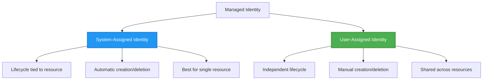

# Vzorce avtentikacije in upravljana identiteta

⏱️ **Ocenjen čas**: 45-60 minut branja; dovolite dodatni čas za integracijo vaj | 💰 **Vpliv na stroške**: identiteta/RBAC so brezplačni; obračunava se nameščena računalniška moč, shramba in Key Vault | ⭐ **Zahtevnost**: Srednje zahtevno

> Pregledano po `azd 1.37.2` (november 2026). Ta lekcija vsebuje **ilustrativne fragmente za integracijo, ne popolne prenosljive predloge `secure-app`**. Ustvarite referencirane datoteke, zagotovite ustrezno infrastrukturo in zamenjajte nadomestke pred nameščanjem. Med pregledom ni bilo ustvarjenih Azure virov.

**📚 Učni načrt:**
- ← Prejšnja: [Upravljanje konfiguracije](configuration.md) - Upravljanje okoljskih spremenljivk in skrivnosti
- 🎯 **Trenutno ste tukaj**: Avtentikacija in varnost (upravljana identiteta, Key Vault, varni vzorci)
- → Naslednja: [Infrastruktura kot koda](../chapter-04-infrastructure/README.md) - Priprava in nameščanje virov
- 🏠 [Domača stran tečaja](../../README.md)

---

## Kaj se boste naučili

Z zaključkom te lekcije boste:
- Spoznali Azure vzorce avtentikacije (ključev, povezovalnih nizov, upravljane identitete)
- Uporabili **Upravljano identiteto** za prijavo brez gesla
- Zaščitili skrivnosti z integracijo **Azure Key Vault**
- Konfigurirali **vloge na osnovi dostopa (RBAC)** za AZD nameščanja
- Uporabili varnostne dobre prakse v Container Apps in Azure storitvah
- Migrirali s ključev na avtentikacijo na osnovi identitete

## Zakaj je upravljana identiteta pomembna

### Težava: Tradicionalna avtentikacija

**Pred upravljano identiteto:**
```javascript
// ❌ SECURITY RISK: Hardcoded secrets in code
const connectionString = "Server=mydb.database.windows.net;User=admin;Password=P@ssw0rd123";
const storageKey = "xK7mN9pQ2wR5tY8uI0oP3aS6dF1gH4jK...";
const cosmosKey = "C2x7B9n4M1p8Q5w3E6r0T2y5U8i1O4p7...";
```

**Težave:**
- 🔴 **Razkrite skrivnosti** v kodi, konfiguracijskih datotekah, okoljskih spremenljivkah
- 🔴 **Rotacija poverilnic** zahteva spremembe kode in ponovni zagon
- 🔴 **Nočne more zaradi revizije** - kdo je dostopal k čemu, kdaj?
- 🔴 **Razpršenost** - skrivnosti so razpršene po več sistemih
- 🔴 **Tveganja skladnosti** - ne uspe varnostnim pregledom

### Rešitev: Upravljana identiteta

**Po uvedbi upravljane identitete:**
```javascript
// ✅ SECURE: No secrets in code
const credential = new DefaultAzureCredential();
const client = new BlobServiceClient(
  "https://mystorageaccount.blob.core.windows.net",
  credential  // Azure automatically handles authentication
);
```

**Prednosti:**
- ✅ **Brez skrivnosti** v kodi ali konfiguraciji
- ✅ **Samodejna rotacija** - upravlja jo Azure
- ✅ **Popolna revizijska sled** v Microsoft Entra ID dnevnikih
- ✅ **Centralizirana varnost** - upravljanje prek Azure Portala
- ✅ **Pripravljeno na skladnost** - izpolnjuje varnostne standarde

**Primerjava**: Tradicionalna avtentikacija je kot nošenje več fizičnih ključev za različna vrata. Upravljana identiteta je kot varnostna značka, ki samodejno omogoča dostop glede na vašo identiteto – brez ključev, ki bi jih bilo treba izgubiti, kopirati ali rotirati.

---

## Pregled arhitekture

### Potek avtentikacije z upravljano identiteto

```mermaid
sequenceDiagram
    participant App as Your Application<br/>(Container App)
    participant MI as Managed Identity<br/>(Microsoft Entra ID)
    participant KV as Key Vault
    participant Storage as Azure Storage
    participant DB as Azure SQL
    
    App->>MI: Request access token<br/>(automatic)
    MI->>MI: Verify identity<br/>(no password needed)
    MI-->>App: Return token for requested audience<br/>(lifetime varies)
    
    App->>KV: Get secret<br/>(using token)
    KV->>KV: Check RBAC permissions
    KV-->>App: Return secret value
    
    App->>Storage: Upload blob<br/>(using token)
    Storage->>Storage: Check RBAC permissions
    Storage-->>App: Success
    
    App->>DB: Query data<br/>(using token)
    DB->>DB: Check SQL permissions
    DB-->>App: Return results
    
    Note over App,DB: Request a separate token for each service audience;<br/>SDK credentials handle caching and renewal
```

### Vrste upravljanih identitet



| Značilnost | Sistemoma dodeljena | Ročno dodeljena |
|---------|----------------|---------------|
| **Življenjski cikel** | Veže se na vir | Neodvisna |
| **Ustvarjanje** | Samodejno z virom | Ročno ustvarjanje |
| **Brisanje** | Izbrisana z virom | Obstane po brisanju vira |
| **Deljenje** | Samo en vir | Več virov |
| **Uporaba** | Enostavni scenariji | Kompleksni scenariji z več viri |
| **Izbira predloge** | Določena v infrastrukturi | Določena v infrastrukturi |

---

## Predpogoji

### Zahtevana orodja

Te že imate nameščena iz predhodnih lekcij:

```bash
# Verify Azure Developer CLI
azd version
# ✅ Expected: azd version 1.0.0 or higher

# Verify Azure CLI
az --version
# ✅ Expected: azure-cli 2.50.0 or higher
```

### Zahteve za Azure

- Aktivno Azure naročnino
- Dovoljenja za:
  - Ustvarjanje upravljanih identitet
  - Dodeljevanje RBAC vlog
  - Ustvarjanje Key Vault virov
  - Namestitev Container Apps

### Potrebno znanje

Morali ste zaključiti:
- [Vodnik za namestitev](../chapter-01-foundation/installation.md) - Nastavitev AZD
- [Osnove AZD](../chapter-01-foundation/azd-basics.md) - Temeljni koncepti
- [Upravljanje konfiguracije](configuration.md) - Okoljske spremenljivke

---

## Lekcija 1: Razumevanje vzorcev avtentikacije

### Vzorec 1: Povezovalni nizi (zastarjeno - izogibajte se)

**Kako deluje:**
```bash
# Connection string contains credentials
STORAGE_CONNECTION_STRING="DefaultEndpointsProtocol=https;AccountName=myaccount;AccountKey=xK7mN9pQ2wR5..."
COSMOS_CONNECTION_STRING="AccountEndpoint=https://myaccount.documents.azure.com:443/;AccountKey=C2x7..."
SQL_CONNECTION_STRING="Server=myserver.database.windows.net;User=admin;Password=P@ssw0rd..."
```

**Težave:**
- ❌ Skrivnosti so vidne v okoljskih spremenljivkah
- ❌ Zabeležene v sistemih za nameščanje
- ❌ Težko jih je rotirati
- ❌ Ni revizijske sledi dostopa

**Kdaj uporabiti:** Ko ciljna storitev zahteva avtentikacijo na osnovi ključa. Raje uporabite identiteto, če je podprta; sicer hranite ključe varno in jih rotirajte, tudi v produkcijskem okolju.

---

### Vzorec 2: Reference Key Vault (bolje)

**Kako deluje:**
**Delni Bicep fragmenti:** zahtevana polja za vault, identiteta Container App in njen `configuration.secrets` zapis so izpuščeni. `secretRef` poimenuje skrivnost Container App; ni **sama po sebi** Key Vault URI. Za uporabo Key Vault določite to imenovano skrivnost z `keyVaultUrl` in pooblaščenim `identity`.

```bicep
// Store secret in Key Vault
resource keyVault 'Microsoft.KeyVault/vaults@2023-02-01' = {
  name: 'mykv'
  properties: {
    enableRbacAuthorization: true
  }
}

// Reference in Container App
env: [
  {
    name: 'STORAGE_KEY'
    secretRef: 'storage-key'  // References Key Vault
  }
]
```

**Prednosti:**
- ✅ Skrivnosti shranjene varno v Key Vault
- ✅ Centralizirano upravljanje skrivnosti
- ✅ Rotacija brez sprememb kode

**Omejitve:**
- ⚠️ Še vedno uporabljajo ključe/gesla
- ⚠️ Potrebno je upravljati dostop do Key Vault

**Kdaj uporabiti:** Prehodni korak iz povezovalnih nizov na upravljano identiteto.

---

### Vzorec 3: Upravljana identiteta (najboljša praksa)

**Kako deluje:**
**Delni Bicep:** združite blok identitete v popolno Container App in zagotovite `storageAccount` ter definicijo vloge. Dodelitev vloge zahteva tudi deterministični `name`.

```bicep
// Enable managed identity
resource containerApp 'Microsoft.App/containerApps@2023-05-01' = {
  name: 'myapp'
  identity: {
    type: 'SystemAssigned'  // Automatically creates identity
  }
}

// Grant permissions
resource roleAssignment 'Microsoft.Authorization/roleAssignments@2022-04-01' = {
  name: guid(storageAccount.id, containerApp.id, storageBlobDataContributorRole)
  scope: storageAccount
  properties: {
    roleDefinitionId: storageBlobDataContributorRole
    principalId: containerApp.identity.principalId
    principalType: 'ServicePrincipal'
  }
}
```

**Aplikacijska koda:**
```javascript
// No secrets needed!
const { DefaultAzureCredential } = require('@azure/identity');
const { BlobServiceClient } = require('@azure/storage-blob');

const credential = new DefaultAzureCredential();
const blobServiceClient = new BlobServiceClient(
  'https://mystorageaccount.blob.core.windows.net',
  credential
);
```

**Prednosti:**
- ✅ Brez skrivnosti v kodi/konfiguraciji
- ✅ Samodejna rotacija poverilnic
- ✅ Popolna revizijska sled
- ✅ Dovoljenja na osnovi RBAC
- ✅ Pripravljeno za skladnost

**Kdaj uporabiti:** Priporočljivo za aplikacije, ki gostujejo v Azure in dostopajo do storitev, ki podpirajo Microsoft Entra avtentikacijo.

---

### Vzorec 4: Servisni glavni uporabniki (CI/CD in avtomatizacija)

Upravljana identiteta je zlati standard *za vire, ki tečejo znotraj Azure*. Kaj pa tisto, kar teče **izven** Azure - kot CI/CD cevovod na gradbenem agentu ali skripta na vašem prenosniku, ki ne more uporabiti vaše interaktivne prijave? Tu pride do izraza **servisni glavni uporabnik**: nečloveška identiteta s svojimi poverilnicami, s katerimi se lahko avtomatizirani proces prijavi.

**Kako deluje:**

Ustvarite servisnega glavnega uporabnika z obsegom vire skupine (najmanjša pravica):

```bash
az ad sp create-for-rbac \
  --name "myapp-cicd" \
  --role contributor \
  --scopes "/subscriptions/<sub-id>/resourceGroups/<rg-name>"
```

Izpiše ID odjemalca, skrivnost odjemalca in ID najemnika. azd se lahko z njima prijavi brez interakcije:

```bash
azd auth login \
  --client-id "<appId>" \
  --client-secret "<password>" \
  --tenant-id "<tenant>"
```

**Raje uporabite federirane poverilnice (OIDC) namesto skrivnosti.** Namesto dolgožive skrivnosti odjemalca konfigurirajte federirano poverilnico, da cevovod izmenja kratkotrajni žeton—ni skrivnosti, ki bi se lahko razkrila ali rotirala:

```bash
azd auth login \
  --client-id "<appId>" \
  --federated-credential-provider "github" \
  --tenant-id "<tenant>"
```

> `azd pipeline config` to samodejno nastavi za vas. Oglejte si predstavitve CI/CD v [Poglavju 8](../chapter-08-production/production-ai-practices.md).

**Prednosti:**
- ✅ Deluje zunaj Azure (gradbeni agenti, lokalno, drugi oblaki)
- ✅ Lahko je omejen na eno skupino virov z eno vlogo
- ✅ Federirana (OIDC) različica ne uporablja shranjene skrivnosti

**Slabosti:**
- ⚠️ Različica s skrivnostjo zahteva skrbno shranjevanje in rotacijo
- ⚠️ Razkrita skrivnost omogoča vse, kar SP lahko stori – zato naj bo obseg omejen

**Kdaj uporabiti:** CI/CD cevovodi in avtomatizacija, ki ne morejo uporabiti upravljane identitete. Vedno raje uporabite **federirano/OIDC** različico pred skrivnostjo odjemalca in raje upravljano identiteto, kadar delovna obremenitev teče v Azure.

**Varno shranjevanje poverilnic:**
- Nikoli ne shranjujte skrivnosti v repozitorij – uporabite skrivnostni shrambni prostor vašega cevovoda (GitHub Actions skrivnosti, Azure DevOps skupine spremenljivk / Key Vault).
- Določite najmanjšo potrebno vlogo in skupino virov za SP.
- Nastavite rok veljavnosti in rotirajte, oziroma popolnoma odpravite skrivnost z OIDC.

---

## Lekcija 2: Uporaba upravljane identitete z AZD

### Korak za korakom implementacija

Naslednji fragmenti prikazujejo, kako integrirati upravljano identiteto v projekt Container App. Niso **kopiraj-in-zaženi začetek**: modul Storage, popolna infrastruktura za upravljano okolje/registracijo, Dockerfile in datoteka s parametri niso vsi vključeni tukaj. Začnite z delujočo predlogo Container Apps in združite te vzorce, pri čemer ohranite konfiguracijo registra in oznake storitev.

### Struktura projekta

```
secure-app/
├── azure.yaml                 # AZD configuration
├── infra/
│   ├── main.bicep            # Main infrastructure
│   ├── core/
│   │   ├── identity.bicep    # Managed identity setup
│   │   ├── keyvault.bicep    # Key Vault configuration
│   │   └── storage.bicep     # Storage with RBAC
│   └── app/
│       └── container-app.bicep
└── src/
    ├── app.js                # Application code
    ├── package.json
    └── Dockerfile
```

### 1. Konfiguracija AZD (azure.yaml)

```yaml
name: secure-app
metadata:
  template: secure-app@1.0.0

services:
  api:
    project: ./src
    language: js
    host: containerapp

# Managed identity must be enabled in the infrastructure, not by this YAML.
```

### 2. Infrastruktura: Omogočanje upravljane identitete

**Datoteka: `infra/main.bicep`**

```bicep
targetScope = 'subscription'

param environmentName string
param location string = 'eastus'
param containerAppsEnvironmentId string
param containerImage string

var tags = { 'azd-env-name': environmentName }

// Resource group
resource rg 'Microsoft.Resources/resourceGroups@2021-04-01' = {
  name: 'rg-${environmentName}'
  location: location
  tags: tags
}

// Storage Account
module storage './core/storage.bicep' = {
  name: 'storage'
  scope: rg
  params: {
    name: 'st${uniqueString(rg.id)}'
    location: location
    tags: tags
  }
}

// Key Vault
module keyVault './core/keyvault.bicep' = {
  name: 'keyvault'
  scope: rg
  params: {
    name: 'kv-${uniqueString(rg.id)}'
    location: location
    tags: tags
  }
}

// Container App with Managed Identity
module containerApp './app/container-app.bicep' = {
  name: 'container-app'
  scope: rg
  params: {
    name: 'ca-${environmentName}'
    location: location
    tags: tags
    storageAccountName: storage.outputs.name
    keyVaultName: keyVault.outputs.name
    containerAppsEnvironmentId: containerAppsEnvironmentId
    containerImage: containerImage
  }
}

// Grant Container App access to Storage
module storageRoleAssignment './core/role-assignment.bicep' = {
  name: 'storage-role'
  scope: rg
  params: {
    principalId: containerApp.outputs.identityPrincipalId
    roleDefinitionId: 'ba92f5b4-2d11-453d-a403-e96b0029c9fe'  // Storage Blob Data Contributor
    targetResourceType: 'storage'
    targetResourceName: storage.outputs.name
  }
}

// Grant Container App access to Key Vault
module kvRoleAssignment './core/role-assignment.bicep' = {
  name: 'kv-role'
  scope: rg
  params: {
    principalId: containerApp.outputs.identityPrincipalId
    roleDefinitionId: '4633458b-17de-408a-b874-0445c86b69e6'  // Key Vault Secrets User
    targetResourceType: 'keyvault'
    targetResourceName: keyVault.outputs.name
  }
}

// Outputs
output AZURE_STORAGE_ACCOUNT_NAME string = storage.outputs.name
output AZURE_KEY_VAULT_NAME string = keyVault.outputs.name
output APP_URL string = containerApp.outputs.url
```

### 3. Container App s sistemsko dodeljeno identiteto

**Datoteka: `infra/app/container-app.bicep`**

```bicep
param name string
param location string
param tags object = {}
param storageAccountName string
param keyVaultName string
param containerAppsEnvironmentId string
param containerImage string

resource containerApp 'Microsoft.App/containerApps@2023-05-01' = {
  name: name
  location: location
  tags: union(tags, { 'azd-service-name': 'api' })
  identity: {
    type: 'SystemAssigned'  // 🔑 Enable managed identity
  }
  properties: {
    managedEnvironmentId: containerAppsEnvironmentId
    configuration: {
      ingress: {
        external: true
        targetPort: 3000
      }
    }
    template: {
      containers: [
        {
          name: 'api'
          image: containerImage // Must exist; configure registry credentials for private images
          resources: {
            cpu: json('0.5')
            memory: '1Gi'
          }
          env: [
            {
              name: 'AZURE_STORAGE_ACCOUNT_NAME'
              value: storageAccountName
            }
            {
              name: 'AZURE_KEY_VAULT_NAME'
              value: keyVaultName
            }
            // 🔑 No secrets - managed identity handles authentication!
          ]
        }
      ]
    }
  }
}

// Output the identity for RBAC assignments
output identityPrincipalId string = containerApp.identity.principalId
output id string = containerApp.id
output url string = 'https://${containerApp.properties.configuration.ingress.fqdn}'
```

### 4. Modul za dodeljevanje vlog RBAC

**Datoteka: `infra/core/role-assignment.bicep`**

```bicep
param principalId string
param roleDefinitionId string  // Azure built-in role ID
@allowed(['storage', 'keyvault'])
param targetResourceType string
param targetResourceName string

// Typed existing resources give Bicep a valid resource scope, not a string ID.
resource storageTarget 'Microsoft.Storage/storageAccounts@2023-01-01' existing = {
  name: targetResourceName
}
resource vaultTarget 'Microsoft.KeyVault/vaults@2023-02-01' existing = {
  name: targetResourceName
}

resource storageAssignment 'Microsoft.Authorization/roleAssignments@2022-04-01' = if (targetResourceType == 'storage') {
  name: guid(storageTarget.id, principalId, roleDefinitionId)
  scope: storageTarget
  properties: {
    roleDefinitionId: subscriptionResourceId('Microsoft.Authorization/roleDefinitions', roleDefinitionId)
    principalId: principalId
    principalType: 'ServicePrincipal'
  }
}

resource vaultAssignment 'Microsoft.Authorization/roleAssignments@2022-04-01' = if (targetResourceType == 'keyvault') {
  name: guid(vaultTarget.id, principalId, roleDefinitionId)
  scope: vaultTarget
  properties: {
    roleDefinitionId: subscriptionResourceId('Microsoft.Authorization/roleDefinitions', roleDefinitionId)
    principalId: principalId
    principalType: 'ServicePrincipal'
  }
}

// This module assigns at the target resource scope, not the whole resource group.
```

### 5. Aplikacijska koda z upravljano identiteto

**Datoteka: `src/app.js`**

```javascript
const express = require('express');
const { DefaultAzureCredential } = require('@azure/identity');
const { BlobServiceClient } = require('@azure/storage-blob');
const { SecretClient } = require('@azure/keyvault-secrets');

const app = express();
const PORT = process.env.PORT || 3000;

// 🔑 Initialize credential (works automatically with managed identity)
const credential = new DefaultAzureCredential();

// Azure Storage setup
const storageAccountName = process.env.AZURE_STORAGE_ACCOUNT_NAME;
const blobServiceClient = new BlobServiceClient(
  `https://${storageAccountName}.blob.core.windows.net`,
  credential  // No keys needed!
);

// Key Vault setup
const keyVaultName = process.env.AZURE_KEY_VAULT_NAME;
const secretClient = new SecretClient(
  `https://${keyVaultName}.vault.azure.net`,
  credential  // No keys needed!
);

// Health check
app.get('/health', (req, res) => {
  res.json({ status: 'healthy', authentication: 'managed-identity' });
});

// Upload file to blob storage
app.post('/upload', async (req, res) => {
  try {
    const containerClient = blobServiceClient.getContainerClient('uploads');
    await containerClient.createIfNotExists();
    
    const blobName = `file-${Date.now()}.txt`;
    const blockBlobClient = containerClient.getBlockBlobClient(blobName);
    
    const content = 'Hello from managed identity!';
    await blockBlobClient.upload(content, Buffer.byteLength(content));
    
    res.json({
      success: true,
      blobName: blobName,
      message: 'File uploaded using managed identity!'
    });
  } catch (error) {
    console.error('Upload error:', error);
    res.status(500).json({ error: error.message });
  }
});

// Get secret from Key Vault
app.get('/secret/:name', async (req, res) => {
  try {
    const secretName = req.params.name;
    const secret = await secretClient.getSecret(secretName);
    
    res.json({
      name: secretName,
      retrieved: secret.value !== undefined, // Never return the secret value to callers
      message: 'Secret retrieved using managed identity!'
    });
  } catch (error) {
    console.error('Secret error:', error);
    res.status(500).json({ error: error.message });
  }
});

// List blob containers (demonstrates read access)
app.get('/containers', async (req, res) => {
  try {
    const containers = [];
    for await (const container of blobServiceClient.listContainers()) {
      containers.push(container.name);
    }
    
    res.json({
      containers: containers,
      count: containers.length,
      message: 'Containers listed using managed identity!'
    });
  } catch (error) {
    console.error('List error:', error);
    res.status(500).json({ error: error.message });
  }
});

app.listen(PORT, () => {
  console.log(`Secure API listening on port ${PORT}`);
  console.log('Authentication: Managed Identity (passwordless)');
});
```

**Datoteka: `src/package.json`**

```json
{
  "name": "secure-app",
  "version": "1.0.0",
  "dependencies": {
    "express": "^4.18.2",
    "@azure/identity": "^4.0.0",
    "@azure/storage-blob": "^12.17.0",
    "@azure/keyvault-secrets": "^4.7.0"
  },
  "scripts": {
    "start": "node app.js"
  }
}
```

### 6. Namestitev in testiranje

Te ukaze zaženite **šele po** dokončanju manjkajoče infrastrukture, Dockerfile in ustreznega `main.parameters.json` v vašem lastnem projektu. Avtenticirajte azd z `azd auth login`; ločeno se prijavite z `az login` za kasnejše preverjanje z Azure CLI. Prikazane končne točke so demonstracije in zahtevajo ustrezno dostopno kontrolo pred javno uporabo.

```bash
# Initialize AZD environment
azd init

# Deploy infrastructure and application
azd up

# Get the app URL
APP_URL=$(azd env get-value APP_URL)

# Test health check
curl $APP_URL/health
```

**✅ Pričakovani izhod:**
```json
{
  "status": "healthy",
  "authentication": "managed-identity"
}
```

**Preizkus nalaganja blob-a:**
```bash
curl -X POST $APP_URL/upload
```

**✅ Pričakovani izhod:**
```json
{
  "success": true,
  "blobName": "file-1700404800000.txt",
  "message": "File uploaded using managed identity!"
}
```

**Preizkus seznama vsebnikov:**
```bash
curl $APP_URL/containers
```

**✅ Pričakovani izhod:**
```json
{
  "containers": ["uploads"],
  "count": 1,
  "message": "Containers listed using managed identity!"
}
```

---

## Pogoste vloge Azure RBAC

### Vgrajene ID vloge za upravljano identiteto

| Storitev | Ime vloge | ID vloge | Dovoljenja |
|---------|-----------|---------|-------------|
| **Storage** | Bralec podatkov Storage Blob | `2a2b9908-6ea1-4ae2-8e65-a410df84e7d1` | Branje blobov in vsebnikov |
| **Storage** | Sodelavec pri podatkih Storage Blob | `ba92f5b4-2d11-453d-a403-e96b0029c9fe` | Branje, pisanje, brisanje blobov |
| **Storage** | Sodelavec pri podatkih Storage Queue | `974c5e8b-45b9-4653-ba55-5f855dd0fb88` | Branje, pisanje, brisanje vrstic/sporočil |
| **Key Vault** | Uporabnik skrivnosti Key Vault | `4633458b-17de-408a-b874-0445c86b69e6` | Branje skrivnosti |
| **Key Vault** | Uradnik skrivnosti Key Vault | `b86a8fe4-44ce-4948-aee5-eccb2c155cd7` | Branje, pisanje, brisanje skrivnosti |
| **Cosmos DB** | Vgrajen bralec podatkov Cosmos DB | `00000000-0000-0000-0000-000000000001` | Branje podatkov Cosmos DB |
| **Cosmos DB** | Vgrajen sodelavec pri podatkih Cosmos DB | `00000000-0000-0000-0000-000000000002` | Branje, pisanje podatkov Cosmos DB |
| **SQL baza podatkov** | Sodelavec SQL DB | `9b7fa17d-e63e-47b0-bb0a-15c516ac86ec` | Upravljanje virov baze podatkov; ne dovoljuje dostopa do podatkov SQL |
| **Service Bus** | Lastnik podatkov Azure Service Bus | `090c5cfd-751d-490a-894a-3ce6f1109419` | Pošiljanje, sprejemanje, upravljanje sporočil |

### Kako najti ID-je vlog

Dva ID-ja Cosmos DB za NoSQL zgoraj sta **nativni definiciji vlog podatkovne ravni Cosmos**, ne ID-ji vlog naročniške ravni Azure RBAC. Dodelite ju z `az cosmosdb sql role assignment create` (ali `Microsoft.DocumentDB/databaseAccounts/sqlRoleAssignments`), ne z `az role assignment create`. Dostop do podatkov SQL zahteva uporabnika baze podatkov Entra in dovoljenja SQL.

```bash
# List all built-in roles
az role definition list --query "[].{Name:roleName, ID:name}" --output table

# Search for specific role
az role definition list --query "[?contains(roleName, 'Storage Blob')].{Name:roleName, ID:name}" --output table

# Get role details
az role definition list --name "Storage Blob Data Contributor"
```

---

## Praktične vaje

**Pogoji za integracijo vseh treh vaj:** delujoča predloga Container App v vašem projektu, ujemajoči se Bicep viri, prijava v Azure CLI/azd in pooblastila za dodeljevanje potrebnih vlog. To so vodene prilagoditve, ne samostojni lokalni začetki; zamenjajte vzorčna imena virov z vašimi nameščenimi imeni.

### Vaja 1: Omogočanje upravljane identitete za obstoječo aplikacijo ⭐⭐ (srednje zahtevno)

**Cilj**: Dodajte upravljano identiteto obstoječemu Container App nameščanju

**Scenarij**: Imate Container App, ki uporablja povezovalne nize. Pretvorite ga v upravljano identiteto.

**Začetna točka**: Container App s to konfiguracijo:

```bicep
// ❌ Current: Using connection string
env: [
  {
    name: 'STORAGE_CONNECTION_STRING'
    secretRef: 'storage-connection'
  }
]
```

**Koraki**:

1. **Omogočite upravljano identiteto v Bicep:**

```bicep
resource containerApp 'Microsoft.App/containerApps@2023-05-01' = {
  name: 'myapp'
  identity: {
    type: 'SystemAssigned'  // Add this
  }
  // ... rest of configuration
}
```

2. **Dodelite dostop do Storage:**

```bicep
// Get storage account reference
resource storageAccount 'Microsoft.Storage/storageAccounts@2023-01-01' existing = {
  name: storageAccountName
}

// Assign role
resource roleAssignment 'Microsoft.Authorization/roleAssignments@2022-04-01' = {
  name: guid(containerApp.id, 'ba92f5b4-2d11-453d-a403-e96b0029c9fe', storageAccount.id)
  scope: storageAccount
  properties: {
    roleDefinitionId: subscriptionResourceId('Microsoft.Authorization/roleDefinitions', 'ba92f5b4-2d11-453d-a403-e96b0029c9fe')
    principalId: containerApp.identity.principalId
    principalType: 'ServicePrincipal'
  }
}
```

3. **Posodobite aplikacijsko kodo:**

**Pred tem (povezovalni niz):**
```javascript
const { BlobServiceClient } = require('@azure/storage-blob');

const blobServiceClient = BlobServiceClient.fromConnectionString(
  process.env.STORAGE_CONNECTION_STRING
);
```

**Po tem (upravljana identiteta):**
```javascript
const { DefaultAzureCredential } = require('@azure/identity');
const { BlobServiceClient } = require('@azure/storage-blob');

const credential = new DefaultAzureCredential();
const blobServiceClient = new BlobServiceClient(
  `https://${process.env.STORAGE_ACCOUNT_NAME}.blob.core.windows.net`,
  credential
);
```

4. **Posodobite okoljske spremenljivke:**

```bicep
env: [
  {
    name: 'STORAGE_ACCOUNT_NAME'
    value: storageAccountName  // Just the name, no secrets!
  }
  // Remove STORAGE_CONNECTION_STRING
]
```

5. **Namestite in testirajte:**

```bash
# Redeploy
azd up

# Test that it still works
APP_URL=$(azd show --output json | jq -er '.services.api.ingressUrl')
curl --fail -X POST "$APP_URL/upload"
```

**✅ Merila uspeha:**
- ✅ Aplikacija se namesti brez napak
- ✅ Operacije na Storage delujejo (nalaganje, seznam, prenos)
- ✅ Brez povezovalnih nizov v okoljskih spremenljivkah
- ✅ Identiteta je vidna v Azure Portalu pod zavihek "Identity"

**Preverjanje:**

```bash
# Check managed identity is enabled
az containerapp show \
  --name myapp \
  --resource-group rg-myapp \
  --query "identity.type"
# ✅ Expected: "SystemAssigned"

# Check role assignment
az role assignment list \
  --assignee $(az containerapp show --name myapp --resource-group rg-myapp --query "identity.principalId" -o tsv) \
  --scope /subscriptions/{sub-id}/resourceGroups/rg-myapp/providers/Microsoft.Storage/storageAccounts/mystorageaccount
# ✅ Expected: Shows "Storage Blob Data Contributor" role
```

**Čas:** 20-30 minut

---

### Vaja 2: Dostop do več storitev z ročno dodeljeno identiteto ⭐⭐⭐ (napredno)

**Cilj**: Ustvarite ročno dodeljeno identiteto, ki jo delijo več Container Apps

**Scenarij**: Imate 3 mikrostoritev, ki vse potrebujejo dostop do istega računa Storage in Key Vault.

**Koraki**:

1. **Ustvarite ročno dodeljeno identiteto:**

**Datoteka: `infra/core/identity.bicep`**

```bicep
param name string
param location string
param tags object = {}

resource userAssignedIdentity 'Microsoft.ManagedIdentity/userAssignedIdentities@2023-01-31' = {
  name: name
  location: location
  tags: tags
}

output id string = userAssignedIdentity.id
output principalId string = userAssignedIdentity.properties.principalId
output clientId string = userAssignedIdentity.properties.clientId
```

2. **Dodelite vloge ročno dodeljeni identiteti:**

```bicep
// In main.bicep
module userIdentity './core/identity.bicep' = {
  name: 'user-identity'
  scope: rg
  params: {
    name: 'id-${environmentName}'
    location: location
    tags: tags
  }
}

// Grant Storage access
resource storageRoleAssignment 'Microsoft.Authorization/roleAssignments@2022-04-01' = {
  name: guid(storageAccount.id, environmentName, 'storage-contributor')
  scope: storageAccount
  properties: {
    roleDefinitionId: subscriptionResourceId('Microsoft.Authorization/roleDefinitions', 'ba92f5b4-2d11-453d-a403-e96b0029c9fe')
    principalId: userIdentity.outputs.principalId
    principalType: 'ServicePrincipal'
  }
}

// Grant Key Vault access
resource kvRoleAssignment 'Microsoft.Authorization/roleAssignments@2022-04-01' = {
  name: guid(keyVault.id, environmentName, 'kv-secrets-user')
  scope: keyVault
  properties: {
    roleDefinitionId: subscriptionResourceId('Microsoft.Authorization/roleDefinitions', '4633458b-17de-408a-b874-0445c86b69e6')
    principalId: userIdentity.outputs.principalId
    principalType: 'ServicePrincipal'
  }
}
```

3. **Dodeli identiteto več Container Apps:**

```bicep
resource apiGateway 'Microsoft.App/containerApps@2023-05-01' = {
  name: 'api-gateway'
  identity: {
    type: 'UserAssigned'
    userAssignedIdentities: {
      '${userIdentity.outputs.id}': {}
    }
  }
  // ... rest of config
}

resource productService 'Microsoft.App/containerApps@2023-05-01' = {
  name: 'product-service'
  identity: {
    type: 'UserAssigned'
    userAssignedIdentities: {
      '${userIdentity.outputs.id}': {}
    }
  }
  // ... rest of config
}

resource orderService 'Microsoft.App/containerApps@2023-05-01' = {
  name: 'order-service'
  identity: {
    type: 'UserAssigned'
    userAssignedIdentities: {
      '${userIdentity.outputs.id}': {}
    }
  }
  // ... rest of config
}
```

4. **Koda aplikacije (vse storitve uporabljajo isti vzorec):**

```javascript
const { ManagedIdentityCredential } = require('@azure/identity');
const { BlobServiceClient } = require('@azure/storage-blob');

// For user-assigned identity, specify the client ID
const credential = new ManagedIdentityCredential(
  process.env.AZURE_CLIENT_ID  // User-assigned identity client ID
);

// Alternative (choose ONE credential declaration):
// const { DefaultAzureCredential } = require('@azure/identity');
// const credential = new DefaultAzureCredential({
//   managedIdentityClientId: process.env.AZURE_CLIENT_ID
// });

const blobServiceClient = new BlobServiceClient(
  `https://${process.env.STORAGE_ACCOUNT_NAME}.blob.core.windows.net`,
  credential
);
```

Vsakemu Container App nastavi runtime `AZURE_CLIENT_ID` na `userIdentity.outputs.clientId` in `STORAGE_ACCOUNT_NAME` na ime tvoje shrambe v Bicep. Samo dodeljevanje identitete ali zagon `azd env set` ne nastavi teh runtime vrednosti.

5. **Postavi in preveri:**

```bash
azd up

# Test all services can access storage
# Replace with the actual ingress URLs reported for your three services
curl --fail -X POST "$API_GATEWAY_URL/upload"
curl --fail -X POST "$PRODUCT_SERVICE_URL/upload"
curl --fail -X POST "$ORDER_SERVICE_URL/upload"
```

**✅ Merila uspeha:**
- ✅ Ena identiteta za 3 storitve
- ✅ Vse storitve lahko dostopajo do Storage in Key Vault
- ✅ Identiteta ostane, če izbrišeš eno storitev
- ✅ Centralizirano upravljanje dovoljenj

**Prednosti User-Assigned Identity:**
- Ena sama identiteta za upravljanje
- Enaka dovoljenja v vseh storitvah
- Preživi brisanje storitve
- Boljša za kompleksne arhitekture

**Čas**: 30-40 minut

---

### Naloga 3: Implementiraj rotacijo skrivnosti v Key Vault ⭐⭐⭐ (Napredno)

**Cilj**: Shraniti API ključe tretjih oseb v Key Vault in do njih dostopati z uporabo upravljane identitete

**Scenarij**: Tvoja aplikacija potrebuje klic zunanjega API-ja (OpenAI, Stripe, SendGrid), ki zahteva API ključe.

**Koraki**:

1. **Ustvari Key Vault z RBAC:**

**Datoteka: `infra/core/keyvault.bicep`**

```bicep
param name string
param location string
param tags object = {}

resource keyVault 'Microsoft.KeyVault/vaults@2023-02-01' = {
  name: name
  location: location
  tags: tags
  properties: {
    enableRbacAuthorization: true  // Use RBAC instead of access policies
    sku: {
      family: 'A'
      name: 'standard'
    }
    tenantId: subscription().tenantId
    enableSoftDelete: true
    softDeleteRetentionInDays: 90
  }
}

// Allow Container App to read secrets
output id string = keyVault.id
output name string = keyVault.name
output uri string = keyVault.properties.vaultUri
```

2. **Shrani skrivnosti v Key Vault:**

```bash
# Get Key Vault name
KV_NAME=$(azd env get-value AZURE_KEY_VAULT_NAME)

# Store third-party API keys
az keyvault secret set \
  --vault-name $KV_NAME \
  --name "OpenAI-ApiKey" \
  --value "sk-proj-xxxxxxxxxxxxx"

az keyvault secret set \
  --vault-name $KV_NAME \
  --name "Stripe-ApiKey" \
  --value "sk_live_xxxxxxxxxxxxx"

az keyvault secret set \
  --vault-name $KV_NAME \
  --name "SendGrid-ApiKey" \
  --value "SG.xxxxxxxxxxxxx"
```

3. **Koda aplikacije za pridobivanje skrivnosti:**

**Datoteka: `src/config.js`**

```javascript
const { DefaultAzureCredential } = require('@azure/identity');
const { SecretClient } = require('@azure/keyvault-secrets');

class Config {
  constructor() {
    this.credential = new DefaultAzureCredential();
    this.secretClient = new SecretClient(
      `https://${process.env.AZURE_KEY_VAULT_NAME}.vault.azure.net`,
      this.credential
    );
    this.cache = {};
  }

  async getSecret(secretName) {
    // Check cache first
    if (this.cache[secretName]) {
      return this.cache[secretName];
    }

    try {
      const secret = await this.secretClient.getSecret(secretName);
      this.cache[secretName] = secret.value;
      console.log(`✅ Retrieved secret: ${secretName}`);
      return secret.value;
    } catch (error) {
      console.error(`❌ Failed to get secret ${secretName}:`, error.message);
      throw error;
    }
  }

  async getOpenAIKey() {
    return this.getSecret('OpenAI-ApiKey');
  }

  async getStripeKey() {
    return this.getSecret('Stripe-ApiKey');
  }

  async getSendGridKey() {
    return this.getSecret('SendGrid-ApiKey');
  }
}

module.exports = new Config();
```

4. **Uporabi skrivnosti v aplikaciji:**

**Datoteka: `src/app.js`**

Ta **zamenjava fragmenta aplikacije** zahteva `npm install openai`, pravi ključ tretje osebe, dostopen model in infrastrukturo iz tvojega delovnega projekta. Kliče OpenAI neposredno, ne Azure OpenAI namestitve. Nadomestni ključi spodaj ne pooblastijo zahteve.

```javascript
const express = require('express');
const config = require('./config');
const { OpenAI } = require('openai');

const app = express();

// Initialize OpenAI with key from Key Vault
let openaiClient;

async function initializeServices() {
  const openaiKey = await config.getOpenAIKey();
  openaiClient = new OpenAI({ apiKey: openaiKey });
  console.log('✅ Services initialized with secrets from Key Vault');
}

app.post('/chat', async (req, res) => {
  try {
    const completion = await openaiClient.chat.completions.create({
      model: 'gpt-4.1',
      messages: [{ role: 'user', content: 'Hello!' }]
    });
    
    res.json({
      response: completion.choices[0].message.content,
      authentication: 'Key from Key Vault via Managed Identity'
    });
  } catch (error) {
    res.status(500).json({ error: error.message });
  }
});

// Start listening only after initialization succeeds.
initializeServices().then(() => {
  app.listen(3000, () => console.log('Key Vault demo running'));
}).catch(error => {
  console.error('Initialization failed:', error.message);
  process.exitCode = 1;
});
```

5. **Postavi in testiraj:**

```bash
azd up

# Test that API keys work
curl -X POST https://myapp.azurecontainerapps.io/chat \
  -H "Content-Type: application/json" \
  -d '{"message":"Hello AI"}'
```

**✅ Merila uspeha:**
- ✅ Brez API ključev v kodi ali okoljskih spremenljivkah
- ✅ Aplikacija pridobi ključe iz Key Vault
- ✅ API-ji tretjih oseb delujejo pravilno
- ✅ Ključe je mogoče vrteti brez spremembe kode

**Rotiraj skrivnost:**

```bash
# Update secret in Key Vault
az keyvault secret set \
  --vault-name $KV_NAME \
  --name "OpenAI-ApiKey" \
  --value "sk-proj-NEW_KEY_HERE"

# Find the active revision name, then restart it to clear the in-process cache
az containerapp revision list --name myapp --resource-group rg-myapp --output table
az containerapp revision restart \
  --name myapp \
  --resource-group rg-myapp \
  --revision "<active-revision-name>"
```

**Čas**: 25-35 minut

---

## Kontrolna točka znanja

### 1. Vzorci avtentikacije ✓

Preizkusi svoje razumevanje:

- [ ] **V1**: Kateri so trije glavni vzorci avtentikacije? 
  - **O**: Povezovalne nizi (staro), Reference Key Vault (prehod), Upravljana identiteta (najboljša)

- [ ] **V2**: Zakaj je upravljana identiteta boljša od povezovalnih nizov?
  - **O**: Brez skrivnosti v kodi, samodejna rotacija, popolna revizijska sled, RBAC dovoljenja

- [ ] **V3**: Kdaj bi uporabil user-assigned identiteto namesto system-assigned?
  - **O**: Ko se identiteta deli med več viri ali ko je življenjska doba identitete neodvisna od življenjske dobe vira

**Preverjanje z vajo:**
```bash
# Check what type of identity your app uses
az containerapp show \
  --name myapp \
  --resource-group rg-myapp \
  --query "identity.type"

# List all role assignments for the identity
az role assignment list \
  --assignee $(az containerapp show --name myapp --resource-group rg-myapp --query "identity.principalId" -o tsv)
```

---

### 2. RBAC in dovoljenja ✓

Preizkusi svoje razumevanje:

- [ ] **V1**: Kakšen je ID vloge za "Storage Blob Data Contributor"?
  - **O**: `ba92f5b4-2d11-453d-a403-e96b0029c9fe`

- [ ] **V2**: Kakšna dovoljenja daje "Key Vault Secrets User"?
  - **O**: Dostop samo za branje skrivnosti (ne more ustvarjati, posodabljati ali brisati)

- [ ] **V3**: Kako omogočiš Container App dostop do Azure SQL?
  - **O**: Nastavi Microsoft Entra avtentikacijo, ustvari identiteto kot uporabnika baze podatkov in dodeli potrebna dovoljenja za SQL. "SQL DB Contributor" upravlja le Azure vire; ne pooblašča poizvedb.

**Preverjanje z vajo:**
```bash
# Find specific role
az role definition list --name "Storage Blob Data Contributor"

# Check what roles are assigned to your identity
PRINCIPAL_ID=$(az containerapp show --name myapp --resource-group rg-myapp --query "identity.principalId" -o tsv)
az role assignment list --assignee $PRINCIPAL_ID --output table
```

---

### 3. Integracija Key Vault ✓

Preizkusi svoje razumevanje:

- [ ] **V1**: Kako omogočiš RBAC za Key Vault namesto dostopnih pravil?
  - **O**: Nastavi `enableRbacAuthorization: true` v Bicep

- [ ] **V2**: Kateri Azure SDK paket upravlja avtentikacijo z upravljano identiteto?
  - **O**: `@azure/identity` s `DefaultAzureCredential` razredom

- [ ] **V3**: Kako dolgo so skrivnosti Key Vaulta shranjene v predpomnilniku?
  - **O**: Odvisno od aplikacije; implementiraj svojo strategijo predpomnjenja

**Preverjanje z vajo:**
```bash
# Test Key Vault access
az keyvault secret show \
  --vault-name $KV_NAME \
  --name "OpenAI-ApiKey" \
  --query "{name:name,enabled:attributes.enabled}"

# Check RBAC is enabled
az keyvault show \
  --name $KV_NAME \
  --query "properties.enableRbacAuthorization"
# ✅ Expected: true
```

---

## Najboljše varnostne prakse

### ✅ DEJATI:

1. **Vedno uporabljaj upravljano identiteto v produkciji**
   ```bicep
   identity: {
     type: 'SystemAssigned'
   }
   ```

2. **Uporabi RBAC vloge z najmanj privilegiji**
   - Kadar je mogoče, uporabi vloge "Reader"
   - Izogibaj se vlogam "Owner" ali "Contributor", razen če je nujno

3. **Shrani ključe tretjih oseb v Key Vault**
   ```javascript
   const apiKey = await secretClient.getSecret('ThirdPartyApiKey');
   ```

4. **Omogoči revizijsko beleženje** (delni fragment vira; združi s svojo konfiguracijo shrambe in delovnega prostora)
   ```bicep
   resource vaultDiagnostics 'Microsoft.Insights/diagnosticSettings@2021-05-01-preview' = {
     name: 'vault-audit'
     scope: keyVault
     properties: {
       workspaceId: logAnalytics.id
       logs: [{ category: 'AuditEvent', enabled: true }]
     }
   }
   ```

5. **Uporabi različne identitete za razvoj/test/produkcijo**
   ```bash
   azd env new dev
   azd env new staging
   azd env new prod
   ```

6. **Redno rotiraj skrivnosti**
   - Nastavi datume poteka na skrivnostih v Key Vault
   - Avtomatiziraj rotacijo z Azure Functions

### ❌ NE DEJATI:

1. **Nikoli ne vnašaj skrivnosti neposredno v kodo**
   ```javascript
   // ❌ BAD
   const apiKey = "sk-proj-xxxxxxxxxxxxx";
   ```

2. **Ne uporabljaj povezovalnih nizov v produkciji**
   ```javascript
   // ❌ BAD
   BlobServiceClient.fromConnectionString(process.env.STORAGE_CONNECTION_STRING)
   ```

3. **Ne dodeljuj prekomernih dovoljenj**
   ```bicep
   // ❌ BAD - too much access
   roleDefinitionId: subscriptionResourceId('Microsoft.Authorization/roleDefinitions', '8e3af657-a8ff-443c-a75c-2fe8c4bcb635')
   
   // ✅ GOOD - least privilege
   roleDefinitionId: subscriptionResourceId('Microsoft.Authorization/roleDefinitions', '2a2b9908-6ea1-4ae2-8e65-a410df84e7d1')
   ```

4. **Ne beleži skrivnosti**
   ```javascript
   // ❌ BAD
   console.log('API Key:', apiKey);
   
   // ✅ GOOD
   console.log('API Key retrieved successfully');
   ```

5. **Ne deli produkcijskih identitet med okolji**
   ```bicep
   // ❌ BAD - same identity for dev and prod
   // ✅ GOOD - separate identities per environment
   ```

---

## Vodnik za odpravljanje težav

### Težava: "Unauthorized" pri dostopu do Azure Storage

**Simptomi:**
```
Error: Unauthorized (403)
AuthorizationPermissionMismatch: This request is not authorized to perform this operation
```

**Diagnoza:**

```bash
# Check if managed identity is enabled
az containerapp show \
  --name myapp \
  --resource-group rg-myapp \
  --query "identity.type"
# ✅ Expected: "SystemAssigned" or "UserAssigned"

# Check role assignments
PRINCIPAL_ID=$(az containerapp show --name myapp --resource-group rg-myapp --query "identity.principalId" -o tsv)
az role assignment list --assignee $PRINCIPAL_ID

# Expected: Should see "Storage Blob Data Contributor" or similar role
```

**Rešitve:**

1. **Dodeli pravilno RBAC vlogo:**
```bash
STORAGE_ID=$(az storage account show --name mystorageaccount --resource-group rg-myapp --query "id" -o tsv)
az role assignment create \
  --assignee $PRINCIPAL_ID \
  --role "Storage Blob Data Contributor" \
  --scope $STORAGE_ID
```

2. **Počakaj na propagacijo (lahko traja 5-10 minut):**
```bash
# Check role assignment status
az role assignment list --assignee $PRINCIPAL_ID --scope $STORAGE_ID
```

3. **Preveri, da aplikacijska koda uporablja pravilne poverilnice:**
```javascript
// Make sure you're using DefaultAzureCredential
const credential = new DefaultAzureCredential();
```

---

### Težava: Dostop do Key Vault zavrnjen

**Simptomi:**
```
Error: Forbidden (403)
The user, group or application does not have secrets get permission
```

**Diagnoza:**

```bash
# Check Key Vault RBAC is enabled
az keyvault show \
  --name $KV_NAME \
  --query "properties.enableRbacAuthorization"
# ✅ Expected: true

# Check role assignments
az role assignment list \
  --assignee $PRINCIPAL_ID \
  --scope /subscriptions/{sub-id}/resourceGroups/rg-myapp/providers/Microsoft.KeyVault/vaults/$KV_NAME
```

**Rešitve:**

1. **Omogoči RBAC na Key Vault:**
```bash
az keyvault update \
  --name $KV_NAME \
  --enable-rbac-authorization true
```

2. **Dodeli vlogo Key Vault Secrets User:**
```bash
KV_ID=$(az keyvault show --name $KV_NAME --query "id" -o tsv)
az role assignment create \
  --assignee $PRINCIPAL_ID \
  --role "Key Vault Secrets User" \
  --scope $KV_ID
```

---

### Težava: DefaultAzureCredential ne deluje lokalno

**Simptomi:**
```
Error: DefaultAzureCredential failed to retrieve a token
CredentialUnavailableError: No credential available
```

**Diagnoza:**

```bash
# Check if you're logged in
az account show

# Check Azure CLI authentication
az ad signed-in-user show
```

**Rešitve:**

1. **Prijavi se v Azure CLI:**
```bash
az login
```

2. **Nastavi Azure naročnino:**
```bash
az account set --subscription "Your Subscription Name"
```

3. **Za lokalni razvoj uporabi okoljske spremenljivke:**
```bash
export AZURE_TENANT_ID="your-tenant-id"
export AZURE_CLIENT_ID="your-client-id"
export AZURE_CLIENT_SECRET="your-client-secret"
```

4. **Ali uporabi drugo poverilnico lokalno:**
```javascript
const { DefaultAzureCredential, AzureCliCredential } = require('@azure/identity');

// Use AzureCliCredential for local dev
const credential = process.env.NODE_ENV === 'production' 
  ? new DefaultAzureCredential()
  : new AzureCliCredential();
```

---

### Težava: Dodelitev vloge traja predolgo, da se razširi

**Simptomi:**
- Vloga uspešno dodeljena
- Še vedno prejemaš 403 napake
- Občasni dostopi (včasih deluje, včasih ne)

**Razlaga:**
Spremembe v Azure RBAC lahko globalno potrebujejo 5-10 minut za propagacijo.

**Rešitev:**

```bash
# Wait and retry
echo "Waiting for RBAC propagation..."
sleep 300  # Wait 5 minutes

# Test access
curl --fail -X POST "$APP_URL/upload"

# If still failing, restart the app
az containerapp revision restart \
  --name myapp \
  --resource-group rg-myapp \
  --revision "<active-revision-name>"
```

---

## Stroškovne premisleki

### Stroški upravljane identitete

| Vir | Strošek |
|----------|------|
| **Upravljana identiteta** | 🆓 **BREZPLAČNO** - Brez stroškov |
| **Dodelitve RBAC vlog** | 🆓 **BREZPLAČNO** - Brez stroškov |
| **Zahteve za Microsoft Entra ID žetone** | 🆓 **BREZPLAČNO** - Vključeno |
| **Operacije Key Vault** | $0.03 na 10.000 operacij |
| **Shranjevanje skrivnosti v Key Vault** | Preveri trenutno ceno; ne predpostavljaj mesečne pristojbine na skrivnost |

**Upravljana identiteta prihrani denar z:**
- ✅ Odpravo operacij Key Vault za avtentikacijo med storitvami
- ✅ Zmanjšanjem varnostnih incidentov (brez uhajanih poverilnic)
- ✅ Zmanjšanjem operativnih stroškov (brez ročne rotacije)

Število zahtev aplikacije ne enako številu operacij Key Vault: vzorci predpomnjenja in rotacije določajo stroške branja skrivnosti. Identiteta ne odpravlja stroškov računalništva/shranjevanja. Preveri [Key Vault cene](https://azure.microsoft.com/pricing/details/key-vault/) in Azure Pricing Calculator za tvojo regijo, namesto da sklepaš mesečne prihranke zgolj na podlagi števila zahtev.

---

## Izvedi več

### Uradna dokumentacija
- [Azure Managed Identity](https://learn.microsoft.com/entra/identity/managed-identities-azure-resources/overview)
- [Azure RBAC](https://learn.microsoft.com/azure/role-based-access-control/overview)
- [Azure Key Vault](https://learn.microsoft.com/azure/key-vault/general/overview)
- [DefaultAzureCredential](https://learn.microsoft.com/dotnet/api/azure.identity.defaultazurecredential)

### Dokumentacija SDK
- [@azure/identity (Node.js)](https://www.npmjs.com/package/@azure/identity)
- [Azure.Identity (C#)](https://www.nuget.org/packages/Azure.Identity/)
- [azure-identity (Python)](https://pypi.org/project/azure-identity/)

### Naslednji koraki v tem tečaju
- ← Prejšnje: [Upravljanje konfiguracije](configuration.md)
- → Naslednje: [Infrastruktura kot koda](../chapter-04-infrastructure/README.md)
- 🏠 [Domov tečaja](../../README.md)

### Sorodni primeri
- [Microsoft Foundry Models Chat primer](../../../../examples/azure-openai-chat) - Uporablja upravljano identiteto za Microsoft Foundry Models
- [Primer mikroservisov](../../../../examples/microservices) - Vzorec avtentikacije za več storitev

---

## Povzetek

**Naučil si se:**
- ✅ Trije vzorci avtentikacije (povezovalni nizi, Key Vault, upravljana identiteta)
- ✅ Kako omogočiti in nastaviti upravljano identiteto v AZD
- ✅ Dodelitve RBAC vlog za Azure storitve
- ✅ Integracija Key Vault za skrivnosti tretjih oseb
- ✅ User-assigned proti system-assigned identitetam
- ✅ Najboljše varnostne prakse in odpravljanje težav

**Ključni poudarki:**
1. **Vedno uporabljaj upravljano identiteto v produkciji** - Brez skrivnosti, samodejna rotacija
2. **Uporabi RBAC vloge z najmanj potrebnimi dovoljenji** - Dodeli le nujna dovoljenja
3. **Shrani ključe tretjih oseb v Key Vault** - Centralizirano upravljanje skrivnosti
4. **Loči identitete za posamezna okolja** - Izolacija razvoj, test in produkcija
5. **Omogoči revizijsko beleženje** - Spremljaj, kdo je do česa dostopal

**Naslednji koraki:**
1. Zaključi praktične vaje zgoraj
2. Migriraj obstoječo aplikacijo iz povezovalnih nizov na upravljano identiteto
3. Ponovno obišči začetni tok postavitve: [Prvi projekt](../chapter-01-foundation/first-project.md)

---

<!-- CO-OP TRANSLATOR DISCLAIMER START -->
**Omejitev odgovornosti**:
Ta dokument je bil preveden z uporabo AI prevajalske storitve [Co-op Translator](https://github.com/Azure/co-op-translator). Čeprav si prizadevamo za natančnost, vas prosimo, da upoštevate, da avtomatizirani prevodi lahko vsebujejo napake ali netočnosti. Izvirni dokument v njegovem izvirnem jeziku je treba obravnavati kot avtoritativni vir. Za kritične informacije je priporočljiv strokovni človeški prevod. Ne odgovarjamo za morebitna nesporazume ali napačne interpretacije, ki izhajajo iz uporabe tega prevoda.
<!-- CO-OP TRANSLATOR DISCLAIMER END -->