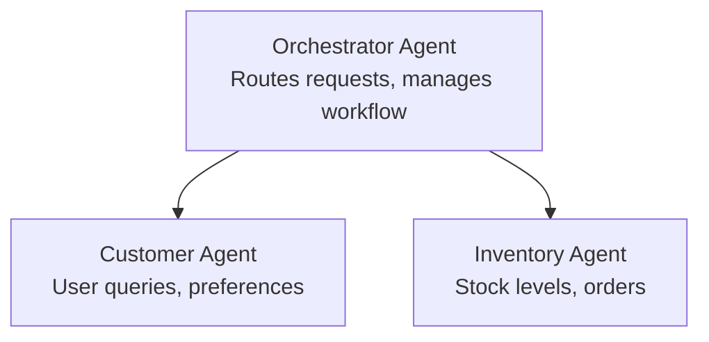

# Poglavje 5: Večagentne AI rešitve

**📚 Tečaj**: [AZD za začetnike](../../README.md) | **⏱️ Trajanje**: 2-3 ure | **⭐ Kompleksnost**: Napredno

---

## Pregled

To poglavje zajema napredne vzorce večagentne arhitekture, usklajevanje agentov in produkcijsko pripravljene AI namestitve za kompleksne scenarije.

> Navodila za ukaze so bila pregledana glede na izdano referenco `azd 1.37.2`. Namestitve v oblaku niso bile izvedene.

## Cilji učenja

Z dokončanjem tega poglavja boste:
- Razumeli vzorce večagentne arhitekture
- Namestili usklajene sisteme AI agentov
- Izvedli komunikacijo med agenti
- Zgradili produkcijsko pripravljene večagentne rešitve

---

## 📚 Lekcije

| # | Lekcija | Opis | Čas |
|---|--------|-------------|------|
| 1 | [Osnove več agentov](multi-agent-basics.md) | Praktično: namestitev delujoče večagentne aplikacije z `azd up` | 45 min |
| 2 | [Vzorci usklajevanja](../chapter-06-pre-deployment/coordination-patterns.md) | Strategije orkestracije agentov (nadaljuje se v poglavju 6) | 30 min |
| 3 | [Namestitev ARM predloge](../../examples/retail-multiagent-arm-template/README.md) | Primer enkratne namestitve | 30 min |

> **Začnite z lekcijo 1.** To je edina popolnoma praktična, izvedljiva lekcija v tem poglavju. Lekcija 2 je v poglavju 6 (deljena s prednamestitvenim načrtovanjem), [Večagentna rešitev za trgovine](../../examples/retail-scenario.md) pa je arhitekturni načrt—referenca za oblikovanje, ne predloga z enim ukazom.

---

## 🚀 Hiter začetek

```bash
# Option 1: Deploy the multi-agent template used in Lesson 1
azd init --template Azure-Samples/contoso-creative-writer .
azd up

# Option 2: Initialize a Foundry agent interactively (requires azure.ai.agents)
azd extension install azure.ai.agents
azd ai agent init
azd up
```

> **Kateri pristop?** Začnite s primerom, ki deluje z uporabo `azd init --template`. Uporabite `azd ai agent init` interaktivno ali `azd ai agent init --template <path-to-azure.yaml>` za prevzem trenutnega projekta agenta. Za zahteve verzije in migracijo ocenjevanja glejte [AZD AI CLI referenco](../chapter-08-production/production-ai-practices.md#azd-ai-cli-commands-and-extensions).

Ukaze izvajajte v ločenih praznih mapah. Razširitev agentov `1.0.0-beta.23` zahteva `azd >= 1.37.0`; njen interaktivni potek ne generira prilagojenega službenega Service Bus kanala v lekciji o usklajevanju.

---

## 🤖 Večagentna arhitektura



---

## 🎯 Izpostavljena rešitev: Večagentna rešitev za trgovine

Rešitev [Retail Multi-Agent Solution](../../examples/retail-scenario.md) prikazuje:

- **Agent za stranke**: Upravlja interakcije z uporabniki in njihove preference
- **Agent za zalogo**: Upravljanje zalog in obdelava naročil
- **Koordinator**: Usmerja sodelovanje med agenti
- **Deljeni pomnilnik**: Upravljanje konteksta med agenti

### Uporabljene storitve

| Storitev | Namen |
|---------|---------|
| Microsoft Foundry Models | Razumevanje jezika |
| Azure AI Search | Katalog izdelkov |
| Cosmos DB | Stanje in pomnilnik agentov |
| Container Apps | Gostovanje agentov |
| Application Insights | Spremljanje |

---

## 🔗 Navigacija

| Smer | Poglavje |
|-----------|---------|
| **Prejšnje** | [Poglavje 4: Infrastruktura](../chapter-04-infrastructure/README.md) |
| **Naslednje** | [Poglavje 6: Pred uvajanjem](../chapter-06-pre-deployment/README.md) |

---

## 📖 Sorodni viri

- [Vodnik za AI agente](../chapter-02-ai-development/agents.md)
- [Prakse proizvodne umetne inteligence](../chapter-08-production/production-ai-practices.md)
- [Reševanje težav z AI](../chapter-07-troubleshooting/ai-troubleshooting.md)

---

<!-- CO-OP TRANSLATOR DISCLAIMER START -->
**Omejitev odgovornosti**:
Ta dokument je bil preveden z uporabo AI prevajalske storitve [Co-op Translator](https://github.com/Azure/co-op-translator). Čeprav si prizadevamo za natančnost, vas prosimo, da upoštevate, da avtomatizirani prevodi lahko vsebujejo napake ali netočnosti. Izvirni dokument v njegovem izvirnem jeziku je treba obravnavati kot avtoritativni vir. Za kritične informacije je priporočljiv strokovni človeški prevod. Ne odgovarjamo za morebitna nesporazume ali napačne interpretacije, ki izhajajo iz uporabe tega prevoda.
<!-- CO-OP TRANSLATOR DISCLAIMER END -->