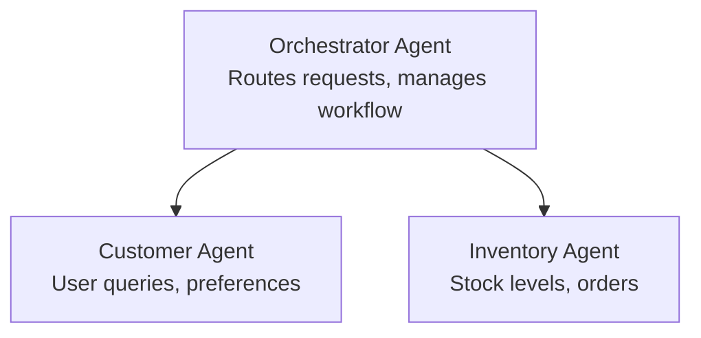

# Poglavje 5: Večagentne AI rešitve

**📚 Tečaj**: [AZD za začetnike](../../README.md) | **⏱️ Trajanje**: 2-3 ure | **⭐ Kompleksnost**: Napredno

---

## Pregled

To poglavje zajema napredne vzorce večagentne arhitekture, orkestracijo agentov in AI implementacije, pripravljene za produkcijo, za kompleksne scenarije.

> Navodila za ukaze so pregledana glede na objavo referenčnega `azd 1.37.2`. Namestitve v oblaku niso bile izvedene.

## Cilji učenja

Z dokončanjem tega poglavja boste:
- Razumeli vzorce večagentne arhitekture
- Implementirali usklajene sisteme AI agentov
- Izvedli komunikacijo med agenti
- Zgradili večagentne rešitve, pripravljene za produkcijo

---

## 📚 Lekcije

| # | Lekcija | Opis | Čas |
|---|--------|-------------|------|
| 1 | [Osnove večagentnosti](multi-agent-basics.md) | Praktično: namestitev delujoče večagentne aplikacije z `azd up` | 45 min |
| 2 | [Vzorce usklajevanja](../chapter-06-pre-deployment/coordination-patterns.md) | Strategije orkestracije agentov (nadaljuje se v poglavju 6) | 30 min |
| 3 | [Implementacija ARM predloge](../../examples/retail-multiagent-arm-template/README.md) | Primer namestitve z enim klikom | 30 min |

> **Začnite z lekcijo 1.** To je edina popolnoma praktična in namestljiva lekcija v tem poglavju. Lekcija 2 je v poglavju 6 (je del načrtovanja pred namestitvijo), medtem ko je [Retail Multi-Agent Solution](../../examples/retail-scenario.md) arhitekturna predloga – načrtniški primer, ne predloga za en ukaz.

---

## 🚀 Hiter začetek

```bash
# Option 1: Deploy the multi-agent template used in Lesson 1
azd init --template Azure-Samples/contoso-creative-writer .
azd up

# Option 2: Initialize a Foundry agent interactively with the GA bundle
azd ext install microsoft.foundry
azd ai agent init
azd up
```

> **Kateri pristop?** Začnite z delujočim vzorcem z uporabo `azd init --template`. Uporabite `azd ai agent init` interaktivno ali `azd ai agent init --template <path-to-azure.yaml>` za prevzem trenutnega projekta agenta. Glejte [referenco AZD AI CLI](../chapter-08-production/production-ai-practices.md#azd-ai-cli-commands-and-extensions) za zahteve glede verzije in migracijo ocenjevanja.

Te alternative zaženite v ločenih praznih mapah. Delovni tok GA Foundry zahteva `azd >= 1.37.0`; njegov interaktivni potek ne ustvari prilagojene Service Bus cevovode v lekciji o usklajevanju. Za lokalno testiranje, nameščanje kode in čiščenje novih ali ponovno uporabljenih projektov sledite [vodniku po gostovanem agentu](../chapter-02-ai-development/microsoft-foundry-integration.md#hosted-agent-walkthrough-ga).

---

## 🤖 Večagentna arhitektura



---

## 🎯 Izpostavljena rešitev: Večagentni sistem za maloprodajo

Rešitev [Retail Multi-Agent](../../examples/retail-scenario.md) prikazuje:

- **Agent za stranke**: Upravljanje interakcij in preferenc uporabnikov
- **Agent za zaloge**: Upravljanje zalog in obdelava naročil
- **Orkestrator**: Koordinacija med agenti
- **Deljeni spomin**: Upravljanje konteksta med agenti

### Uporabljene storitve

| Storitev | Namen |
|---------|---------|
| Microsoft Foundry Models | Razumevanje jezika |
| Azure AI Search | Katalog izdelkov |
| Cosmos DB | Stanje in spomin agenta |
| Container Apps | Gostovanje agentov |
| Application Insights | Nadzor |

---

## 🔗 Navigacija

| Usmeritev | Poglavje |
|-----------|---------|
| **Prejšnje** | [Poglavje 4: Infrastruktura](../chapter-04-infrastructure/README.md) |
| **Naslednje** | [Poglavje 6: Pred-namestitev](../chapter-06-pre-deployment/README.md) |

---

## 📖 Povezani viri

- [Vodnik po AI agentih](../chapter-02-ai-development/agents.md)
- [Prakse AI v proizvodnji](../chapter-08-production/production-ai-practices.md)
- [Odpravljanje težav z AI](../chapter-07-troubleshooting/ai-troubleshooting.md)

---

<!-- CO-OP TRANSLATOR DISCLAIMER START -->
**Omejitev odgovornosti**:
Ta dokument je bil preveden z uporabo AI prevajalske storitve [Co-op Translator](https://github.com/Azure/co-op-translator). Čeprav si prizadevamo za natančnost, vas prosimo, da upoštevate, da avtomatizirani prevodi lahko vsebujejo napake ali netočnosti. Izvirni dokument v njegovem izvirnem jeziku je treba obravnavati kot avtoritativni vir. Za kritične informacije je priporočljiv strokovni človeški prevod. Ne odgovarjamo za morebitna nesporazume ali napačne interpretacije, ki izhajajo iz uporabe tega prevoda.
<!-- CO-OP TRANSLATOR DISCLAIMER END -->