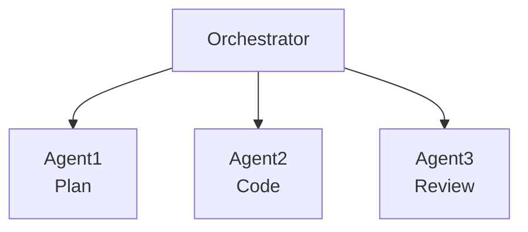
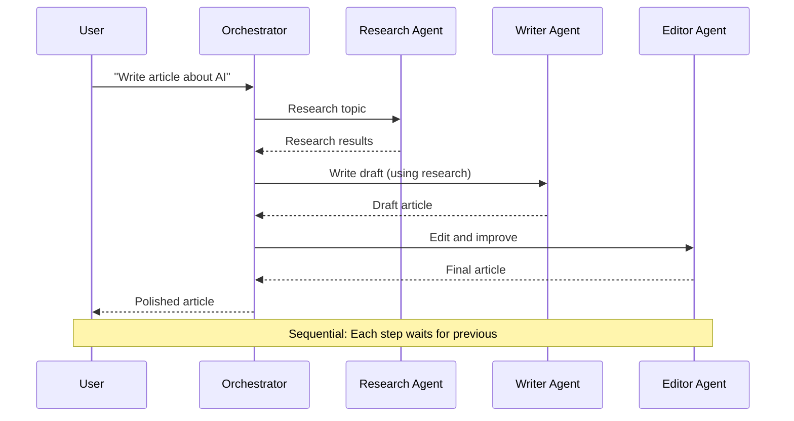
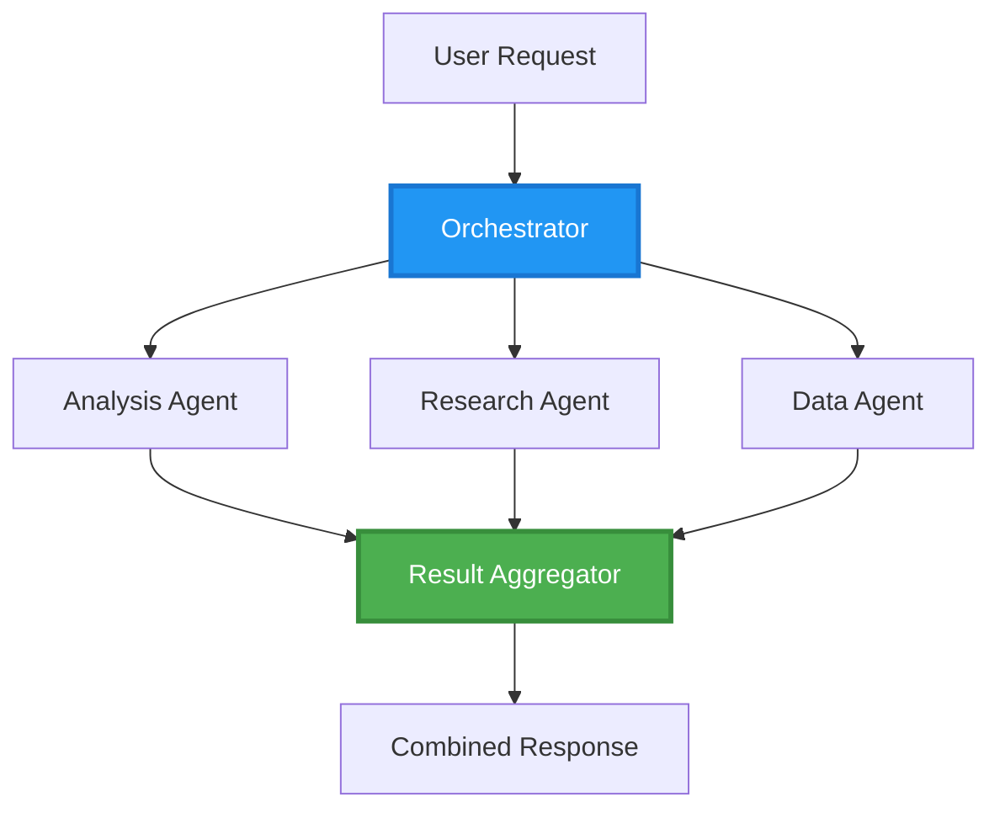
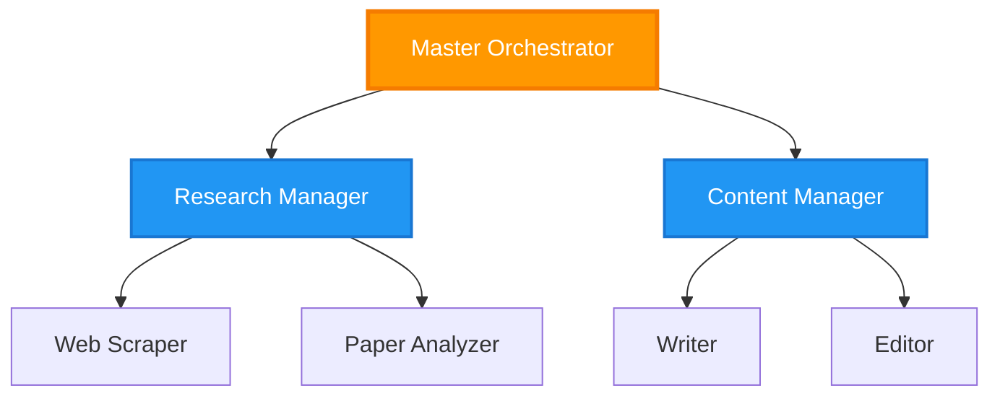
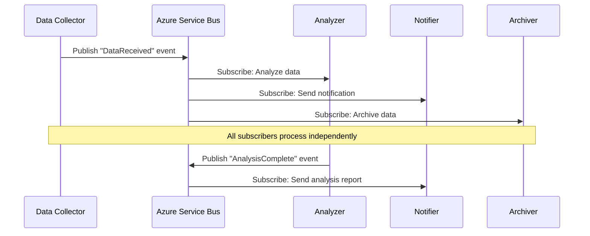
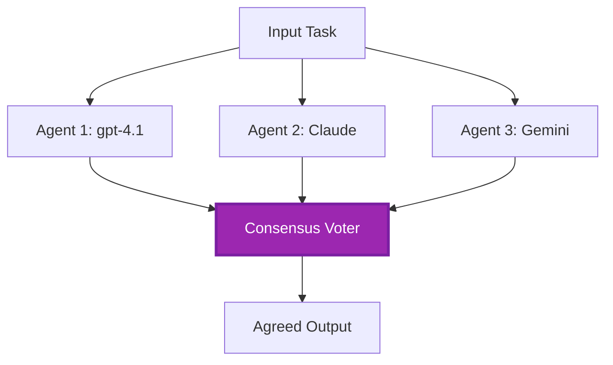

# Vzorce koordinacije več agentov

⏱️ **Ocenjeni čas**: 60-75 minut branja; nekaj ur za implementacijo | 💰 **Ocenjeni stroški**: odvisni od delovne obremenitve | ⭐ **Zahtevnost**: Napredno

**📚 Pot učenja:**
- ← Prejšnja: [Capacity Planning](capacity-planning.md) - Strategije dimenzioniranja in skaliranja virov
- 🎯 **Tu ste**: Vzorce koordinacije več agentov (orkestracija, komunikacija, upravljanje stanja)
- → Naslednja: [SKU Selection](sku-selection.md) - Izbira pravih Azure storitev
- 🏠 [Domača stran tečaja](../../README.md)

---

## Kaj se boste naučili

Z dokončanjem te lekcije boste:
- Razumeli vzorce **arhitekture več agentov** in kdaj jih uporabiti
- Implementirali **vzorce orkestracije** (centralizirano, decentralizirano, hierarhično)
- Oblikovali strategije **komunikacije agentov** (sinhrona, asinhrona, na dogodkih temelječa)
- Upravljali **deljeno stanje** med razporejenimi agenti
- Implementirali **sisteme z več agenti** na Azure z AZD
- Uporabili **vzorce koordinacije** za resnične AI scenarije
- Nadzorovali in odpravljali napake v razporejenih sistemih agentov

## Zakaj je koordinacija več agentov pomembna

### Evolucija: Od enega agenta do več agentov

**En sam agent (preprosto):**
```
User → Agent → Response
```
- ✅ Enostavno razumeti in implementirati
- ✅ Hitra izvedba pri preprostih nalogah
- ❌ Omejeno z zmožnostmi posameznega modela
- ❌ Ne more paralelizirati kompleksnih nalog
- ❌ Brez specializacije

**Sistem z več agenti (napredno):**

- ✅ Specializirani agenti za specifične naloge
- ✅ Paralelna izvedba za hitrost
- ✅ Modularno in vzdržno
- ✅ Bolje obvladuje kompleksne delovne tokove
- ⚠️ Zahteva koordinacijsko logiko

**Analitično**: En sam agent je kot ena oseba, ki opravlja vse naloge. Več agentov je kot ekipa, kjer ima vsak član specializirane veščine (raziskovalec, programer, ocenjevalec, pisec) in sodelujejo.

---

## Osnovni vzorci koordinacije

### Vzorec 1: Zaporedna koordinacija (Veriga odgovornosti)

**Kdaj uporabiti**: Naloge se morajo izvesti v določenem zaporedju, vsak agent gradi na izhodu prejšnjega.



**Prednosti:**
- ✅ Jasna pretok podatkov
- ✅ Enostavno razhroščevati
- ✅ Predvidljiv vrstni red izvajanja

**Omejitve:**
- ❌ Počasnejše (ni paralelizacije)
- ❌ Ena napaka ustavi celotno verigo
- ❌ Ne zmore obravnavati soodvisnih nalog

**Primeri uporabe:**
- Cikel ustvarjanja vsebine (raziskava → pisanje → urejanje → objava)
- Generiranje kode (planiranje → implementacija → test → uvajanje)
- Generiranje poročil (zbira podatke → analizira → vizualizira → povzame)

---

### Vzorec 2: Paralelna koordinacija (Razveza / združevanje)

**Kdaj uporabiti**: Neodvisne naloge se lahko izvajajo hkrati, rezultate na koncu združimo.



**Prednosti:**
- ✅ Hitro (paralelna izvedba)
- ✅ Odporen na napake (delni izidi so sprejemljivi)
- ✅ Skalabilno vodoravno

**Omejitve:**
- ⚠️ Rezultati lahko prispejo izven zaporedja
- ⚠️ Potrebna je logika združevanja
- ⚠️ Kompleksno upravljanje stanja

**Primeri uporabe:**
- Povezovanje podatkov iz več virov (API-ji + baze podatkov + spletno strganje)
- Konkurenčne analize (več modelov generira rešitve, izbere se najboljša)
- Prevajalske storitve (sočasni prevodi v več jezikov)

---

### Vzorec 3: Hierarhična koordinacija (Vodja-delavec)

**Kdaj uporabiti**: Kompleksni delovni tokovi z podnalogami, potrebna delegacija.



**Prednosti:**
- ✅ Obvladuje kompleksne delovne tokove
- ✅ Modularno in vzdržno
- ✅ Jasne meje odgovornosti

**Omejitve:**
- ⚠️ Zapletena arhitektura
- ⚠️ Višja zakasnitev (več plasti koordinacije)
- ⚠️ Zahteva sofisticirano orkestracijo

**Primeri uporabe:**
- Obravnava poslovnih dokumentov (razvrsti → usmeri → obdela → arhivira)
- Večstopenjski podatkovni pipelini (vnos → čiščenje → transformacija → analiza → poročilo)
- Kompleksni avtomatizirani delovni tokovi (načrtovanje → razporeditev virov → izvedba → spremljanje)

---

### Vzorec 4: Koordinacija na dogodkih (Objavi-naroči)

**Kdaj uporabiti**: Agenti morajo reagirati na dogodke, želena je ohlapna vezava.



**Prednosti:**
- ✅ Ohlapna vezava med agenti
- ✅ Enostavno dodajanje novih agentov (preprosto naročanje)
- ✅ Asinhrono procesiranje
- ✅ Odporno (trajnost sporočil)

**Omejitve:**
- ⚠️ Končna skladnost
- ⚠️ Kompleksno razhroščevanje
- ⚠️ Izzivi pri urejanju vrstnega reda sporočil

**Primeri uporabe:**
- Sistemi za nadzor v realnem času (opozorila, nadzorne plošče, dnevniki)
- Večkanalne obvestilne storitve (e-pošta, SMS, push, Slack)
- Pipelines za obdelavo podatkov (več potrošnikov istih podatkov)

---

### Vzorec 5: Koordinacija na osnovi konsenza (glasovanje/kvora)

**Kdaj uporabiti**: Potreben je dogovor med več agenti pred nadaljevanjem.



**Prednosti:**
- ✅ Višja natančnost (več mnenj)
- ✅ Odporno na manjše napake (sprejemljive manjše napake)
- ✅ Vgrajena zagotovitev kakovosti

**Omejitve:**
- ❌ Drago (več klicev modelov)
- ❌ Počasnejše (čakanje na vse agente)
- ⚠️ Potrebno reševanje konfliktov

**Primeri uporabe:**
- Moderacija vsebine (več modelov ocenjuje vsebino)
- Pregled kode (več opravilnikov/analyzerjev)
- Medicinska diagnostika (več AI modelov, strokovna validacija)

---

## Pregled arhitekture

### Popoln sistem z več agenti na Azure

```mermaid
graph TB
    User[User/API Client]
    APIM[Azure API Management]
    Orchestrator[Orchestrator Service<br/>Container App]
    ServiceBus[Azure Service Bus<br/>Queues / Topics]
    
    Agent1[Research Agent<br/>Container App]
    Agent2[Writer Agent<br/>Container App]
    Agent3[Analyst Agent<br/>Container App]
    Agent4[Reviewer Agent<br/>Container App]
    
    CosmosDB[(Cosmos DB<br/>Shared State)]
    Storage[Azure Storage<br/>Artifacts]
    AppInsights[Application Insights<br/>Monitoring]
    
    User --> APIM
    APIM --> Orchestrator
    
    Orchestrator --> ServiceBus
    ServiceBus --> Agent1
    ServiceBus --> Agent2
    ServiceBus --> Agent3
    ServiceBus --> Agent4
    
    Agent1 --> CosmosDB
    Agent2 --> CosmosDB
    Agent3 --> CosmosDB
    Agent4 --> CosmosDB
    
    Agent1 --> Storage
    Agent2 --> Storage
    Agent3 --> Storage
    Agent4 --> Storage
    
    Orchestrator -.-> AppInsights
    Agent1 -.-> AppInsights
    Agent2 -.-> AppInsights
    Agent3 -.-> AppInsights
    Agent4 -.-> AppInsights
    
    style Orchestrator fill:#FF9800,stroke:#F57C00,stroke-width:3px,color:#fff
    style ServiceBus fill:#9C27B0,stroke:#7B1FA2,stroke-width:3px,color:#fff
    style CosmosDB fill:#4CAF50,stroke:#388E3C,stroke-width:3px,color:#fff
```



**Ključne komponente:**

| Komponenta | Namen | Azure storitev |
|-----------|---------|---------------|
| **API Gateway** | Vstopna točka, omejevanje stopenj, autentikacija | API Management |
| **Orkestrator** | Koordinira delovne tokove agentov | Container Apps |
| **Queue sporočil** | Asinhrona komunikacija | Service Bus / Event Hubs |
| **Agenti** | Specializirani AI delavci | Container Apps / Functions |
| **Shramba stanja** | Deljeno stanje, sledenje nalog | Cosmos DB |
| **Shramba artefaktov** | Dokumenti, rezultati, dnevniki | Blob Storage |
| **Nadzor** | Razporejeno sledenje, dnevniki | Application Insights |

Serijski čakalni sistemi Service Bus in Event Hubs so različne storitve z različnimi modeli dostave in porabe; Event Hubs ni neposredna zamenjava za spodnjo kodo Service Bus delavca. Paralelizem, trajna sporočila in glasovanje modelov sami po sebi ne zagotavljajo odpornosti na napake ali višje natančnosti.

---

## Predpogoji

### Potrebna orodja

```bash
# Verify Azure Developer CLI
azd version
# Command reference baseline: azd 1.37.2

# Verify Azure CLI
az --version
# ✅ Expected: azure-cli 2.50.0 or higher

# Verify Docker (for local testing)
docker --version
# ✅ Expected: Docker version 20.10 or higher
```

### Zahteve Azure

- Aktivna naročnina Azure
- Pooblastila za ustvarjanje:
  - Container Apps
  - Service Bus imenskih prostorov
  - Cosmos DB računov
  - Shrambnih računov
  - Application Insights

### Predznanje

Morali bi opraviti:
- [Upravljanje konfiguracije](../chapter-03-configuration/configuration.md)
- [Avtentikacija in varnost](../chapter-03-configuration/authsecurity.md)
- [Primer mikro storitev](../../../../examples/microservices)

---

## Vodnik za implementacijo

> **Delčki zasnove, ne celovit uporabni laboratorij:** Projektna struktura in oznake `File:` spodaj opisujejo datoteke, ki jih ustvarite v svojem projektu; ta repozitorij ne vsebuje popolne aplikacije `multi-agent-system`. Manjkajoči deli vključujejo predloge glavnih/parametrov, okolja/registrov Container Apps, Dockerfile in zaklepe odvisnosti, nastavitve baze/containerja Cosmos, uvajanja modelov, konfiguracijo identitete/vloge, pravila skaliranja in paralelnih delavcev/vrst. Ne pričakujte, da bosta `azd init` generirala te datoteke ali da bo `azd up` uporabila koščke brez sprememb. Za izvedljivo izhodišče dokončajte [Osnove več agentov](../chapter-05-multi-agent/multi-agent-basics.md).

**Predpostavke za runtime:** Python 3.10+, `azure-servicebus`, `azure-cosmos`, `openai`, Flask in (za nadzor) `azure-monitor-opentelemetry`; postavite `shared` na pot uvoza Pythona v vsaki storitveni sliki. Cosmos `agent-state/tasks` posoda mora že obstajati s ključem particije `/id`. Povezave na ključ poenostavijo te delčke, niso pa produkcijska priporočila: raje uporabite upravljane identitete z omejenimi vlogami Service Bus/Cosmos/OpenAI na ravni podatkovnega sloja. Ne razkrivajte ključev v izhodih ali dnevnikih.

Dostava Service Bus je **vsaj enkrat**. Ohranjajte idempotentnost nalog **in korakov**, uporabljajte optimistično sočasnost (ETags) za branje/spremembo/zapis stanja in obnavljajte zaklepanje sporočil med daljšim procesiranjem. Preprost upravitelj stanja spodaj je zaporedni in ne izvaja teh produkcijskih zagotovil.

### Struktura projekta

```
multi-agent-system/
├── azure.yaml                    # AZD configuration
├── infra/
│   ├── main.bicep               # Main infrastructure
│   ├── core/
│   │   ├── servicebus.bicep     # Message queue
│   │   ├── cosmos.bicep         # State store
│   │   ├── storage.bicep        # Artifact storage
│   │   └── monitoring.bicep     # Application Insights
│   └── app/
│       ├── orchestrator.bicep   # Orchestrator service
│       └── agent.bicep          # Agent template
└── src/
    ├── orchestrator/            # Orchestration logic
    │   ├── app.py
    │   ├── workflows.py
    │   └── Dockerfile
    ├── agents/
    │   ├── research/            # Research agent
    │   ├── writer/              # Writer agent
    │   ├── analyst/             # Analyst agent
    │   └── reviewer/            # Reviewer agent
    └── shared/
        ├── state_manager.py     # Shared state logic
        └── message_handler.py   # Message handling
```

---

## Lekcija 1: Zaporedni vzorec koordinacije

### Implementacija: Cikel ustvarjanja vsebine

Oblikujmo zaporedni cikel: Raziskava → Pisanje → Urejanje. Objavljanje je zunaj tega primera.

### 1. Konfiguracija AZD

**Datoteka: `azure.yaml`**

```yaml
name: content-pipeline
metadata:
  template: multi-agent-sequential@1.0.0

services:
  orchestrator:
    project: ./src/orchestrator
    language: python
    host: containerapp
  
  research-agent:
    project: ./src/agents/research
    language: python
    host: containerapp
  
  writer-agent:
    project: ./src/agents/writer
    language: python
    host: containerapp
  
  editor-agent:
    project: ./src/agents/editor
    language: python
    host: containerapp
```

### 2. Infrastruktura: Service Bus za koordinacijo

**Datoteka: `infra/core/servicebus.bicep`**

```bicep
param name string
param location string
param tags object = {}

resource serviceBusNamespace 'Microsoft.ServiceBus/namespaces@2022-10-01-preview' = {
  name: name
  location: location
  tags: tags
  sku: {
    name: 'Standard'
    tier: 'Standard'
  }
  properties: {
    minimumTlsVersion: '1.2'
  }
}

// Queue for orchestrator → research agent
resource researchQueue 'Microsoft.ServiceBus/namespaces/queues@2022-10-01-preview' = {
  parent: serviceBusNamespace
  name: 'research-tasks'
  properties: {
    maxDeliveryCount: 3
    lockDuration: 'PT5M'
    deadLetteringOnMessageExpiration: true
  }
}

// Queue for research agent → writer agent
resource writerQueue 'Microsoft.ServiceBus/namespaces/queues@2022-10-01-preview' = {
  parent: serviceBusNamespace
  name: 'writer-tasks'
  properties: {
    maxDeliveryCount: 3
    lockDuration: 'PT5M'
  }
}

// Queue for writer agent → editor agent
resource editorQueue 'Microsoft.ServiceBus/namespaces/queues@2022-10-01-preview' = {
  parent: serviceBusNamespace
  name: 'editor-tasks'
  properties: {
    maxDeliveryCount: 3
    lockDuration: 'PT5M'
  }
}

output namespace string = serviceBusNamespace.name
// Do not output RootManageSharedAccessKey. Resolve scoped credentials
// securely or use managed identity in the application and scale rules.
```

### 3. Upravljalnik deljenega stanja

**Datoteka: `src/shared/state_manager.py`**

```python
from azure.cosmos import CosmosClient, PartitionKey
from datetime import datetime, timezone
import os

class StateManager:
    """Manages shared state across agents using Cosmos DB"""
    
    def __init__(self):
        endpoint = os.environ['COSMOS_ENDPOINT']
        key = os.environ['COSMOS_KEY']
        
        self.client = CosmosClient(endpoint, key)
        self.database = self.client.get_database_client('agent-state')
        self.container = self.database.get_container_client('tasks')
    
    def create_task(self, task_id: str, task_type: str, input_data: dict):
        """Create a new task"""
        task = {
            'id': task_id,
            'type': task_type,
            'status': 'pending',
            'input': input_data,
            'created_at': datetime.now(timezone.utc).isoformat(),
            'steps': []
        }
        self.container.create_item(task)
        return task
    
    def update_task_step(self, task_id: str, step_name: str, result: dict):
        """Update task with completed step"""
        task = self.container.read_item(task_id, partition_key=task_id)
        
        task['steps'].append({
            'name': step_name,
            'completed_at': datetime.now(timezone.utc).isoformat(),
            'result': result
        })
        
        self.container.replace_item(task_id, task)
        return task
    
    def complete_task(self, task_id: str, final_result: dict):
        """Mark task as complete"""
        task = self.container.read_item(task_id, partition_key=task_id)
        task['status'] = 'completed'
        task['result'] = final_result
        task['completed_at'] = datetime.now(timezone.utc).isoformat()
        self.container.replace_item(task_id, task)
        return task
    
    def get_task(self, task_id: str):
        """Retrieve task state"""
        return self.container.read_item(task_id, partition_key=task_id)
```

### 4. Orkestratorska storitev

**Datoteka: `src/orchestrator/app.py`**

```python
from flask import Flask, request, jsonify
from azure.servicebus import ServiceBusClient, ServiceBusMessage
import json
import uuid
import os
from shared.state_manager import StateManager

app = Flask(__name__)
state_manager = StateManager()

# Service Bus connection
servicebus_connection_str = os.environ['SERVICEBUS_CONNECTION_STRING']
servicebus_client = ServiceBusClient.from_connection_string(servicebus_connection_str)

@app.route('/health', methods=['GET'])
def health():
    return jsonify({'status': 'healthy', 'service': 'orchestrator'})

@app.route('/create-content', methods=['POST'])
def create_content():
    """
    Sequential workflow: Research → Write → Edit (returns a draft; no publishing)
    """
    data = request.get_json(silent=True) or {}
    topic = data.get('topic')
    
    if not topic:
        return jsonify({'error': 'Topic required'}), 400
    
    # Create task in state store
    task_id = str(uuid.uuid4())
    task = state_manager.create_task(
        task_id=task_id,
        task_type='content_creation',
        input_data={'topic': topic}
    )
    
    # Send message to research agent (first step)
    sender = servicebus_client.get_queue_sender('research-tasks')
    message = ServiceBusMessage(
        body=json.dumps({
            'task_id': task_id,
            'topic': topic,
            'next_queue': 'writer-tasks'  # Where to send results
        }),
        content_type='application/json'
    )
    
    with sender:
        sender.send_messages(message)
    
    return jsonify({
        'task_id': task_id,
        'status': 'started',
        'workflow': 'sequential',
        'steps': ['research', 'write', 'edit'],
        'message': 'Content creation pipeline initiated'
    }), 202

@app.route('/task/<task_id>', methods=['GET'])
def get_task_status(task_id):
    """Check task status"""
    try:
        task = state_manager.get_task(task_id)
        return jsonify(task)
    except Exception as e:
        return jsonify({'error': str(e)}), 404

if __name__ == '__main__':
    app.run(host='0.0.0.0', port=8080)
```

### 5. Raziskovalni agent

**Datoteka: `src/agents/research/app.py`**

```python
from azure.servicebus import ServiceBusClient, ServiceBusMessage
from openai import AzureOpenAI
import json
import os
import time
from shared.state_manager import StateManager

# Initialize clients
state_manager = StateManager()
servicebus_client = ServiceBusClient.from_connection_string(
    os.environ['SERVICEBUS_CONNECTION_STRING']
)

openai_client = AzureOpenAI(
    api_key=os.environ['AZURE_OPENAI_API_KEY'],
    api_version="2024-10-21",
    azure_endpoint=os.environ['AZURE_OPENAI_ENDPOINT']
)

def process_research_task(message_data):
    """Process research request and pass to writer"""
    task_id = message_data['task_id']
    topic = message_data['topic']
    next_queue = message_data['next_queue']
    
    print(f"🔬 Researching: {topic}")
    
    # Call Microsoft Foundry Models for research
    response = openai_client.chat.completions.create(
        model=os.environ['AZURE_OPENAI_DEPLOYMENT'],
        messages=[
            {"role": "system", "content": "You are a research assistant. Provide comprehensive research on the given topic."},
            {"role": "user", "content": f"Research this topic thoroughly: {topic}"}
        ],
        max_tokens=1500
    )
    
    research_results = response.choices[0].message.content
    
    # Update state
    state_manager.update_task_step(
        task_id=task_id,
        step_name='research',
        result={'research': research_results}
    )
    
    # Send to next agent (writer)
    sender = servicebus_client.get_queue_sender(next_queue)
    message = ServiceBusMessage(
        body=json.dumps({
            'task_id': task_id,
            'topic': topic,
            'research': research_results,
            'next_queue': 'editor-tasks'
        }),
        content_type='application/json'
    )
    
    with sender:
        sender.send_messages(message)
    
    print(f"✅ Research complete for task {task_id}")

def main():
    """Listen to research queue"""
    receiver = servicebus_client.get_queue_receiver('research-tasks')
    
    print("🔬 Research Agent started, listening for tasks...")
    
    with receiver:
        while True:
            messages = receiver.receive_messages(max_wait_time=5)
            for message in messages:
                try:
                    message_data = json.loads(str(message))
                    process_research_task(message_data)
                    receiver.complete_message(message)
                except Exception as e:
                    print(f"❌ Error processing message: {e}")
                    receiver.abandon_message(message)

if __name__ == '__main__':
    main()
```

### 6. Pisalni agent

**Datoteka: `src/agents/writer/app.py`**

```python
from azure.servicebus import ServiceBusClient, ServiceBusMessage
from openai import AzureOpenAI
import json
import os
from shared.state_manager import StateManager

state_manager = StateManager()
servicebus_client = ServiceBusClient.from_connection_string(
    os.environ['SERVICEBUS_CONNECTION_STRING']
)

openai_client = AzureOpenAI(
    api_key=os.environ['AZURE_OPENAI_API_KEY'],
    api_version="2024-10-21",
    azure_endpoint=os.environ['AZURE_OPENAI_ENDPOINT']
)

def process_writing_task(message_data):
    """Write article based on research"""
    task_id = message_data['task_id']
    topic = message_data['topic']
    research = message_data['research']
    next_queue = message_data['next_queue']
    
    print(f"✍️ Writing article: {topic}")
    
    # Call Microsoft Foundry Models to write article
    response = openai_client.chat.completions.create(
        model=os.environ['AZURE_OPENAI_DEPLOYMENT'],
        messages=[
            {"role": "system", "content": "You are a professional writer. Write engaging, well-structured articles."},
            {"role": "user", "content": f"Based on this research:\n\n{research}\n\nWrite a comprehensive article about: {topic}"}
        ],
        max_tokens=2000
    )
    
    article_draft = response.choices[0].message.content
    
    # Update state
    state_manager.update_task_step(
        task_id=task_id,
        step_name='writing',
        result={'draft': article_draft}
    )
    
    # Send to editor
    sender = servicebus_client.get_queue_sender(next_queue)
    message = ServiceBusMessage(
        body=json.dumps({
            'task_id': task_id,
            'topic': topic,
            'draft': article_draft
        }),
        content_type='application/json'
    )
    
    with sender:
        sender.send_messages(message)
    
    print(f"✅ Article draft complete for task {task_id}")

def main():
    """Listen to writer queue"""
    receiver = servicebus_client.get_queue_receiver('writer-tasks')
    
    print("✍️ Writer Agent started, listening for tasks...")
    
    with receiver:
        while True:
            messages = receiver.receive_messages(max_wait_time=5)
            for message in messages:
                try:
                    message_data = json.loads(str(message))
                    process_writing_task(message_data)
                    receiver.complete_message(message)
                except Exception as e:
                    print(f"❌ Error: {e}")
                    receiver.abandon_message(message)

if __name__ == '__main__':
    main()
```

### 7. Urejevalni agent

**Datoteka: `src/agents/editor/app.py`**

```python
from azure.servicebus import ServiceBusClient
from openai import AzureOpenAI
import json
import os
from shared.state_manager import StateManager

state_manager = StateManager()
servicebus_client = ServiceBusClient.from_connection_string(
    os.environ['SERVICEBUS_CONNECTION_STRING']
)

openai_client = AzureOpenAI(
    api_key=os.environ['AZURE_OPENAI_API_KEY'],
    api_version="2024-10-21",
    azure_endpoint=os.environ['AZURE_OPENAI_ENDPOINT']
)

def process_editing_task(message_data):
    """Edit and finalize article"""
    task_id = message_data['task_id']
    topic = message_data['topic']
    draft = message_data['draft']
    
    print(f"📝 Editing article: {topic}")
    
    # Call Microsoft Foundry Models to edit
    response = openai_client.chat.completions.create(
        model=os.environ['AZURE_OPENAI_DEPLOYMENT'],
        messages=[
            {"role": "system", "content": "You are an expert editor. Improve grammar, clarity, and structure."},
            {"role": "user", "content": f"Edit and improve this article:\n\n{draft}"}
        ],
        max_tokens=2000
    )
    
    final_article = response.choices[0].message.content
    
    # Mark task as complete
    state_manager.complete_task(
        task_id=task_id,
        final_result={
            'topic': topic,
            'final_article': final_article,
            'word_count': len(final_article.split())
        }
    )
    
    print(f"✅ Article finalized for task {task_id}")

def main():
    """Listen to editor queue"""
    receiver = servicebus_client.get_queue_receiver('editor-tasks')
    
    print("📝 Editor Agent started, listening for tasks...")
    
    with receiver:
        while True:
            messages = receiver.receive_messages(max_wait_time=5)
            for message in messages:
                try:
                    message_data = json.loads(str(message))
                    process_editing_task(message_data)
                    receiver.complete_message(message)
                except Exception as e:
                    print(f"❌ Error: {e}")
                    receiver.abandon_message(message)

if __name__ == '__main__':
    main()
```

### 8. Uvajanje in testiranje

Ti ukazi veljajo **le po implementaciji manjkajočih datotek projekta**. Inicializacija interaktivnega Foundry agenta je ločen delovni tok; ne generira zasnove Service Bus.

```bash
# In your completed custom project
azd up

# Alternative in a SEPARATE empty folder (agents beta.23 requires azd >= 1.37)
azd extension install azure.ai.agents
azd ai agent init
azd up
```

> Oglejte si [AZD AI CLI ukaze](../chapter-08-production/production-ai-practices.md#azd-ai-cli-commands-and-extensions) za vse zastavice in možnosti `azd ai`.

```bash
# Get orchestrator URL
ORCHESTRATOR_URL=$(azd env get-values | grep ORCHESTRATOR_URL | cut -d '=' -f2 | tr -d '"')

# Create content
curl -X POST $ORCHESTRATOR_URL/create-content \
  -H "Content-Type: application/json" \
  -d '{"topic": "The Future of AI in Healthcare"}'
```

**✅ Pričakovan izhod:**
```json
{
  "task_id": "a1b2c3d4-e5f6-7890-abcd-ef1234567890",
  "status": "started",
  "workflow": "sequential",
  "steps": ["research", "write", "edit"],
  "message": "Content creation pipeline initiated"
}
```

**Preverite napredek naloge:**
```bash
TASK_ID="a1b2c3d4-e5f6-7890-abcd-ef1234567890"
curl $ORCHESTRATOR_URL/task/$TASK_ID
```

**✅ Pričakovan izhod (zaključeno):**
```json
{
  "id": "a1b2c3d4-e5f6-7890-abcd-ef1234567890",
  "type": "content_creation",
  "status": "completed",
  "steps": [
    {
      "name": "research",
      "completed_at": "2025-11-19T10:30:00Z",
      "result": {"research": "..."}
    },
    {
      "name": "writing",
      "completed_at": "2025-11-19T10:32:00Z",
      "result": {"draft": "..."}
    }
  ],
  "result": {
    "topic": "The Future of AI in Healthcare",
    "final_article": "...",
    "word_count": 1500
  }
}
```

---

## Lekcija 2: Paralelni vzorec koordinacije

### Implementacija: Agregator raziskav iz več virov

Zgradimo paralelen sistem, ki hkrati zbira informacije iz več virov.

### Paralelni orkestrator

**Datoteka: `src/orchestrator/parallel_workflow.py`**

```python
from flask import Flask, request, jsonify
from azure.servicebus import ServiceBusClient, ServiceBusMessage
import json
import uuid
import os
from shared.state_manager import StateManager

app = Flask(__name__)
state_manager = StateManager()

servicebus_client = ServiceBusClient.from_connection_string(
    os.environ['SERVICEBUS_CONNECTION_STRING']
)

@app.route('/research-parallel', methods=['POST'])
def research_parallel():
    """
    Parallel workflow: Multiple agents work simultaneously
    """
    data = request.json
    query = data.get('query')
    
    task_id = str(uuid.uuid4())
    task = state_manager.create_task(
        task_id=task_id,
        task_type='parallel_research',
        input_data={
            'query': query,
            'agents': ['web', 'academic', 'news', 'social']
        }
    )
    
    # Fan-out: publish sequentially; workers may process concurrently.
    agents = [
        ('web-research-queue', 'web'),
        ('academic-research-queue', 'academic'),
        ('news-research-queue', 'news'),
        ('social-research-queue', 'social')
    ]
    
    for queue_name, agent_type in agents:
        sender = servicebus_client.get_queue_sender(queue_name)
        message = ServiceBusMessage(
            body=json.dumps({
                'task_id': task_id,
                'query': query,
                'agent_type': agent_type,
                'result_queue': 'aggregation-queue'
            }),
            content_type='application/json'
        )
        
        with sender:
            sender.send_messages(message)
    
    return jsonify({
        'task_id': task_id,
        'status': 'started',
        'workflow': 'parallel',
        'agents_dispatched': 4,
        'message': 'Parallel research initiated'
    }), 202

if __name__ == '__main__':
    app.run(host='0.0.0.0', port=8080)
```

### Logika združevanja

**Datoteka: `src/agents/aggregator/app.py`**

```python
from azure.servicebus import ServiceBusClient
import json
import os
from collections import defaultdict
from shared.state_manager import StateManager

state_manager = StateManager()
servicebus_client = ServiceBusClient.from_connection_string(
    os.environ['SERVICEBUS_CONNECTION_STRING']
)

# Single-process demo only: not durable or shared across replicas.
# Production: use durable unique (task_id, agent_type) result records.
task_results = defaultdict(dict)
expected_agents = 4  # web, academic, news, social

def process_result(message_data):
    """Aggregate results from parallel agents"""
    task_id = message_data['task_id']
    agent_type = message_data['agent_type']
    result = message_data['result']
    
    # Store result
    task_results[task_id][agent_type] = {
        'agent': agent_type,
        'data': result
    }
    
    print(f"📊 Received result from {agent_type} agent ({len(task_results[task_id])}/{expected_agents})")
    
    # Check if all agents completed (fan-in)
    if len(task_results[task_id]) == expected_agents:
        print(f"✅ All agents completed for task {task_id}. Aggregating...")
        
        # Combine results
        aggregated = {
            'query': message_data['query'],
            'sources': list(task_results[task_id].values()),
            'summary': generate_summary(list(task_results[task_id].values()))
        }
        
        # Mark complete
        state_manager.complete_task(task_id, aggregated)
        
        # Clean up
        del task_results[task_id]
        
        print(f"✅ Aggregation complete for task {task_id}")

def generate_summary(results):
    """Generate summary from all sources"""
    summaries = [r['data'].get('summary', '') for r in results]
    return '\n\n'.join(summaries)

def main():
    """Listen to aggregation queue"""
    receiver = servicebus_client.get_queue_receiver('aggregation-queue')
    
    print("📊 Aggregator started, listening for results...")
    
    with receiver:
        while True:
            messages = receiver.receive_messages(max_wait_time=5)
            for message in messages:
                try:
                    message_data = json.loads(str(message))
                    process_result(message_data)
                    receiver.complete_message(message)
                except Exception as e:
                    print(f"❌ Error: {e}")
                    receiver.abandon_message(message)

if __name__ == '__main__':
    main()
```

**Prednosti paralelnega vzorca:**
- ⚡ **Potencialno nižja zakasnitev** (omejena s najpočasnejšim delavcem in koordinacijskimi stroški)
- 🔄 **Podpora delnih rezultatov** z eksplicitnimi roki in politiko napak (ni implementirano v osnovnem agregatorju)
- 📈 **Skalabilnost** (enostavno dodajanje agentov)

---

## Praktične vaje

### Vaja 1: Dodajanje obravnave časovne omejitve ⭐⭐ (srednja zahtevnost)

**Cilj**: Implementirati logiko časovne omejitve, da agregator ne čaka večno na počasne agente.

**Začetna točka:** Zaženite simulacijo lokalnega roka pred vključitvijo v delavca vrste. Časovna omejitev, preverjena le ob prihodu drugega sporočila, se nikoli ne sproži, če zamujajoči delavec ne pošlje ničesar.

**Koraki**:

1. **Dodajte sledenje časovni omejitvi v agregator:**

```python
import asyncio

async def simulated_agent(name, delay):
    await asyncio.sleep(delay)
    return {'agent': name, 'result': 'done'}

async def main():
    tasks = [asyncio.create_task(simulated_agent(name, delay))
             for name, delay in [('web', 0.1), ('academic', 0.2),
                                 ('news', 0.3), ('social', 3)]]
    done, pending = await asyncio.wait(tasks, timeout=1)
    results = [task.result() for task in done]
    for task in pending:
        task.cancel()
    await asyncio.gather(*pending, return_exceptions=True)
    print({'completed_agents': len(results), 'timed_out': bool(pending)})
    assert len(results) == 3 and pending

asyncio.run(main())
```

2. **Pričakovan izhod:**

```text
{'completed_agents': 3, 'timed_out': True}
```

3. **Integracija vrstnega sistema (oblikovna naloga):** Ohranjajte rok odpremanja in pričakovane agente ob ustvarjanju naloge, izvajajte periodično preverjanje rokov neodvisno od prihodnih rezultatov, atomično dokončajte delne rezultate in ignorirajte pozna/dvojna sporočila za zaključene naloge. Lokalna časovna omejitev ne prekine oddaljenih delavcev.

Le za vaš implementirani projekt:

```bash
azd deploy aggregator

# Submit task
curl -X POST $ORCHESTRATOR_URL/research-parallel \
  -H "Content-Type: application/json" \
  -d '{"query": "AI safety research"}'

# Check results after 30 seconds
curl $ORCHESTRATOR_URL/task/$TASK_ID
```

**✅ Merila uspeha:**
- ✅ Lokalni test se zaključi po roku ene sekunde, tudi če agent ni popoln
- ✅ Odgovor kaže delne rezultate (`"timed_out": true`)
- ✅ Vrnjeni so razpoložljivi rezultati (3 od 4 agentov)

**Čas**: 20-25 minut

---

### Vaja 2: Implementacija logike ponovnega poskusa ⭐⭐⭐ (napredno)

**Cilj**: Samodejno ponavljanje neuspelih agentovih nalog pred vdajo.

**Koraki**:

1. **Uporabite štetje dostave Service Bus namesto lastnih števčev ponovnega poskusa:**

```python
import json
import time
# Integration fragment: use a live peek-lock ServiceBusReceiver.
# Set queue maxDeliveryCount to 4 for one attempt + up to three retries.
```

2. **Dodajte upravitelja ponovnih poskusov agentom:**

```python
def process_with_retry(message, receiver, process_func):
    """Process message with automatic retry on failure"""
    try:
        message_data = json.loads(str(message))
        
        # Process the message
        process_func(message_data)
        
        # Success - complete
        receiver.complete_message(message)
        
    except Exception as e:
        if message.delivery_count < 4:
            # Bounded exponential delay: 5s, 10s, 20s.
            # Renew the lock if processing + waiting can exceed its duration.
            time.sleep(5 * 2 ** (message.delivery_count - 1))
            receiver.abandon_message(message)
        else:
            # Max retries exceeded - move to dead letter queue
            print(f"❌ Max attempts exceeded for message {message.message_id}")
            receiver.dead_letter_message(
                message,
                reason="MaxRetriesExceeded",
                error_description=str(e)
            )
```

3. **Nadzirajte čakalno vrsto mrtvih sporočil:**

```python
def monitor_dead_letters():
    """Check dead letter queue for failed messages"""
    receiver = servicebus_client.get_queue_receiver(
        'research-tasks',
        sub_queue='deadletter'
    )
    
    with receiver:
        messages = receiver.receive_messages(max_wait_time=5)
        for message in messages:
            print(f"☠️ Dead letter: {message.message_id}")
            print(f"Reason: {message.dead_letter_reason}")
            print(f"Description: {message.dead_letter_error_description}")
```

**✅ Merila uspeha:**
- ✅ Neuspele naloge se samodejno poskušajo znova (do 3x)
- ✅ Eksponentno vračanje med ponovitvami (5s, 10s, 20s), z obnovitvijo zaklepa sporočil, kjer je potrebno
- ✅ Po največ poskusih sporočila preidejo v mrtvo čakalno vrsto
- ✅ Mrtva sporočila je mogoče pregledati; ponovni predvajanje zahteva ločen idempotenten delovni tok okrevanja

**Čas**: 30-40 minut

---

### Vaja 3: Implementacija prekinitvenega veznika (Circuit Breaker) ⭐⭐⭐ (napredno)

**Cilj**: Preprečiti kaskadne napake z zaustavitvijo zahtev pri napakajočih agentih.

**Koraki**:

1. **Ustvarite razred prekinitvenega veznika:**

```python
from enum import Enum
from datetime import datetime, timedelta, timezone

class CircuitState(Enum):
    CLOSED = "closed"      # Normal operation
    OPEN = "open"          # Failing, reject requests
    HALF_OPEN = "half_open"  # Testing if recovered

class CircuitBreaker:
    def __init__(self, failure_threshold=5, timeout_seconds=60):
        self.failure_threshold = failure_threshold
        self.timeout_seconds = timeout_seconds
        self.failure_count = 0
        self.last_failure_time = None
        self.state = CircuitState.CLOSED
    
    def call(self, func):
        """Execute function with circuit breaker protection"""
        if self.state == CircuitState.OPEN:
            # Check if timeout expired
            if datetime.now(timezone.utc) - self.last_failure_time > timedelta(seconds=self.timeout_seconds):
                self.state = CircuitState.HALF_OPEN
                print("🔄 Circuit breaker: HALF_OPEN (testing)")
            else:
                raise Exception(f"Circuit breaker OPEN for agent. Try again in {self.timeout_seconds}s")
        
        try:
            result = func()
            
            # Success
            self.failure_count = 0 # Count consecutive failures only
            if self.state == CircuitState.HALF_OPEN:
                self.state = CircuitState.CLOSED
                self.failure_count = 0
                print("✅ Circuit breaker: CLOSED (recovered)")
            
            return result
            
        except Exception as e:
            self.failure_count += 1
            self.last_failure_time = datetime.now(timezone.utc)
            
            if self.failure_count >= self.failure_threshold:
                self.state = CircuitState.OPEN
                print(f"🔴 Circuit breaker: OPEN (too many failures)")
            
            raise
```

2. **Uporabite pri klicih agentov:**

```python
# In orchestrator
agent_circuits = {
    'web': CircuitBreaker(failure_threshold=5, timeout_seconds=60),
    'academic': CircuitBreaker(failure_threshold=5, timeout_seconds=60),
    'news': CircuitBreaker(failure_threshold=5, timeout_seconds=60),
    'social': CircuitBreaker(failure_threshold=5, timeout_seconds=60)
}

def send_to_agent(agent_type, message_data):
    """Send with circuit breaker protection"""
    circuit = agent_circuits[agent_type]
    
    try:
        circuit.call(lambda: send_message(agent_type, message_data))
    except Exception as e:
        print(f"⚠️ Skipping {agent_type} agent: {e}")
        # Continue with other agents
```

Ta vezje ščiti **operacijo pošiljanja**, ne pa dokončanja pri oddaljenem delavcu: uspešno zaporedno dodajanje sporočila ne pove nič o tem, ali je agent živ. `send_message` je funkcija pošiljatelja vaše aplikacije. Za izvršilna vezja pošiljajte opazovane neuspehe/opozoritve nalog v zanesljivega koordinatorja. Ta razred v pomnilniku je enonitni prikaz, ne distribuirani breakers vezje.

3. **Testirajte breaker vezje lokalno:**

```python
# Run after the class definition; no Azure changes required.
circuit = CircuitBreaker(failure_threshold=5, timeout_seconds=0)
def fail():
    raise RuntimeError("simulated failure")
for _ in range(5):
    try:
        circuit.call(fail)
    except RuntimeError:
        pass
assert circuit.state == CircuitState.OPEN
assert circuit.call(lambda: "recovered") == "recovered"
assert circuit.state == CircuitState.CLOSED
print("Circuit breaker recovery verified")
```

**✅ Merila uspeha:**
- ✅ Po 5 neuspehih se vezje odpre (zavrne zahteve)
- ✅ Po 60 sekundah se vezje delno odpre (preizkusi obnovitev)
- ✅ Drugi agenti še naprej normalno delajo
- ✅ Vezje se samodejno zapre, ko se agent pozdravi

**Čas**: 40-50 minut

---

## Nadzor in odpravljanje napak

### Distribuirano sledenje z Application Insights

**Datoteka: `src/shared/tracing.py`**

```python
from azure.monitor.opentelemetry import configure_azure_monitor
from opentelemetry import trace
from opentelemetry.trace import SpanKind
import logging
import os

connection_string = os.environ.get('APPLICATIONINSIGHTS_CONNECTION_STRING')

# Configure once per process. Message send/receive trace-context propagation
# and agent attributes on exceptions need explicit instrumentation.
if connection_string:
    configure_azure_monitor(connection_string=connection_string, logger_name=__name__)
tracer = trace.get_tracer(__name__)

# Configure logging
logger = logging.getLogger(__name__)
logger.setLevel(logging.INFO)

def trace_agent_call(agent_name, task_id, operation_name, operation):
    """Trace agent operations"""
    with tracer.start_as_current_span(f'agent.{agent_name}.{operation_name}', kind=SpanKind.CLIENT) as span:
        span.set_attribute('agent', agent_name)
        span.set_attribute('task_id', task_id)
        span.set_attribute('operation', operation_name)
        
        try:
            result = operation()
            span.set_attribute('status', 'success')
            logger.info('Agent operation completed', extra={
                'agent': agent_name, 'task_id': task_id, 'operation': operation_name
            })
            return result
        except Exception as e:
            span.set_attribute('status', 'error')
            logger.exception('Agent operation failed', extra={
                'agent': agent_name, 'task_id': task_id, 'operation': operation_name
            })
            raise
```

### Poizvedbe Application Insights

**Sledenje večagentnim delovnim tokom:**

```kusto
// Trace complete workflow for a task
traces
| where customDimensions.task_id == "a1b2c3d4-..."
| project timestamp, message, customDimensions.agent, customDimensions.operation
| order by timestamp asc
```

**Primerjava uspešnosti agentov:**

```kusto
// Compare agent execution times
dependencies
| where name contains "agent"
| summarize 
    avg_duration = avg(duration),
    p95_duration = percentile(duration, 95),
    count = count()
  by agent = tostring(customDimensions.agent)
| order by avg_duration desc
```

**Analiza neuspehov:**

```kusto
// Find which agents fail most
exceptions
| where customDimensions.agent != ""
| summarize 
    failure_count = count(),
    unique_errors = dcount(outerMessage)
  by agent = tostring(customDimensions.agent)
| order by failure_count desc
```

---

## Analiza stroškov

### Stroški večagentnega sistema (mesečne ocene)

Ilustrativne načrtovalne številke, ne ponudbe: spodaj je skupno **$240-565/mesec**. Preverite trenutne regionalne cene, aktivne/pasivne ure replik, mešanico vhodnih/izhodnih žetonov, shranjevanje in telemetrijo. Serverless nima minimalne dodeljene prepustnosti, vendar še vedno zaračunava za zahtevke in shranjevanje.

| Komponenta | Konfiguracija | Strošek |
|-----------|--------------|------|
| **Orkestrator** | 1 Container App (1 vCPU, 2GB) | $30-50 |
| **4 Agenti** | 4 Container Apps (0.5 vCPU, 1GB vsak) | $60-120 |
| **Service Bus** | Standardni nivo, 10M sporočil | $10-20 |
| **Cosmos DB** | Serverless, 5GB shranjevanje, 1M RU | $25-50 |
| **Blob Storage** | 10GB shranjevanje, 100K operacij | $5-10 |
| **Application Insights** | 5GB zajem podatkov | $10-15 |
| **Microsoft Foundry modeli** | gpt-4.1, 10M žetonov | $100-300 |
| **Skupaj** | | **$240-565/mesec** |

### Strategije za optimizacijo stroškov

1. **Uporabljajte serverless, kjer je mogoče:**
   ```bicep
   // Cosmos DB serverless (no minimum cost)
   properties: {
     databaseAccountOfferType: 'Standard'
     capabilities: [{ name: 'EnableServerless' }]
   }
   ```

2. **Prilagodite agente na nič, ko so neaktivni:**
   ```bicep
   scale: {
     minReplicas: 0  // Requires a Service Bus/KEDA scale rule to wake workers
     maxReplicas: 10
   }
   ```

3. **Uporabljajte združevanje za Service Bus:**
   ```python
   # Send messages in batches (cheaper)
   sender.send_messages([message1, message2, message3])
   ```

4. **Predpomnjenje pogosto uporabljenih rezultatov:**
   ```python
   # Use Azure Cache for Redis
   if cache.exists(query_hash):
       return cache.get(query_hash)
   ```

---

## Najboljše prakse

### ✅ NAREDI:

1. **Uporabljajte idempotentne operacije**
   ```python
   # Pseudocode: implement a durable, atomic per-step deduplication claim.
   def process_task(task_id):
       raise NotImplementedError("Claim (task_id, step) atomically, execute, persist outcome")
   ```

2. **Uvedite obsežno beleženje**
   ```python
   logger.info(f"Agent: {agent_name}, Task: {task_id}, Action: {action}")
   ```

3. **Uporabljajte korelacijske ID-je**
   ```python
   # Pass task_id through entire workflow
   message_data = {
       'task_id': task_id,  # Correlation ID
       'timestamp': datetime.utcnow().isoformat()
   }
   ```

4. **Nastavite TTL (čas življenja) za sporočila**
   ```bicep
   properties: {
     defaultMessageTimeToLive: 'PT1H'  // 1 hour max
   }
   ```

5. **Nadzirajte vrste za mrtve črke**
   ```python
   # Regular monitoring of failed messages
   monitor_dead_letters()
   ```

### ❌ NE DELAJ:

1. **Ne ustvarjajte krožnih odvisnosti**
   ```python
   # ❌ BAD: Agent A → Agent B → Agent A (infinite loop)
   # ✅ GOOD: Define clear directed acyclic graph (DAG)
   ```

2. **Ne blokirajte niti agentov**
   ```python
   # ❌ BAD: Synchronous wait
   while not task_complete:
       time.sleep(1)
   
   # ✅ GOOD: Use message queue callbacks
   ```

3. **Ne ignorirajte delnih neuspehov**
   ```python
   # ❌ BAD: Fail entire workflow if one agent fails
   # ✅ GOOD: Return partial results with error indicators
   ```

4. **Ne uporabljajte neskončnih ponovitev**
   ```python
   # ❌ BAD: retry forever
   # ✅ GOOD: max_retries = 3, then dead letter
   ```

---

## Vodnik za odpravljanje težav

### Težava: Sporočila zataknjena v vrsti

**Simptomi:**
- Sporočila se nabirajo v vrsti
- Agenti ne obdelujejo
- Status naloge se zatakne na "čakajoči"

**Diagnoza:**
```bash
# Check queue depth
az servicebus queue show \
  --resource-group "$RG_NAME" \
  --namespace-name mybus \
  --name research-tasks \
  --query "countDetails"

# Check agent logs using Azure CLI
az containerapp logs show --name research-agent --resource-group $RG_NAME --tail 50
```

**Rešitve:**

1. **Povečajte število replik agentov:**
   ```bash
   az containerapp update \
     --resource-group "$RG_NAME" \
     --name research-agent \
     --min-replicas 3 \
     --max-replicas 10
   ```

2. **Preverite vrsto mrtvih črk:**
   ```bash
   az servicebus queue show \
     --resource-group "$RG_NAME" \
     --namespace-name mybus \
     --name research-tasks \
     --query "countDetails.deadLetterMessageCount"
   ```

---

### Težava: Naloga poteče/nikoli ne dokonča

**Simptomi:**
- Status naloge ostane "v teku"
- Nekateri agenti dokončajo, drugi ne
- Brez sporočil o napakah

**Diagnoza:**
```bash
# Check task state
curl $ORCHESTRATOR_URL/task/$TASK_ID

# Check Application Insights
# Run query: traces | where customDimensions.task_id == "..."
```

**Rešitve:**

1. **Uvedite časovni limit v agregatorju (Vaja 1)**

2. **Preverite neuspehe agentov z Azure Monitorjem:**
   ```bash
   # View logs via azd monitor
   azd monitor --logs
   
   # Or use Azure CLI to check specific container app logs
   az containerapp logs show --name <agent-name> --resource-group $RG_NAME --follow | grep "ERROR\|FAIL"
   ```

3. **Preverite, da vsi agenti tečejo:**
   ```bash
   az containerapp list \
     --resource-group rg-agents \
     --query "[].{name:name, status:properties.runningStatus}"
   ```

---

## Naučite se več

### Uradna dokumentacija
- [Azure Service Bus](https://learn.microsoft.com/azure/service-bus-messaging/service-bus-messaging-overview)
- [Cosmos DB](https://learn.microsoft.com/azure/cosmos-db/introduction)
- [Container Apps DAPR](https://learn.microsoft.com/azure/container-apps/dapr-overview)
- [Vzorce orkestracije AI agentov](https://learn.microsoft.com/azure/architecture/ai-ml/guide/ai-agent-design-patterns)

### Naslednji koraki v tem tečaju
- ← Prejšnji: [Načrtovanje kapacitete](capacity-planning.md)
- → Naslednji: [Izbira SKU](sku-selection.md)
- 🏠 [Domača stran tečaja](../../README.md)

### Sorodni primeri
- [Primer mikrostoritev](../../../../examples/microservices) - vzorci komunikacije storitev
- [Primer Microsoft Foundry modelov](../../../../examples/azure-openai-chat) - integracija AI

---

## Povzetek

**Naučili ste se:**
- ✅ Pet vzorcev koordinacije (zaporedni, vzporedni, hierarhični, dogodkovno vodeni, konsenzni)
- ✅ Večagentna arhitektura na Azure (Service Bus, Cosmos DB, Container Apps)
- ✅ Upravljanje stanja med razpršenimi agenti
- ✅ Ravnanje s časovnimi omejitvami, ponavljanji in breakers vezji
- ✅ Nadzor in odpravljanje napak v razpršenih sistemih
- ✅ Strategije za optimizacijo stroškov

**Ključni poudarki:**
1. **Izberite pravilen vzorec** – zaporedni za urejene delovne tokove, vzporedni za hitrost, dogodkovno vodeni za prilagodljivost
2. **Skrbno upravljajte stanje** – uporabite Cosmos DB ali podobno za deljeno stanje
3. **Spretno ravnajte z neuspehi** – časovne omejitve, ponovitve, breakers vezja, vrste mrtvih črk
4. **Nadzirajte vse** – distribuirano sledenje je ključno za odpravljanje napak
5. **Optimirajte stroške** – prilagodite na nič, uporabite serverless, uvedite predpomnjenje

**Naslednji koraki:**
1. Dokončajte praktične vaje
2. Zgradite večagentni sistem za svojo primerno uporabo
3. Preučite [Izbira SKU](sku-selection.md) za optimizacijo zmogljivosti in stroškov

---

<!-- CO-OP TRANSLATOR DISCLAIMER START -->
**Omejitev odgovornosti**:
Ta dokument je bil preveden z uporabo AI prevajalske storitve [Co-op Translator](https://github.com/Azure/co-op-translator). Čeprav si prizadevamo za natančnost, vas prosimo, da upoštevate, da avtomatizirani prevodi lahko vsebujejo napake ali netočnosti. Izvirni dokument v njegovem izvirnem jeziku je treba obravnavati kot avtoritativni vir. Za kritične informacije je priporočljiv strokovni človeški prevod. Ne odgovarjamo za morebitna nesporazume ali napačne interpretacije, ki izhajajo iz uporabe tega prevoda.
<!-- CO-OP TRANSLATOR DISCLAIMER END -->