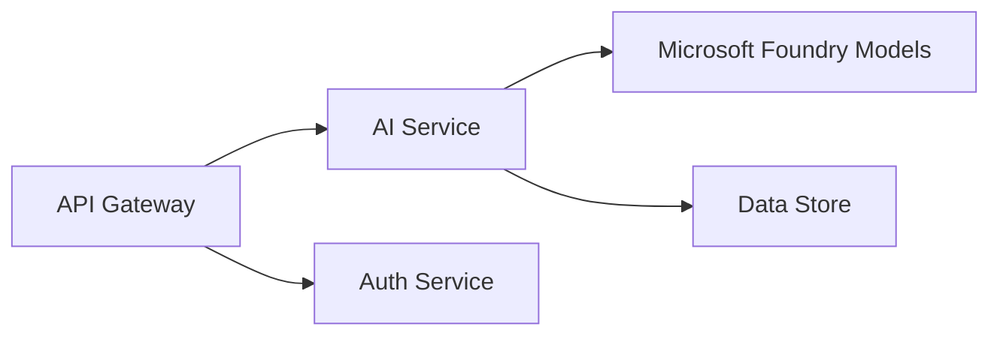
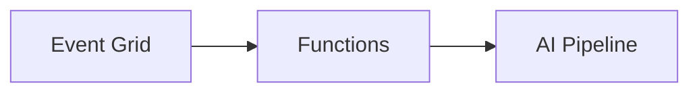

# Poglavje 8: Vzorce proizvodnje in podjetij

**📚 Tečaj**: [AZD za začetnike](../../README.md) | **⏱️ Trajanje**: 2-3 ure | **⭐ Kompleksnost**: Napredno

---

## Pregled

To poglavje pokriva vzorce nameščanja, pripravljenih za podjetja, utrjevanje varnosti, spremljanje in optimizacijo stroškov za produkcijske AI delovne obremenitve.

To je arhitekturni referenčni zapis, ne popoln produkcijski predloga za namestitev. Primeri izpuščajo podrobnosti integracije, ki jih morate sami zagotoviti in preizkusiti v svoji aplikaciji; branje kontrolnega seznama ne zagotavlja pripravljenosti za produkcijo.

> **Pregled izdaje (2026-11-04):** Navodila za AI CLI so bila preverjena glede na dokumentacijo/vir `azd 1.37.2`, agente `1.0.0-beta.23` in ocene `1.0.0-beta.2`. Za zahteve glede združljivosti in podrobnosti migracije si oglejte [spremembe in popravke izdaje](production-ai-practices.md#recent-release-changes-and-fixes); to ni preverjanje dejanske namestitve.

## Cilji učenja

Z dokončanjem tega poglavja boste:
- Namestili večregijske odporne aplikacije
- Implementirali varnostne vzorce za podjetja
- Konfigurirali celovito spremljanje
- Optimizirali stroške v obsegu
- Nastavili CI/CD procese z AZD

---

## 📚 Lekcije

| # | Lekcija | Opis | Čas |
|---|--------|--------------|------|
| 1 | [Prakse produkcijskega AI](production-ai-practices.md) | Vzorce namestitve za podjetja | 90 min |

---

## 🚀 Kontrolni seznam za produkcijo

- [ ] Večregijska namestitev za odpornost
- [ ] Upravljana identiteta za preverjanje pristnosti (brez ključev)
- [ ] Application Insights za spremljanje
- [ ] Nastavljeni proračuni in opozorila za stroške
- [ ] Omogočeno varnostno skeniranje
- [ ] Integracija CI/CD procesa
- [ ] Načrt za obnovitev po katastrofi

---

## 🏗️ Arhitekturni vzorci

### Vzorec 1: Mikroservisi AI



### Vzorec 2: Dogodkovno usmerjeni AI



---

## 🔐 Najboljše varnostne prakse

```bicep
// Illustrative properties from different resources, NOT a standalone Bicep file.
// Attach identity to the application host:
identity: {
  type: 'SystemAssigned'
}

// AI account properties (also require private endpoints, DNS and app connectivity):
properties: {
  publicNetworkAccess: 'Disabled'
  networkAcls: {
    defaultAction: 'Deny'
  }
}
```

---

## 💰 Optimizacija stroškov

| Strategija | Glavna omejitev |
|----------|---------|
| Skaliranje do ničle (Container Apps) | Zahteva ustrezen sprožilec; ostale storitve še vedno povzročajo stroške |
| Uporaba plasti s porabo za razvoj | Primerjava cen izbrane storitve in delovne obremenitve |
| Načrtovano skaliranje | Skaliranje preko podprte infrastrukture/avtomatizacije |
| Rezervacije/rezervirana zmogljivost | Samo če je podprto; zaveze lahko povečajo stroške nedejavnosti |

Uporabite [popolni vzorec proračuna](production-ai-practices.md#2-cost-monitoring-and-budgets) z veljavnim začetnim datumom, obsegom obračunavanja, prejemniki in dovoljenji. Proračun pošilja opozorila; ne omejuje porabe. Prihranki so odvisni od izmerjene porabe in niso zajamčeni odstotki.

---

## 📊 Nastavitev spremljanja

```bash
# Open the Application Insights logs view (requires configured monitoring)
azd monitor --logs

# Check Application Insights
azd monitor --overview

# View metrics
az monitor metrics list --resource <resource-id>
```

---

## 🔗 Navigacija

| Smer | Poglavje |
|-----------|---------|
| **Prejšnje** | [Poglavje 7: Odpravljanje težav](../chapter-07-troubleshooting/README.md) |
| **Zaključek tečaja** | [Domača stran tečaja](../../README.md) |

---

## 📖 Sorodni viri

- [Vodnik za AI agente](../chapter-02-ai-development/agents.md)
- [Application Insights](../chapter-06-pre-deployment/application-insights.md)
- [Rešitve z več agenti](../chapter-05-multi-agent/README.md)
- [Primer mikroservisov](../../examples/microservices/README.md)

---

<!-- CO-OP TRANSLATOR DISCLAIMER START -->
**Omejitev odgovornosti**:
Ta dokument je bil preveden z uporabo AI prevajalske storitve [Co-op Translator](https://github.com/Azure/co-op-translator). Čeprav si prizadevamo za natančnost, vas prosimo, da upoštevate, da avtomatizirani prevodi lahko vsebujejo napake ali netočnosti. Izvirni dokument v njegovem izvirnem jeziku je treba obravnavati kot avtoritativni vir. Za kritične informacije je priporočljiv strokovni človeški prevod. Ne odgovarjamo za morebitna nesporazume ali napačne interpretacije, ki izhajajo iz uporabe tega prevoda.
<!-- CO-OP TRANSLATOR DISCLAIMER END -->