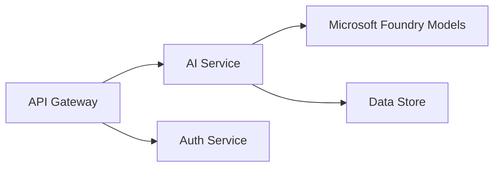
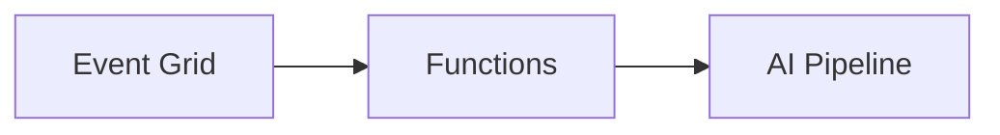

# Poglavje 8: Produkcijski in podjetniški vzorci

**📚 Tečaj**: [AZD za začetnike](../../README.md) | **⏱️ Trajanje**: 2-3 ure | **⭐ Kompleksnost**: Napredno

---

## Pregled

To poglavje zajema vzorce uvajanja, pripravljenih za podjetja, utrjevanje varnosti, nadzor in optimizacijo stroškov za produkcijske AI delovne obremenitve.

To je arhitekturni referenčni material, ne popolna predloga za produkcijo, ki je pripravljena za uvajanje. Primeri izpuščajo podrobnosti integracije, ki jih morate zagotoviti in preizkusiti v svoji aplikaciji; branje kontrolnega seznama ne potrjuje pripravljenosti za produkcijo.

> **Posodobitev Foundry GA (2026-11-09):** Uporabite `azd >= 1.37.0` in splošno dostopen paket `microsoft.foundry` 1.0 za Foundry potek dela; ocene se namestijo ločeno. Oglejte si [obseg izdaje in migracijo](production-ai-practices.md#recent-release-changes-and-fixes) in [primer overjenega poteka](production-ai-practices.md#cicd-pipeline-configuration). To je pregled dokumentacije, ne preverjanje uvajanja v živo ali splošni status GA za neobvezne predogledne funkcije.

## Cilji učenja

Z dokončanjem tega poglavja boste:
- Uvajali aplikacije z večregijskim odpornim delovanjem
- Izvajali varnostne vzorce za podjetja
- Konfigurirali celovit nadzor
- Optimizirali stroške v obsegu
- Nastavili CI/CD cevovode z AZD

---

## 📚 Lekcije

| # | Lekcija | Opis | Čas |
|---|--------|-------------|------|
| 1 | [Produkcijske AI prakse](production-ai-practices.md) | Podjetniški vzorci uvajanja | 90 min |

---

## 🚀 Kontrolni seznam za produkcijo

- [ ] Večregijsko uvajanje za odpornost
- [ ] Upravljana identiteta za avtentikacijo (brez ključev)
- [ ] Application Insights za nadzor
- [ ] Nastavljeni proračuni stroškov in opozorila
- [ ] Omogočeno varnostno pregledovanje
- [ ] Integracija CI/CD cevovoda
- [ ] Načrt za obnovo po katastrofi

---

## 🏗️ Arhitekturni vzorci

### Vzorec 1: AI mikro-storitve



### Vzorec 2: Dogodkovno vodena AI



---

## 🔐 Najboljše varnostne prakse

```bicep
// Illustrative properties from different resources, NOT a standalone Bicep file.
// Attach identity to the application host:
identity: {
  type: 'SystemAssigned'
}

// AI account properties (also require private endpoints, DNS and app connectivity):
properties: {
  publicNetworkAccess: 'Disabled'
  networkAcls: {
    defaultAction: 'Deny'
  }
}
```

---

## 💰 Optimizacija stroškov

| Strategija | Glavna omejitev |
|----------|---------|
| Preklop na ničlo (Container Apps) | Zahteva primern sprožilec; druge storitve še vedno povzročajo stroške |
| Uporaba nivojev porabe za razvoj | Primerjava cen izbrane storitve in delovne obremenitve |
| Načrtovano skaliranje | Skaliranje preko podprte infrastrukture/avtomatizacije |
| Rezervacije/rezerve z zmogljivostjo | Samo če je podprto; obveznosti lahko povečajo stroške med mirovanjem |

Uporabite [popolni vzorec proračuna virov](production-ai-practices.md#2-cost-monitoring-and-budgets) z veljavnim začetnim datumom, obsegom obračuna, prejemniki in dovoljenji. Proračun pošilja opozorila; ne omejuje porabe. Prihranki so odvisni od izmerjene uporabe in niso zagotovljeni deleži.

---

## 📊 Nastavitev nadzora

```bash
# Open the Application Insights logs view (requires configured monitoring)
azd monitor --logs

# Check Application Insights
azd monitor --overview

# View metrics
az monitor metrics list --resource <resource-id>
```

---

## 🔗 Navigacija

| Smer | Poglavje |
|-----------|---------|
| **Prejšnje** | [Poglavje 7: Odpravljanje težav](../chapter-07-troubleshooting/README.md) |
| **Zaključek tečaja** | [Domača stran tečaja](../../README.md) |

---

## 📖 Sorodni viri

- [Vodnik za AI agente](../chapter-02-ai-development/agents.md)
- [Application Insights](../chapter-06-pre-deployment/application-insights.md)
- [Rešitve z več agenti](../chapter-05-multi-agent/README.md)
- [Primer mikro-storitev](../../examples/microservices/README.md)

---

<!-- CO-OP TRANSLATOR DISCLAIMER START -->
**Omejitev odgovornosti**:
Ta dokument je bil preveden z uporabo AI prevajalske storitve [Co-op Translator](https://github.com/Azure/co-op-translator). Čeprav si prizadevamo za natančnost, vas prosimo, da upoštevate, da avtomatizirani prevodi lahko vsebujejo napake ali netočnosti. Izvirni dokument v njegovem izvirnem jeziku je treba obravnavati kot avtoritativni vir. Za kritične informacije je priporočljiv strokovni človeški prevod. Ne odgovarjamo za morebitna nesporazume ali napačne interpretacije, ki izhajajo iz uporabe tega prevoda.
<!-- CO-OP TRANSLATOR DISCLAIMER END -->