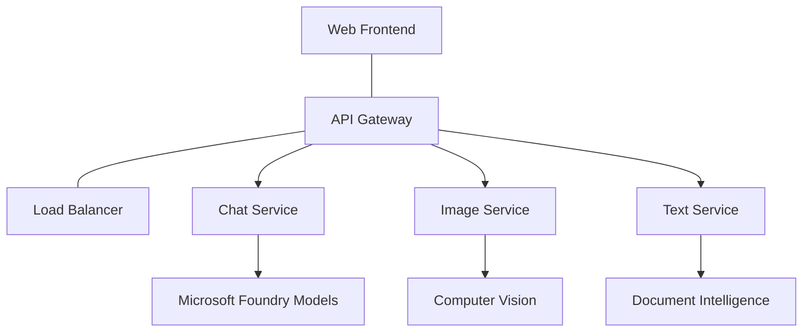

# Najboljše prakse za proizvodno obremenitev AI z AZD

**Navigacija po poglavjih:**
- **📚 Domača stran tečaja**: [AZD Za začetnike](../../README.md)
- **📖 Trenutno poglavje**: Poglavje 8 - Proizvodni & podjetniški vzorci
- **⬅️ Prejšnje poglavje**: [Poglavje 7: Odpravljanje težav](../chapter-07-troubleshooting/debugging.md)
- **⬅️ Povezano tudi**: [Delavnica AI Laboratorij](../chapter-02-ai-development/ai-workshop-lab.md)
- **🎯 Zaključek tečaja**: [AZD Za začetnike](../../README.md)

## Pregled

Ta vodič pojasnjuje proizvodne vzorce za AI z uporabo Azure Developer CLI (AZD). Gre za referenco za oblikovanje, ne pa za aplikacijo, ki jo je mogoče namestiti, ali za proizvodno certifikacijo.

**Meje primera:** Če ni izrecno opisano kot popolno, Bicep fragmenti predpostavljajo parametre in navedene vire iz vsebujejoče predloge. Izpuščajo gostiteljske slike/plane, identitete, dodelitve vlog, DNS, izhode in drugo zahtevano integracijo. YAML poti storitev in skripti za kljuke/preteke so ilustrativne datoteke za ustvarjanje v **vaši lastni aplikaciji**; niso priložene v tem tečaju. Uporabite delujoč vzorec AZD kot osnovo, sestavite celotno infrastrukturo in jo preizkusite v izoliranem okolju pred produkcijo.

## Ključne izzive, ki jih obravnavamo

Pogosti problemi proizvodnje vključujejo uvajanje več storitev, upravljanje identitet in skrivnosti, skaliranje, nadzor stroškov in spremljanje. Tukaj ni trditev o pogostosti.

## Arhitekturni vzorci za proizvodno AI

### Vzorec 1: Arhitektura AI mikrostoritev

**Kdaj uporabljati**: Kompleksne AI aplikacije z več možnostmi



**Implementacija z AZD**:

```yaml
# azure.yaml
name: enterprise-ai-platform
services:
  web:
    project: ./web
    host: staticwebapp
  api-gateway:
    project: ./api-gateway
    host: containerapp
  chat-service:
    project: ./services/chat
    host: containerapp
  vision-service:
    project: ./services/vision
    host: containerapp
  text-service:
    project: ./services/text
    host: containerapp
```

### Vzorec 2: AI procesiranje, ki se sproža z dogodki

**Kdaj uporabljati**: Serijsko procesiranje, analiza dokumentov, asinhroni delovni tokovi

```bicep
// Event Hub for AI processing pipeline
resource eventHub 'Microsoft.EventHub/namespaces@2024-01-01' = {
  name: eventHubNamespaceName
  location: location
  sku: {
    name: 'Standard'
    tier: 'Standard'
    capacity: 1
  }
}

// Service Bus for reliable message processing
resource serviceBus 'Microsoft.ServiceBus/namespaces@2024-01-01' = {
  name: serviceBusNamespaceName
  location: location
  sku: {
    name: 'Premium'
    tier: 'Premium'
    capacity: 1
  }
}

// Function App for processing
resource functionApp 'Microsoft.Web/sites@2023-01-01' = {
  name: functionAppName
  location: location
  kind: 'functionapp,linux'
  properties: {
    siteConfig: {
      appSettings: [
        {
          name: 'FUNCTIONS_EXTENSION_VERSION'
          value: '~4'
        }
        {
          name: 'AZURE_OPENAI_ENDPOINT'
          value: '@Microsoft.KeyVault(VaultName=${keyVault.name};SecretName=openai-endpoint)'
        }
      ]
    }
  }
}
```

To ustvari fragmente imenskega prostora, ne vozlišč, čakalnih vrst, naročnin ali sprožilcev za funkcije. Za izvedljivo funkcijo je potreben tudi gostiteljski načrt, konfiguracija izvajanja/shranjevanja, pripeta identiteta, RBAC in dostop do omrežja. Referenca Key Vault zahteva dovoljenje za branje skrivnosti; sam URL končne točke ni poverilnica.

## Razmišljanje o zdravju AI agenta

Ko tradicionalna spletna aplikacija odpove, so simptomi znani: stran se ne naloži, API vrne napako ali uvajanje odpove. AI-podprte aplikacije lahko odpovedo na vse te načine—lahko pa se obnašajo tudi bolj subtilno, brez očitnih sporočil o napakah.

Ta oddelek vam pomaga zgraditi mentalni model za spremljanje AI obremenitev, da boste vedeli, kje iskati, ko se stvari ne zdijo prav.

### Kako se zdravje agenta razlikuje od zdravja tradicionalnih aplikacij

Tudi tradicionalne aplikacije imajo lahko subtilne težave z pravilnostjo. AI agent doda nedeterministično kakovost odziva k običajnim skrbi glede razpoložljivosti in pravilnosti. Razmišljajte o zdravju agenta v dveh slojih:

| Sloj | Kaj spremljati | Kje iskati |
|-------|--------------|---------------|
| **Zdravje infrastrukture** | Ali storitev deluje? So viri zagotovljeni? So končne točke dosegljive? | `azd monitor`, zdravje vira v Azure portalu, dnevniki vseh vsebnikov/aplikacij |
| **Zdravje vedenja** | Ali agent odgovarja natančno? Ali so odgovori pravočasni? Ali je model pravilno klican? | Application Insights sledi, meritve latence klicev modela, dnevniki kakovosti odziva |

Zdravje infrastrukture je znano—enako velja za katerokoli azd aplikacijo. Zdravje vedenja je nov sloj, ki ga uvajajo AI obremenitve.

### Kje iskati, ko se AI aplikacije ne obnašajo kot pričakovano

Če vaša AI aplikacija ne proizvaja pričakovanih rezultatov, je tukaj konceptualni seznam:

1. **Začnite z osnovami.** Aplikacija deluje? Ali doseže svoje odvisnosti? Preverite `azd monitor` in zdravje vira kot pri vsaki aplikaciji.
2. **Preverite povezavo z modelom.** Ali vaša aplikacija uspešno kliče AI model? Neuspešni ali potekli klici modela so najpogostejši vzrok težav AI aplikacij in se bodo prikazali v vaših aplikacijskih dnevnikih.
3. **Preverite vhod in ozadje z varnostjo.** Napačni odgovori lahko izvirajo iz iskanja, navodil, omejitev modela ali izvajanja orodij. Uporabljajte podatke za diagnostiko z nadzorom dostopa in cenzurirane; ne omogočajte neselektivnega dnevnikovanja pozivov/odgovorov v produkciji.
4. **Preverite latenco odziva.** Klici AI modela so počasnejši od običajnih API klicev. Če se aplikacija zdi počasna, preverite, ali so se časi odziva modela povečali—to lahko kaže na omejevanje, kapacitete ali zasičenost na ravni regije.
5. **Spremljajte signal stroškov.** Nepričakovani porasti v uporabi žetonov ali API klicih lahko kažejo zanko, nepravilno nastavljen poziv ali prekomerne ponovitve.

Ni vam treba takoj obvladati orodij za opazovanje. Ključna ugotovitev je, da AI aplikacije uvajajo dodatni sloj vedenja za spremljanje, azd vgrajeno spremljanje (`azd monitor`) pa vam nudi izhodišče za preiskovanje obeh slojev.

---

## Najboljše prakse varnosti

### 1. Model varnosti brez zaupanja (Zero-Trust)

**Strategija izvajanja**:
- Brez komunikacije med storitvami brez overitve
- Vsi API klici uporabljajo upravljane identitete
- Omrežna izolacija z zasebnimi končnimi točkami
- Dostop z najmanjšimi potrebnimi privilegiji

```bicep
// Managed Identity for each service
resource chatServiceIdentity 'Microsoft.ManagedIdentity/userAssignedIdentities@2023-01-31' = {
  name: 'chat-service-identity'
  location: location
}

// Role assignments with minimal permissions
resource openAIUserRole 'Microsoft.Authorization/roleAssignments@2022-04-01' = {
  scope: openAIAccount
  name: guid(openAIAccount.id, chatServiceIdentity.id, '5e0bd9bd-7b93-4f28-af87-19fc36ad61bd')
  properties: {
    roleDefinitionId: subscriptionResourceId('Microsoft.Authorization/roleDefinitions', '5e0bd9bd-7b93-4f28-af87-19fc36ad61bd')
    principalId: chatServiceIdentity.properties.principalId
    principalType: 'ServicePrincipal'
  }
}
```

### 2. Varen upravljavec skrivnosti

**Vzorčni vzorec integracije Key Vault**:

```bicep
// Key Vault with proper access policies
resource keyVault 'Microsoft.KeyVault/vaults@2023-02-01' = {
  name: keyVaultName
  location: location
  properties: {
    tenantId: tenant().tenantId
    sku: {
      family: 'A'
      name: 'standard' // Premium is needed for HSM-backed keys, not ordinary secrets
    }
    enableRbacAuthorization: true  // Use RBAC instead of access policies
    enablePurgeProtection: true    // Prevent accidental deletion
    enableSoftDelete: true
    softDeleteRetentionInDays: 90
  }
}

// Optional legacy key-auth alternative; omit when using Entra ID.
resource openAIKeySecret 'Microsoft.KeyVault/vaults/secrets@2023-02-01' = {
  parent: keyVault
  name: 'openai-api-key'
  properties: {
    value: openAIAccount.listKeys().key1
    attributes: {
      enabled: true
    }
  }
}
```

Dodelite identiteto za izvajanje `Key Vault Secrets User` na ustreznem obsegu in jo pripnite gostitelju; `enableRbacAuthorization` sam ne podeli dostopa. Prednost dajte overjanju z upravljano identiteto OpenAI z `disableLocalAuth: true`. Izbirna skrivnost ključa smiselno obstaja le za račun, ki je namensko omogočen s ključem, glavni ponudnik mora imeti tudi dovoljenje za pisanje skrivnosti.

### 3. Omrežna varnost

**Konfiguracija zasebnih končnih točk**:

```bicep
// Virtual Network for AI services
resource virtualNetwork 'Microsoft.Network/virtualNetworks@2023-04-01' = {
  name: vnetName
  location: location
  properties: {
    addressSpace: {
      addressPrefixes: ['10.0.0.0/16']
    }
    subnets: [
      {
        name: 'ai-services-subnet'
        properties: {
          addressPrefix: '10.0.1.0/24'
          privateEndpointNetworkPolicies: 'Disabled'
        }
      }
      {
        name: 'app-services-subnet'
        properties: {
          addressPrefix: '10.0.2.0/24'
          delegations: [
            {
              name: 'Microsoft.Web/serverFarms'
              properties: {
                serviceName: 'Microsoft.Web/serverFarms'
              }
            }
          ]
        }
      }
    ]
  }
}

// Private endpoints for all AI services
resource openAIPrivateEndpoint 'Microsoft.Network/privateEndpoints@2023-04-01' = {
  name: '${openAIAccountName}-pe'
  location: location
  properties: {
    subnet: {
      id: virtualNetwork.properties.subnets[0].id
    }
    privateLinkServiceConnections: [
      {
        name: 'openai-connection'
        properties: {
          privateLinkServiceId: openAIAccount.id
          groupIds: ['account']
        }
      }
    ]
  }
}
```

Zasebne končne točke prav tako zahtevajo skupine zasebnih DNS con/povezave VNet in integracijo aplikacije VNet. Ne blokirajo samodejno javnega dostopa: izrecno onemogočite javni omrežni dostop do AI računa po potrditvi zasebne povezljivosti in dostopa do uvajanja.

## Izvedba in skaliranje

### 1. Strategije samodejnega skaliranja

**Samodejno skaliranje Container Apps**:

```bicep
resource containerApp 'Microsoft.App/containerApps@2023-05-01' = {
  name: containerAppName
  location: location
  properties: {
    configuration: {
      ingress: {
        external: true
        targetPort: 8000
        transport: 'http'
      }
    }
    template: {
      scale: {
        minReplicas: 2  // Always have 2 instances minimum
        maxReplicas: 50 // Scale up to 50 for high load
        rules: [
          {
            name: 'http-scaling'
            http: {
              metadata: {
                concurrentRequests: '20'  // Scale when >20 concurrent requests
              }
            }
          }
          {
            name: 'cpu-scaling'
            custom: {
              type: 'cpu'
              metadata: {
                type: 'Utilization'
                value: '70'  // Scale when CPU >70%
              }
            }
          }
        ]
      }
    }
  }
}
```

### 2. Strategije predpomnjenja

**Redis predpomnilnik za AI odzive**:

```bicep
// Legacy Azure Cache for Redis example (not recommended for new deployments)
resource redisCache 'Microsoft.Cache/redis@2023-04-01' = {
  name: redisCacheName
  location: location
  properties: {
    sku: {
      name: 'Premium'
      family: 'P'
      capacity: 1
    }
    enableNonSslPort: false
    minimumTlsVersion: '1.2'
    redisConfiguration: {
      'maxmemory-policy': 'allkeys-lru'
    }
    // Sharding distributes data; replication/failover provides availability.
    shardCount: 2
  }
}

// Cache configuration in application
var cacheConnectionString = '${redisCache.properties.hostName}:6380,password=${redisCache.listKeys().primaryKey},ssl=True,abortConnect=False'
```

Azure Cache za Redis Basic/Standard/Premium je na [poti upokojevanja](https://learn.microsoft.com/azure/azure-cache-for-redis/retirement-faq). Uporabite Azure Managed Redis za nove zasnove in njeno dokumentirano SKU, identiteto in TLS konfiguracijo, namesto da kopirate ta stari vir v nov proizvodni sistem. Vrstica s povezovalno nizko je nefunkcionalni nadomestek, ne poverilnica. Razdelite ključne predpomnilnike glede na pooblastila, model/navodila in različico iskanja, s časovno potekom; skupni predpomnilnik samo za poizvedbe lahko razkrije podatke drugega uporabnika.

### 3. Uravnoteženje obremenitve in upravljanje s prometom

**Aplikacijski prehod z WAF**:

```bicep
// Application Gateway with Web Application Firewall
resource applicationGateway 'Microsoft.Network/applicationGateways@2023-04-01' = {
  name: appGatewayName
  location: location
  properties: {
    sku: {
      name: 'WAF_v2'
      tier: 'WAF_v2'
      capacity: 2
    }
    webApplicationFirewallConfiguration: {
      enabled: true
      firewallMode: 'Prevention'
      ruleSetType: 'OWASP'
      ruleSetVersion: '3.2'
    }
    // Backend pools for AI services
    backendAddressPools: [
      {
        name: 'ai-services-pool'
        properties: {
          backendAddresses: [
            {
              fqdn: '${containerApp.properties.configuration.ingress.fqdn}'
            }
          ]
        }
      }
    ]
  }
}
```

To je delni vir prehoda: za resnično uvajanje potrebujete tudi podomrežje prehoda/IP konfiguracijo, frontend IP-je in porte, TLS poslušalce/sertifikate, backend HTTP nastavitve/probe, pravila in prioritete usmerjanja ter pregledano WAF politiko. TLS domena/SNI in overitev morata ustrezati backendu Container App.

## 💰 Optimizacija stroškov

### 1. Pravilna izbira velikosti vira

**Okoljsko-specifične konfiguracije**:

Ta imena so **ilustrativni vhodi v prilagojene predloge**, ne samodejne nastavitve AZD. Vsakega najprej preslikajte v `infra/main.parameters.json`/Bicep in gostiteljsko konfiguracijo. Na primer, vzorec RAG uporablja `AZURE_SEARCH_SERVICE_SKU` in `AZURE_OPENAI_CHATGPT_DEPLOYMENT_CAPACITY`, ne spodnja generična imena. Dajte Container Apps pomnilnik v podprto enoto, kot je `1Gi` v dejanskem viru. Infrastrukturne spremembe izvedite z `azd up` ali `azd provision`; `azd deploy` sam ne uporabi sprememb Bicep.

```bash
# Development environment
azd env new development
azd env set AZURE_OPENAI_SKU "S0"
azd env set AZURE_OPENAI_CAPACITY 10
azd env set AZURE_SEARCH_SKU "basic"
azd env set CONTAINER_CPU 0.5
azd env set CONTAINER_MEMORY 1.0

# Production environment  
azd env new production
azd env set AZURE_OPENAI_SKU "S0"
azd env set AZURE_OPENAI_CAPACITY 100
azd env set AZURE_SEARCH_SKU "standard"
azd env set CONTAINER_CPU 2.0
azd env set CONTAINER_MEMORY 4.0
```

### 2. Spremljanje stroškov in proračuni

```bicep
// Supply the first day of the current UTC month, e.g. 2026-11-01T00:00:00Z.
param budgetStartDate string

// Cost management and budgets
resource budget 'Microsoft.Consumption/budgets@2024-08-01' = {
  name: 'ai-workload-budget'
  properties: {
    timePeriod: {
      startDate: budgetStartDate
    }
    timeGrain: 'Monthly'
    amount: 2000  // In the billing currency, not necessarily USD
    category: 'Cost'
    notifications: {
      warning: {
        enabled: true
        operator: 'GreaterThan'
        threshold: 80
        contactEmails: [
          'finance@company.com'
          'engineering@company.com'
        ]
        contactRoles: [
          'Owner'
          'Contributor'
        ]
      }
      critical: {
        enabled: true
        operator: 'GreaterThan'
        threshold: 95
        contactEmails: [
          'cto@company.com'
        ]
      }
    }
  }
}
```

Zamenjajte primerne prejemnike in preverite obseg/dovoljenja. Opozorila o proračunu uporabljajo zastoje podatkov o stroških in ne izvajajo omejitve porabe.

### 3. Optimizacija uporabe žetonov

**Upravljanje stroškov OpenAI**:

To je samo heuristika, ki temelji na znakovni dolžini za predogled UI, **ne** preverjevalnik omejitve žetonov modela. Proizvodna koda mora uporabiti razdeljevalnik tokenov ustrezen za nameščeni model in upoštevati sistemska navodila, sheme orodij, zgodovino in izhodni proračun. Zavrnite preveliko uporabniško sporočilo namesto tihega skrajšanja.

```typescript
// Application-level token optimization
class TokenOptimizer {
  private readonly maxTokens = 4000;
  private readonly reserveTokens = 500;
  
  optimizePrompt(userInput: string, context: string): string {
    const availableTokens = this.maxTokens - this.reserveTokens;
    if (this.estimateTokens(userInput) + 8 >= availableTokens) {
      throw new Error("User input exceeds the illustrative prompt budget");
    }
    const estimatedTokens = this.estimateTokens(userInput + context) + 8;
    
    if (estimatedTokens > availableTokens) {
      // Truncate context, not user input
      context = this.truncateContext(context, Math.max(0, availableTokens - this.estimateTokens(userInput) - 8));
    }
    
    return `${context}\n\nUser: ${userInput}`;
  }
  
  private estimateTokens(text: string): number {
    // Rough estimation: 1 token ≈ 4 characters
    return Math.ceil(text.length / 4);
  }

  private truncateContext(text: string, estimatedBudget: number): string {
    return text.slice(0, Math.max(0, estimatedBudget) * 4);
  }
}
```

## Spremljanje in opazovanje

### 1. Celovit Application Insights

```bicep
// Application Insights with advanced features
resource applicationInsights 'Microsoft.Insights/components@2020-02-02' = {
  name: applicationInsightsName
  location: location
  kind: 'web'
  properties: {
    Application_Type: 'web'
    WorkspaceResourceId: logAnalyticsWorkspace.id
    SamplingPercentage: 100  // Ingestion setting; review cost and SDK sampling separately
    DisableIpMasking: false  // Retain IP masking
  }
}

// Custom metrics for AI operations
resource aiMetricAlerts 'Microsoft.Insights/metricAlerts@2018-03-01' = {
  name: 'ai-high-error-rate'
  location: 'global'
  properties: {
    description: 'Alert when failed request count exceeds 10 in five minutes'
    severity: 2
    enabled: true
    scopes: [
      applicationInsights.id
    ]
    evaluationFrequency: 'PT1M'
    windowSize: 'PT5M'
    criteria: {
      'odata.type': 'Microsoft.Azure.Monitor.SingleResourceMultipleMetricCriteria'
      allOf: [
        {
          name: 'high-error-rate'
          metricName: 'requests/failed'
          operator: 'GreaterThan'
          threshold: 10
          timeAggregation: 'Count'
        }
      ]
    }
  }
}
```

### 2. AI-specifično spremljanje

**Prilagojene nadzorne plošče za AI meritve**:

```json
{
  "dashboard": {
    "name": "AI Application Monitoring",
    "tiles": [
      {
        "name": "OpenAI Request Volume",
        "query": "dependencies | where target contains 'openai' | summarize count() by bin(timestamp, 5m)"
      },
      {
        "name": "AI Response Latency",
        "query": "dependencies | where target contains 'openai' | summarize avg(duration) by bin(timestamp, 5m)"
      },
      {
        "name": "Token Usage",
        "query": "customMetrics | where name == 'openai_tokens_used' | summarize sum(value) by bin(timestamp, 1h)"
      },
      {
        "name": "Cost per Hour",
        "query": "customMetrics | where name == 'openai_cost' | summarize sum(value) by bin(timestamp, 1h)"
      }
    ]
  }
}
```

Ta JSON je skica, določena z aplikacijo, ne uvozljiva shema nadzorne plošče Azure portala. Poizvedbe za žetone/stroške zahtevajo, da vaša aplikacija oddaja točno te prilagojene metrike; niso ustvarjene z AZD. Prilagodite filtre odvisnosti za dejanske končne točke/ime razpona modela.

### 3. Preverjanje zdravja in spremljanje dosegljivosti

```bicep
// Application Insights availability tests
resource availabilityTest 'Microsoft.Insights/webtests@2022-06-15' = {
  name: 'ai-app-availability-test'
  location: location
  tags: {
    'hidden-link:${applicationInsights.id}': 'Resource'
  }
  properties: {
    SyntheticMonitorId: 'ai-app-availability-test'
    Name: 'AI Application Availability Test'
    Description: 'Tests AI application endpoints'
    Enabled: true
    Frequency: 300  // 5 minutes
    Timeout: 120    // 2 minutes
    Kind: 'standard'
    Locations: [
      {
        Id: 'us-east-2-azr'
      }
      {
        Id: 'us-west-2-azr'
      }
    ]
    Request: {
      RequestUrl: 'https://${webApp.properties.defaultHostName}/health'
      HttpVerb: 'GET'
      FollowRedirects: true
      ParseDependentRequests: false
    }
    ValidationRules: {
      ExpectedHttpStatusCode: 200
      SSLCheck: true
      SSLCertRemainingLifetimeCheck: 7
    }
  }
}
```

## Obnova po nesrečah in visoka razpoložljivost

Prejšnji test predpostavlja obstoječo storitev App Service `webApp` in vir Application Insights. Standardni testi razpoložljivosti so plačljivi in zahtevajo dosegljivo končno točko; samo zasebne aplikacije potrebujejo ustrezno zasnovo zasebnega spremljanja. URL ping testi so zastareli; uporabljajte [standardne teste razpoložljivosti](https://learn.microsoft.com/azure/azure-monitor/app/availability).

### 1. Večregijska uvajanja

```yaml
# azure.yaml - Multi-region configuration
name: ai-app-multiregion
services:
  api-primary:
    project: ./api
    host: containerapp
    env:
      AZURE_REGION: eastus
  api-secondary:
    project: ./api
    host: containerapp
    env:
      AZURE_REGION: westus2
```

```bicep
// Separate App Service topology, not the Container Apps declarations above
resource trafficManager 'Microsoft.Network/trafficManagerProfiles@2022-04-01' = {
  name: trafficManagerProfileName
  location: 'global'
  properties: {
    profileStatus: 'Enabled'
    trafficRoutingMethod: 'Priority'
    dnsConfig: {
      relativeName: trafficManagerProfileName
      ttl: 30
    }
    monitorConfig: {
      protocol: 'HTTPS'
      port: 443
      path: '/health'
      intervalInSeconds: 30
      toleratedNumberOfFailures: 3
      timeoutInSeconds: 10
    }
    endpoints: [
      {
        name: 'primary-endpoint'
        type: 'Microsoft.Network/trafficManagerProfiles/azureEndpoints'
        properties: {
          targetResourceId: primaryAppService.id
          endpointStatus: 'Enabled'
          priority: 1
        }
      }
      {
        name: 'secondary-endpoint'
        type: 'Microsoft.Network/trafficManagerProfiles/azureEndpoints'
        properties: {
          targetResourceId: secondaryAppService.id
          endpointStatus: 'Enabled'
          priority: 2
        }
      }
    ]
  }
}
```

Okoljske spremenljivke ne izbirajo lokacije virov. IaC mora zagotoviti ločene regionalne gostitelje in vsak servis povezati z `resourceName` ali `azd-service-name` oznakami. Primer Traffic Managerja je **loča topologija App Service** (`primaryAppService`/`secondaryAppService`), ne usmerjanje za izjave Container Apps. Container Apps potrebuje ustrezno konfigurirano zunanjo končno točko/vhodna vrata, TLS/usmerjanje po meri domene in preglede zdravja.

### 2. Varnostna kopija in obnova podatkov

```bicep
// Backup configuration for critical data
resource backupVault 'Microsoft.DataProtection/backupVaults@2023-05-01' = {
  name: backupVaultName
  location: location
  identity: {
    type: 'SystemAssigned'
  }
  properties: {
    storageSettings: [
      {
        datastoreType: 'VaultStore'
        type: 'LocallyRedundant'
      }
    ]
  }
}

```

Sam ključ ni varnostna kopija ničesar. Konfigurirajte **politiko in primer varnostne kopije, ki je podprt za določeno obremenitev**, dovoljenja vira, hrambo in teste obnovitve z uporabo [matrik podprtosti Azure Backup](https://learn.microsoft.com/azure/backup/backup-support-matrix). Ni splošne politike Azure Backup za gostujoča uvajanja Azure OpenAI modelov. Definicije infrastrukture/modela hranite v nadzoru vira; zaščitite naložene dokumente, aplikacijske podatke in artefakte prilagoditve s podprtimi funkcijami varnostne kopije/izvoza vsake storitve. Izrecno določite in testirajte RPO/RTO.

## DevOps in integracija CI/CD

### 1. GitHub Actions delovni tok

```yaml
# .github/workflows/deploy-ai-app.yml
name: Deploy AI Application

on:
  push:
    branches: [main]
  pull_request:
    branches: [main]

jobs:
  test:
    runs-on: ubuntu-latest
    steps:
      - uses: actions/checkout@v4
      
      - name: Setup Python
        uses: actions/setup-python@v4
        with:
          python-version: '3.11'
          
      - name: Install dependencies
        run: |
          pip install -r requirements.txt
          pip install pytest
          
      - name: Run tests
        run: pytest tests/
        
      - name: AI Safety Tests
        run: |
          python scripts/test_ai_safety.py
          python scripts/validate_prompts.py

```

To je **delovni tok samo za testiranje** in predpostavlja, da ste ustvarili `requirements.txt`, `tests/` in dva varnostna skripta. Dodajte overjene naloge OIDC za uvajanje/namestitev iz [nastavitve CI/CD cevovoda](#cicd-pipeline-configuration), z `needs: test`, zaupanja vrednim sprožilcem push/ročno in zaščitenim okoljem GitHub. Ne uvajajte nepregledane kode pull requesta z oblačnimi poverilnicami. Nov zaganjalnik nima izbranega lokalnega AZD okolja; priskrbite vnose okolja/odjemalca/območja in uporabite `azd auth login`, ne samo `azure/login`.

### 2. Preverjanje infrastrukture

```bash
# scripts/validate_infrastructure.sh
#!/bin/bash
set -euo pipefail

echo "Validating AI infrastructure deployment..."

# Requires Azure CLI login and the resource group selected explicitly.
: "${AZURE_RESOURCE_GROUP:?Set AZURE_RESOURCE_GROUP}"
: "${AZURE_OPENAI_NAME:?Set AZURE_OPENAI_NAME}"
: "${AZURE_OPENAI_CHAT_DEPLOYMENT:?Set the actual deployment name}"

# A successful empty list is not proof that resources exist.
types=("Microsoft.CognitiveServices/accounts" "Microsoft.Search/searchServices"
       "Microsoft.Storage/storageAccounts" "Microsoft.KeyVault/vaults")
for resource_type in "${types[@]}"; do
    count=$(az resource list --resource-group "$AZURE_RESOURCE_GROUP" \
        --resource-type "$resource_type" --query "length(@)" -o tsv)
    if [[ "$count" -lt 1 ]]; then
        echo "ERROR: No $resource_type found in $AZURE_RESOURCE_GROUP"
        exit 1
    fi
done

# Validate OpenAI model deployments
echo "Validating OpenAI model deployments..."
state=$(az cognitiveservices account deployment show \
  --name "$AZURE_OPENAI_NAME" --resource-group "$AZURE_RESOURCE_GROUP" \
  --deployment-name "$AZURE_OPENAI_CHAT_DEPLOYMENT" \
  --query "properties.provisioningState" -o tsv)
if [[ "$state" != "Succeeded" ]]; then
    echo "ERROR: Required model deployment is not provisioned successfully"
    exit 1
fi

echo "Infrastructure validation completed successfully!"
```

Pričakovano: ničelna napaka in sporočilo o zaključku le, če obstajajo vsi pričakovani tipi in če je določeno uvajanje modela zagotovljeno. To preverja stanje inventarja/namestitve, **ne** zdravje vira, natančno topologijo, RBAC, dosegljivost omrežja ali vedenje modela. Prilagodite pričakovane tipe svoji arhitekturi, nato izvedite ločen overjen test pripravljenosti aplikacije.

## Seznam preverjanja pripravljenosti za proizvodnjo

### Varnost ✅
- [ ] Vse storitve uporabljajo upravljane identitete
- [ ] Skrivnosti shranjene v Key Vault
- [ ] Zasebne končne točke konfigurirane
- [ ] Omrežne varnostne skupine uporabljene
- [ ] RBAC z najmanjšimi privilegiji
- [ ] WAF omogočen na javnih končnih točkah

### Izvedba ✅
- [ ] Samodejno skaliranje konfigurirano
- [ ] Predpomnilnik uveden
- [ ] Nastavitev uravnoteženja obremenitve
- [ ] CDN za statične vsebine
- [ ] Uporaba povezav podatkovnih baz v skupni rabi
- [ ] Optimizacija uporabe tokenov

### Spremljanje ✅
- [ ] Application Insights konfiguriran
- [ ] Opredeljene prilagojene metrike
- [ ] Nastavljene opozorilne vrstice
- [ ] Ustvarjena nadzorna plošča
- [ ] Izvedeni zdravstveni pregledi
- [ ] Politike hranjenja dnevnikov

### Zanesljivost ✅
- [ ] Večregijsko uvajanje
- [ ] Načrt varnostnih kopij in obnovitev
- [ ] Izvedeni varovalni mehanizmi
- [ ] Konfigurirane politike ponavljanja
- [ ] Prijazna degradacija
- [ ] Končne točke preverjanja zdravja

### Upravljanje stroškov ✅
- [ ] Nastavljena opozorila o proračunu
- [ ] Pravilna velikost virov
- [ ] Uporabljene razvojne/testne ugodnosti
- [ ] Nakup rezerviranih primerkov
- [ ] Nadzorna plošča za spremljanje stroškov
- [ ] Redni pregledi stroškov

### Skladnost ✅
- [ ] Izpolnjene zahteve glede lokacije podatkov
- [ ] Omogočeno revizijsko beleženje
- [ ] Uvedene politike skladnosti
- [ ] Izvedene varnostne osnove
- [ ] Redni varnostni pregledi
- [ ] Načrt ukrepanja ob incidentih

## Merila zmogljivosti

### Ilustrativni proizvodni cilji

To so primerne SLO za pogajanje in testiranje obremenitev, ne merjena merila ali zagotovila. Latenca odziva je odvisna od dolžine modela/izhoda; mesečni strošek žetonov je odvisen od prometa in cen, ne samo števila žetonov.

| Merilo | Cilj | Spremljanje |
|--------|--------|------------|
| **Čas odziva** | < 2 sekundi | Application Insights |
| **Razpoložljivost** | 99,9 % | Spremljanje dosegljivosti |
| **Stopnja napak** | < 0,1 % | Aplikacijski dnevniki |
| **Poraba modela** | < 500 USD/mesec (primer proračuna) | Upravljanje stroškov |
| **Hkratni uporabniki** | 1000+ | Testiranje obremenitve |
| **Čas okrevanja** | < 1 ura | Preizkusi obnovitve po nesreči |

### Testiranje obremenitve

Spodaj je prikazana skica vmesnika za skripto za testiranje obremenitve, **ki jo morate sami implementirati**; ta repozitorij ne vsebuje `scripts/load_test.py`. Pred zagonom v izbranem orodju za testiranje obremenitve definirajte vsebino zahtevkov, overjanje, reprezentativne delovne obremenitve, preverjanja latence/napak glede na percentile in omejitev porabe:

```bash
# Load testing script for AI applications
python scripts/load_test.py \
  --endpoint https://your-ai-app.azurewebsites.net \
  --concurrent-users 100 \
  --duration 300 \
  --ramp-up 60
```

## 🤝 Najboljše prakse skupnosti

Glede na povratne informacije skupnosti na Microsoft Foundry Discord:

### Glavna priporočila skupnosti:

1. **Začnite z majhnim, postopoma širite**: začnite z osnovnimi SKU-ji in povečujte glede na dejansko uporabo
2. **Spremljajte vse**: vzpostavite celovito spremljanje od prvega dne
3. **Avtomatizirajte varnost**: uporabite infrastrukturo kot kodo za dosledno varnost
4. **Temeljito testirajte**: vključite specifično testiranje za AI v svojo cevovod
5. **Načrtujte stroške**: spremljajte porabo žetonov in zgodaj nastavite opozorila o proračunu

### Pogoste napake, ki se jim je treba izogniti:

- ❌ Trdo kodiranje API ključev v kodi
- ❌ Nepostavitev ustreznega spremljanja
- ❌ Ignoriranje optimizacije stroškov
- ❌ Netestiranje scenarijev napak
- ❌ Uvajanje brez preverjanja zdravja

## Ukazi in razširitve AI v AZD CLI

AZD vključuje vse več ukazov in razširitev specifičnih za AI, ki poenostavljajo proizvodne delovne procese za AI. Ta orodja premostijo vrzel med lokalnim razvojem in proizvodnim uvajanjem za delovne obremenitve AI.

> **Posodobitev Foundry GA (2026-11-09):** Paket `microsoft.foundry` je dosegel **1.0 / splošno dostopnost** dne [5. novembra 2026](https://devblogs.microsoft.com/azure-sdk/microsoft-foundry-azure-developer-cli-ga/). Za ta delovni tok uporabite **`azd >= 1.37.0`**. Prejšnji pregled beta različic `azd 1.37.2`, agents beta.23 in evaluations beta.2 je spodaj ohranjen kot zgodovina migracij, ne pa kot trenutna različica paketa. Gre za pregled dokumentacije/izvorne kode, ne pa za preverjanje uvajanja v živo ali trditev, da je vsak neobvezen razširitveni ukaz, API ali predogledna funkcija GA.

### AZD razširitve za AI

AZD uporablja sistem razširitev za dodajanje specifik za AI. Namestite in upravljajte razširitve z:

```bash
# List all available extensions (including AI)
azd extension list

# Inspect installed versions
azd version
azd ext list --installed

# Install the GA Foundry bundle
azd ext install microsoft.foundry

# Install the separate Foundry evaluations extension
azd extension install azure.ai.evaluations

# Install the fine-tuning extension
azd extension install azure.ai.finetune

# Install the custom models extension
azd extension install azure.ai.models

# Upgrade the Foundry bundle
azd ext upgrade microsoft.foundry
```

**Razpoložljive AI razširitve:**

| Razširitev | Namen | Status |
|-----------|-------|--------|
| `microsoft.foundry` | Meta-paket, ki namešča sedem osnovnih razširitev spodaj; nima lastne skupine ukazov | GA paket 1.0 |
| `azure.ai.agents` | `azd ai agent`: nastavitev agentov, lokalno izvajanje in upravljanje | Vključeno; samostojno verzionirano |
| `azure.ai.connections` | `azd ai connection`: povezave projektov | Vključeno; samostojno verzionirano |
| `azure.ai.inspector` | `azd ai inspector`: lokalni uporabniški vmesnik za Agent Inspector | Vključeno; samostojno verzionirano |
| `azure.ai.projects` | `azd ai project`: viri projektov in uvajanja modelov | Vključeno; samostojno verzionirano |
| `azure.ai.routines` | `azd ai routine`: urniki in sprožilci | Vključeno; samostojno verzionirano |
| `azure.ai.skills` | `azd ai skill`: ponovno uporabna pravila vedenja | Vključeno; samostojno verzionirano |
| `azure.ai.toolboxes` | `azd ai toolbox`: zbirke orodij z verzijami | Vključeno; samostojno verzionirano |
| `azure.ai.evaluations` | Nabori podatkov za ocenjevanje, ocenjevalci, eval skupine in izvedbe | Ločena namestitev/izdaja |
| `azure.ai.dataset` | Registracija in verzioniranje podatkovnih zbirk | Ločena namestitev/izdaja |
| `azure.ai.finetune` | Prilagajanje modelov Foundry | Ločena namestitev/izdaja |
| `azure.ai.models` | Prilagojeni modeli Foundry | Ločena namestitev/izdaja |

Še vedno je podprta posamezna namestitev `azure.ai.agents` in namesti njegove odvisnosti; paket pa je privzet za potek GA v tem tečaju. GA različica paketa ni univerzalna garancija statusa izdaje za izbirne funkcije njegovih komponent. Glejte [paketiranje in preverjanje razširitev](https://learn.microsoft.com/azure/foundry/agents/how-to/install-cli-foundry-extensions) in si pred uporabo oglejte pomoč za nameščene ukaze.

> Najprej nadgradite osnovni CLI z `azd update` ali ustrezno [metodo namestitve/nadgradnje](https://learn.microsoft.com/azure/developer/azure-developer-cli/install-azd), nato zaženite `azd ext upgrade microsoft.foundry`. Po potrebi posodobite ločeno nameščena ocenjevanja z `azd ext upgrade azure.ai.evaluations`. Ni osnovnega `azd upgrade` ukaza. V proizvodnji evidentirajte in pregledujte samostojno verzionirane razširitve; nadgradnja ne migrira samodejno stare konfiguracije.

### Nedavne spremembe in popravki izdaj

| Izdaja | Kaj se spremeni za ta tečaj |
|--------|----------------------------|
| `microsoft.foundry` 1.0 GA (2026-11-05) | Privzeto sedemrazširitveni paket, ohrani nastavitve agentov/uvajanja v `azure.yaml`, lokalno testiranje z Agent Inspectorjem in nalaganje kode za oddaljeno gradnjo Foundry. Ocenjevanja namestite posebej in ponovno namestite zahtevane razširitve na CI-ognjiščih. |
| `azd 1.37.0` | Doda stabilne API-je za predogled uvajanja in popravi prepisovanje nastavitev `azure.yaml` pri urejanju razširitev, ki niso povezane. |
| `azd 1.37.1` | Popravi širjenje Ctrl+C prek razširitev in razlikuje preklic/casovne prekinitve od splošnih napak. |
| `azd 1.37.2` | Izboljša preverjanje oskrbe: kritična opozorila so privzeto **Ne**, na neuspeh brez potrditve v nebzoranih zagonih in preklic preskoči post-provizijske kuke. Popravi tudi nerešene vrednosti okolja na seznamih prepovedi Deployment Stacks, ko je ta alfa funkcija omogočena. |
| Agent `beta.22` | Migrira ocenjevanje v `azd ai eval`, spremeni optimizacijo na GA v1 API, zahteva množinske `toolboxes`, loči upravljanje ogrodja, glas in daljše predoglede. Popravlja izbor modela glede na okolje in overjanje orodnih kompletov. |
| Agent `beta.23` | Razkrije `init --harness`; popravi izhod A2A 0.3, neveljavne poti/moduli za agent-podpora na plasteh infrastrukture, diagnostiko časovne omejitve aktivacije in shranjena RBAC opozorila razvijalcev. |
| Ocenjevanje `beta.2` | Zahteva konfiguracijo ocenjevanja camelCase, dodaja statično/simulirano ustvarjanje pogovorov in eksplicitne lokalne vire datotek ter popravlja upravljanje identitete/verzije podatkovnih zbirk, štetje kontrol kakovosti in diagnostiko neuspelih zagonov. |

Časovna omejitev aktivacije agenta **ne** dokazuje neuspeha uvajanja: pred ponovnim poskusom preglejte različico in njen status. RBAC opozorila razvijalcev lahko ostanejo tudi ob uspešni oskrbi; odpravite manjkajoči dostop pred izvajanjem kot ta razvijalec.

Zgornje vrstice beta opisujejo prej izvedene popravke in meje migracij, ne obveznost pritrjevanja novih projektov na te različice.

Viri: [Objava Foundry GA](https://devblogs.microsoft.com/azure-sdk/microsoft-foundry-azure-developer-cli-ga/), [izdaje AZD](https://github.com/Azure/azure-dev/releases), [izdaja agents beta.23](https://github.com/Azure/azure-dev/releases/tag/azd-ext-azure-ai-agents_1.0.0-beta.23), [migracija agents beta.22](https://github.com/Azure/azure-dev/releases/tag/azd-ext-azure-ai-agents_1.0.0-beta.22) in [izdaja evaluations beta.2](https://github.com/Azure/azure-dev/releases/tag/azd-ext-azure-ai-evaluations_1.0.0-beta.2).

**Kaj sta pakirana `skills` in `connections` razširitev?**

Nameščeni sta s privzetim paketom, vendar imata različne namene:

- **`azure.ai.skills`** — **Znanje**, ki pakira ponovno uporabna pravila vedenja za agente. Delite pregledana navodila med agenti namesto, da jih kopirate. Znanje samo po sebi ne implementira orodja ali zagotavlja dostopa do podatkov; za izvajanje orodij uporabite orodne komplete in programsko kodo aplikacije.
- **`azure.ai.connections`** — **Povezava** je upravljana povezava iz vašega Foundry projekta do zunanjega vira, ki ga agenti potrebujejo—vir podatkov (kot je Azure AI Search), končni točki orodja ali druga storitev. Povezave centralizirajo *kje* in *kako* agenti dostopajo do podatkov, tako da poverilnice in končne točke živijo na enem nadzorovanem mestu namesto, da so razpršene po kodi.

Ni vam treba konfigurirati vseh pakiranih zmogljivosti, da uvedete svojega prvega agenta. Uporabite znanja, ko agenti delijo pravila vedenja, in povezave, ko delijo zunanje vire.

### Inicializacija projektov agentov z `azd ai agent init`

Ukaz `azd ai agent init` postavi okvir projekta agenta Microsoft Foundry. Za primer delujočega uvajanja kode s Python 3.13+ in trenutnim uv sledite [navodilu za GA gostujočega agenta](../chapter-02-ai-development/microsoft-foundry-integration.md#hosted-agent-walkthrough-ga). Spodnji ukazi namesto tega prikazujejo sprejetje **svoje** trenutne predloge projekta `azure.yaml`; navedena lokalna predloga ni vključena v ta tečaj:

```bash
# Initialize a new agent project from a local project template
azd ai agent init --template ./templates/support-agent/azure.yaml

# Initialize and target a specific Foundry project
azd ai agent init --template ./templates/support-agent/azure.yaml --project-id <foundry-project-id>

# Adopt the template into a different directory
azd ai agent init --template ./templates/support-agent/azure.yaml --src ./agents/my-agent
```

**Ključne zastavice:**

| Zastavica | Opis |
|----------|-------|
| `-t, --template` | Pot ali podprt URI GitHub do dokumenta projekta `azure.yaml` |
| `-p, --project-id` | Obstajajoči Microsoft Foundry Project ID za vaše okolje azd |
| `-s, --src` | Izhodna mapa za generirane agente ali ciljna mapa ob sprejemu projekta |
| `--deploy-mode code` | Naloži izvor za oddaljeno gradnjo Foundry namesto lokalne izdelave kontejnerja |
| `--model-deployment` | Ponovna uporaba imenovane obstoječe uvajalne verzije modela med inicializacijo |
| `--kind` | Inicializiraj `hosted`, `prompt` ali predoglednega `prompt-voice` agenta |
| `--harness` | Izbirni izvršilni okvir za `--kind prompt`; zahteva predogledno potrditev |
| `-e, --environment` | Okolje azd za uporabo |

`--manifest`/`-m` je zastarela nadomestna oznaka za `--template`/`-t`; preimenovanje zastavice ne pretvori starega manifesta v trenutni dokument projekta. `--host containerapp` ni trenutna zastavica za agent-init. Za običajno aplikacijo Container Apps uporabite `azd init --template` s predlogo, ki razglasi `host: containerapp`.

Za obstoječi projekt z natanko eno storitvijo `azure.ai.project`, `azd ai agent add support-agent --file ./agents/support-agent.yaml` doda ali posodobi direktno definicijo agenta brez provizije ali uvajanja. Ukazi v času izvajanja zavrnejo stare implicitne definicije `agent.yaml`/AgentManifest in gnezdene storitvene `config:`; migrirajte jih v trenutno storitev `azure.ai.agent`. Ko init izpiše `cd` naslednji korak, ga izvedite pred `azd up`: init ne spremeni vaše ukazne poti.

**Nasvet za proizvodnjo**: Uporabite `--project-id` za neposredno povezavo z obstoječim Foundry projektom, tako da vaša koda agenta in oblačni viri ostanejo povezani že od začetka.

#### Izbirne predogledne funkcije

Upravljano ogrodje, glas in dolgotrajno klicanje so privzeto neodvisno onemogočeni. Nastavite samo stikalo za funkcijo, ki jo potrebujete, v **okolju ukazne vrstice/CI procesa**, ne z `azd env set`:

| Funkcija | Spremenljivka okolja procesa |
|----------|-----------------------------|
| Upravljano ogrodje (`init --kind prompt --harness ...`) | `AZD_ALPHA_ENABLE_AGENTS_MANAGED_HARNESS=true` |
| Glas (`init --kind prompt-voice`) | `AZD_ALPHA_ENABLE_AGENTS_VOICE=true` |
| Dolgotrajno klicanje | `AZD_ALPHA_ENABLE_AGENTS_LONG_RUNNING=true` |

Na primer, uporabite `export AZD_ALPHA_ENABLE_AGENTS_MANAGED_HARNESS=true` v Bash ali `$env:AZD_ALPHA_ENABLE_AGENTS_MANAGED_HARNESS = "true"` v PowerShell pred zagonom ustreznega ukaza. Eno stikalo ne omogoči drugih. Glejte [README izdanih agentov](https://github.com/Azure/azure-dev/blob/azd-ext-azure-ai-agents_1.0.0-beta.23/cli/azd/extensions/azure.ai.agents/README.md) za vse predogledne stikalne in omejitve.

### Upravljanje življenjskega cikla agenta

Razširitev `azure.ai.agents` paketa podpira lokalno testiranje in upravljanje uvajenih agentov. Ločeno namestite `azure.ai.evaluations` za merjenje kakovosti:

```bash
# Start the local agent and Agent Inspector (leave running)
azd ai agent run

# From a second terminal in the project directory
azd ai agent invoke --local "Explain how this agent is deployed."

# Invoke a deployed agent and view server response timing
# (total latency and time to first byte)
azd ai agent invoke

# Show the live endpoint configuration before changing it
azd ai agent endpoint show

# Download the deployed source of a code-based hosted agent
# (with SHA-256 verification)
azd ai agent code download

# Delete a hosted agent and all of its versions
# (--force terminates active sessions)
azd ai agent delete --force
```

**Življenjski cikel na kratko:**

| Faza | Ukaz | Uporaba v proizvodnji |
|-------|-------|-----------------------|
| Lokalni test | `azd ai agent run`, nato `azd ai agent invoke --local "Test prompt"` | Preglejte zahtevke in odgovore pred uvajanjem; klici Azure modelov pa še vedno povzročajo stroške |
| Uvajanje | `azd deploy` | V načinu kode zgradite naloženi izvor na daljavo v Foundry |
| Testiranje | `azd ai agent invoke` | Preverite odzive in izmerite latenco pred izdajo |
| Diagnostika | `azd ai agent doctor`, `azd ai agent monitor --follow` | Preverite nastavitve/dovoljenja in spremljajte dnevnike agentov |
| Pregled | `azd ai agent endpoint show` | Preglejte avtentikacijo/konfiguracijo končne točke; zgodaj zaznajte spremembe |
| Meritve | `azd ai eval init`, `generate`, `run start` | Definirajte, uvajal in izvajajte ponovljiva ocenjevanja |
| Izboljšave | `azd ai agent optimize --eval <evaluation-name> --optimize-model <optimizer-deployment>` | Ponovno uporabite združljivo ocenjevanje za optimizacijo agenta |
| Okrevanje | `azd ai agent code download` | Pridobite natančen uvajajoči izvor za revizijo/vračilo |
| Umik | `azd ai agent delete --force` | Čisto odstranite agenta in njegove različice |

> Za ogled ukazov v nameščeni različici zaženite `azd ai agent --help`. Paket je GA; samostojno omejene predogledne funkcije so še vedno na voljo kot izbira. Pred čiščenjem ločite brisanje agenta od brisanja projekta: `azd down` izbriše skupino virov pravkar ustvarjenega projekta, a pusti vire ponovno uporabljenega projekta. Upoštevajte [navodila za čiščenje](../chapter-02-ai-development/microsoft-foundry-integration.md#7-clean-up-deliberately).

`endpoint show` podpira gostujoče, pozive in glasovne agente, a posodobitve končnih točk so samo za gostujoče; delovni agenti niso podprti. Prenos kode in prikaz primera umika gostujočega agenta zgoraj ni splošna operacija za vse vrste agentov.

#### Migracija ocenjevanja in kontrole kakovosti

Začne se z agenti **1.0.0-beta.22 (2026-10-23)**, stari ukazi `azd ai agent eval` nudijo navodila za migracijo namesto prejšnjega poteka ocenjevanja. Ne kopirajte starih primerov `eval generate --dataset ...`: ocenjevanje zdaj živi pod **`azd ai eval`**.

V inicializiranem agentnem projektu se prijavite z `azd auth login`, potrdite izbrano okolje/projekt Foundry in namestite `azure.ai.evaluations`. Za ocenjevanje na osnovi modela je potrebna implementacija sodnikovega modela; generiranje in simulacija pogovorov pa lahko zahtevata posamezne izbire modelov in povzročita dodatne stroške.

```bash
# Generate a draft rubric and dataset from the deployed agent
azd ai eval generate

# After reviewing the assets, configure a named evaluation
azd ai eval init --name quality

# Review generated files, then register datasets, evaluators, and eval groups
azd up

# Start an evaluation and wait for its results
azd ai eval run start --eval quality --wait

# Inspect runs and available test-case output
azd ai eval run list
azd ai eval run show <run-id>
azd ai eval run output list <run-id>
```

Za primer oznanitve GA izberite **Dataset and evaluator** in **Turn** med generiranjem, nato pa izberite pregledane vire in sodnikov model med inicializacijo. Sledite navedenim naslednjim korakom namesto da predpostavite, da so generirani viri že registrirani. Prav tako lahko inicializirate na podlagi obstoječega pregledanega nabora podatkov/rubrike brez generiranja novih podatkov. Konfiguracija ocenjevanja običajno živi v `evals/azure.eval.yaml`, nanjo pa se sklicuje storitev `azure.ai.eval` v `azure.yaml`. Ključi so **camelCase** (`evaluationLevel`, `maxSamples`, `initializationParameters`, `dataMapping`); stari ključi v snake_case obliki niso sprejeti. Poti znotraj referencirane konfiguracije se rešujejo glede na to datoteko, ne koren repozitorija.

Za ocenjevanja pogovorov izberite **static** za ocenjevanje zaključenih prepisov brez zagona agenta, ali **simulation** za generiranje pogovorov iz začetnih scenarijev. Simulacija zahteva ciljni agent, simulacijski model in ločeno izbiro sodnikovega modela. Za neodzivne ukaze zagotovite vhodne podatke, navedene v `azd ai eval init --help` in `azd ai eval generate --help`; ne predpostavljajte, da je model generiranja istočasno tudi sodnik ali simulator.

Za CI konfigurirajte eksplicitno politiko kakovosti z uporabo `azd ai eval run start --help` (`--fail-on`) in obravnavajte nenici izhod gostitelja kot napako. Zaključen zagon ni samodejno prehod kakovosti. Preverite neuspešne/napake vrstice in diagnostične podatke; manjkajoči ali neskladni števci rezultatov niso dokaz uspeha. Registrirani nabori podatkov ohranijo svojo identiteto/storitev različice; `--max-samples` ne more podniza registriranega nabora podatkov. Namenoma objavite manjši nabor podatkov ali uporabite podprti lokalni viri datotek.

```bash
# Example CI policy: at least 90% of all test cases must pass
azd ai eval run start --eval quality --wait --no-prompt --fail-on "pass-rate=0.9"
```

Vrata za stopnjo prehoda uporabljajo delež opravljenih testnih primerov deljeno s skupnim številom testov; neuspešne, napake, preskočene in druge neprejete vrstice štejejo proti temu. Ne kombinirajte vrat z `--no-wait`, ki se vrne pred razpoložljivostjo sodbe.

#### Migracija konfiguracije optimizacije

Optimizacija sedaj uporablja GA v1 API. Za ponovno uporabo združljivega **ocenjevanja na ravni poteze, podprtega z naborom podatkov** iz novega poteka dela:

```bash
# Replace placeholders with the evaluation name and optimizer model deployment
azd ai agent optimize --eval-config ./evals/azure.eval.yaml --eval <evaluation-name> --optimize-model <optimizer-deployment>
```

`--eval` izbere ocenjevanje; `--eval-config` izbere njegovo konfiguracijsko datoteko (vključno s definicijami na osnovi datotek). `--config` namesto tega prejme **samostojno zahtevo API za optimizacijo** v YAML ali JSON formatu. Ne posredujte starega agentnega `eval.yaml` ali novega `azure.eval.yaml` k `--config` in ne kombinirajte `--config` z `--eval`/`--eval-config`. Ocenjevanja pogovorov, sledena s sledmi ali simulacijska niso zamenljiva s prečico optimizacije, ki uporablja nabor podatkov; za te scenarije uporabite podprto obliko zahteve optimizacije. Pred uporabo ali uvajanjem preglejte kandidate.

Oglejte si [referenco ocenjevanj za pregledano izdajo](https://github.com/Azure/azure-dev/blob/azd-ext-azure-ai-evaluations_1.0.0-beta.2/cli/azd/extensions/azure.ai.evaluations/README.md) in [izvor ukaza optimizacije za pregledano izdajo](https://github.com/Azure/azure-dev/blob/azd-ext-azure-ai-agents_1.0.0-beta.23/cli/azd/extensions/azure.ai.agents/internal/cmd/optimize.go) za natančne možnosti.

#### Predogled uvajanja gostovanega agenta samo za branje

Za obstoječe okolje povezano z Foundry z združeno `azure.ai.agent` storitvijo `kind: hosted`, primerjajte podprto konfiguracijo pred uvajanjem:

```bash
azd deploy <service-name> --preview --no-prompt
```

Ta predogled ne uvaja agenta. Ni popolna razlika infrastrukture/varnosti: agenti za pozive/glas delovnih tokov, dediščinske konfiguracijske postavitve in nekateri gostovani nastavitveni elementi so izven njegovega obsega. Rezultat `unknown` ni odobritev za uvajanje. Ni samostojnega ukaza `azd ai agent deploy` ali agentnega `--dry-run`; uporabite osnovni potek uvajanja.

### Protokol modelnega konteksta (MCP) z `azd mcp`

AZD vključuje vgrajeno podporo MCP strežniku (Alpha), ki omogoča AI agentom in orodjem interakcijo z vašimi Azure viri preko standardiziranega protokola:

```bash
# Start the MCP server for your project
azd mcp start

# Review current Copilot consent rules for tool execution
azd copilot consent list
```

MCP strežnik izpostavlja kontekst vašega azd projekta—okolja, storitve in Azure vire—AI-pogonjenim razvojnim orodjem. To omogoča:

- **AI-podprto uvajanje**: Dovolite, da kodirni agenti poizvedujejo stanje vašega projekta in sprožajo uvedbe
- **Odkritje virov**: AI orodja lahko odkrijejo, katere Azure vire vaš projekt uporablja
- **Upravljanje okolja**: Agenti se lahko preklapljajo med razvojnim, preskusnim in proizvodnim okoljem

### Generiranje infrastrukture z `azd infra generate`

Za proizvodne AI delovne obremenitve lahko ustvarite in prilagodite infrastrukturo kot kodo namesto da se zanašate na samodejno zagotavljanje:

```bash
# Generate supported infrastructure for this project type
azd infra generate
```

Podpora je odvisna od projekta/gostitelja in nameščenih ponudnikov; to ni splošni ukaz za reverzno inženirstvo poljubnih Azure virov ali obljuba, da se bosta generirala tako Bicep kot Terraform. Zaženite `azd infra generate --help` in preglejte ustvarjen format. Kjer je podprto, vam pisanje IaC na disk omogoča:
- pregledati in revidirati infrastrukturo pred uvajanjem
- dodati prilagojene varnostne politike (mrežna pravila, zasebne končne točke)
- integrirati se z obstoječimi postopki pregleda IaC
- upravljati različice infrastrukturnih sprememb ločeno od kode aplikacije

### Kaveljčki življenjskega cikla proizvodnje

AZD kaveljčki vam dovolijo vstavljanje lastne logike v vsakem koraku življenjskega cikla uvajanja—kritično za proizvodne AI delovne tokove:

```yaml
# azure.yaml - Production hooks example
name: ai-production-app
hooks:
  preprovision:
    shell: sh
    run: scripts/validate-quotas.sh    # Check AI model quota before provisioning
  postprovision:
    shell: sh
    run: scripts/verify-networking.sh  # Verify IaC-provisioned private connectivity
  predeploy:
    shell: sh
    run: scripts/run-ai-safety-tests.sh  # Run prompt safety checks
  postdeploy:
    shell: sh
    run: scripts/smoke-test.sh           # Verify agent responses post-deploy
services:
  agent-api:
    project: ./src/agent
    host: containerapp
    hooks:
      predeploy:
        shell: sh
        run: scripts/validate-model-access.sh  # Per-service hook
```

```bash
# Run a specific hook manually during development
azd hooks run predeploy
```

**Priporočeni kaveljčki za proizvodne AI delovne obremenitve:**

| Kaveljček | Uporaba |
|------|----------|
| `preprovision` | Preverjanje kvot naročniških zmogljivosti za modele AI |
| `postprovision` | Preverjanje zasebne povezljivosti in zahtevanih outputov virov |
| `predeploy` | Izvedba varnostnih testov AI, preverjanje predlog pozivov |
| `postdeploy` | Preizkus odgovorov agenta, preverjanje povezanosti modelov |

### Konfiguracija CI/CD cevovoda

Najprej lokalno preverite projekt in dokončajte uspešen `azd up`. Nato uporabite `azd pipeline config` za povezavo s GitHub Actions ali Azure Pipelines z varno avtentikacijo Azure:

```bash
# Configure CI/CD pipeline (interactive)
azd pipeline config

# Configure with a specific provider
azd pipeline config --provider github
```

Ta ukaz:
- ustvari ali konfigurira identiteto cevovoda; preglejte ustvarjeni obseg vlog/dovoljenj namesto da predpostavljate najmanjše privilegije
- konfigurira federirane poverilnice (brez shranjenih skrivnosti)
- ustvari ali posodobi datoteko definicije cevovoda
- nastavi potrebne spremenljivke okolja v sistemu CI/CD

#### Korak za korakom: vaš prvi GitHub Actions cevovod

Tukaj je celoten vodnik od delujočega azd projekta do avtomatiziranih uvedb ob vsakem potisku.

**1. Prepričajte se, da je vaš projekt na GitHub**

```bash
git init
git add .
git commit -m "Initial azd project"
gh repo create my-ai-app --private --source=. --push
```

**2. Zaženite konfiguracijo cevovoda**

```bash
azd pipeline config --provider github
```

azd bo interaktivno:
- vprašal, kateri Azure naročniški račun in okolje uporabiti
- ustvaril Entra **registracijo aplikacije + servisnega principala** za cevovod
- nastavil **federirane poverilnice (OIDC)**—tako da se GitHub prijavi v Azure z začasnimi žetoni in se **ne shranjujejo skrivnosti**
- potisnil zahtevane **spremenljivke** v vaš GitHub repozitorij (`AZURE_CLIENT_ID`, `AZURE_TENANT_ID`, `AZURE_SUBSCRIPTION_ID`, `AZURE_ENV_NAME`, `AZURE_LOCATION`)

**3. Razumite ustvarjeni potek dela**

Za podprt predlog konfigurirajte/preglejte `.github/workflows/azure-dev.yml`. Naslednji primer Foundry ohranja checkout, OIDC prijavo in nastavitve ciljnega okolja ter namesti GA paket in ocenjevanja na runnerju. Dodajte orodjarno vaše aplikacije in zahteve ponudnikov infrastrukture; za Terraform ohranite njegovo ustvarjeno nastavitev, oddaljeno stanje in avtentikacijske korake. Izberite in pritrdite ocenjeno različico AZD 1.37.0 ali višjo; odsek uporablja minimalno različico oznanitve.

```yaml
# .github/workflows/azure-dev.yml
on:
  push:
    branches: [ main ]
  workflow_dispatch:        # lets you run it manually too

permissions:
  id-token: write           # required for OIDC federated login
  contents: read

concurrency:
  group: foundry-production-deployment
  cancel-in-progress: false

jobs:
  build:
    runs-on: ubuntu-latest
    env:
      AZURE_CLIENT_ID: ${{ vars.AZURE_CLIENT_ID }}
      AZURE_TENANT_ID: ${{ vars.AZURE_TENANT_ID }}
      AZURE_SUBSCRIPTION_ID: ${{ vars.AZURE_SUBSCRIPTION_ID }}
      AZURE_ENV_NAME: ${{ vars.AZURE_ENV_NAME }}
      AZURE_LOCATION: ${{ vars.AZURE_LOCATION }}
    steps:
      - uses: actions/checkout@v4
      - name: Install azd
        uses: Azure/setup-azd@v2
        with:
          version: 1.37.0
      - name: Install Foundry extensions
        run: azd ext install microsoft.foundry azure.ai.evaluations
      - name: Log in with OIDC
        run: azd auth login --client-id "$AZURE_CLIENT_ID" --federated-credential-provider "github" --tenant-id "$AZURE_TENANT_ID"
      - name: Provision infrastructure
        run: azd provision --no-prompt
      - name: Deploy application
        run: azd deploy --no-prompt
      - name: Evaluate deployed agent
        run: azd ai eval run start --eval quality --wait --no-prompt --fail-on "pass-rate=0.9"
```

Korak ocenjevanja zahteva zavezan `evals/azure.eval.yaml`, sklic nanj v `azure.yaml`, pregledane ne-tajne testne vire in dostop cevovoda do referenciranih naborov podatkov, ocenjevalcev ter modelov sodnikov. Pred omogočitvijo tega koraka konfigurirajte ocenjevanje `quality`; izpustite tako korak kot namestitev ocenjevanj, če jih vaš projekt ne uporablja. Sam dokončan zagon ni vrata kakovosti: ta primer zahteva vsaj 90 % opravljenih primerov.

Uporabite ločeno AZD okolje in ustrezna dovoljenja za vsak korak. Skupina vzporednosti serializira samo ta potek dela, ne drugih orodij ali repozitorijev, ki posodabljajo iste agente. Dodelite zahtevana dovoljenja do virov in Foundry servisne pravice identiteti cevovoda ter shranjujte potrebne podatke za zagon kot skrivnosti, ne kot zavezanih konfiguracij. Oglejte si [celovit vodnik Foundry CI/CD](https://learn.microsoft.com/azure/foundry/agents/how-to/set-up-ci-cd-cli) za zahteve specifične za ponudnika.

**4. Preverite, ali deluje**

```bash
# Push a change to trigger the pipeline
git commit -am "Trigger pipeline" --allow-empty
git push
```

Odprite zavihek **Actions** v vašem GitHub repozitoriju in spremljajte, kako se potek dela `azd provision` in `azd deploy` samodejno izvaja.

> **Zakaj so federirane poverilnice pomembne:** starejši cevovodi so shranjevali skrivnost odjemalca v GitHub. OIDC federirane poverilnice odstranijo to skrivnost povsem—GitHub ob zagonu zahteva kratek žeton, ki je varnejši in ni treba ničesar obračati ali puščati. To je privzeta konfiguracija, ki jo postavi `azd pipeline config`.

> **Skrivnosti vs. spremenljivke:** nesenzitivni identifikatorji (`AZURE_CLIENT_ID` itd.) so shranjeni kot **spremenljivke** v repozitoriju. Če vaša aplikacija resnično potrebuje skrivnost med gradnjo, ga dodajte kot GitHub **skrivnost** in se nanjo sklicujte z `${{ secrets.NAME }}`—vendar raje uporabite Key Vault + upravljano identiteto med zagonom (glejte [Poglavje 3](../chapter-03-configuration/authsecurity.md)).

**Proizvodni potek dela s konfiguracijo cevovoda:**

```bash
# 1. Set up production environment
azd env new production
azd env set AZURE_OPENAI_CAPACITY 100

# 2. Configure the pipeline
azd pipeline config --provider github

# 3. Review the generated trigger, provisioning/deployment steps, and approvals
```

#### Korak za korakom: Azure DevOps Pipelines

Raje uporabljate Azure DevOps pred GitHub Actions? azd ga podpira nativno s ponudnikom `azdo`. Potek je skoraj enak—azd generira datoteko cevovoda, ustvari storitveni povezovalnik in nastavi avtentikacijo.

**1. Prepričajte se, da imate projekt Azure DevOps**

Potrebujete organizacijo in projekt na `https://dev.azure.com/<your-org>`. Ustvarite osebni dostopni žeton (PAT) z dovoljenji **Build (Read & execute)**, **Code (Read & write)** in **Service Connections (Read, query & manage)**—azd vas bo pozval po njem.

**2. Konfigurirajte cevovod**

```bash
azd pipeline config --provider azdo
```

azd bo:
- vprašal za organizacijo in projekt Azure DevOps
- ustvaril (ali ponovno uporabil) **storitev povezave** do Azure z uporabo servisnega principala
- nastavil **zvezno prijavo dela (OIDC)**, da se ne shranjuje nobena skrivnost odjemalca
- konfiguriral definicijo cevovoda (pogosto `.azdo/pipelines/azure-dev.yml`) iz predloge projekta

**3. Preglejte ustvarjeni cevovod**

Uporabite ustvari cevovod projekta, vključno z **Azure storitveno povezavo in koraki avtentikacije AZD**. Uradni [vodnik za namestitev Azure Pipelines](https://learn.microsoft.com/azure/developer/azure-developer-cli/pipeline-azure-pipelines) prikaže spodnji namestitveni fragment; to je le **namestitev**, ne sam potek za uvajanje z avtentikacijo:

```yaml
# .azdo/pipelines/azure-dev.yml (installer fragment only)
trigger:
  - main

pool:
  vmImage: ubuntu-latest

steps:
  - task: setup-azd@0
    displayName: Install azd
```

Namestite razširitev AZD Azure DevOps, če ta naloga ni na voljo v vaši organizaciji. Za Foundry opravila preverite AZD 1.37.0+ in namestite `microsoft.foundry` na runner, plus `azure.ai.evaluations`, ko so ocenitve zahtevane. Ne kopirajte surovih ukazov `azd provision`/`azd deploy` brez avtentikacije: imeti konfigurirano storitveno povezavo ne pomeni, da se vsak proces samodejno prijavi v AZD. Sledite predlogi prijave OIDC in kontekstu pooblaščenega opravila ter zagotovite izbrano okolje/naročnino/lokacijo.

**4. Od kod prihajajo spremenljivke**

azd shranjuje vrednosti okolja (`AZURE_ENV_NAME`, `AZURE_LOCATION`, `AZURE_SUBSCRIPTION_ID`) kot **skupino spremenljivk** v Azure DevOps, da jih cevovod lahko prebere. Pregledate in urejate jih lahko pod **Pipelines → Library**.

> **Enaka prednost OIDC kot GitHub:** ponudnik `azdo` privzeto nastavi zvezno prijavo dela, zato ni shranjene skrivnosti odjemalca v storitveni povezavi—Azure DevOps izmenja začasen žeton med zagonom. Prekličite podatek `--auth-type client-credentials` samo, če vaša organizacija še ne more uporabiti OIDC.

**5. Zaženite ga**

```bash
git commit -am "Add Azure DevOps pipeline" --allow-empty
git push
```

Odprite **Pipelines** v Azure DevOps in spremljajte izvajanje `azd provision` in `azd deploy`.

### Dodajanje komponent z `azd add`

Postopoma dodajajte Azure storitve obstoječemu projektu:

```bash
# Add a new service component interactively
azd add
```

To je še posebej uporabno za širitev proizvodnih AI aplikacij—na primer dodajanje storitve iskanja vektorjev, novega agentnega končnega mesta ali spremljevalne komponente obstoječi implementaciji.

## Dodatni viri

- **Azure Well-Architected Framework**: [Smernice za AI delovne obremenitve](https://learn.microsoft.com/azure/well-architected/ai/)
- **Microsoft Foundry dokumentacija**: [Uradni dokumenti](https://learn.microsoft.com/azure/ai-studio/)
- **Skupnostni predlogi**: [Azure primeri](https://github.com/Azure-Samples)
- **Discord skupnost**: [#Azure kanal](https://discord.gg/microsoft-azure)
- **Veščine agentov za Azure**: [microsoft/github-copilot-for-azure na skills.sh](https://skills.sh/microsoft/github-copilot-for-azure) - Ponovno uporabne veščine agentov za Azure AI, Foundry, uvajanje, optimizacijo stroškov in diagnostiko. Namestite v vaš urejevalnik:
  ```bash
  npx skills add microsoft/github-copilot-for-azure
  ```

---

**Navigacija po poglavjih:**
- **📚 Domov tečaja**: [AZD za začetnike](../../README.md)
- **📖 Trenutno poglavje**: Poglavje 8 - Proizvodni in podjetniški vzorci
- **⬅️ Predhodno poglavje**: [Poglavje 7: Odpravljanje težav](../chapter-07-troubleshooting/debugging.md)
- **⬅️ Prav tako povezano**: [Delavnica AI](../chapter-02-ai-development/ai-workshop-lab.md)
- **🎯 Tečaj zaključen**: [AZD za začetnike](../../README.md)

**Zapomnite si**: Produkcijske naloge AI zahtevajo skrbno načrtovanje, spremljanje in neprekinjeno optimizacijo. Začnite s temi vzorci in jih prilagodite svojim specifičnim zahtevam.

---

<!-- CO-OP TRANSLATOR DISCLAIMER START -->
**Omejitev odgovornosti**:
Ta dokument je bil preveden z uporabo AI prevajalske storitve [Co-op Translator](https://github.com/Azure/co-op-translator). Čeprav si prizadevamo za natančnost, vas prosimo, da upoštevate, da avtomatizirani prevodi lahko vsebujejo napake ali netočnosti. Izvirni dokument v njegovem izvirnem jeziku je treba obravnavati kot avtoritativni vir. Za kritične informacije je priporočljiv strokovni človeški prevod. Ne odgovarjamo za morebitna nesporazume ali napačne interpretacije, ki izhajajo iz uporabe tega prevoda.
<!-- CO-OP TRANSLATOR DISCLAIMER END -->