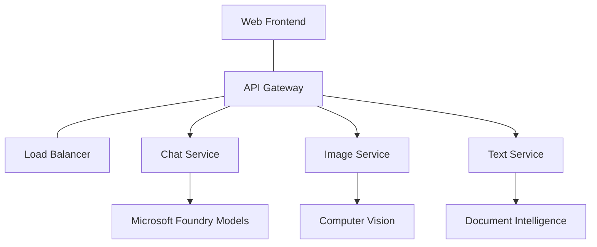

# Prakse za najboljše delo z AI v produkciji z AZD

**Navigacija po poglavjih:**
- **📚 Domača stran tečaja**: [AZD za začetnike](../../README.md)
- **📖 Trenutno poglavje**: Poglavje 8 - Producentni & Enterprise vzorci
- **⬅️ Prejšnje poglavje**: [Poglavje 7: Odpravljanje težav](../chapter-07-troubleshooting/debugging.md)
- **⬅️ Prav tako povezano**: [Delavnica AI Laboratorij](../chapter-02-ai-development/ai-workshop-lab.md)
- **🎯 Zaključek tečaja**: [AZD za začetnike](../../README.md)

## Pregled

Ta vodnik pojasnjuje produktivne AI oblikovne vzorce z uporabo ukazne vrstice Azure Developer CLI (AZD). Gre za oblikovni referenčni okvir, ne pa za nameščljivo aplikacijo ali produkcijsko certifikacijo.

**Meje primerov:** Razen če ni izrecno opisano kot popolno, Bicep fragmenti predvidevajo parametre in referencirane vire iz vsebinske predloge. Izpuščajo gostiteljske slike/plane, identitete, dodelitve vlog, DNS, izhode in drugo potrebno integracijo. YAML službene poti in skripte za hook/test so ilustrativne datoteke za ustvarjanje v **vaši lastni aplikaciji**; niso priložene v tem tečaju. Uporabite delujoč AZD vzorec kot osnovo, sestavite celotno infrastrukturo in jo preizkusite v izoliranem okolju pred uporabo v produkciji.

## Ključni izzivi, ki jih naslovimo

Pogoste skrbi v produkciji vključujejo večstoritvene namestitve, upravljanje identitet in skrivnosti, skaliranje, stroškovni nadzor ter spremljanje. Tu ni trditev o izmerjeni pogostosti.

## Arhitekturni vzorci za produkcijski AI

### Vzorec 1: Arhitektura AI mikro storitev

**Kdaj uporabiti**: Kompleksne AI aplikacije z več funkcionalnostmi



**Implementacija z AZD**:

```yaml
# azure.yaml
name: enterprise-ai-platform
services:
  web:
    project: ./web
    host: staticwebapp
  api-gateway:
    project: ./api-gateway
    host: containerapp
  chat-service:
    project: ./services/chat
    host: containerapp
  vision-service:
    project: ./services/vision
    host: containerapp
  text-service:
    project: ./services/text
    host: containerapp
```

### Vzorec 2: Dogodkovno vodeno AI procesiranje

**Kdaj uporabiti**: Paketno obdelavo, analizo dokumentov, asinhrone delovne tokove

```bicep
// Event Hub for AI processing pipeline
resource eventHub 'Microsoft.EventHub/namespaces@2024-01-01' = {
  name: eventHubNamespaceName
  location: location
  sku: {
    name: 'Standard'
    tier: 'Standard'
    capacity: 1
  }
}

// Service Bus for reliable message processing
resource serviceBus 'Microsoft.ServiceBus/namespaces@2024-01-01' = {
  name: serviceBusNamespaceName
  location: location
  sku: {
    name: 'Premium'
    tier: 'Premium'
    capacity: 1
  }
}

// Function App for processing
resource functionApp 'Microsoft.Web/sites@2023-01-01' = {
  name: functionAppName
  location: location
  kind: 'functionapp,linux'
  properties: {
    siteConfig: {
      appSettings: [
        {
          name: 'FUNCTIONS_EXTENSION_VERSION'
          value: '~4'
        }
        {
          name: 'AZURE_OPENAI_ENDPOINT'
          value: '@Microsoft.KeyVault(VaultName=${keyVault.name};SecretName=openai-endpoint)'
        }
      ]
    }
  }
}
```

Ta vzorec ustvari prekide imenskih prostorov, ne vozlišč, čakalnih vrst, naročnin ali sprožilcev Functions. Za izvedljivo funkcijo je potreben gostiteljski načrt, konfiguracija runtime/shranjevanja, pripeta identiteta, RBAC in dostop do omrežja. Referenca Key Vault zahteva dovoljenje za branje skrivnosti; URL končne točke sam po sebi ni poverilnica.

## Razmišljanje o zdravju AI agenta

Ko se tradicionalna spletna aplikacija pokvari, so simptomi znani: stran se ne naloži, API vrne napako ali namestitev ne uspe. AI-podprte aplikacije se lahko pokvarijo na enake načine — a se lahko tudi nepravilno obnašajo na subtilnejše načine, ki ne pokažejo očitnih sporočil o napaki.

Ta razdelek vam pomaga zgraditi mentalni model spremljanja AI delovnih obremenitev, da boste vedeli, kje iskati, če se zdi, da nekaj ni v redu.

### Kako se zdravje agenta razlikuje od zdravja tradicionalne aplikacije

Tradicionalne aplikacije lahko prav tako doživljajo subtilne neuspehe pravilnosti. AI agent uvaja nedeterministično kakovost odgovorov poleg običajnih skrbi glede razpoložljivosti in pravilnosti. Zdravje agenta lahko razumemo v dveh plasteh:

| Plast | Na kaj paziti | Kje iskati |
|-------|--------------|---------------|
| **Zdravje infrastrukture** | Ali storitev deluje? Ali so viri zagotovljeni? Ali so končne točke dosegljive? | `azd monitor`, stanje vira v Azure portalu, dnevnik kontejnerja/aplikacije |
| **Zdravje vedenja** | Ali agent pravilno odgovarja? So odgovori pravočasni? Ali je klic modela pravilen? | sledi Application Insights, meritve zakasnitve klica modela, dnevniki kakovosti odgovorov |

Zdravje infrastrukture je znano — isto velja za vse aplikacije azd. Zdravje vedenja je nova plast, ki jo uvajajo AI delovne obremenitve.

### Kje iskati, ko se AI aplikacije ne obnašajo kot pričakovano

Če vaša AI aplikacija ne daje pričakovanih rezultatov, je tu konceptualni kontrolni seznam:

1. **Začnite z osnovami.** Ali aplikacija deluje? Ali lahko doseže svoje odvisnosti? Preverite `azd monitor` in stanje vira tako kot pri kateri koli aplikaciji.
2. **Preverite povezavo z modelom.** Ali vaša aplikacija uspešno kliče AI model? Neuspešni ali pretečeni klici modela so najpogostejši vzrok težav pri AI aplikacijah in bodo vidni v dnevnikih vaše aplikacije.
3. **Varnostno preglejte vhodne podatke in podlage.** Napačni odgovori lahko izhajajo iz pridobivanja, navodil, omejitev modela ali izvrševanja orodij. Uporabljajte diagnostične podatke z nadzorovanim dostopom in rdeče označene; ne omogočajte nediskriminatornega beleženja pozivov/odgovorov v produkciji.
4. **Preglejte zamudo odgovorov.** Klici AI modelov so počasnejši od običajnih API klicev. Če se zdi, da je aplikacija počasna, preverite, ali se je čas odziva modela povečal — to lahko kaže na omejitve, preobremenjenost ali regijsko zasičenost.
5. **Bodite pozorni na signale stroškov.** Nenadni skoki v uporabi tokenov ali API klicih lahko kažejo na zanko, nepravilno konfiguriran poziv ali prekomerno ponavljanje.

Ni vam treba takoj obvladati orodij za opazovanje. Ključni zaključek je, da AI aplikacije uvajajo dodaten sloj vedenja za spremljanje, in vgrajeno spremljanje azd (`azd monitor`) vam daje izhodišče za raziskovanje obeh slojev.

---

## Najboljše varnostne prakse

### 1. Model varnosti z ničelnim zaupanjem (Zero-Trust)

**Strategija implementacije**:
- Brez komunikacije med storitvami brez overjanja
- Vsi API klici uporabljajo upravljane identitete
- Omrežna izolacija z zasebnimi končnimi točkami
- Nadzor dostopa z najmanjšimi pravicami

```bicep
// Managed Identity for each service
resource chatServiceIdentity 'Microsoft.ManagedIdentity/userAssignedIdentities@2023-01-31' = {
  name: 'chat-service-identity'
  location: location
}

// Role assignments with minimal permissions
resource openAIUserRole 'Microsoft.Authorization/roleAssignments@2022-04-01' = {
  scope: openAIAccount
  name: guid(openAIAccount.id, chatServiceIdentity.id, '5e0bd9bd-7b93-4f28-af87-19fc36ad61bd')
  properties: {
    roleDefinitionId: subscriptionResourceId('Microsoft.Authorization/roleDefinitions', '5e0bd9bd-7b93-4f28-af87-19fc36ad61bd')
    principalId: chatServiceIdentity.properties.principalId
    principalType: 'ServicePrincipal'
  }
}
```

### 2. Varnostno upravljanje skrivnosti

**Vzorec integracije Key Vault**:

```bicep
// Key Vault with proper access policies
resource keyVault 'Microsoft.KeyVault/vaults@2023-02-01' = {
  name: keyVaultName
  location: location
  properties: {
    tenantId: tenant().tenantId
    sku: {
      family: 'A'
      name: 'standard' // Premium is needed for HSM-backed keys, not ordinary secrets
    }
    enableRbacAuthorization: true  // Use RBAC instead of access policies
    enablePurgeProtection: true    // Prevent accidental deletion
    enableSoftDelete: true
    softDeleteRetentionInDays: 90
  }
}

// Optional legacy key-auth alternative; omit when using Entra ID.
resource openAIKeySecret 'Microsoft.KeyVault/vaults/secrets@2023-02-01' = {
  parent: keyVault
  name: 'openai-api-key'
  properties: {
    value: openAIAccount.listKeys().key1
    attributes: {
      enabled: true
    }
  }
}
```

Dodelite identiteto runtime `Key Vault Secrets User` na ustreznem obsegu in jo pripnite gostitelju; `enableRbacAuthorization` sam po sebi ne daje dostopa. Raje uporabite upravljano identiteto OpenAI z `disableLocalAuth: true`. Izbirni ključ skrivnosti smisel ima le za namenoma omogočen račun, ustvarjalec profila pa mora imeti dovoljenje za pisanje skrivnosti.

### 3. Omrežna varnost

**Konfiguracija zasebnih končnih točk**:

```bicep
// Virtual Network for AI services
resource virtualNetwork 'Microsoft.Network/virtualNetworks@2023-04-01' = {
  name: vnetName
  location: location
  properties: {
    addressSpace: {
      addressPrefixes: ['10.0.0.0/16']
    }
    subnets: [
      {
        name: 'ai-services-subnet'
        properties: {
          addressPrefix: '10.0.1.0/24'
          privateEndpointNetworkPolicies: 'Disabled'
        }
      }
      {
        name: 'app-services-subnet'
        properties: {
          addressPrefix: '10.0.2.0/24'
          delegations: [
            {
              name: 'Microsoft.Web/serverFarms'
              properties: {
                serviceName: 'Microsoft.Web/serverFarms'
              }
            }
          ]
        }
      }
    ]
  }
}

// Private endpoints for all AI services
resource openAIPrivateEndpoint 'Microsoft.Network/privateEndpoints@2023-04-01' = {
  name: '${openAIAccountName}-pe'
  location: location
  properties: {
    subnet: {
      id: virtualNetwork.properties.subnets[0].id
    }
    privateLinkServiceConnections: [
      {
        name: 'openai-connection'
        properties: {
          privateLinkServiceId: openAIAccount.id
          groupIds: ['account']
        }
      }
    ]
  }
}
```

Zasebne končne točke zahtevajo tudi zasebne skupine DNS con/povezave VNet in integracijo aplikacije v VNet. Same po sebi ne blokirajo javnega dostopa: javni dostop AI računa izklopite šele po potrditvi zasebne povezljivosti in dostopa do namestitve.

## Zmogljivost in skaliranje

### 1. Strategije samodejnega skaliranja

**Samodejno skaliranje Container Apps**:

```bicep
resource containerApp 'Microsoft.App/containerApps@2023-05-01' = {
  name: containerAppName
  location: location
  properties: {
    configuration: {
      ingress: {
        external: true
        targetPort: 8000
        transport: 'http'
      }
    }
    template: {
      scale: {
        minReplicas: 2  // Always have 2 instances minimum
        maxReplicas: 50 // Scale up to 50 for high load
        rules: [
          {
            name: 'http-scaling'
            http: {
              metadata: {
                concurrentRequests: '20'  // Scale when >20 concurrent requests
              }
            }
          }
          {
            name: 'cpu-scaling'
            custom: {
              type: 'cpu'
              metadata: {
                type: 'Utilization'
                value: '70'  // Scale when CPU >70%
              }
            }
          }
        ]
      }
    }
  }
}
```

### 2. Strategije predpomnjenja

**Redis predpomnilnik za AI odzive**:

```bicep
// Legacy Azure Cache for Redis example (not recommended for new deployments)
resource redisCache 'Microsoft.Cache/redis@2023-04-01' = {
  name: redisCacheName
  location: location
  properties: {
    sku: {
      name: 'Premium'
      family: 'P'
      capacity: 1
    }
    enableNonSslPort: false
    minimumTlsVersion: '1.2'
    redisConfiguration: {
      'maxmemory-policy': 'allkeys-lru'
    }
    // Sharding distributes data; replication/failover provides availability.
    shardCount: 2
  }
}

// Cache configuration in application
var cacheConnectionString = '${redisCache.properties.hostName}:6380,password=${redisCache.listKeys().primaryKey},ssl=True,abortConnect=False'
```

Azure Cache for Redis Basic/Standard/Premium je na [poti do ukinitve](https://learn.microsoft.com/azure/azure-cache-for-redis/retirement-faq). Za nove zasnove uporabljajte Azure Managed Redis in njegovo dokumentirano konfiguracijo SKU, identitete in TLS, namesto da kopirate ta zapuščinski vir v nov produkcijski sistem. Vrstica z nizom povezave je nepomembno nadomestilo, ne poverilnica. Ključe predpomnilnika razdelite po avtorizaciji, modelu/navodilih in različici pridobivanja, z datumom poteka; skupni predpomnilnik samo za poizvedbe lahko razkrije podatke drugih uporabnikov.

### 3. Uravnoteženje obremenitve in upravljanje prometa

**Aplikacijski Gateway z WAF**:

```bicep
// Application Gateway with Web Application Firewall
resource applicationGateway 'Microsoft.Network/applicationGateways@2023-04-01' = {
  name: appGatewayName
  location: location
  properties: {
    sku: {
      name: 'WAF_v2'
      tier: 'WAF_v2'
      capacity: 2
    }
    webApplicationFirewallConfiguration: {
      enabled: true
      firewallMode: 'Prevention'
      ruleSetType: 'OWASP'
      ruleSetVersion: '3.2'
    }
    // Backend pools for AI services
    backendAddressPools: [
      {
        name: 'ai-services-pool'
        properties: {
          backendAddresses: [
            {
              fqdn: '${containerApp.properties.configuration.ingress.fqdn}'
            }
          ]
        }
      }
    ]
  }
}
```

To je delni vir gatewayja: prava namestitev zahteva tudi konfiguracijo podsistema/gatewaja IP, frontend IP in porte, TLS poslušalce/sertifikate, nastavitve/probe backend HTTP, pravila usmerjanja in prioritete ter pregledano WAF politiko. TLS ime gostitelja/SNI in overjanje morata ustrezati backendu Container App.

## 💰 Optimizacija stroškov

### 1. Pravilna velikost virov

**Nastavitve za specifično okolje**:

Ta imena so **prikazni vhodi po meri v predlogi**, ne samodejne nastavitve AZD. Vsak naj se preslika v `infra/main.parameters.json`/Bicep in konfiguracijo gostitelja najprej. Na primer vzorec RAG uporablja `AZURE_SEARCH_SERVICE_SKU` in `AZURE_OPENAI_CHATGPT_DEPLOYMENT_CAPACITY`, ne splošnih imen spodaj. Za Container Apps dodelite pomnilnik s podprto enoto, kot je `1Gi` znotraj dejanskega vira. Infrastrukturistične spremembe uporabite z `azd up` ali `azd provision`; samo `azd deploy` ne uporablja Bicep sprememb.

```bash
# Development environment
azd env new development
azd env set AZURE_OPENAI_SKU "S0"
azd env set AZURE_OPENAI_CAPACITY 10
azd env set AZURE_SEARCH_SKU "basic"
azd env set CONTAINER_CPU 0.5
azd env set CONTAINER_MEMORY 1.0

# Production environment  
azd env new production
azd env set AZURE_OPENAI_SKU "S0"
azd env set AZURE_OPENAI_CAPACITY 100
azd env set AZURE_SEARCH_SKU "standard"
azd env set CONTAINER_CPU 2.0
azd env set CONTAINER_MEMORY 4.0
```

### 2. Spremljanje stroškov in proračuni

```bicep
// Supply the first day of the current UTC month, e.g. 2026-11-01T00:00:00Z.
param budgetStartDate string

// Cost management and budgets
resource budget 'Microsoft.Consumption/budgets@2024-08-01' = {
  name: 'ai-workload-budget'
  properties: {
    timePeriod: {
      startDate: budgetStartDate
    }
    timeGrain: 'Monthly'
    amount: 2000  // In the billing currency, not necessarily USD
    category: 'Cost'
    notifications: {
      warning: {
        enabled: true
        operator: 'GreaterThan'
        threshold: 80
        contactEmails: [
          'finance@company.com'
          'engineering@company.com'
        ]
        contactRoles: [
          'Owner'
          'Contributor'
        ]
      }
      critical: {
        enabled: true
        operator: 'GreaterThan'
        threshold: 95
        contactEmails: [
          'cto@company.com'
        ]
      }
    }
  }
}
```

Zamenjajte vzorne prejemnike in preverite obseg/dovoljenja. Alarmi proračuna uporabljajo zamujene obračunske podatke in ne uveljavljajo omejitve porabe.

### 3. Optimizacija rabe tokenov

**Upravljanje stroškov OpenAI**:

To je le heuristika na osnovi znakov za predogled uporabniškega vmesnika, **ne** validator omejitve modelnih tokenov. Produkcijska koda mora uporabljati razčlenjevalnik, primeren za nameščeni model in upoštevati sistemska navodila, orodne sheme, zgodovino in proračun izhoda. Preveliko uporabniško sporočilo zavrnite raje kot tiho skrajšajte.

```typescript
// Application-level token optimization
class TokenOptimizer {
  private readonly maxTokens = 4000;
  private readonly reserveTokens = 500;
  
  optimizePrompt(userInput: string, context: string): string {
    const availableTokens = this.maxTokens - this.reserveTokens;
    if (this.estimateTokens(userInput) + 8 >= availableTokens) {
      throw new Error("User input exceeds the illustrative prompt budget");
    }
    const estimatedTokens = this.estimateTokens(userInput + context) + 8;
    
    if (estimatedTokens > availableTokens) {
      // Truncate context, not user input
      context = this.truncateContext(context, Math.max(0, availableTokens - this.estimateTokens(userInput) - 8));
    }
    
    return `${context}\n\nUser: ${userInput}`;
  }
  
  private estimateTokens(text: string): number {
    // Rough estimation: 1 token ≈ 4 characters
    return Math.ceil(text.length / 4);
  }

  private truncateContext(text: string, estimatedBudget: number): string {
    return text.slice(0, Math.max(0, estimatedBudget) * 4);
  }
}
```

## Spremljanje in vidljivost

### 1. Celoviti Application Insights

```bicep
// Application Insights with advanced features
resource applicationInsights 'Microsoft.Insights/components@2020-02-02' = {
  name: applicationInsightsName
  location: location
  kind: 'web'
  properties: {
    Application_Type: 'web'
    WorkspaceResourceId: logAnalyticsWorkspace.id
    SamplingPercentage: 100  // Ingestion setting; review cost and SDK sampling separately
    DisableIpMasking: false  // Retain IP masking
  }
}

// Custom metrics for AI operations
resource aiMetricAlerts 'Microsoft.Insights/metricAlerts@2018-03-01' = {
  name: 'ai-high-error-rate'
  location: 'global'
  properties: {
    description: 'Alert when failed request count exceeds 10 in five minutes'
    severity: 2
    enabled: true
    scopes: [
      applicationInsights.id
    ]
    evaluationFrequency: 'PT1M'
    windowSize: 'PT5M'
    criteria: {
      'odata.type': 'Microsoft.Azure.Monitor.SingleResourceMultipleMetricCriteria'
      allOf: [
        {
          name: 'high-error-rate'
          metricName: 'requests/failed'
          operator: 'GreaterThan'
          threshold: 10
          timeAggregation: 'Count'
        }
      ]
    }
  }
}
```

### 2. AI-specifično spremljanje

**Prilagojene nadzorne plošče za AI metrike**:

```json
{
  "dashboard": {
    "name": "AI Application Monitoring",
    "tiles": [
      {
        "name": "OpenAI Request Volume",
        "query": "dependencies | where target contains 'openai' | summarize count() by bin(timestamp, 5m)"
      },
      {
        "name": "AI Response Latency",
        "query": "dependencies | where target contains 'openai' | summarize avg(duration) by bin(timestamp, 5m)"
      },
      {
        "name": "Token Usage",
        "query": "customMetrics | where name == 'openai_tokens_used' | summarize sum(value) by bin(timestamp, 1h)"
      },
      {
        "name": "Cost per Hour",
        "query": "customMetrics | where name == 'openai_cost' | summarize sum(value) by bin(timestamp, 1h)"
      }
    ]
  }
}
```

Ta JSON je skica, definirana z aplikacijo, ne uvozni model za Azure portal nadzorno ploščo. Poizvedbe po tokenih/stroških zahtevajo, da vaša aplikacija pošilja točne prilagojene meritve; niso ustvarjene z AZD. Prilagodite filtre odvisnosti za dejanske modelne končne točke/poimenovanja razpona.

### 3. Preverjanje zdravja in spremljanje uptime

```bicep
// Application Insights availability tests
resource availabilityTest 'Microsoft.Insights/webtests@2022-06-15' = {
  name: 'ai-app-availability-test'
  location: location
  tags: {
    'hidden-link:${applicationInsights.id}': 'Resource'
  }
  properties: {
    SyntheticMonitorId: 'ai-app-availability-test'
    Name: 'AI Application Availability Test'
    Description: 'Tests AI application endpoints'
    Enabled: true
    Frequency: 300  // 5 minutes
    Timeout: 120    // 2 minutes
    Kind: 'standard'
    Locations: [
      {
        Id: 'us-east-2-azr'
      }
      {
        Id: 'us-west-2-azr'
      }
    ]
    Request: {
      RequestUrl: 'https://${webApp.properties.defaultHostName}/health'
      HttpVerb: 'GET'
      FollowRedirects: true
      ParseDependentRequests: false
    }
    ValidationRules: {
      ExpectedHttpStatusCode: 200
      SSLCheck: true
      SSLCertRemainingLifetimeCheck: 7
    }
  }
}
```

## Obnova ob nesrečah in visoka razpoložljivost

Preizkus predvideva obstoječ App Service `webApp` in vir Application Insights. Standardni preizkusi razpoložljivosti so zaračunljivi in zahtevajo dosegljivo končno točko; samo zasebne aplikacije potrebujejo ustrezno zasnovo zasebnega spremljanja. URL ping preizkusi so zastareli; uporabite [standardne preizkuse razpoložljivosti](https://learn.microsoft.com/azure/azure-monitor/app/availability).

### 1. Namestitev v več regijah

```yaml
# azure.yaml - Multi-region configuration
name: ai-app-multiregion
services:
  api-primary:
    project: ./api
    host: containerapp
    env:
      AZURE_REGION: eastus
  api-secondary:
    project: ./api
    host: containerapp
    env:
      AZURE_REGION: westus2
```

```bicep
// Separate App Service topology, not the Container Apps declarations above
resource trafficManager 'Microsoft.Network/trafficManagerProfiles@2022-04-01' = {
  name: trafficManagerProfileName
  location: 'global'
  properties: {
    profileStatus: 'Enabled'
    trafficRoutingMethod: 'Priority'
    dnsConfig: {
      relativeName: trafficManagerProfileName
      ttl: 30
    }
    monitorConfig: {
      protocol: 'HTTPS'
      port: 443
      path: '/health'
      intervalInSeconds: 30
      toleratedNumberOfFailures: 3
      timeoutInSeconds: 10
    }
    endpoints: [
      {
        name: 'primary-endpoint'
        type: 'Microsoft.Network/trafficManagerProfiles/azureEndpoints'
        properties: {
          targetResourceId: primaryAppService.id
          endpointStatus: 'Enabled'
          priority: 1
        }
      }
      {
        name: 'secondary-endpoint'
        type: 'Microsoft.Network/trafficManagerProfiles/azureEndpoints'
        properties: {
          targetResourceId: secondaryAppService.id
          endpointStatus: 'Enabled'
          priority: 2
        }
      }
    ]
  }
}
```

Okoljske spremenljivke ne določajo lokacije virov. IaC mora zagotoviti ločene regionalne gostitelje in vezati vsako storitev s oznakami `resourceName` ali `azd-service-name`. Primer Traffic Managerja je **loča topologija App Servisa** (`primaryAppService`/`secondaryAppService`), ne usmerjanje za deklaracije Container Apps. Container Apps zahteva ustrezno konfigurirano zunanjo točko/vhodna vrata, TLS/lastno usmerjanje domen in zdravstvene preizkuse.

### 2. Varnostno kopiranje in obnova podatkov

```bicep
// Backup configuration for critical data
resource backupVault 'Microsoft.DataProtection/backupVaults@2023-05-01' = {
  name: backupVaultName
  location: location
  identity: {
    type: 'SystemAssigned'
  }
  properties: {
    storageSettings: [
      {
        datastoreType: 'VaultStore'
        type: 'LocallyRedundant'
      }
    ]
  }
}

```

Sam vault ne naredi varnostne kopije. Konfigurirajte **delovno obremenitveno podporno politiko in varnostno kopijo**, dovoljenja vira, hrambo in preizkuse obnove z uporabo [matrike podpore Azure Backup](https://learn.microsoft.com/azure/backup/backup-support-matrix). Ni splošne politike Azure Backup za gostujoče namestitve Azure OpenAI modelov. Definicije infrastrukture/modela naj bodo v nadzoru vira; zaščitite naložene dokumente, aplikacijske podatke in artefakte za fino nastavljanje z uporabo funkcij podpore varnostne kopije/izvoza vsakega podpornega servisa. Izrecno določite in preizkusite RPO/RTO.

## Integracija DevOps in CI/CD

### 1. GitHub Actions potek dela

```yaml
# .github/workflows/deploy-ai-app.yml
name: Deploy AI Application

on:
  push:
    branches: [main]
  pull_request:
    branches: [main]

jobs:
  test:
    runs-on: ubuntu-latest
    steps:
      - uses: actions/checkout@v4
      
      - name: Setup Python
        uses: actions/setup-python@v4
        with:
          python-version: '3.11'
          
      - name: Install dependencies
        run: |
          pip install -r requirements.txt
          pip install pytest
          
      - name: Run tests
        run: pytest tests/
        
      - name: AI Safety Tests
        run: |
          python scripts/test_ai_safety.py
          python scripts/validate_prompts.py

```

To je **samo testni del** poteka dela in predvideva, da ste ustvarili `requirements.txt`, `tests/` in dve varnostni skripti. Dodajte overjene naloge za upravljanje/provizijo OIDC iz [Nastavitve CI/CD cevi](#cicd-pipeline-configuration), z `needs: test`, zaupanja vrednim sprožilcem push/ročno, in zaščitenimi okolji GitHub. Ne nameščajte nezaupljive kode iz pull-requestov z oblačnimi poverilnicami. Svež izvajalec nima izbranega lokalnega AZD okolja; zagotovite vnose za okolje/številko naročnine/lokacijo in uporabite `azd auth login`, ne samo `azure/login`.

### 2. Validacija infrastrukture

```bash
# scripts/validate_infrastructure.sh
#!/bin/bash
set -euo pipefail

echo "Validating AI infrastructure deployment..."

# Requires Azure CLI login and the resource group selected explicitly.
: "${AZURE_RESOURCE_GROUP:?Set AZURE_RESOURCE_GROUP}"
: "${AZURE_OPENAI_NAME:?Set AZURE_OPENAI_NAME}"
: "${AZURE_OPENAI_CHAT_DEPLOYMENT:?Set the actual deployment name}"

# A successful empty list is not proof that resources exist.
types=("Microsoft.CognitiveServices/accounts" "Microsoft.Search/searchServices"
       "Microsoft.Storage/storageAccounts" "Microsoft.KeyVault/vaults")
for resource_type in "${types[@]}"; do
    count=$(az resource list --resource-group "$AZURE_RESOURCE_GROUP" \
        --resource-type "$resource_type" --query "length(@)" -o tsv)
    if [[ "$count" -lt 1 ]]; then
        echo "ERROR: No $resource_type found in $AZURE_RESOURCE_GROUP"
        exit 1
    fi
done

# Validate OpenAI model deployments
echo "Validating OpenAI model deployments..."
state=$(az cognitiveservices account deployment show \
  --name "$AZURE_OPENAI_NAME" --resource-group "$AZURE_RESOURCE_GROUP" \
  --deployment-name "$AZURE_OPENAI_CHAT_DEPLOYMENT" \
  --query "properties.provisioningState" -o tsv)
if [[ "$state" != "Succeeded" ]]; then
    echo "ERROR: Required model deployment is not provisioned successfully"
    exit 1
fi

echo "Infrastructure validation completed successfully!"
```

Pričakovano: ničelna koda izhoda in sporočilo o zaključku samo, če obstajajo vsi pričakovani tipi in je dodeljena imenovana namestitev modela. To preverja stanje inventarja/provizije, **ne** zdravje vira, natančno topologijo, RBAC, dosegljivost omrežja ali vedenje modela. Prilagodite pričakovane tipe vaši arhitekturi, nato izvedite ločen overjeni test pripravljenosti aplikacije.

## Kontrolni seznam pripravljenosti za produkcijo

### Varnost ✅
- [ ] Vse storitve uporabljajo upravljane identitete
- [ ] Skrivnosti so shranjene v Key Vault
- [ ] Zasebne končne točke so konfigurirane
- [ ] Implementirane so skupine omrežne varnosti
- [ ] RBAC z najmanjše pravice
- [ ] WAF omogočen na javnih končnih točkah

### Zmogljivost ✅
- [ ] Samodejno skaliranje konfigurirano
- [ ] Predpomnjenje implementirano
- [ ] Nastavljeno uravnoteženje obremenitve
- [ ] CDN za statično vsebino
- [ ] Povezovanje podatkovnih baz v sklade
- [ ] Optimizacija uporabe tokenov

### Spremljanje ✅
- [ ] Konfiguriran Application Insights
- [ ] Definirane prilagojene meritve
- [ ] Nastavljena pravila opozoril
- [ ] Ustvarjena nadzorna plošča
- [ ] Implementirani zdravstveni pregledi
- [ ] Politike hrambe dnevnikov

### Zanesljivost ✅
- [ ] Namestitev v več regijah
- [ ] Načrt varnostnih kopij in obnov
- [ ] Implementirani circuit breaker-ji
- [ ] Konfigurirane politike ponovnih poizkusov
- [ ] Prijazno degradiranje
- [ ] Končne točke zdravstvenih pregledov

### Upravljanje stroškov ✅
- [ ] Nastavljeni opozorilniki proračuna
- [ ] Pravilna velikost virov
- [ ] Uporabniški popusti za razvoj/testiranje
- [ ] Nakup rezerviranih primerkov
- [ ] Nadzorna plošča za stroške
- [ ] Redni pregledi stroškov

### Skladnost ✅
- [ ] Izpolnjene zahteve za lokacijo podatkov
- [ ] Omogočeno beleženje revizijskih dogodkov
- [ ] Uveljavljene skladnostne politike
- [ ] Implementirane varnostne osnovne nastavitve
- [ ] Redne varnostne ocene
- [ ] Načrt odziva na incidente

## Merila zmogljivosti

### Ilustrativni produkcijski cilji

To so primeri SLO-jev za pogajanja in load-testiranje, ne izmerjeni kriteriji ali garancije. Zamuda odziva je odvisna od modela/dolžine izhoda; mesečna poraba tokenov je odvisna od prometa in cen, ne samo od števila tokenov.

| Merilo | Cilj | Spremljanje |
|--------|--------|------------|
| **Čas odziva** | < 2 sekundi | Application Insights |
| **Razpoložljivost** | 99,9 % | Spremljanje uptime |
| **Stopnja napak** | < 0,1 % | Dnevniki aplikacije |
| **Poraba modela** | < 500 $/mesec (vzorec proračuna) | Upravljanje stroškov |
| **Sočasni uporabniki** | 1000+ | Testiranje obremenitve |
| **Čas okrevanja** | < 1 ura | Preizkusi oskrbe po nesrečah |

### Preizkušanje obremenitve

Spodaj je skica vmesnika za skripto za preizkušanje obremenitve, ki jo **morate implementirati**; ta repozitorij ne zagotavlja `scripts/load_test.py`. Pred zagonom v svojem orodju za preizkušanje obremenitve definirajte vsebine zahtevkov, preverjanje pristnosti, reprezentativne obremenitve, trditve o latenci/predenostih napak ter zgornjo mejo stroškov:

```bash
# Load testing script for AI applications
python scripts/load_test.py \
  --endpoint https://your-ai-app.azurewebsites.net \
  --concurrent-users 100 \
  --duration 300 \
  --ramp-up 60
```

## 🤝 Najboljše prakse skupnosti

Na podlagi povratnih informacij iz skupnosti Microsoft Foundry Discord:

### Najpomembnejša priporočila skupnosti:

1. **Začnite z malim, postopoma povečujte**: Začnite z osnovnimi SKU-ji in povečujte glede na dejansko uporabo
2. **Nadzorujte vse**: Vzpostavite celovit nadzor že od prvega dne
3. **Avtomatizirajte varnost**: Uporabljajte infrastrukturo kot kodo za dosledno varnost
4. **Temeljito testirajte**: Vključite AI-specifično testiranje v vaše procese
5. **Načrtujte stroške**: Spremljajte uporabo tokenov in zgodaj nastavite opozorila o proračunu

### Pogoste napake, ki se jih je treba izogibati:

- ❌ Trdo kodiranje API ključev v kodi
- ❌ Nepravilno nastavljen nadzor
- ❌ Ignoriranje optimizacije stroškov
- ❌ Ne testiranje scenarijev napak
- ❌ Razmestitev brez preverjanj zdravja

## AZD AI CLI ukazi in razširitve

AZD vključuje naraščajoč nabor AI-specifičnih ukazov in razširitev, ki poenostavljajo produkcijske delovne tokove AI. Ta orodja premoščajo vrzel med lokalnim razvojem in produkcijsko razmestitvijo AI obremenitev.

> **Pregled različice (2026-11-04):** Spodnje smernice CLI so bile preverjene z objavljenimi različicami `azd` **1.37.2**, `azure.ai.agents` **1.0.0-beta.23** in `azure.ai.evaluations` **1.0.0-beta.2**. Agent beta.23 zahteva `azd >= 1.37.0`; evaluations beta.2 zahteva `azd >= 1.33.0`. Uporabite najmanj 1.37.0 za združen delovni tok. To je pregled dokumentacije/izvora, ne validacija žive Azure razmestitve.

### AZD razširitve za AI

AZD uporablja sistem razširitev za dodajanje AI-specifičnih zmogljivosti. Namestite in upravljajte razširitve z:

```bash
# List all available extensions (including AI)
azd extension list

# Inspect installed extension details
azd version
azd extension show azure.ai.agents

# Install the Foundry agents extension
azd extension install azure.ai.agents

# Install the separate Foundry evaluations extension
azd extension install azure.ai.evaluations

# Install the fine-tuning extension
azd extension install azure.ai.finetune

# Install the custom models extension
azd extension install azure.ai.models

# Upgrade all installed extensions
azd extension upgrade --all
```

**Razpoložljive AI razširitve:**

| Razširitev | Namen | Status |
|-----------|---------|--------|
| `azure.ai.agents` | Upravljanje Foundry Agent Service | Predogled |
| `azure.ai.evaluations` | Evalvacijski nabori, ocenjevalci, eval skupine in zagoni | Predogled |
| `azure.ai.skills` | Ponovno uporabne veščine agentov | Predogled |
| `azure.ai.connections` | Foundry povezave (viri podatkov, orodja) | Predogled |
| `azure.ai.finetune` | Dopolnjevanje Foundry modelov | Predogled |
| `azure.ai.models` | Uporabniški Foundry modeli | Predogled |
| `azure.coding-agent` | Konfiguracija kodirajočih agentov | Na voljo |

> Za ogled nameščenih različic zaženite `azd extension list --installed` in `azd extension show azure.ai.evaluations`. Najprej nadgradite jedro CLI po [navodilih za namestitev/nadgradnjo](https://learn.microsoft.com/azure/developer/azure-developer-cli/install-azd) (za Windows winget namestitev: `winget upgrade Microsoft.Azd`), nato zaženite `azd extension upgrade --all`. Ni jedrnega `azd upgrade` ukaza. Pred nadgradnjo produkcijske avtomatizacije preglejte spremembe, ki bi lahko prekinile delovanje; nadgradnja razširitve ne zagotavlja ohranitev starih oblik ukazov ali nastavitev.

### Nedavne spremembe in popravki izdaje

| Izdaja | Kaj se spremeni za ta tečaj |
|---------|------------------------------|
| `azd 1.37.0` | Dodaja stabilne API-je za deployment-predogled in popravlja prepisovanje nepovezanih nastavitev `azure.yaml` med urejanjem razširitev. |
| `azd 1.37.1` | Popravlja prenos Ctrl+C med razširitvami in ločuje preklic/casue timeout od splošnih napak. |
| `azd 1.37.2` | Izboljšuje validacijo provisioning-a: kritična opozorila so privzeto **Ne**, neuspeh brez potrditve pri nenadzorovanih zagonih in preklic preskoči post-provision hooke. Popravlja tudi nerešene vrednosti okolja v Deployment Stacks seznamih prepovedi, ko je ta alfa funkcija omogočena. |
| Agent beta `beta.22` | Migrira evaluacije na `azd ai eval`, spreminja optimizacijo na GA v1 API, zahteva množinsko `toolboxes`, in ločuje managed-harness, glas in dolgoročne predoglede prijave. Popravlja izbiro modelov za okolje in preverjanje pristnosti orodjarne. |
| Agent beta `beta.23` | Razkriva `init --harness`; popravlja izhod odgovorov A2A 0.3, neveljavne poti/module za agent-prompt prek plasti infrastrukture, diagnostiko časovne omejitve aktivacije in ohranjena opozorila za razvijalčevo RBAC. |
| Evaluations beta `beta.2` | Zahteva konfiguracijo evalvacije v camelCase, dodaja statično/simulirano avtorstvo pogovorov in eksplicitne lokalne vire datotek, ter popravlja ročne/analitične podatke o identiteti/verziji naborov, število kakovostnih vrat, in diagnostiko neuspešnih zagonov. |

Časovna omejitev aktivacije agenta **ne dokazuje** napake pri razmestitvi: preglejte poskušano različico in njen status pred ponovnim poskusom. Opozorila za razvijalčevo RBAC se lahko ohranijo tudi če provisioning uspe; pred klicem kot ta razvijalec odpravite manjkajoč dostop.

Viri: [AZD izdaje](https://github.com/Azure/azure-dev/releases), [agents beta.23 izdaja](https://github.com/Azure/azure-dev/releases/tag/azd-ext-azure-ai-agents_1.0.0-beta.23), [agents beta.22 migracija](https://github.com/Azure/azure-dev/releases/tag/azd-ext-azure-ai-agents_1.0.0-beta.22) in [evaluations beta.2 izdaja](https://github.com/Azure/azure-dev/releases/tag/azd-ext-azure-ai-evaluations_1.0.0-beta.2).

**Kaj sta novi razširitvi `skills` in `connections`?**

Dve predogledni razširitvi sta se pojavili skupaj z orodji za agente in ju je vredno razumeti tudi kot začetnik:

- **`azure.ai.skills`** — **Veščina** je ponovno uporabna zmogljivost (pakirano orodje ali vedenje), ki ga lahko pripnete na enega ali več agentov, namesto da bi jo vsakič znova implementirali. Pomislite nanjo kot na skupen gradnik: enkrat definirajte veščino »iskanje dokumentacije« ali »iskanje naročila« in jo večkrat uporabite med agenti. To ohranja sisteme več agentov (Poglavje 5) skladne in preprečuje kopiranje.
- **`azure.ai.connections`** — **Povezava** je upravljana povezava med vašim Foundry projektom in zunanjim virom, ki ga agenti potrebujejo – vir podatkov (npr. Azure AI Search), orodje, ali druga storitev. Povezave centralizirajo *kje* in *kako* agenti dostopajo do podatkov, zato poverilnice in končne točke živijo na enem nadzorovanem mestu, ne pa posuto po kodi.

Te razširitve ne potrebujete za razmestitev prvih agentov – držite se `azure.ai.agents` med učenjem. Uporabite `skills`, ko opažate podvajanje istega orodja med agenti, in `connections`, ko ima več agentov skupen vir podatkov.

### Inicializacija projektov agentov z `azd ai agent init`

Ukaz `azd ai agent init` postavi ogrodje projekta Microsoft Foundry agenta. Uporabite trenutni `azure.yaml` predlogo projekta, ne implicitni stari agent manifest:

```bash
# Initialize a new agent project from a local project template
azd ai agent init --template ./templates/support-agent/azure.yaml

# Initialize and target a specific Foundry project
azd ai agent init --template ./templates/support-agent/azure.yaml --project-id <foundry-project-id>

# Adopt the template into a different directory
azd ai agent init --template ./templates/support-agent/azure.yaml --src ./agents/my-agent
```

**Ključne zastavice:**

| Zastavica | Opis |
|------|-------------|
| `-t, --template` | Pot ali podprta GitHub URI do dokumenta projekta `azure.yaml` |
| `-p, --project-id` | Obstoječi Microsoft Foundry Project ID za vaše azd okolje |
| `-s, --src` | Izvorna mapa za ustvarjene agente ali ciljna mapa pri prevzemu projekta |
| `--kind` | Inicializira `hosted`, `prompt` ali predogledni `prompt-voice` agent |
| `--harness` | Izbirni izvršilni harness za `--kind prompt`; zahteva njegov predogledni opt-in |
| `-e, --environment` | Okolje azd za uporabo |

`--manifest`/`-m` je zastarela oznaka za `--template`/`-t`; preimenovanje zastavice ne pretvori starega manifesta v trenutni dokument projekta. `--host containerapp` ni trenutna zastavica agent-init. Za običajne aplikacije Container Apps uporabite `azd init --template` s predlogo, ki ima `host: containerapp`.

Za obstoječ projekt z natanko enim `azure.ai.project` servisom, `azd ai agent add support-agent --file ./agents/support-agent.yaml` doda ali posodobi direktno definicijo agenta brez provisioning-a ali razmestitve. Ukazi runtime zavrnejo stare implicitne `agent.yaml`/AgentManifest in vgrajene definicije servisa `config:`; migrirajte jih v trenutni `azure.ai.agent` servis. Ko init izpiše `cd` naslednji korak, ga izvedite pred `azd up`: init ne spremeni vaše trenutne mape lupine.

**Nasvet za produkcijo**: Uporabite `--project-id` za neposredno povezavo z obstoječim Foundry projektom, da od začetka povežete kodo in oblake vire svojega agenta.

#### Izbirne predogledne funkcije

Upravljani harness, glas in dolgoročni poklic so privzeto neodvisno onemogočeni. Nastavite samo stikalo za funkcijo, ki jo potrebujete, v **okolju lupine/CI procesa**, ne z `azd env set`:

| Funkcija | Spremenljivka okoljskega procesa |
|---------|------------------------------|
| Upravljani harness (`init --kind prompt --harness ...`) | `AZD_ALPHA_ENABLE_AGENTS_MANAGED_HARNESS=true` |
| Glas (`init --kind prompt-voice`) | `AZD_ALPHA_ENABLE_AGENTS_VOICE=true` |
| Dolgoročni poklic | `AZD_ALPHA_ENABLE_AGENTS_LONG_RUNNING=true` |

Na primer, uporabite `export AZD_ALPHA_ENABLE_AGENTS_MANAGED_HARNESS=true` v Bash ali `$env:AZD_ALPHA_ENABLE_AGENTS_MANAGED_HARNESS = "true"` v PowerShellu pred zagonom ustreznega ukaza. Ena stikala ne omogoča drugih. Oglejte si [README za izdane agente](https://github.com/Azure/azure-dev/blob/azd-ext-azure-ai-agents_1.0.0-beta.23/cli/azd/extensions/azure.ai.agents/README.md) za vsa predogledna stikala in omejitve.

### Upravljanje življenjskega cikla agentov

Uporabite `azure.ai.agents` za testiranje, pregled, optimizacijo in upokojitev agentov ter ločeno razširitev `azure.ai.evaluations` za merjenje kakovosti:

```bash
# Invoke a deployed agent and view server response timing
# (total latency and time to first byte)
azd ai agent invoke

# Show the live endpoint configuration before changing it
azd ai agent endpoint show

# Download the deployed source of a code-based hosted agent
# (with SHA-256 verification)
azd ai agent code download

# Delete a hosted agent and all of its versions
# (--force terminates active sessions)
azd ai agent delete --force
```

**Življenjski cikel na hitro:**

| Faza | Ukaz | Produkcijska uporaba |
|-------|---------|----------------|
| Test | `azd ai agent invoke` | Potrdite odzive in izmerite latenco pred izdajo |
| Pregled | `azd ai agent endpoint show` | Preglejte avtentikacijo/konfiguracijo končne točke; zgodaj zaznajte večje spremembe |
| Merjenje | `azd ai eval init`, `generate`, `run start` | Definirajte, razmestite in izvajajte ponovljive evaluacije |
| Izboljšanje | `azd ai agent optimize --eval <evaluation-name> --optimize-model <optimizer-deployment>` | Znova uporabite združljivo evaluacijo za optimizacijo agenta |
| Okrevanje | `azd ai agent code download` | Pridobite točno razmestljen izvor za revizijo/povrnitev |
| Upokojitev | `azd ai agent delete --force` | Čisto odstranite agenta in njegove različice |

> To so ukazi v predogledu in se lahko spremenijo med izdajami razširitev. Za prikaz natančnih podukazov v vaši nameščeni različici zaženite `azd ai agent --help`.

`endpoint show` podpira gostovane, promptne in glasovne agente, ampak posodobitve končne točke so samo gostovane; agenti v delovnem toku niso podprti. Prenos kode in zgornji primer upokojitve gostovanega agenta nista splošni operaciji za vsak tip agenta.

#### Migracija evaluacije in kakovostne preverbe

Začelo se je z agenti **1.0.0-beta.22 (2026-10-23)**, legacy `azd ai agent eval` ukazi namesto nekdanjega evaluacijskega delovnega toka nudijo smernice za migracijo. Ne kopirajte starih primerov `eval generate --dataset ...`: evalvacija zdaj živi pod **`azd ai eval`**.

V inicializiranem agentskem projektu se prijavite z `azd auth login`, potrdite izbrano okolje/Foundry projekt in namestite `azure.ai.evaluations`. Za ocenjevanje na osnovi modela je potrebna razmestitev modela sodnika; generacija in simulacija pogovora lahko zahtevata svoje izbire modelov in povzročita dodatne stroške.

```bash
# Scaffold evals/ and wire an azure.ai.eval service into azure.yaml
azd ai eval init

# Optionally synthesize a rubric and dataset from the agent
azd ai eval generate

# Review generated files, then register datasets, evaluators, and eval groups
azd up

# Start an evaluation and wait for its results
azd ai eval run start --wait

# Inspect runs and available test-case output
azd ai eval run list
azd ai eval run show <run-id>
azd ai eval run output list <run-id>
```

Sledite interaktivnim izbiro in izpisanim naslednjim korakom in ne predpostavljajte, da so generirani viri že registrirani. Konfiguracija evaluacije običajno živi v `evals/azure.eval.yaml`, nanjo se sklicuje storitev `azure.ai.eval` v `azure.yaml`. Ključi so **camelCase** (`evaluationLevel`, `maxSamples`, `initializationParameters`, `dataMapping`); stari ključi v snake_case konfiguraciji so zavrnjeni. Poti znotraj sklicane konfiguracije so relativne na to datoteko, ne na koren repozitorija.

Za evaluacije pogovorov izberite **statične**, da ocenite dokončane prepise brez klica agenta, ali **simulacijo**, da ustvarite pogovore iz scenarijskih začetkov. Simulacija potrebuje tarčo agenta, simulatorni model in ločeno izbiro modela sodnika. Za nenadzorovane ukaze zagotovite vnose opisane pri `azd ai eval init --help` in `azd ai eval generate --help`; ne predpostavljajte, da je generacijski model tudi sodnik ali simulator.

Za CI konfigurirajte eksplicitno kakovostno politiko z `azd ai eval run start --help` (`--fail-on`) in obravnavajte ne-nicelni izhod gostitelja kot neuspeh. Dokončan zagon ni samodejno kakovostni prehod. Preverite neuspele/napake vrstice in diagnostiko; manjkajoče ali nedosledne rezultate ni dokaz uspeha. Registrirani nabori ohranijo svojo identiteto/verzijo storitve; `--max-samples` ne more podmnožiti registriranega nabora. Objavite manjši nabor namensko ali uporabite podprt lokalni vir datotek.

```bash
# Example CI policy: at least 90% of all test cases must pass
azd ai eval run start --wait --fail-on "pass-rate=0.9"
```

Prehodna stopnja uporablja uspešne testne primere deljeno s skupnim številom testnih primerov; neuspešni, z napako, preskočeni in ostali neuspešni zapisi štejejo proti njej. Ne kombinirajte stopnji s `--no-wait`, ki vrne rezultat pred razpoložljivostjo sodbe.

#### Migracija konfiguracije optimizacije

Optimizacija zdaj uporablja GA v1 API. Za ponovno uporabo združljive **nivoa potez, podprte z nabori podatkov** evaluacije iz novega delovnega toka:

```bash
# Replace placeholders with the evaluation name and optimizer model deployment
azd ai agent optimize --eval-config ./evals/azure.eval.yaml --eval <evaluation-name> --optimize-model <optimizer-deployment>
```

`--eval` izbere oceno; `--eval-config` izbere konfiguracijsko datoteko (vključno z definicijami, ki podpirajo datoteke). `--config` namesto tega prejme **samostojen zahtevek za optimizacijo prek API** v YAML ali JSON. Ne pošiljajte starega agentu `eval.yaml` ali novega `azure.eval.yaml` v `--config` in ne kombinirajte `--config` z `--eval`/`--eval-config`. Pogovorne, sledljene ali simulirane ocene niso zamenljive s hitrim optimizacijskim ukazom, ki temelji na naboru podatkov; za te primere uporabite podprto obliko zahtevka za optimizacijo. Pred uporabo ali uvajanjem preglejte kandidate.

Oglejte si [referenco ocen za pregledano izdajo](https://github.com/Azure/azure-dev/blob/azd-ext-azure-ai-evaluations_1.0.0-beta.2/cli/azd/extensions/azure.ai.evaluations/README.md) in [izvor ukaza za optimizacijo za pregledano izdajo](https://github.com/Azure/azure-dev/blob/azd-ext-azure-ai-agents_1.0.0-beta.23/cli/azd/extensions/azure.ai.agents/internal/cmd/optimize.go) za natančne možnosti.

#### Predogled uvajanja gostujočega agenta samo za branje

Za obstoječe okolje, vezano na Foundry, z združeno storitvijo `azure.ai.agent` `kind: hosted`, primerjajte podprto konfiguracijo pred uvajanjem:

```bash
azd deploy <service-name> --preview --no-prompt
```

Ta predogled ne uvaja agenta. Ni popolna primerjava infrastrukture/varnosti: agenti za pozive/glasovne/izvedbene tokove, zastarele postavitve konfiguracije in nekateri gostujoči nastavitveni parametri so izven njegovega obsega. Rezultat `unknown` ni odobritev uvajanja. Ni samostojnega ukaza `azd ai agent deploy` ali agentov `--dry-run`; uporabite osnovni potek uvajanja.

### Protokol konteksta modela (MCP) z `azd mcp`

AZD vključuje vgrajeno podporo za MCP strežnik (alfa), ki omogoča AI agentom in orodjem, da komunicirajo z vašimi Azure viri preko standardiziranega protokola:

```bash
# Start the MCP server for your project
azd mcp start

# Review current Copilot consent rules for tool execution
azd copilot consent list
```

MCP strežnik razkriva kontekst vašega azd projekta — okolja, storitve in Azure vire — AI-pogonjenim razvojnim orodjem. To omogoča:

- **AI-podprto uvajanje**: Agenti za kodiranje lahko poizvedujejo stanje projekta in sprožijo uvajanja
- **Odkritje virov**: AI orodja lahko odkrijejo, katere Azure vire vaš projekt uporablja
- **Upravljanje okolij**: Agenti se lahko preklapljajo med dev/staging/production okolji

### Generiranje infrastrukture z `azd infra generate`

Za produkcijske AI delovne obremenitve lahko ustvarite in prilagodite infrastrukturo kot kodo, namesto da bi se zanašali na samodejno zagotavljanje:

```bash
# Generate supported infrastructure for this project type
azd infra generate
```

Podpora je odvisna od projekta/gostitelja in nameščenih ponudnikov; to ni splošni ukaz za inženiring na povratni način za poljubne Azure vire ali obljuba generiranja tako Bicep kot Terraform. Zaženite `azd infra generate --help` in preverite ustvarjeno obliko. Kjer je podprto, pisanje IaC na disk omogoča:
- Pregled in revizijo infrastrukture pred uvajanjem
- Dodajanje lastnih varnostnih pravilnikov (mrežna pravila, zasebni končni točki)
- Integracijo z obstoječimi postopki pregleda IaC
- Razširjanje sprememb infrastrukture ločeno od kode aplikacije

### Produkcijski presledki življenjskega cikla

AZD presledki vam omogočajo vstavljanje lastne logike v vsaki fazi življenjskega cikla uvajanja — ključnega pomena za produkcijske AI delovne tokove:

```yaml
# azure.yaml - Production hooks example
name: ai-production-app
hooks:
  preprovision:
    shell: sh
    run: scripts/validate-quotas.sh    # Check AI model quota before provisioning
  postprovision:
    shell: sh
    run: scripts/verify-networking.sh  # Verify IaC-provisioned private connectivity
  predeploy:
    shell: sh
    run: scripts/run-ai-safety-tests.sh  # Run prompt safety checks
  postdeploy:
    shell: sh
    run: scripts/smoke-test.sh           # Verify agent responses post-deploy
services:
  agent-api:
    project: ./src/agent
    host: containerapp
    hooks:
      predeploy:
        shell: sh
        run: scripts/validate-model-access.sh  # Per-service hook
```

```bash
# Run a specific hook manually during development
azd hooks run predeploy
```

**Priporočeni produkcijski presledki za AI delovne obremenitve:**

| Presledek | Primer uporabe |
|---------|----------------|
| `preprovision` | Preverjanje omejitev naročnine za kapaciteto AI modela |
| `postprovision` | Preverjanje zasebne povezljivosti in zahtevanih izhodov virov |
| `predeploy` | Izvajanje varnostnih testov AI, preverjanje predlog predlogov |
| `postdeploy` | Testiranje odzivov agenta in preverjanje povezljivosti modela |

### Konfiguracija CI/CD cevovoda

Uporabite `azd pipeline config` za povezavo vašega projekta z GitHub Actions ali Azure Pipelines z varno Azure avtentikacijo:

```bash
# Configure CI/CD pipeline (interactive)
azd pipeline config

# Configure with a specific provider
azd pipeline config --provider github
```

Ta ukaz:
- Ustvari ali konfigurira identiteto cevovoda; preglejte obseg/pooblastila njegove vloge namesto, da bi predpostavljali najmanjše privilegije
- Konfigurira federirane poverilnice (ni shranjenih skrivnosti)
- Ustvari ali posodobi vašo definicijsko datoteko cevovoda
- Nastavi potrebne okoljske spremenljivke v vašem CI/CD sistemu

#### Korak za korakom: vaš prvi GitHub Actions cevovod

Tukaj je celoten potek od delujočega azd projekta do avtomatiziranih uvajanj ob vsakem potisku.

**1. Poskrbite, da je vaš projekt na GitHubu**

```bash
git init
git add .
git commit -m "Initial azd project"
gh repo create my-ai-app --private --source=. --push
```

**2. Zaženite konfiguracijo cevovoda**

```bash
azd pipeline config --provider github
```

azd bo interaktivno:
- Vprašal, katero naročnino Azure in okolje ciljati
- Ustvaril Entra **registracijo aplikacije + servisno glavo** za cevovod
- Nastavil **federirane poverilnice (OIDC)** — tako da se GitHub avtenticira pri Azure z začasnimi žetoni in **ni shranjenih skrivnosti**
- Potisnil potrebne **spremenljivke** v vaš GitHub repozitorij (`AZURE_CLIENT_ID`, `AZURE_TENANT_ID`, `AZURE_SUBSCRIPTION_ID`, `AZURE_ENV_NAME`, `AZURE_LOCATION`)

**3. Razumite ustvarjen potek**

Za podprt predlog konfigurirajte/preglejte `.github/workflows/azure-dev.yml`. Ključni deli izgledajo tako (predloga mora zagotoviti orodjarno aplikacije in parametre okolja):

```yaml
# .github/workflows/azure-dev.yml
on:
  push:
    branches: [ main ]
  workflow_dispatch:        # lets you run it manually too

permissions:
  id-token: write           # required for OIDC federated login
  contents: read

jobs:
  build:
    runs-on: ubuntu-latest
    env:
      AZURE_CLIENT_ID: ${{ vars.AZURE_CLIENT_ID }}
      AZURE_TENANT_ID: ${{ vars.AZURE_TENANT_ID }}
      AZURE_SUBSCRIPTION_ID: ${{ vars.AZURE_SUBSCRIPTION_ID }}
      AZURE_ENV_NAME: ${{ vars.AZURE_ENV_NAME }}
      AZURE_LOCATION: ${{ vars.AZURE_LOCATION }}
    steps:
      - uses: actions/checkout@v4
      - name: Install azd
        uses: Azure/setup-azd@v2
      - name: Log in with OIDC
        run: azd auth login --client-id "$AZURE_CLIENT_ID" --federated-credential-provider "github" --tenant-id "$AZURE_TENANT_ID"
      - name: Provision infrastructure
        run: azd provision --no-prompt
      - name: Deploy application
        run: azd deploy --no-prompt
```

**4. Preverite, da deluje**

```bash
# Push a change to trigger the pipeline
git commit -am "Trigger pipeline" --allow-empty
git push
```

Odprite zavihek **Actions** v vašem GitHub repozitoriju in spremljajte samodejno izvajanje poteka `azd provision` in `azd deploy`.

> **Zakaj so federirane poverilnice pomembne:** starejši cevovodi so shranjevali odjemalsko skrivnost v GitHub. OIDC federirane poverilnice popolnoma odstranijo to skrivnost — GitHub ob zagonu zahteva začasni žeton, kar je varneje in nima potrebe po rotaciji ali uhajanju. To je privzeto, kar nastavi `azd pipeline config`.

> **Skrivnosti proti spremenljivkam:** neobčutljive identifikatorje (`AZURE_CLIENT_ID` itd.) shranite v repozitorijske **spremenljivke**. Če vaša aplikacija resnično potrebuje skrivnost med gradnjo, jo dodajte kot GitHub **skrivnost** in jo referencirajte z `${{ secrets.NAME }}` — vendar raje uporabite Key Vault + upravljano identiteto med izvajanjem (glejte [poglavje 3](../chapter-03-configuration/authsecurity.md)).

**Produkcijski potek z konfiguracijo cevovoda:**

```bash
# 1. Set up production environment
azd env new production
azd env set AZURE_OPENAI_CAPACITY 100

# 2. Configure the pipeline
azd pipeline config --provider github

# 3. Review the generated trigger, provisioning/deployment steps, and approvals
```

#### Korak za korakom: Azure DevOps Pipelines

Raje uporabljate Azure DevOps kot GitHub Actions? azd ga nativno podpira z `azdo` ponudnikom. Postopek je skoraj enak — azd ustvari datoteko cevovoda, vzpostavi servisno povezavo in uredi avtentikacijo.

**1. Prepričajte se, da imate projekt Azure DevOps**

Potrebujete organizacijo in projekt na `https://dev.azure.com/<your-org>`. Ustvarite osebni dostopni žeton (PAT) z obsegom **Build (beri in izvaja)**, **Code (beri in piši)** in **Service Connections (beri, poizveduj in upravljaj)** — azd vas bo nanj vprašal.

**2. Konfigurirajte cevovod**

```bash
azd pipeline config --provider azdo
```

azd bo:
- Vprašal za organizacijo in projekt Azure DevOps
- Ustvaril (ali ponovno uporabil) **servisno povezavo** z Azure z uporabo servisne glave
- Konfiguriral **federacijo identitete delovnih obremenitev (OIDC)**, tako da ni shranjene odjemalske skrivnosti
- Konfiguriral definicijo cevovoda (pogosto `.azdo/pipelines/azure-dev.yml`) iz predloge cevovoda projekta

**3. Preglejte ustvarjeni cevovod**

Uporabite ustvarjeni cevovod projekta, vključno z njegovimi **Azure servisno povezavo in koraki avtentikacije AZD**. Uradni [vodnik za namestitev Azure Pipelines](https://learn.microsoft.com/azure/developer/azure-developer-cli/pipeline-azure-pipelines) prikazuje spodnji namestitveni fragment; to je samo **namestitev**, ne zagnan avtenticiran potek uvajanja:

```yaml
# .azdo/pipelines/azure-dev.yml (installer fragment only)
trigger:
  - main

pool:
  vmImage: ubuntu-latest

steps:
  - task: setup-azd@0
    displayName: Install azd
```

Namestite razširitev AZD Azure DevOps, če ta naloga ni na voljo v vaši organizaciji. Ne kopirajte surovih ukazov `azd provision`/`azd deploy` brez avtentikacije: konfiguriranje servisne povezave ne prijavi samodejno vseh procesov v AZD. Sledite OIDC prijavi in pooblaščenemu kontekstu naloge v ustvarjeni predlogi in navedite izbrano okolje/naročnino/območje.

**4. Od kod prihajajo spremenljivke**

azd shranjuje vrednosti okolja (`AZURE_ENV_NAME`, `AZURE_LOCATION`, `AZURE_SUBSCRIPTION_ID`) kot **skupino spremenljivk** v Azure DevOps, tako da jih cevovod lahko prebere. Ogledate si jih lahko in urejate v **Pipelines → Library**.

> **Enaka prednost OIDC kot GitHub:** `azdo` ponudnik privzeto konfigurira federacijo identitete delovnih obremenitev, zato v servisni povezavi ni shranjene odjemalske skrivnosti — Azure DevOps zamenja začasni žeton med izvajanjem. Povejte `--auth-type client-credentials` samo, če vaša organizacija še ne more uporabljati OIDC.

**5. Zaženite ga**

```bash
git commit -am "Add Azure DevOps pipeline" --allow-empty
git push
```

Odprite **Pipelines** v Azure DevOps, da spremljate izvajanje `azd provision` in `azd deploy`.

### Dodajanje komponent z `azd add`

Postopno dodajajte Azure storitve obstoječemu projektu:

```bash
# Add a new service component interactively
azd add
```

To je še posebej koristno za razširjanje produkcijskih AI aplikacij — na primer, dodajanje storitve vektorskega iskanja, novega končnega točka agenta ali komponente za nadzor obstoječemu uvajanju.

## Dodatni viri

- **Azure Okvir za dobro arhitekturo**: [Smernice za AI delovne obremenitve](https://learn.microsoft.com/azure/well-architected/ai/)
- **Microsoft Foundry dokumentacija**: [Uradni dokumenti](https://learn.microsoft.com/azure/ai-studio/)
- **Predloge skupnosti**: [Azure Primeri](https://github.com/Azure-Samples)
- **Discord Skupnost**: [#Azure kanal](https://discord.gg/microsoft-azure)
- **Agentove veščine za Azure**: [microsoft/github-copilot-for-azure na skills.sh](https://skills.sh/microsoft/github-copilot-for-azure) - Ponovno uporabne agentove veščine za Azure AI, Foundry, uvajanje, optimizacijo stroškov in diagnostiko. Namestite v vaš urejevalnik:
  ```bash
  npx skills add microsoft/github-copilot-for-azure
  ```

---

**Navigacija po poglavju:**
- **📚 Začetna stran tečaja**: [AZD za začetnike](../../README.md)
- **📖 Trenutno poglavje**: Poglavje 8 - Produkcijski in podjetniški vzorci
- **⬅️ Prejšnje poglavje**: [Poglavje 7: Odpravljanje težav](../chapter-07-troubleshooting/debugging.md)
- **⬅️ Prav tako povezano**: [AI delavnica laboratorij](../chapter-02-ai-development/ai-workshop-lab.md)
- **🎯 Zaključek tečaja**: [AZD za začetnike](../../README.md)

**Zapomnite si**: Produkcijske AI delovne obremenitve zahtevajo skrbno načrtovanje, spremljanje in neprekinjeno optimizacijo. Začnite s temi vzorci in jih prilagodite vašim specifičnim zahtevam.

---

<!-- CO-OP TRANSLATOR DISCLAIMER START -->
**Omejitev odgovornosti**:
Ta dokument je bil preveden z uporabo AI prevajalske storitve [Co-op Translator](https://github.com/Azure/co-op-translator). Čeprav si prizadevamo za natančnost, vas prosimo, da upoštevate, da avtomatizirani prevodi lahko vsebujejo napake ali netočnosti. Izvirni dokument v njegovem izvirnem jeziku je treba obravnavati kot avtoritativni vir. Za kritične informacije je priporočljiv strokovni človeški prevod. Ne odgovarjamo za morebitna nesporazume ali napačne interpretacije, ki izhajajo iz uporabe tega prevoda.
<!-- CO-OP TRANSLATOR DISCLAIMER END -->