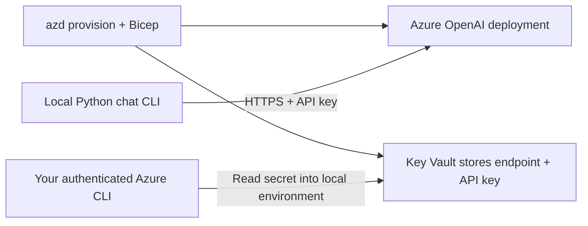

# Azure OpenAI Chat — Lokalni CLI in infrastruktura AZD

**Raven:** Vmesni · **Čas:** 35–60 minut vključno z nastavitvijo

Ta primer zagotovi **Azure OpenAI vir in Key Vault**, nato pa zažene interaktivni
Python chat ukazni vmesnik **na vašem računalniku**. Ne gosti spletne aplikacije
ali Container App. Privzeti model je `gpt-4.1`, različica `2025-04-14`, z
zmogljivostjo nameščanja `GlobalStandard` 20. Pred zagonom preverite trenutno razpoložljivost in kvoto
za izbrano regijo; datumi življenjskega cikla modela se lahko spremenijo.

## Cilji učenja

- Namestitev infrastrukturnega modela s Bicep in azd.
- Pridobitev API ključa iz Key Vault brez dajatev v izhodih nameščanja.
- Pošiljanje zahtevkov za Chat Completions in vzdrževanje zgodovine pogovora.
- Razumevanje štetja tokenov in omejitev stroškovnih ocen.



V tem primeru ni integracije z upravljano identiteto med izvajanjem, failover več regij,
lastnega omejevalnika hitrosti, pretočnega načina ali gostovane obdelave. OpenAI SDK
izvede do dva ponovna poskusa za ponovljive napake; CLI poroča o preostalih napakah.

## Predpogoji

- Trenutna stabilna različica [azd](https://learn.microsoft.com/azure/developer/azure-developer-cli/install-azd)
  (objavljena izdaja ob času pregleda: 1.37.2).
- [Azure CLI](https://learn.microsoft.com/cli/azure/install-azure-cli).
- Python **3.10+** (priporočen 3.11) in virtualno okolje.
- Azure naročnina z dovoljenjem za ustvarjanje storitev Cognitive Services in Key Vault
  virov, nameščanje modelov in branje skrivnosti zaklada.
- Regijska razpoložljivost in `GlobalStandard` kvota za `gpt-4.1`. Zahteve za dostop
  so odvisne od naročnine in funkcije; ni zagotovljenega časovnega okvira za odobritev.

```bash
azd version
az version
python --version
azd auth login
az login
```

To so ločene prijavne seje. Pred zagonom spodnjih ukazov izberite isto naročnino v obeh
orodjih.

## Hiter začetek (Bash)

Zaženite iz korena repozitorija:

```bash
cd examples/azure-openai-chat
azd env new myopenai
azd provision
```

Izberite podprt regijo. Zagotavljanje ustvari skupino virov, OpenAI račun,
namestitev modela, Key Vault ter `openai-endpoint`/`openai-api-key` skrivnosti.
Ni **storitev za nameščanje** v `azure.yaml`.

Naložite izhode, ki niso skrivni, in pridobite skrivnost v vašo trenutno lupino:

```bash
export AZURE_OPENAI_ENDPOINT="$(azd env get-value AZURE_OPENAI_ENDPOINT)"
export AZURE_OPENAI_MODEL="$(azd env get-value AZURE_OPENAI_MODEL)"
KV_NAME="$(azd env get-value AZURE_KEY_VAULT_NAME)"
export AZURE_OPENAI_API_KEY="$(az keyvault secret show \
  --vault-name "$KV_NAME" --name openai-api-key --query value --output tsv)"

python -m venv .venv
source .venv/bin/activate
python -m pip install -r src/requirements.txt
python src/chat.py
```

V PowerShellu aktivirajte z `.\.venv\Scripts\Activate.ps1` in dodelite spremenljivke okolja
z `$env:AZURE_OPENAI_ENDPOINT = azd env get-value AZURE_OPENAI_ENDPOINT`
(in podobno za model). API ključ pridobite z uporabo
`$env:AZURE_OPENAI_API_KEY = az keyvault secret show --vault-name $KV_NAME --name openai-api-key --query value -o tsv`.
Najprej nastavite `$KV_NAME = azd env get-value AZURE_KEY_VAULT_NAME`.

Ne tiskajte, ne posredujte in ne prilepite API ključa v poročila o napakah. CLI prebere
spremenljivke okolja procesa; **ne** pridobi skrivnosti iz Key Vault ali naloži `.env` datotek.
`config.py` preveri končno točko, omejitev žetona in temperaturo ob zagonu.

Pričakovani izhod (vsebina in uporaba se razlikujeta):

```text
Azure OpenAI Chat Application
Model: gpt-4.1
...
You: Say hello in one sentence.
Assistant: Hello! How can I help you today?
[Tokens: ... | Cost: $...]
```

Ukazi: `stats` prikazuje vsote, `clear` izbriše zgodovino pogovora, in
`quit`/`exit` konča sejo. Ni `--stream`, `--show-tokens`, `tokens`,
ali `cost` ukazov.

## Preverite namestitev

Po nalaganju zgornjih spremenljivk lupine:

```bash
curl --fail-with-body \
  "${AZURE_OPENAI_ENDPOINT%/}/openai/deployments/${AZURE_OPENAI_MODEL}/chat/completions?api-version=2024-10-21" \
  -H "Content-Type: application/json" \
  -H "api-key: $AZURE_OPENAI_API_KEY" \
  -d '{"messages":[{"role":"user","content":"Say hello!"}],"max_tokens":50}'

az keyvault secret list --vault-name "$KV_NAME" --query "[].name" -o table
```

Uspeh: API vrne HTTP 200 z `choices[0].message.content` in `usage`;
trezor navaja `openai-api-key` in `openai-endpoint`. Samo uspešna ARM namestitev
ne preveri sklepanja.

## Datoteke in konfiguracija

```text
azure.yaml                         # Infrastructure-only AZD project
infra/main.bicep                   # Subscription deployment
infra/main.parameters.json         # Environment, location, principal ID
infra/resources/openai.bicep       # Account + model
infra/resources/keyvault.bicep     # Vault + deploying user's secret access policy
infra/resources/secrets.bicep      # Writes secrets, no key output
src/chat.py                        # Interactive CLI
src/config.py                      # Environment validation
src/requirements.txt               # Python packages
```

Za spremembo zagotovljenega modela/različice/zmogljivosti uredite privzete nastavitve v
Zaženite `infra/main.bicep` in `azd provision`. Nastavitev `AZURE_OPENAI_MODEL` v vaši
lupini le izbere **obstoječe ime namestitve**; ne namesti drugega modela.

| Spremenljivka okolja | Privzeta / vir |
|---|---|
| `AZURE_OPENAI_ENDPOINT` | Obvezno; izhod azd brez skrivnosti |
| `AZURE_OPENAI_API_KEY` | Obvezno; pridobljeno iz Key Vault |
| `AZURE_OPENAI_MODEL` | `gpt-4.1`; ime namestitve v Azure |
| `AZURE_OPENAI_MAX_TOKENS` | 800 (veljavnost preverjanja 1–4096) |
| `AZURE_OPENAI_TEMPERATURE` | 0,7 (območje 0–2) |
| `AZURE_OPENAI_INPUT_PRICE_PER_1K` | 0,002 USD; ilustrativna cena vnosa brez predpomnjenja |
| `AZURE_OPENAI_OUTPUT_PRICE_PER_1K` | 0,008 USD; ilustrativna cena izhoda |

## Stroški in varnostne omejitve

Prikaz stroškov je **ocena**, ne zaračunavanje Azure. Pomnoži uporabo API tokena
z nastavitvami cen in ne upošteva popustov za predpomnjene vnose,
regionalnih/SKU razlik, davkov, sprememb cen ali neuspelih/ponovljenih klicev.
Prepišite **obe stopnji**, ko uporabljate drug model ali SKU, in preverite trenutne
[cene Azure OpenAI](https://azure.microsoft.com/pricing/details/cognitive-services/openai-service/).

Za ilustracijo, 100 zahtevkov z uporabo 500 nepredpomnjenih vhodnih in 200 izhodnih tokenov vsak
stane pri privzetih stopnjah `100 × (500/1000 × .002 + 200/1000 × .008) = $0.26`.
Operacije/shranjevanje Key Vault povzročajo ločene stroške. Ni fiksne mesečne pristojbine 50 $ 
za ta lokalni CLI in v predlogi ni gostovanega računalništva.

Vault uporablja dostopno politiko za namestitvenega principal-a; ni RBAC ali
primer aplikacije z upravljano identiteto. Javni končni točki in avtentikacija s ključem API
se uporabljajo za učenje. Omejite dovoljenja in dodajte ustrezne identitetne/mrežne
kontrole, preden jih prilagodite za produkcijo.

## Praktične vaje

### 1. Preverite kontekst in ga ponastavite

**Začetek:** zagon CLI. **Cilj:** opazovati zgodovino.
Recite „Zapomni si besedo cedar,“ nato vprašajte „Katero besedo sem vas prosil, da si zapomnite?“
Zaženite `stats`; dva uspešna odziva naj štejeta kot dva izmenjana sporočila.
Zaženite `clear` in `stats`; izmenjana sporočila naj bodo nič (skupni žetoni ostanejo).
Natančna besedna izbira modela ni deterministična.

### 2. Spremenite omejitev odgovora

**Začetek:** zapustite CLI, obdržite isti shell.
Zaženite `export AZURE_OPENAI_MAX_TOKENS=100`, znova zaženite `python src/chat.py` in zahtevajte
kratek opis azd. Preverite, da pasica prikazuje 100.
Obnovite z `unset AZURE_OPENAI_MAX_TOKENS`. Manjša omejitev odgovora ne
zmanjša že poslanih zgodovinskih žetonov.

### Pogoste težave

- **Manjkajoče okoljske spremenljivke:** provisioning ne izvaža vrednosti shell-a;
  ponovite korake izvoza. Nov terminal jih ponovno potrebuje.
- **403 pri branju Key Vault:** preverite naročnino/prijavo Azure CLI in glavno
  osebo v dostopni politiki ključavnice. Spremembe politike se lahko izvajajo nekaj časa.
- **404 inferenca:** preverite ime namestitve, končno točko in stanje namestitve.
- **429 inferenca:** počakajte na ponastavitev omejitev hitrosti; preverite regionalno kvoto modela.
  CLI odstrani neuspešne odzive iz zgodovine, zato ponovni poskus ne doda podvojenih.
- **Dolžina konteksta:** vzorec ne skrajša dolgih pogovorov; uporabite `clear`.
- **Model ni na voljo/upokojen:** preverite trenutno razpoložljivost modela in posodobite
  model/različico/SKU skupaj; različica API-ja in različica modela sta drugačni nastavitvi.

## Čiščenje in naslednji koraki

```bash
azd down
unset AZURE_OPENAI_API_KEY
```

Retencija Key Vault soft-delete je sedem dni; čiščenje zahteva ločena dovoljenja.
Ni obveznega testnega kompleta; ne izvajajte neobstoječega ukaza `pytest tests/`.
Pred razširitvijo kode dodajte simulirane API teste.

[Primeri vsebnikov](../../../../examples/container-app) · [Načrt arhitekture trgovine na drobno](../retail-scenario.md) ·
[Domača stran tečaja](../../README.md) · [Prijava težave](https://github.com/microsoft/AZD-for-beginners/issues)

---

<!-- CO-OP TRANSLATOR DISCLAIMER START -->
**Omejitev odgovornosti**:
Ta dokument je bil preveden z uporabo AI prevajalske storitve [Co-op Translator](https://github.com/Azure/co-op-translator). Čeprav si prizadevamo za natančnost, vas prosimo, da upoštevate, da avtomatizirani prevodi lahko vsebujejo napake ali netočnosti. Izvirni dokument v njegovem izvirnem jeziku je treba obravnavati kot avtoritativni vir. Za kritične informacije je priporočljiv strokovni človeški prevod. Ne odgovarjamo za morebitna nesporazume ali napačne interpretacije, ki izhajajo iz uporabe tega prevoda.
<!-- CO-OP TRANSLATOR DISCLAIMER END -->