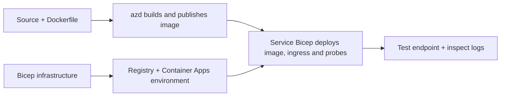

# Primeri nameščanja Container App z AZD

Ta imenik vsebuje dva učna primera s izvorno kodo, Dockerfile-i,
infrastrukturo Bicep in `azure.yaml`. Nobeden ni produkcijsko utrjen.

## Izberite primer

| Vzorec | Kaj je implementirano | Predpogoji |
|---|---|---|
| [Preprosto Flask API](../../../../examples/container-app/simple-flask-api) | Enoten Python CRUD API, elementi v pomnilniku, zdravstvene preveritve, HTTP skaliranje | Osnovno znanje CLI in HTTP |
| [Mikrostoritvi z dvema servisoma](../../../../examples/container-app/microservices) | Node.js prehod, interno le za branje Python produktna storitev, telemetrija in skaliranje | Najprej dokončajte enostaven enostoritveni primer |

Predviden čas 30–60 minut vključno z nastavitvijo in preverjanjem. Časi dodelitve Azure se razlikujejo.

## Predpogoji

- [Azure Developer CLI](https://learn.microsoft.com/azure/developer/azure-developer-cli/install-azd)
- [Azure CLI](https://learn.microsoft.com/cli/azure/install-azure-cli) za preverjalne ukaze
- Docker z zagonskim daemon-om za gradnjo container slik
- Azure naročnina z dovoljenji za ustvarjanje virov in zadostno regionalno kvoto
- Bash za primere s terminalom ali ustrezni PowerShell ukazi

```bash
azd version
az version
docker info
azd auth login
az login
```

Orodji imata ločene prijavne seje. Uporabite trenutno stabilno različico azd; trenutno
objavljena različica ob času pregleda je 1.37.2. Starejše zahteve po minimalni različici niso
zagotovilo združljivosti.

## Hitri začetek

Iz korena repozitorija:

```bash
cd examples/container-app/simple-flask-api
azd env new flask-demo
azd up
API_URL=$(azd env get-value API_ENDPOINT)
curl --fail-with-body "${API_URL}/health"
```

Pričakovano: HTTP 200 z `"status": "healthy"`. Sledite navodilom v pripomočku README za ustvarjanje,
branje, posodabljanje in brisanje elementa ter pregled dnevnikov.



Začetna dodelitev uporablja javno hello-world sliko na vratih 80. Specifične
Bicep parametarske datoteke omogočajo, da `azd deploy` zamenja to s sestavljeno aplikacijsko sliko
in pravilnimi vrati/aplikacijskimi preveritvami (8000 za Flask/produkt, 8080 za prehod).
Te datoteke shranjujte z njihovimi `azure.yaml` `module` nastavitvami.

## Konfiguracija: kaj spreminja kaj

`azure.yaml` izbere izvorne mape, jezike, gostitelje in module za nameščanje.
CPU/pomnilnik vsebnika, dostop, preveritve, število replik in pravila skaliranja so definirana
v **Bicep**, ne v poljubnih `resources`, `scale` ali `regions` lastnostih servisa.

`azd env set SOME_VALUE ...` lokalno shrani vrednost. Spreminja le nameščen
vir, če parameter, preslikava okolja ali povezava eksplicitno porabi to
vrednost. Ti primeri ne uporabljajo `MAX_REPLICAS`, `SCALE_TO_ZERO_TIMEOUT`,
`CONTAINER_APP_REPLICA_TYPE` ali lastnih nastavitvah kanarčkov iz vrednosti okolja azd.
Uredite ustrezen Bicep in za ponovno dodelavo ter namestitev zaženite `azd up`.

Ne shranjujte izvora aplikacije pod `infra/`. `project` mora kazati na izvorno
mapo, ki vsebuje Dockerfile in manifest odvisnosti.

## Nadzor in stroški

- `azd monitor --logs` odpre pogled portal; ni terminalni tok dnevnikov.
  Uporabite `az containerapp logs show --follow` z dejanskim imenom vira.
- Preprost API piše stdout dnevnike, ki jih zbirata Container Apps/Log Analytics.
  Njegov dodeljeni Application Insights vir ni samodejno instrumentiran.
- Prehod mikrostoritev uporablja Node.js Application Insights SDK; Python
  servis izvozi aplikacijske dnevniške sledi. Polno sledenje Python zahtevam/odvisnostim
  ni nastavljeno.
- Skaliranje na nič lahko zmanjša stroške računalništva, a registracija in vnosi/shranjevanje dnevnikov
  še vedno lahko stanejo. Privzete nastavitve mikrostoritev pustijo replikacije v teku.
  Ocenite vaš regijski in porabniški strošek v
  [Azure kalkulator cen](https://azure.microsoft.com/pricing/calculator/).

## Napredni vzorci — implementacije niso vključene

To so smernice za oblikovanje, ne dodatni lokalni projekti ali koščki za kopiranje in zagon:

- **Stalni podatki in avtentikacija:** zamenjajte pomnilniške skladišča in dodajte
  Microsoft Entra ID avtentikacijo/avtorizacijo pred produkcijo.
- **Blue-green/canary:** uporabite način več različic Container Apps, oznake različic,
  uteži prometa, preverjanje zdravja in postopke povrnitve.
  V teh primerih ni `deploymentStrategy: canary` azd konfiguracije.
  Glejte [upravljanje različic](https://learn.microsoft.com/azure/container-apps/revisions).
- **Večregijski:** ustvarite ločena okolja in aplikacije v Bicep ter oblikujte
  globalno usmerjanje in konsistenco podatkov. Seznam servisnih `regions` ni azd
  mehanizem za nameščanje.
- **Delavci čakalnih vrst:** dodajte izvor delavca, odvisnosti, vire čakalne vrste, upravljan
  identiteto z vlogami podatkovne ravni in overjeno pravilo za skaliranje. Ne kopirajte
  prazne poti `src/worker` in ne pričakujte izvedljivega projekta.
- **Dapr:** zagotovite komponente, konfigurirajte pomočnika (sidecar), namestite ustrezni SDK,
  in implementirajte obravnavo napak za stanje/pub-sub.
- **Skrivnosti:** kjer je mogoče, uporabljajte upravljano identiteto in dodelitve vlog. Samo
  ustvarjanje Key Vaulta ne podeli aplikacijam dostopa ali naloži skrivnosti.

## Čiščenje

Iz vzorčne mape:

```bash
azd down
```

Preglejte pozive za brisanje in potrdite odstranitev namenjene skupine virov.
Ne uporabljajte teh vzorcev kot osnovo za produkcijsko okolje brez dodatnega načrtovanja in testov.

[Indeks primerov](../README.md) · [Domača stran tečaja](../../README.md) ·
[Dokumentacija Container Apps](https://learn.microsoft.com/azure/container-apps/) ·
[Prijavite težavo](https://github.com/microsoft/AZD-for-beginners/issues)

---

<!-- CO-OP TRANSLATOR DISCLAIMER START -->
**Omejitev odgovornosti**:
Ta dokument je bil preveden z uporabo AI prevajalske storitve [Co-op Translator](https://github.com/Azure/co-op-translator). Čeprav si prizadevamo za natančnost, vas prosimo, da upoštevate, da avtomatizirani prevodi lahko vsebujejo napake ali netočnosti. Izvirni dokument v njegovem izvirnem jeziku je treba obravnavati kot avtoritativni vir. Za kritične informacije je priporočljiv strokovni človeški prevod. Ne odgovarjamo za morebitna nesporazume ali napačne interpretacije, ki izhajajo iz uporabe tega prevoda.
<!-- CO-OP TRANSLATOR DISCLAIMER END -->