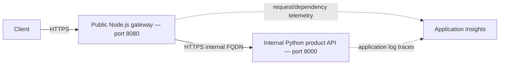

# Mikroservisi z dvema storitvama — Azure Container Apps

**Raven:** vmesni · **Čas:** 45–60 minut vključno z nastavitvijo

Ta učni primer implementira **Node.js API Gateway** in **Python storitev za izdelek samo za branje**.
Vključeni so izvorna koda, Dockerfiles, Bicep in konfiguracija azd.
Ni sistem, pripravljen za produkcijsko uporabo.

## Kaj se boste naučili

- Neodvisno namestiti dve storitvi.
- Uporabiti interno zadnjo FQDN preko HTTPS.
- Preveriti odgovore za uspeh, ni najdeno in nedosegljivo storitev.
- Razumeti telemetrijo in meje neodvisnega skaliranja.



Katalog izdelkov vsebuje pet fiksnih izdelkov v pomnilniku. Ni **obdelovalcev POST, 
PUT ali DELETE**, baze podatkov, Service Bus, servisov za naročila/uporabnike/obvestila, 
C# ali Go kode. To so ideje za prihodnji razvoj, niso vključene funkcionalnosti.
Prehod (gateway) ne preverja uporabnikov; notranji vhod ni nadomestilo 
za avtorizacijo aplikacije.

## Predpogoji

Najprej dokončajte [samostojni Flask API](../../../../../examples/container-app/simple-flask-api).
Namestite trenutno stabilno različico azd (objavljena različica ob pregledu: 1.37.2), Azure CLI
in Docker z zaganjanim demonom. Potrebujete Azure naročnino, dovoljenja za ustvarjanje
virov in regionalno kvoto za Container Apps.

```bash
azd version
az version
docker info
azd auth login
az login
```

V obeh orodjih CLI uporabite isto naročnino. Ukazi spodaj uporabljajo Bash.

## Namestitev in preverjanje

Iz korena repozitorija:

```bash
cd examples/container-app/microservices
azd env new microservices-demo
azd up
GATEWAY_URL=$(azd env get-value API_GATEWAY_URL)
RG_NAME=$(azd env get-value AZURE_RESOURCE_GROUP)
GATEWAY_NAME=$(azd env get-value API_GATEWAY_NAME)
PRODUCT_NAME=$(azd env get-value PRODUCT_SERVICE_NAME)

curl --fail-with-body "${GATEWAY_URL}/health"
curl --fail-with-body "${GATEWAY_URL}/api/products"
curl --fail-with-body "${GATEWAY_URL}/api/products/1"
curl -i "${GATEWAY_URL}/api/products/999"
```

**Uspeh:** health 200; list 200 s **petimi** izdelki; izdelek 1 je prenosnik 
s ceno 999,99 in zalogo 50; neznan izdelek vrne 404.
Opisi so vključeni v odgovore; časovne oznake se razlikujejo.

Začetna oskrba uporablja javne slike hello-world na vratih 80, da ne poskuša
potegniti neobstoječih slik iz praznega registra. Moduli Bicep za posamezne storitve
in datoteke s parametri zamenjajo s slikanimi slikami in vhodnimi točkami/preizkusi aplikacij med
`azd deploy`. Glavni parametri ohranijo objavljena imena slik za kasnejše zagotavljanje.

## Storitve in omrežje

| Storitev | Izpostavljene končne točke | Privzeti viri |
|---|---|---|
| Prehod | GET `/`, `/health`, `/api/products`, `/api/products/:id` | 1 vCPU, 2 GiB, 2–20 replik |
| Izdelek | GET `/`, `/health`, `/products`, `/products/<id>` | 0.5 vCPU, 1 GiB, 1–10 replik |

Vhod izdelka ima `external: false` in `allowInsecure: false`. Bicep vbrizga
`PRODUCT_SERVICE_URL=https://<actual-internal-fqdn>` v prehod. HTTP bi se
preusmeril, HTTPS pa ustreza konfiguriranemu vhodu. Kratko DNS ime mora ustrezati
**dejanskemu imenu Container App**, ne logičnemu ključu storitve `product-service`.
Ne poskušajte neposredno poklicati notranjega URL-ja iz vašega prenosnika.

Prehod ima petsekundni časovni potek za klice izdelka. Manjkajoče ID-je izdelkov
posreduje kot 404; napake pri prenosu/ostale napake zalednega sistema vrnejo 503. Prehod
`/health` preverja samo prehod, ne pa zaledne razpoložljivosti.

## Datoteke in konfiguracija

```text
azure.yaml
infra/main.bicep
infra/main.parameters.json
infra/abbreviations.json
infra/core/container-apps-environment.bicep
infra/core/monitor.bicep
infra/app/api-gateway.bicep
infra/app/api-gateway.parameters.json
infra/app/product-service.bicep
infra/app/product-service.parameters.json
src/api-gateway/{app.js,package.json,Dockerfile}
src/product-service/{main.py,requirements.txt,Dockerfile}
```

Merjenje obremenitve, CPU/spomin, pristanišča in preizkuse nastavimo v `infra/app/*.bicep`. Spremenite te
datoteke in zaženite `azd up`, da uporabite infrastrukturo in znova namestite. Ni
`GATEWAY_MAX_REPLICAS` parametra okoljske spremenljivke v tem vzorcu.

Za spremembe samo kode:

```bash
azd deploy product-service
azd deploy api-gateway
```

Slika Node uporablja Node 22; slika Python pa Python 3.11. Oba se povežeta na
`0.0.0.0`. Vhod/preizkusi uporabljajo vrata 8080 (prehod) oziroma 8000 (izdelek).

## Lokalni razvoj z Dockerjem

Zaženite iz tega imenika vzorcev. Uporabite omrežje, ki ga definira uporabnik, **ne `localhost`
iz ene posode, da dosežete drugo**:

```bash
docker network create azd-microservices-demo
docker build -t local-product ./src/product-service
docker build -t local-gateway ./src/api-gateway
docker run -d --name azd-product --network azd-microservices-demo local-product
docker run -d --name azd-gateway --network azd-microservices-demo \
  -p 8080:8080 -e PRODUCT_SERVICE_URL=http://azd-product:8000 local-gateway
curl --fail-with-body http://localhost:8080/api/products
```

Pričakovano: pet izdelkov. HTTP se uporablja samo za to lokalno omrežje Docker.

```bash
docker stop azd-product azd-gateway
docker rm azd-product azd-gateway
docker network rm azd-microservices-demo
```

## Nadzor

```bash
az containerapp logs show --name "$GATEWAY_NAME" --resource-group "$RG_NAME" --follow
# In a separate terminal:
az containerapp logs show --name "$PRODUCT_NAME" --resource-group "$RG_NAME" --tail 100
```

`azd monitor --logs` odpre pogled portala; ne pretaka dnevniških zapisov terminala.
Node SDK zbira zahteve/odvisnosti prehoda. Pythonov `AzureLogHandler`
izvozi **sledi dnevnikov**, ne samodejnih Flask zahtev, SQL odvisnosti ali celotnih
distribuiranih sledi. OpenCensus je zastareli SDK; raje uporabite Azure Monitor OpenTelemetry,
ko razširite ta vzorec.

V Application Insights Logs ustvarjajte zahteve in preglejte:

```kusto
requests
| where timestamp > ago(1h)
| where name contains "products"
| summarize RequestCount=count(), AvgDuration=avg(duration) by bin(timestamp, 5m)
```

Za sporočila aplikacije Python:

```kusto
traces
| where timestamp > ago(1h)
| where message contains "products"
| project timestamp, message, severityLevel
```

Dovolite zamudo pri vnosu in vzorčenju; ne pričakujte natančnega števila zahtev ali
zagotovljene zakasnitve. Ni konfiguriranih prilagojenih opozoril ali nadzornih plošč.

## Praktične vaje

### Vaja 1: Spremenite katalog

**Začetna točka:** `src/product-service/main.py`.
**Cilj:** preveriti neodvisno nameščanje storitve.
Spremenite zalogo prenosnika iz 50 na 49 v fiksnem seznamu `products`, zaženite
`azd deploy product-service`, nato zahtevajte `${GATEWAY_URL}/api/products/1`.

**Merila uspeha / rešitev:** HTTP 200 z `"stock":49`. Obnovite 50 in znova namestite.
**Pogosta težava:** urejanje prehoda namesto storitve, ki ima v lasti katalog.
To spremeni izvorne podatke, ne trajno bazo podatkov inventarja.

### Vaja 2: Preverite konfiguracijo replik

**Začetna točka:** `infra/app/product-service.bicep`.
**Cilj:** opazovati spremembo infrastrukture brez ugibanja o samodejnem merjenju obremenitve.
Spremenite `minReplicas: 1` na `minReplicas: 2`, zaženite `azd up`, nato:

```bash
az containerapp show --name "$PRODUCT_NAME" --resource-group "$RG_NAME" \
  --query properties.template.scale -o json
```

**Merila uspeha:** konfigurirana najmanjša vrednost je 2, največja pa ostane 10.
Obnovite najmanjšo vrednost 1 in zaženite `azd up`.
**Pogosta težava:** `azd deploy` sam ne spremeni skupne
infrastrukture, ki ni povezana. Ne nastavite `maxReplicas` na nič kot simulacijo napake.
To preverja konfiguracijo, ne preskus obremenitve ali zagotovljeno takojšnjo število replik.

### Vaja 3: Lokalne preizkušnje ravnanja z nedosegljivo storitvijo

**Začetna točka:** oba lokalna kontejnerja Docker zgoraj sta zagnana.
**Cilj:** razlikovati zaledno napako od manjkajočega izdelka.
Ustavite samo kontejner izdelka:

```bash
docker stop azd-product
curl -i http://localhost:8080/api/products
docker start azd-product
curl --fail-with-body http://localhost:8080/api/products
```

**Merila uspeha:** med ustavitvijo prehod vrne 503 s
`"error":"Product service unavailable"`; po ponovnem zagonu seznam vrne 200.
Po potrebi ponovite po kratki začetni zamudi.
**Pogosta težava:** ustavitev prehoda preizkuša drugačno napako (noben HTTP odgovor).

## Stroški in proizvodne vrzeli

Privzete minimalne replike ohranjajo delovanje računalnika. Tudi register in nadzor povzročata
stroške. Ni preverjenega fiksnega skupnega zneska $50/mesec: ocenite regionalni CPU/spomin,
ure replik, zahteve, register in zadrževanje dnevnikov v
[Azure ceniku](https://azure.microsoft.com/pricing/calculator/).
Učinkovito izbrišite učne vire.

Proizvodno delo vključuje preverjanje pristnosti/avtorizacije, obsegane upravljane identitete,
trajne podatke, preverjanje vnosa/odziva, podprto instrumentiranje opazovanja,
obremenitvene/napake teste, CI/CD, opozorila in postopke obnovitve. Dodajanje storitve naročila,
vrste ali baze podatkov je ločena implementacijska naloga, ne končana
vaja ali funkcija, ki je že tukaj na voljo.

## Odpravljanje težav in čiščenje

- **Slika ni najdena med prvo zagonom:** bootstrap naj uporablja javno sliko;
  preverite privzete glavne parametre slike in preslikave modulov namestitve.
- **503 izdelkov:** preverite dnevnike izdelka, revizijo slike in vbrizgan notranji URL HTTPS.
- **404 nepričakovana pot:** API za izdelek je samo za branje; preverite pot, ne neobstoječega upravljalnika CRUD.
- **Brez telemetrije:** preglejte povezovalne nize med izvajanjem, ne da bi jih razkrivali, in
  dovolite zamudo vnosa. Pythonove tabele zahtev niso napolnjene z njegovim upravljalcem dnevnikov.

Iz tega imenika vzorca:

```bash
azd down
```

Preglejte pozive za brisanje in preverite, da je namenjena skupina virov odstranjena.

[Prejšnje: Flask API](../../../../../examples/container-app/simple-flask-api) · [Naslednje: Aplikacija baze podatkov](../../../../../examples/database-app) ·
[Razvoj AI](../../../docs/chapter-02-ai-development/README.md) ·
[Izvorna stran tečaja](../../../README.md) · [Poročanje o težavi](https://github.com/microsoft/AZD-for-beginners/issues)

---

<!-- CO-OP TRANSLATOR DISCLAIMER START -->
**Omejitev odgovornosti**:
Ta dokument je bil preveden z uporabo AI prevajalske storitve [Co-op Translator](https://github.com/Azure/co-op-translator). Čeprav si prizadevamo za natančnost, vas prosimo, da upoštevate, da avtomatizirani prevodi lahko vsebujejo napake ali netočnosti. Izvirni dokument v njegovem izvirnem jeziku je treba obravnavati kot avtoritativni vir. Za kritične informacije je priporočljiv strokovni človeški prevod. Ne odgovarjamo za morebitna nesporazume ali napačne interpretacije, ki izhajajo iz uporabe tega prevoda.
<!-- CO-OP TRANSLATOR DISCLAIMER END -->