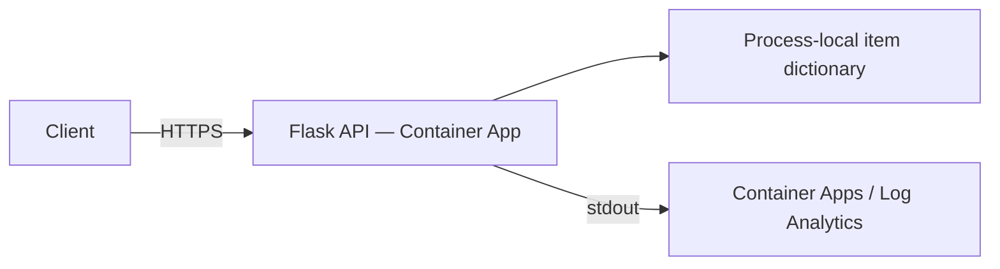

# Preprosta Flask API — Azure Container Apps

**Raven:** Začetnik · **Čas:** 30–45 minut vključno z nastavitvijo

Namestite Python Flask CRUD API z Azure Developer CLI (azd). Vključeni so vir, Dockerfile,
Bicep in parametri za namestitev. To je **učni primer**, ne
produkcijsko pripravljen API.

## Kaj se boste naučili

- Sestaviti in objaviti vsebnik preko azd.
- Nastaviti vhod in "liveness"/"readiness" preglede.
- Preveriti CRUD odzive in pregledati dnevnike aplikacije.
- Razumeti, zakaj v pomnilniku shranjeni podatki niso primerni za trajne aplikacije.



**Pomembno:** elementi so shranjeni v enem procesu. Privzeto je **en Gunicorn delavec,
0–1 replik**, namenoma se izogiba neskladnim podatkom med delavci/replicami.
Elementi se izgubijo ob ponovnem zagonu, spremembi revizije ali skaliranju na ničlo. Povečanje replik
zahteva skupno trajno shrambo. API nima avtentikacije ali avtoritacije.

## Predpogoji

- [Trenutno stabilni azd](https://learn.microsoft.com/azure/developer/azure-developer-cli/install-azd)
  (objavljena različica ob pregledu: 1.37.2).
- [Azure CLI](https://learn.microsoft.com/cli/azure/install-azure-cli) za preverjanje.
- Docker z zagnanim demonom; potreben je za privzeto lokalno gradnjo slike.
- Azure naročnina, dovoljenja za ustvarjanje virov in regionalna kvota za Container Apps.
- Bash za spodnje ukaze (ali ustrezni PowerShell).
- Python 3.11 za opcijski lokalni razvoj.

```bash
azd version
az version
docker info
azd auth login
az login
```

Ukazne vrstice imajo ločene prijavne seje. Uporabite isto naročnino v obeh.

## Hitri začetek

Iz korena repozitorija:

```bash
cd examples/container-app/simple-flask-api
azd env new flask-demo
azd up
API_URL=$(azd env get-value API_ENDPOINT)
RG_NAME=$(azd env get-value AZURE_RESOURCE_GROUP)
API_NAME=$(azd env get-value API_NAME)
curl --fail-with-body "${API_URL}/health"
```

Pričakovano: HTTP 200 in JSON z `"status":"healthy"`,
`"service":"simple-flask-api"` in trenutnim UTC časovnim žigom.
Postopek postavitve in gradnje slike običajno traja nekaj minut; čas se razlikuje.

Začetna postavitev uporablja javno hello-world sliko, ki posluša na vratih 80.
`azure.yaml` izbere `infra/app/api.bicep` in njegovo ustrezno datoteko parametrov za
namestitev storitve, ki preklopi sliko, vhod in preglede na vrata 8000.
Ne brišite teh parametrov namestitve.

## Preverite CRUD

Izvedite spodnje zaporedno, medtem ko ostaja aktivna ista replika:

```bash
# Create: HTTP 201; note the returned id (1 for a fresh process).
curl -i -X POST "${API_URL}/api/items" \
  -H "Content-Type: application/json" \
  -d '{"name":"Test Item","description":"My first item"}'

# Read list: HTTP 200, total 1 in a fresh process.
curl --fail-with-body "${API_URL}/api/items"

# Replace 1 if your create response returned another id.
curl --fail-with-body "${API_URL}/api/items/1"
curl -i -X PUT "${API_URL}/api/items/1" \
  -H "Content-Type: application/json" -d '{"name":"Updated Item"}'
curl -i -X DELETE "${API_URL}/api/items/1"
curl -i "${API_URL}/api/items/1"
```

Uspeh: POST 201, branje/PUT 200, DELETE 204 brez telesa, nato manjkajoči element 404.
Napačen/nerazumski JSON ali prazno ime vrne 400.
Če predmet izgine med zahtevami, preverite ponovni zagon ali skaliranje na ničlo;
to je namerna omejitev v pomnilniku, ne trajnosti.

| Končna točka | Metode |
|---|---|
| `/` | GET — informacije o storitvi |
| `/health` | GET — živost/pripravljenost |
| `/api/items` | GET, POST |
| `/api/items/{id}` | GET, PUT, DELETE |

## Dnevniki in konfiguracija

```bash
az containerapp logs show --name "$API_NAME" --resource-group "$RG_NAME" --follow
```

Pričakovano: zagon Gunicorn, dnevnik dostopa do zahtevkov in sporočila aplikacije.
`azd monitor --logs` odpre pogled portala; ne pretaka v terminal.
Application Insights je postavljen, vendar ga **ta Flask koda ne instrumentira**;
uporabite Container Apps/Log Analytics za dnevnike stdout.

Uredite `infra/app/api.bicep` za CPU/ram, omejitve replik ali pravila skaliranja, nato
zaženite `azd up`. Privzete vrednosti so 0.5 vCPU, 1 GiB, najmanj 0 / največ 1 replika in
HTTP prag 50 sočasnih zahtev. Skaliranje na ničlo lahko povzroči zamik ob hladnem zagonu.

Poljubne vrednosti `azd env set MAX_REPLICAS`, `API_KEY`, `LOG_LEVEL` ali
`SCALE_TO_ZERO_TIMEOUT` niso **povezane s to predlogo ali aplikacijo**.
Nastavitev vrednosti samodejno ne naredi spremenljivke okolja med izvajanjem.
Slika neposredno veže vrata 8000; posodobite Dockerfile, Bicep vhod in preglede
skupaj, če spreminjate vrata.

## Datoteke

```text
azure.yaml
infra/main.bicep
infra/main.parameters.json
infra/app/container-apps.bicep       # Environment, registry, monitoring
infra/app/api.bicep                  # App, ingress, probes, scale settings
infra/app/api.parameters.json        # Image and resource values for azd deploy
src/app.py
src/Dockerfile
src/requirements.txt
```

## Lokalni razvoj

Iz tega primernega imenika:

```bash
python -m venv .venv
source .venv/bin/activate  # PowerShell: .\.venv\Scripts\Activate.ps1
python -m pip install -r src/requirements.txt
python src/app.py
```

V drugem terminalu testirajte `http://localhost:8000/health` in CRUD končne točke.
Ali zgradite in zaženite dejansko sliko:

```bash
docker build -t flask-api:local ./src
docker run --rm -p 8000:8000 flask-api:local
```

Za spremembe samo kode po prvi namestitvi zaženite `azd deploy api`.
Za spremembe Bicep zaženite `azd up` za ponovno postavitev in namestitev.

## Praktične vaje

### 1. Preverite zavračanje neveljavnih vhodov

**Izhodišče:** nameščeni API, `API_URL` zgoraj.
**Cilj:** preverite, da API zavrne neveljavne oblike JSON in manjkajoča imena.

```bash
curl -i -X POST "${API_URL}/api/items" \
  -H "Content-Type: application/json" -d '[]'
curl -i -X POST "${API_URL}/api/items" \
  -H "Content-Type: application/json" -d '{"name":""}'
```

**Kriteriji uspeha / rešitev:** oba vrneta 400 z JSON napako, ne 500.
**Pogosta težava:** izpuščanje glave vsebine tipa JSON.

### 2. Dodajte končno točko samo za branje

**Izhodišče:** `src/app.py`. **Cilj:** razširite in ponovno namestite API.
Dodajte to pred blokom `if __name__ == '__main__':`:

```python
@app.route('/version', methods=['GET'])
def version():
    return jsonify({'version': '1.0.0'})
```

Zaženite `azd deploy api`, nato `curl --fail-with-body "${API_URL}/version"`.
**Kriteriji uspeha:** HTTP 200 in `{"version":"1.0.0"}`.
**Pogosta težava:** postaviti pot za klic blokade `app.run()`, ko
testirate z `python src/app.py`.

### Kontrolna točka znanja

Zakaj je en delavec premalo za trajne podatke? Ker tudi en proces izgubi
svoj slovar ob ponovnem zagonu. Produkcijska različica potrebuje trajno skupno shrambo,
avtentikacijo, avtoritacijo, migracije, teste in operativno spremljanje.

## Stroški in odpravljanje težav

To ni zagotovljena namestitev brez stroškov: osnovni register in shramba/ingestija dnevnikov
lahko povzročita stroške tudi, ko je računalniška storitev aplikacije na ničli. Uporabite
[kalkulator cen](https://azure.microsoft.com/pricing/calculator/) za vašo regijo.

- **Napaka gradnje Dockerja:** potrdite `docker info`, dostop do omrežja in odvisnosti.
- **Nezdrava aplikacija:** preglejte konzolne/sistemske dnevnike in preverite vrata slike, vhod,
  in preglede, naj se ujemajo. Rezervirano mesto ne sme biti pregledano na Flask vratih.
- **403/dovoljenja:** potrdite naročnino in dovoljenja za ustvarjanje virov.
- **Izginejo elementi:** stanje v pomnilniku se ponastavi ob ponovnem zagonu/skaliranju na ničlo;
  dodajte podatkovno bazo za trajno vedenje.

## Čiščenje in naslednji koraki

```bash
azd down
```

Preglejte poziv za izbris in potrdite, da je namenski skupina virov odstranjena.
Ne uporabljajte destruktivnega čiščenja proti skupini virov, ki vsebuje nepovezane podatke.

[Naprej: Datotečna aplikacija](../../../../../examples/database-app) · [Mikrostoritve](../../../../../examples/container-app/microservices) ·
[Pregled vsebnikov](../README.md) · [Domača stran tečaja](../../../README.md) ·
[Prijavi težavo](https://github.com/microsoft/AZD-for-beginners/issues)

---

<!-- CO-OP TRANSLATOR DISCLAIMER START -->
**Omejitev odgovornosti**:
Ta dokument je bil preveden z uporabo AI prevajalske storitve [Co-op Translator](https://github.com/Azure/co-op-translator). Čeprav si prizadevamo za natančnost, vas prosimo, da upoštevate, da avtomatizirani prevodi lahko vsebujejo napake ali netočnosti. Izvirni dokument v njegovem izvirnem jeziku je treba obravnavati kot avtoritativni vir. Za kritične informacije je priporočljiv strokovni človeški prevod. Ne odgovarjamo za morebitna nesporazume ali napačne interpretacije, ki izhajajo iz uporabe tega prevoda.
<!-- CO-OP TRANSLATOR DISCLAIMER END -->