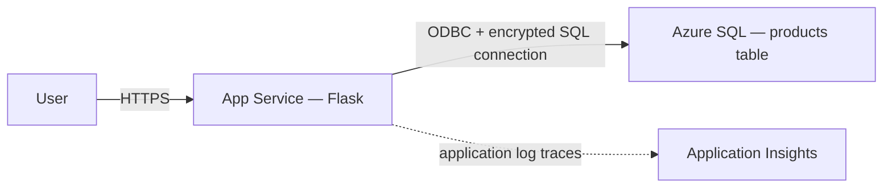

# Flask in Azure SQL na App Service

**Raven:** Vmesni · **Čas:** 30–60 minut vključno s predpogoji

Ta primer namesti Python Flask read API na **Linux App Service** in osnovno
Azure SQL bazo podatkov. Vključeni so izvorna koda, Bicep in azd konfiguracija. Gre za
učni primer, ne pa za arhitekturo baze podatkov pripravljeno za produkcijo.

## Kaj se boste naučili

- Zagotavljanje virov App Service, SQL in nadzora z Bicepom.
- Konfiguriranje šifrirane povezave do SQL brez vnašanja poverilnic.
- Inicializacija sheme pred začetkom Gunicorn delavcev.
- Preverjanje vnaprej določenih podatkov, odzivov "ni najdeno" in stanja baze podatkov.



Viri: namensko skupino virov, B1 Linux App Service načrt, Python 3.11 spletna
aplikacija, SQL strežnik in osnovna 2-GB baza, Application Insights in Log Analytics.
Spletna aplikacija uporablja **nameščanje iz vira/ZIP in namestitev odvisnosti Oryx**;
`azd deploy` ne gradi ali namešča izbirnega Dockerfile.

## Predpogoji

- Trenutno stabilno [azd](https://learn.microsoft.com/azure/developer/azure-developer-cli/install-azd)
  (objavljena različica ob času pregleda: 1.37.2).
- [Azure CLI](https://learn.microsoft.com/cli/azure/install-azure-cli) za preverjanje.
- Azure naročnina, dovoljenja za ustvarjanje navedenih virov in regionalna omejitev.
- Python **3.11** za lokalni razvoj; uporabljena `pyodbc==5.0.1` morda potrebuje
  native gradbene pripomočke na novejših različicah Pythona.
- Microsoft ODBC Driver 18 (ali 17) za SQL Server na lokalnih računalnikih. `pip install
  pyodbc` ne namešča sistemskega gonilnika. Glejte
  [namestitev ODBC](https://learn.microsoft.com/sql/connect/odbc/download-odbc-driver-for-sql-server).
- Docker samo, če testirate izbirni kontejner lokalno.

```bash
azd version
az version
azd auth login
az login
```

Uporabite isto naročnino v obeh orodjih. Ukazi spodaj so v Bash lupini.

## Namestitev

Iz korena repozitorija:

```bash
cd examples/database-app
azd env new sql-demo
azd provision
azd deploy
WEB_URL=$(azd env get-value WEB_APP_URI)
WEB_NAME=$(azd env get-value WEB_APP_NAME)
RG_NAME=$(azd env get-value AZURE_RESOURCE_GROUP)
```

Izberite podprto regijo. `sqlAdminLogin` privzeto nastavi na `sqladmin`; zahtevani
`sqlAdminPassword` je varen parameter. Ob pozivu vnesite močno geslo.
Ne vključujte poverilnic namestitve v Git ali poročila o napakah. Trenutna interpolacija
povezovalne niza pričakuje geslo brez ločil znotraj povezave, kakršnih je
`;`; prilagodite umik pred uporabo takih vrednosti.

Bicep nastavi zagon ukaza, ki zažene `init_database()` **pred** začetkom Gunicorn
delavcev. To je potrebno, ker uvoz `app:app` ne izvrši
Python bloka `if __name__ == '__main__'`. Na novi bazi inicializacija
ustvari `products` in vstavi pet vrstic. To je preprost učni primer, ne
orodje za sočasno migracijo; za množično uporabo uporabite ustrezne migracije.

Aplikacija najprej izbere nameščen Microsoft ODBC Driver 18, nato 17, če povezovalna
niza ne določa gonilnika. Če nobeden ni na voljo, zagon ne uspe z
izvedljivo napako namestitve. Preverite razpoložljivost gonilnika v izbranem
App Service izvajanju, ne predpostavljajte.

## Preverjanje

```bash
curl --fail-with-body "${WEB_URL}/"
curl --fail-with-body "${WEB_URL}/health"
curl --fail-with-body "${WEB_URL}/products"
curl --fail-with-body "${WEB_URL}/products/1"
curl -i "${WEB_URL}/products/999"
```

Pričakovano:

- `/` vrne informacije o končni točki.
- `/health` vrne 200 z `{"status":"healthy","database":"connected"}`.
- `/products` vrne pet vnaprej določenih izdelkov na novi bazi.
- `/products/1` vrne prenosnik s ceno 1299.99.
- Neobstojen izdelek vrne 404 z `{"error":"Product not found"}`.

API je samo za branje. Ni poti POST/PUT/DELETE ali brskalniškega UI.
Neuspešna povezava do baze vrne 503 iz `/health`; to ni uspeh.

## Datoteke in konfiguracija

```text
azure.yaml                         # Python App Service source deployment
infra/main.bicep
infra/main.parameters.json
infra/abbreviations.json
infra/resources/sql-server.bicep
infra/resources/sql-database.bicep
infra/resources/app-service-plan.bicep
infra/resources/web-app.bicep       # Settings + initialization/startup command
infra/resources/app-insights.bicep
src/web/app.py
src/web/requirements.txt
src/web/Dockerfile                 # Optional local container, not the azd target
.env.sample
```

`SQL_CONNECTION_STRING` se posreduje kot varen Bicep parameter modulu spletne aplikacije
in shrani v nastavitvah App Service, ne v izhodih namestitve.
`APPLICATIONINSIGHTS_CONNECTION_STRING` konfigurira izvoz dnevnikov.
`SCM_DO_BUILD_DURING_DEPLOYMENT=true` omogoča namestitev odvisnosti na strežniški strani.
Nastavljanje poljubnih vrednosti `azd env` ne spremeni samodejno nastavitev aplikacije.

Pravilo požarnega zidu `0.0.0.0` v SQL dovoljuje povezave z **Azure storitev,
vključno z naročninami drugih strank**, ob pogoju SQL overjanja. Ni
omejeno samo na to aplikacijo ali naročnino. Omogočen je javni dostop do SQL omrežja.
Pred produkcijo uporabite omejeno mrežo in aplikacijsko identiteto brez upravnih pravic.

## Lokalni razvoj

Uporabite Python 3.11 in nameščen Microsoft SQL ODBC gonilnik:

```bash
python -m venv .venv
source .venv/bin/activate  # PowerShell: .\.venv\Scripts\Activate.ps1
python -m pip install -r src/web/requirements.txt
export SQL_CONNECTION_STRING='Server=tcp:YOUR_SERVER.database.windows.net,1433;Database=YOUR_DATABASE;UID=YOUR_USER;PWD=YOUR_PASSWORD;Encrypt=yes;TrustServerCertificate=no;Connection Timeout=30;'
python src/web/app.py
```

Varnostno zamenjajte rezervirane vrednosti. Kopirana `.env` datoteka **ni samodejno naložena**
v to aplikacijo. Namesto tega izvozite spremenljivke v svoji trenutni lupini.
Za Azure SQL iz prenosnika začasno dovolite samo vaš javni IP:

```bash
SQL_SERVER=$(azd env get-value SQL_SERVER_NAME)
MY_IP=YOUR_PUBLIC_IP
az sql server firewall-rule create -g "$RG_NAME" -s "$SQL_SERVER" \
  -n AllowMyLearningIP --start-ip-address "$MY_IP" --end-ip-address "$MY_IP"
```

Po testiranju odstranite pravilo:

```bash
az sql server firewall-rule delete -g "$RG_NAME" -s "$SQL_SERVER" -n AllowMyLearningIP
```

Izbirni test kontejnerja iz tega primerka imenika:

```bash
docker build -t sql-flask:local src/web
docker run --rm -p 8000:8000 -e SQL_CONNECTION_STRING sql-flask:local
```

Ta slika namesti gonilnik 18 z uporabo Debian 12 repozitorija, ki ustreza njegovi
osnovni različici Bookworm, enkrat inicializira bazo, nato zažene Gunicorn.

## Nadzor in odpravljanje težav

Omogočite/prikličite dnevniške zapise aplikacije App Service, ko diagnosticirate zagon:

```bash
az webapp log config --name "$WEB_NAME" --resource-group "$RG_NAME" \
  --application-logging filesystem --level information
az webapp log tail --name "$WEB_NAME" --resource-group "$RG_NAME"
```

Ta koda izvaža **sledove dnevnikov aplikacije** prek zastarelega OpenCensus upravljalca.
Ne konfigurira samodejnega sledenja Flask zahtevkom/odvisnostim, Live Metrics,
SQL revizije, diagnostičnih nastavitev ali opozoril. Te zahtevajo ločeno nastavitev.
Za novo instrumentacijo priporočamo Azure Monitor OpenTelemetry.

V Application Insights Logs, po poizvedbah API:

```kusto
traces
| where timestamp > ago(1h)
| where message contains "products" or message contains "Health check"
| project timestamp, message, severityLevel
```

Dovolite čas zamika vnosa. Aktivnost v tabeli zahtevkov ali Live Metrics ni
kriterij za dokončanje te instrumentacije samo z dnevnikom.

- **Manjka gonilnik:** preverite `pyodbc.drivers()` v izvajanju in namestite
  podprt Microsoft ODBC gonilnik. Samo Python paket ni dovolj.
- **Neuspeh povezave:** preverite SQL nastavitve, poverilnice, požarni zid in izbrano
  naročnino. Ne onemogočajte šifriranja zaobiti napako.
- **Manjka tabela izdelkov:** potrdite, da je bil Bicep zagon ukaza nameščen;
  samo zagon `gunicorn app:app` preskoči inicializacijo.
- **Neuspeh gradnje paketa:** uporabite Python 3.11 ali zagotovite native gradbene predpogoje.
- **Podatki z ničelno ceno:** nič je veljavna decimalna cena; mora se serializirati kot 0.0,
  ne kot `null`.

## Praktične vaje

### Vaja 1: Preverite vedenje manjkajočega izdelka

**Začetna točka:** nameščen API in `WEB_URL` zgoraj.
**Cilj:** razlikovati manjkajočo vrstico od pokvarjene baze.
Poizvedujte `/health` in `/products/999` z ukazi zgoraj.
**Kriteriji uspeha / odgovor:** zdravje 200, neobstojen izdelek 404 (ne 500 ali 503).
**Pogosta težava:** domnevati, da odziv "ni najdeno" pomeni, da je SQL povezava pokvarjena.

### Vaja 2: Spremenite predisporočeno vrednost

**Začetna točka:** Azure SQL Query Editor, povezan z vzorčno bazo.
**Cilj:** pokazati, da so API podatki shranjeni v SQL, ne v pomnilniku procesa.

```sql
UPDATE products SET price = 0 WHERE id = 1;
SELECT id, name, price FROM products WHERE id = 1;
```

Poizvedujte `${WEB_URL}/products/1`. **Kriteriji uspeha:** cena je `0.0`, ne `null`.
Vrednost povrnite:

```sql
UPDATE products SET price = 1299.99 WHERE id = 1;
```

**Pogosta težava:** urejanje Python seznama začetnih vrednosti ne posodobi že v SQL obstoječih vrstic.
Ne izvajajte vaj na produkcijski bazi.

### Vaja 3: Dodajte števec samo za branje

**Začetna točka:** `src/web/app.py`.
**Cilj:** razširite API z agregatno poizvedbo brez parametrov.
Dodajte to pred blokom `if __name__ == '__main__':`:

```python
@app.route('/product-count')
def product_count():
    from contextlib import closing
    with closing(get_db_connection()) as conn, closing(conn.cursor()) as cursor:
        cursor.execute("SELECT COUNT(*) FROM products")
        return jsonify({'count': cursor.fetchone()[0]})
```

Zaženite `azd deploy web`, nato poizvedujte `${WEB_URL}/product-count`.
**Kriteriji uspeha:** 200 z `{"count":5}` na nedotaknjeni začinjeni bazi.
**Pogosta težava:** sprememba poti brez ponovne namestitve.
Za produkcijo dodajte ravnanje z napakami/teste; ta kratka vaja se osredotoča na poizvedbo.

## Stroški, pomanjkljivosti produkcije in čiščenje

B1 App Service in osnovna baza se zaračunavata, dokler sta zagotovljena. Zaustavitev
spletne aplikacije **ne** ustavi zaračunavanja App Service načrta. Dnevniki in shramba lahko povzročijo stroške.
Uporabite [Azure kalkulator cen](https://azure.microsoft.com/pricing/calculator/)
za trenutne regionalne cene. Preklop na F1 prav tako zahteva onemogočanje `alwaysOn`;
ni enostavna zamenjava z enim ukazom. Brezstrežni SQL ni samodejno brezplačen.

Produkcijsko delo vključuje aplikacijsko identiteto z najmanjšimi pravicami (ne SQL admin),
overjanje/avtorizacijo, zasebno mreženje, varne migracije, pregled povezovalnih bazenov/življenjskega cikla,
telemetrijo, revizijo, opozorila, teste in postopke obnove.
Predpomnjenje Redis in dodatne tabele so razvojne ideje, ne izvedene vaje.

Iz tega primerka imenika:

```bash
azd down
```

Preglejte poziv za brisanje in preverite, da je namensko skupina virov odstranjena.
Ne brišite skupin, ki vsebujejo nepovezane podatke.

[Primeri kontejnerjev](../../../../examples/container-app) ·
[AI razvoj](../../docs/chapter-02-ai-development/README.md) ·
[Domača stran tečaja](../../README.md) · [Prijavi težavo](https://github.com/microsoft/AZD-for-beginners/issues)

---

<!-- CO-OP TRANSLATOR DISCLAIMER START -->
**Omejitev odgovornosti**:
Ta dokument je bil preveden z uporabo AI prevajalske storitve [Co-op Translator](https://github.com/Azure/co-op-translator). Čeprav si prizadevamo za natančnost, vas prosimo, da upoštevate, da avtomatizirani prevodi lahko vsebujejo napake ali netočnosti. Izvirni dokument v njegovem izvirnem jeziku je treba obravnavati kot avtoritativni vir. Za kritične informacije je priporočljiv strokovni človeški prevod. Ne odgovarjamo za morebitna nesporazume ali napačne interpretacije, ki izhajajo iz uporabe tega prevoda.
<!-- CO-OP TRANSLATOR DISCLAIMER END -->