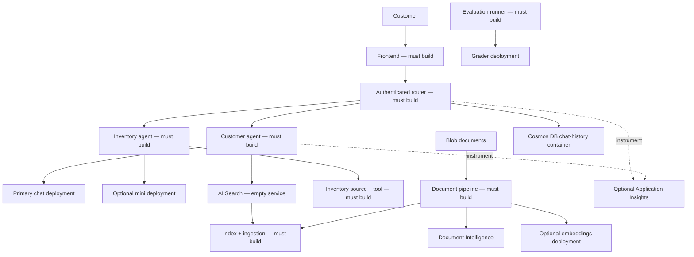

# Podpora strankam z več agenti — Načrt arhitekture za trgovino na drobno

**Poglavje 5: Rešitve z več AI agenti**

- [Domača stran tečaja](../README.md)
- [Poglavje 5](../docs/chapter-05-multi-agent/README.md)
- [Pogoj: integracija AI](../docs/chapter-02-ai-development/microsoft-foundry-integration.md)
- [Nadaljevanje: Načrtovanje zmogljivosti](../docs/chapter-06-pre-deployment/capacity-planning.md)
- [Okvir infrastrukture ARM](retail-multiagent-arm-template/README.md)

> **Vodnik za arhitekturo, ne delujoča aplikacija.** Edine implementacije za trgovino na drobno
> so datoteke `azuredeploy.json`, `azuredeploy.parameters.json` in `deploy.sh` v
> `retail-multiagent-arm-template/`. Polnila za usmerjevalnike/frontende so samo hello-world.
> Lokalno ni nobenega agente za trgovino na drobno, UI, cevi za vnos podatkov, ocenjevalca,
> optičnega bralnika ali testnega kompleta za aplikacijo.

## Pregled

**Cilj:** oblikovati sistem podpore strankam z agentom za stranke in agentom za inventar,
opredeliti, kaj infrastruktura zagotavlja, in načrtovati manjkajoče pogodbe aplikacije
ter preverjanje.

**Ciljna publika:** razvijalci, ki so zaključili lokalni
[primer klepeta](../../../examples/azure-openai-chat) in [primer kontejnerja z dvema storitvama](../../../examples/container-app/microservices).
Namenite 2–3 ure za študij arhitekture. Izdelava aplikacije je poseben
projekt: 80–120 ur razvoja je ilustrativna ocena načrtovanja za
izkušene razvijalce, **ne obljuba dostave**; priprava za produkcijo, testi,
varnostni pregled in upravljanje zahtevajo dodatno delo.

### Cilji učenja

- Razložiti usmerjanje, osnove, dovoljenja orodij in lastništvo pogovora.
- Razločiti identifikatorje modelov, imena nameščanj, različice API in različice ARM.
- Oblikovati vnos in pridobivanje dokumentov z ujemajočimi se dimenzijami vektorjev.
- Opredeliti preverljive funkcionalne zahteve, ocenjevalne in za povrnitev ob neuspehu.
- Ločiti neobvezne cilje arhitekture od resnično zagotovljenih virov.

## Arhitektura rešitve



To je **ciljna arhitektura aplikacije**, ne diagram delujočih storitev agentov.
Okvir ARM ustvari le osnovne storitve in dva polnilna kontejnerja.
Front Door, register, upravljane identitete, dodelitve vlog,
zasebni končni elementi, failover, instrumentacija aplikacije in opozorila niso vključeni.

### Odgovornosti in pogodbe

| Komponenta | Zahtevano vedenje | Dokaz pred dokončanjem |
|---|---|---|
| Frontend | Overi uporabnike, prikaže klepet, varno naloži dokumente | Testi UI in nalaganja, dostopne napake |
| Usmerjevalnik | Avtorizira zahteve, izbere agenta, omeji klice orodij/časovne omejitve | Testi usmerjanja, preglede avtorizacije, testi napak |
| Agent za stranke | Osnovni odgovori na podlagi odobrenih virov | Pravilni citati, izogibanje, če podatki manjkajo |
| Orodje za inventar | Bere avtoritativno zalogo z omejenimi dovoljenji | Deterministični testi zaloge; brez izmišljenih razpoložljivosti |
| Pipeline dokumentov | Izvleček, razdelitev, vdelava, indeksiranje, posodobitve/brisanje | Indeksirani pripomočki in vedenje ponovnega poskusa/mrtvih sporočil |
| Shramba pogovorov | Izolacija uporabnikov, uveljavitev hrambe | Preverjanje avtorizacije med uporabniki in testi časa hrambe |
| Ocenjevalni mehanizem | Primerja rezultate z resničnimi podatki in rubriko | Pokritost, število napak, ponovljiva poročila |

Usmerjevalnik si zamislite kot recepcijsko mizo, orodja pa kot omejene notranje sisteme:
izbira specialista ni dovoljenje za dostop do vseh strankinih podatkov.
Identiteto in dovoljenja uveljavljajte v kodi aplikacije in podatkovnih storitvah, ne v pozivih.

## Infrastruktura v primerjavi z aplikacijo

Pred zagonom preberite [navodila za okvir](retail-multiagent-arm-template/README.md).
Vsebuje seznam natančnih virov, načinov, stroškov in omejitev.

| Logična raba | Ime nameščanja ARM | Model / različica | Privzeta regija |
|---|---|---|---|
| Klepet s stranko | `gpt-4.1-chat` | `gpt-4.1` / `2025-04-14` | `eastus2` |
| Inventar | `gpt-4.1-mini-inventory` | `gpt-4.1-mini` / `2025-04-14` | `westus2`, neobvezno |
| Vdelave | `text-embedding-ada-002` | `text-embedding-ada-002` / `2` | `francecentral`, neobvezno |
| Ocenjevanje | `gpt-4.1-grader` | `gpt-4.1` / `2025-04-14` | Privzeta primarna regija |

Preverite razpoložljivost modelov/različic/SKU in kvote v **vsaki regiji**. Klepet/mini/ocenjevalec
uporablja `GlobalStandard`; vdelave uporabljajo `Standard`. Preslikave enot kapacitete v TPM so
odvisne od modela. Ne dodajajte drugačnih enot kapacitete kot univerzalno garancijo kvote.

Argument `model` v zahtevi Azure OpenAI je **ime nameščanja**, ne
nujno identifikator modela iz kataloga. Različica API za podatkovno ravnino `2024-10-21`
se razlikuje od različice modela `2025-04-14` in vira ARM `apiVersion`.
Model, ki ni na voljo, ni mogoče popraviti samo z menjavo različice API za podatkovno ravnino.

`--no-multi-region` preskoči sekundarne in račune za vdelave. Ostajata primarni klepet in
neodvisen račun ocenjevalca. Ločeni računi modelov ne zagotavljajo samodejnega
preklopa; to zahteva usmerjanje aplikacije, združljiva nameščanja, zdravstvene preglede,
omejitve ponovnega poskusa in pregled lokacije podatkov.

## Načrt implementacije

### 1. Začnite z enim preizkušenim interakcijskim primerom

Pred zagonom velikega okvira uporabite lokalni primer klepeta za vzpostavitev
povezave za sklepanje. Določite eno reprezentativno vprašanje stranke, odobren
vir odgovorov, pričakovani citat in vedenje ob neuspehu, če vir manjka.

### 2. Določite meje za usmerjanje in orodja

Ustvarite lasten izvor usmerjevalnika, manifest odvisnosti, Dockerfile in teste. Ilustrativna pogodba
bi lahko bila `POST /chat` z `{"message":"...","conversation_id":"..."}`.
**Ta končna točka je oblikovalski predlog; ni implementirana v ARM predlogi.**

Preverite tipe/telje telesa, pridobite uporabniško identiteto iz avtentikacije, uveljavite
lastništvo pogovorov, uporabite časovne omejitve zahtev in vrnite smiselne kode napak.
Ne obravnavajte neuspehov HTTP ali praznih odgovorov kot uspešne rezultate agenta.

### 3. Izvedite osnove in vnos podatkov

ARM predloga ne ustvari iskalnega indeksa. To je **referenčni JSON
odlomek za prilagoditev pri lastni definiciji indeksa**, ne datoteka, ki je že v repozitoriju:

```json
{
  "name": "retail-product-index",
  "fields": [
    {"name": "id", "type": "Edm.String", "key": true},
    {"name": "title", "type": "Edm.String", "searchable": true},
    {"name": "content", "type": "Edm.String", "searchable": true},
    {"name": "category", "type": "Edm.String", "filterable": true},
    {
      "name": "content_vector",
      "type": "Collection(Edm.Single)",
      "searchable": true,
      "dimensions": 1536,
      "vectorSearchProfile": "retail-profile"
    }
  ],
  "vectorSearch": {
    "algorithms": [{"name": "retail-hnsw", "kind": "hnsw"}],
    "profiles": [{"name": "retail-profile", "algorithm": "retail-hnsw"}]
  }
}
```

Profil povezuje vektorsko polje z njegovim algoritmom. Dimenzije se morajo ujemati z
dejanskim izhodom vdelave (1536 za ta `ada-002` nameščanje). Za pridobivanje v Python-u
uporabite `azure.search.documents.models.VectorizedQuery` namesto nepopolnega
slovarja brez vrste poizvedbe vektorja:

```python
# Reference function only: supply an authenticated async SearchClient and an embedding.
from azure.search.documents.models import VectorizedQuery

async def retrieve(search_client, embedding):
    results = await search_client.search(
        search_text=None,
        vector_queries=[VectorizedQuery(
            vector=embedding,
            k_nearest_neighbors=5,
            fields="content_vector"
        )],
        select=["id", "title", "content"]
    )
    return [document async for document in results]
```

Ustvarite ločeno implementacijo vnosa podatkov, ki:

1. Avtorizira dostop do nalaganja in preverja tip in velikost vsebine.
2. Bere zasebne blob-e z avtoriziranimi klici SDK. Sam URL zasebnega blob-a
   **ni** berljiv vhod Document Intelligence; pošljite prenesene bajte z
   `AnalyzeDocumentRequest(bytes_source=...)` ali uporabite ustrezno omejen,
   kratkotrajni SAS po pregledu zahtev glede dostopa.
3. Izvleče besedilo, ga razdeli v kose, da ustreza omejitvam vdelav, in ustvari vdelave.
4. Ustvari stabilne veljavne ključe dokumentov in naloži kose z ujemajočimi se vektorji.
5. Preveri rezultate indeksiranja po dokumentih, upravlja ponovitve ter posodablja/izbriše zastarele podatke.

Ne vstavljajte poljubnih uporabniških ključev/vrednosti v OData filtre. Dovolite samo določena polja,
preverite tipe vrednosti in ubežite navednice v nizih. Boolovi in numerični filtri potrebujejo
tipizirane vrednosti, ne navajenih nizov.

### 4. Spletna osnova

**Bing Search v7 je bil upokojeni 11. avgusta 2025.** Stari `Microsoft.Bing/accounts`
vir in `api.bing.microsoft.com/v7.0/search` primeri niso podprta
implementacijska pot. Ocenite trenutno podprto integracijo osnove v
Microsoft Foundry in njegov SDK, dovoljenja, obračun ter zahteve za navajanje;
nobena ni tukaj implementirana. Ni neposredna zamenjava za upokojeno končno točko.

### 5. Dodajte telemetrijo in ocenjevanje

Ustvarjanje Application Insights ne instrumentira kode. Uporabite podprto Azure Monitor
OpenTelemetry instrumentacijo pri gradnji nove aplikacije, prenesite sledilni
kontekst med storitvami in se izogibajte beleženju uporabniških pozivov, dokumentov ali skrivnosti.
Skrčenje poizvedbe ne anonimizira te.

Merite trajanje zahtev, napake usmerjanja/orodij, relevantnost pridobivanja, pravilnost navajanja,
uporabo žetonov in vzdržanost. Shranjujte dejstva o zalogi/politiki kot osnovo
skupaj z ocenitvenimi primeri: ocenjevalec ne more zanesljivo ugotoviti dejanske točnosti
samo na podlagi vprašanja in odgovora.

Namestitev ocenjevalca ni izvajalec ocenjevanja. Implementirajte verzionirano rubriko,
strukturiran izhod/validacijo sheme, preverjanje razpona ocen, štetje napak prevoza,
in človeško pregledane primere. Nepravilne/napake primere poročajte ločeno; ne spreminjajte
jih v uspešne ocene ali tiho vključite kot odzive modela z ničelno kakovostjo.

Prav tako nekaj preverjanj ključnih besed ni varnostna certifikacija. Neuspešna HTTP
zahteva, manjkajoča testna strategija ali prazen odgovor morajo narediti test **nedorečenega ali
neuspešnega**, ne dati ocene „100 % varno“. Izvajajte pooblaščene teste z ustreznimi
orodji in človeškim pregledom pred kakršnokoli trditvijo o pripravljenosti za produkcijo.

### 6. Namestite svojo aplikacijo

Ustvarite lastne izvorne imenike, manifeste, teste, register in dovoljenja za poteg slike.
Zamenjajte nadomestne vrednosti z zgrajenimi slikami in posodobite vstopne točke/preverjanja,
da se ujemajo s poslušalnim pristaniščem vsake aplikacije. Konfigurirajte spremenljivke okolja za
ali eksplicitno podprto preslikavo azd okolja.

Pod azd storitvijo ni nobenega generičnega slovarja `config`, ki bi samodejno
ustvarjal spremenljivke runtime okolja. `azd env set` spremeni le vire, ki
eksplicitno uporabljajo te vrednosti. V tem okvirju ni implementiranega nobenega canary,
seznama regij ali finotunerskega hooka.

## Praktične oblikovne vaje

To so **vaje za arhitekturo**, ne trditve o izvedljivi začetni kodi za prodajo.

### Vaja 1: Preveri mejo

**Izhodišče:** tri datoteke v `retail-multiagent-arm-template/`.
**Cilj:** razlikovati med provisioniranjem in funkcionalnostjo aplikacije.
Odpri `azuredeploy.json`, poišči oba kontejnerska slike in vrednosti `targetPort`,
nato naštej manjkajoče aplikacijske komponente v repozitoriju.

**Merila uspeha / odgovor:** obe sliki sta hello-world nadomestki, ki poslušata
na vratih 80; agenti, klepetalni UI, router handlerji, index/ingestion, evaluator in skener
manjkajo. Uspešen root request nadomestka ne preverja `/chat`.
**Pogosta težava:** interpretacija imen virov, kot je `retail-router`, kot delujoče kode.

### Vaja 2: Sledi konfiguraciji vektorja

**Izhodišče:** zgornji JSON indeks.
**Cilj:** razumeti razmerje med poljem → profilom → algoritmom.
Določite, katere vrednosti je treba spremeniti pri preklopu na model embeddinga z
drugačno izhodno dimenzijo, nato pregledajte funkcijo `retrieve`.

**Merila uspeha / odgovor:** spremenite polje `dimensions` na dejansko dolžino vektorja;
obdržite `vectorSearchProfile` usklajen z deklariranim profilom in njegovim algoritmom;
poizvedba `fields` mora poimenovati vektorsko polje. Ponovno ustvarite obstoječe vektorje dokumentov,
ko se embedding model spremeni.
**Pogosta težava:** spreminjanje le imena modela ob ohranitvi nezdružljivih vektorjev.

### Vaja 3: Določi test za odpoved

**Izhodišče:** tabela odgovornosti.
**Cilj:** preprečiti lažen uspeh.
Napišite pričakovano vedenje za nedosegljiv inventory API, iskalni indeks brez
ujemajočih dokumentov in zahtevek za ocenjevanje, ki vrača HTTP 503.

**Merila uspeha / odgovor:** brez izmišljenih vrednosti inventarja; eksplicitna vzdržanost ali
eskalacija, ko kontekst manjka; ocenjevanje poroča o transportni napaki namesto
o uspehu kvalitete ali varnosti. Dodajte izvedljive teste, ko gradite aplikacijo.
**Pogosta težava:** zajemanje vsake izjeme in nadaljevanje z praznim odgovorom.

## Stroški, odpravljanje težav in čiščenje

- Infrastruktura ima tekoče stroške tudi z praznimi iskalnimi indeksi in nadomestnimi
  aplikacijami. Uporabite trenutne regionalne cene; niti "minimalno" niti večregijsko ne pomeni brezplačno.
- Stroški tokenov so odvisni od modela, predpomnjenega/nepredpomnjenega vnosa, izhoda in SKU namestitve.
  Usmerjanje lahko prihrani denar samo, če opravljena obremenitev in rezultati kvalitete to upravičujejo;
  fiksna 60–80 % prihranek ni zagotovljena.
- Pred provisioniranjem preverite razpoložljivost modela in kvoto; razlikujte dovoljenje,
  napake pri imenu namestitve, regiji, različici modela in različici API-ja.
- Ne zaženite manjkajočih ukazov `setup-data.sh`, evaluator CLI-jev ali ukazov `pytest tests/`.
  Njihove implementacije so del vašega razvojnega seznama.
- Okvir je le za ARM: sledite njegovim
  [navodilom za preverjanje in čiščenje](retail-multiagent-arm-template/README.md).
  `azd down` ne upravlja s temi viri.

## Sorodni viri

- [Delujoč lokalni vzorec klepeta](../../../examples/azure-openai-chat)
- [Delujoč vzorec dveh vsebnikov storitev](../../../examples/container-app/microservices)
- [Vektorji iskalnih indeksov AI](https://learn.microsoft.com/azure/search/vector-search-how-to-create-index)
- [Dokumentacija Container Apps](https://learn.microsoft.com/azure/container-apps/)
- [Odpravljanje napak](../docs/chapter-07-troubleshooting/common-issues.md)
- [Prijavite težavo](https://github.com/microsoft/AZD-for-beginners/issues)

---

<!-- CO-OP TRANSLATOR DISCLAIMER START -->
**Omejitev odgovornosti**:
Ta dokument je bil preveden z uporabo AI prevajalske storitve [Co-op Translator](https://github.com/Azure/co-op-translator). Čeprav si prizadevamo za natančnost, vas prosimo, da upoštevate, da avtomatizirani prevodi lahko vsebujejo napake ali netočnosti. Izvirni dokument v njegovem izvirnem jeziku je treba obravnavati kot avtoritativni vir. Za kritične informacije je priporočljiv strokovni človeški prevod. Ne odgovarjamo za morebitna nesporazume ali napačne interpretacije, ki izhajajo iz uporabe tega prevoda.
<!-- CO-OP TRANSLATOR DISCLAIMER END -->