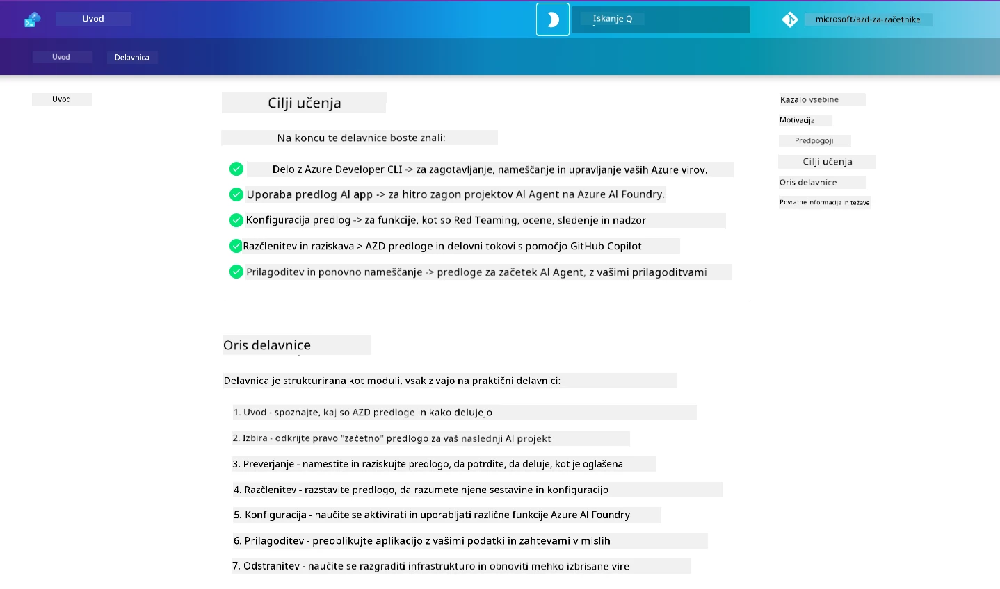

<div align="center">
  <div style="background: linear-gradient(135deg, #0078d4, #106ebe); border-radius: 10px; padding: 20px; margin: 20px 0; box-shadow: 0 4px 15px rgba(0, 120, 212, 0.3); border: 2px solid #005a9e;">
    <h2 style="color: white; margin: 0; font-size: 24px; text-shadow: 1px 1px 2px rgba(0,0,0,0.3);">
      🎯 Delavnica AZD za razvijalce umetne inteligence
    </h2>
    <p style="color: white; margin: 10px 0 0 0; font-size: 16px; text-shadow: 1px 1px 2px rgba(0,0,0,0.3);">
      <strong>Praktična delavnica za gradnjo AI aplikacij z ukazno vrstico Azure Developer CLI.</strong><br>
      Dokončajte 7 modulov, da osvojite predloge AZD in delovne procese uvajanja umetne inteligence.
    </p>
    <div style="margin-top: 15px;">
      <span style="background: rgba(255,255,255,0.2); padding: 5px 10px; border-radius: 15px; color: white; font-size: 14px;">
        📅 Pregled navodil izvora: November 2026
      </span>
    </div>
  </div>
</div>

# Delavnica AZD za razvijalce umetne inteligence

Dobrodošli na praktični delavnici za učenje Azure Developer CLI (AZD) s poudarkom na uvajanju aplikacij umetne inteligence. Ta delavnica vam pomaga pridobiti praktično razumevanje predlog AZD v 3 korakih:

1. **Odkritje** - poiščite predlogo, ki je primerna za vas.
1. **Uvajanje** - uvedite in preverite, da deluje.
1. **Prilagoditev** - spremenite in prilagodite, da bo vaša!

V času te delavnice se boste tudi seznanili z osnovnimi orodji in delovnimi procesi za razvijalce, ki vam bodo pomagali poenostaviti vašo celostno razvojno pot.

<br/>

## Vodnik v brskalniku

Lekcije delavnice so v Markdownu. Lahko jih neposredno pregledujete na GitHubu ali pa zaženete predogled v brskalniku, kot je prikazano na spodnjem posnetku zaslona.



Če želite uporabiti to možnost - naredite fork repozitorija na svoj profil in zaženite GitHub Codespaces. Ko je terminal VS Code aktiven, vnesite ta ukaz:

Ta predogled v brskalniku deluje v GitHub Codespaces, razvojnih kontejnerjih ali lokalni kopiji z nameščenim Pythonom in MkDocs.

```bash title="" linenums="0"
python -m pip install -r requirements-dev.txt
python -m mkdocs serve --config-file workshop/mkdocs.yml
```

Zaženite te ukaze iz **koreninskega repozitorija tečaja**, ne iz posebej inicializiranega vzorca AI. Držite predogled v ospredju, da bodo napake ostale vidne; ustavite ga s Ctrl+C. Če želite preveriti stran brez strežnika, zaženite `python -m mkdocs build --strict --config-file workshop/mkdocs.yml`.

V nekaj sekundah se bo pojavilo pojavnostno okno. Izberite možnost za `Open in browser`. Spletni vodnik se bo zdaj odprl v novem zavihku brskalnika. Nekatere prednosti tega predogleda:

1. **Vgrajeno iskanje** - hitro poiščite ključne besede ali lekcije.
1. **Ikona za kopiranje** - pokažite se nad blokom kode, da vidite to možnost.
1. **Preklop teme** - preklapljajte med temno in svetlo temo.
1. **Dobite pomoč** - kliknite ikono Discord v nogi, da se pridružite!

<br/>

## Pregled delavnice

**Trajanje:** 3-4 ure  
**Raven:** Začetna do srednja  
**Predpogoji:** Poznavanje Azure, konceptov AI, VS Code in ukaznih orodij.

To je praktična delavnica, kjer se učite z izvajanjem. Ko opravite vaje, priporočamo, da pregledate učni načrt AZD za začetnike, da nadaljujete svojo učno pot z najboljšimi praksami za varnost in produktivnost.

| Čas| Modul  | Cilj |
|:---|:---|:---|
| 15 min | [Uvod](docs/instructions/0-Introduction.md) | Upostavitev temeljev, razumevanje ciljev |
| 30 min | [Izbira AI predloge](docs/instructions/1-Select-AI-Template.md) | Raziskava možnosti in izbira začetne |
| 30 min | [Preverjanje AI predloge](docs/instructions/2-Validate-AI-Template.md) | Uvedba privzete rešitve v Azure |
| 30 min | [Analiza AI predloge](docs/instructions/3-Deconstruct-AI-Template.md) | Raziskava strukture in konfiguracije |
| 30 min | [Nastavitev AI predloge](docs/instructions/4-Configure-AI-Template.md) | Aktivacija in preizkus razpoložljivih funkcij |
| 30 min | [Prilagoditev AI predloge](docs/instructions/5-Customize-AI-Template.md) | Prilagoditev predloge vašim potrebam |
| 30 min | [Razgradnja infrastrukture](docs/instructions/6-Teardown-Infrastructure.md) | Čiščenje in sprostitev virov |
| 15 min | [Zaključek in nadaljnji koraki](docs/instructions/7-Wrap-up.md) | Učilni viri, izziv delavnice |

<br/>

## Kaj se boste naučili

Predstavljajte si predlogo AZD kot učno peskovnik za raziskovanje različnih zmogljivosti in orodij za celoviti razvoj v Microsoft Foundry. Do konca te delavnice boste imeli intuitivni občutek za različna orodja in koncepte v tem kontekstu.

| Koncept  | Cilj |
|:---|:---|
| **Azure Developer CLI** | Razumeti ukaze orodja in delovne procese |
| **AZD predloge**| Razumeti strukturo projekta in konfiguracijo |
| **Azure AI Agent**| Priprava in uvajanje projekta Microsoft Foundry |
| **Azure AI Search**| Omogočiti inženiring konteksta z agenti |
| **Opazovanje**| Raziskati sledenje, spremljanje in ocenjevanja |
| **Red Teaming**| Raziskati sovražno testiranje in omilitve |

<br/>

## Struktura delavnice

Delavnica je strukturirana tako, da vas popelje od odkritja predloge, do uvajanja, analize in prilagoditve - z uporabo uradne [Začetek z AI agenti](https://github.com/Azure-Samples/get-started-with-ai-agents) začetne predloge kot osnovo.

### [Modul 1: Izbira AI predloge](docs/instructions/1-Select-AI-Template.md) (30 min)

- Kaj so AI predloge?
- Kje lahko najdem AI predloge?
- Kako začeti graditi AI agente?
- **Lab**: Hiter začetek v Codespaces ali razvojni posodi

### [Modul 2: Preverjanje AI predloge](docs/instructions/2-Validate-AI-Template.md) (30 min)

- Kakšna je arhitektura AI predloge?
- Kakšen je delovni proces razvoja z AZD?
- Kako dobim pomoč pri razvoju z AZD?
- **Lab**: Uvedba in preverjanje predloge AI agentov

### [Modul 3: Analiza AI predloge](docs/instructions/3-Deconstruct-AI-Template.md) (30 min)

- Raziskovanje okolja v `.azure/` 
- Raziskovanje nastavitve virov v `infra/` 
- Raziskovanje konfiguracije AZD v `azure.yaml`s
- **Lab**: Spreminjanje okoljskih spremenljivk in ponovna uvedba

### [Modul 4: Nastavitev AI predloge](docs/instructions/4-Configure-AI-Template.md) (30 min)
- Raziskovanje: Pridobivanje z izboljšanim iskanjem
- Raziskovanje: Ovrednotenje agentov in Red Teaming
- Raziskovanje: Sledenje in spremljanje
- **Lab**: Raziskovanje AI agenta + opazovanje 

### [Modul 5: Prilagoditev AI predloge](docs/instructions/5-Customize-AI-Template.md) (30 min)
- Določitev: PRD z zahtevami scenarija
- Nastavitev: Okoljske spremenljivke za AZD
- Implementacija: Hooki za življenjski cikel za dodatne naloge
- **Lab**: Prilagoditev predloge za moj scenarij

### [Modul 6: Razgradnja infrastrukture](docs/instructions/6-Teardown-Infrastructure.md) (30 min)
- Povzetek: Kaj so AZD predloge?
- Povzetek: Zakaj uporabljati Azure Developer CLI?
- Naslednji koraki: Poskusite drugo predlogo!
- **Lab**: Odpravljanje infrastrukture in čiščenje

<br/>

## Izziv delavnice

Želite izzvati sebe z več? Tukaj je nekaj predlogov za projekte – ali pa delite svoje ideje z nami!!

| Projekt | Opis |
|:---|:---|
|1. **Analiza zahtevne AI predloge** | Uporabite delovni proces in orodja, ki smo jih opisali, in preverite, ali lahko uvedete, preverite in prilagodite drugačno AI rešitveno predlogo. _Kaj ste se naučili?_|
|2. **Prilagoditev vašemu scenariju**  | Poskusite napisati PRD (dokument zahtev izdelka) za drug scenarij. Nato uporabite GitHub Copilot v vašem repozitoriju predloge v Agent Model in ga prosite, da vam ustvari delovni proces prilagoditve. _Kaj ste se naučili? Kako bi lahko izboljšali te predloge?_|
| | |

## Imate povratne informacije?

1. Objavite težavo na tem repozitoriju – označite jo z `Workshop` za lažjo uporabo.
1. Pridružite se Discordu Microsoft Foundry - povežite se s sotekmovalci!


| | | 
|:---|:---|
| **📚 Domača stran tečaja**| [AZD za začetnike](../README.md)|
| **📖 Dokumentacija** | [Začni z AI predlogami](https://learn.microsoft.com/en-us/azure/ai-foundry/how-to/develop/ai-template-get-started)|
| **🛠️AI predloge** | [Microsoft Foundry predloge](https://ai.azure.com/templates) |
|**🚀 Naslednji koraki** | [Začni delavnico](#workshop-overview) |
| | |

<br/>

---

**Navigacija:** [Glavni tečaj](../README.md) | [Uvod](docs/instructions/0-Introduction.md) | [Modul 1: Izbira predloge](docs/instructions/1-Select-AI-Template.md)

**Ste pripravljeni začeti graditi AI aplikacije z AZD?**

[Začni delavnico: Uvod →](docs/instructions/0-Introduction.md)

---

<!-- CO-OP TRANSLATOR DISCLAIMER START -->
**Omejitev odgovornosti**:
Ta dokument je bil preveden z uporabo AI prevajalske storitve [Co-op Translator](https://github.com/Azure/co-op-translator). Čeprav si prizadevamo za natančnost, vas prosimo, da upoštevate, da avtomatizirani prevodi lahko vsebujejo napake ali netočnosti. Izvirni dokument v njegovem izvirnem jeziku je treba obravnavati kot avtoritativni vir. Za kritične informacije je priporočljiv strokovni človeški prevod. Ne odgovarjamo za morebitna nesporazume ali napačne interpretacije, ki izhajajo iz uporabe tega prevoda.
<!-- CO-OP TRANSLATOR DISCLAIMER END -->