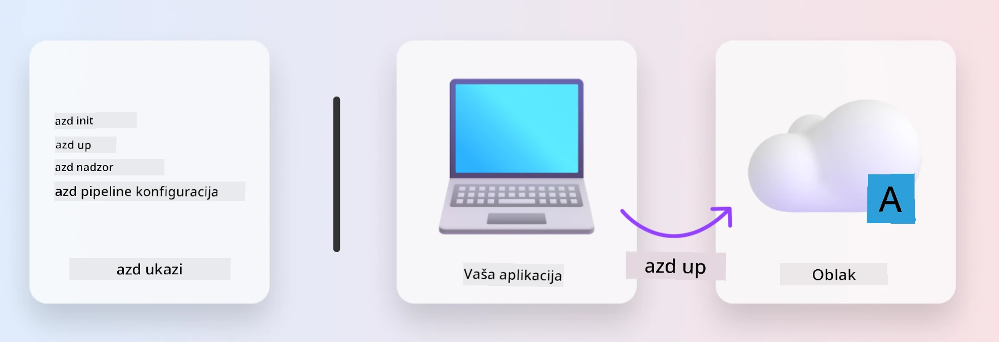
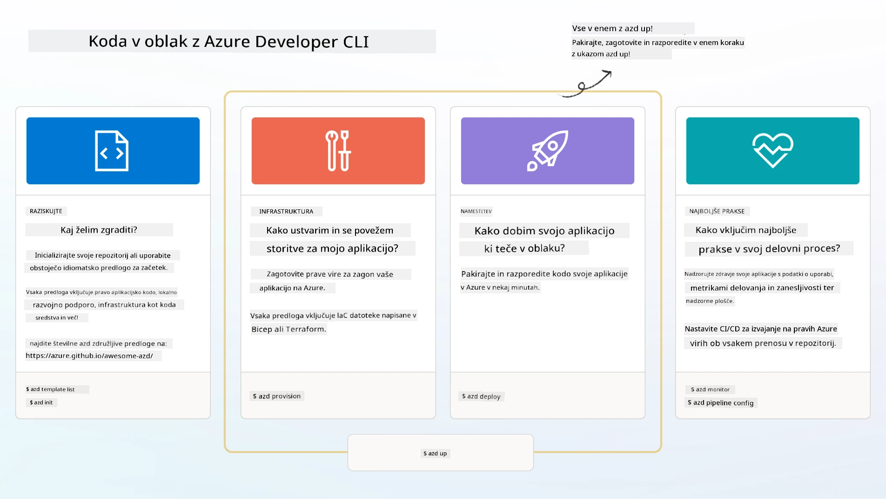

# 1. Izberite predlogo

!!! tip "DO KONCA TEGA MODULA BOSTE ZNALI"

    - [ ] Describe what AZD templates are
    - [ ] Discover and use AZD templates for AI
    - [ ] Get started with the AI Agents template
    - [ ] **Lab 1:** AZD Quickstart in Codespaces or a dev container

---

## 1. Prispodoba graditelja

Zgraditi sodobno poslovno pripravljeno AI aplikacijo _od nič_ je lahko zastrašujoče. To je nekoliko kot graditi svojo novo hišo sam, opeko za opeko. Da, mogoče je! A ni najbolj učinkovit način, da dosežete želeni končni rezultat! 

Namesto tega pogosto začnemo z obstoječim _načrtom_ in sodelujemo z arhitektom, da ga prilagodimo našim osebnim zahtevam. In prav to je pristop, ki ga moramo uporabiti pri gradnji inteligentnih aplikacij. Najprej najdite dober arhitekturni načrt, ki ustreza vašemu problemu. Nato sodelujte z arhitektom rešitve, da prilagodite in razvijete rešitev za vaš specifičen primer.

A kje lahko najdemo te načrte? In kako najdemo arhitekta, ki nas bo naučil, kako te načrte prilagoditi in uvesti sami? V tej delavnici bomo na ta vprašanja odgovorili s predstavitvijo treh tehnologij:

1. [Azure Developer CLI](https://aka.ms/azd) – odprtokodno orodje, ki pospeši razvojno pot od lokalnega razvoja (gradnje) do uvajanja v oblak (distribucije).
1. [Microsoft Foundry Templates](https://ai.azure.com/templates) – standardizirani odprtokodni repozitoriji, ki vsebujejo vzorčno kodo, infrastrukturo in konfiguracijske datoteke za uvajanje AI arhitekture rešitve.
1. [GitHub Copilot Agent Mode](https://code.visualstudio.com/docs/copilot/chat/chat-agent-mode) – kodni agent, ki temelji na znanju Azure in nas lahko vodi pri razumevanju kode ter spreminjanju - z uporabo naravnega jezika.

S temi orodji v rokah lahko zdaj _odkrijemo_ pravo predlogo, jo _uvedemo_, da preverimo, če deluje, in jo _prilagodimo_, da ustreza našim specifičnim primerom. Poglejmo, kako to deluje.


---

## 2. Azure Developer CLI

Ukazna vrstica [Azure Developer CLI](https://learn.microsoft.com/en-us/azure/developer/azure-developer-cli/) (ali `azd`) je odprtokodno orodje, ki lahko pospeši vašo pot od kode do oblaka z naborom prijaznih ukazov za razvijalce, ki dosledno delujejo v vašem IDE-ju (razvoj) in CI/CD (devops) okoljih.

Z `azd` je vaša pot nameščanja lahko preprosta kot:

- `azd init` - Inicializira nov AI projekt iz obstoječe AZD predloge.
- `azd up` - V enem koraku pripravi infrastrukturo in namesti vašo aplikacijo.
- `azd monitor` - Dobite spremljanje v realnem času in diagnostiko za vašo nameščeno aplikacijo.
- `azd pipeline config` - Nastavite CI/CD cevovode za avtomatizacijo nameščanja v Azure.

**🎯 | VAJA**: <br/> Raziščite ukazno vrstico `azd` v vašem trenutnem delovnem okolju zdaj. To je lahko GitHub Codespaces, razvojni zabojček ali lokalna kopija z nameščenimi predpogoji. Začnite tako, da vpišete ta ukaz, da vidite, kaj orodje zmore:

```bash title="" linenums="0"
azd help
```



---

## 3. AZD Predloga

Da lahko `azd` to doseže, mora poznati infrastrukturo, ki jo je treba pripraviti, nastavitve konfiguracije, ki jih je treba uveljaviti, in aplikacijo, ki jo je treba namestiti. Tu pridejo v poštev [AZD predloge](https://learn.microsoft.com/en-us/azure/developer/azure-developer-cli/azd-templates?tabs=csharp).

AZD predloge so odprtokodni repozitoriji, ki združujejo vzorčno kodo z infrastrukturnimi in konfiguracijskimi datotekami, potrebnimi za namestitev arhitekture rešitve.
Z uporabo pristopa _Infrastructure-as-Code_ (IaC) omogočajo, da so definicije virov predloge in nastavitve konfiguracije pod nadzorom različic (tako kot izvorna koda aplikacije) – kar ustvarja ponovno uporabne in dosledne delovne tokove med uporabniki tega projekta.

Pri ustvarjanju ali ponovni uporabi AZD predloge za _vaš_ scenarij razmislite o naslednjih vprašanjih:

1. Kaj gradite? → Ali obstaja predloga, ki ima začetno kodo za ta scenarij?
1. Kako je vaša rešitev zasnovana? → Ali obstaja predloga z potrebnimi viri?
1. Kako je vaša rešitev nameščena? → Razmislite o `azd deploy` s pre/post-obdelovalnimi kljuke!
1. Kako jo lahko dodatno optimizirate? → Razmislite o vgrajenem spremljanju in avtomatizacijskih cevovodih!

**🎯 | VAJA**: <br/>
Obiščite galerijo [Awesome AZD](https://azure.github.io/awesome-azd/) in uporabite filtre za raziskovanje več kot 250 trenutnih predlog. Preverite, ali lahko najdete tisto, ki ustreza zahtevam _vašega_ scenarija.



---

## 4. AI Predloge aplikacij

Za aplikacije, ki uporabljajo umetno inteligenco, Microsoft nudi specializirane predloge z značilnostmi **Microsoft Foundry** in **Foundry Agents**. Te predloge pospešujejo vašo pot do izdelave inteligentnih, pripravljeni za produkcijo aplikacij.

### Predloge Microsoft Foundry & Foundry Agents

Izberite predlogo spodaj za namestitev. Vsaka predloga je na voljo na [Awesome AZD](https://azure.github.io/awesome-azd/) in se lahko inicializira z enim ukazom.

| Predloga | Opis | Ukaz za namestitev |
|----------|-------------|----------------|
| **[AI Chat z RAG](https://github.com/Azure-Samples/azure-search-openai-demo)** | Poglobljena klepetalna aplikacija, ki temelji na iskanju | `azd init -t Azure-Samples/azure-search-openai-demo .` |
| **[Začnite z AI Agenti](https://github.com/Azure-Samples/get-started-with-ai-agents)** | Klepetalna aplikacija s podporo agentov; uporabljena skozi cel delavnico | `azd init -t Azure-Samples/get-started-with-ai-agents .` |
| **[Začnite z AI Klepetom](https://github.com/Azure-Samples/get-started-with-ai-chat)** | Začetna AI klepetalna aplikacija | `azd init -t Azure-Samples/get-started-with-ai-chat .` |

Alternativno: inicializirajte **eno** predlogo v svojem praznem imeniku. Zadnji argument `.` izbere ta imenik; če ga izpustite v trenutnih verzijah AZD, se ustvari podimenik s imenom predloge. Inicializacija prenese projekt; `azd up` izvede plačljivo namestitev po tem, ko pregledate predpogoje, vire, podporo regij in kvote.

### Hiter začetek

1. **Prebrskajte predloge**: Obiščite [https://azure.github.io/awesome-azd/](https://azure.github.io/awesome-azd/) in filtrirajte po `AI`, `Agents` ali `Microsoft Foundry`
2. **Izberite svojo predlogo**: Izberite tisto, ki ustreza vaši uporabi
3. **Inicializirajte**: Zaženite ukaz `azd init` za izbrano predlogo
4. **Namestite**: Zaženite `azd up` za pripravo in namestitev

**🎯 | VAJA**: <br/>
Izberite eno izmed zgornjih predlog glede na vaš scenarij:

- **Nadaljujete delavnico?** → Izberite **Začnite z AI Agenti**
- **Gradite iskalno podprt klepet?** → Raziščite posebej **AI Chat z RAG**
- **Potrebujete drugo arhitekturo?** → Prebrskajte galerijo in preverite dejanski repozitorij, stanje implementacije in predpogoje

```bash title="Initialize the workshop template in an empty directory" linenums="0"
azd init -t Azure-Samples/get-started-with-ai-agents .
azd auth login
azd up
```

!!! info "Raziščite več predlog"
    Galerija [Awesome AZD](https://azure.github.io/awesome-azd/) vsebuje več kot 250 predlog. Uporabite filtre, da poiščete predloge, ki ustrezajo vašim specifičnim zahtevam za jezik, okvir in Azure storitve.

---

<!-- CO-OP TRANSLATOR DISCLAIMER START -->
**Omejitev odgovornosti**:
Ta dokument je bil preveden z uporabo AI prevajalske storitve [Co-op Translator](https://github.com/Azure/co-op-translator). Čeprav si prizadevamo za natančnost, vas prosimo, da upoštevate, da avtomatizirani prevodi lahko vsebujejo napake ali netočnosti. Izvirni dokument v njegovem izvirnem jeziku je treba obravnavati kot avtoritativni vir. Za kritične informacije je priporočljiv strokovni človeški prevod. Ne odgovarjamo za morebitna nesporazume ali napačne interpretacije, ki izhajajo iz uporabe tega prevoda.
<!-- CO-OP TRANSLATOR DISCLAIMER END -->