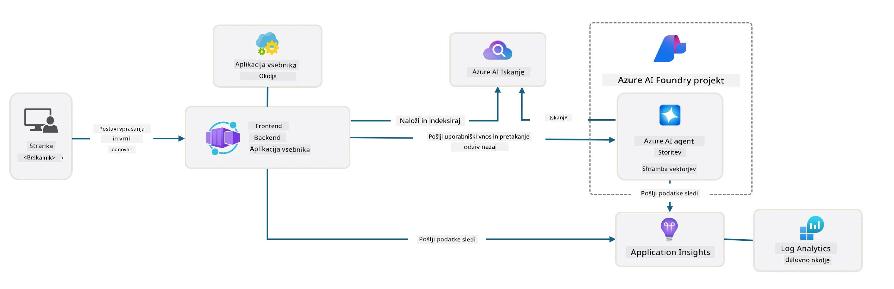
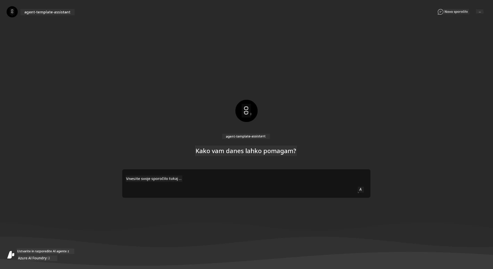

# 2. Preverite predlogo

> Vodilo izvora preverjeno glede na AZD 1.37.2 in trenutni vzorec 4. novembra 2026. Posnetki zaslona so ilustrativni; navigacija v portalu, privzete nastavitve predloge in razpoložljivost storitev se lahko spremenijo. Ta pregled ni izvedel dejanske implementacije v Azure.

!!! tip "OB KONCU TEGA MODULA BOSTE ZMOGLI"

    - [ ] Identify the sample's prerequisites and intended resources
    - [ ] Deploy the selected template into an intentional environment
    - [ ] Verify the application and agent behavior separately from deployment success
    - [ ] **Lab 2:** Record evidence of a working baseline, or an actionable deployment blocker

---

## 1. Preverite predpogoje

Ukazna vrstica [Azure Developer CLI](https://learn.microsoft.com/azure/developer/azure-developer-cli/) upravlja z nameščanjem aplikacij z uporabo konfiguracije, infrastrukture in kode predloge. Preverite svojo nameščeno različico:

```bash
azd version
```

Po potrebi uporabite [trenutna navodila za namestitev/posodobitev](https://learn.microsoft.com/azure/developer/azure-developer-cli/install-azd). Pregledani primer deklarira AZD `>=1.14.0`, vendar je priporočena trenutna podprta izdaja. Izbirni AI razširitve imajo ločene zahteve glede različic; običajen potek dela `azd up` tega primera ne zahteva razširitve agentov.

Pred predlogom si preberite [nastavitev računa Azure](https://github.com/Azure-Samples/get-started-with-ai-agents/blob/main/docs/azure_account_setup.md) in [vodnik za nameščanje](https://github.com/Azure-Samples/get-started-with-ai-agents/blob/main/docs/deployment.md) vzorčnega primera. Potrdite svojo naročnino, dovoljenja, razpoložljivost modela, regionalno kvoto in pričakovane stroške. Brezplačen račun Azure ne zagotavlja dostopa ali brezplačne uporabe vsake potrebne storitve.

## 2. Odprite izbrani primer

Uporabite repozitorij [Začnite z AI agenti](https://github.com/Azure-Samples/get-started-with-ai-agents), inicializiran v modulu 1. Če ga še niste inicializirali, izberite eno od teh možnosti:

- Odprite [Codespace za primer](https://github.com/codespaces/new/Azure-Samples/get-started-with-ai-agents).
- Klonirajte primer in sledite lokalni/dev-container nastavitvi.
- V **praznem imeniku** zaženite:

```bash
azd init --template Azure-Samples/get-started-with-ai-agents .
```

Ne inicializirajte druge predloge znotraj obstoječega projekta. Nadaljnje ukaze zaženite iz korena primera, ki vsebuje `azure.yaml`, ne iz korena repozitorija tečaja.

Primer gosti klepetalno aplikacijo, ki temelji na agentih v Container Apps, in zaganja podporne Foundry vire. Raje preglejte trenutno arhitekturo in izbirne storitve, kot da bi stare slike obravnavali kot točen inventar virov.



## 3. Namerno izvedite namestitev

```bash
azd auth login
azd up
```

Preglejte pozive:

1. Izberite edinstveno ime okolja AZD.
2. Izberite želeno naročnino, ne samo katero koli, ki se ponudi prva.
3. Izberite regijo, ki jo podpira zahtevan model/različica/SKU in vaša kvota.
4. Preberite izhod ukazov za zaganjanje, nameščanje in postopke po nameščanju.

Privzete vrednosti pregledujejo `gpt-5-mini`, različico `2025-08-07` in `GlobalStandard`. Preverite svojo inicializirano predlogo in [podprte kombinacije model/regija](https://learn.microsoft.com/azure/ai-services/agents/concepts/model-region-support). Nobena regija ni univerzalno zagotovljena.

Trajanje namestitve se razlikuje. Če zaganjanje spodleti, ohranite napako in odpravite njen vzrok pred ponovnim poskusom. Ne brišite nameščanja ali trajno ne odstranjujte virov kot splošni korak odpravljanja težav.

## 4. Preverite aplikacijo

```bash
azd show
```

Odprite končno točko za `api_and_frontend` ali poiščite Container App v skupini virov namestitve v [Azure portalu](https://portal.azure.com/). Sledite navodilom vzorčnega primera za dostop/avtentikacijo, če je zahtevan prijavni postopek; ne onemogočajte avtentikacije za uspešen osnovni test.



Preizkusite nekaj [vzorcev vprašanj](https://github.com/Azure-Samples/get-started-with-ai-agents/blob/main/docs/sample_questions.md):

- Splošno dejstveno vprašanje.
- Vprašanje, na katerega bi moral biti odgovor v naloženih dokumentih vzorčnega primera.
- Vprašanje, na katerega ni mogoče odgovoriti iz teh dokumentov.

Preverite, da se uporabniški vmesnik naloži, da API odgovarja, pridobivanje uporablja pričakovane podatke, sklici ustrezajo izvorni vsebini in da se neprizadeta vprašanja ustrezno obravnavajo. Samo uspešno sporočilo `azd up` ne zagotavlja teh rezultatov.

## 5. Preverite nameščenega agenta

Odprite svoj projekt v [Foundry portalu](https://ai.azure.com/). V pregledanem portalnem postopku izberite **Build**, nato **Agents** in poiščite agenta, ki ga je ustvaril primer. Nalepke za navigacijo se lahko spremenijo.

Zabeležite:

- Ime in različico agenta.
- Nastavljeno nameščanje modela.
- Dejanske ukaze in omogočena orodja.
- Katere datoteke ali iskalni indeks so povezani in ali je bila nastavitev uspešna.

Pregledani primer uporablja identifikator agenta v obliki `agent_name:agent_version` za svoje preskusne ocene. Ne kopirajte klasičnega identifikatorja agenta/vrstice s stare slike v novejši potek API-ja.

Primerjajte naložene dokumente z `src/files/` v svoji inicializirani reviziji. Prej so slike prikazovale 32 datotek; ta številka ni zagotovljena trenutna privzeta vrednost. Vsak odgovor o vzorčnih strankah/izdelkih preverite z dejanskimi sintetičnimi izvornimi podatki in za to vajo ne nalagajte pravih podatkov strank.

## 6. Primerjajte z igralnim poljem

Odprite igralno polje izbranega agenta v Foundryju in postavite isto vprašanje glede pridobivanja. Primerjajte konfigurirano različico agenta, orodja, sklice in kakovost odgovorov z nameščeno aplikacijo.

Odgovori so verjetnostni; beseda za besedo ujemanje ni merilo. Če se rezultati bistveno razlikujejo, preverite, da aplikacija in igralno polje ciljita isti projekt, agenta/različico in vir znanja.

## 7. Preverite predpogoje za opazovanje

Vzorec [vodnik za opazovanje](https://github.com/Azure-Samples/get-started-with-ai-agents/blob/main/docs/observability.md) je vir resnice za nastavitev sledenja, ocenjevanja in rdečega tima.

V pregledanih privzetih nastavitvah infrastrukture je Application Insights omogočen, vendar **sledenje na strani odjemalca onemogočeno** (`ENABLE_AZURE_MONITOR_TRACING=false`). Ustvarjanje vira za spremljanje ne dokazuje, da aplikacija izvaža sledi. Modul 5 zajema omogočanje sledenja in generiranje testnega zahtevka.

Uporabite dnevnike aplikacije Container App za preiskovanje začetnih napak/API napak. V Foundryju si oglejte razpoložljive poglede za sledenje in spremljanje agenta. Vnosi ocenjevanja zahtevajo ustrezno konfiguracijo, podprt evalvator/regijo in dejanske zahtevke; niso samodejno zagotovljeni za vsak zagon.

Pustite zajemanje vsebine poziv/odgovor onemogočeno, razen če so bile pregledujete zahteve glede zasebnosti, hrambe, dostopa in cenzure.

## 8. Razumite vrednosti okolja

AZD shranjuje izbrano okolje pod `.azure/<environment-name>/`. Trajne vhode in rezultate nameščanja lahko preberete z:

```bash
azd env list
azd env get-value AZURE_ENV_NAME
azd env get-value AZURE_LOCATION
```

`azd env get-values` prikaže vse vrednosti, ki lahko vključujejo občutljivo konfiguracijo. Ne lepite tega izhoda v javne težave ali dnevnike.

AZD uporablja izbrano okolje pri izvajanju svojih ukazov/ključev, medtem ko lahko okoljske spremenljivke procesa tudi vplivajo na ukaze in predloge. To **ne** izvozi vrednosti v vaš nadrejeni lup ali vsak samostojno zagnan Python proces. Sledite navodilom za [lokalni razvoj](https://github.com/Azure-Samples/get-started-with-ai-agents/blob/main/docs/local_development.md) vzorčnega primera.

Privzete vrednosti predloge se lahko uporabijo v `infra/main.parameters.json`, ne da bi se prikazale kot eksplicitne lokalne vrednosti. Nastavitev poljubne spremenljivke ne spremeni infrastrukture, razen če jo predloga uporablja.

Na primer, za izrecno izbiro pregledanih privzetih vrednosti modela:

```bash
azd env set AZURE_AI_AGENT_MODEL_NAME gpt-5-mini
azd env set AZURE_AI_AGENT_MODEL_VERSION 2025-08-07
azd env set AZURE_AI_AGENT_DEPLOYMENT_SKU GlobalStandard
azd provision --preview
azd up
```

Najprej preglejte združljivost, kapaciteto, razpoložljivost in načrtovane spremembe. Posodobitve infrastrukture zahtevajo zaganjanje; sam `azd deploy` ni dovolj. Podprte spremembe modela običajno ne zahtevajo razdiranja celotne aplikacije.

`azd env refresh` pridobi izhode nameščanja za dostopno okolje; ne rekonstruira vseh prilagojenih vhodov, ne sinhronizira skrivnosti ali ne nadomešča upravljanja konfiguracije.

## 9. Zabeležite svojo osnovno vrednost

- [ ] Preverjeni pravilno okolje, naročnina, regija in model.
- [ ] Zaganjanje, namestitev in zahtevani namestitveni kljuki brez nerešenih napak.
- [ ] Preverjen dostop do aplikacije, klepeta, pridobivanja in sklicev.
- [ ] Prepoznan agent/različica in vir znanja.
- [ ] Dokumentirani predpogoji za opazovanje in vsi preostali blokatorji.

Nadaljujte z [Razčlenitvijo predloge](3-Deconstruct-AI-Template.md).

---

<!-- CO-OP TRANSLATOR DISCLAIMER START -->
**Omejitev odgovornosti**:
Ta dokument je bil preveden z uporabo AI prevajalske storitve [Co-op Translator](https://github.com/Azure/co-op-translator). Čeprav si prizadevamo za natančnost, vas prosimo, da upoštevate, da avtomatizirani prevodi lahko vsebujejo napake ali netočnosti. Izvirni dokument v njegovem izvirnem jeziku je treba obravnavati kot avtoritativni vir. Za kritične informacije je priporočljiv strokovni človeški prevod. Ne odgovarjamo za morebitna nesporazume ali napačne interpretacije, ki izhajajo iz uporabe tega prevoda.
<!-- CO-OP TRANSLATOR DISCLAIMER END -->