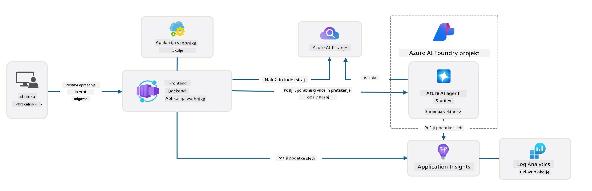

# 3. Razstavite predlogo

!!! tip "DO KONCA TEGA MODULA BOSTE ZNALI"

    - [ ] Use GitHub Copilot and optional MCP tools for Azure documentation and read-only exploration
    - [ ] Identify the template's application, infrastructure, configuration, and test entry points
    - [ ] Verify generated explanations against actual repository files
    - [ ] **Lab 3:** Trace one request and one configuration input through the project

---

## 1. Aktivirajte GitHub Copilot

Odprite inicializiran AI vzorec v VS Code in omogočite [GitHub Copilot](https://code.visualstudio.com/docs/copilot/chat/chat-agent-mode). Prijavite se z računom, ki ima ustrezen načrt; omejitve uporabe se razlikujejo. Prosite Copilota, naj razloži repozitorij, preden odobrite spremembe.

### Izbirni MCP strežniki

Te storitve lahko zagotovijo dodatna orodja:

- [Azure MCP Server](https://learn.microsoft.com/azure/developer/azure-mcp-server/overview)
- [Microsoft Learn MCP Server](https://learn.microsoft.com/training/support/mcp)

V VS Code preglejte [navodila za konfiguracijo MCP](https://code.visualstudio.com/docs/copilot/chat/mcp-servers) in po potrebi ustvarite `.vscode/mcp.json`:

```json
{
  "servers": {
    "Azure MCP Server": {
      "type": "stdio",
      "command": "npx",
      "args": ["-y", "@azure/mcp@latest", "server", "start"]
    },
    "microsoft.docs.mcp": {
      "type": "http",
      "url": "https://learn.microsoft.com/api/mcp"
    }
  }
}
```

Ukaz `npx` zahteva podprto namestitev Node.js/npm in prenese izvršljivo kodo. Preverite paket in določite potrjeno različico za ponovljivo namestitev ekipe. Zaženite strežnike z nadzornimi elementi MCP v VS Code in preglejte njihova na voljo orodja; imena se lahko razlikujejo med različicami.

**Avtentikacija je ločena.** Za AZD uporabite `azd auth login`. Sledite dokumentiranemu poteku avtentikacije za Azure MCP za njegova orodja; samo prijava v AZD ne vzpostavi MCP seje. `az login` uporabite ločeno, ko vaja ali kavelj kliče Azure CLI.

Poskusite z ukazi samo za branje:

1. “Uporabite Microsoft Learn MCP, da poiščete dokumentacijo konfiguracije Azure Developer CLI.”
2. “Razložite `azure.yaml` tega repozitorija; navedite datoteke, ki implementirajo vsak kavelj.”
3. “Z uporabo razpoložljivih Azure MCP orodij navedite moje nameščene vire, ne da bi karkoli spremenili.”

Preverite izbran najemnik/naročnino in vsak predlagani klic orodja. Ne odobrite ustvarjanja, brisanja virov ali sprememb dostopa samo zato, da raziščete arhitekturo.

## 2. Razumite arhitekturo

Vzorec gosti Python FastAPI backend in React/TypeScript frontend v Azure Container Apps. Backend komunicira z agentom v Microsoft Foundry projektu. Pridobivanje in opazovanje sta odvisna od omogočenih funkcij predloge in uspešne nastavitve; nista zagotovljena samo zato, ker je aplikacija nameščena.



Primerjajte ta diagram s [trenutnim vodnikom za namestitev upstream](https://github.com/Azure-Samples/get-started-with-ai-agents/blob/main/docs/deployment.md) in vašimi dejanskimi viri. Preverite konfigurirano namestitev modela, orodja agenta, upravljano identiteto, dodelitve vlog in izbirne vire AI Search/Application Insights.

**Vaja:** Prosite Copilota, naj sledi zahtevi za klepet od frontend preko API do Foundry, z referencami datotek in funkcij. Odprite te reference in preverite razlago. Iz diagrama sami ne sklepajte o implementirani avtentikaciji, usmerjanju ali avtorizaciji.

## 3. Struktura repozitorija

Naslednje izbrane poti so bile preverjene proti vzorcu 4. novembra 2026. Vaša inicializirana revizija ostaja vir resnice:

```text
get-started-with-ai-agents/
  azure.yaml
  docker-compose.yaml
  requirements-dev.txt
  .devcontainer/
  infra/
    main.bicep
    main.parameters.json
    api.bicep
    core/
  src/
    Dockerfile
    pyproject.toml
    requirements.txt
    api/
      main.py
      routes.py
      search_index_manager.py
    frontend/
      package.json
      src/
    files/
  scripts/
    validate_env_vars.sh
    validate_env_vars.ps1
    postdeploy.sh
    postdeploy.ps1
  tests/
    test_evaluation.py
    test_red_teaming.py
  docs/
    deployment.md
    deploy_customization.md
    ai_search.md
    observability.md
    local_development.md
    troubleshooting.md
```

### Infrastruktura in konfiguracija

`infra/main.bicep` orkestrira vire; `main.parameters.json` povezuje vhodne vrednosti predloge z vrednostmi okolja AZD. `azure.yaml` izbere aplikacijsko storitev in življenjske kavelje. Spremljajte vhod, kot je `USE_AZURE_AI_SEARCH_SERVICE` skozi te datoteke, da najdete, kaj se dejansko spremeni.

### Aplikacija in identiteta

Preberite `src/api/` in `src/frontend/` skupaj. Ugotovite, kje je agent ustvarjen ali pridobljen, kje so konfigurirana navodila/orodja in katero identiteto uporablja vsak klic Azure. Vzorec datotek v `src/files/` so demonstracijski podatki, ne proizvodni katalog ali model avtorizacije.

### Testi in opazovanje

Trenutne vstopne točke za ocenjevanje in rdeče ekipe so pod `tests/`; starejši sklici na imenike `evals/` in `airedteaming/` so za ta vzorec zastareli. Pred zagonom testov v oblaku preberite `docs/observability.md` za predpogoje in stroške. Ti Python testi so ločeni od izbirnega razširitve `azure.ai.evaluations` AZD.

## 4. Preverite svoje ugotovitve

- Določite API pot, interakcijo agenta in kodo za pridobivanje za eno vzorčno vprašanje.
- Pojasnite, katera identiteta dostopa do Foundry in katera konfiguracija izbere njen konec.
- Najdite dejanske skripte pred-naložitve in po-namestitvi ter njihovo vedenje pri ravnanju z napakami.
- Navedite morebitne odvisnosti ali izbirne funkcije, ki manjkajo v vaši namestitvi.

Nadaljujte na [Konfiguriraj predlogo](4-Configure-AI-Template.md).

---

<!-- CO-OP TRANSLATOR DISCLAIMER START -->
**Omejitev odgovornosti**:
Ta dokument je bil preveden z uporabo AI prevajalske storitve [Co-op Translator](https://github.com/Azure/co-op-translator). Čeprav si prizadevamo za natančnost, vas prosimo, da upoštevate, da avtomatizirani prevodi lahko vsebujejo napake ali netočnosti. Izvirni dokument v njegovem izvirnem jeziku je treba obravnavati kot avtoritativni vir. Za kritične informacije je priporočljiv strokovni človeški prevod. Ne odgovarjamo za morebitna nesporazume ali napačne interpretacije, ki izhajajo iz uporabe tega prevoda.
<!-- CO-OP TRANSLATOR DISCLAIMER END -->