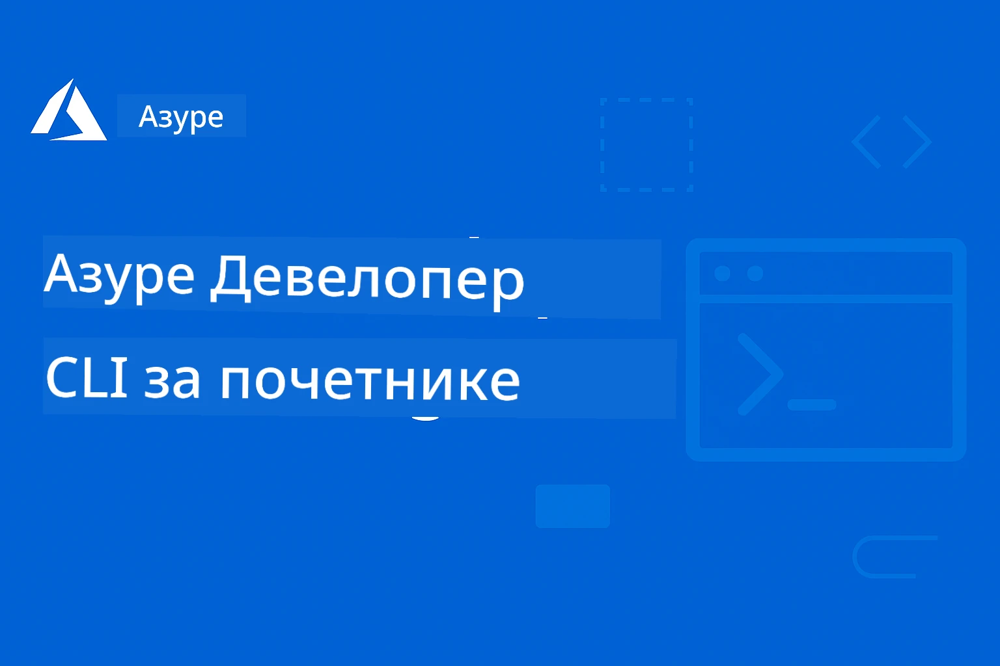

# AZD за почетнике: Структурирано учење

 

[](https://GitHub.com/microsoft/azd-for-beginners/watchers/)
[](https://GitHub.com/microsoft/azd-for-beginners/network/)
[](https://GitHub.com/microsoft/azd-for-beginners/stargazers/)

[](https://discord.com/invite/nkVh3dp)
[](https://discord.gg/nTYy5BXMWG)

---

### Аутоматски преводи (увек ажурно)

<!-- CO-OP TRANSLATOR LANGUAGES TABLE START -->
[Arabic](../ar/README.md) | [Bengali](../bn/README.md) | [Bulgarian](../bg/README.md) | [Burmese (Myanmar)](../my/README.md) | [Chinese (Simplified)](../zh-CN/README.md) | [Chinese (Traditional, Hong Kong)](../zh-HK/README.md) | [Chinese (Traditional, Macau)](../zh-MO/README.md) | [Chinese (Traditional, Taiwan)](../zh-TW/README.md) | [Croatian](../hr/README.md) | [Czech](../cs/README.md) | [Danish](../da/README.md) | [Dutch](../nl/README.md) | [Estonian](../et/README.md) | [Finnish](../fi/README.md) | [French](../fr/README.md) | [German](../de/README.md) | [Greek](../el/README.md) | [Hebrew](../he/README.md) | [Hindi](../hi/README.md) | [Hungarian](../hu/README.md) | [Indonesian](../id/README.md) | [Italian](../it/README.md) | [Japanese](../ja/README.md) | [Kannada](../kn/README.md) | [Khmer](../km/README.md) | [Korean](../ko/README.md) | [Lithuanian](../lt/README.md) | [Malay](../ms/README.md) | [Malayalam](../ml/README.md) | [Manipuri (Meitei Mayek)](../mni/README.md) | [Marathi](../mr/README.md) | [Nepali](../ne/README.md) | [Nigerian Pidgin](../pcm/README.md) | [Norwegian](../no/README.md) | [Persian (Farsi)](../fa/README.md) | [Polish](../pl/README.md) | [Portuguese (Brazil)](../pt-BR/README.md) | [Portuguese (Portugal)](../pt-PT/README.md) | [Punjabi (Gurmukhi)](../pa/README.md) | [Romanian](../ro/README.md) | [Russian](../ru/README.md) | [Serbian (Cyrillic)](./README.md) | [Slovak](../sk/README.md) | [Slovenian](../sl/README.md) | [Spanish](../es/README.md) | [Swahili](../sw/README.md) | [Swedish](../sv/README.md) | [Tagalog (Filipino)](../tl/README.md) | [Tamil](../ta/README.md) | [Telugu](../te/README.md) | [Thai](../th/README.md) | [Turkish](../tr/README.md) | [Ukrainian](../uk/README.md) | [Urdu](../ur/README.md) | [Vietnamese](../vi/README.md)

> **Волите да клонирате локално?**
>
> Овај репозиторијум садржи преводе на преко 50 језика што значајно повећава величину преузимања. Да бисте клонирали без превода, користите sparse checkout:
>
> **Bash / macOS / Linux:**
> ```bash
> git clone --filter=blob:none --sparse https://github.com/microsoft/AZD-for-beginners.git
> cd AZD-for-beginners
> git sparse-checkout set --no-cone '/*' '!translations' '!translated_images'
> ```
>
> **CMD (Windows):**
> ```cmd
> git clone --filter=blob:none --sparse https://github.com/microsoft/AZD-for-beginners.git
> cd AZD-for-beginners
> git sparse-checkout set --no-cone "/*" "!translations" "!translated_images"
> ```
>
> Ово вам даје све што вам је потребно за завршетак курса са много бржим преузимањем.
<!-- CO-OP TRANSLATOR LANGUAGES TABLE END -->

## 🆕 Шта је ново у azd данас

> 📌 Овај курс је верификован са **`azd 1.27.1`** (јул 2026). Покрените `azd version` да проверите вашу верзију, и `azd upgrade` да добијете најновију.

Azure Developer CLI је прерастао традиционалне веб апликације и API-је. Данас је azd једини алат за развој **сваке** апликације на Azure—укључујући апликације са AI подршком и интелигентним агентима.

Ево шта то значи за вас:

- **AI агенти су сада првокласне azd радне јединице.** Можете инициализовати, деплојовати и управљати AI агент пројектима користећи исти `azd init` → `azd up` радни ток који већ познајете.
- **Комплетан животни циклус агента из CLI.** Екстензија `azure.ai.agents` сада покрива цео пут—`azd ai agent init` за скелетирање, `azd ai agent invoke` за тестирање (са приказом времена одговора), `azd ai agent eval generate` и `azd ai agent optimize` за мерење и побољшање квалитета, и `azd ai agent delete` за чишћење.
- **Више AI грађевних блокова.** Нове прегледне екстензије—`azure.ai.skills` и `azure.ai.connections`—омогућавају управљање поново употребљивим агентским вештинама и конекцијама Foundry директно помоћу azd.
- **Интеграција Microsoft Foundry** доноси распоређивање модела, хостинг агената и конфигурацију AI сервиса директно у азд екосистем шаблона.
- **Глађе основне свакодневне операције.** Недавна издања учинила су `azd init` идемпотентним (безбедним за поновно покретање), аутоматски су очистила застареле токене у `azd auth login` и додали пријатељски `azd tool` упит за подешавање приликом првог покретања.
- **Основни ток рада није се променио.** Без обзира да ли распоређујете апликацију за обавезе, микросервис или мулти-агентско AI решење, команде су исте.

> **Напомена за Aspire кориснике:** Microsoft сада производ једноставно назива **Aspire** (раније ".NET Aspire"). Подршка за Aspire у azd остаје иста—промењено је само име.

Ако сте раније користили azd, AI подршка је природно проширење—не засебни алат или напредна стаза. Ако почињете од нуле, научићете један ток рада који ради за све.

---

## 🚀 Шта је Azure Developer CLI (azd)?

**Azure Developer CLI (azd)** је пријатељски алат командне линије дизајниран за програмере који поједностављује распоређивање апликација на Azure. Уместо да ручно креирате и повезујете десетине Azure ресурса, можете распоредити целе апликације једном командом.

### Магија `azd up`

```bash
# This single command does everything:
# ✅ Creates all Azure resources  
# ✅ Configures networking and security
# ✅ Builds your application code
# ✅ Deploys to Azure
# ✅ Gives you a working URL
azd up
```

**То је све!** Нема кликања по Azure порталу, нема потребе да прво учите сложене ARM шаблоне, нема ручне конфигурације—само функционишуће апликације на Azure.

---

## ❓ Azure Developer CLI против Azure CLI: Која је разлика?

Ово је најчешће питање које почетници постављају. Ево једноставног одговора:

| Карактеристика | **Azure CLI (`az`)** | **Azure Developer CLI (`azd`)** |
|---------|---------------------|--------------------------------|
| **Намена** | Управљање појединачним Azure ресурсима | Распоређивање комплетних апликација |
| **Мислосност** | Фокус на инфраструктуру | Фокус на апликацију |
| **Пример** | `az webapp create --name myapp...` | `azd up` |
| **Крива учења** | Морате знати Azure сервисе | Морате знати своју апликацију |
| **Најбоље за** | ДевОпс, Инфраструктуру | Програмере, Прототипирање |

### Једноставна аналогија

- **Azure CLI** је као да имате све алате за грађевину куће—чекрке, тестере, ексере. Можете направити било шта, али морате знати грађевинарство.
- **Azure Developer CLI** је као да ангажујете извођача радова—опишете шта желите, а они се брину о изградњи.

### Када користити који

| Сценарио | Користите Ово |
|----------|----------|
| "Желим брзо распоредити своју веб апликацију" | `azd up` |
| "Треба ми само складишни налог" | `az storage account create` |
| "Правим комплетну AI апликацију" | `azd init --template azure-search-openai-demo` |
| "Треба ми да дебагујем одређени Azure ресурс" | `az resource show` |
| "Желим распоређивање спремно за продукцију за неколико минута" | `azd up --environment production` |

### Радију заједно!

AZD користи Azure CLI у позадини. Можете користити оба:
```bash
# Deploy your app with AZD
azd up

# Then fine-tune specific resources with Azure CLI
az webapp config set --name myapp --always-on true
```

---

## 🌟 Пронађите шаблоне у Awesome AZD

Немојте почети од нуле! **Awesome AZD** је заједничка колекција шаблона спремних за распоређивање:

| Ресурс | Опис |
|----------|-------------|
| 🔗 [**Awesome AZD галерија**](https://azure.github.io/awesome-azd/) | Прегледајте преко 200 шаблона са једним кликом за распоређивање |
| 🔗 [**Пошаљите шаблон**](https://github.com/Azure/awesome-azd/issues) | Допринесите свој шаблон заједници |
| 🔗 [**GitHub репозиторијум**](https://github.com/Azure/awesome-azd) | Означите звездицом и истражите извор |

### Популарни AI шаблони из Awesome AZD

```bash
# RAG Chat with Microsoft Foundry Models + AI Search
azd init --template azure-search-openai-demo

# Quick AI Chat Application
azd init --template openai-chat-app-quickstart

# AI Agents with Foundry Agents
azd init --template get-started-with-ai-agents
```

---

## 🎯 Почетак у 3 корака

Пре него што почнете, уверите се да је ваша машина спремна за шаблон који желите да распоредите:

**Windows:**
```powershell
.\validate-setup.ps1
```

**macOS / Linux:**
```bash
bash ./validate-setup.sh
```

Ако било која обавезна провера не успе, прво то поправите па наставите са брзим почетком.

### Корак 1: Инсталирајте AZD (2 минута)

**Windows:**
```powershell
winget install microsoft.azd
```

**macOS:**
```bash
brew tap azure/azd && brew install azd
```

**Linux:**
```bash
curl -fsSL https://aka.ms/install-azd.sh | bash
```

### Корак 2: Аутентификовати се за AZD

```bash
# Optional if you plan to use Azure CLI commands directly in this course
az login

# Required for AZD workflows
azd auth login
```

Ако нисте сигурни који вам треба, пратите цео ток подешавања у [Installation & Setup](docs/chapter-01-foundation/installation.md#authentication-setup).

### Корак 3: Распоредите своју прву апликацију

```bash
# Initialize from a template
azd init --template todo-nodejs-mongo

# Deploy to Azure (creates everything!)
azd up
```

**🎉 То је све!** Ваша апликација је сада активна на Azure.

### Очистите (не заборавите!)

```bash
# Remove all resources when done experimenting
azd down --force --purge
```

---

## 📚 Како користити овај курс

Овај курс је осмишљен за **прогресивно учење**—покрените са онога што вам одговара и наставите корак по корак:

| Ваше искуство | Почните овде |
|-----------------|------------|
| **Потпуно нов у Azure-у** | [Поглавље 1: Основа](#-chapter-1-foundation--quick-start) |
| **Знате Azure, нови сте у AZD-у** | [Поглавље 1: Основа](#-chapter-1-foundation--quick-start) |
| **Желите да развијате AI апликације** | [Поглавље 2: AI-први развој](#-chapter-2-ai-first-development-recommended-for-ai-developers) |
| **Желите практичан рад** | [🎓 Интерактивна радионица](workshop/README.md) - вођена лабораторија од 3-4 сата |
| **Требају вам производни обрасци** | [Поглавље 8: Производња и предузеће](#-chapter-8-production--enterprise-patterns) |

### Брзо подешавање

1. **Направите форк овог репозиторијума**: [](https://GitHub.com/microsoft/azd-for-beginners/fork)
2. **Клонирајте га**: `git clone https://github.com/YOUR-USERNAME/azd-for-beginners.git`
3. **Добите помоћ**: [Azure Discord заједница](https://discord.com/invite/ByRwuEEgH4)

> **Више волите локално клонирање?**

> Овај репозиторијум укључује преко 50 превода што значајно повећава величину преузимања. Да бисте клонирали без превода, користите sparse checkout:
> ```bash
> git clone --filter=blob:none --sparse https://github.com/microsoft/AZD-for-beginners.git
> cd AZD-for-beginners
> git sparse-checkout set --no-cone '/*' '!translations' '!translated_images'
> ```
> Ово вам даје све што вам треба да завршите курс са знатно бржим преузимањем.


## Преглед курса

Савладајте Azure Developer CLI (azd) кроз структурирана поглавља осмишљена за прогресивно учење. **Посебан акценат на распоређивање AI апликација са интеграцијом Microsoft Foundry.**

### Зашто је овај курс неопходан за модерне програмере

На основу увида из Microsoft Foundry Discord заједнице, **45% програмера жели да користи AZD за AI радне задатке**, али се сусрећу са изазовима у вези са:
- Комплексним мулти-сервисним AI архитектурама
- Најбољим праксама за продукционо AI распоређивање  
- Интеграцијом и конфигурацијом Azure AI сервиса
- Оптимизацијом трошкова за AI радне задатке
- Решавањем специфичних проблема са AI распоређивањем

### Циљеви учења

Завршетком овог структурираног курса, научићете:
- **Савладавање основа AZD-а**: Кључни концепти, инсталација и конфигурација
- **Распоређивање AI апликација**: Коришћење AZD-а са Microsoft Foundry сервисима
- **Имплементирајте инфраструктуру као код**: Управљајте Azure ресурсима помоћу Bicep шаблона
- **Решавајте проблеме са деплојем**: Решавање уобичајених проблема и отклањање грешака
- **Оптимизујте за производњу**: Безбедност, масштабирање, праћење и управљање трошковима
- **Креирајте мулти-агент решења**: Деплојовање сложених AI архитектура

## Пре него што почнете: Налози, приступ и претпоставке

Пре него што почнете Први поглавље, уверите се да имате следеће. Кораци инсталације касније у овом водичу претпостављају да су ове основе већ решене.

- **Azure претплата**: Можете користити постојећу претплату на послу или вашем налогу, или креирати [бесплатну пробну](https://aka.ms/azurefreetrial) претплату за почетак.
- **Дозвола за креирање Azure ресурса**: За већину вежби требало би да имате најмање приступ **Contributor** на циљаној претплати или групи ресурса. Нека поглавља могу претпостављати да можете креирати групе ресурса, управљане идентитете и RBAC доделе.
- [**GitHub налог**](https://github.com): Корисно је за форкање репозиторијума, праћење ваших промена и коришћење GitHub Codespaces за радионицу.
- **Претходни услови за извршавање шаблона**: Неки шаблони захтевају локалне алате као што су Node.js, Python, Java или Docker. Покрените валидатор поставке пре почетка како бисте на време открили недостајуће алате.
- **Основно познавање терминала**: Не морате бити експерт, али требало би да будете удобни са извршавањем команди као што су `git clone`, `azd auth login` и `azd up`.

> **Радите у ентерпрајз претплати?**
> Ако ваш Azure окруживање управља администратор, унапред проверите да ли можете да деплојујете ресурсе у претплату или групу ресурса коју планирате да користите. Ако не, затражите sandbox претплату или Contributor приступ пре почетка.

> **Нови сте у Azure-у?**
> Почните са сопственом Azure пробном или pay-as-you-go претплатом на https://aka.ms/azurefreetrial како бисте могли да завршите вежбе од почетка до краја без чекања на одобрења на нивоу закупца.

## 🗺️ Мапа курса: Брза навигација по поглављима

Свако поглавље има посвећени README са учењем, брзим стартом и вежбама:

| Поглавље | Тема | Лекције | Трајање | Комплексност |
|---------|-------|---------|----------|------------|
| **[Погл 1: Основа](docs/chapter-01-foundation/README.md)** | Почетак рада | [AZD основе](docs/chapter-01-foundation/azd-basics.md) &#124; [Инсталација](docs/chapter-01-foundation/installation.md) &#124; [Први пројекат](docs/chapter-01-foundation/first-project.md) | 30-45 мин | ⭐ |
| **[Погл 2: AI развој](docs/chapter-02-ai-development/README.md)** | AI-прве апликације | [Microsoft Foundry интеграција](docs/chapter-02-ai-development/microsoft-foundry-integration.md) &#124; [AI агенти](docs/chapter-02-ai-development/agents.md) &#124; [Деплој модела](docs/chapter-02-ai-development/ai-model-deployment.md) &#124; [Радионица](docs/chapter-02-ai-development/ai-workshop-lab.md) | 1-2 сата | ⭐⭐ |
| **[Погл 3: Конфигурација](docs/chapter-03-configuration/README.md)** | Аутентификација и безбедност | [Конфигурација](docs/chapter-03-configuration/configuration.md) &#124; [Аутентификација и безбедност](docs/chapter-03-configuration/authsecurity.md) | 45-60 мин | ⭐⭐ |
| **[Погл 4: Инфраструктура](docs/chapter-04-infrastructure/README.md)** | IaC и деплој | [Водич за деплој](docs/chapter-04-infrastructure/deployment-guide.md) &#124; [Провизионисање](docs/chapter-04-infrastructure/provisioning.md) | 1-1.5 сата | ⭐⭐⭐ |
| **[Погл 5: Мулти-агент](docs/chapter-05-multi-agent/README.md)** | AI агент решења | [Примарни сценарио](examples/retail-scenario.md) &#124; [Обрасци координације](docs/chapter-06-pre-deployment/coordination-patterns.md) | 2-3 сата | ⭐⭐⭐⭐ |
| **[Погл 6: Пре деплоја](docs/chapter-06-pre-deployment/README.md)** | Планирање и валидација | [Провере пре лета](docs/chapter-06-pre-deployment/preflight-checks.md) &#124; [Планирање капацитета](docs/chapter-06-pre-deployment/capacity-planning.md) &#124; [Избор SKU](docs/chapter-06-pre-deployment/sku-selection.md) &#124; [Апп Инсигхтс](docs/chapter-06-pre-deployment/application-insights.md) | 1 сат | ⭐⭐ |
| **[Погл 7: Решавање проблема](docs/chapter-07-troubleshooting/README.md)** | Отклањање грешака и исправке | [Чести проблеми](docs/chapter-07-troubleshooting/common-issues.md) &#124; [Откривање грешака](docs/chapter-07-troubleshooting/debugging.md) &#124; [AI проблеми](docs/chapter-07-troubleshooting/ai-troubleshooting.md) | 1-1.5 сата | ⭐⭐ |
| **[Погл 8: Производња](docs/chapter-08-production/README.md)** | Ентерпрајз обрасци | [Практике у производњи](docs/chapter-08-production/production-ai-practices.md) | 2-3 сата | ⭐⭐⭐⭐ |
| **[🎓 Радионица](workshop/README.md)** | Практичан рад | [Увод](workshop/docs/instructions/0-Introduction.md) &#124; [Избор](workshop/docs/instructions/1-Select-AI-Template.md) &#124; [Валидација](workshop/docs/instructions/2-Validate-AI-Template.md) &#124; [Деконструкција](workshop/docs/instructions/3-Deconstruct-AI-Template.md) &#124; [Конфигурација](workshop/docs/instructions/4-Configure-AI-Template.md) &#124; [Прилагођавање](workshop/docs/instructions/5-Customize-AI-Template.md) &#124; [Расклањање](workshop/docs/instructions/6-Teardown-Infrastructure.md) &#124; [Завршетак](workshop/docs/instructions/7-Wrap-up.md) | 3-4 сата | ⭐⭐ |

**Укупно трајање курса:** ~10-14 сати | **Ниво вештина:** Почетник → Спреман за производњу

---

## 📚 Поглавља за учење

*Изаберите свој пут учења у зависности од нивоа искуства и циљева*

### 🚀 Поглавље 1: Основа и брзи почетак
**Претходни услови**: Azure претплата, основно познавање командне линије  
**Трајање**: 30-45 минута  
**Комплексност**: ⭐

#### Шта ћете научити
- Основе Azure Developer CLI
- Инсталирање AZD на вашој платформи
- Ваш први успешан деплој

#### Ресурси за учење
- **🎯 Почните овде**: [Шта је Azure Developer CLI?](#what-is-azure-developer-cli)
- **📖 Теорија**: [AZD основе](docs/chapter-01-foundation/azd-basics.md) - Кључни концепти и терминологија
- **⚙️ Постављање**: [Инсталација и подешавање](docs/chapter-01-foundation/installation.md) - Водичи за платформу
- **🛠️ Практичан рад**: [Ваш први пројекат](docs/chapter-01-foundation/first-project.md) - Туторијал корак по корак
- **📋 Брзи референтни материјал**: [Листу команди](resources/cheat-sheet.md)

#### Практичне вежбе
```bash
# Quick installation check
azd version

# Deploy your first application
azd init --template todo-nodejs-mongo
azd up
```

**💡 Исход поглавља**: Успешно деплојујте једноставну веб апликацију на Azure користећи AZD

**✅ Валидација успеха:**
```bash
# After completing Chapter 1, you should be able to:
azd version              # Shows installed version
azd init --template todo-nodejs-mongo  # Initializes project
azd up                  # Deploys to Azure
azd show                # Displays running app URL
# Application opens in browser and works
azd down --force --purge  # Cleans up resources
```

**📊 Уложено време:** 30-45 минута  
**📈 Ниво вештина након:** Можете независно да деплојујете основне апликације
**📈 Ниво вештина након:** Можете независно да деплојујете основне апликације

---

### 🤖 Поглавље 2: AI-први развој (Препоручено AI програмерима)
**Претходни услови**: Поглавље 1 завршено  
**Трајање**: 1-2 сата  
**Комплексност**: ⭐⭐

#### Шта ћете научити
- Интеграција Microsoft Foundry са AZD-ом
- Деплој AI-управљаних апликација
- Разумевање конфигурација AI сервиса

#### Ресурси за учење
- **🎯 Почните овде**: [Интеграција Microsoft Foundry](docs/chapter-02-ai-development/microsoft-foundry-integration.md)
- **🤖 AI агенти**: [Водич за AI агенте](docs/chapter-02-ai-development/agents.md) - Деплој интелигентних агената уз AZD
- **📖 Обрасци**: [Деплој AI модела](docs/chapter-02-ai-development/ai-model-deployment.md) - Деплој и управљање AI моделима
- **🛠️ Радионица**: [AI радионица](docs/chapter-02-ai-development/ai-workshop-lab.md) - Учините ваша AI решења спремним за AZD
- **🎥 Интерактивни водич**: [Материјали радионице](workshop/README.md) - Учење у прегледачу са MkDocs * DevContainer окружењем
- **📋 Шаблони**: [Microsoft Foundry шаблони](#featured-microsoft-foundry-templates)
- **📝 Примери**: [Примери AZD деплоја](examples/README.md)

#### Практичне вежбе
```bash
# Deploy your first AI application
azd init --template azure-search-openai-demo
azd up

# Try additional AI templates
azd init --template openai-chat-app-quickstart
azd init --template agent-openai-python-prompty
```

**💡 Исход поглавља**: Деплојујте и конфигуришите AI-управљану чат апликацију са RAG функцијама

**✅ Валидација успеха:**
```bash
# After Chapter 2, you should be able to:
azd init --template azure-search-openai-demo
azd up
# Test the AI chat interface
# Ask questions and get AI-powered responses with sources
# Verify search integration works
azd monitor  # Check Application Insights shows telemetry
azd down --force --purge
```

**📊 Уложено време:** 1-2 сата  
**📈 Ниво вештина након:** Можете деплојовати и конфигурисати продукцијски спремне AI апликације  
**💰 Свесност о трошковима:** Разумети трошкове развоја $80-150/месец, производне трошкове $300-3500/месец

#### 💰 Разматрања трошкова за AI деплоје

**Окружење за развој (Процењено $80-150/месец):**
- Microsoft Foundry модели (плаћање по коришћењу): $0-50/месец (зависно од коришћења токена)
- AI претрага (Основни ниво): $75/месец
- Container Apps (потрошња): $0-20/месец
- Складиштење (Стандард): $1-5/месец

**Производна средина (Процењено $300-3,500+/месец):**
- Microsoft Foundry модели (PTU за конзистентне перформансе): $3,000+/месец ИЛИ плаћање по коришћењу са великим обимом
- AI претрага (Стандардни ниво): $250/месец
- Container Apps (Посвећено): $50-100/месец
- Application Insights: $5-50/месец
- Складиштење (Премиум): $10-50/месец

**💡 Савети за оптимизацију трошкова:**
- Користите **бесплатни ниво** Microsoft Foundry модела за учење (Azure OpenAI укључује 50,000 токена месечно)
- Покрените `azd down` за деалокацију ресурса када не развијате активно
- Почните са наплатом по коришћењу, надоградите на PTU само за производњу
- Користите `azd provision --preview` за процену трошкова пре деплоја
- Омогућите аутоматско скалирање: плаћате само за стварну употребу

**Праћење трошкова:**
```bash
# Check estimated monthly costs
azd provision --preview

# Monitor actual costs in Azure Portal
az consumption budget list --resource-group <your-rg>
```

---

### ⚙️ Поглавље 3: Конфигурација и аутентификација
**Претходни услови**: Поглавље 1 завршено  
**Трајање**: 45-60 минута  
**Комплексност**: ⭐⭐

#### Шта ћете научити
- Конфигурација и управљање окружењем
- Најбоље праксе аутентификације и безбедности
- Именовање и организација ресурса

#### Ресурси за учење
- **📖 Конфигурација**: [Водич за конфигурацију](docs/chapter-03-configuration/configuration.md) - Подешавање окружења
- **🔐 Безбедност**: [Обрасци за аутентификацију и управљани идентитет](docs/chapter-03-configuration/authsecurity.md) - Обрасци аутентификације
- **📝 Примери**: [Пример апликације базе података](examples/database-app/README.md) - AZD базе података примери

#### Практичне вежбе
- Конфигуришите више окружења (развојно, тестно, продукционо)
- Подесите аутентификацију управљаним идентитетом
- Имплементирајте конфигурације специфичне за окружење

**💡 Исход поглавља**: Управљајте више окружења са исправном аутентификацијом и безбедношћу

---

### 🏗️ Поглавље 4: Инфраструктура као код и деплој
**Претходни услови**: Поглавља 1-3 завршена  
**Трајање**: 1-1.5 сата  
**Комплексност**: ⭐⭐⭐

#### Шта ћете научити
- Напредни обрасци деплоја
- Инфраструктура као код уз Bicep
- Стратегије провизионисања ресурса

#### Ресурси за учење
- **📖 Деплој**: [Водич за деплој](docs/chapter-04-infrastructure/deployment-guide.md) - Комплетни токови рада
- **🏗️ Провизионисање**: [Провизионисање ресурса](docs/chapter-04-infrastructure/provisioning.md) - Управљање Azure ресурсима
- **📝 Примери**: [Пример апликације у контејнеру](../../examples/container-app) - Контејнерски деплои

#### Практичне вежбе
- Креирајте прилагођене Bicep шаблоне
- Деплојујте мулти-сервисне апликације
- Имплементирајте стратегије blue-green деплоја

**💡 Исход поглавља**: Деплојујте сложене мулти-сервисне апликације уз помоћ прилагођених инфраструктурних шаблона

---

### 🎯 Поглавље 5: Мулти-агент AI решења (Напредно)
**Претходни услови**: Поглавља 1-2 завршена  
**Трајање**: 2-3 сата  
**Комплексност**: ⭐⭐⭐⭐

#### Шта ћете научити
- Обрасци мулти-агентске архитектуре
- Оркестрација и координација агената
- Продукцијски спремни AI деплои

#### Ресурси за учење
- **🤖 Главни пројекат**: [Ритейл мулти-агент решење](examples/retail-scenario.md) - Комплетна имплементација
- **🛠️ ARM шаблони**: [ARM пакет шаблона](../../examples/retail-multiagent-arm-template) - Једнокликови деплој
- **📖 Архитектура**: [Обрасци координације мулти-агента](docs/chapter-06-pre-deployment/coordination-patterns.md) - Обрасци

#### Практичне вежбе
```bash
# Deploy the complete retail multi-agent solution
cd examples/retail-multiagent-arm-template
./deploy.sh

# Explore agent configurations
az deployment group show --resource-group <rg-name> --name <deployment-name>
```

**💡 Исход поглавља**: Деплојујте и управљајте продукцијски спремним мулти-агент AI решењем са агентима за кориснике и инвентар

---

### 🔍 Поглавље 6: Валидација и планирање пре деплоја
**Претходни услови**: Поглавље 4 завршено  
**Трајање**: 1 сат  
**Комплексност**: ⭐⭐

#### Шта ћете научити
- Планирање капацитета и валидација ресурса
- Стратегије избора SKU
- Провере пре лета и аутоматизација

#### Ресурси за учење
- **📊 Планирање**: [Планирање капацитета](docs/chapter-06-pre-deployment/capacity-planning.md) - Валидација ресурса
- **💰 Селекција**: [Селекција СКУ](docs/chapter-06-pre-deployment/sku-selection.md) - Избори погодни за трошкове
- **✅ Валидација**: [Прелиминарне провере](docs/chapter-06-pre-deployment/preflight-checks.md) - Аутоматизовани скрипти

#### Практичне вежбе
- Покрени скрипте за валидацију капацитета
- Оптимизуј изборе СКУ ради смањења трошкова
- Имплементирај аутоматизоване прелиминарне провере пре распорештања

**💡 Изаход поглавља**: Валидација и оптимизација распореда пре извршења

---

### 🚨 Поглавље 7: Решавање проблема и дебаговање
**Претпоставке**: Комплетирано било које поглавље распореда  
**Трајање**: 1-1.5 сати  
**Комплексност**: ⭐⭐

#### Шта ћете научити
- Систематски приступи дебаговању
- Уобичајени проблеми и решења
- Решавање проблема специфичних за AI

#### Ресурси за учење
- **🔧 Уобичајени проблеми**: [Уобичајени проблеми](docs/chapter-07-troubleshooting/common-issues.md) - Често постављана питања и решења
- **🕵️ Дебаговање**: [Водич за дебаговање](docs/chapter-07-troubleshooting/debugging.md) - Стратегије корак по корак
- **🤖 AI проблеми**: [Решавање проблема специфичних за AI](docs/chapter-07-troubleshooting/ai-troubleshooting.md) - Проблеми AI сервиса

#### Практичне вежбе
- Дијагностикуј кварове распореда
- Реши проблеме аутентификације
- Дебагуј повезаност AI сервиса

**💡 Изаход поглавља**: Самостално дијагностикуј и решавај уобичајене проблеме распореда

---

### 🏢 Поглавље 8: Производни и пословни шаблони
**Претпоставке**: Комплетирана поглавља 1-4  
**Трајање**: 2-3 сата  
**Комплексност**: ⭐⭐⭐⭐

#### Шта ћете научити
- Стратегије производног распореда
- Пословни сигурносни шаблони
- Мониторинг и оптимизација трошкова

#### Ресурси за учење
- **🏭 Производња**: [Најбоље праксе за производни AI](docs/chapter-08-production/production-ai-practices.md) - Пословни шаблони
- **📝 Примери**: [Пример микросервиса](../../examples/microservices) - Комплексне архитектуре
- **📊 Мониторинг**: [Интеграција Application Insights](docs/chapter-06-pre-deployment/application-insights.md) - Мониторинг

#### Практичне вежбе
- Имплементирај пословне сигурносне шаблоне
- Подеси комплетан мониторинг
- Распореди у производно окружење уз одговарајућу контролу

**💡 Изаход поглавља**: Распореди апликације спремне за пословну производњу са комплетним капацитетима

---

## 🎓 Преглед радионице: Практично искуство учења

> **⚠️ СТАЊЕ РАДИОНИЦЕ: Активни развој**  
> Материјали радионице су тренутно у развоју и усавршавању. Основни модули функционишу, али неки напредни делови су непотпуни. Интензивно радимо на довршавању целокупног садржаја. [Пратите напредак →](workshop/README.md)

### Интерактивни материјали радионице
**Опширно практично учење са алатима у претраживачу и вођеним вежбама**

Наши материјали радионице пружају структурирано, интерактивно искуство учења које допуњује горе наведени курикулум по поглављима. Радионица је дизајнирана и за самостално учење и за предавања под водством инструктора.

#### 🛠️ Карактеристике радионице
- **Интерфејс у претраживачу**: Комплетна радионица подржана MkDocs-ом са опцијама претраге, копирања и промене теме
- **Интеграција са GitHub Codespaces**: Подешавање окружења за развој једним кликом
- **Структурирана путања учења**: 8 модула вођених вежби (укупно 3-4 сата)
- **Прогресивна методологија**: Увод → Селекција → Валидација → Демонтажa → Конфигурација → Прилагођавање → Демонтажa → Резиме
- **Интерактивно DevContainer окружење**: Предконфигурисани алати и зависности

#### 📚 Структура модула радионице
Радионица следи **8-модуларну прогресивну методологију** која вас води од откривања до мајсторства распореда:

| Модул | Тема | Шта ћете радити | Трајање |
|--------|-------|----------------|----------|
| **0. Увод** | Преглед радионице | Разумети циљеве учења, претпоставке и структуру радионице | 15 мин |
| **1. Селекција** | Откривање шаблона | Истражити AZD шаблоне и изабрати одговарајући AI шаблон за ваш сценарио | 20 мин |
| **2. Валидација** | Распореди и верификуј | Распореди шаблон са `azd up` и валидација инфраструктуре | 30 мин |
| **3. Демонтажa** | Разумети структуру | Користи GitHub Copilot за истраживање архитектуре шаблона, Bicep датотека и организације кода | 30 мин |
| **4. Конфигурација** | Детаљна анализа azure.yaml | Савладај `azure.yaml` конфигурацију, lifecycle hooks и променљиве окружења | 30 мин |
| **5. Прилагођавање** | Прилагоди себи | Омогући AI претрагу, праћење, евалуацију и прилагоди сценарију | 45 мин |
| **6. Демонтажa** | Очисти | Безбедно уклони ресурсе уз `azd down --purge` | 15 мин |
| **7. Резиме** | Следећи кораци | Преглед достигнућа, кључних концепата и наставак учења | 15 мин |

**Ток радионице:**
```
Introduction → Selection → Validation → Deconstruction → Configuration → Customization → Teardown → Wrap-up
     ↓            ↓           ↓              ↓               ↓              ↓            ↓           ↓
  Overview    Find the     Deploy &      Explore        Master         Customize     Clean up    Review &
             right        verify        code &        azure.yaml      for your      resources   next steps
             template                   structure                     scenario
```

#### 🚀 Почетак радионице
```bash
# Option 1: GitHub Codespaces (Recommended)
# Click "Code" → "Create codespace on main" in the repository

# Option 2: Local Development
git clone https://github.com/microsoft/azd-for-beginners.git
cd azd-for-beginners/workshop
# Follow the setup instructions in workshop/README.md
```

#### 🎯 Резултати учења радионице
Завршетком радионице, учесници ће:
- **Распоредити производне AI апликације**: Користити AZD са Microsoft Foundry сервисима
- **Мајсторити мулти-агентске архитектуре**: Имплементирати координиране AI агентске решења
- **Имплементирати сигурносне најбоље праксе**: Конфигурисати аутентификацију и контролу приступа
- **Оптимизовати скалабилност**: Дизајнирати исплативе и функционалне распореде
- **Решавати проблеме распореда**: Самостално решавати уобичајене проблеме

#### 📖 Ресурси радионице
- **🎥 Интерактивни водич**: [Материјали радионице](workshop/README.md) - Учебно окружење у претраживачу
- **📋 Упутства по модулу**:
  - [0. Увод](workshop/docs/instructions/0-Introduction.md) - Преглед и циљеви радионице
  - [1. Селекција](workshop/docs/instructions/1-Select-AI-Template.md) - Пронађи и изабери AI шаблоне
  - [2. Валидација](workshop/docs/instructions/2-Validate-AI-Template.md) - Распореди и верификуј шаблоне
  - [3. Демонтажa](workshop/docs/instructions/3-Deconstruct-AI-Template.md) - Истражи архитектуру шаблона
  - [4. Конфигурација](workshop/docs/instructions/4-Configure-AI-Template.md) - Савладај azure.yaml
  - [5. Прилагођавање](workshop/docs/instructions/5-Customize-AI-Template.md) - Прилагоди сценарију
  - [6. Демонтажa](workshop/docs/instructions/6-Teardown-Infrastructure.md) - Очисти ресурсе
  - [7. Резиме](workshop/docs/instructions/7-Wrap-up.md) - Преглед и следећи кораци
- **🛠️ AI лабораторија радионице**: [AI лабораторија радионице](docs/chapter-02-ai-development/ai-workshop-lab.md) - Вежбе фокусиране на AI
- **💡 Брзи почетак**: [Водич за подешавање радионице](workshop/README.md#quick-start) - Конфигурација окружења

**Идеално за**: Корпоративну обуку, универзитетске курсеве, самостално учење и кампове за програмере.

---

## 📖 Дубински поглед: AZD могућности

Поред основа, AZD пружа моћне функције за производне распореде:

- **Распореди засновани на шаблонима** - Користи унапред направљене шаблоне за уобичајене обрасце апликација
- **Инфраструктура као код** - Управљај Azure ресурсима помоћу Bicep или Terraform  
- **Интегрисани токови рада** - Безпрекорно обезбеђуј, распореди и прати апликације
- **Прилагођено програмерима** - Оптимизовано за продуктивност и искуство програмера

### **AZD + Microsoft Foundry: Идеално за AI распореде**

**Зашто AZD за AI решења?** AZD решава главне изазове са којима се суочавају AI програмери:

- **AI прилагођени шаблони** - Предконфигурисани шаблони за Microsoft Foundry моделе, Azure AI сервисе и ML радне оптерећења
- **Сигурни AI распореди** - Уграђени сигурносни шаблони за AI сервисе, API кључеве и крајње тачке модела  
- **Производни AI обрасци** - Најбоље праксе за скалабилне и исплативе AI апликације
- **Цео AI ток рада** - Од развоја модела до производног распореда уз одговарајући мониторинг
- **Оптимизација трошкова** - Паметне стратегије алокације и скалирања ресурса за AI радне оптерећења
- **Интеграција са Microsoft Foundry-јем** - Беспрекорна веза са Microsoft Foundry каталогом модела и крајњим тачкама

---

## 🎯 Библиотека шаблона и примера

### Истакнуто: Microsoft Foundry шаблони
**Почните овде ако распорежујете AI апликације!**

> **Напомена:** Ови шаблони демонстрирају различите AI обрасце. Неки су спољашњи Azure узорци, други локалне имплементације.

| Шаблон | Поглавље | Комплексност | Сервиси | Тип |
|----------|---------|------------|----------|------|
| [**Почетак са AI четом**](https://github.com/Azure-Samples/get-started-with-ai-chat) | Поглавље 2 | ⭐⭐ | AzureOpenAI + Azure AI Model Inference API + Azure AI Search + Azure Container Apps + Application Insights | Спољашњи |
| [**Почетак са AI агентима**](https://github.com/Azure-Samples/get-started-with-ai-agents) | Поглавље 2 | ⭐⭐ | Foundry Agents + AzureOpenAI + Azure AI Search + Azure Container Apps + Application Insights| Спољашњи |
| [**Демо Azure Search + OpenAI**](https://github.com/Azure-Samples/azure-search-openai-demo) | Поглавље 2 | ⭐⭐ | AzureOpenAI + Azure AI Search + App Service + Storage | Спољашњи |
| [**OpenAI Chat App Quickstart**](https://github.com/Azure-Samples/openai-chat-app-quickstart) | Поглавље 2 | ⭐ | AzureOpenAI + Container Apps + Application Insights | Спољашњи |
| [**Agent OpenAI Python Prompty**](https://github.com/Azure-Samples/agent-openai-python-prompty) | Поглавље 5 | ⭐⭐⭐ | AzureOpenAI + Azure Functions + Prompty | Спољашњи |
| [**Contoso Chat RAG**](https://github.com/Azure-Samples/contoso-chat) | Поглавље 8 | ⭐⭐⭐⭐ | AzureOpenAI + AI Search + Cosmos DB + Container Apps | Спољашњи |
| [**Решење за малопродајне мулти-агенте**](examples/retail-scenario.md) | Поглавље 5 | ⭐⭐⭐⭐ | AzureOpenAI + AI Search + Storage + Container Apps + Cosmos DB | **Локално** |

### Истакнуто: Комплетни сценарији учења
**Шаблони апликација спремних за производњу мапирани на поглавља учења**

| Шаблон | Поглавље учења | Комплексност | Кључно учење |
|----------|------------------|------------|--------------|
| [**openai-chat-app-quickstart**](https://github.com/Azure-Samples/openai-chat-app-quickstart) | Поглавље 2 | ⭐ | Основни AI обрасци распореда |
| [**azure-search-openai-demo**](https://github.com/Azure-Samples/azure-search-openai-demo) | Поглавље 2 | ⭐⭐ | Имплементација RAG са Azure AI Search |
| [**ai-document-processing**](https://github.com/Azure-Samples/ai-document-processing) | Поглавље 4 | ⭐⭐ | Интеграција за разумевање докумената |
| [**agent-openai-python-prompty**](https://github.com/Azure-Samples/agent-openai-python-prompty) | Поглавље 5 | ⭐⭐⭐ | Фрејмворк агената и позив функција |
| [**contoso-chat**](https://github.com/Azure-Samples/contoso-chat) | Поглавље 8 | ⭐⭐⭐ | Оркестрација корпоративног AI |
| [**retail-multi-agent-solution**](examples/retail-scenario.md) | Поглавље 5 | ⭐⭐⭐⭐ | Мулти-агент архитектура са агенти Купаца и Инвентара |

### Учите према типу примера

> **📌 Локални у односу на спољашње примере:**  
> **Локални примери** (у овом репозиторијуму) = Спремно за непосредну употребу  
> **Спољашњи примери** (Azure узорци) = Клонирај из повезаних репозиторијума

#### Локални примери (спремни за употребу)
- [**Решење за малопродајне мулти-агенте**](examples/retail-scenario.md) - Комплетна производна имплементација са ARM шаблонима
  - Мулти-агент архитектура (Купац + Инвентар агенти)
  - Опсежан мониторинг и евалуација
  - Распоред једним кликом преко ARM шаблона

#### Локални примери - Апликације у контејнерима (поглавља 2-5)
**Опсежни примери распореда у контејнерима у овом репозиторијуму:**
- [**Примери апликација у контејнеру**](examples/container-app/README.md) - Комплетан водич за распореде у контејнерима
  - [Једноставан Flask API](../../examples/container-app/simple-flask-api) - Основни REST API са скалирањем на нулу
  - [Микросервисна архитектура](../../examples/container-app/microservices) - Производна мулти-сервисна имплементација
  - Брзи почетак, производни и напредни обрасци распореда
  - Упутства за мониторинг, безбедност и оптимизацију трошкова

#### Спољашњи примери - Једноставне апликације (поглавља 1-2)
**Клонирајте ове Azure узорке да започнете:**
- [Једноставна веб апликација - Node.js + MongoDB](https://github.com/Azure-Samples/todo-nodejs-mongo) - Основни обрасци распореда
- [Статични вебсајт - React SPA](https://github.com/Azure-Samples/todo-csharp-sql-swa-func) - Распоред статичког садржаја
- [Апликација у контејнеру - Python Flask](https://github.com/Azure-Samples/container-apps-store-api-microservice) - Распоред REST API

#### Спољашњи примери - Интеграција базе података (поглавља 3-4)  
- [Апликација базе података - C# + SQL](https://github.com/Azure-Samples/todo-csharp-sql) - Обрасци повезивања базе
- [Функције + Cosmos DB](https://github.com/Azure-Samples/todo-python-mongo-swa-func) - Серверлес податковни ток

#### Спољашњи примери - Напредни обрасци (поглавља 4-8)
- [Java микросервиси](https://github.com/Azure-Samples/java-microservices-aca-lab) - Мулти-сервисне архитектуре
- [Контејнерски послови](https://github.com/Azure-Samples/container-apps-jobs) - Обрада у позадини  
- [Пословне ML цевоводе](https://github.com/Azure-Samples/mlops-v2) - Производни ML обрасци

### Спољашње колекције шаблона
- [**Званична AZD галерија шаблона**](https://azure.github.io/awesome-azd/) - Курирана колекција званичних и заједничких шаблона
- [**Azure Developer CLI шаблони**](https://learn.microsoft.com/en-us/azure/developer/azure-developer-cli/azd-templates) - Документација Microsoft Learn шаблона
- [**Директоријум примера**](examples/README.md) - Локални примери учења са детаљним објашњењима

---

## 📚 Ресурси за учење и референце

### Брзе референце
- [**Преглед команди**](resources/cheat-sheet.md) - Основне azd команде организоване по поглављима
- [**Речник термина**](resources/glossary.md) - Термини из Azure и azd  
- [**Често постављана питања**](resources/faq.md) - Уобичајена питања организована по поглављима
- [**Водич за учење**](resources/study-guide.md) - Комплетне вежбе за праксу

### Практичне радионице
- [**AI радионица**](docs/chapter-02-ai-development/ai-workshop-lab.md) - Учините своја AI решења спремним за AZD развој (2-3 сата)
- [**Интерактивна радионица**](workshop/README.md) - 8 модуларних вођених вежби са MkDocs и GitHub Codespaces
  - Следи: Увод → Избор → Валидација → Деконструкција → Конфигурација → Прилагођавање → Демонтажа → Завршна реч

### Спољни ресурси за учење
- [Документација за Azure Developer CLI](https://learn.microsoft.com/en-us/azure/developer/azure-developer-cli/)
- [Azure Architecture Center](https://learn.microsoft.com/en-us/azure/architecture/)
- [Azure калкулатор цена](https://azure.microsoft.com/pricing/calculator/)
- [Статус Azure-а](https://status.azure.com/)

### Вештине AI агента за ваш едитор
- [**Microsoft Azure вештине на skills.sh**](https://skills.sh/microsoft/github-copilot-for-azure) - 37 отворених вештина агената за Azure AI, Foundry, развој, дијагностику, оптимизацију трошкова и више. Инсталирајте их у GitHub Copilot, Cursor, Claude Code или било који подржани агент:
  ```bash
  npx skills add microsoft/github-copilot-for-azure
  ```

---

## 🔧 Брзи водич за решавање проблема

**Чести проблеми са којима се почетници сусрећу и тренутна решења:**

<details>
<summary><strong>❌ "azd: команда није пронађена"</strong></summary>

```bash
# Install AZD first
# Windows (PowerShell):
winget install microsoft.azd

# macOS:
brew tap azure/azd && brew install azd

# Linux:
curl -fsSL https://aka.ms/install-azd.sh | bash

# Verify installation
azd version
```
</details>

<details>
<summary><strong>❌ "Није пронађена претплата" или "Претплата није подешена"</strong></summary>

```bash
# List available subscriptions
az account list --output table

# Set default subscription
az account set --subscription "<subscription-id-or-name>"

# Set for AZD environment
azd env set AZURE_SUBSCRIPTION_ID "<subscription-id>"

# Verify
az account show
```
</details>

<details>
<summary><strong>❌ "InsufficientQuota" или "Прекорачење квоте"</strong></summary>

```bash
# Try different Azure region
azd env set AZURE_LOCATION "westus2"
azd up

# Or use smaller SKUs in development
# Edit infra/main.parameters.json:
{
  "sku": "B1"  // Instead of "P1V2"
}
```
</details>

<details>
<summary><strong>❌ "azd up" неуспешно на пола пута</strong></summary>

```bash
# Option 1: Clean and retry
azd down --force --purge
azd up

# Option 2: Just fix infrastructure
azd provision

# Option 3: Check detailed status
azd show

# Option 4: Check logs in Azure Monitor
azd monitor --logs
```
</details>

<details>
<summary><strong>❌ "Аутентификација није успела" или "Токен је истекао"</strong></summary>

```bash
# Re-authenticate for AZD
azd auth logout
azd auth login

# Optional: refresh Azure CLI too if you are running az commands
az logout
az login

# Verify authentication
az account show
```
</details>

<details>
<summary><strong>❌ "Ресурс већ постоји" или конфликт имена</strong></summary>

```bash
# AZD generates unique names, but if conflict:
azd down --force --purge

# Then retry with fresh environment
azd env new dev-v2
azd up
```
</details>

<details>
<summary><strong>❌ Деплој шаблона траје сувише дуго</strong></summary>

**Нормално време чекања:**
- Једноставна веб апликација: 5-10 минута
- Апликација са базом података: 10-15 минута
- AI апликације: 15-25 минута (Отварање OpenAI је споро)

```bash
# Check progress
azd show

# If stuck >30 minutes, check Azure Portal:
azd monitor --overview
# Look for failed deployments
```
</details>

<details>
<summary><strong>❌ "Дозвола одбијена" или "Забрањено"</strong></summary>

```bash
# Check your Azure role
az role assignment list --assignee $(az account show --query user.name -o tsv)

# You need at least "Contributor" role
# Ask your Azure admin to grant:
# - Contributor (for resources)
# - User Access Administrator (for role assignments)
```
</details>

<details>
<summary><strong>❌ Не могу пронаћи URL имплементиране апликације</strong></summary>

```bash
# Show all service endpoints
azd show

# Or open Azure Portal
azd monitor

# Check specific service
azd env get-values
# Look for *_URL variables
```
</details>

### 📚 Потпуни ресурси за решавање проблема

- **Водич за честе проблеме:** [Детаљна решења](docs/chapter-07-troubleshooting/common-issues.md)
- **AI специфични проблеми:** [Решавање AI проблема](docs/chapter-07-troubleshooting/ai-troubleshooting.md)
- **Водич за дебаговање:** [Корак по корак дебаговање](docs/chapter-07-troubleshooting/debugging.md)
- **Затражите помоћ:** [Azure Discord](https://discord.gg/microsoft-azure) #azure-developer-cli

---

## 🎓 Завршетак курса и сертификат

### Праћење напретка
Пратите свој напредак у учењу кроз сва поглавља:

- [ ] **Поглавље 1**: Основа и брзи старт ✅
- [ ] **Поглавље 2**: AI-прво програмирање ✅  
- [ ] **Поглавље 3**: Конфигурација и аутентификација ✅
- [ ] **Поглавље 4**: Инфраструктура као код и развој ✅
- [ ] **Поглавље 5**: Višestruki AI агенти ✅
- [ ] **Поглавље 6**: Пре-валидaција и планирање развоја ✅
- [ ] **Поглавље 7**: Решење проблема и дебаговање ✅
- [ ] **Поглавље 8**: Производни и предузетнички обрасци ✅

### Потврда знања
Након завршетка сваког поглавља, проверите своје знање тако што ћете:
1. **Практична вежба**: Завршите практични развој у том поглављу
2. **Провера знања**: Прегледајте FAQ одељак за ваше поглавље
3. **Заједничка дискусија**: Поделите своје искуство у Azure Discord
4. **Следеће поглавље**: Пређите на следећи ниво сложености

### Предности завршетка курса
Након завршетка свих поглавља, имаћете:
- **Искуство из производње**: Развијене и имплементиране реалне AI апликације у Azure
- **Професионалне вештине**: Способност развоја спремних за предузећа  
- **Прихватање у заједници**: Активно чланство у Azure програмерској заједници
- **Напредовање у каријери**: Потражена експертиза у AZD и AI развоју

---

## 🤝 Заједница и подршка

### Затражите помоћ и подршку
- **Технички проблеми**: [Пријави грешке и затражи функције](https://github.com/microsoft/azd-for-beginners/issues)
- **Питања о учењу**: [Microsoft Azure Discord заједница](https://discord.gg/microsoft-azure) и [](https://discord.gg/nTYy5BXMWG)
- **AI специфична помоћ**: Придружите се [](https://discord.gg/nTYy5BXMWG)
- **Документација**: [Званична документација Azure Developer CLI](https://learn.microsoft.com/en-us/azure/developer/azure-developer-cli/)

### Увид из Microsoft Foundry Discord заједнице

**Недавни резултати анкете из #Azure канала:**
- **45%** програмера жели да користи AZD за AI радне задатке
- **Највећи изазови:** Višestruki развоји услуга, управљање акредитивима, спремност за производњу  
- **Најчешће тражено:** AI-специфични шаблони, водичи за решавање проблема, најбоље праксе

**Придружите се нашој заједници да бисте:**
- Делили своја AZD + AI искуства и затражили помоћ
- Имали приступ раним прегледима нових AI шаблона
- Конрибутовали у најбоље праксе развоја AI
- Утицали на развој будућих AI + AZD функција

### Како допринети курсу
Добродошли су доприноси! Молимо прочитајте наш [Водич за доприносе](CONTRIBUTING.md) за детаље о:
- **Унапређењу садржаја**: Побољшајте постојећа поглавља и примере
- **Новим примерима**: Додајте сценарије и шаблоне из стварног света  
- **Преводу**: Помозите у одржавању подршке за више језика
- **Извештајима о грешкама**: Побољшајте тачност и јасноћу
- **Стандартима заједнице**: Пратите наше инклузивне смернице заједнице

---

## 📄 Информације о курсу

### Лиценца
Овај пројекат је лиценциран под MIT лиценцом - погледајте фајл [LICENSE](../../LICENSE) за детаље.

### Повезани Microsoft ресурси за учење

Наш тим производи друге обухватне курсеве за учење:

<!-- CO-OP TRANSLATOR OTHER COURSES START -->
### LangChain
[](https://aka.ms/langchain4j-for-beginners)
[](https://aka.ms/langchainjs-for-beginners?WT.mc_id=m365-94501-dwahlin)
[](https://github.com/microsoft/langchain-for-beginners?WT.mc_id=m365-94501-dwahlin)
---

### Azure / Edge / MCP / Агенти
[](https://github.com/microsoft/AZD-for-beginners?WT.mc_id=academic-105485-koreyst)
[](https://github.com/microsoft/edgeai-for-beginners?WT.mc_id=academic-105485-koreyst)
[](https://github.com/microsoft/mcp-for-beginners?WT.mc_id=academic-105485-koreyst)
[](https://github.com/microsoft/ai-agents-for-beginners?WT.mc_id=academic-105485-koreyst)

---
 
### Сериија о генеративном AI
[](https://github.com/microsoft/generative-ai-for-beginners?WT.mc_id=academic-105485-koreyst)
[-9333EA?style=for-the-badge&labelColor=E5E7EB&color=9333EA)](https://github.com/microsoft/Generative-AI-for-beginners-dotnet?WT.mc_id=academic-105485-koreyst)
[-C084FC?style=for-the-badge&labelColor=E5E7EB&color=C084FC)](https://github.com/microsoft/generative-ai-for-beginners-java?WT.mc_id=academic-105485-koreyst)
[-E879F9?style=for-the-badge&labelColor=E5E7EB&color=E879F9)](https://github.com/microsoft/generative-ai-with-javascript?WT.mc_id=academic-105485-koreyst)

---
 
### Основно учење
[](https://aka.ms/ml-beginners?WT.mc_id=academic-105485-koreyst)
[](https://aka.ms/datascience-beginners?WT.mc_id=academic-105485-koreyst)
[](https://aka.ms/ai-beginners?WT.mc_id=academic-105485-koreyst)
[](https://github.com/microsoft/Security-101?WT.mc_id=academic-96948-sayoung)
[](https://aka.ms/webdev-beginners?WT.mc_id=academic-105485-koreyst)
[](https://aka.ms/iot-beginners?WT.mc_id=academic-105485-koreyst)
[](https://github.com/microsoft/xr-development-for-beginners?WT.mc_id=academic-105485-koreyst)

---
 
### Сериија о Copilot-у
[](https://aka.ms/GitHubCopilotAI?WT.mc_id=academic-105485-koreyst)
[](https://github.com/microsoft/mastering-github-copilot-for-dotnet-csharp-developers?WT.mc_id=academic-105485-koreyst)
[](https://github.com/microsoft/CopilotAdventures?WT.mc_id=academic-105485-koreyst)
<!-- CO-OP TRANSLATOR OTHER COURSES END -->

---

## 🗺️ Навигација кроз курс

**🚀 Спремни да почнете са учењем?**

**Почетници**: Почните са [Поглавље 1: Основа и брзи старт](#-chapter-1-foundation--quick-start)  
**AI програмери**: Прескочите на [Поглавље 2: AI-прво програмирање](#-chapter-2-ai-first-development-recommended-for-ai-developers)  
**Искусни програмери**: Почните са [Поглавље 3: Конфигурација и аутентификација](#️-chapter-3-configuration--authentication)

**Следећи кораци**: [Почни Поглавље 1 - Основе AZD](docs/chapter-01-foundation/azd-basics.md) →

---

<!-- CO-OP TRANSLATOR DISCLAIMER START -->
**Изјава о одрицању одговорности**:
Овај документ је преведен коришћењем услуге за аутоматски превод [Co-op Translator](https://github.com/Azure/co-op-translator). Иако тежимо тачности, имајте у виду да аутоматски преводи могу садржати грешке или нетачности. Оригинални документ на његовом изворном језику треба сматрати ауторитативним извором. За критичне информације препоручује се професионални људски превод. Нисмо одговорни за било каква неспоразума или погрешна тумачења која произилазе из коришћења овог превода.
<!-- CO-OP TRANSLATOR DISCLAIMER END -->