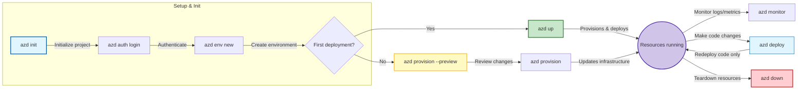
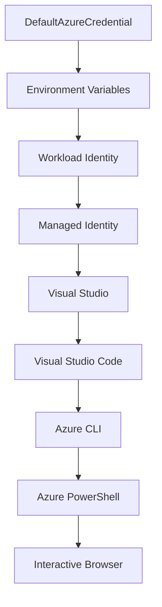

# Osnove AZD - Osnovni Koncepti i Temelji

**Navigacija Kroz Poglavlja:**
- **📚 Početna Stranica Kursa**: [AZD za Početnike](../../README.md)
- **📖 Trenutno Poglavlje**: Poglavlje 1 - Osnove i Brzi Start
- **⬅️ Prethodno**: [Pregled Kursa](../../README.md#-chapter-1-foundation--quick-start)
- **➡️ Sledeće**: [Instalacija i Podešavanje](installation.md)
- **🚀 Sledeće Poglavlje**: [Poglavlje 2: AI-prvo Programiranje](../chapter-02-ai-development/microsoft-foundry-integration.md)

## Uvod

> Pregledano u skladu sa `azd 1.37.2` (novembar 2026). Bash komande koriste navodnike za zamenjive elemente koje je potrebno zameniti. Šablonski tokovi koriste `.` za inicijalizaciju trenutnog direktorijuma; bez argumenta direktorijuma, inicijalizacija šablona kreira poddirektorijum i ne menja radni direktorijum u ljusci. Napredni primeri služe za ilustraciju, nisu kompletni projekti.

Ova lekcija uvodi u Azure Developer CLI (azd), moćan komandni alat koji ubrzava vaše putovanje od lokalnog razvoja do implementacije na Azure-u. Naučićete osnovne koncepte, ključne funkcije i shvatićete kako azd pojednostavljuje implementaciju cloud-native aplikacija.

## Ciljevi Učenja

Do kraja ove lekcije, moći ćete da:
- Razumete šta je Azure Developer CLI i njegov primarni cilj
- Naučite osnovne koncepte šablona, okruženja i servisa
- Istražite ključne funkcije uključujući razvoj vođen šablonima i Infrastrukturu kao Kod
- Razumete strukturu azd projekta i tok rada
- Budete spremni za instalaciju i konfiguraciju azd u vašem razvojnom okruženju

## Ishodi Učenja

Nakon završetka lekcije, moći ćete da:
- Objasnite ulogu azd u savremenim cloud razvojim tokovima rada
- Identifikujete komponente strukture azd projekta
- Opišete kako šabloni, okruženja i servisi funkcionišu zajedno
- Razumete prednosti Infrastrukture kao Koda sa azd
- Prepoznate različite azd komande i njihove namene

## Šta je Azure Developer CLI (azd)?

Azure Developer CLI (azd) je komandni alat dizajniran da ubrza vaše putovanje od lokalnog razvoja do implementacije na Azure-u. Pojednostavljuje proces izgradnje, implementacije i upravljanja cloud-native aplikacijama na Azure-u.

### Šta možete implementirati sa azd?

azd podržava širok spektar radnih opterećenja — i ta lista stalno raste. Danas možete koristiti azd za implementaciju:

| Tip radnog opterećenja | Primeri | Isti tok rada? |
|----------------------|---------|---------------|
| **Tradicionalne aplikacije** | Veb aplikacije, REST API-jevi, statične stranice | ✅ `azd up` |
| **Servisi i mikroservisi** | Container Apps, Function Apps, višeservisni backendi | ✅ `azd up` |
| **AI-pokretane aplikacije** | Chat aplikacije sa Microsoft Foundry modelima, RAG rešenja sa AI pretragom | ✅ `azd up` |
| **Inteligentni agenti** | Agenti hostovani na Foundry, višagentne orkestracije | ✅ `azd up` |

Ključni uvid je da **azd životni ciklus ostaje isti bez obzira na to šta implementirate**. Inicijalizujete projekat, obezbeđujete infrastrukturu, implementirate kod, pratite aplikaciju i čistite — bilo da je to jednostavan veb sajt ili sofisticirani AI agent.

Ova kontinuitet je dizajnirana namerno. azd tretira AI sposobnosti kao još jedan tip servisa koji vaša aplikacija može koristiti, a ne kao nešto suštinski drugačije. Chat endpoint podržan Microsoft Foundry modelima, iz azd perspektive, je samo još jedan servis za konfiguraciju i implementaciju.

### 🎯 Zašto koristiti AZD? Prava uporedba

Uporedimo implementaciju jednostavne veb aplikacije sa bazom podataka:

#### ❌ BEZ AZD: Ručna Azure implementacija (30+ minuta)

**Ilustrativno poređenje u Bash-u, nije pokretanje aplikacije.** Pretpostavlja postojeći aplikacioni kod, jedinstvene nazive resursa, Azure CLI autentifikaciju i potrebna CLI proširenja. Koristite donji šablonski zadatak za podržani put od početka do kraja.

```bash
# Step 1: Create resource group
az group create --name myapp-rg --location eastus

# Step 2: Create App Service Plan
az appservice plan create --name myapp-plan \
  --resource-group myapp-rg \
  --sku B1 --is-linux

# Step 3: Create Web App
az webapp create --name myapp-web-unique123 \
  --resource-group myapp-rg \
  --plan myapp-plan \
  --runtime "NODE:22-lts"

# Step 4: Create Cosmos DB account (10-15 minutes)
az cosmosdb create --name myapp-cosmos-unique123 \
  --resource-group myapp-rg \
  --kind MongoDB

# Step 5: Create database
az cosmosdb mongodb database create \
  --account-name myapp-cosmos-unique123 \
  --resource-group myapp-rg \
  --name tododb

# Step 6: Create collection
az cosmosdb mongodb collection create \
  --account-name myapp-cosmos-unique123 \
  --resource-group myapp-rg \
  --database-name tododb \
  --name todos

# Step 7: Get connection string
CONN_STR=$(az cosmosdb keys list \
  --name myapp-cosmos-unique123 \
  --resource-group myapp-rg \
  --type connection-strings \
  --query "connectionStrings[0].connectionString" -o tsv)

# Step 8: Configure app settings
az webapp config appsettings set \
  --name myapp-web-unique123 \
  --resource-group myapp-rg \
  --settings MONGODB_URI="$CONN_STR"

# Step 9: Enable logging
az webapp log config --name myapp-web-unique123 \
  --resource-group myapp-rg \
  --application-logging filesystem \
  --detailed-error-messages true

# Step 10: Set up Application Insights
az monitor app-insights component create \
  --app myapp-insights \
  --location eastus \
  --resource-group myapp-rg

# Step 11: Link App Insights to Web App
INSTRUMENTATION_KEY=$(az monitor app-insights component show \
  --app myapp-insights \
  --resource-group myapp-rg \
  --query "instrumentationKey" -o tsv)

az webapp config appsettings set \
  --name myapp-web-unique123 \
  --resource-group myapp-rg \
  --settings APPINSIGHTS_INSTRUMENTATIONKEY="$INSTRUMENTATION_KEY"

# Step 12: Build application locally
npm install
npm run build

# Step 13: Create deployment package
zip -r app.zip . -x "*.git*" "node_modules/*"

# Step 14: Deploy application
az webapp deployment source config-zip \
  --resource-group myapp-rg \
  --name myapp-web-unique123 \
  --src app.zip

# Step 15: Wait and pray it works 🙏
# (No automated validation, manual testing required)
```

**Problemi:**
- ❌ Više od 15 komandi koje treba zapamtiti i izvršiti po redu
- ❌ 30-45 minuta manuelnog rada
- ❌ Lako praviti greške (tipkarske greške, pogrešni parametri)
- ❌ Podaci za pristup zahtevaju eksplicitno rukovanje; debug logovi i praćenje ljuske mogu ih otkriti
- ❌ Nema automatizovanog vraćanja ako nešto zakaže
- ❌ Teško za reprodukovati za članove tima
- ❌ Različito svaki put (nereproducibilno)

#### ✅ SA AZD: Automatska Implementacija (5 komandi, 10-15 minuta)

```bash
# Step 1: Initialize from template
azd init --template todo-nodejs-mongo .

# Step 2: Authenticate
azd auth login

# Step 3: Select the environment created during init
azd env select dev

# Step 4: Preview changes (optional but recommended)
azd provision --preview

# Step 5: Deploy everything
azd up

# ✨ Done! Everything is deployed, configured, and monitored
```

**Prednosti:**
- ✅ **5 komandi** naspram 15+ manuelnih koraka
- ✅ **10-15 minuta** ukupno vreme (uglavnom čekanje na Azure)
- ✅ **Manje manuelnih grešaka** - konzistentan, šablonima vođen tok rada
- ✅ **Sigurno rukovanje tajnama** - mnogi šabloni koriste Azure upravljano skladište tajni
- ✅ **Ponavljajuće implementacije** - isti tok rada svaki put
- ✅ **Ponavljajuće definicije infrastrukture** - zavisno od kvota, dostupnosti regiona i verzija šablona
- ✅ **Pripremljeno za tim** - svako može implementirati sa istim komandama
- ✅ **Infrastruktura kao Kod** - verzionisani Bicep šabloni
- ✅ **Nadzor definisan šablonom** - Application Insights kada je uključen u šablon

### Vreme i Pouzdanost

Gore navedena vremena su procene, ne benchmark testovi. azd smanjuje broj komandi koje treba koordinisati, ali ne garantuje trajanje implementacije, ne eliminiše greške niti pruža automatsko vraćanje aplikacija/baza podataka. Čuvajte radne verzije u verzionisanju i testirajte procedure oporavka.

## Osnovni Koncepti

### Šabloni
Šabloni su temelj azd. Oni sadrže:
- **Kod aplikacije** - Vaš izvorni kod i zavisnosti
- **Definicije infrastrukture** - Azure resursi definisani u Bicep ili Terraform
- **Konfiguracione datoteke** - Podešavanja i promenljive okruženja
- **Skripte za implementaciju** - Automatizovani tokovi implementacije

### Okruženja
Okruženja predstavljaju različite ciljeve implementacije:
- **Razvoj** - Za testiranje i razvoj
- **Priprema** - Predprodukciono okruženje
- **Produkcija** - Živo produkciono okruženje

Svako okruženje održava svoje:
- Naziv i vrednosti okruženja; izolacija resursa zavisi od infrastrukturalnog šablona
- Konfiguracione postavke
- Stanje implementacije

### Servisi
Servisi u `azure.yaml` opisuju deployabilne komponente aplikacije:
- **Frontend** - Veb aplikacije, SPA
- **Backend** - API-jevi, mikroservisi

Baze podataka i skladišta se obično obezbeđuju kao infrastrukturni resursi, a ne kao smišljeni servisi domaćini poput `host: postgres`.

## Ključne Karakteristike

### 1. Razvoj Vođen Šablonima
```bash
# Browse available templates
azd template list

# Initialize from a template
azd init --template "<template-name>" .
```

### 2. Infrastruktura kao Kod
- **Bicep** - Azure specifičan jezik
- **Terraform** - Multi-cloud infrastrukturni alat
- Bicep se kompajlira u ARM šablone; sirovi ARM JSON nije poseban ugrađeni `infra.provider`.

### 3. Integrisani Tokovi Rada
```bash
# Complete deployment workflow
azd up            # Provision + Deploy this is hands off for first time setup

# 🧪 NEW: Preview infrastructure changes before deployment (SAFE)
azd provision --preview    # Simulate infrastructure deployment without making changes

azd provision     # Create Azure resources if you update the infrastructure use this
azd deploy        # Deploy application code or redeploy application code once update
azd down          # Clean up resources
```

#### 🛡️ Bezbedno Planiranje Infrastrukture sa Pregledom
Komanda `azd provision --preview` menja igru za bezbednu implementaciju:
- **Analiza bez izvršenja** - Prikazuje šta će biti kreirano, izmenjeno ili obrisano
- **Bez primene infrastrukture** - Pregled promena provajdera; prvo proverite projektne hook-ove jer oni mogu izvršavati komande sa sporednim efektima
- **Timска saradnja** - Podelite rezultate pregleda pre implementacije
- **Ulaz za planiranje troškova** - Pregledajte predložene SKU-ove, zatim ih ocenite sa Azure Kalkulatorom cena; pregled ne računa cene

```bash
# Example preview workflow
azd provision --preview           # See what will change
# Review the output, discuss with team
azd provision                     # Apply changes with confidence
```

### 📊 Vizualno: AZD Tok Razvoja



**Objašnjenje toka rada:**
1. **Init** - Početak sa šablonom ili novim projektom
2. **Auth** - Autentikacija sa Azure-om
3. **Okruženje** - Kreiranje izolovanog okruženja za implementaciju
4. **Preview** - 🆕 Uvek prvo pregledajte promene infrastrukture (bezbedna praksa)
5. **Provision** - Kreiranje/azuriranje Azure resursa
6. **Deploy** - Postavljanje vašeg aplikacionog koda
7. **Monitor** - Praćenje performansi aplikacije
8. **Iterate** - Pravite izmene i ponovo implementirate kod
9. **Cleanup** - Uklonite resurse kada završite

### 4. Upravljanje Okruženjem
```bash
# Create and manage environments
azd env new "<environment-name>"
azd env select "<environment-name>"
azd env list
```

### 5. Ekstenzije i AI Komande

azd koristi sistem ekstenzija za dodavanje funkcionalnosti izvan osnovnog CLI-a. Ovo je posebno korisno za AI radna opterećenja:

```bash
# List available extensions
azd extension list

# Install the Foundry agents extension
azd extension install azure.ai.agents

# Initialize an AI agent project interactively
azd ai agent init

# Test a deployed agent (shows latency and time-to-first-byte)
azd ai agent invoke

# Start the MCP server for AI-assisted development (Alpha)
azd mcp start
```

**Životni ciklus agenta, od početka do kraja.** Koristite `azure.ai.agents` za operacije životnog ciklusa agenta i instalirajte `azure.ai.evaluations` zasebno za evaluaciju. Koristite `azd >= 1.37.0` za kombinovani tok rada. Nisu vam sve ove komande potrebne prvog dana:

| Faza | Komanda | Šta radi |
|------|---------|----------|
| **Scaffold** | `azd ai agent init --template <path-to-azure.yaml>` | Usvoji šablon za trenutni agent projekat |
| **Test** | `azd ai agent invoke` | Pozovi agenta i vidi vreme odgovora |
| **Measure** | `azd ai eval init`, `generate`, `run start` | Konfiguriši, implementiraj i pokreni evaluacije koristeći posebnu ekstenziju |
| **Improve** | `azd ai agent optimize --eval <evaluation-name> --optimize-model <optimizer-deployment>` | Ponovo koristi kompatibilnu evaluaciju za optimizaciju agenta |
| **Inspect** | `azd ai agent endpoint show` | Pogledaj konfiguraciju live endpoint-a |
| **Clean up** | `azd ai agent delete` | Obriši hostovanog agenta i sve njegove verzije |

> Ekstenzije su detaljno obrađene u [Poglavlju 2: AI-prvo Programiranje](../chapter-02-ai-development/agents.md) i u referenci [AZD AI CLI Komande](../chapter-08-production/production-ai-practices.md#azd-ai-cli-commands-and-extensions).

## 📁 Struktura Projekta

Tipična struktura azd projekta:
```
my-app/
├── .azure/                  # Local environments and selected-environment config
│   ├── config.json
│   └── dev/.env
├── .devcontainer/          # Development container config
├── .github/workflows/      # GitHub Actions
├── .vscode/               # VS Code settings
├── infra/                 # Infrastructure code
│   ├── main.bicep        # Main infrastructure template
│   ├── main.parameters.json
│   └── modules/          # Reusable modules
├── src/                  # Application source code
│   ├── api/             # Backend services
│   └── web/             # Frontend application
├── azure.yaml           # azd project configuration
└── README.md
```

## 🔧 Konfiguracione Datoteke

### azure.yaml
Glavna konfiguraciona datoteka projekta:
```yaml
name: my-awesome-app
metadata:
  template: my-template@1.0.0

services:
  web:
    project: ./src/web
    language: js
    host: appservice
  api:
    project: ./src/api
    language: js
    host: appservice

hooks:
  preprovision:
    shell: pwsh
    run: echo "Preparing to provision..."
```

### .azure/config.json
Lokalni izbor podrazumevanog okruženja (ilustrativno; upravlja azd):
```json
{
  "defaultEnvironment": "dev"
}
```

## 🎪 Uobičajeni Tokovi Rada sa Praktičnim Vežbama

> **💡 Savet za Učenje:** Pratite ove vežbe redom da biste postepeno razvijali svoje AZD veštine.

### 🎯 Vežba 1: Inicijalizujte Vaš Prvi Projekat

**Cilj:** Kreirajte AZD projekat i istražite njegovu strukturu

**Koraci:**
```bash
# Use a proven template
mkdir azd-basics-practice
cd azd-basics-practice
# Choose "dev" for the environment name when prompted
azd init --template todo-nodejs-mongo .

# Explore the generated files
ls -la  # View all files including hidden ones

# Key files created:
# - azure.yaml (main config)
# - infra/ (infrastructure code)
# - src/ (application code)
```

**✅ Uspeh:** Imate azure.yaml, infra/ i src/ direktorijume

---

### 🎯 Vežba 2: Implementirajte na Azure

**Cilj:** Završite implementaciju od početka do kraja

**Koraci:**
```bash
# 1. Authenticate
azd auth login

# 2. Select the dev environment created in Exercise 1
azd env select dev
azd env set AZURE_LOCATION eastus

# 3. Preview changes (RECOMMENDED)
azd provision --preview

# 4. Deploy everything
azd up

# 5. Verify deployment
azd show    # View your app URL
```

**Očekivano Vreme:** 10-15 minuta  
**✅ Uspeh:** URL aplikacije se otvara u pregledaču

---

### 🎯 Vežba 3: Više Okruženja

**Cilj:** Implementirajte u dev i staging okruženja

**Koraci:**
```bash
# Already have dev, create staging
azd env new staging
azd env set AZURE_LOCATION westus2
azd up

# Switch between them
azd env list
azd env select dev
```

**✅ Uspeh:** Dve odvojene grupe resursa u Azure Portalu

**Čišćenje:** Vežba 3 kreira drugu naplatnu implementaciju. Obrišite obe kada završite:

```bash
azd down --environment dev
azd down --environment staging
```

---

### 🛡️ Destruktivno Čišćenje: `azd down --force --purge`

Kada namerno želite da obrišete Azure resurse izabranog okruženja:

```bash
azd down --force --purge
```

**Šta radi:**
- `--force`: Bez potvrda
- `--purge`: Takođe trajno briše podržane resurse koji su soft-obrisani (npr. Key Vaults), gde je zaštita od čišćenja dozvoljena. Ne briše lokalni direktorijum `.azure/`.

**Koristite kada:** završite sa jednokratnim okruženjem. Ne tretirajte destruktivno čišćenje kao prvi odgovor na probleme sa autentifikacijom, kvotama ili konfiguracijom.

---

## 🎪 Originalna Referenca Toka Rada

### Pokretanje Novog Projekta
```bash
# Method 1: Use existing template
azd init --template todo-nodejs-mongo .

# Method 2: Start from scratch
azd init

# Method 3: Use current directory
azd init .
```

### Razvojni Ciklus
```bash
# Set up development environment
azd auth login
azd env new dev
azd env select dev

# Deploy everything
azd up

# Make changes and redeploy
azd deploy

# Clean up when done
azd down --force --purge # Deletes this environment's discovered Azure resources; review before forcing deletion.
```

## Razumevanje `azd down --force --purge`
Komanda `azd down --force --purge` je moćan način da kompletno srušite vaše azd okruženje i sve povezane resurse. Evo šta svaki parametar radi:
```
--force
```
- Preskače potvrde.
- Korisno za automatizaciju ili skriptovanje gde ručni unos nije moguć.
- Ne zaobilazi dozvole, zaštitu od čišćenja ili neuspehe prilikom brisanja.

```
--purge
```
Трајно брише подржане Azure ресурсе који су меко избрисани без додатне потврде. Заштита од брисања и дозволе и даље важе. Ово **не** уклања локална окружења или директоријум `.azure/`.


### Зашто користити оба?
Користите оба само када намеравате да избришете Azure ресурсе изабраног окружења и очистите опорављиве ресурсе. Ово је деструктивно чишћење, а не општи поправак или ресетовање локалног стања.

Посебно је корисно након ручног брисања ресурса у Azure порталу или приликом промене шаблона, окружења или конвенција именовања група ресурса.


### Управљање са више окружења
```bash
# Create staging environment
azd env new staging
azd env select staging
azd up

# Switch back to dev
azd env select dev

# Compare environments
azd env list
```

## 🔐 Аутентификација и креденцијали

Разликујте автентикацију за деплојмент (`azd auth login`) од аутентификације у апликацијском SDK-у (`DefaultAzureCredential`). Оне су одвојене. azd по подразумеваној вредности не користи Azure CLI креденцијале.

### Azure CLI Аутентификација (`az login`)

Покрените `azd auth login` за azd. Следеће Azure CLI команде су опционе и аутентификују `az` команде одвојено:

```bash
# Interactive login (opens browser)
az login

# Login with specific tenant
az login --tenant "<tenant-id>"

# Login with service principal
az login --service-principal -u "<app-id>" -p "<password>" --tenant "<tenant-id>"

# Check current login status
az account show

# List available subscriptions
az account list --output table

# Set default subscription
az account set --subscription "<subscription-id>"
```

### Ток аутентификације
1. **Интерактивни пријављивање**: Отвара подразумевани прегледач за аутентификацију
2. **Device Code Flow**: За окружења без приступа прегледачу
3. **Service Principal**: За аутоматизацију и CI/CD сценарије
4. **Managed Identity**: За апликације хостоване у Azure-у

### DefaultAzureCredential ланац

`DefaultAzureCredential` је тип креденцијала који пружа поједностављено искуство аутентификације тако што аутоматски испробава више извора креденцијала у одређеном редоследу:

#### Ланац креденцијала апликацијског SDK-а

Тачан низ зависи од језика Azure Identity SDK, верзије, инсталираних додатака и опција. Овај дијаграм је концептуални, није фиксна азд секвенца аутентификације; новији SDK-ови могу такође укључивати Azure Developer CLI креденцијале.


#### 1. Променљиве окружења
```bash
# Set environment variables for service principal
export AZURE_CLIENT_ID="<app-id>"
export AZURE_CLIENT_SECRET="<password>"
export AZURE_TENANT_ID="<tenant-id>"
```

#### 2. Workload Identity (Kubernetes/GitHub Actions)
Користи се аутоматски у:
- Azure Kubernetes Service (AKS) са Workload Identity
- GitHub Actions са OIDC федерацијом
- Другим сценаријима федеративног идентитета

#### 3. Управљани идентитет
За Azure ресурсе као што су:
- Виртуелне машине
- App Service
- Azure Functions
- Инстанце контејнера

```bash
# Inspect a deployed Container App's configured identity (requires az login)
az containerapp show --name "<app-name>" --resource-group "<rg-name>" --query identity
```

#### 4. Интеграција алата за развој
- **Visual Studio**: Аутоматски користи пријављени налог
- **VS Code**: Подршка зависи од SDK и подржане брокер/додатак конфигурације
- **Azure CLI**: Користи `az login` креденцијале (најчешће за локални развој)

### Подешавање AZD аутентификације

```bash
# Method 1: Direct azd authentication (recommended)
azd auth login

# Method 2: Direct azd authentication
azd auth login --use-device-code  # For headless environments

# Method 3: Check authentication status
azd auth login --check-status

# Method 4: Logout and re-authenticate
azd auth logout
azd auth login
```

### Најбоље праксе за аутентификацију

#### За локални развој
```bash
# 1. Log in to azd
azd auth login

# 2. Select the subscription for this initialized environment
azd env set AZURE_SUBSCRIPTION_ID "<subscription-id>"

# 3. Check azd sign-in details (read the status message)
azd auth login --check-status
```

#### За CI/CD пипелине
```yaml
# Partial GitHub Actions steps: assumes checkout, azd installation,
# required AZURE_* environment values, and pipeline secret configuration.
- name: Deploy with azd
  run: |
    azd auth login --client-id ${{ secrets.AZURE_CLIENT_ID }} \
                    --client-secret ${{ secrets.AZURE_CLIENT_SECRET }} \
                    --tenant-id ${{ secrets.AZURE_TENANT_ID }}
    azd up --no-prompt
```

#### За продукциона окружења
- Користите **Управљани идентитет** када радите на Azure ресурсима
- Користите **Service Principal** за аутоматизацију сценарија
- Избегавајте чување креденцијала у коду или конфигурационим фајловима
- Користите **Azure Key Vault** за осетљиву конфигурацију

### Чести проблеми са аутентификацијом и решења

#### Проблем: "Није пронађена претплата"
```bash
# Solution: Set default subscription
az account list --output table
az account set --subscription "<subscription-id>"
azd env set AZURE_SUBSCRIPTION_ID "<subscription-id>"
```

#### Проблем: "Недовољне дозволе"
```bash
# Solution: Check and assign required roles
az role assignment list --assignee $(az account show --query user.name --output tsv)

# Common required roles:
# - Contributor (for resource management)
# - User Access Administrator (for role assignments)
```

#### Проблем: "Токен је истекао"
```bash
# Solution: Re-authenticate
az logout
az login
azd auth logout
azd auth login
```

### Аутентификација у различитим сценаријима

#### Локални развој
```bash
# Personal development account
az login
azd auth login
```

#### Тимски развој
```bash
# Use specific tenant for organization
az login --tenant contoso.onmicrosoft.com
azd auth login --tenant-id "<tenant-id>"
```

#### Мулти-тенант сценарији
```bash
# Switch between tenants
az login --tenant tenant1.onmicrosoft.com
azd auth login --tenant-id "<tenant-1-id>"
# Select an environment configured with tenant 1's subscription
azd env select tenant1-dev
# Deploy to tenant 1
azd up

az login --tenant tenant2.onmicrosoft.com  
azd auth login --tenant-id "<tenant-2-id>"
azd env select tenant2-dev
# Deploy to tenant 2
azd up
```

### Безбедносне препреке

1. **Чување креденцијала**: Никада не чувајте креденцијале у изворном коду
2. **Ограничење обима**: Користите принцип најмањих привилегија за service principal
3. **Ротација токена**: Редовно мењајте сервисне тајне
4. **Ревизија**: Пратите активности аутентификације и деплоја
5. **Мрежна безбедност**: Користите приватне ендпоинте кад год је могуће

### Решавање проблема са аутентификацијом

```bash
# Debug authentication issues
azd auth login --check-status
az account show
az account get-access-token

# Common diagnostic commands
whoami                          # Current user context
az ad signed-in-user show      # Microsoft Entra ID user details
az group list                  # Test resource access
```

## Откривање команди

### Откривање
```bash
azd template list              # Browse templates
azd template list --help       # Template discovery options
azd init --help               # Initialization options
```

### Управљање пројектом
```bash
azd show                     # Project overview
azd env list                # Available environments and selected default
azd config show            # Configuration settings
```

### Надгледање
```bash
azd monitor                  # Open Azure portal monitoring
azd monitor --logs           # View application logs
azd monitor --live           # View live metrics
azd pipeline config          # Set up CI/CD
```

## Најбоље праксе

### 1. Користите значајна имена
```bash
# Good
azd env new production-east
azd init --template todo-nodejs-mongo .

# Avoid
azd env new env1
azd init --template template1 .
```

### 2. Искористите шаблоне
- Почните са постојећим шаблонима
- Прилагодите их својим потребама
- Креирајте поново употребљиве шаблоне за вашу организацију

### 3. Изолација окружења
- Користите посебна окружења за дев/стагинг/прод
- Никада немојте директно депловати у продукцију са локалне машине
- Користите CI/CD пипелине за производне деплоје

### 4. Управљање конфигурацијом
- Користите управљани идентитет и Key Vault за тајне; обичне `azd env set` вредности су локални plaintext
- Чувајте конфигурацију у контролу верзија
- Документујте подешавања специфична за окружење

## Прогрес учења

### Почетник (недеља 1-2)
1. Инсталирајте азд и аутентификујте се
2. Деплојујте једноставан шаблон
3. Разумевање структуре пројекта
4. Учење основних команди (up, down, deploy)

### Средњи ниво (недеља 3-4)
1. Прилагодите шаблоне
2. Управљајте више окружења
3. Разумевање инфраструктуре као кода
4. Подешавање CI/CD пипелина

### Напредни ниво (недеља 5+)
1. Креирајте прилагођене шаблоне
2. Напредни инфраструктурни обрасци
3. Мулти-регионална деплоја
4. Конфигурације корпоративног нивоа

## Следећи кораци

**📖 Наставите са Поглављем 1:**
- [Инсталација и подешавање](installation.md) - Инсталирајте и конфигуришите азд
- [Ваш први пројекат](first-project.md) - Комплетан практичан туторијал
- [Водич за конфигурацију](../chapter-03-configuration/configuration.md) - Напредне опције конфигурације

**🎯 Спремни за следеће поглавље?**
- [Поглавље 2: AI-први развој](../chapter-02-ai-development/microsoft-foundry-integration.md) - Почните са изградњом AI апликација

## Додатни ресурси

- [Преглед Azure Developer CLI](https://learn.microsoft.com/en-us/azure/developer/azure-developer-cli/)
- [Галерија шаблона](https://azure.github.io/awesome-azd/)
- [Примери заједнице](https://github.com/Azure-Samples)

---

## 🙋 Често постављана питања

### Општа питања

**П: Која је разлика између AZD и Azure CLI?**

О: Azure CLI (`az`) је за управљање појединачним Azure ресурсима. AZD (`azd`) је за управљање целим апликацијама:

```bash
# Azure CLI - Low-level resource management
az webapp create --name myapp --resource-group rg
az sql server create --name myserver --resource-group rg
# ...many more commands needed

# AZD - Application-level management
azd up  # Deploys entire app with all resources
```

**Размислите овако:**
- `az` = Рад са појединачним Lego коцкицама
- `azd` = Рад са комплетним Lego сетовима

---

**П: Да ли ми треба знање Bicep или Terraform да бих користио AZD?**

О: Не! Почните са шаблонима:
```bash
# Use existing template - no IaC knowledge needed
azd init --template todo-nodejs-mongo .
azd up
```

Можете касније научити Bicep за прилагођавање инфраструктуре. Шаблони пружају радне примере за учење.

---

**П: Колико кошта покретање AZD шаблона?**

О: Трошкови варирају у зависности од региона, SKU, uptime-а, режима базе података и коришћења модела. Развојно окружење може имати значајне месечне трошкове чак и када не ради; немојте претпостављати општи распон од $50-150:

```bash
# Preview resource changes (not prices)
azd provision --preview

# Always cleanup when not using
azd down --force --purge  # Removes all resources
```

**Професионални савет:** Користите бесплатне нивое када су доступни:
- App Service: F1 (бесплатни) ниво
- Azure OpenAI: нема опште гаранције бесплатних токена месечно; проверите тренутни модел и цене
- Cosmos DB: елегибилни налози са provisioned throughput-ом могу бити на бесплатном нивоу; serverless шаблони се аутоматски не квалификују

---

**П: Могу ли користити AZD са постојећим Azure ресурсима?**

О: Да, али је лакше почети из чисте инсталације. AZD најбоље функционише када управља целим животним циклусом. За постојеће ресурсе:

```bash
# Option 1: Import existing resources (advanced)
azd init
# Then modify infra/ to reference existing resources

# Option 2: Start fresh (recommended)
azd init --template "<verified-template-name>" .
azd up  # Creates new environment
```

---

**П: Како да делим свој пројекат са тимом?**

О: Објавите AZD пројекат у Git (али НЕ .azure фасциклу):

```bash
# Already in .gitignore by default
.azure/        # Contains secrets and environment data
*.env          # Environment variables

# Team members then:
git clone "<your-repo>"
# Change into the cloned repository before running the remaining commands.
azd auth login
azd env new "<their-name>-dev"
azd up
```

Сви добијају идентичну инфраструктуру из истих шаблона.

---

### Питања за решавање проблема

**П: "azd up" је пао на пола. Шта да радим?**

О: Проверите грешку, исправите је, па поново покушајте:

```bash
# Capture detailed diagnostics (redact sensitive values before sharing)
azd up --debug

# Common fixes:

# 1. If quota exceeded:
azd env set AZURE_LOCATION "westus2"  # Try different region

# 2. If resource name conflict:
azd down --force --purge  # Clean slate
azd up  # Retry

# 3. If auth expired:
az login
azd auth login
azd up
```

**Најчешћи проблем:** Изабрана је погрешна Azure претплата
```bash
az account list --output table
az account set --subscription "<correct-subscription>"
azd env set AZURE_SUBSCRIPTION_ID "<correct-subscription-id>"
```

---

**П: Како да деплојујем само промене кода без репровизије?**

О: Користите `azd deploy` уместо `azd up`:

```bash
azd up          # First time: provision + deploy (slow)

# Make code changes...

azd deploy      # Subsequent times: deploy only (fast)
```

Упоређење брзине:
- `azd up`: 10-15 минута (провизионира инфраструктуру)
- `azd deploy`: 2-5 минута (само код)

---

**П: Могу ли прилагодити инфраструктурне шаблоне?**

О: Можете! Уредите Bicep фајлове у `infra/`:

```bash
# After azd init
cd infra/
code main.bicep  # Edit in VS Code

# Preview changes
azd provision --preview

# Apply changes
azd provision
```

**Савет:** Почните мало - промените прво SKU-ове:
```bicep
// infra/main.bicep
sku: {
  name: 'B1'  // Change to 'P1V2' for production
}
```

---

**П: Како да избришем све што је AZD креирао?**

О: Једна команда уклања све ресурсе:

```bash
azd down --force --purge

# This deletes:
# - Azure resources/resource groups discovered for the selected environment
# - Supported soft-deleted resources, if purge protection allows
# Local .azure files remain; shared/external resources may remain too.
```

**Увек покрените ово када:**
- Завршите тестирање шаблона
- Прелазите на други пројекат
- Желите да почнете из чисте инсталације

**Провера трошкова:** Потврдите брисање у Azure и проверите задржане/заједничке ресурсе. Претходно настали трошкови и даље важе.

---

**П: Шта ако случајно обришем ресурсе у Azure Порталу?**

О: Азд стање може бити несинхронизовано. Приступ са чистом таблом:

```bash
# 1. Delete remaining resources only if that is your intent
azd down --force --purge

# 2. Start fresh
azd up

# Alternative: Let AZD detect and fix
azd provision  # Will create missing resources
```

---

### Напредна питања

**П: Могу ли користити AZD у CI/CD пипелинима?**

О: Можете! Пример са GitHub Actions:

```yaml
# .github/workflows/deploy.yml
name: Deploy with AZD

on:
  push:
    branches: [main]

jobs:
  deploy:
    runs-on: ubuntu-latest
    steps:
      - uses: actions/checkout@v4
      
      - name: Install azd
        run: curl -fsSL https://aka.ms/install-azd.sh | bash
      
      - name: Azure Login
        run: |
          azd auth login \
            --client-id ${{ secrets.AZURE_CLIENT_ID }} \
            --client-secret ${{ secrets.AZURE_CLIENT_SECRET }} \
            --tenant-id ${{ secrets.AZURE_TENANT_ID }}
      
      - name: Deploy
        env:
          AZURE_ENV_NAME: dev
          AZURE_LOCATION: ${{ vars.AZURE_LOCATION }}
          AZURE_SUBSCRIPTION_ID: ${{ vars.AZURE_SUBSCRIPTION_ID }}
        run: azd up --no-prompt
```

---

**П: Како да управљам тајнама и осетљивим подацима?**

О: Користите експлицитно Key Vault. `azd env set` записује обичне вредности у локални формат окружења; не креира аутоматски локу, не додељује улоге нити не убацује тајне у вашу апликацију.

```bash
# Interactive: create/select a Key Vault secret and save its reference
azd env set-secret DATABASE_PASSWORD
```

Потребне су вам одговарајуће дозволе за локу. Ваша инфраструктура/апликација мора да повезује тајну са корисником и да додели приступ идентитету при извршавању. Немојте исписивати решене вредности тајне у логове.

**Никада не објављујте:**
- `.azure/` фасциклу (садржи податке окружења)
- `.env` фајлове (локалне тајне)
- Конекцијске низове

---

**П: Могу ли деплојовати у више региона?**

О: Можете, креирајте окружење по регији:

```bash
# East US environment
azd env new prod-eastus
azd env set AZURE_LOCATION eastus
azd up

# West Europe environment
azd env new prod-westeurope
azd env set AZURE_LOCATION westeurope
azd up

# Each environment is independent
azd env list
```

За праве мулти-регионалне апликације, прилагодите Bicep шаблоне за паралелну деплоју у више региона.

---

**П: Где могу добити помоћ ако запнем?**

1. **AZD документација:** https://learn.microsoft.com/azure/developer/azure-developer-cli/
2. **GitHub Issues:** https://github.com/Azure/azure-dev/issues
3. **Discord:** [Azure Discord](https://discord.gg/microsoft-azure) - канал #azure-developer-cli
4. **Stack Overflow:** Таг `azure-developer-cli`
5. **Овај курс:** [Водич за решавање проблема](../chapter-07-troubleshooting/common-issues.md)

**Професионални савет:** Пре питања, покрените:
```bash
azd show       # Shows current state
azd version    # Shows your version
```
Укључите ове информације у ваше питање за бржу помоћ.

---

## 🎓 Шта следи?

Сада разумете основе AZD. Изаберите свој пут:

### 🎯 За почетнике:
1. **Следеће:** [Инсталација и подешавање](installation.md) - Инсталирајте AZD на свој уређај
2. **Затим:** [Ваш први пројекат](first-project.md) - Деплојујте своју прву апликацију
3. **Вежбајте:** Посветите се сва три задатка из овог лекције

### 🚀 За AI програмере:
1. **Прескочите на:** [Поглавље 2: AI-први развој](../chapter-02-ai-development/microsoft-foundry-integration.md)
2. **Деплојујте:** У празном фолдеру за пројекат почните са `azd init --template get-started-with-ai-chat .`
3. **Учите:** Градите у току деплоја

### 🏗️ За искусне програмере:
1. **Прегледајте:** [Водич за конфигурацију](../chapter-03-configuration/configuration.md) - Напредна подешавања
2. **Истражите:** [Инфраструктура као код](../chapter-04-infrastructure/provisioning.md) - Детаљно о Bicep-у
3. **Креирајте:** Направите прилагођене шаблоне за ваш стек

---

**Навигација кроз поглавља:**
- **📚 Почетак курса**: [AZD за почетнике](../../README.md)
- **📖 Тренутно поглавље**: Поглавље 1 - Оснaве и брзи почетак  
- **⬅️ Претходно**: [Преглед курса](../../README.md#-chapter-1-foundation--quick-start)
- **➡️ Следеће**: [Инсталација и подешавање](installation.md)
- **🚀 Следеће поглавље**: [Поглавље 2: AI-први развој](../chapter-02-ai-development/microsoft-foundry-integration.md)

---

<!-- CO-OP TRANSLATOR DISCLAIMER START -->
**Изјава о одрицању одговорности**:
Овај документ је преведен коришћењем услуге за аутоматски превод [Co-op Translator](https://github.com/Azure/co-op-translator). Иако тежимо тачности, имајте у виду да аутоматски преводи могу садржати грешке или нетачности. Оригинални документ на његовом изворном језику треба сматрати ауторитативним извором. За критичне информације препоручује се професионални људски превод. Нисмо одговорни за било каква неспоразума или погрешна тумачења која произилазе из коришћења овог превода.
<!-- CO-OP TRANSLATOR DISCLAIMER END -->