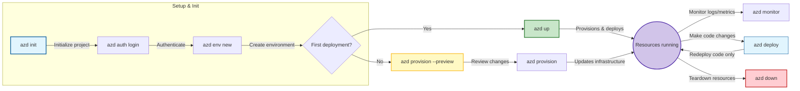
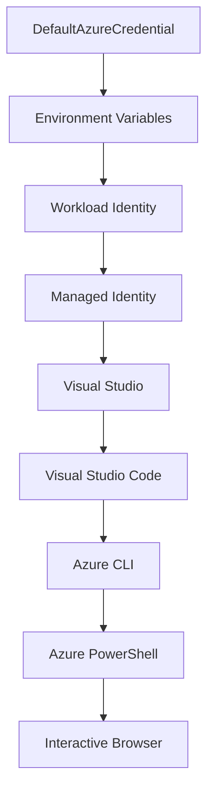

# Osnovni pojmovi i temelj AZD-a

**Navigacija poglavljima:**
- **📚 Početna stranа kursa**: [AZD za početnike](../../README.md)
- **📖 Trenutno poglavlje**: Poglavlje 1 - Osnove i brz početak
- **⬅️ Prethodno**: [Pregled kursa](../../README.md#-chapter-1-foundation--quick-start)
- **➡️ Sledeće**: [Instalacija i podešavanje](installation.md)
- **🚀 Sledeće poglavlje**: [Poglavlje 2: AI-prvo programiranje](../chapter-02-ai-development/microsoft-foundry-integration.md)

## Uvod

> Revidirano u skladu sa `azd 1.37.2` (novembar 2026). Bash komande koriste navedene promenljive koje morate zameniti. Šabloni tokova rada koriste `.` za inicijalizaciju trenutnog direktorijuma; bez argumenta za direktorijum, inicijalizacija šablona kreira poddirektorijum i ne menja radni direktorijum vaše ljuske. Napredni primeri su ilustrativni, ne potpuni projekti.

Ova lekcija vas upoznaje sa Azure Developer CLI (azd), moćnim alatom komandne linije koji ubrzava vaše putovanje od lokalnog razvoja do objavljivanja na Azure-u. Naučićete osnovne koncepte, ključne funkcije i razumećete kako azd pojednostavljuje implementaciju aplikacija prilagođenih oblaku.

## Ciljevi učenja

Do kraja ove lekcije, moći ćete:
- Razumeti šta je Azure Developer CLI i njegovu primarnu svrhu
- Naučiti osnovne koncepte šablona, okruženja i servisa
- Istražiti ključne karakteristike uključujući razvoj vođen šablonima i infrastrukturu kao kod
- Razumeti strukturu i tok rada azd projekta
- Biti spremni da instalirate i konfigurišete azd za vaše razvojno okruženje

## Ishodi učenja

Nakon završetka ove lekcije, moći ćete:
- Objasniti ulogu azd u savremenim tokovima rada za razvoj u oblaku
- Identifikovati komponente strukture azd projekta
- Oписати како šabloni, okruženja i servisi funkcionišu zajedno
- Razumeti koristi Infrastrukture kao Koda sa azd
- Prepoznati različite azd komande i njihove namene

## Šta je Azure Developer CLI (azd)?

Azure Developer CLI (azd) је алат командне линије дизајниран да убрза ваше путовање од локалног развоја до имплементације на Azure. Поједностављује процес израде, имплементације и управљања апликацијама нативним за облак на Azure-у.

### Шта можете да имплементирате уз помоћ azd?

azd подржава широк спектар радних оптерећења – и листа се стално проширује. Данас можете користити azd за следеће имплементације:

| Тип радног оптерећења | Примери | Исти ток рада? |
|---------------|----------|----------------|
| **Традиционалне апликације** | Веб апликације, REST API-ји, статичке странице | ✅ `azd up` |
| **Сервиси и микросервиси** | Container Apps, Function Apps, позадине са више сервиса | ✅ `azd up` |
| **Апликације са вештачком интелигенцијом** | Чат апликације са Microsoft Foundry моделима, RAG решења са AI претрагом | ✅ `azd up` |
| **Интелигентни агенти** | Агенти хостовани на Foundry-у, оркестрације више агената | ✅ `azd up` |

Кључна поента је да **азд животни циклус остаје исти без обзира шта имплементирате**. Иницијализујете пројекат, обезбеђујете инфраструктуру, имплементирате код, пратите апликацију и чистите ресурсе—без обзира да ли је то једноставан веб сајт или сложени AI агент.

Ова континуираност је намерна. azd третира AI могућности као још једну врсту сервиса коју ваша апликација може користити, а не нешто фундаментално другачије. Чат крајња тачка подржана Microsoft Foundry моделима је, из azd перспективе, још један сервис за конфигурисање и имплементацију.

### 🎯 Зашто користити AZD? Поређење из стварног света

Поређајмо имплементацију једноставне веб апликације са базом података:

#### ❌ БЕЗ AZD: Ручна имплементација на Azure (више од 30 минута)

**Илустративна поређење у Bash-у, није апликациони стартер погодан за извршавање.** Ово подразумева постојећи апликациони код, јединствена имена ресурса, Azure CLI аутентификацију и све потребне CLI екстензије. Користите вежбу шаблона испод за подржани крај до краја ток рада.

```bash
# Step 1: Create resource group
az group create --name myapp-rg --location eastus

# Step 2: Create App Service Plan
az appservice plan create --name myapp-plan \
  --resource-group myapp-rg \
  --sku B1 --is-linux

# Step 3: Create Web App
az webapp create --name myapp-web-unique123 \
  --resource-group myapp-rg \
  --plan myapp-plan \
  --runtime "NODE:22-lts"

# Step 4: Create Cosmos DB account (10-15 minutes)
az cosmosdb create --name myapp-cosmos-unique123 \
  --resource-group myapp-rg \
  --kind MongoDB

# Step 5: Create database
az cosmosdb mongodb database create \
  --account-name myapp-cosmos-unique123 \
  --resource-group myapp-rg \
  --name tododb

# Step 6: Create collection
az cosmosdb mongodb collection create \
  --account-name myapp-cosmos-unique123 \
  --resource-group myapp-rg \
  --database-name tododb \
  --name todos

# Step 7: Get connection string
CONN_STR=$(az cosmosdb keys list \
  --name myapp-cosmos-unique123 \
  --resource-group myapp-rg \
  --type connection-strings \
  --query "connectionStrings[0].connectionString" -o tsv)

# Step 8: Configure app settings
az webapp config appsettings set \
  --name myapp-web-unique123 \
  --resource-group myapp-rg \
  --settings MONGODB_URI="$CONN_STR"

# Step 9: Enable logging
az webapp log config --name myapp-web-unique123 \
  --resource-group myapp-rg \
  --application-logging filesystem \
  --detailed-error-messages true

# Step 10: Set up Application Insights
az monitor app-insights component create \
  --app myapp-insights \
  --location eastus \
  --resource-group myapp-rg

# Step 11: Link App Insights to Web App
INSTRUMENTATION_KEY=$(az monitor app-insights component show \
  --app myapp-insights \
  --resource-group myapp-rg \
  --query "instrumentationKey" -o tsv)

az webapp config appsettings set \
  --name myapp-web-unique123 \
  --resource-group myapp-rg \
  --settings APPINSIGHTS_INSTRUMENTATIONKEY="$INSTRUMENTATION_KEY"

# Step 12: Build application locally
npm install
npm run build

# Step 13: Create deployment package
zip -r app.zip . -x "*.git*" "node_modules/*"

# Step 14: Deploy application
az webapp deployment source config-zip \
  --resource-group myapp-rg \
  --name myapp-web-unique123 \
  --src app.zip

# Step 15: Wait and pray it works 🙏
# (No automated validation, manual testing required)
```

**Проблеми:**
- ❌ потребно је запамтити и извршити преко 15 команди по реду
- ❌ 30-45 минута ручног рада
- ❌ Лако је направити грешке (писарне грешке, погрешни параметри)
- ❌ Акредитиви захтевају експлицитно руковање; debug логови и праћење љуске могу их открити
- ❌ Нема аутоматске повратне радње ако нешто пукне
- ❌ Тешко за реплицирати за тимске чланове
- ❌ Сваки пут другачије (није репродуктивно)

#### ✅ СА AZD: Аутоматизована имплементација (5 команди, 10-15 минута)

```bash
# Step 1: Initialize from template
azd init --template todo-nodejs-mongo .

# Step 2: Authenticate
azd auth login

# Step 3: Select the environment created during init
azd env select dev

# Step 4: Preview changes (optional but recommended)
azd provision --preview

# Step 5: Deploy everything
azd up

# ✨ Done! Everything is deployed, configured, and monitored
```

**Предности:**
- ✅ **5 команди** уместо 15+ ручних корака
- ✅ **10-15 минута** укупно (углавном чекање Azure-а)
- ✅ **Мање ручних грешака** - доследан, вођен шаблоном ток рада
- ✅ **Сигурно руковање тајнама** - многи шаблони користе Azure-managed складиште тајни
- ✅ **Поновљиве имплементације** - исти ток рада сваки пут
- ✅ **Поновљиви описи инфраструктуре** - подложно квотама, доступности региона и верзијама шаблона
- ✅ **Припремљено за тим** - свако може имплементирати истим командама
- ✅ **Инфраструктура као код** - Bicep шаблони под контролом верзија
- ✅ **Мониторинг дефинисан шаблоном** - Application Insights када је укључен у шаблон

### Време и поузданост

Времена су процене, не референтни тестови. azd смањује број команди које морате координирати, али не гарантује трајање имплементације, не елиминише грешке или обезбеђује аутоматску повратну радњу апликације/базе података. Чувајте радне верзије у контроли извора и тестирајте процедуре опоравка.

## Основни појмови

### Шаблони
Шаблони су темељ azd-а. Они садрже:
- **Код апликације** - Ваши изворни код и зависности
- **Дефиниције инфраструктуре** - Azure ресурси дефинисани у Bicep или Terraform
- **Конфигурационе датотеке** - Подешавања и променљиве окружења
- **Сценарији за имплементацију** - Аутоматизовани токови рада за имплементацију

### Окружења
Окружења представљају различите циљеве имплементације:
- **Развој** - За тестирање и развој
- **Препродукција** - Окружење пре продукције
- **Продукција** - Уживена продукциона средина

Свако окружење одржава своје:
- Име и вредности окружења; изолација ресурса зависи од шаблона инфраструктуре
- Подешавања конфигурације
- Стање имплементације

### Сервиси
Сервиси у `azure.yaml` описују компоненте апликације које се могу имплементирати:
- **Фронтенд** - Веб апликације, СПА
- **Бекенд** - API-ји, микросервиси

Базе података и складишта се обично обезбеђују као инфраструктурни ресурси, не као измишљени хостови сервиса као што је `host: postgres`.

## Кључне функције

### 1. Развој вођен шаблоном
```bash
# Browse available templates
azd template list

# Initialize from a template
azd init --template "<template-name>" .
```

### 2. Инфраструктура као код
- **Bicep** - Домена посебни језик Azure-а
- **Terraform** - Мултиклауд алат за инфраструктуру
- Bicep компајлира у ARM шаблоне; сирови ARM JSON није посебан уграђени `infra.provider`.

### 3. Интегрисани токови рада
```bash
# Complete deployment workflow
azd up            # Provision + Deploy this is hands off for first time setup

# 🧪 NEW: Preview infrastructure changes before deployment (SAFE)
azd provision --preview    # Simulate infrastructure deployment without making changes

azd provision     # Create Azure resources if you update the infrastructure use this
azd deploy        # Deploy application code or redeploy application code once update
azd down          # Clean up resources
```

#### 🛡️ Безбедно планирање инфраструктуре са прегледом
Команда `azd provision --preview` је револуција за безбедну имплементацију:
- **Симулација** - Приказује шта ће бити креирано, измењено или обрисано
- **Не примењује инфраструктуру** - Прегледа промене провајдера; прво прегледајте закачке пројекта, јер закачке могу покретати команде са споредним ефектима
- **Тимска сарадња** - Делите резултате прегледа пре имплементације
- **Унос у планирање трошкова** - Прегледајте предложене SKU-ове, затим их ценирајте помоћу Azure калкулатора цена; преглед не рачуна цене

```bash
# Example preview workflow
azd provision --preview           # See what will change
# Review the output, discuss with team
azd provision                     # Apply changes with confidence
```

### 📊 Визуелно: AZD ток развоја



**Објашњење тока рада:**
1. **Init** - Почните са шаблоном или новим пројектом
2. **Auth** - Аутентификовати се на Azure
3. **Environment** - Креирати изоловано окружење за имплементацију
4. **Preview** - 🆕 Увек прво прегледајте промене инфраструктуре (безбедна пракса)
5. **Provision** - Креирати/ажурирати Azure ресурсе
6. **Deploy** - Прати апликациони код
7. **Monitor** - Пратити перформансе апликације
8. **Iterate** - Правити измене и поново имплементирати код
9. **Cleanup** - Уклонити ресурсе када завршите

### 4. Управљање окружењем
```bash
# Create and manage environments
azd env new "<environment-name>"
azd env select "<environment-name>"
azd env list
```

### 5. Екстензије и AI команде

azd користи систем екстензија за додавање могућности ван основног CLI-а. Ово је посебно корисно за AI радна оптерећења:

```bash
# List available extensions
azd extension list

# Install the GA Foundry bundle (requires azd >= 1.37.0)
azd ext install microsoft.foundry

# Initialize an AI agent project interactively
azd ai agent init

# Test a deployed agent (shows latency and time-to-first-byte)
azd ai agent invoke

# Start the MCP server for AI-assisted development (Alpha)
azd mcp start
```

**Животни циклус агента, од почетка до краја.** GA `microsoft.foundry` пакет укључује `azure.ai.agents` и још шест основних екстензија. Инсталирајте `azure.ai.evaluations` посебно ради евалуације. Користите `azd >= 1.37.0` за овај ток рада. Не требате све ове од првог дана:

| Фаза | Команда | Шта ради |
|-------|---------|--------------|
| **Креирање скелета** | `azd ai agent init --template <path-to-azure.yaml>` | Примени шаблон тренутног агента |
| **Локално извођење** | `azd ai agent run`, затим `azd ai agent invoke --local "Test prompt"` у другом терминалу | Праћење локалних активности у Agent Inspector-у; позиви модела и даље користе Azure |
| **Имплементација** | `azd deploy` | За агенте хостоване у code-режиму, отпремите извор ради даљинске Foundry изградње |
| **Тестирање** | `azd ai agent invoke` | Позовите агента и пратите време одговора |
| **Мерење** | `azd ai eval init`, `generate`, `run start` | Конфигуришите, имплементирајте и извршите процене помоћу посебне екстензије |
| **Побољшање** | `azd ai agent optimize --eval <evaluation-name> --optimize-model <optimizer-deployment>` | Рециркулишите компатибилну евалуацију за оптимизацију агента |
| **Инспекција** | `azd ai agent endpoint show` | Погледајте конфигурацију живог крајњег сервера |
| **Чишћење** | `azd ai agent delete` | Обришите хостованог агента и све његове верзије |

> Почните са [GA hosted-agent водичем корак по корак](../chapter-02-ai-development/microsoft-foundry-integration.md#hosted-agent-walkthrough-ga), који покрива предуслове, обезбеђивање и безбедно чишћење. Екстензије су детаљније описане у [AZD AI CLI Commands](../chapter-08-production/production-ai-practices.md#azd-ai-cli-commands-and-extensions) референци.

## 📁 Структура пројекта

Типична структура azd пројекта:
```
my-app/
├── .azure/                  # Local environments and selected-environment config
│   ├── config.json
│   └── dev/.env
├── .devcontainer/          # Development container config
├── .github/workflows/      # GitHub Actions
├── .vscode/               # VS Code settings
├── infra/                 # Infrastructure code
│   ├── main.bicep        # Main infrastructure template
│   ├── main.parameters.json
│   └── modules/          # Reusable modules
├── src/                  # Application source code
│   ├── api/             # Backend services
│   └── web/             # Frontend application
├── azure.yaml           # azd project configuration
└── README.md
```

## 🔧 Конфигурационе датотеке

### azure.yaml
Главна конфигурациона датотека пројекта:
```yaml
name: my-awesome-app
metadata:
  template: my-template@1.0.0

services:
  web:
    project: ./src/web
    language: js
    host: appservice
  api:
    project: ./src/api
    language: js
    host: appservice

hooks:
  preprovision:
    shell: pwsh
    run: echo "Preparing to provision..."
```

### .azure/config.json
Локална селекција подразумеваног окружења пројекта (илустративно; управља azd):
```json
{
  "defaultEnvironment": "dev"
}
```

## 🎪 Уобичајени токови рада са практичним вежбама

> **💡 Савет за учење:** Пратите ове вежбе редом како бисте постепено изграђивали своје AZD вештине.

### 🎯 Вежба 1: Иницијализујте свој први пројекат

**Циљ:** Креирати AZD пројекат и истражити његову структуру

**Кораци:**
```bash
# Use a proven template
mkdir azd-basics-practice
cd azd-basics-practice
# Choose "dev" for the environment name when prompted
azd init --template todo-nodejs-mongo .

# Explore the generated files
ls -la  # View all files including hidden ones

# Key files created:
# - azure.yaml (main config)
# - infra/ (infrastructure code)
# - src/ (application code)
```

**✅ Успех:** Имате azure.yaml, инфра/ и src/ директоријуме

---

### 🎯 Вежба 2: Имплементирајте на Azure

**Циљ:** Завршити имплементацију крај до краја

**Кораци:**
```bash
# 1. Authenticate
azd auth login

# 2. Select the dev environment created in Exercise 1
azd env select dev
azd env set AZURE_LOCATION eastus

# 3. Preview changes (RECOMMENDED)
azd provision --preview

# 4. Deploy everything
azd up

# 5. Verify deployment
azd show    # View your app URL
```

**Очекује се време:** 10-15 минута  
**✅ Успех:** URL апликације се отвара у прегледачу

---

### 🎯 Вежба 3: Више окружења

**Циљ:** Имплементирајте у dev и staging окружења

**Кораци:**
```bash
# Already have dev, create staging
azd env new staging
azd env set AZURE_LOCATION westus2
azd up

# Switch between them
azd env list
azd env select dev
```

**✅ Успех:** Две посебне групе ресурса у Azure порталу

**Чишћење:** Вежба 3 креира другу наплаћену имплементацију. Обришите обе када завршите:

```bash
azd down --environment dev
azd down --environment staging
```

---

### 🛡️ Деструктивно чишћење: `azd down --force --purge`

Када намерно желите да обришете Azure ресурсе изабраног окружења:

```bash
azd down --force --purge
```

**Шта ради:**
- `--force`: Без упита за потврду
- `--purge`: Такође трајно брише подржане ресурсе обрисане „меко“ (на пример Key Vault-ове), где је дозвољена заштита од чишћења. Не брише локални `.azure/` директоријум.

**Користити када:** завршите са окружењем које се може уништити. Не посматрајте деструктивно чишћење као први одговор на грешку аутентификације, квоте или конфигурације.

---

## 🎪 Референца оригиналног тока рада

### Покретање новог пројекта
```bash
# Method 1: Use existing template
azd init --template todo-nodejs-mongo .

# Method 2: Start from scratch
azd init

# Method 3: Use current directory
azd init .
```

### Развојни циклус
```bash
# Set up development environment
azd auth login
azd env new dev
azd env select dev

# Deploy everything
azd up

# Make changes and redeploy
azd deploy

# Clean up when done
azd down --force --purge # Deletes this environment's discovered Azure resources; review before forcing deletion.
```

## Разумевање `azd down --force --purge`
Команда `azd down --force --purge` је снажан начин потпуног уклањања вашег azd окружења и свих повезаних ресурса. Ево шта сваки параметар ради:
```
--force
```
- Прескаче упите за потврду.
- Корисно за аутоматизацију или скриптовање где ручни унос није могућ.
- Не заобилази дозволе, заштиту од чишћења или грешке приликом брисања.

```
--purge
```
Трајно брише подржане Azure ресурсе који су меко избрисани без додатне потврде. Заштита од чишћења и дозволе и даље важе. Ово **не** уклања локална окружења или фасциклу `.azure/`.


### Зашто користити оба?
Користите оба само када намеравате да избришете Azure ресурсе изабраног окружења и очистите ресурсе који су подложни опоравку. Ово је деструктивно чишћење, а не општи поправак или ресетовање локалног стања.

То је посебно корисно након ручног брисања ресурса у Azure порталу или приликом промене шаблона, окружења или конвенција именовања група ресурса.


### Управљање вишеструким окружењима
```bash
# Create staging environment
azd env new staging
azd env select staging
azd up

# Switch back to dev
azd env select dev

# Compare environments
azd env list
```

## 🔐 Аутентификација и креденцијали

Разликујте аутентификацију при постављању (`azd auth login`) од аутентификације у апликацијском SDK-ју (`DefaultAzureCredential`). Они су одвојени. azd по дефаулту не користи Azure CLI креденцијале.

### Azure CLI аутентификација (`az login`)

Покрените `azd auth login` за azd. Следеће Azure CLI команде су опционе и аутентификују `az` команде посебно:

```bash
# Interactive login (opens browser)
az login

# Login with specific tenant
az login --tenant "<tenant-id>"

# Login with service principal
az login --service-principal -u "<app-id>" -p "<password>" --tenant "<tenant-id>"

# Check current login status
az account show

# List available subscriptions
az account list --output table

# Set default subscription
az account set --subscription "<subscription-id>"
```

### Проток аутентификације
1. **Интерактивна пријава**: Отвара ваш подразумевани прегледач за аутентификацију
2. **Ток уређајског кода**: За окружења без приступа прегледачу
3. **Сервисни Принципал**: За аутоматизацију и CI/CD сценарије
4. **Управљани идентитет**: За апликације хостоване у Azure

### Ланац DefaultAzureCredential

`DefaultAzureCredential` је тип акредитива који пружа поједностављено искуство аутентификације аутоматским испробавањем више извора акредитива у одређеном редоследу:

#### Ланац акредитива апликације SDK

Тачан ланац зависи од језика Azure Identity SDK, верзије, инсталираних додатака и опција. Овај дијаграм је концептуалан, а не фиксни азд аутентификациони низ; новији SDK могу укључивати и акредитиве Azure Developer CLI-а.


#### 1. Променљиве окружења
```bash
# Set environment variables for service principal
export AZURE_CLIENT_ID="<app-id>"
export AZURE_CLIENT_SECRET="<password>"
export AZURE_TENANT_ID="<tenant-id>"
```

#### 2. Идентитет оптерећења (Kubernetes/GitHub Actions)
Користи се аутоматски у:
- Azure Kubernetes сервису (AKS) са идентитетом оптерећења
- GitHub Actions са OIDC федерацијом
- Другим сценаријима федеративног идентитета

#### 3. Управљани идентитет
За Azure ресурсе као што су:
- Виртуелне машине
- App Service
- Azure Functions
- Инстанце контејнера

```bash
# Inspect a deployed Container App's configured identity (requires az login)
az containerapp show --name "<app-name>" --resource-group "<rg-name>" --query identity
```

#### 4. Интеграција алата за развој
- **Visual Studio**: Аутоматски користи пријављени налог
- **VS Code**: Подршка зависи од SDK и његовог постављања брокера/плугина
- **Azure CLI**: Користи `az login` акредитиве (најчешће за локални развој)

### Подешавање аутентификације AZD

```bash
# Method 1: Direct azd authentication (recommended)
azd auth login

# Method 2: Direct azd authentication
azd auth login --use-device-code  # For headless environments

# Method 3: Check authentication status
azd auth login --check-status

# Method 4: Logout and re-authenticate
azd auth logout
azd auth login
```

### Најбоље праксе аутентификације

#### За локални развој
```bash
# 1. Log in to azd
azd auth login

# 2. Select the subscription for this initialized environment
azd env set AZURE_SUBSCRIPTION_ID "<subscription-id>"

# 3. Check azd sign-in details (read the status message)
azd auth login --check-status
```

#### За CI/CD цевоводе
```yaml
# Partial GitHub Actions steps: assumes checkout, azd installation,
# required AZURE_* environment values, and pipeline secret configuration.
- name: Deploy with azd
  run: |
    azd auth login --client-id ${{ secrets.AZURE_CLIENT_ID }} \
                    --client-secret ${{ secrets.AZURE_CLIENT_SECRET }} \
                    --tenant-id ${{ secrets.AZURE_TENANT_ID }}
    azd up --no-prompt
```

#### За продукциона окружења
- Користите **Управљани идентитет** када радите на Azure ресурсима
- Користите **Сервисни Принципал** за аутоматизоване сценарије
- Избегавајте чување акредитива у коду или конфигурационим фајловима
- Користите **Azure Key Vault** за осетљиву конфигурацију

### Уобичајени проблеми са аутентификацијом и решења

#### Проблем: "Није пронађена претплата"
```bash
# Solution: Set default subscription
az account list --output table
az account set --subscription "<subscription-id>"
azd env set AZURE_SUBSCRIPTION_ID "<subscription-id>"
```

#### Проблем: "Недовољне дозволе"
```bash
# Solution: Check and assign required roles
az role assignment list --assignee $(az account show --query user.name --output tsv)

# Common required roles:
# - Contributor (for resource management)
# - User Access Administrator (for role assignments)
```

#### Проблем: "Токен је истекао"
```bash
# Solution: Re-authenticate
az logout
az login
azd auth logout
azd auth login
```

### Аутентификација у различитим сценаријима

#### Локални развој
```bash
# Personal development account
az login
azd auth login
```

#### Тимски развој
```bash
# Use specific tenant for organization
az login --tenant contoso.onmicrosoft.com
azd auth login --tenant-id "<tenant-id>"
```

#### Вишекориснички сценарији
```bash
# Switch between tenants
az login --tenant tenant1.onmicrosoft.com
azd auth login --tenant-id "<tenant-1-id>"
# Select an environment configured with tenant 1's subscription
azd env select tenant1-dev
# Deploy to tenant 1
azd up

az login --tenant tenant2.onmicrosoft.com  
azd auth login --tenant-id "<tenant-2-id>"
azd env select tenant2-dev
# Deploy to tenant 2
azd up
```

### Безбедносне разматрања

1. **Чување акредитива**: Никада не чувати акредитиве у изворном коду
2. **Ограничење опсега**: Користите принцип најмањих привилегија за сервисне принципале
3. **Ротација токена**: Редовно ротирајте тајне сервисних принципала
4. **Аудит трака**: Пратите активности аутентикације и примене
5. **Безбедност мреже**: Користите приватне крајње тачке када је могуће

### Решавање проблема са аутентификацијом

```bash
# Debug authentication issues
azd auth login --check-status
az account show
az account get-access-token

# Common diagnostic commands
whoami                          # Current user context
az ad signed-in-user show      # Microsoft Entra ID user details
az group list                  # Test resource access
```

## Проналажење команда

### Проналажење
```bash
azd template list              # Browse templates
azd template list --help       # Template discovery options
azd init --help               # Initialization options
```

### Управљање пројектом
```bash
azd show                     # Project overview
azd env list                # Available environments and selected default
azd config show            # Configuration settings
```

### Мониторинг
```bash
azd monitor                  # Open Azure portal monitoring
azd monitor --logs           # View application logs
azd monitor --live           # View live metrics
azd pipeline config          # Set up CI/CD
```

## Најбоље праксе

### 1. Користите значајне називе
```bash
# Good
azd env new production-east
azd init --template todo-nodejs-mongo .

# Avoid
azd env new env1
azd init --template template1 .
```

### 2. Искористите шаблоне
- Почните са постојећим шаблонима
- Прилагодите за ваше потребе
- Креирајте поновно употребљиве шаблоне за вашу организацију

### 3. Изолација окружења
- Користите одвојена окружења за дев/стагинг/прод
- Никада не радите директну примену у продукцију са локалне машине
- Користите CI/CD цевоводе за продукционе имплементације

### 4. Управљање конфигурацијом
- Користите управљани идентитет и Key Vault за тајне; обичне `azd env set` вредности су лоисти чист текст
- Чувајте конфигурацију у контролу верзија
- Документујте подешавања специфична за окружење

## Напредак у учењу

### Почетник (недеља 1-2)
1. Инсталирајте azd и аутентификујте се
2. Деплојујте једноставан шаблон
3. Разумите структуру пројекта
4. Научите основне команде (up, down, deploy)

### Средњи ниво (недеља 3-4)
1. Прилагодите шаблоне
2. Управљајте више окружења
3. Разумите инфраструктурни код
4. Подесите CI/CD цевоводе

### Напредни (недеља 5+)
1. Креирајте прилагођене шаблоне
2. Напредни инфраструктурни обрасци
3. Вишерегионалне имплементације
4. Конфигурације корпоративног ранга

## Следећи кораци

**📖 Наставите учење из Поглавља 1:**
- [Инсталација и подешавање](installation.md) - Инсталирајте и конфигуришите azd
- [Ваш први пројекат](first-project.md) - Завршите практични туторијал
- [Водич за конфигурацију](../chapter-03-configuration/configuration.md) - Напредне опције конфигурације

**🎯 Спремни за наредно поглавље?**
- [Поглавље 2: AI-прво развој](../chapter-02-ai-development/microsoft-foundry-integration.md) - Почните са изградњом AI апликација

## Додатни ресурси

- [Преглед Azure Developer CLI](https://learn.microsoft.com/en-us/azure/developer/azure-developer-cli/)
- [Галерија шаблона](https://azure.github.io/awesome-azd/)
- [Примери заједнице](https://github.com/Azure-Samples)

---

## 🙋 Често постављана питања

### Општа питања

**П: Која је разлика између AZD и Azure CLI?**

О: Azure CLI (`az`) је за управљање појединачним Azure ресурсима. AZD (`azd`) је за управљање целим апликацијама:

```bash
# Azure CLI - Low-level resource management
az webapp create --name myapp --resource-group rg
az sql server create --name myserver --resource-group rg
# ...many more commands needed

# AZD - Application-level management
azd up  # Deploys entire app with all resources
```

**Размислите овако:**
- `az` = Рад са појединачним Лего коцкама
- `azd` = Рад са комплетним Лего сетовима

---

**П: Морам ли да знам Bicep или Terraform да бих користио AZD?**

О: Не! Почните са шаблонима:
```bash
# Use existing template - no IaC knowledge needed
azd init --template todo-nodejs-mongo .
azd up
```

Касније можете научити Bicep за прилагођавање инфраструктуре. Шаблони пружају радне примере за учење.

---

**П: Колико кошта покретање AZD шаблона?**

О: Трошкови варирају по региону, SKU, радном времену, режиму базе података и коришћењу модела. Развојно окружење може имати значајне месечне трошкове чак и када је неактивно; немојте претпостављати универзални опсег $50-150:

```bash
# Preview resource changes (not prices)
azd provision --preview

# Always cleanup when not using
azd down --force --purge  # Removes all resources
```

**Професионални савет:** Користите бесплатне нивое где су доступни:
- App Service: Ф1 (бесплатни) ниво
- Azure OpenAI: нема гаранција за месечну бесплатну количину токена; проверите тренутне цене модела и понуде
- Cosmos DB: подобни рачуни са обезбеђеним пропусним опсегом могу се пријавити за бесплатни ниво; серверлесс шаблони аутоматски не испуњавају критеријуме

---

**П: Могу ли користити AZD са постојећим Azure ресурсима?**

О: Да, али је лакше почети из почетка. AZD најбоље функционише када управља читавим животним циклусом. За постојеће ресурсе:

```bash
# Option 1: Import existing resources (advanced)
azd init
# Then modify infra/ to reference existing resources

# Option 2: Start fresh (recommended)
azd init --template "<verified-template-name>" .
azd up  # Creates new environment
```

---

**П: Како да поделим свој пројекат са сарадницима?**

О: Комитовајте AZD пројекат у Git (али НЕ фолдер .azure):

```bash
# Already in .gitignore by default
.azure/        # Contains secrets and environment data
*.env          # Environment variables

# Team members then:
git clone "<your-repo>"
# Change into the cloned repository before running the remaining commands.
azd auth login
azd env new "<their-name>-dev"
azd up
```

Сви добијају идентичну инфраструктуру из истих шаблона.

---

### Питања у вези са решавањем проблема

**П: „azd up“ није успео половином процеса. Шта да радим?**

О: Проверите грешку, исправите је, па покушајте поново:

```bash
# Capture detailed diagnostics (redact sensitive values before sharing)
azd up --debug

# Common fixes:

# 1. If quota exceeded:
azd env set AZURE_LOCATION "westus2"  # Try different region

# 2. If resource name conflict:
azd down --force --purge  # Clean slate
azd up  # Retry

# 3. If auth expired:
az login
azd auth login
azd up
```

**Најчешћи проблем:** Изабрана је погрешна Azure претплата
```bash
az account list --output table
az account set --subscription "<correct-subscription>"
azd env set AZURE_SUBSCRIPTION_ID "<correct-subscription-id>"
```

---

**П: Како да лицем код само промене без поновног провизионисања?**

О: Користите `azd deploy` уместо `azd up`:

```bash
azd up          # First time: provision + deploy (slow)

# Make code changes...

azd deploy      # Subsequent times: deploy only (fast)
```

Поређење брзине:
- `azd up`: 10-15 минута (провизија инфраструктуре)
- `azd deploy`: 2-5 минута (само код)

---

**П: Могу ли прилагодити инфраструктурне шаблоне?**

О: Да! Уредите Bicep фајлове у `infra/`:

```bash
# After azd init
cd infra/
code main.bicep  # Edit in VS Code

# Preview changes
azd provision --preview

# Apply changes
azd provision
```

**Савет:** Почните мало - промените прво SKU:
```bicep
// infra/main.bicep
sku: {
  name: 'B1'  // Change to 'P1V2' for production
}
```

---

**П: Како да избришем све што је AZD креирао?**

О: Једна команда брише све ресурсе:

```bash
azd down --force --purge

# This deletes:
# - Azure resources/resource groups discovered for the selected environment
# - Supported soft-deleted resources, if purge protection allows
# Local .azure files remain; shared/external resources may remain too.
```

**Увек покрените ово када:**
- Завршите тестирање шаблона
- Прелазите на други пројекат
- Желите свеж почетак

**Провера трошкова:** Потврдите брисање у Azure-у и проверите да ли има задржаних/заједничких ресурса. Раније настали трошкови и даље важе.

---

**П: Шта ако случајно избришем ресурсе у Azure Порталу?**

О: Стање AZD-а може бити неусклађено. Приступ почисти све:

```bash
# 1. Delete remaining resources only if that is your intent
azd down --force --purge

# 2. Start fresh
azd up

# Alternative: Let AZD detect and fix
azd provision  # Will create missing resources
```

---

### Напредна питања

**П: Могу ли користити AZD у CI/CD цевоводима?**

О: Да! Пример GitHub Actions:

```yaml
# .github/workflows/deploy.yml
name: Deploy with AZD

on:
  push:
    branches: [main]

jobs:
  deploy:
    runs-on: ubuntu-latest
    steps:
      - uses: actions/checkout@v4
      
      - name: Install azd
        run: curl -fsSL https://aka.ms/install-azd.sh | bash
      
      - name: Azure Login
        run: |
          azd auth login \
            --client-id ${{ secrets.AZURE_CLIENT_ID }} \
            --client-secret ${{ secrets.AZURE_CLIENT_SECRET }} \
            --tenant-id ${{ secrets.AZURE_TENANT_ID }}
      
      - name: Deploy
        env:
          AZURE_ENV_NAME: dev
          AZURE_LOCATION: ${{ vars.AZURE_LOCATION }}
          AZURE_SUBSCRIPTION_ID: ${{ vars.AZURE_SUBSCRIPTION_ID }}
        run: azd up --no-prompt
```

---

**П: Како да управљам тајнама и осетљивим подацима?**

О: Користите експлицитно Key Vault. `azd env set` уписује обичне вредности у локални фајл окружења; не креира аутоматски складиште, не додељује улоге или не инјектује тајне у вашу апликацију.

```bash
# Interactive: create/select a Key Vault secret and save its reference
azd env set-secret DATABASE_PASSWORD
```

Потребне су одговарајуће дозволе за складиште. Ваша инфраструктура/апликација и даље мора повезати тајну са корисником и доделити приступ идентитету у време извршења. Не приказујте решене вредности тајни у логовима.

**Никада не комитујте:**
- `.azure/` фолдер (садржи податке о окружењу)
- `.env` фајлове (локалне тајне)
- Стрингове за конекцију

---

**П: Могу ли деплојовати у више региона?**

О: Да, креирајте окружење по региону:

```bash
# East US environment
azd env new prod-eastus
azd env set AZURE_LOCATION eastus
azd up

# West Europe environment
azd env new prod-westeurope
azd env set AZURE_LOCATION westeurope
azd up

# Each environment is independent
azd env list
```

За праве вишерегионалне апликације, прилагодите Bicep шаблоне за истовремену примену у више региона.

---

**П: Где могу добити помоћ ако заглавим?**

1. **AZD документација:** https://learn.microsoft.com/azure/developer/azure-developer-cli/
2. **GitHub Issues:** https://github.com/Azure/azure-dev/issues
3. **Discord:** [Azure Discord](https://discord.gg/microsoft-azure) - канал #azure-developer-cli
4. **Stack Overflow:** Ознака `azure-developer-cli`
5. **Овај курс:** [Водич за решавање проблема](../chapter-07-troubleshooting/common-issues.md)

**Професионални савет:** Пре питања, покрените:
```bash
azd show       # Shows current state
azd version    # Shows your version
```
Укључите ове информације у питање за бржу помоћ.

---

## 🎓 Шта следи?

Сада разумете основе AZD-а. Изаберите свој пут:

### 🎯 За почетнике:
1. **Следеће:** [Инсталација и подешавање](installation.md) - Инсталирајте AZD на својој машини
2. **Онда:** [Ваш први пројекат](first-project.md) - Деплојујте своју прву апликацију
3. **Вежбајте:** Завршите сва 3 задатка у овом лекцији

### 🚀 За AI програмере:
1. **Прескочите до:** [Поглавље 2: AI-прво развој](../chapter-02-ai-development/microsoft-foundry-integration.md)
2. **Деплојујте:** У празном директоријуму пројекта, почните са `azd init --template get-started-with-ai-chat .`
3. **Упознајте се:** Креирајте током деплоја

### 🏗️ За искусне програмере:
1. **Прегледајте:** [Водич за конфигурацију](../chapter-03-configuration/configuration.md) - Напредна подешавања
2. **Истражите:** [Инфраструктура као код](../chapter-04-infrastructure/provisioning.md) - Дубока анализа Bicep-а
3. **Креирајте:** Направите прилагођене шаблоне за свој стек

---

**Навигација поглавља:**
- **📚 Почетна страна курса**: [AZD за почетнике](../../README.md)
- **📖 Тренутно поглавље**: Поглавље 1 - Основа и Брзи старт  
- **⬅️ Претходно**: [Преглед курса](../../README.md#-chapter-1-foundation--quick-start)
- **➡️ Следеће**: [Инсталација и подешавање](installation.md)
- **🚀 Наредно поглавље**: [Поглавље 2: AI-прво развој](../chapter-02-ai-development/microsoft-foundry-integration.md)

---

<!-- CO-OP TRANSLATOR DISCLAIMER START -->
**Изјава о одрицању одговорности**:
Овај документ је преведен коришћењем услуге за аутоматски превод [Co-op Translator](https://github.com/Azure/co-op-translator). Иако тежимо тачности, имајте у виду да аутоматски преводи могу садржати грешке или нетачности. Оригинални документ на његовом изворном језику треба сматрати ауторитативним извором. За критичне информације препоручује се професионални људски превод. Нисмо одговорни за било каква неспоразума или погрешна тумачења која произилазе из коришћења овог превода.
<!-- CO-OP TRANSLATOR DISCLAIMER END -->