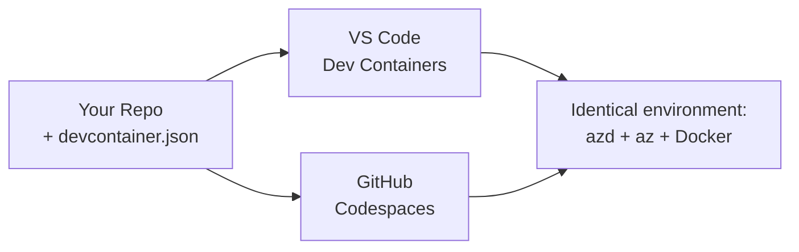

# Дев Контејнери и GitHub Codespaces за azd

**Навигација по поглављу:**
- **📚 Почетна страница курса**: [AZD За почетнике](../../README.md)
- **📖 Тренутно поглавље**: Поглавље 1 - Оснoве и брз почетак
- **⬅️ Претходно**: [Донеси своју апликацију](bring-your-own-app.md)
- **🚀 Следеће поглавље**: [Поглавље 2: Развој са фокусом на вештачку интелигенцију](../chapter-02-ai-development/README.md)

> Преглед циља команде и конфигурације: `azd 1.37.2` (новембар 2026). Контејнерски билдови и Azure деплоји нису извршени у оквиру овог прегледа.

## Увод

Инсталирање azd, одговарајућег окружења за извршавање, Dockera и Azure CLI на свакој машини је мука — и то је главни разлог зашто туторијал који „ради на мојој машини“ не функционише код неког другог. **Дев контејнер** то решава тако што описује цео творац алата у једној датотеци. Свако ко отвори пројекат у VS Code или GitHub Codespaces добија потпуно исто окружење, са већ инсталираним azd. Ова лекција вам показује како да додате контејнер.

## Циљеви учења

На крају ове лекције ћете:
- Разумети шта је дев контејнер и зашто помаже са azd
- Додати минимални `.devcontainer/devcontainer.json` у пројекат
- Обухватити azd, Azure CLI и Docker кроз функције Дев Контејнера
- Отворити пројекат у GitHub Codespaces или VS Code

## Резултати учења

Након завршетка ове лекције, моћи ћете:
- Написати `devcontainer.json` за azd пројекат
- Додати azd и Azure алате без ручних инсталација
- Покренути `azd up` из контејнера или Codespace-а

---

## Шта је дев контејнер?

Дев контејнер је развојно окружење засновано на Docker-у, дефинисано `.devcontainer/devcontainer.json` датотеком у вашем репозиторијуму. Када отворите пројекат:

- **VS Code** (са екстензијом Dev Containers) креира контејнер и прикључује се на њега.
- **GitHub Codespaces** прави исти контејнер у облаку и даје вам уређивач базиран на прегледачу.

У оба случаја, сваки сарадник добија идентичне алате — без проблема „да ли сте инсталирали azd?“.



---

## Корак 1: Креирање датотеке devcontainer

Креирајте `.devcontainer/devcontainer.json` у корену вашег пројекта:

```json
{
  "name": "azd-project",
  "image": "mcr.microsoft.com/devcontainers/base:bookworm",
  "features": {
    "ghcr.io/devcontainers/features/azure-cli:1": {},
    "ghcr.io/azure/azure-dev/azd:0": { "version": "1.37.2" },
    "ghcr.io/devcontainers/features/docker-in-docker:2": {},
    "ghcr.io/devcontainers/features/node:1": {}
  },
  "customizations": {
    "vscode": {
      "extensions": [
        "ms-azuretools.azure-dev",
        "ms-azuretools.vscode-bicep"
      ]
    }
  },
  "forwardPorts": [3000],
  "postCreateCommand": "azd version"
}
```

Шта сваки део ради:

| Кључ | Сврха |
|-----|---------|
| `image` | Основни ОС за контејнер |
| `features` | Прекомпилирани инсталатери — овде: Azure CLI, **azd**, Docker и Node.js |
| `customizations.vscode.extensions` | Аутоматски инсталира azd и Bicep VS Code екстензије |
| `forwardPorts` | Отвара порт ваше апликације према вашем прегледачу |
| `postCreateCommand` | Покреће се једном после што је контејнер изграђен (овде, проверa исправности) |

> Верзија функције (`azd:0`) и инсталирана CLI верзија се разликују. Подесите опцију `version` функције на `"1.37.2"` да фиксирате CLI; не користите верзију CLI као ознаку функције.

---

## Корак 2: Ускладите функцију са језиком ваше апликације

Замените `node` функцију за језик који ваша апликација користи:

```jsonc
// Python project
"ghcr.io/devcontainers/features/python:1": {},

// .NET project
"ghcr.io/devcontainers/features/dotnet:2": {},

// Java project
"ghcr.io/devcontainers/features/java:1": {},

// Go project
"ghcr.io/devcontainers/features/go:1": {}
```

Задржите `docker-in-docker` када градите слике локално. Конфигурисани удаљени ACR билд (`docker.remoteBuild: true`) је алтернатива; сам тип домаћина не захтева увек локални Docker.

---

## Корак 3: Отворите га

**У VS Code:**
1. Инсталирајте екстензију **Dev Containers**.
2. Отворите фолдер пројекта.
3. Кликните на **Reopen in Container** када вас то буде питало (или покрените *Dev Containers: Reopen in Container*).

**У GitHub Codespaces:**
1. Форсирајте репо на GitHub.
2. Кликните **Code → Codespaces → Create codespace on main**.
3. Са чекајте да се контејнер изгради — azd је спреман у терминалу.

---

## Корак 4: Деплоy из контејнера

Контејнер већ има инсталиран azd, тако да нормални ток рада једноставно функционише:

```bash
azd auth login --use-device-code   # device code is handy inside Codespaces
azd up
```

> **Зашто `--use-device-code`?** У удаљеном контејнеру или Codespace-у нема локалног прегледача за редирекцију, тако да је улазак помоћу уређај-код-а поуздан пут. Уметнућете код у картицу прегледача да завршите пријаву.

---

## Уобичајене замке

| Замка | Поправка |
|---------|-----|
| `azd up` не може да изгради слику | Додајте функцију `docker-in-docker` |
| Пријава у прегледачу заглављује у Codespaces | Користите `azd auth login --use-device-code` |
| Алати се разликују између тимских чланова | Закључајте CLI преко опције `version` функције azd и фиксирајте окружења језика |
| Апликација није доступна у прегледачу | Додајте порт у `forwardPorts` |

---

## Резиме

- Дев контејнер чини ваш azd творац алата репродуктивним за све.
- Додајте azd, Azure CLI и Docker кроз функције Дев Контејнера.
- Ускладите функцију језика са вашом апликацијом и задржите `docker-in-docker` за домаћине контејнера.
- Користите пријаву помоћу уређај-код-а када радите унутар Codespaces.

---

## 🔗 Навигација

| Смера | Ресурс |
|-----------|----------|
| **Претходно** | [Донеси своју апликацију](bring-your-own-app.md) |
| **Почетна поглавља** | [Поглавље 1: Оснoве и брз почетак](README.md) |
| **Следеће поглавље** | [Поглавље 2: Развој са фокусом на вештачку интелигенцију](../chapter-02-ai-development/README.md) |

## 📖 Повезани ресурси

- [Инсталација и подешавање](installation.md)
- [Преглед команди](../../resources/cheat-sheet.md)
- [Званична спецификација Дев Контејнера](https://containers.dev/)
- [azd Дев Контејнер функција](https://github.com/Azure/azure-dev/tree/main/ext/devcontainer)

---

<!-- CO-OP TRANSLATOR DISCLAIMER START -->
**Изјава о одрицању одговорности**:
Овај документ је преведен коришћењем услуге за аутоматски превод [Co-op Translator](https://github.com/Azure/co-op-translator). Иако тежимо тачности, имајте у виду да аутоматски преводи могу садржати грешке или нетачности. Оригинални документ на његовом изворном језику треба сматрати ауторитативним извором. За критичне информације препоручује се професионални људски превод. Нисмо одговорни за било каква неспоразума или погрешна тумачења која произилазе из коришћења овог превода.
<!-- CO-OP TRANSLATOR DISCLAIMER END -->