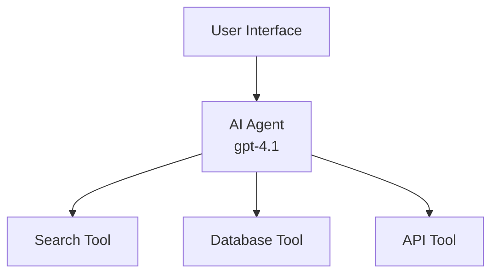
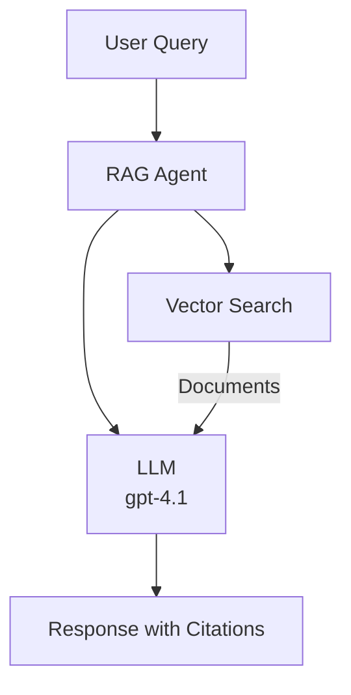
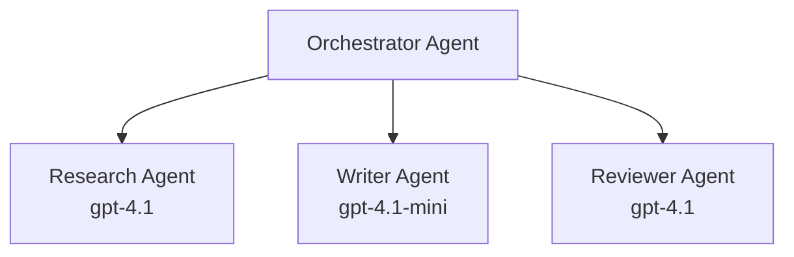

# AI агенти са Azure Developer CLI

**Навигација кроз поглавља:**
- **📚 Почетна страница курса**: [AZD за почетнике](../../README.md)
- **📖 Тренутно поглавље**: Поглавље 2 - Развој усмерен на вештачку интелигенцију
- **⬅️ Претходно**: [Интеграција Microsoft Foundry](microsoft-foundry-integration.md)
- **➡️ Следеће**: [Деплојмент AI модела](ai-model-deployment.md)
- **🚀 Напредно**: [Решења са више агената](../../examples/retail-scenario.md)

---

## Увод

AI агенти су аутономни програми који могу да перципирају своју околину, доносе одлуке и предузимају акције ради постизања специфичних циљева. За разлику од једноставних чатботова који одговарају на упите, агенти могу:

- **Користити алате** - Позивати API-је, претраживати базе података, извршавати код
- **Планирати и расуђивати** - Разлагати сложене задатке на кораке
- **Учити из контекста** - Одржавати сећање и прилагођавати понашање
- **Сарадњивати** - Радити са другим агентима (системи са више агената)

Овај водич показује како да распоручите AI агенте на Azure користећи Azure Developer CLI (azd).

Коришћење контекста разговора није тренирање модела: упорна меморија, контрола приступа и задржавање морају бити имплементирани/конфигурисани од стране апликације.

> **Foundry GA ажурирање (2026-11-09):** Инсталирајте генерално доступан пакет `microsoft.foundry` 1.0 са `azd >= 1.37.0`. Евалуације се инсталирају посебно; опционе прегледне функције и класични SDK фрагмент нису промовисани у GA овим пакетам. Ова упутства се базирају на [GA најави](https://devblogs.microsoft.com/azure-sdk/microsoft-foundry-azure-developer-cli-ga/) и документацији, а не на живом Azure деплоју.

## Циљеви учења

Завршетком овог водича:
- Разумете шта су AI агенти и како се разликују од чатботова
- Расположите предефинисане шаблоне AI агената помоћу AZD
- Конфигуришете Foundry Agents за прилагођене агенте
- Имплементирате основне агенске шеме (коришћење алата, RAG, више агената)
- Пратите и отклањате грешке у распоређеним агентима

## Резултати учења

Након завршетка, моћи ћете да:
- Распоредите апликације AI агената на Azure једном командом
- Конфигуришете алате и могућности агената
- Имплементирате retrieval-augmented generation (RAG) са агентима
- Дизајнирате архитектуре за више агената за сложене радне токове
- Решавате уобичајене проблеме у распоређивању агената

---

## 🤖 Шта агента разликује од чатбота?

| Карактеристика | Чатбот | AI агент |
|---------|---------|----------|
| **Понашање** | Одговара на упите | Предузима аутономне акције |
| **Алати** | Може користити претрагу или алате | Обично користи алате у циклусу усмереном ка циљу |
| **Меморија** | Зависи од апликације | Упорна меморија само ако је експлицитно имплементирана |
| **Планирање** | Један одговор | Расуђивање у више корака |
| **Сарадња** | Јединична јединица | Може радити са другим агентима |

### Једноставна аналогија

- **Чатбот** = Корисна особа која одговара на питања на информативном шалтеру
- **AI агент** = Лични асистент који може да обавља позиве, заказује састанке и извршава задатке за вас

---

## 🚀 Брзи почетак: Распоредите свог првог агента

Изаберите једну опцију у **новом празном радном директоријуму**. Задњи `.` иницијализује тамо; без изричите дестинације, тренутни AZD може креирати поддиректоријум са именом шаблона и не мења ваш терминалски директоријум. Држите различите шаблоне/окружења у посебним директоријумима.

Наведени опсези времена/трошкова су илустративни, нису верификовани цитати. Проверите тренутне предуслове, цене, квоте модела и опционе услуге сваког примера пре деплоја.

### Опција 1: Foundry Agents Шаблон (Препоручено)

```bash
# Initialize the AI agents template
azd init --template get-started-with-ai-agents .

# Deploy to Azure
azd up
```

**Шта се распоређује:** Тренутна инфраструктура и изабране поставке узорка одређују модел, алате, хостинг и ресурсе за надзор. Прегледајте његов README и `infra/` пре провизије; немојте претпостављати да сваки шаблон агента укључује Претрагу или веб интерфејс.

**Време:** ~15-20 минута
**Трошак:** ~100-150 долара месечно (развој)

### Опција 2: Креативни писац агенти са Prompty

```bash
# Initialize the Prompty-based agent template
azd init --template https://github.com/Azure-Samples/contoso-creative-writer .

# Deploy to Azure
azd up
```

**Шта се распоређује:** FastAPI/Prompty пример више агената за писање користећи Azure OpenAI, Bing Grounding и Azure AI Search. Претходни `agent-openai-python-prompty` репозиторијум преусмерава овде; није минимални шаблон за временски агент Azure Functions. Пратите тренутни README за хостинг, квоту модела и предуслове Bing Grounding.

**Време:** ~10-15 минута
**Трошак:** ~50-100 долара месечно (развој)

### Опција 3: RAG Chat агент

```bash
# Initialize RAG chat template
azd init --template azure-search-openai-demo .

# Deploy to Azure
azd up
```

**Шта се распоређује:**
- ✅ Microsoft Foundry модели
- ✅ Azure AI Search са примером података
- ✅ Пимена за обраду докумената
- ✅ Чат интерфејс са цитатима

**Време:** ~15-25 минута
**Трошак:** ~80-150 долара месечно (развој)

### Опција 4: Хостовани агент са GA Foundry пакетом

Користите [комплетан водич за хостовани агент](microsoft-foundry-integration.md#hosted-agent-walkthrough-ga) за основни Python Agent Framework Responses API пример. Овај пут деплоја кода захтева Python 3.13+, тренутни uv, Foundry дозволе и регионалну квоту модела. Аутентификовати локалне SDK позиве посебно користећи Azure CLI креденцијале.

```bash
azd auth login
azd ext install microsoft.foundry
```

У празном директоријуму, иницијализујте пример:

```text
azd ai agent init --template https://github.com/microsoft-foundry/foundry-samples/blob/main/samples/python/hosted-agents/agent-framework/responses/01-basic/azure.yaml --deploy-mode code --src .
```

Изаберите нови или постојећи пројекат, прегледајте `azure.yaml`, и покрените `azd provision`. Користите `azd ai agent run` за отварање Agent Inspector и, из другог терминала у том директоријуму, `azd ai agent invoke --local "Explain how this agent is hosted."`. Након локалне верификације, користите `azd deploy` и `azd ai agent invoke "Explain how this agent is hosted."` за поређење добијеног одговора. Foundry гради отпремљени извор на даљину; локална израда контејнера није потребна.

**Када користити `azd ai agent init` уместо `azd init --template`:**

| Приступ | Најприкладније за | Како ради |
|----------|----------|------|
| `azd init --template` | Почетак од радног примерка апликације | Клонира цео репозиторијум шаблона са кодом + инфра |
| `azd ai agent init --template` | Примање постојећег Foundry агента | Користи `azure.yaml` пројектни документ и његове дефиниције |

> **Савет:** Опције 1-3 почињу од потпуних шаблона апликација; Опција 4 учи GA хостовани агенат радни ток. Ниједна команда за иницијацију аутоматски не мигрира старе агенске манифесте. За додавање директне агенске дефиниције у постојећи пројекат, видети [упутства за иницијацију и миграцију](../chapter-08-production/production-ai-practices.md#initializing-agent-projects-with-azd-ai-agent-init).

Инсталирајте `azure.ai.evaluations` посебно за генерисање и преглед тест података/рубрика, конфигурисање евалуације и њено покретање користећи `azd ai eval`. Оптимизација може поново користити компатибилну евалуацију; прегледајте кандидате пре него што експлицитно примените једну. Пратите [радни ток евалуације](../chapter-08-production/production-ai-practices.md#evaluation-migration-and-quality-checks) и [миграцију оптимизације](../chapter-08-production/production-ai-practices.md#optimization-configuration-migration) пре поновне употребе старијих примера. За чишћење, ресурси обновљеног Foundry пројекта остају након `azd down`; ресурсна група новокреираног пројекта брише се. Погледајте [упутства за чишћење водича](microsoft-foundry-integration.md#7-clean-up-deliberately).

---

## 🏗️ Обрасци архитектуре агената

### Образац 1: Један агент са алатима

Најједноставнији образац агента – један агент који може користити више алата.



**Најприкладнији за:**
- Ботове за корисничку подршку
- Истраживачке асистенте
- Агенте за анализу података

**Повезан пример апликације:** `azure-search-openai-demo` приказује RAG, а не општи агентски циклус са произвољним алатом.

### Образац 2: RAG агент (retrieval-augmented generation)

Агент који проналази релевантне документе пре него што генерише одговоре.



**Најприкладнији за:**
- Пословне базе знања
- Системе за питања и одговоре на документима
- Испитивање усаглашености и правна истраживања

**AZD шаблон:** `azure-search-openai-demo`

### Образац 3: Систем са више агената

Више специјализованих агената који раде заједно на сложеним задацима.



**Најприкладнији за:**
- Генерацију сложених садржаја
- Радне токове са више корака
- Задатке који захтевају различиту експертизу

**Сазнајте више:** [Обрасци координације више агената](../chapter-06-pre-deployment/coordination-patterns.md)

---

## ⚙️ Конфигурисање алата агената

Агенти постају моћни када могу да користе алате. Ево како да конфигуришете уобичајене алате:

### Конфигурација алата у Foundry Agents

Овај **класични фрагмент Agent Service SDK** је намењен `azure-ai-projects==1.0.0` и `azure-ai-agents==1.1.0` са `azure-identity`. Није новији versioned-agent/Responses API који користе неки тренутни Foundry шаблони, нити `azure.ai.agents` AZD екстензија (другачији пакет). Не мешајте ове генерације API-ја. Подесите `PROJECT_ENDPOINT` на класични Foundry пројектни крајњу тачку и `MODEL_DEPLOYMENT_NAME` на постојеће подржано распоређивање модела; аутентификујте локално са `az login` и дайте потребна пројектна овлашћења.

```python
# agent_config.py
import os
from azure.ai.projects import AIProjectClient
from azure.ai.agents.models import FunctionTool
from azure.identity import DefaultAzureCredential

def search_knowledge_base(query: str) -> str:
    """Search the demonstration knowledge base.

    :param query: Search text.
    :return: Matching demonstration information.
    """
    # Local fixture only, not a production search implementation.
    return "Demo policy: returns are accepted within 30 days."

project_client = AIProjectClient(
    endpoint=os.environ["PROJECT_ENDPOINT"],
    credential=DefaultAzureCredential(),
)
search_tool = FunctionTool(functions={search_knowledge_base})
project_client.agents.enable_auto_function_calls(search_tool)
agent = project_client.agents.create_agent(
    model=os.environ["MODEL_DEPLOYMENT_NAME"],
    name="Support Agent",
    instructions="Use search_knowledge_base for policy questions. Label results as demo data.",
    tools=search_tool.definitions,
)
```

Регистрација шеме функције не извршава Python на сервису. У овом SDK, `enable_auto_function_calls` плус `agents.runs.create_and_process(...)` покрећу регистроване повратне функције у вашем клијентском процесу. Погледајте [пример ослобођеног SDK-а](https://github.com/Azure/azure-sdk-for-python/blob/azure-ai-agents_1.1.0/sdk/ai/azure-ai-agents/samples/agents_tools/sample_agents_auto_function_call.py). Затворите клијента и избришите демонстрационе агенте/теме када завршите.

### Конфигурација окружења

Следећа имена су **илустративни прилагођени уноси шаблона**, нису урођене AZD опције. Прво свака вредност иде кроз `infra/main.parameters.json`, инфраструктуру и апликациони код. Само `azd env set` не мења алате или инструкције агента.

```bash
# Set up agent-specific environment variables
azd env set AZURE_OPENAI_MODEL "gpt-4.1"
azd env set AGENT_INSTRUCTIONS "You are a helpful assistant..."
azd env set ENABLE_CODE_INTERPRETER "true"
azd env set ENABLE_FILE_SEARCH "true"

# Apply wired infrastructure and application changes
azd up
```

---

## 📊 Надгледање агената

### Интеграција Application Insights

Ако ваш изабрани шаблон провиђује Application Insights и конфигурише инструментацију:

```bash
# Open monitoring dashboard
azd monitor --overview

# Open the Application Insights logs view (not a streaming log tail)
azd monitor --logs

# View live metrics
azd monitor --live
```

### Кључне метрике за праћење

| Метрика | Опис | Циљ |
|--------|-------------|--------|
| Латенција одговора | Време за генерисање одговора | < 5 секунди |
| Потрошња токена | Токени по упиту | Пратите због трошкова |
| Стопа успешности позива алата | % успешних извршења алата | > 95% |
| Стопа грешака | Неуспели захтеви агента | < 1% |
| Задовољство корисника | Оцене повратних информација | > 4.0/5.0 |

### Прилагођено евидентирање за агенте

```python
import os
from azure.monitor.opentelemetry import configure_azure_monitor
from opentelemetry import trace

# Configure Azure Monitor with OpenTelemetry
configure_azure_monitor(
    connection_string=os.environ["APPLICATIONINSIGHTS_CONNECTION_STRING"]
)

tracer = trace.get_tracer(__name__)

def log_agent_interaction(user_query, agent_response, tools_used, latency_ms):
    with tracer.start_as_current_span("agent_interaction") as span:
        span.set_attributes({
            "query_length": len(user_query),  # Do not log raw prompts or personal data
            "response_length": len(agent_response),
            "tools_used": tools_used,
            "latency_ms": latency_ms
        })
```

> **Напомена:** Инсталирајте потребан пакет: `pip install azure-monitor-opentelemetry`. Он доноси OpenTelemetry зависности; простор имена за увоз није потребан да би се инсталирао пакет под називом `opentelemetry`.

---

## 💰 Разматрања о трошковима

### Процењени месечни трошкови по обрасцу

Ово су илустративни опсези планирања, а не понуде или ограничења потрошње. Регион, токени модела, Search/compute SKU, сесије алата, складиште и саобраћај могу их премашити. Проверите упутства о трошковима узорка и Azure цене пре `azd up`.

| Образац | Дев околина | Производња |
|---------|-----------------|------------|
| Један агент | $50-100 | $200-500 |
| RAG агент | $80-150 | $300-800 |
| Мулти-Агент (2-3 агената) | $150-300 | $500-1,500 |
| Пословни мулти-агент | $300-500 | $1,500-5,000+ |

### Савети за оптимизацију трошкова

1. **Користите gpt-4.1-mini за једноставне задатке** (само ако ваш шаблон користи овај унос)
   ```bash
   azd env set AZURE_OPENAI_MODEL "gpt-4.1-mini"
   ```

2. **Имплементирајте скопирано кеширање за безбедне, понављане упите.** Укључите овлашћење закупца/корисника, распоређивање модела, инструкције и верзију преузимања у кључ кеша; подесите истек. Не делите приватне одговоре разговора преко процесно-широког кеширања само за упите. SDK агент објекат нема општу `agent.run()` методу.

3. **Подесите ограничења токена по покретању**
   ```python
   # Set max_completion_tokens when running the agent, not during creation
   run = project_client.agents.runs.create_and_process(
       thread_id=thread.id,
       agent_id=agent.id,
       max_completion_tokens=1000  # Budget across the run; may finish as incomplete
   )
   ```

4. **Скалирајте погодне Container Apps на нулу када се не користе**
   ```bash
   # Custom-template input: must map to template.scale.minReplicas
   azd env set MIN_REPLICAS "0"
   ```
   Примена промене инфраструктуре са `azd provision` или `azd up`. Скалирање на нулу захтева одговарајући тригер и не зауставља Search, складиште или трошкове модела/алата.

---

## 🔧 Решавање проблема са агентима

### Уобичајени проблеми и решења

<details>
<summary><strong>❌ Агенти не одговарају на позиве алата</strong></summary>

```bash
# Inspect the application deployment (not the agent's registered tools)
azd show

# Verify OpenAI deployment
az cognitiveservices account deployment list \
  --name $AZURE_OPENAI_NAME \
  --resource-group $RG_NAME

# Check agent logs
azd monitor --logs
```

**Уобичајени узроци:**
- Неслагање сигнатуре функције алата
- Недостају потребне дозволе
- API крајња тачка није доступна
</details>

<details>
<summary><strong>❌ Висока латенција у одговорима агента</strong></summary>

```bash
# Check Application Insights for bottlenecks
azd monitor --live

# Consider using a faster model
azd env set AZURE_OPENAI_MODEL "gpt-4.1-mini"
azd up
```

**Савети за оптимизацију:**
- Користите стриминг одговоре
- Имплементирајте кеширање одговора
- Смањите величину окна контекста
</details>

<details>
<summary><strong>❌ Агенти враћају нетачне или халуцинације</strong></summary>

```python
# Improve with better system prompts
instructions = """
You are a helpful assistant. IMPORTANT:
- Only answer based on provided context
- If you don't know, say "I don't know"
- Always cite your sources
- Never make up information
"""

# Use these instructions in the agent definition.
# For classic file search, first upload/index documents in a vector store,
# then use FileSearchTool(vector_store_ids=[...]) and pass both its
# .definitions and .resources when creating the agent.
```
Инструкције и преузимање смањују ризик; ниједно не гарантује чињеничне одговоре. Процените поткрепљена и ван домета питања у односу на познате одговоре.
</details>

<details>
<summary><strong>❌ Грешке због преласка лимита токена</strong></summary>

```python
# Implement context window management
def truncate_context(messages, max_tokens=8000, model="gpt-4.1"):
    """Approximate content-only budget for objects with .content strings."""
    import tiktoken
    encoding = tiktoken.encoding_for_model(model)
    total_tokens = 0
    truncated = []
    
    for msg in reversed(messages):
        msg_tokens = len(encoding.encode(msg.content))
        if total_tokens + msg_tokens > max_tokens:
            break
        truncated.insert(0, msg)
        total_tokens += msg_tokens
    
    return truncated
```
Ова помоћ укључује искључење шема улога/алата, системских инструкција, токена слика и протоколске режије. Резервишите простор за те и комплетирање; немојте делити парове позива алата/резултата или одбацивати потребне системске инструкције. Инсталирајте `tiktoken` посебно. Није општи валидатор окна контекста.
</details>

---

## 🎓 Практичне вежбе

### Вежба 1: Распоредити основног агента (20 минута)

**Циљ:** Распоредите свог првог AI агента користећи AZD

```bash
# Step 1: Initialize template
azd init --template get-started-with-ai-agents .

# Step 2: Login to Azure
azd auth login
# If you work across tenants, add --tenant-id <tenant-id>

# Step 3: Deploy
azd up

# Step 4: Test the agent
# Expected output after deployment:
#   Deployment Complete!
#   Endpoint: https://<app-name>.<region>.azurecontainerapps.io
# Open the URL shown in the output and try asking a question

# Step 5: View monitoring
azd monitor --overview

# Step 6: Review the listed resources and confirm cleanup
azd down
```

**Критеријуми успеха:**
- [ ] Агенат одговара на питања
- [ ] Може приступити мониторинг контролној табли преко `azd monitor`
- [ ] Ресурси су успешно очишћени

### Вежба 2: Додајте прилагођени алат (30 минута)

**Циљ:** Проширити агента прилагођеним алатом

**Почетна тачка:** Користите класични СДК клијент из [Подешавање алата](#tool-configuration-in-foundry-agents), не произвољни шаблон са другом СДК генерацијом.

1. Додајте овај детерминистички фикстур у `agent_config.py`:
   ```python
   def get_weather(location: str) -> str:
       """Return demonstration weather, not live conditions.

       :param location: City name.
       :return: A clearly labelled fixture.
       """
       print(f"TOOL_CALLED: {location}")
       return f"Demo weather in {location}: Sunny, 72°F (fixture, not live)"
   ```
2. Замените блок регистрације и креирања алата за претрагу са:
   ```python
   weather_tool = FunctionTool(functions={get_weather})
   project_client.agents.enable_auto_function_calls(weather_tool)
   agent = project_client.agents.create_agent(
       model=os.environ["MODEL_DEPLOYMENT_NAME"],
       name="Weather Agent",
       instructions="Call get_weather for weather questions; explain that it returns demo data.",
       tools=weather_tool.definitions,
   )
   thread = project_client.agents.threads.create()
   try:
       project_client.agents.messages.create(
           thread_id=thread.id, role="user", content="Use get_weather for Seattle."
       )
       run = project_client.agents.runs.create_and_process(
           thread_id=thread.id, agent_id=agent.id
       )
       if run.status != "completed":
           raise RuntimeError(f"Run status: {run.status}; error: {run.last_error}")
       for message in project_client.agents.messages.list(thread_id=thread.id):
           for text in message.text_messages:
               print(text.text.value)
   finally:
       project_client.agents.threads.delete(thread.id)
       project_client.agents.delete_agent(agent.id)
       project_client.close()
   ```
3. Покрените локално (ово позива постојећи Azure пројекат и узрокује трошкове модела):
   ```bash
   python agent_config.py
   # Expected: TOOL_CALLED: Seattle, then a completed answer labelled demo data.
   ```

**Критеријуми успеха:**
- [ ] Агенат препознаје упите везане за временске услове
- [ ] Алат се исправно позива
- [ ] Одговор укључује информације о времену

### Вежба 3: Направите РАГ агента (45 минута)

**Циљ:** Креирајте агента који одговара на питања из ваших докумената

```bash
# Step 1: Deploy RAG template
azd init --template azure-search-openai-demo .
azd up

# Step 2: Upload your documents
# For the sample's local ingestion path, place supported files in data/.
# Run from the sample root after following its Python environment setup:
./scripts/prepdocs.sh
# Windows PowerShell equivalent: .\\scripts\\prepdocs.ps1

# Step 3: Test with domain-specific questions
# Open the web app URL from the azd up output
# Ask questions about your uploaded documents
# Responses should include citation references like [doc.pdf]
```

**Критеријуми успеха:**
- [ ] Агенат одговара на основу отпремљених докумената
- [ ] Одговори укључују цитате
- [ ] Питања ван домена се обрађују без неоснованих тврдњи (није гаранција за сва будућа питања)

Ако је `USE_CLOUD_INGESTION=true`, користите уместо тога примерен поступак уноса/отпребљивања у облак; локални омотач намерно прескачe унос. Након тестирања, покрените `azd down` у РАГ окружењу и прегледајте ресурсе за брисање.

---

## 📚 Следећи кораци

Сада када разумете АИ агенте, истражите ове напредне теме:

| Тема | Опис | Линк |
|-------|-------------|------|
| **Системи са више агената** | Изградите системе са више сарађујућих агената | [Пример мулти-агената у малопродаји](../../examples/retail-scenario.md) |
| **Обрасци координације** | Учење образаца оркестрације и комуникације | [Обрасци координације](../chapter-06-pre-deployment/coordination-patterns.md) |
| **Производна употреба** | Распоређивање агената спремних за предузећа | [Практичне AI примене](../chapter-08-production/production-ai-practices.md) |
| **Евалуација агената** | Тестирање и процена перформанси агената | [Решавање проблема са АИ](../chapter-07-troubleshooting/ai-troubleshooting.md) |
| **АИ радионица лаб** | Практично: Учинак ваше АИ решења спреман за AZD | [АИ радионица лаб](ai-workshop-lab.md) |

---

## 📖 Додатни ресурси

### Званична документација
- [Microsoft Foundry Agent Service](https://learn.microsoft.com/azure/ai-services/agents/)
- [Microsoft Foundry Agent Service Quickstart](https://learn.microsoft.com/azure/ai-services/agents/quickstart)
- [Semantic Kernel Agent Framework](https://learn.microsoft.com/semantic-kernel/)

### AZD шаблони за агенте
- [Почните са АИ агентима](https://github.com/Azure-Samples/get-started-with-ai-agents)
- [Агенти за креативно писање са Промпти](https://github.com/Azure-Samples/contoso-creative-writer)
- [Azure Search OpenAI демо](https://github.com/Azure-Samples/azure-search-openai-demo)

### Заједнички ресурси
- [Одлични AZD - шаблони за агенте](https://azure.github.io/awesome-azd/?tags=ai-agents)
- [Azure AI Discord](https://discord.gg/microsoft-azure)
- [Microsoft Foundry Discord](https://discord.gg/nTYy5BXMWG)

### Вештине агената за ваш уређивач
- [**Microsoft Azure Agent Skills**](https://skills.sh/microsoft/github-copilot-for-azure) - Инсталирајте поновно употребљиве вештине АИ агената за развој на Azure у GitHub Copilot, Cursor или било ком подржаном агенту. Укључује вештине за [Azure AI](https://skills.sh/microsoft/github-copilot-for-azure/azure-ai), [Microsoft Foundry](https://skills.sh/microsoft/github-copilot-for-azure/microsoft-foundry), [распоређивање](https://skills.sh/microsoft/github-copilot-for-azure/azure-deploy) и [дијагностику](https://skills.sh/microsoft/github-copilot-for-azure/azure-diagnostics):
  ```bash
  npx skills add microsoft/github-copilot-for-azure
  ```

---

**Навигација**
- **Претходна лекција**: [Интеграција Microsoft Foundry](microsoft-foundry-integration.md)
- **Следећа лекција**: [Распоређивање АИ модела](ai-model-deployment.md)

---

<!-- CO-OP TRANSLATOR DISCLAIMER START -->
**Изјава о одрицању одговорности**:
Овај документ је преведен коришћењем услуге за аутоматски превод [Co-op Translator](https://github.com/Azure/co-op-translator). Иако тежимо тачности, имајте у виду да аутоматски преводи могу садржати грешке или нетачности. Оригинални документ на његовом изворном језику треба сматрати ауторитативним извором. За критичне информације препоручује се професионални људски превод. Нисмо одговорни за било каква неспоразума или погрешна тумачења која произилазе из коришћења овог превода.
<!-- CO-OP TRANSLATOR DISCLAIMER END -->