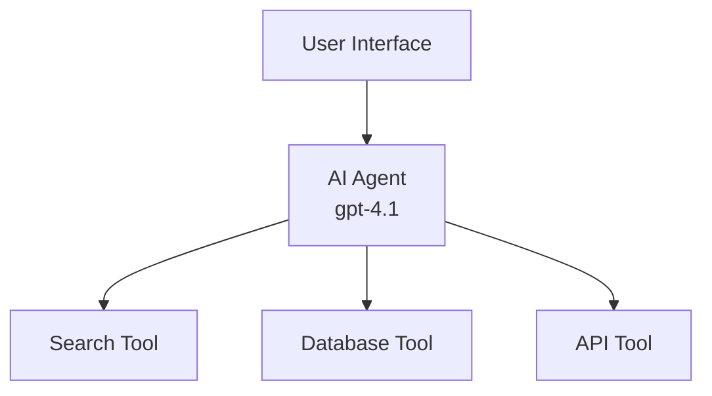
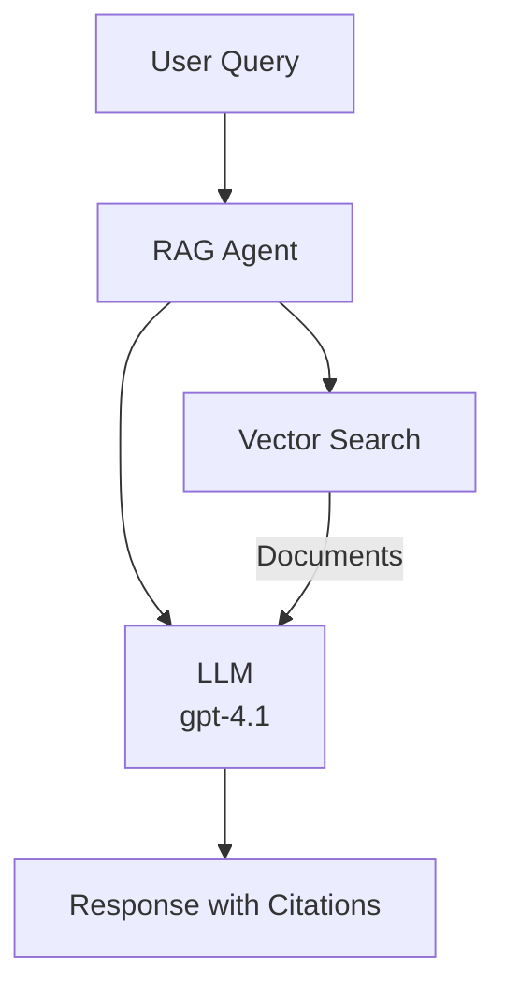
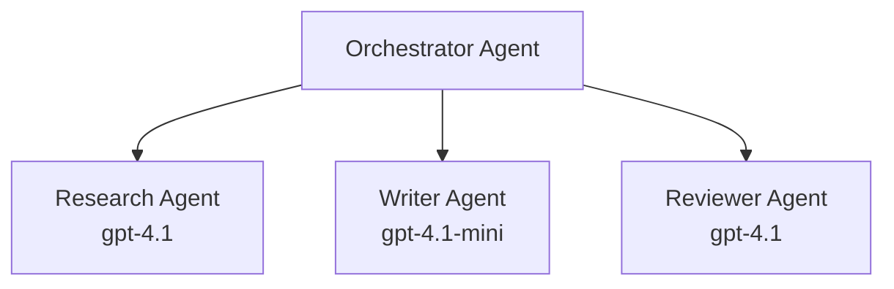

# AI агенти са Azure Developer CLI

**Навигација кроз поглавље:**
- **📚 Почетна страница курса**: [AZD За почетнике](../../README.md)
- **📖 Тренутно поглавље**: Поглавље 2 - Развој првенствено заснован на вештачкој интелигенцији
- **⬅️ Претходно**: [Интеграција Microsoft Foundry](microsoft-foundry-integration.md)
- **➡️ Следеће**: [Деплојмент AI модела](ai-model-deployment.md)
- **🚀 Напредно**: [Решења са више агената](../../examples/retail-scenario.md)

---

## Увод

AI агенти су аутономни програми који могу да поимају своје окружење, доносе одлуке и предузимају акције да би постигли одређене циљеве. За разлику од обичних четботова који одговарају на упите, агенти могу:

- **Користити алате** - Позивати API-је, претраживати базе података, извршавати код
- **Планирати и размишљати** - Разбити сложене задатке на кораке
- **Учити из контекста** - Одржавати меморију и прилагођавати понашање
- **Сарадњивати** - Радити са другим агентима (системи са више агената)

Овај водич показује како да деплојујете AI агенте на Ајур користећи Azure Developer CLI (azd).

Користити контекст разговора није исто што и тренинг модела: упорна меморија, контролa приступа и задржавање морају бити имплементирани/конфигурисани од стране апликације.

> **Проверa издања (2026-11-04):** CLI примери су проверени на бази документације/извора `azd` `1.37.2`, `azure.ai.agents` `1.0.0-beta.23`, и `azure.ai.evaluations` `1.0.0-beta.2`, а не на живом Azure деплоју. Користите `azd >= 1.37.0` за комбиновани ток рада. Погледајте [недавне измене и исправке](../chapter-08-production/production-ai-practices.md#recent-release-changes-and-fixes) пре надоградње старијих пројеката.

## Циљеви учења

Завршетком овог водича, научићете:
- Да разумете шта су AI агенти и како се разликују од четботова
- Како се деплојују предефинисани AI шаблони агената користећи AZD
- Како конфигурисати Foundry агенте за прилагођене агенте
- Како имплементирати основне шаблоне агената (коришћење алата, RAG, системи са више агената)
- Како пратити и дебаговати деплоје агенте

## Очекивани исходи учења

Након завршетка, моћи ћете да:
- Деплојујете AI агент апликације на Azure једном командом
- Конфигуришете алате и могућности агената
- Имплементирате retrieval-augmented generation (RAG) са агентима
- Дизајнирате архитектуре са више агената за сложене токове рада
- Решавате уобичајене проблеме у деплоју агената

---

## 🤖 Шта разликује агента од четбота?

| Карактеристика | Четбот | AI агент |
|---------|---------|----------|
| **Понашање** | Одговара на упите | Предузима аутономне акције |
| **Алати** | Може користити претрагу или алате | Обично користи алате у циклусу усмереном ка циљу |
| **Меморија** | Зависи од апликације | Упорна меморија само ако је експлицитно имплементирана |
| **Планирање** | Један одговор | Размишљање у више корака |
| **Сарадња** | Један ентитет | Може радити са другим агентима |

### Једноставна аналогија

- **Четбот** = Корисна особа која одговара на питања на информативном шалтеру
- **AI агент** = Лични асистент који може правити позиве, заказивати термине и завршавати задатке за вас

---

## 🚀 Брзи почетак: Деплојујте свог првог агента

Изаберите једну опцију у **новом празном радном директоријуму**. Команда `.` иницијализује тамо; без изричитог одредишта, тренутни AZD може креирати поддиректоријум са именом шаблона и не мења вашу командну линију. Држите одвојене шаблоне/окружења у одвојеним директоријумима.

Наведени временски и трошковни опсези су илустративни, а не проверене понуде. Пре деплоја проверите тренутне захтеве, цене, квоте модела и опционе услуге за сваки пример.

### Опција 1: Foundry Agents шаблон (Препоручено)

```bash
# Initialize the AI agents template
azd init --template get-started-with-ai-agents .

# Deploy to Azure
azd up
```

**Шта се деплојује:** Тренутна инфраструктура и изабране опције узорка одређују модел, алате, хостовање и ресурсе за праћење. Прегледајте његов README и `infra/` пре провизије; немојте претпостављати да сваки шаблон агента укључује Претрагу или веб интерфејс.

**Време:** ~15-20 минута
**Трошак:** ~$100-150/месечно (развој)

### Опција 2: Creative Writing агенти са Prompty

```bash
# Initialize the Prompty-based agent template
azd init --template https://github.com/Azure-Samples/contoso-creative-writer .

# Deploy to Azure
azd up
```

**Шта се деплојује:** FastAPI/Prompty пример више агената за писање користећи Azure OpenAI, Bing Grounding и Azure AI Search. Претходни `agent-openai-python-prompty` репозиторијум преусмерава овде; није минимални Azure Functions шаблон агента за временске услове. Пратите тренутни README за хостовање, квоту модела и предуслове за Bing Grounding.

**Време:** ~10-15 минута
**Трошак:** ~$50-100/месечно (развој)

### Опција 3: RAG Chat агент

```bash
# Initialize RAG chat template
azd init --template azure-search-openai-demo .

# Deploy to Azure
azd up
```

**Шта се деплојује:**
- ✅ Microsoft Foundry модели
- ✅ Azure AI Search са примером података
- ✅ Пипелејн за обраду докумената
- ✅ Чет интерфејс са навођењима

**Време:** ~15-25 минута
**Трошак:** ~$80-150/месечно (развој)

### Опција 4: AZD AI Agent Init (преглед шаблона пројекта)

Користите `azd ai agent init` интерактивно, или усвојите тренутни `azure.yaml` агент пројекат са `--template`/`-t`. Стари `--manifest`/`-m` је застарели алјас, није конвертер за старе манифесте.

```bash
# Install the AI agents extension
azd extension install azure.ai.agents

# Optional: verify the installed preview version
azd extension show azure.ai.agents

# Initialize from a current agent project template (supply your template path)
azd ai agent init --template ./templates/support-agent/azure.yaml

# Deploy to Azure
azd up

# Test the deployed agent (shows latency + time-to-first-byte)
azd ai agent invoke
```

**Када користити `azd ai agent init` уместо `azd init --template`:**

| Приступ | Најбоље за | Како ради |
|----------|----------|------|
| `azd init --template` | Започињање са радним примером апликације | Клонира цео шаблон репозиторијум са кодом + инфра |
| `azd ai agent init --template` | Усваја тренутни Foundry агент пројекат | Користи `azure.yaml` пројектни документ и његове дефиниције |

> **Савет:** Користите `azd init --template` приликом учења (опције 1-3 изнад). Користите `azd ai agent init` за Foundry агентски ток рада. Да бисте додали директну дефиницију агента у постојећи пројекат, погледајте [упутства за иницијализацију и миграцију](../chapter-08-production/production-ai-practices.md#initializing-agent-projects-with-azd-ai-agent-init).

Након `azd up`, користите `azd ai agent invoke` за тестирање, одвојени `azure.ai.evaluations` екстензију (`azd ai eval init`, `generate`, и `run start`) за мерење квалитета, и `azd ai agent optimize` за побољшање користећи нову конфигурацију евалуације. Agenti beta.22 је заменио стари ток евалуације и променио формат `--config` оптимизације. Погледајте [миграцију евалуације](../chapter-08-production/production-ai-practices.md#evaluation-migration-and-quality-checks) и [миграцију оптимизације](../chapter-08-production/production-ai-practices.md#optimization-configuration-migration) пре поновног коришћења старијих примера.

---

## 🏗️ Обрасци архитектуре агената

### Образац 1: Један агент са алатима

Најједноставнији образац агента - један агент који може користити више алата.



**Најприкладније за:**
- Ботови за корисничку подршку
- Истраживачке помоћнике
- Агенте за аналитику података

**Повезани пример апликације:** `azure-search-openai-demo` приказује RAG, а не генеричку петљу агената са произвољним алатима.

### Образац 2: RAG агент (retrieval-augmented generation)

Агент који проналази релевантне документе пре генерације одговора.



**Најприкладније за:**
- Ентерпрајз базе знања
- Системе питања и одговора на документе
- Истраживања у области усаглашености и права

**AZD шаблон:** `azure-search-openai-demo`

### Образац 3: Систем са више агената

Више специјализованих агената који заједно раде на сложеним задацима.



**Најприкладније за:**
- Комплексну генерацију садржаја
- Вишестепене токове рада
- Задатке који захтевају различите области стручности

**Сазнајте више:** [Обрасци координације више агената](../chapter-06-pre-deployment/coordination-patterns.md)

---

## ⚙️ Конфигурисање алата агената

Агенти постају моћни када могу да користе алате. Ево како да конфигуришете уобичајене алате:

### Конфигурација алата у Foundry Agents

Овај **класични фрагмент Agent Service SDK** циља на `azure-ai-projects==1.0.0` и `azure-ai-agents==1.1.0` са `azure-identity`. Није новији versioned-agent/Responses API коришћен у неким тренутним Foundry шаблонима, нити `azure.ai.agents` AZD екстензија (други пакет). Не мешајте ове генерације API-ja. Подесите `PROJECT_ENDPOINT` на класичну Foundry проектну тачку и `MODEL_DEPLOYMENT_NAME` на постојећи подржани модел деплоја; аутентификујте се локално са `az login` и дајте потребне дозволе пројекту.

```python
# agent_config.py
import os
from azure.ai.projects import AIProjectClient
from azure.ai.agents.models import FunctionTool
from azure.identity import DefaultAzureCredential

def search_knowledge_base(query: str) -> str:
    """Search the demonstration knowledge base.

    :param query: Search text.
    :return: Matching demonstration information.
    """
    # Local fixture only, not a production search implementation.
    return "Demo policy: returns are accepted within 30 days."

project_client = AIProjectClient(
    endpoint=os.environ["PROJECT_ENDPOINT"],
    credential=DefaultAzureCredential(),
)
search_tool = FunctionTool(functions={search_knowledge_base})
project_client.agents.enable_auto_function_calls(search_tool)
agent = project_client.agents.create_agent(
    model=os.environ["MODEL_DEPLOYMENT_NAME"],
    name="Support Agent",
    instructions="Use search_knowledge_base for policy questions. Label results as demo data.",
    tools=search_tool.definitions,
)
```

Регистрација шеме функције не извршава Python на сервису. У овом SDK, `enable_auto_function_calls` плус `agents.runs.create_and_process(...)` покрећу регистроване колбекове у вашем клијентском процесу. Погледајте [реализовани пример SDK](https://github.com/Azure/azure-sdk-for-python/blob/azure-ai-agents_1.1.0/sdk/ai/azure-ai-agents/samples/agents_tools/sample_agents_auto_function_call.py). Затворите клијент и избришите демонстрационе агенте/теме када завршите.

### Конфигурација окружења

Следећа имена су **илустративни прилагођени улази шаблона**, нису уграђени AZD прекидачи. Прво повежите сваку вредност кроз `infra/main.parameters.json`, инфраструктуру и апликациони код. Само `azd env set` не мења алате или упутства агента.

```bash
# Set up agent-specific environment variables
azd env set AZURE_OPENAI_MODEL "gpt-4.1"
azd env set AGENT_INSTRUCTIONS "You are a helpful assistant..."
azd env set ENABLE_CODE_INTERPRETER "true"
azd env set ENABLE_FILE_SEARCH "true"

# Apply wired infrastructure and application changes
azd up
```

---

## 📊 Праћење агената

### Интеграција Application Insights

Ако ваш изабрани шаблон провизионише Application Insights и конфигурише инструментацију:

```bash
# Open monitoring dashboard
azd monitor --overview

# Open the Application Insights logs view (not a streaming log tail)
azd monitor --logs

# View live metrics
azd monitor --live
```

### Кључни показатељи за праћење

| Метрика | Опис | Циљ |
|--------|-------------|--------|
| Латенција одговора | Време за генерисање одговора | < 5 секунди |
| Коришћење токена | Токени по упиту | Пратите због трошкова |
| Стопа успешности позива алата | % успешних извршења алата | > 95% |
| Стопа грешке | Неуспели захтеви агента | < 1% |
| Задовољство корисника | Оцењивање повратних информација | > 4.0/5.0 |

### Прилагођено бележење за агенте

```python
import os
from azure.monitor.opentelemetry import configure_azure_monitor
from opentelemetry import trace

# Configure Azure Monitor with OpenTelemetry
configure_azure_monitor(
    connection_string=os.environ["APPLICATIONINSIGHTS_CONNECTION_STRING"]
)

tracer = trace.get_tracer(__name__)

def log_agent_interaction(user_query, agent_response, tools_used, latency_ms):
    with tracer.start_as_current_span("agent_interaction") as span:
        span.set_attributes({
            "query_length": len(user_query),  # Do not log raw prompts or personal data
            "response_length": len(agent_response),
            "tools_used": tools_used,
            "latency_ms": latency_ms
        })
```

> **Напомена:** Инсталирајте потребан пакет: `pip install azure-monitor-opentelemetry`. Он доноси OpenTelemetry зависности; пространство имена за увоз није услов да се инсталира пакет под именом `opentelemetry`.

---

## 💰 Разматрања о трошковима

### Процењени месечни трошкови по обрасцу

Ово су илустративни опсези планирања, а не понуде или лимити потрошње. Регион, токени модела, Search/compute SKU, сесије алата, складиштење и саобраћај могу их премашити. Пре `azd up` проверите смернице о трошковима узорка и цене Azure-а.

| Образац | Дев окружење | Продукција |
|---------|-----------------|------------|
| Један агент | $50-100 | $200-500 |
| RAG агент | $80-150 | $300-800 |
| Више агената (2-3 агента) | $150-300 | $500-1,500 |
| Ентерпрајз више агената | $300-500 | $1,500-5,000+ |

### Савети за оптимизацију трошкова

1. **Користите gpt-4.1-mini за једноставне задатке** (само ако ваш шаблон то користи као улаз)
   ```bash
   azd env set AZURE_OPENAI_MODEL "gpt-4.1-mini"
   ```

2. **Имплементирајте скопирано кеширање за безбедне, поновљене упите.** Укључите ауторизацију станара/корисника, деплој модела, упутства и верзију претраге у кључ кеша; подесите истек. Немојте делити приватне одговоре из разговора преко процесно-широког кеша који служи само за упите. SDK агент објекат нема општи `agent.run()` метод.

3. **Поставите ограничења токена по покретању**
   ```python
   # Set max_completion_tokens when running the agent, not during creation
   run = project_client.agents.runs.create_and_process(
       thread_id=thread.id,
       agent_id=agent.id,
       max_completion_tokens=1000  # Budget across the run; may finish as incomplete
   )
   ```

4. **Скалирајте елегибилне Container Apps до нуле када се не користе**
   ```bash
   # Custom-template input: must map to template.scale.minReplicas
   azd env set MIN_REPLICAS "0"
   ```
   Примените промену инфраструктуре са `azd provision` или `azd up`. Скалирање до нуле захтева одговарајући триггер и не зауставља наплате за Претрагу, складиштење или моделе/алате.

---

## 🔧 Решавање проблема са агентима

### Уобичајени проблеми и решења

<details>
<summary><strong>❌ Агент не одговара на позиве алата</strong></summary>

```bash
# Inspect the application deployment (not the agent's registered tools)
azd show

# Verify OpenAI deployment
az cognitiveservices account deployment list \
  --name $AZURE_OPENAI_NAME \
  --resource-group $RG_NAME

# Check agent logs
azd monitor --logs
```

**Уобичајени узроци:**
- Неподударност потписа функције алата
- Недостају потребне дозволе
- Не може се приступити API крајњој тачки
</details>

<details>
<summary><strong>❌ Висока латенција у одговорима агента</strong></summary>

```bash
# Check Application Insights for bottlenecks
azd monitor --live

# Consider using a faster model
azd env set AZURE_OPENAI_MODEL "gpt-4.1-mini"
azd up
```

**Савети за оптимизацију:**
- Користите стриминг одговоре
- Имплементирајте кеширање одговора
- Смањите величину контекстног прозора
</details>

<details>
<summary><strong>❌ Агент враћа нетачне или халуциниране информације</strong></summary>

```python
# Improve with better system prompts
instructions = """
You are a helpful assistant. IMPORTANT:
- Only answer based on provided context
- If you don't know, say "I don't know"
- Always cite your sources
- Never make up information
"""

# Use these instructions in the agent definition.
# For classic file search, first upload/index documents in a vector store,
# then use FileSearchTool(vector_store_ids=[...]) and pass both its
# .definitions and .resources when creating the agent.
```
Упутства и претрага смањују ризик; ниједно не гарантује чињеничне одговоре. Процијените утемељена и ван домена питања према познатим одговорима.
</details>

<details>
<summary><strong>❌ Оштећења због преласка ограничења токена</strong></summary>

```python
# Implement context window management
def truncate_context(messages, max_tokens=8000, model="gpt-4.1"):
    """Approximate content-only budget for objects with .content strings."""
    import tiktoken
    encoding = tiktoken.encoding_for_model(model)
    total_tokens = 0
    truncated = []
    
    for msg in reversed(messages):
        msg_tokens = len(encoding.encode(msg.content))
        if total_tokens + msg_tokens > max_tokens:
            break
        truncated.insert(0, msg)
        total_tokens += msg_tokens
    
    return truncated
```
Овај помоћник искључује шеме улоге/алата, системска упутства, токене слика и протоколски оверхед. Резервишите простор за њих и за довршетак; немојте раздвајати парове позив/резултат алата или избацивати потребна системска упутства. Инсталирајте `tiktoken` посебно. Није општи валидатор контекстног прозора.
</details>

---

## 🎓 Практичне вежбе

### Вежба 1: Деплојујте основног агента (20 минута)

**Циљ:** Деплојујте свог првог AI агента користећи AZD

```bash
# Step 1: Initialize template
azd init --template get-started-with-ai-agents .

# Step 2: Login to Azure
azd auth login
# If you work across tenants, add --tenant-id <tenant-id>

# Step 3: Deploy
azd up

# Step 4: Test the agent
# Expected output after deployment:
#   Deployment Complete!
#   Endpoint: https://<app-name>.<region>.azurecontainerapps.io
# Open the URL shown in the output and try asking a question

# Step 5: View monitoring
azd monitor --overview

# Step 6: Clean up
azd down --force --purge
```

**Критеријуми успеха:**
- [ ] Агент одговара на питања
- [ ] Може приступити контролној табли за праћење преко `azd monitor`
- [ ] Ресурси су успешно очистени

### Вежба 2: Додавање прилагођеног алата (30 минута)

**Циљ:** Проширите агента прилагођеним алатом

**Почетна тачка:** Користите класични SDK клијент из [Tool Configuration](#tool-configuration-in-foundry-agents), а не произвољни шаблон са другачијом генерацијом SDK-а.

1. Додајте овај детерминистички фиксирани податак у `agent_config.py`:
   ```python
   def get_weather(location: str) -> str:
       """Return demonstration weather, not live conditions.

       :param location: City name.
       :return: A clearly labelled fixture.
       """
       print(f"TOOL_CALLED: {location}")
       return f"Demo weather in {location}: Sunny, 72°F (fixture, not live)"
   ```
2. Замените блок регистрације и креирања алата за претрагу са:
   ```python
   weather_tool = FunctionTool(functions={get_weather})
   project_client.agents.enable_auto_function_calls(weather_tool)
   agent = project_client.agents.create_agent(
       model=os.environ["MODEL_DEPLOYMENT_NAME"],
       name="Weather Agent",
       instructions="Call get_weather for weather questions; explain that it returns demo data.",
       tools=weather_tool.definitions,
   )
   thread = project_client.agents.threads.create()
   try:
       project_client.agents.messages.create(
           thread_id=thread.id, role="user", content="Use get_weather for Seattle."
       )
       run = project_client.agents.runs.create_and_process(
           thread_id=thread.id, agent_id=agent.id
       )
       if run.status != "completed":
           raise RuntimeError(f"Run status: {run.status}; error: {run.last_error}")
       for message in project_client.agents.messages.list(thread_id=thread.id):
           for text in message.text_messages:
               print(text.text.value)
   finally:
       project_client.agents.threads.delete(thread.id)
       project_client.agents.delete_agent(agent.id)
       project_client.close()
   ```
3. Покрените локално (ово позива постојећи Azure пројекат и наплаћује трошкове за модел):
   ```bash
   python agent_config.py
   # Expected: TOOL_CALLED: Seattle, then a completed answer labelled demo data.
   ```

**Критеријуми успеха:**
- [ ] Агент препознаје упите везане за временске услове
- [ ] Алат се позива исправно
- [ ] Одговор садржи информације о времену

### Вежба 3: Направите РАГ агента (45 минута)

**Циљ:** Креирати агента који одговара на питања из ваших докумената

```bash
# Step 1: Deploy RAG template
azd init --template azure-search-openai-demo .
azd up

# Step 2: Upload your documents
# For the sample's local ingestion path, place supported files in data/.
# Run from the sample root after following its Python environment setup:
./scripts/prepdocs.sh
# Windows PowerShell equivalent: .\\scripts\\prepdocs.ps1

# Step 3: Test with domain-specific questions
# Open the web app URL from the azd up output
# Ask questions about your uploaded documents
# Responses should include citation references like [doc.pdf]
```

**Критеријуми успеха:**
- [ ] Агент одговара користећи отпремљене документе
- [ ] Одговори садрже цитате
- [ ] Тест питања ван опсега се обрађују без недозвољених тврдњи (без гаранције за сва будућа питања)

Ако `USE_CLOUD_INGESTION=true`, уместо тога користите пример облачног уноса/отпремања; локални омотач намерно прескаче унос. Након тестирања, покрените `azd down` у РАГ окружењу и прегледајте ресурсе који ће бити обрисани.

---

## 📚 Следећи кораци

Сада када разумете АИ агенте, истражите ове напредне теме:

| Тема | Опис | Линк |
|-------|-------------|------|
| **Системи са више агената** | Направите системе са више сарадничких агената | [Пример малопродајног система са више агената](../../examples/retail-scenario.md) |
| **Обрасци координације** | Научите обрасце оркестрације и комуникације | [Обрасци координације](../chapter-06-pre-deployment/coordination-patterns.md) |
| **Производна имплементација** | Распоређивање агената спремних за предузећа | [Практичне AI процедуре у производњи](../chapter-08-production/production-ai-practices.md) |
| **Процена агената** | Тестирање и процена перформанси агената | [Решавање проблема са AI](../chapter-07-troubleshooting/ai-troubleshooting.md) |
| **AI радионица лабораторија** | Практично: Учините своје AI решење спремним за AZD | [AI радионица лабораторија](ai-workshop-lab.md) |

---

## 📖 Додатни ресурси

### Званична документација
- [Microsoft Foundry Agent Service](https://learn.microsoft.com/azure/ai-services/agents/)
- [Microsoft Foundry Agent Service Quickstart](https://learn.microsoft.com/azure/ai-services/agents/quickstart)
- [Semantic Kernel Agent Framework](https://learn.microsoft.com/semantic-kernel/)

### AZD шаблони за агенте
- [Започните са AI агентима](https://github.com/Azure-Samples/get-started-with-ai-agents)
- [Агенти за креативно писање са Prompty](https://github.com/Azure-Samples/contoso-creative-writer)
- [Azure Search OpenAI демонстрација](https://github.com/Azure-Samples/azure-search-openai-demo)

### Заједнички ресурси
- [Одличан AZD - Шаблони агената](https://azure.github.io/awesome-azd/?tags=ai-agents)
- [Azure AI Discord](https://discord.gg/microsoft-azure)
- [Microsoft Foundry Discord](https://discord.gg/nTYy5BXMWG)

### Вештине агената за ваш уређивач
- [**Microsoft Azure вештине агената**](https://skills.sh/microsoft/github-copilot-for-azure) - Инсталирајте поновно употребљиве вештине АИ агената за развој у Azure у GitHub Copilot, Cursor, или било ком подржаном агенту. Укључује вештине за [Azure AI](https://skills.sh/microsoft/github-copilot-for-azure/azure-ai), [Microsoft Foundry](https://skills.sh/microsoft/github-copilot-for-azure/microsoft-foundry), [распоређивање](https://skills.sh/microsoft/github-copilot-for-azure/azure-deploy), и [дијагностику](https://skills.sh/microsoft/github-copilot-for-azure/azure-diagnostics):
  ```bash
  npx skills add microsoft/github-copilot-for-azure
  ```

---

**Навигација**
- **Претходна лекција**: [Интеграција Microsoft Foundry](microsoft-foundry-integration.md)
- **Следећа лекција**: [Распоређивање AI модела](ai-model-deployment.md)

---

<!-- CO-OP TRANSLATOR DISCLAIMER START -->
**Изјава о одрицању одговорности**:
Овај документ је преведен коришћењем услуге за аутоматски превод [Co-op Translator](https://github.com/Azure/co-op-translator). Иако тежимо тачности, имајте у виду да аутоматски преводи могу садржати грешке или нетачности. Оригинални документ на његовом изворном језику треба сматрати ауторитативним извором. За критичне информације препоручује се професионални људски превод. Нисмо одговорни за било каква неспоразума или погрешна тумачења која произилазе из коришћења овог превода.
<!-- CO-OP TRANSLATOR DISCLAIMER END -->