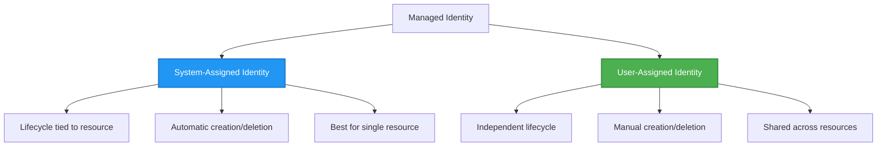

# Obrasci autentifikacije и Managed Identity

⏱️ **Процењено време**: 45-60 минута читања; резервишите додатно време за интеграцију вежби | 💰 **Утицај на трошкове**: Identity/RBAC су бесплатни; разврстани compute, storage и Key Vault су наплатни | ⭐ **Сложеност**: Средњи ниво

> Оцењено у односу на `azd 1.37.2` (новембар 2026). Ова лекција садржи **илустративни фрагменти интеграције, а не комплетан преузимајући `secure-app` образац**. Креирајте реферисане фајлове, обезбедите одговарајућу инфраструктуру и замените плейсхолдере пре распоређивања. Током прегледа нису створени Azure ресурси.

**📚 Пут учења:**
- ← Претходно: [Configuration Management](configuration.md) - Управљање променљивим окружења и тајнама
- 🎯 **Тренутно сте овде**: Аутентификација и безбедност (Managed Identity, Key Vault, безбедносни обрасци)
- → Следеће: [Infrastructure as Code](../chapter-04-infrastructure/README.md) - Испоручивање и распоређивање ресурса
- 🏠 [Почетна страница курса](../../README.md)

---

## Шта ћете научити

Завршетком ове лекције, научићете:
- Разумевање образаца аутентификације у Azure (кључеви, конекцијски низови, managed identity)
- Имплементирање **Managed Identity** за аутентификацију без лозинки
- Безбедно чување тајни уз **Azure Key Vault** интеграцију
- Конфигурисање **ролеве контроле приступа засноване на улогама (RBAC)** за AZD деплоје
- Примену најбољих безбедносних пракси у Container Apps и Azure сервисима
- Миграцију са аутентификације засноване на кључевима на аутентификацију засновану на идентитету

## Зашто је Managed Identity важан

### Проблем: Традиционална аутентификација

**Пре Managed Identity:**
```javascript
// ❌ SECURITY RISK: Hardcoded secrets in code
const connectionString = "Server=mydb.database.windows.net;User=admin;Password=P@ssw0rd123";
const storageKey = "xK7mN9pQ2wR5tY8uI0oP3aS6dF1gH4jK...";
const cosmosKey = "C2x7B9n4M1p8Q5w3E6r0T2y5U8i1O4p7...";
```

**Проблеми:**
- 🔴 **Отворене тајне** у коду, конфигурационим фајловима, променљивим окружења
- 🔴 **Ротација креденцијала** захтева промене кода и поновно постављање
- 🔴 **Ноћне море ревизије** - ко је приступао чему и када?
- 🔴 **Разбацаност** - тајне распршене по више система
- 🔴 **Ризици усаглашености** - не пролази безбедносне ревизије

### Решење: Managed Identity

**После Managed Identity:**
```javascript
// ✅ SECURE: No secrets in code
const credential = new DefaultAzureCredential();
const client = new BlobServiceClient(
  "https://mystorageaccount.blob.core.windows.net",
  credential  // Azure automatically handles authentication
);
```

**Бенефити:**
- ✅ **Нема тајни** у коду или конфигурацији
- ✅ **Аутоматска ротација** - Azure то обрађује
- ✅ **Потпуна ревизија** у Microsoft Entra ID записницима
- ✅ **Централизована безбедност** - управљање преко Azure портала
- ✅ **Спреман за усаглашеност** - испуњава стандарде безбедности

**Аналогија**: Традиционална аутентификација је као ношење више физичких кључева за различита врата. Managed Identity је као безбедносна пропусница која аутоматски даје приступ у зависности од вашег идентитета—нема кључева које треба изгубити, копирати или ротирати.

---

## Преглед архитектуре

### Ток аутентификације са Managed Identity

```mermaid
sequenceDiagram
    participant App as Your Application<br/>(Container App)
    participant MI as Managed Identity<br/>(Microsoft Entra ID)
    participant KV as Key Vault
    participant Storage as Azure Storage
    participant DB as Azure SQL
    
    App->>MI: Request access token<br/>(automatic)
    MI->>MI: Verify identity<br/>(no password needed)
    MI-->>App: Return token for requested audience<br/>(lifetime varies)
    
    App->>KV: Get secret<br/>(using token)
    KV->>KV: Check RBAC permissions
    KV-->>App: Return secret value
    
    App->>Storage: Upload blob<br/>(using token)
    Storage->>Storage: Check RBAC permissions
    Storage-->>App: Success
    
    App->>DB: Query data<br/>(using token)
    DB->>DB: Check SQL permissions
    DB-->>App: Return results
    
    Note over App,DB: Request a separate token for each service audience;<br/>SDK credentials handle caching and renewal
```

### Врсте Managed Identity



| Карактеристика | System-Assigned | User-Assigned |
|---------|----------------|---------------|
| **Животни циклус** | Повезано са ресурсом | Независно |
| **Креирање** | Аутоматично са ресурсом | Ручно креирање |
| **Брисање** | Брише се са ресурсом | Остаје након брисања ресурса |
| **Дељење** | Један ресурс само | Више ресурса |
| **Случај употребе** | Једноставни сценарији | Комплексни мулти-ресурс сценарији |
| **Избор шаблона** | Дефинисан у инфраструктури | Дефинисан у инфраструктури |

---

## Претпоставке

### Потребни алати

Већ би требало да имате инсталирано из претходних лекција:

```bash
# Verify Azure Developer CLI
azd version
# ✅ Expected: azd version 1.0.0 or higher

# Verify Azure CLI
az --version
# ✅ Expected: azure-cli 2.50.0 or higher
```

### Захтеви у Azure-у

- Активна Azure претплата
- Дозвољава приступ за:
  - Креирање managed identities
  - Додељивање RBAC улога
  - Креирање Key Vault ресурса
  - Распоређивање Container Apps

### Познавање претпоставки

Требало би да сте завршили:
- [Упутство за инсталацију](../chapter-01-foundation/installation.md) - AZD подешавање
- [АЗД основе](../chapter-01-foundation/azd-basics.md) - Основни концепти
- [Configuration Management](configuration.md) - Променљиве окружења

---

## Лекција 1: Разумевање образаца аутентификације

### Образац 1: Конекцијски низови (Старији - избегавајте)

**Како функционише:**
```bash
# Connection string contains credentials
STORAGE_CONNECTION_STRING="DefaultEndpointsProtocol=https;AccountName=myaccount;AccountKey=xK7mN9pQ2wR5..."
COSMOS_CONNECTION_STRING="AccountEndpoint=https://myaccount.documents.azure.com:443/;AccountKey=C2x7..."
SQL_CONNECTION_STRING="Server=myserver.database.windows.net;User=admin;Password=P@ssw0rd..."
```

**Проблеми:**
- ❌ Тајне видљиве у променљивима окружења
- ❌ Записане у системима за распоређивање
- ❌ Тешко ротирање
- ❌ Није обезбеђен аудиторски траг приступа

**Када користити:** Када циљни сервис захтева аутентификацију засновану на кључу. Преферирајте идентитет где је подржано; у супротном, чувајте кључеве сигурно и ротирајте их, укључујући у продукцији.

---

### Образац 2: Кључне референце (Боље)

**Како функционише:**
**Делови Bicep шаблона:** неопходна поља vault-а, identity Container App-а и његов `configuration.secrets` запис су изостављени. `secretRef` означава тајну Container App-а; то **није сам по себи** URI Key Vault-а. Да бисте користили Key Vault, дефинишите ту именовану тајну користећи `keyVaultUrl` и овлашћени `identity`.

```bicep
// Store secret in Key Vault
resource keyVault 'Microsoft.KeyVault/vaults@2023-02-01' = {
  name: 'mykv'
  properties: {
    enableRbacAuthorization: true
  }
}

// Reference in Container App
env: [
  {
    name: 'STORAGE_KEY'
    secretRef: 'storage-key'  // References Key Vault
  }
]
```

**Бенефити:**
- ✅ Тајне сигурно сачуване у Key Vault-у
- ✅ Централизовано управљање тајнама
- ✅ Ротација без измена у коду

**Ограничења:**
- ⚠️ Још увек користи кључеве/лозинке
- ⚠️ Потребна контрола приступа Key Vault-у

**Када користити:** Прелазни корак од конекцијских низова ка managed identity.

---

### Образац 3: Managed Identity (Најбоља пракса)

**Како функционише:**
**Део Bicep шаблона:** уклопите identity блок у комплетан Container App и доставите `storageAccount` и дефиницију улоге. Додела улоге такође захтева детерминистички `name`.

```bicep
// Enable managed identity
resource containerApp 'Microsoft.App/containerApps@2023-05-01' = {
  name: 'myapp'
  identity: {
    type: 'SystemAssigned'  // Automatically creates identity
  }
}

// Grant permissions
resource roleAssignment 'Microsoft.Authorization/roleAssignments@2022-04-01' = {
  name: guid(storageAccount.id, containerApp.id, storageBlobDataContributorRole)
  scope: storageAccount
  properties: {
    roleDefinitionId: storageBlobDataContributorRole
    principalId: containerApp.identity.principalId
    principalType: 'ServicePrincipal'
  }
}
```

**Апликациони код:**
```javascript
// No secrets needed!
const { DefaultAzureCredential } = require('@azure/identity');
const { BlobServiceClient } = require('@azure/storage-blob');

const credential = new DefaultAzureCredential();
const blobServiceClient = new BlobServiceClient(
  'https://mystorageaccount.blob.core.windows.net',
  credential
);
```

**Бенефити:**
- ✅ Ниједна тајна у коду/конфигурацији
- ✅ Аутоматска ротација креденцијала
- ✅ Потпун ревизни траг
- ✅ Дозволе засноване на RBAC
- ✅ Спреман за усаглашеност

**Када користити:** Пожељно за Azure хостоване апликације које приступају сервисима подржаним од Microsoft Entra аутентификације.

---

### Образац 4: Service Principals (CI/CD и аутоматизација)

Managed identity је златни стандард *за ресурсе који раде унутар Azure-а*. Али шта је са стварима које раде **изван** Azure-а—као што је CI/CD pipeline на build агенту, или скрипта на вашем лаптопу која не може користити интерактивну пријаву? Тада у игру улази **service principal**: не-људски идентитет са сопственим креденцијалима под којим аутоматизовани процес може пријавити.

**Како функционише:**

Креирајте service principal у оквиру resource групе (најмања привилегија):

```bash
az ad sp create-for-rbac \
  --name "myapp-cicd" \
  --role contributor \
  --scopes "/subscriptions/<sub-id>/resourceGroups/<rg-name>"
```

Ово ће исписати client ID, client secret, и tenant ID. azd може неинтерактивно да се пријави:

```bash
azd auth login \
  --client-id "<appId>" \
  --client-secret "<password>" \
  --tenant-id "<tenant>"
```

**Пожељно је користити федералне креденцијале (OIDC) уместо тајни.** Уместо дугорочног client секрет-а, конфигуришите федерални креденцијал тако да pipeline размењује краткотрајни токен—нема тајне за цурење или ротацију:

```bash
azd auth login \
  --client-id "<appId>" \
  --federated-credential-provider "github" \
  --tenant-id "<tenant>"
```

> `azd pipeline config` ово вам аутоматски поставља. Погледајте CI/CD водич у [Поглављу 8](../chapter-08-production/production-ai-practices.md).

**Бенефити:**
- ✅ Ради изван Azure-а (build агенти, on-prem, други облаци)
- ✅ Може бити ограничен на једну resource групу са једном улогом
- ✅ Федерална (OIDC) варијанта не користи сачувану тајну

**Противречности:**
- ⚠️ Варијанта базирана на тајни захтева пажљиво чување и ротацију
- ⚠️ Цурење тајне даје све што SP може - држите опсеге уску

**Када користити:** CI/CD pipeline и аутоматизацију која не може користити managed identity. Увек претпочитајте **federated/OIDC** варијанту уместо client секрета, и претпочитајте managed identity кад год workload ради унутар Azure-а.

**Безбедно чување креденцијала:**
- Никада не комитујте тајне—користите складиште тајни вашег pipeline-а (GitHub Actions secrets, Azure DevOps variable groups / Key Vault).
- Ограничите SP на најмању потребну улогу и resource групу.
- Поставите рок важења и ротирајте, или у потпуности елиминишите тајну помоћу OIDC.

---

## Лекција 2: Имплементација Managed Identity са AZD

### Корак по корак имплементација

Следећи фрагменти показују како интегрисати managed identity у пројекат Container App-а. Они **нису једноставни шаблон за директно покретање**: Storage модул, комплетна инфраструктура managed окружења/registry, Dockerfile и параметарски фајл нису сви овде обезбеђени. Почните са функционалним шаблоном Container Apps и уворите ове обрасце задржавајући њихову конфигурацију registry-а и service тагове.

### Структура пројекта

```
secure-app/
├── azure.yaml                 # AZD configuration
├── infra/
│   ├── main.bicep            # Main infrastructure
│   ├── core/
│   │   ├── identity.bicep    # Managed identity setup
│   │   ├── keyvault.bicep    # Key Vault configuration
│   │   └── storage.bicep     # Storage with RBAC
│   └── app/
│       └── container-app.bicep
└── src/
    ├── app.js                # Application code
    ├── package.json
    └── Dockerfile
```

### 1. Конфигуришите AZD (azure.yaml)

```yaml
name: secure-app
metadata:
  template: secure-app@1.0.0

services:
  api:
    project: ./src
    language: js
    host: containerapp

# Managed identity must be enabled in the infrastructure, not by this YAML.
```

### 2. Инфраструктура: Омогућите Managed Identity

**Фајл: `infra/main.bicep`**

```bicep
targetScope = 'subscription'

param environmentName string
param location string = 'eastus'
param containerAppsEnvironmentId string
param containerImage string

var tags = { 'azd-env-name': environmentName }

// Resource group
resource rg 'Microsoft.Resources/resourceGroups@2021-04-01' = {
  name: 'rg-${environmentName}'
  location: location
  tags: tags
}

// Storage Account
module storage './core/storage.bicep' = {
  name: 'storage'
  scope: rg
  params: {
    name: 'st${uniqueString(rg.id)}'
    location: location
    tags: tags
  }
}

// Key Vault
module keyVault './core/keyvault.bicep' = {
  name: 'keyvault'
  scope: rg
  params: {
    name: 'kv-${uniqueString(rg.id)}'
    location: location
    tags: tags
  }
}

// Container App with Managed Identity
module containerApp './app/container-app.bicep' = {
  name: 'container-app'
  scope: rg
  params: {
    name: 'ca-${environmentName}'
    location: location
    tags: tags
    storageAccountName: storage.outputs.name
    keyVaultName: keyVault.outputs.name
    containerAppsEnvironmentId: containerAppsEnvironmentId
    containerImage: containerImage
  }
}

// Grant Container App access to Storage
module storageRoleAssignment './core/role-assignment.bicep' = {
  name: 'storage-role'
  scope: rg
  params: {
    principalId: containerApp.outputs.identityPrincipalId
    roleDefinitionId: 'ba92f5b4-2d11-453d-a403-e96b0029c9fe'  // Storage Blob Data Contributor
    targetResourceType: 'storage'
    targetResourceName: storage.outputs.name
  }
}

// Grant Container App access to Key Vault
module kvRoleAssignment './core/role-assignment.bicep' = {
  name: 'kv-role'
  scope: rg
  params: {
    principalId: containerApp.outputs.identityPrincipalId
    roleDefinitionId: '4633458b-17de-408a-b874-0445c86b69e6'  // Key Vault Secrets User
    targetResourceType: 'keyvault'
    targetResourceName: keyVault.outputs.name
  }
}

// Outputs
output AZURE_STORAGE_ACCOUNT_NAME string = storage.outputs.name
output AZURE_KEY_VAULT_NAME string = keyVault.outputs.name
output APP_URL string = containerApp.outputs.url
```

### 3. Container App са System-Assigned Identity

**Фајл: `infra/app/container-app.bicep`**

```bicep
param name string
param location string
param tags object = {}
param storageAccountName string
param keyVaultName string
param containerAppsEnvironmentId string
param containerImage string

resource containerApp 'Microsoft.App/containerApps@2023-05-01' = {
  name: name
  location: location
  tags: union(tags, { 'azd-service-name': 'api' })
  identity: {
    type: 'SystemAssigned'  // 🔑 Enable managed identity
  }
  properties: {
    managedEnvironmentId: containerAppsEnvironmentId
    configuration: {
      ingress: {
        external: true
        targetPort: 3000
      }
    }
    template: {
      containers: [
        {
          name: 'api'
          image: containerImage // Must exist; configure registry credentials for private images
          resources: {
            cpu: json('0.5')
            memory: '1Gi'
          }
          env: [
            {
              name: 'AZURE_STORAGE_ACCOUNT_NAME'
              value: storageAccountName
            }
            {
              name: 'AZURE_KEY_VAULT_NAME'
              value: keyVaultName
            }
            // 🔑 No secrets - managed identity handles authentication!
          ]
        }
      ]
    }
  }
}

// Output the identity for RBAC assignments
output identityPrincipalId string = containerApp.identity.principalId
output id string = containerApp.id
output url string = 'https://${containerApp.properties.configuration.ingress.fqdn}'
```

### 4. Модул за доделу RBAC улоге

**Фајл: `infra/core/role-assignment.bicep`**

```bicep
param principalId string
param roleDefinitionId string  // Azure built-in role ID
@allowed(['storage', 'keyvault'])
param targetResourceType string
param targetResourceName string

// Typed existing resources give Bicep a valid resource scope, not a string ID.
resource storageTarget 'Microsoft.Storage/storageAccounts@2023-01-01' existing = {
  name: targetResourceName
}
resource vaultTarget 'Microsoft.KeyVault/vaults@2023-02-01' existing = {
  name: targetResourceName
}

resource storageAssignment 'Microsoft.Authorization/roleAssignments@2022-04-01' = if (targetResourceType == 'storage') {
  name: guid(storageTarget.id, principalId, roleDefinitionId)
  scope: storageTarget
  properties: {
    roleDefinitionId: subscriptionResourceId('Microsoft.Authorization/roleDefinitions', roleDefinitionId)
    principalId: principalId
    principalType: 'ServicePrincipal'
  }
}

resource vaultAssignment 'Microsoft.Authorization/roleAssignments@2022-04-01' = if (targetResourceType == 'keyvault') {
  name: guid(vaultTarget.id, principalId, roleDefinitionId)
  scope: vaultTarget
  properties: {
    roleDefinitionId: subscriptionResourceId('Microsoft.Authorization/roleDefinitions', roleDefinitionId)
    principalId: principalId
    principalType: 'ServicePrincipal'
  }
}

// This module assigns at the target resource scope, not the whole resource group.
```

### 5. Апликациони код са Managed Identity

**Фајл: `src/app.js`**

```javascript
const express = require('express');
const { DefaultAzureCredential } = require('@azure/identity');
const { BlobServiceClient } = require('@azure/storage-blob');
const { SecretClient } = require('@azure/keyvault-secrets');

const app = express();
const PORT = process.env.PORT || 3000;

// 🔑 Initialize credential (works automatically with managed identity)
const credential = new DefaultAzureCredential();

// Azure Storage setup
const storageAccountName = process.env.AZURE_STORAGE_ACCOUNT_NAME;
const blobServiceClient = new BlobServiceClient(
  `https://${storageAccountName}.blob.core.windows.net`,
  credential  // No keys needed!
);

// Key Vault setup
const keyVaultName = process.env.AZURE_KEY_VAULT_NAME;
const secretClient = new SecretClient(
  `https://${keyVaultName}.vault.azure.net`,
  credential  // No keys needed!
);

// Health check
app.get('/health', (req, res) => {
  res.json({ status: 'healthy', authentication: 'managed-identity' });
});

// Upload file to blob storage
app.post('/upload', async (req, res) => {
  try {
    const containerClient = blobServiceClient.getContainerClient('uploads');
    await containerClient.createIfNotExists();
    
    const blobName = `file-${Date.now()}.txt`;
    const blockBlobClient = containerClient.getBlockBlobClient(blobName);
    
    const content = 'Hello from managed identity!';
    await blockBlobClient.upload(content, Buffer.byteLength(content));
    
    res.json({
      success: true,
      blobName: blobName,
      message: 'File uploaded using managed identity!'
    });
  } catch (error) {
    console.error('Upload error:', error);
    res.status(500).json({ error: error.message });
  }
});

// Get secret from Key Vault
app.get('/secret/:name', async (req, res) => {
  try {
    const secretName = req.params.name;
    const secret = await secretClient.getSecret(secretName);
    
    res.json({
      name: secretName,
      retrieved: secret.value !== undefined, // Never return the secret value to callers
      message: 'Secret retrieved using managed identity!'
    });
  } catch (error) {
    console.error('Secret error:', error);
    res.status(500).json({ error: error.message });
  }
});

// List blob containers (demonstrates read access)
app.get('/containers', async (req, res) => {
  try {
    const containers = [];
    for await (const container of blobServiceClient.listContainers()) {
      containers.push(container.name);
    }
    
    res.json({
      containers: containers,
      count: containers.length,
      message: 'Containers listed using managed identity!'
    });
  } catch (error) {
    console.error('List error:', error);
    res.status(500).json({ error: error.message });
  }
});

app.listen(PORT, () => {
  console.log(`Secure API listening on port ${PORT}`);
  console.log('Authentication: Managed Identity (passwordless)');
});
```

**Фајл: `src/package.json`**

```json
{
  "name": "secure-app",
  "version": "1.0.0",
  "dependencies": {
    "express": "^4.18.2",
    "@azure/identity": "^4.0.0",
    "@azure/storage-blob": "^12.17.0",
    "@azure/keyvault-secrets": "^4.7.0"
  },
  "scripts": {
    "start": "node app.js"
  }
}
```

### 6. Распоредите и тестирајте

Извршите ове команде **након** што сте завршили непостојећу инфраструктуру, Dockerfile и одговарајући `main.parameters.json` у свом пројекту. Аутентификујте azd са `azd auth login`; пријавите се посебно са `az login` за Azure CLI провере касније. Приказани endpoints су демонстрације и захтевају одговарајуће контроле приступа пре јавне употребе.

```bash
# Initialize AZD environment
azd init

# Deploy infrastructure and application
azd up

# Get the app URL
APP_URL=$(azd env get-value APP_URL)

# Test health check
curl $APP_URL/health
```

**✅ Очекујени резултат:**
```json
{
  "status": "healthy",
  "authentication": "managed-identity"
}
```

**Тестирање отпремања блоба:**
```bash
curl -X POST $APP_URL/upload
```

**✅ Очекујени резултат:**
```json
{
  "success": true,
  "blobName": "file-1700404800000.txt",
  "message": "File uploaded using managed identity!"
}
```

**Тестирање листа контејнера:**
```bash
curl $APP_URL/containers
```

**✅ Очекујени резултат:**
```json
{
  "containers": ["uploads"],
  "count": 1,
  "message": "Containers listed using managed identity!"
}
```

---

## Честе Azure RBAC улоге

### Уграђени ID-ови улога за Managed Identity

| Сервис | Назив улоге | Role ID | Дозволе |
|---------|-----------|---------|-------------|
| **Storage** | Storage Blob Data Reader | `2a2b9908-6ea1-4ae2-8e65-a410df84e7d1` | Читање блобова и контејнера |
| **Storage** | Storage Blob Data Contributor | `ba92f5b4-2d11-453d-a403-e96b0029c9fe` | Читање, писање, брисање блобова |
| **Storage** | Storage Queue Data Contributor | `974c5e8b-45b9-4653-ba55-5f855dd0fb88` | Читање, писање, брисање редова/порука |
| **Key Vault** | Key Vault Secrets User | `4633458b-17de-408a-b874-0445c86b69e6` | Читање тајни |
| **Key Vault** | Key Vault Secrets Officer | `b86a8fe4-44ce-4948-aee5-eccb2c155cd7` | Читање, писање, брисање тајни |
| **Cosmos DB** | Cosmos DB Built-in Data Reader | `00000000-0000-0000-0000-000000000001` | Читање података из Cosmos DB |
| **Cosmos DB** | Cosmos DB Built-in Data Contributor | `00000000-0000-0000-0000-000000000002` | Читање, писање података у Cosmos DB |
| **SQL Database** | SQL DB Contributor | `9b7fa17d-e63e-47b0-bb0a-15c516ac86ec` | Управљање ресурсима базе података; нема приступ SQL подацима |
| **Service Bus** | Azure Service Bus Data Owner | `090c5cfd-751d-490a-894a-3ce6f1109419` | Слање, примање, управљање порукама |

### Како пронаћи Role ID-ове

Cosmos DB for NoSQL два ID-ја изнад су **изворне Cosmos дефиниције улога за data-plane**, а не Azure RBAC subscription role ID-ови. Доделите их помоћу `az cosmosdb sql role assignment create` (или `Microsoft.DocumentDB/databaseAccounts/sqlRoleAssignments`), не `az role assignment create`. Приступ SQL подацима захтева корисника и дозволе у Entra бази.

```bash
# List all built-in roles
az role definition list --query "[].{Name:roleName, ID:name}" --output table

# Search for specific role
az role definition list --query "[?contains(roleName, 'Storage Blob')].{Name:roleName, ID:name}" --output table

# Get role details
az role definition list --name "Storage Blob Data Contributor"
```

---

## Практичне вежбе

**Претпоставке интеграције за све три вежбе:** радни шаблон Container App-а у вашем пројекту, одговарајући Bicep ресурси, Azure CLI/azd пријава и права да доделите потребне улоге. Ово су вођене прилагођавања, а не самостални локални стартери; замените пример имена ресурса са својим распоређеним именима.

### Вежба 1: Омогућавање Managed Identity за постојећу апликацију ⭐⭐ (Средњи ниво)

**Циљ**: Додавање managed identity у постојеће Container App распоређење

**Сценарио**: Имате Container App који користи конекцијске низове. Пребаците га на managed identity.

**Полазна тачка**: Container App са овом конфигурацијом:

```bicep
// ❌ Current: Using connection string
env: [
  {
    name: 'STORAGE_CONNECTION_STRING'
    secretRef: 'storage-connection'
  }
]
```

**Кораци**:

1. **Омогућите managed identity у Bicep-у:**

```bicep
resource containerApp 'Microsoft.App/containerApps@2023-05-01' = {
  name: 'myapp'
  identity: {
    type: 'SystemAssigned'  // Add this
  }
  // ... rest of configuration
}
```

2. **Дозволите приступ Storage-у:**

```bicep
// Get storage account reference
resource storageAccount 'Microsoft.Storage/storageAccounts@2023-01-01' existing = {
  name: storageAccountName
}

// Assign role
resource roleAssignment 'Microsoft.Authorization/roleAssignments@2022-04-01' = {
  name: guid(containerApp.id, 'ba92f5b4-2d11-453d-a403-e96b0029c9fe', storageAccount.id)
  scope: storageAccount
  properties: {
    roleDefinitionId: subscriptionResourceId('Microsoft.Authorization/roleDefinitions', 'ba92f5b4-2d11-453d-a403-e96b0029c9fe')
    principalId: containerApp.identity.principalId
    principalType: 'ServicePrincipal'
  }
}
```

3. **Ажурирајте апликациони код:**

**Пре (конекцијски низ):**
```javascript
const { BlobServiceClient } = require('@azure/storage-blob');

const blobServiceClient = BlobServiceClient.fromConnectionString(
  process.env.STORAGE_CONNECTION_STRING
);
```

**После (managed identity):**
```javascript
const { DefaultAzureCredential } = require('@azure/identity');
const { BlobServiceClient } = require('@azure/storage-blob');

const credential = new DefaultAzureCredential();
const blobServiceClient = new BlobServiceClient(
  `https://${process.env.STORAGE_ACCOUNT_NAME}.blob.core.windows.net`,
  credential
);
```

4. **Ажурирање променљивих окружења:**

```bicep
env: [
  {
    name: 'STORAGE_ACCOUNT_NAME'
    value: storageAccountName  // Just the name, no secrets!
  }
  // Remove STORAGE_CONNECTION_STRING
]
```

5. **Распоредите и тестирајте:**

```bash
# Redeploy
azd up

# Test that it still works
APP_URL=$(azd show --output json | jq -er '.services.api.ingressUrl')
curl --fail -X POST "$APP_URL/upload"
```

**✅ Критеријуми успеха:**
- ✅ Апликација се распоређује без грешака
- ✅ Операције са Storage-ом раде (отпремање, листање, скидање)
- ✅ Нема конекцијских низова у променљивим окружења
- ✅ Идентифитет видљив у Azure порталу у одељку "Identity"

**Верификација:**

```bash
# Check managed identity is enabled
az containerapp show \
  --name myapp \
  --resource-group rg-myapp \
  --query "identity.type"
# ✅ Expected: "SystemAssigned"

# Check role assignment
az role assignment list \
  --assignee $(az containerapp show --name myapp --resource-group rg-myapp --query "identity.principalId" -o tsv) \
  --scope /subscriptions/{sub-id}/resourceGroups/rg-myapp/providers/Microsoft.Storage/storageAccounts/mystorageaccount
# ✅ Expected: Shows "Storage Blob Data Contributor" role
```

**Време**: 20-30 минута

---

### Вежба 2: Višestruki pristup servisima са User-Assigned Identity ⭐⭐⭐ (Напредни ниво)

**Циљ**: Креирати кориснички додељени идентитет који деле више Container App-ова

**Сценарио**: Имате 3 микросервиса којима је потребан приступ истом Storage налогу и Key Vault-у.

**Кораци**:

1. **Креирајте user-assigned identity:**

**Фајл: `infra/core/identity.bicep`**

```bicep
param name string
param location string
param tags object = {}

resource userAssignedIdentity 'Microsoft.ManagedIdentity/userAssignedIdentities@2023-01-31' = {
  name: name
  location: location
  tags: tags
}

output id string = userAssignedIdentity.id
output principalId string = userAssignedIdentity.properties.principalId
output clientId string = userAssignedIdentity.properties.clientId
```

2. **Доделите улоге user-assigned identity:**

```bicep
// In main.bicep
module userIdentity './core/identity.bicep' = {
  name: 'user-identity'
  scope: rg
  params: {
    name: 'id-${environmentName}'
    location: location
    tags: tags
  }
}

// Grant Storage access
resource storageRoleAssignment 'Microsoft.Authorization/roleAssignments@2022-04-01' = {
  name: guid(storageAccount.id, environmentName, 'storage-contributor')
  scope: storageAccount
  properties: {
    roleDefinitionId: subscriptionResourceId('Microsoft.Authorization/roleDefinitions', 'ba92f5b4-2d11-453d-a403-e96b0029c9fe')
    principalId: userIdentity.outputs.principalId
    principalType: 'ServicePrincipal'
  }
}

// Grant Key Vault access
resource kvRoleAssignment 'Microsoft.Authorization/roleAssignments@2022-04-01' = {
  name: guid(keyVault.id, environmentName, 'kv-secrets-user')
  scope: keyVault
  properties: {
    roleDefinitionId: subscriptionResourceId('Microsoft.Authorization/roleDefinitions', '4633458b-17de-408a-b874-0445c86b69e6')
    principalId: userIdentity.outputs.principalId
    principalType: 'ServicePrincipal'
  }
}
```

3. **Доделите идентитет више Container App апликацијама:**

```bicep
resource apiGateway 'Microsoft.App/containerApps@2023-05-01' = {
  name: 'api-gateway'
  identity: {
    type: 'UserAssigned'
    userAssignedIdentities: {
      '${userIdentity.outputs.id}': {}
    }
  }
  // ... rest of config
}

resource productService 'Microsoft.App/containerApps@2023-05-01' = {
  name: 'product-service'
  identity: {
    type: 'UserAssigned'
    userAssignedIdentities: {
      '${userIdentity.outputs.id}': {}
    }
  }
  // ... rest of config
}

resource orderService 'Microsoft.App/containerApps@2023-05-01' = {
  name: 'order-service'
  identity: {
    type: 'UserAssigned'
    userAssignedIdentities: {
      '${userIdentity.outputs.id}': {}
    }
  }
  // ... rest of config
}
```

4. **Код апликације (сви сервиси користе исти образац):**

```javascript
const { ManagedIdentityCredential } = require('@azure/identity');
const { BlobServiceClient } = require('@azure/storage-blob');

// For user-assigned identity, specify the client ID
const credential = new ManagedIdentityCredential(
  process.env.AZURE_CLIENT_ID  // User-assigned identity client ID
);

// Alternative (choose ONE credential declaration):
// const { DefaultAzureCredential } = require('@azure/identity');
// const credential = new DefaultAzureCredential({
//   managedIdentityClientId: process.env.AZURE_CLIENT_ID
// });

const blobServiceClient = new BlobServiceClient(
  `https://${process.env.STORAGE_ACCOUNT_NAME}.blob.core.windows.net`,
  credential
);
```

Поставите сваки runtime за Container App на `AZURE_CLIENT_ID` на `userIdentity.outputs.clientId` и `STORAGE_ACCOUNT_NAME` на име вашег складишта у Bicep-у. Само доделити идентитет или покренути `azd env set` не подешава ове runtime вредности.

5. **Деплоајте и проверите:**

```bash
azd up

# Test all services can access storage
# Replace with the actual ingress URLs reported for your three services
curl --fail -X POST "$API_GATEWAY_URL/upload"
curl --fail -X POST "$PRODUCT_SERVICE_URL/upload"
curl --fail -X POST "$ORDER_SERVICE_URL/upload"
```

**✅ Критеријуми успеха:**
- ✅ Један идентитет који деле 3 сервиса
- ✅ Сви сервиси могу приступити Storage и Key Vault
- ✅ Идентитет остаје и ако избришете један сервис
- ✅ Централизовано управљање дозволама

**Предности коришћења User-Assigned Identity:**
- Један идентитет за управљање
- Конзистентне дозволе на свим сервисима
- Преживљава брисање сервиса
- Боље за комплексне архитектуре

**Време**: 30-40 минута

---

### Вежба 3: Имплементирање ротације тајни у Key Vault ⭐⭐⭐ (Напредно)

**Циљ**: Чување API кључева од трећих страна у Key Vault и приступање помоћу managed identity

**Сценарио**: Ваша апликација треба да позове екстерни API (OpenAI, Stripe, SendGrid) који захтева API кључеве.

**Кораци**:

1. **Креирајте Key Vault са RBAC-ом:**

**Датотека: `infra/core/keyvault.bicep`**

```bicep
param name string
param location string
param tags object = {}

resource keyVault 'Microsoft.KeyVault/vaults@2023-02-01' = {
  name: name
  location: location
  tags: tags
  properties: {
    enableRbacAuthorization: true  // Use RBAC instead of access policies
    sku: {
      family: 'A'
      name: 'standard'
    }
    tenantId: subscription().tenantId
    enableSoftDelete: true
    softDeleteRetentionInDays: 90
  }
}

// Allow Container App to read secrets
output id string = keyVault.id
output name string = keyVault.name
output uri string = keyVault.properties.vaultUri
```

2. **Сачувајте тајне у Key Vault:**

```bash
# Get Key Vault name
KV_NAME=$(azd env get-value AZURE_KEY_VAULT_NAME)

# Store third-party API keys
az keyvault secret set \
  --vault-name $KV_NAME \
  --name "OpenAI-ApiKey" \
  --value "sk-proj-xxxxxxxxxxxxx"

az keyvault secret set \
  --vault-name $KV_NAME \
  --name "Stripe-ApiKey" \
  --value "sk_live_xxxxxxxxxxxxx"

az keyvault secret set \
  --vault-name $KV_NAME \
  --name "SendGrid-ApiKey" \
  --value "SG.xxxxxxxxxxxxx"
```

3. **Код апликације за преузимање тајни:**

**Датотека: `src/config.js`**

```javascript
const { DefaultAzureCredential } = require('@azure/identity');
const { SecretClient } = require('@azure/keyvault-secrets');

class Config {
  constructor() {
    this.credential = new DefaultAzureCredential();
    this.secretClient = new SecretClient(
      `https://${process.env.AZURE_KEY_VAULT_NAME}.vault.azure.net`,
      this.credential
    );
    this.cache = {};
  }

  async getSecret(secretName) {
    // Check cache first
    if (this.cache[secretName]) {
      return this.cache[secretName];
    }

    try {
      const secret = await this.secretClient.getSecret(secretName);
      this.cache[secretName] = secret.value;
      console.log(`✅ Retrieved secret: ${secretName}`);
      return secret.value;
    } catch (error) {
      console.error(`❌ Failed to get secret ${secretName}:`, error.message);
      throw error;
    }
  }

  async getOpenAIKey() {
    return this.getSecret('OpenAI-ApiKey');
  }

  async getStripeKey() {
    return this.getSecret('Stripe-ApiKey');
  }

  async getSendGridKey() {
    return this.getSecret('SendGrid-ApiKey');
  }
}

module.exports = new Config();
```

4. **Користите тајне у апликацији:**

**Датотека: `src/app.js`**

Овај **фрагмент замене апликације** захтева `npm install openai`, стварни трећи кључ, приступачан модел и инфраструктуру из вашег радног пројекта. Позива OpenAI директно, а не Azure OpenAI деплојмент. Placeholder кључеви испод не ауторизују захтев.

```javascript
const express = require('express');
const config = require('./config');
const { OpenAI } = require('openai');

const app = express();

// Initialize OpenAI with key from Key Vault
let openaiClient;

async function initializeServices() {
  const openaiKey = await config.getOpenAIKey();
  openaiClient = new OpenAI({ apiKey: openaiKey });
  console.log('✅ Services initialized with secrets from Key Vault');
}

app.post('/chat', async (req, res) => {
  try {
    const completion = await openaiClient.chat.completions.create({
      model: 'gpt-4.1',
      messages: [{ role: 'user', content: 'Hello!' }]
    });
    
    res.json({
      response: completion.choices[0].message.content,
      authentication: 'Key from Key Vault via Managed Identity'
    });
  } catch (error) {
    res.status(500).json({ error: error.message });
  }
});

// Start listening only after initialization succeeds.
initializeServices().then(() => {
  app.listen(3000, () => console.log('Key Vault demo running'));
}).catch(error => {
  console.error('Initialization failed:', error.message);
  process.exitCode = 1;
});
```

5. **Деплоајте и тестирајте:**

```bash
azd up

# Test that API keys work
curl -X POST https://myapp.azurecontainerapps.io/chat \
  -H "Content-Type: application/json" \
  -d '{"message":"Hello AI"}'
```

**✅ Критеријуми успеха:**
- ✅ Нема API кључева у коду или окружењу
- ✅ Апликација преузима кључеве из Key Vault
- ✅ Треће стране API-и раде исправно
- ✅ Могућа ротација кључева без промене кода

**Ротација тајне:**

```bash
# Update secret in Key Vault
az keyvault secret set \
  --vault-name $KV_NAME \
  --name "OpenAI-ApiKey" \
  --value "sk-proj-NEW_KEY_HERE"

# Find the active revision name, then restart it to clear the in-process cache
az containerapp revision list --name myapp --resource-group rg-myapp --output table
az containerapp revision restart \
  --name myapp \
  --resource-group rg-myapp \
  --revision "<active-revision-name>"
```

**Време**: 25-35 минута

---

## Провера знања

### 1. Обрасци аутентификације ✓

Тестирајте своје разумевање:

- [ ] **П1**: Која су три главна обрасца аутентификације?
  - **О**: Connection strings (стандардно), Key Vault референце (транзиција), Managed Identity (најбоље)

- [ ] **П2**: Зашто је managed identity бољи од connection strings?
  - **О**: Није потребно чувати тајне у коду, аутоматска ротација, потпуни аудити, RBAC дозволе

- [ ] **П3**: Када користити user-assigned identity уместо system-assigned?
  - **О**: Када се идентитет дели између више ресурса или када је животни циклус идентитета независан од ресурса

**Практична верификација:**
```bash
# Check what type of identity your app uses
az containerapp show \
  --name myapp \
  --resource-group rg-myapp \
  --query "identity.type"

# List all role assignments for the identity
az role assignment list \
  --assignee $(az containerapp show --name myapp --resource-group rg-myapp --query "identity.principalId" -o tsv)
```

---

### 2. RBAC и дозволе ✓

Тестирајте своје разумевање:

- [ ] **П1**: Који је role ID за "Storage Blob Data Contributor"?
  - **О**: `ba92f5b4-2d11-453d-a403-e96b0029c9fe`

- [ ] **П2**: Које дозволе пружа "Key Vault Secrets User"?
  - **О**: Приступ само за читање тајни (не може креирати, ажурирати или брисати)

- [ ] **П3**: Како дати приступ Container App апликацији на Azure SQL?
  - **О**: Конфигуришите Microsoft Entra аутентификацију, направите идентитет као корисника базе и дodelите потребне SQL дозволе. "SQL DB Contributor" само управља Azure ресурсима, не одобрава SQL упите.

**Практична верификација:**
```bash
# Find specific role
az role definition list --name "Storage Blob Data Contributor"

# Check what roles are assigned to your identity
PRINCIPAL_ID=$(az containerapp show --name myapp --resource-group rg-myapp --query "identity.principalId" -o tsv)
az role assignment list --assignee $PRINCIPAL_ID --output table
```

---

### 3. Интеграција Key Vault-а ✓

Тестирајте своје разумевање:

- [ ] **П1**: Како омогућити RBAC за Key Vault уместо access policies?
  - **О**: Подесите `enableRbacAuthorization: true` у Bicep-у

- [ ] **П2**: Која Azure SDK библиотека подржава аутентификацију managed identity?
  - **О**: `@azure/identity` са класом `DefaultAzureCredential`

- [ ] **П3**: Колико дуго кључеви из Key Vault остају у кешу?
  - **О**: Зависи од апликације; имплементирајте своју стратегију кеширања

**Практична верификација:**
```bash
# Test Key Vault access
az keyvault secret show \
  --vault-name $KV_NAME \
  --name "OpenAI-ApiKey" \
  --query "{name:name,enabled:attributes.enabled}"

# Check RBAC is enabled
az keyvault show \
  --name $KV_NAME \
  --query "properties.enableRbacAuthorization"
# ✅ Expected: true
```

---

## Најбоље безбедносне праксе

### ✅ Урадите:

1. **Увек користите managed identity у продукцији**
   ```bicep
   identity: {
     type: 'SystemAssigned'
   }
   ```

2. **Користите RBAC улоге са најмањим привилегијама**
   - Користите "Reader" улоге када је могуће
   - Избегавајте "Owner" или "Contributor осим ако није неопходно

3. **Чувајте кључеве трећих страна у Key Vault**
   ```javascript
   const apiKey = await secretClient.getSecret('ThirdPartyApiKey');
   ```

4. **Омогућите audit logging** (делимичан ресурс, спојите са вашим vault и workspace декларацијама)
   ```bicep
   resource vaultDiagnostics 'Microsoft.Insights/diagnosticSettings@2021-05-01-preview' = {
     name: 'vault-audit'
     scope: keyVault
     properties: {
       workspaceId: logAnalytics.id
       logs: [{ category: 'AuditEvent', enabled: true }]
     }
   }
   ```

5. **Користите различите идентитете за dev/staging/prod окружења**
   ```bash
   azd env new dev
   azd env new staging
   azd env new prod
   ```

6. **Редовно ротирајте тајне**
   - Поставите рок трајања на Key Vault тајнама
   - Аутоматизујте ротацију помоћу Azure Functions

### ❌ Немојте:

1. **Никад не уписујте тајне у код**
   ```javascript
   // ❌ BAD
   const apiKey = "sk-proj-xxxxxxxxxxxxx";
   ```

2. **Не користите connection strings у продукцији**
   ```javascript
   // ❌ BAD
   BlobServiceClient.fromConnectionString(process.env.STORAGE_CONNECTION_STRING)
   ```

3. **Не дајте превише дозвола**
   ```bicep
   // ❌ BAD - too much access
   roleDefinitionId: subscriptionResourceId('Microsoft.Authorization/roleDefinitions', '8e3af657-a8ff-443c-a75c-2fe8c4bcb635')
   
   // ✅ GOOD - least privilege
   roleDefinitionId: subscriptionResourceId('Microsoft.Authorization/roleDefinitions', '2a2b9908-6ea1-4ae2-8e65-a410df84e7d1')
   ```

4. **Не логирајте тајне**
   ```javascript
   // ❌ BAD
   console.log('API Key:', apiKey);
   
   // ✅ GOOD
   console.log('API Key retrieved successfully');
   ```

5. **Не делите продукционе идентитете између окружења**
   ```bicep
   // ❌ BAD - same identity for dev and prod
   // ✅ GOOD - separate identities per environment
   ```

---

## Водич за решавање проблема

### Проблем: "Unauthorized" при приступу Azure Storage-у

**Симптоми:**
```
Error: Unauthorized (403)
AuthorizationPermissionMismatch: This request is not authorized to perform this operation
```

**Дијагноза:**

```bash
# Check if managed identity is enabled
az containerapp show \
  --name myapp \
  --resource-group rg-myapp \
  --query "identity.type"
# ✅ Expected: "SystemAssigned" or "UserAssigned"

# Check role assignments
PRINCIPAL_ID=$(az containerapp show --name myapp --resource-group rg-myapp --query "identity.principalId" -o tsv)
az role assignment list --assignee $PRINCIPAL_ID

# Expected: Should see "Storage Blob Data Contributor" or similar role
```

**Решења:**

1. **Доделите исправну RBAC улогу:**
```bash
STORAGE_ID=$(az storage account show --name mystorageaccount --resource-group rg-myapp --query "id" -o tsv)
az role assignment create \
  --assignee $PRINCIPAL_ID \
  --role "Storage Blob Data Contributor" \
  --scope $STORAGE_ID
```

2. **Причекајте да се промена пропагира (може потрајати 5-10 минута):**
```bash
# Check role assignment status
az role assignment list --assignee $PRINCIPAL_ID --scope $STORAGE_ID
```

3. **Проверите да ли апликациони код користи исправне креденцијале:**
```javascript
// Make sure you're using DefaultAzureCredential
const credential = new DefaultAzureCredential();
```

---

### Проблем: Приступ Key Vault-у одбијен

**Симптоми:**
```
Error: Forbidden (403)
The user, group or application does not have secrets get permission
```

**Дијагноза:**

```bash
# Check Key Vault RBAC is enabled
az keyvault show \
  --name $KV_NAME \
  --query "properties.enableRbacAuthorization"
# ✅ Expected: true

# Check role assignments
az role assignment list \
  --assignee $PRINCIPAL_ID \
  --scope /subscriptions/{sub-id}/resourceGroups/rg-myapp/providers/Microsoft.KeyVault/vaults/$KV_NAME
```

**Решења:**

1. **Омогућите RBAC на Key Vault-у:**
```bash
az keyvault update \
  --name $KV_NAME \
  --enable-rbac-authorization true
```

2. **Доделите улогу Key Vault Secrets User:**
```bash
KV_ID=$(az keyvault show --name $KV_NAME --query "id" -o tsv)
az role assignment create \
  --assignee $PRINCIPAL_ID \
  --role "Key Vault Secrets User" \
  --scope $KV_ID
```

---

### Проблем: DefaultAzureCredential пада локално

**Симптоми:**
```
Error: DefaultAzureCredential failed to retrieve a token
CredentialUnavailableError: No credential available
```

**Дијагноза:**

```bash
# Check if you're logged in
az account show

# Check Azure CLI authentication
az ad signed-in-user show
```

**Решења:**

1. **Пријавите се у Azure CLI:**
```bash
az login
```

2. **Подесите Azure subscription:**
```bash
az account set --subscription "Your Subscription Name"
```

3. **За локални развој, користите environment variables:**
```bash
export AZURE_TENANT_ID="your-tenant-id"
export AZURE_CLIENT_ID="your-client-id"
export AZURE_CLIENT_SECRET="your-client-secret"
```

4. **Или користите другачији credential локално:**
```javascript
const { DefaultAzureCredential, AzureCliCredential } = require('@azure/identity');

// Use AzureCliCredential for local dev
const credential = process.env.NODE_ENV === 'production' 
  ? new DefaultAzureCredential()
  : new AzureCliCredential();
```

---

### Проблем: Додела улоге траје предуго да се пропагира

**Симптоми:**
- Улога успешно додељена
- И даље добијате 403 грешке
- Прекидани приступ (понекад ради, понекад не)

**Објашњење:**
Промене у Azure RBAC могу потрајати 5-10 минута да се глобално пропагирају.

**Решење:**

```bash
# Wait and retry
echo "Waiting for RBAC propagation..."
sleep 300  # Wait 5 minutes

# Test access
curl --fail -X POST "$APP_URL/upload"

# If still failing, restart the app
az containerapp revision restart \
  --name myapp \
  --resource-group rg-myapp \
  --revision "<active-revision-name>"
```

---

## Трошкови

### Трошкови managed identity-а

| Ресурс | Трошак |
|----------|------|
| **Managed Identity** | 🆓 **БЕСПЛАТНО** - Без наплате |
| **RBAC доделе улога** | 🆓 **БЕСПЛАТНО** - Без наплате |
| **Microsoft Entra ID Token захтеви** | 🆓 **БЕСПЛАТНО** - Укључено |
| **Key Vault операције** | $0.03 на 10,000 операција |
| **Чување тајни у Key Vault** | Проверите актуелне цене; не претпостављајте месечну накнаду по тајни |

**Managed identity штеди новац тако што:**
- ✅ Уклања Key Vault операције за сервис-сервис аутентификацију
- ✅ Смањује безбедносне инциденте (нема цурења креденцијала)
- ✅ Смањује оперативни трошак (нема ручне ротације)

Број захтева апликације није исти као број Key Vault операција: кеширање и ротација утичу на трошкове читања тајни. Идентитет не уклања трошкове израчунавања/складиштења. Проверите [Key Vault price](https://azure.microsoft.com/pricing/details/key-vault/) и Azure Pricing Calculator за ваш регион уместо да оптерећујете месечну уштеду само по броју захтева.

---

## Сазнајте више

### Званична документација
- [Azure Managed Identity](https://learn.microsoft.com/entra/identity/managed-identities-azure-resources/overview)
- [Azure RBAC](https://learn.microsoft.com/azure/role-based-access-control/overview)
- [Azure Key Vault](https://learn.microsoft.com/azure/key-vault/general/overview)
- [DefaultAzureCredential](https://learn.microsoft.com/dotnet/api/azure.identity.defaultazurecredential)

### SDK документација
- [@azure/identity (Node.js)](https://www.npmjs.com/package/@azure/identity)
- [Azure.Identity (C#)](https://www.nuget.org/packages/Azure.Identity/)
- [azure-identity (Python)](https://pypi.org/project/azure-identity/)

### Следећи кораци у овом курсу
- ← Претходно: [Configuration Management](configuration.md)
- → Следеће: [Infrastructure as Code](../chapter-04-infrastructure/README.md)
- 🏠 [Почетак курса](../../README.md)

### Повезани примери
- [Microsoft Foundry Models Chat Example](../../../../examples/azure-openai-chat) - Користи managed identity за Microsoft Foundry Models
- [Microservices Example](../../../../examples/microservices) - Обрасци аутентификације више сервиса

---

## Резиме

**Научили сте:**
- ✅ Три обрасца аутентификације (connection strings, Key Vault, managed identity)
- ✅ Како омогућити и конфигурисати managed identity у AZD-у
- ✅ RBAC доделе улога за Azure сервисе
- ✅ Интеграција Key Vault-а за тајне трећих страна
- ✅ Кориснички додељени против системски додељених идентитета
- ✅ Најбоље безбедносне праксе и решавање проблема

**Кључне поуке:**
1. **Увек користите managed identity у продукцији** - Без тајни, аутоматска ротација
2. **Користите RBAC улоге са најмањим привилегијама** - Дајте само неопходне дозволе
3. **Чувајте кључеве трећих страна у Key Vault-у** - Централизовано управљање тајнама
4. **Одвојите идентитете по окружењима** - Раздвајање dev, staging, prod окружења
5. **Омогућите audit logging** - Пратите ко је приступао чему

**Следећи кораци:**
1. Завршите горе наведене практичне вежбе
2. Мигрирајте постојећу апликацију са connection strings на managed identity
3. Поново прегледајте почетни ток деплоја: [First Project](../chapter-01-foundation/first-project.md)

---

<!-- CO-OP TRANSLATOR DISCLAIMER START -->
**Изјава о одрицању одговорности**:
Овај документ је преведен коришћењем услуге за аутоматски превод [Co-op Translator](https://github.com/Azure/co-op-translator). Иако тежимо тачности, имајте у виду да аутоматски преводи могу садржати грешке или нетачности. Оригинални документ на његовом изворном језику треба сматрати ауторитативним извором. За критичне информације препоручује се професионални људски превод. Нисмо одговорни за било каква неспоразума или погрешна тумачења која произилазе из коришћења овог превода.
<!-- CO-OP TRANSLATOR DISCLAIMER END -->