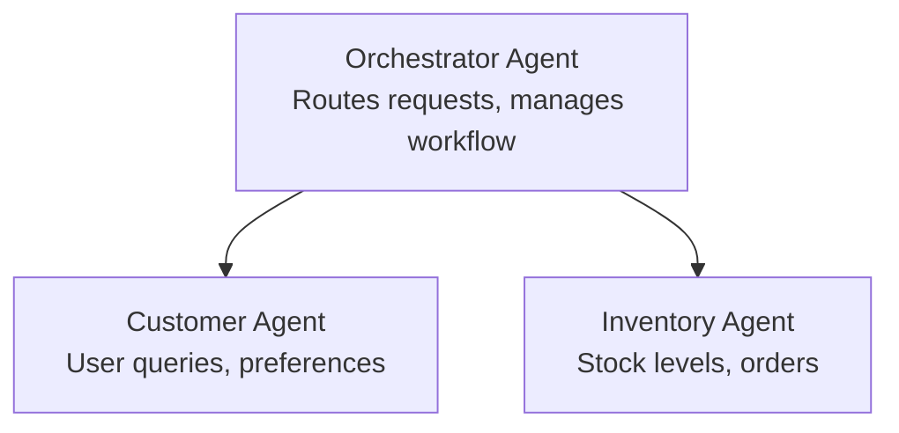

# Поглавље 5: Мулти-Агент AI Решења

**📚 Курс**: [AZD За Почетнике](../../README.md) | **⏱️ Трајање**: 2-3 сата | **⭐ Комплексност**: Напредни

---

## Преглед

Ово поглавље обухвата напредне мулти-агент архитектонске обрасце, оркестрацију агената и продукцијске AI имплементације за комплексне сценарије.

> Упутства за команду су прегледана према објављеном `azd 1.37.2` референци. Облачно постављање није извршено.

## Циљеви учења

Завршетком овог поглавља ћете:
- Разумети мулти-агент архитектонске обрасце
- Имплементирати координисане системе AI агената
- Спроводити комуникацију агент-агент
- Креирати продукцијска мулти-агент решења

---

## 📚 Лекције

| # | Лекција | Опис | Време |
|---|--------|-------------|------|
| 1 | [Основе Мулти-Агената](multi-agent-basics.md) | Практично: поставите радни мулти-агент апликацију са `azd up` | 45 мин |
| 2 | [Обрасци Координације](../chapter-06-pre-deployment/coordination-patterns.md) | Стратегије оркестрације агената (наставак у Поглављу 6) | 30 мин |
| 3 | [Имплементација ARM Темплета](../../examples/retail-multiagent-arm-template/README.md) | Пример имплементације једним кликом | 30 мин |

> **Започните са Лекцијом 1.** То је једина у потпуности практична и имплементибилна лекција у овом поглављу. Лекција 2 је у Поглављу 6 (дели се са планирањем пре имплементације), а [Рењил Мулти-Агент Решење](../../examples/retail-scenario.md) је архитектонски план — референца за дизајн, а не темплејт за једну команду.

---

## 🚀 Брзи Почетак

```bash
# Option 1: Deploy the multi-agent template used in Lesson 1
azd init --template Azure-Samples/contoso-creative-writer .
azd up

# Option 2: Initialize a Foundry agent interactively with the GA bundle
azd ext install microsoft.foundry
azd ai agent init
azd up
```

> **Који приступ?** Користите `azd init --template` да започнете са радним примером. Користите `azd ai agent init` интерактивно, или `azd ai agent init --template <path-to-azure.yaml>` да усвојите тренутни агент пројекат. Погледајте [AZD AI CLI референцу](../chapter-08-production/production-ai-practices.md#azd-ai-cli-commands-and-extensions) за захтеве верзије и миграцију евалуације.

Покрените ове алтернативе у посебним празним фасциклама. GA Foundry радни процес захтева `azd >= 1.37.0`; његов интерактивни ток не генерише прилагођени Service Bus пипелине у лекцији окоординације. За локално тестирање, постављање кода и чишћење нових и препакованих пројеката, пратите [упутство за host-agent](../chapter-02-ai-development/microsoft-foundry-integration.md#hosted-agent-walkthrough-ga).

---

## 🤖 Мулти-Агент Архитектура



---

## 🎯 Истакнуто Решење: Рењил Мулти-Агент

Решење [Retail Multi-Agent Solution](../../examples/retail-scenario.md) демонстрира:

- **Агент за кориснике**: Руководи интеракцијама и преференцама корисника
- **Агент за залихе**: Управља залихама и обрадом поруџбина
- **Оркестратор**: Координише рад између агената
- **Заједничка меморија**: Управљање контекстом између агената

### Користљиве услуге

| Услуга | Сврха |
|---------|---------|
| Microsoft Foundry Models | Разумевање језика |
| Azure AI Search | Каталог производа |
| Cosmos DB | Станје и меморија агента |
| Container Apps | Хостовање агената |
| Application Insights | Надзор |

---

## 🔗 Навигација

| Смерак | Поглавље |
|-----------|---------|
| **Претходно** | [Поглавље 4: Инфраструктура](../chapter-04-infrastructure/README.md) |
| **Следеће** | [Поглавље 6: Пре-диплојмент](../chapter-06-pre-deployment/README.md) |

---

## 📖 Повезани ресурси

- [Водич за AI агенте](../chapter-02-ai-development/agents.md)
- [Праксе у производњи AI](../chapter-08-production/production-ai-practices.md)
- [Решавање проблема AI](../chapter-07-troubleshooting/ai-troubleshooting.md)

---

<!-- CO-OP TRANSLATOR DISCLAIMER START -->
**Изјава о одрицању одговорности**:
Овај документ је преведен коришћењем услуге за аутоматски превод [Co-op Translator](https://github.com/Azure/co-op-translator). Иако тежимо тачности, имајте у виду да аутоматски преводи могу садржати грешке или нетачности. Оригинални документ на његовом изворном језику треба сматрати ауторитативним извором. За критичне информације препоручује се професионални људски превод. Нисмо одговорни за било каква неспоразума или погрешна тумачења која произилазе из коришћења овог превода.
<!-- CO-OP TRANSLATOR DISCLAIMER END -->