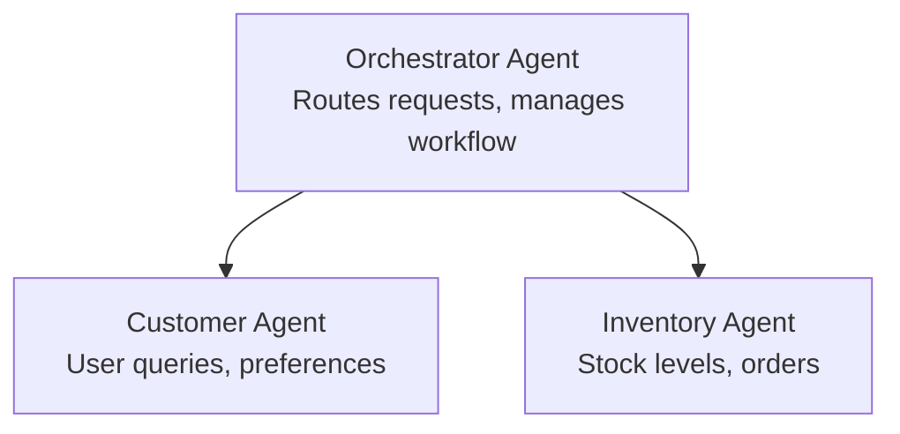

# Поглавље 5: Вишеагентска AI Решења

**📚 Курс**: [AZD за почетнике](../../README.md) | **⏱️ Трајање**: 2-3 сата | **⭐ Комплексност**: Напредно

---

## Преглед

Ово поглавље покрива напредне шаблоне вишегентске архитектуре, оркестрацију агената и продукцијска AI решења за комплексне сценарије.

> Упутства командне линије су проверена у односу на објављени `azd 1.37.2` референцу. Деплојменти у облаку нису извршени.

## Циљеви учења

Завршетком овог поглавља, ви ћете:
- Разумети шаблоне вишегентске архитектуре
- Деплојовати координиране системе AI агената
- Имплементирати комуникацију агент-агент
- Направити продукцијски спремна вишеагентска решења

---

## 📚 Лекције

| # | Лекција | Опис | Време |
|---|--------|-------------|------|
| 1 | [Основе вишеагентског система](multi-agent-basics.md) | Практично: деплојујте функционалну вишеагентску апликацију са `azd up` | 45 мин |
| 2 | [Обрасци координације](../chapter-06-pre-deployment/coordination-patterns.md) | Стратегије оркестрације агената (наставља се у Поглављу 6) | 30 мин |
| 3 | [Деплојмент са ARM шаблоном](../../examples/retail-multiagent-arm-template/README.md) | Пример деплојмента једним кликом | 30 мин |

> **Почните са Лекцијом 1.** То је једина потпуно практична, деплојована лекција у овом поглављу. Лекција 2 се налази у Поглављу 6 (заједно са планирањем пре деплојмента), а [Решење за вишеагентску малопродају](../../examples/retail-scenario.md) је архитектонски шаблон — референца за дизајн, а не шаблон за једнокомандни деплојмент.

---

## 🚀 Брзи почетак

```bash
# Option 1: Deploy the multi-agent template used in Lesson 1
azd init --template Azure-Samples/contoso-creative-writer .
azd up

# Option 2: Initialize a Foundry agent interactively (requires azure.ai.agents)
azd extension install azure.ai.agents
azd ai agent init
azd up
```

> **Који приступ изабрати?** Користите `azd init --template` да почнете од радног примера. Користите `azd ai agent init` интерактивно, или `azd ai agent init --template <path-to-azure.yaml>` да преузмете постојећи агенатски пројекат. Погледајте [AZD AI CLI референцу](../chapter-08-production/production-ai-practices.md#azd-ai-cli-commands-and-extensions) за захтеве верзије и миграцију процене.

Покрените ове алтернативе у посебним празним фолдерима. Проширење агената `1.0.0-beta.23` захтева `azd >= 1.37.0`; његов интерактивни ток не генерише прилагођени сервисни бас цевовод у лекцији о координацији.

---

## 🤖 Вишеагентска архитектура



---

## 🎯 Истакнуто решење: Вишеагентска малопродаја

Решење [Retail Multi-Agent Solution](../../examples/retail-scenario.md) показује:

- **Кориснички агент**: Управља интеракцијама и преференцама корисника
- **Агент за залихе**: Руководи залихама и обрадом наруџбина
- **Оркестратор**: Координише агенте
- **Заједничка меморија**: Управља контекстом између агената

### Коришћене услуге

| Услуга | Сврха |
|---------|---------|
| Microsoft Foundry Models | Разумевање језика |
| Azure AI Search | Каталог производа |
| Cosmos DB | Стање и меморија агената |
| Container Apps | Хостовање агената |
| Application Insights | Надгледање |

---

## 🔗 Навигација

| Правец | Поглавље |
|-----------|---------|
| **Претходно** | [Поглавље 4: Инфраструктура](../chapter-04-infrastructure/README.md) |
| **Следеће** | [Поглавље 6: Пре-деплојмент](../chapter-06-pre-deployment/README.md) |

---

## 📖 Повезани ресурси

- [AI Agents Guide](../chapter-02-ai-development/agents.md)
- [Production AI Practices](../chapter-08-production/production-ai-practices.md)
- [AI Troubleshooting](../chapter-07-troubleshooting/ai-troubleshooting.md)

---

<!-- CO-OP TRANSLATOR DISCLAIMER START -->
**Изјава о одрицању одговорности**:
Овај документ је преведен коришћењем услуге за аутоматски превод [Co-op Translator](https://github.com/Azure/co-op-translator). Иако тежимо тачности, имајте у виду да аутоматски преводи могу садржати грешке или нетачности. Оригинални документ на његовом изворном језику треба сматрати ауторитативним извором. За критичне информације препоручује се професионални људски превод. Нисмо одговорни за било каква неспоразума или погрешна тумачења која произилазе из коришћења овог превода.
<!-- CO-OP TRANSLATOR DISCLAIMER END -->