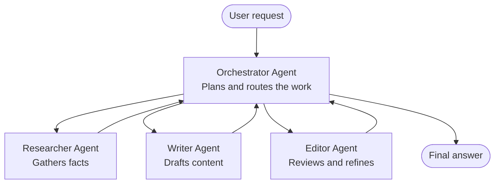

# Основе вишеагентних система - Распоредите свој први координисани AI систем

**Навигација кроз поглавље:**
- **📚 Почетна страница курса**: [AZD за почетнике](../../README.md)
- **📖 Тренутно поглавље**: Поглавље 5 - Вишеагентна AI решења
- **⬅️ Претходно**: [Поглавље 4: Инфраструктура](../chapter-04-infrastructure/README.md)
- **➡️ Следеће**: [Обрасци координације](../chapter-06-pre-deployment/coordination-patterns.md)

> Упутства команди прегледана у односу на објављени `azd 1.37.2` референтни материјал. Распоређивање у облаку није извршено.

## Увод

У претходним поглављима сте распоредили једну апликацију — а у Поглављу 2 сте распоредили једног AI агента. Ова лекција прави следећи корак: распоређивање **вишеагентног система**, где неколико специјализованих агената сарађује како би решили проблем који један агент не би могао добро сам да реши.

Добра вест за почетнике: **не требају вам нове команде.** Вишеагентно решење је и даље azd пројекат. Ви ћете `azd init`, `azd up`, тестирати и `azd down` — управо онај радни ток који већ познајете. Шта се мења је *облик* апликације унутар ње.

## Циљеви учења

На крају ове лекције ћете:
- Разумети шта значи „вишеагентно“ и када вреди додатна сложеност
- Препознати уобичајене улоге у вишеагентном систему (оркестратор + специјалисти)
- Распоредити стварни, радни вишеагентни шаблон са `azd up`
- Разумети Azure ресурсе који подржавају вишеагентну апликацију
- Знати како безбедно верификовати, прилагодити и уклонити решење

## Резултати учења

Након завршетка ове лекције моћи ћете да:
- Објасните разлику између једног агента и вишеагентног система
- Изаберете између једног агента са алатима и правог вишеагентног дизајна
- Распоредите и тестирате вишеагентни шаблон од почетка до краја помоћу azd
- Идентификујете где сваки агент ради и како комуницирају
- Очистите све ресурсе да бисте избегли текуће трошкове

---

## Шта је вишеагентни систем?

Један AI агент је један модел са скупом упутстава и (опционо) неким алатима. То добро функционише за специфичне задатке. Али како задатак расте — истраживање, затим писање, па уређивање, па проверу чињеница — нагомилавање свега у једној поруци чини агента споријим, мање поузданим и тежим за дебаговање.

**Вишеагентни систем** дели посао на специјалисте који сваки добро обавља један задатак, координисане од стране оркестратора:



### Две улоге које ћете увек видети

| Улога | Посао | Пример |
|------|-------|--------|
| **Оркестратор** | Одлучује *шта следи* и усмерава посао између агената | „Прво истражи, затим пиши, па уреди“ |
| **Специјалиста** | Обавља један фокусиран задатак и враћа резултат | „истраживач“ који само сакупља чињенице |

### Да ли вам заиста треба више агената?

Почните једноставно. Притегните се на више агената **само ако** важи једно од ових:

- ✅ Задатак има **јасне фазе** које имају користи од различитих упутстава (истраживање против писања против прегледа)
- ✅ Желите да специјалисти раде **паралелно** да бисте уштедели време
- ✅ Различите фазе захтевају **различите алате или изворе података**
- ✅ Желео/ла бисте да свака фаза буде **независно тестирана и дебагована**

Ако је ваш задатак једно питање-одговор или једноставан позив алата, **један агент са алатима** (Поглавље 2) је једноставнији, јефтинији и лакши за употребу.

> **Савет за почетнике:** „Више агената“ није увек „боље.“ Сваки агент додаје кашњење, трошак и нешто ново за праћење. Додајте агенте само када проблем јасно има поделе на делове.

---

## Два начина за изградњу вишеагентног система на Azure

| Приступ | Шта је то | Најбоље за |
|---------|-----------|-----------|
| **Један агент + алати** | Један Foundry агент који позива функције/алате | Једноставни радни процеси, почетак рада |
| **Више координисаних агената** | Неколико агената са оркестратором | Јасне фазе, паралелни рад, специјализација |

Ова лекција се фокусира на други приступ користећи **спреман шаблон**, тако да можете видети стварни вишеагентни систем у раду пре него што направите свој.

---

## Практично: Распоредите радну вишеагентну апликацију

Распоредићемо **Contoso Creative Writer**, званични Azure пример који координише истраживање, производ, писање и уређивање агената за производњу чланка. Пре него што наставите, проверите [претпоставке и трошкове узорка](https://github.com/Azure-Samples/contoso-creative-writer#azure-account-requirements): потребна је квота за моделе, Azure AI Search, приступ Bing Grounding, Python, Docker и Bash-компатибилни хукови. Доступност модела и региона зависи од ваше претплате; распоређивање није загарантовано избором одређеног региона.

### Корак 1: Иницијализујте шаблон

```bash
# Create a working folder
mkdir creative-writer && cd creative-writer

# Initialize from the official multi-agent template
azd init --template Azure-Samples/contoso-creative-writer .
```

> Прегледајте више вишеагентних шаблона у било ком тренутку у [Awesome AZD AI галерији](https://azure.github.io/awesome-azd/?tags=ai). Друго почетнички пријатељски опције укључују `get-started-with-ai-agents` и `azure-ai-travel-agents`.

### Корак 2: Аутентификујте се

```bash
# Required for azd workflows
azd auth login

# Also required by this sample's Azure CLI hooks
az login
```

### Корак 3: Проверите окружење

```bash
# init normally creates/selects an environment; confirm it before proceeding
azd env list
# Only if you need an additional environment:
# azd env new dev
```

### Корак 4: Преглед, па распоређивање

```bash
# See what will be created before spending anything (recommended)
azd provision --preview

# Provision infrastructure and deploy all agents in one step
azd up
```

`azd up` ће тражити недостајућа подешавања претплате и региона, затим одредити ресурсе и распоредити апликацију. Преглед не резервише квоту нити гарантује успех; хукови шаблона могу се и даље изводити током прегледа одређивања ресурса, зато их претходно прегледајте. Да бисте продужили време чекања азд-а за сваки **сервисни развој** (не одређивање модела):

```bash
azd deploy --timeout 1800
```

Таймаут зауставља чекање азд-а; не отказује развој у Azure-у. Прегледајте стање ресурса пре поновног покушаја.

> **Напомена о трошковима и капацитету:** Вишеагентне апликације распоређују AI моделе који троше квоту и коштају. Ако `azd up` не успе због квоте за моделе, погледајте [Отказивање проблема са AI](../chapter-07-troubleshooting/ai-troubleshooting.md) за исправке региона и квоте, као и Поглавље 6 [Планирање капацитета](../chapter-06-pre-deployment/capacity-planning.md).

---

## Разумевање онога што сте распоредили

Типична вишеагентна апликација као ова распоређује скуп Azure ресурса који директно одговарају одговорностима на дијаграму изнад:

| Ресурс | Зашто је ту |
|--------|------------|
| **Microsoft Foundry / Модели** | Домаћин језичких модела које користи сваки агент |
| **Azure AI Search** | Дава агенту-истраживачу доступне податке за претрагу |
| **Container Apps** (или App Service) | Домаћин оркестратора и кода агената |
| **Cosmos DB** (у неким примерима) | Чува заједничко стање/памћење које се деле између агената |
| **Application Insights** | Прати захтеве *између* агената како бисте могли дебаговати ток |

### Како агенти комуницирају међусобно

У већини azd вишеагентних примера, **оркестратор ради у вашем коду апликације** (на пример, користећи оквир као Semantic Kernel или Microsoft Agent Framework). Оркестратор позива сваки специјализовани агент узастопно, прослеђује резултате и саставља коначни одговор. Агенти деле контекст преко:

- **Позиви функција/алата** — оркестратор позива специјалисту и добија резултат назад
- **Заједничко памћење** — база података (често Cosmos DB) држи стање које оба агента могу читати
- **Поруке/догађаји** — за лабавије повезивање, агенти комуницирају преко реда или Service Bus-а

> **Зашто је ово важно за дебаговање:** зато што је сваки корак одvojen, Application Insights вам показује *који* агент је био спор или није успео. То је главни разлог зашто уопште поделити посао између агената.

---

## Потврдите распоређивање

Потврдите да систем заправо ради пре даљег рада:

```bash
# Show the deployed endpoints
azd show

# Open the app's monitoring dashboard
azd monitor

# Open Application Insights Logs (not a terminal log stream)
azd monitor --logs
```

Затим отворите УРЛ апликације из `azd show` и затражите кратак чланак. Користите приказ за дебаговање узорка да бисте прегледали радни ток његових агената. Претрага трансакција у Application Insights може показати појединачне кораке само ако узорак инструментише и корелира те кораке; azd аутоматски не додаје опсеге агента.

**Критеријуми успеха:**
- ✅ `azd show` наводи доступну крајњу тачку
- ✅ Захтев производи резултат који је јасно прошао кроз више фаза
- ✅ Приказ за дебаговање показује више корака агената; ако је тражење омогућено, проверите одговарајућу телеметрију након уноса

---

## Прилагодите: Додајте или подесите агента

Пошто је сваки агент само скуп упутстава плус алати, прилагођавање је приступачно:

1. **Пронађите дефиниције агената** у шаблону (често скуп `prompts/`, `agents/` или `*.prompty` датотека).
2. **Подесите упутства агента** — на пример, наложите агенту-уређивачу да инсистира на одређеном тону или броју речи.
3. **Поново распоредите само код** (инфраструктура остаје иста):

   ```bash
   azd deploy
   ```

Да бисте и даље напредовали са *својим* Foundry агент пројектом, користите интерактивну иницијализацију екстензије агента:

```bash
azd extension install azure.ai.agents
azd ai agent init
azd up
azd ai agent invoke      # test, with response timing
```

Погледајте [Поглавље 2: Агенти](../chapter-02-ai-development/agents.md) и [AZD AI CLI референцу](../chapter-08-production/production-ai-practices.md#azd-ai-cli-commands-and-extensions) за комплетан животни циклус: агент `invoke`, одвојени процес екстензије за процене `azd ai eval`, агент `optimize`, и агент `delete`.

---

## Очистите окружење

Вишеагентне апликације покрећу више плаћених сервиса. Уклоните све када завршите:

```bash
# Review the resources and confirm deletion interactively
azd down
```

Брисање је уништавајуће. За привремено лабораторијско окружење, `azd down --force --purge` прескаче брисање и подржане потврде о брзом софт-брисању; чишћење је неповратно где је подржано и може бити блокирано заштитом брисања. Софт-брисање је питање опоравка/реупотребе имена, а не само доказ текућих трошкова. Проверите задржане ресурсе и наплату након чишћења.

---

## Белешка о производним вишеагентним системима

Решење [Retail Multi-Agent Solution](../../examples/retail-scenario.md) у овом репозиторијуму је **архитектонски план**, а не шаблон који се покреће једном командом—документује како би производни малопродајни систем *био* изграђен (и јасно наводи да је комплетна изградња значајан посао). Користите га као референцу за дизајн *после* што сте овде покренули радни пример. За производна питања (отпорност, трошкови, надзор, управљање), наставите са [Поглавље 8: Практике производног АИ](../chapter-08-production/production-ai-practices.md).

---

## Резиме

- Систем вишеструких агената дели посао између стручњака координисаних од стране оркестратора.
- Користите га само када задатак има јасне фазе, паралелизам или различите алате по кораку — у супротном преферирајте једног агента.
- Работни ток азд није промењен: `azd init` → `azd up` → тест → `azd down`.
- Прави шаблон као што је `contoso-creative-writer` омогућава вам да данас видите и прилагодите радну вишеструку апликацију агената.
- Праћење у Application Insights-у преко агената је једна од највећих практичних предности дизајна вишеструких агената.

---

## 🔗 Навигација

| Правaц | Лекција |
|-----------|--------|
| **Претходна** | [Поглавље 4: Инфраструктура](../chapter-04-infrastructure/README.md) |
| **Следећа** | [Обрасци координације](../chapter-06-pre-deployment/coordination-patterns.md) |

## 📖 Повезани ресурси

- [Водич за AI агенте](../chapter-02-ai-development/agents.md)
- [Обрасци координације](../chapter-06-pre-deployment/coordination-patterns.md)
- [Практичне примене AI у производњи](../chapter-08-production/production-ai-practices.md)
- [Решавање проблема са AI](../chapter-07-troubleshooting/ai-troubleshooting.md)

---

<!-- CO-OP TRANSLATOR DISCLAIMER START -->
**Изјава о одрицању одговорности**:
Овај документ је преведен коришћењем услуге за аутоматски превод [Co-op Translator](https://github.com/Azure/co-op-translator). Иако тежимо тачности, имајте у виду да аутоматски преводи могу садржати грешке или нетачности. Оригинални документ на његовом изворном језику треба сматрати ауторитативним извором. За критичне информације препоручује се професионални људски превод. Нисмо одговорни за било каква неспоразума или погрешна тумачења која произилазе из коришћења овог превода.
<!-- CO-OP TRANSLATOR DISCLAIMER END -->