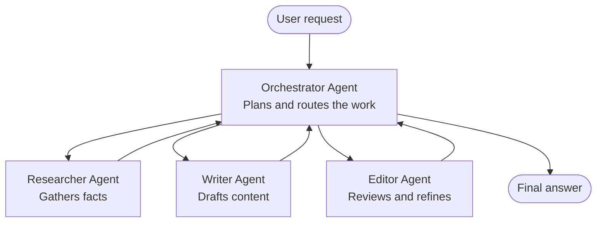

# Основе вишеагентских система - Распоредите свој први координирани АИ систем

**Навигација кроз поглавља:**
- **📚 Почетна страница курса**: [AZD за почетнике](../../README.md)
- **📖 Тренутно поглавље**: Поглавље 5 - Вишеагентска АИ решења
- **⬅️ Претходно**: [Поглавље 4: Инфраструктура](../chapter-04-infrastructure/README.md)
- **➡️ Следеће**: [Обрасци координације](../chapter-06-pre-deployment/coordination-patterns.md)

> Упутства за команде су прегледана у односу на објављени `azd 1.37.2` референцу. Облачно распоредање није извршено.

## Увод

У претходним поглављима сте распоредили једну апликацију—а у Поглављу 2 сте распоредили једног АИ агента. Ова лекција прави следећи корак: распоредање **вишеагентског система**, у коме неколико специјализованих агената сарађује да реше проблем који ниједан појединачни агент сам не би могао добро да реши.

Добра вест за почетнике: **немате потребу за новим командама.** Вишеагентско решење је и даље азд пројекат. Ви ћете `azd init`, `azd up`, тестирати, и `azd down`—упркос томе што је радни ток онакав какав већ познајете. Шта се мења је *облик* апликације изнутра.

## Циљеви учења

До краја ове лекције, видећете:
- Разумети шта значи "вишеагентски" и када вреди додатна сложеност
- Препознати уобичајене улоге у вишеагентском систему (диригент + специјалисти)
- Распоредити стваран и радни вишеагентски шаблон са `azd up`
- Разумети Azure ресурсе који подржавају вишеагентску апликацију
- Знати како сигурно верификовати, прилагодити и уклонити решење

## Резултати учења

Након завршетка ове лекције, моћи ћете:
- Објаснити разлику између једног агента и вишеагентског система
- Изабрати између једног агента са алатима и правог вишеагентског дизајна
- Распоредити и тестирати вишеагентски шаблон од почетка до краја са azd
- Идентификовати где сваки агент ради и како комуницирају
- Очистити све ресурсе како не би дошло до сталних трошкова

---

## Шта је вишеагентски систем?

Један АИ агент је један модел са сетом упутстава и (опционо) неким алатима. То добро функционише за фокусиране задатке. Али како задатак расте—истраживање, затим писање, затим уређивање, па провера чињеница—угуравање свега у један упит чини агента споријим, мање поузданим и тежим за решавање грешака.

**Вишеагентски систем** раздваја рад на специјалисте који сваки обавља један задатак добро, а координише их диригент:



### Две улоге које ћете увек видети

| Улога | Задатак | Пример |
|------|---------|--------|
| **Диригент** | Одлучује *шта следи* и усмеравa рад међу агентима | "Прво истраживање, па писање, па уређивање" |
| **Специјалиста** | Обавља један фокусиран задатак и враћа резултат | "истраживач" који само прикупља чињенице |

### Да ли вам заиста треба више агената?

Почните једноставно. Приступите вишеагентском решењу **само** када је једно од ових тачно:

- ✅ Задатак има **различите фазе** које захтевају различита упутства (истраживање у односу на писање у односу на преглед)
- ✅ Желите да специјалисти раде **паралелно** како бисте уштедели време
- ✅ Различити кораци захтевају **различите алате или изворе података**
- ✅ Желите да сваки корак буде **независно тестабилан и лак за отклањање грешака**

Ако је ваш задатак једно питање-одговор или једноставан позив алату, **један агент са алатима** (Поглавље 2) је једноставнији, јефтинији и лакши за коришћење.

> **Савет за почетнике:** "Више агената" није "боље." Сваки агент додаје кашњење, трошак и нову ствар за праћење. Додајте агенте само када се проблем јасно дели на делове.

---

## Два начина за изградњу вишеагентског система на Азуру

| Приступ | Шта је | Најбоље за |
|---------|---------|-----------|
| **Један агент + алати** | Један Foundry агент који позива функције/алате | Једноставни радни токови, почетак рада |
| **Више координисаних агената** | Неколико агената са диригентом | Јасне фазе, паралелни рад, специјализација |

Ова лекција се фокусира на други приступ користећи **спреман шаблон**, да бисте видели како ради прави вишеагентски систем пре него што направите свој.

---

## Практично: Распоредите радну вишеагентску апликацију

Распоредићемо **Contoso Creative Writer**, званични Азур пример који координише истраживање, продукт, писање и уређивање како би се произвео чланак. Пре наставка проверите [предуслове и трошкове примерa](https://github.com/Azure-Samples/contoso-creative-writer#azure-account-requirements): потребна је квота модела, Azure AI Search, приступ Bing Grounding, Python, Docker и Bash-компатибилни хукс. Доступност модела и региона зависи од ваше претплате; распоредање није загарантовано избором одређеног региона.

### Корак 1: Иницијализујте шаблон

```bash
# Create a working folder
mkdir creative-writer && cd creative-writer

# Initialize from the official multi-agent template
azd init --template Azure-Samples/contoso-creative-writer .
```

> Прегледајте више вишеагентских шаблона у било ком тренутку у [Awesome AZD AI галерији](https://azure.github.io/awesome-azd/?tags=ai). Друге опције пријатељске за почетнике укључују `get-started-with-ai-agents` и `azure-ai-travel-agents`.

### Корак 2: Аутентификујте се

```bash
# Required for azd workflows
azd auth login

# Also required by this sample's Azure CLI hooks
az login
```

### Корак 3: Проверите окружење

```bash
# init normally creates/selects an environment; confirm it before proceeding
azd env list
# Only if you need an additional environment:
# azd env new dev
```

### Корак 4: Прегледајте, затим распореди

```bash
# See what will be created before spending anything (recommended)
azd provision --preview

# Provision infrastructure and deploy all agents in one step
azd up
```

`azd up` ће затражити недостајућа подешавања претплате и региона, затим обезбедити ресурсе и распореди апликацију. Преглед не резервише квоту нити гарантује успех; шаблону хукси могу бити покренути у току прегледа обезбеђења, зато их прво прегледајте. Да бисте продужили време чекања азд за сваки **распоред услуге** (не обезбеђење модела):

```bash
azd deploy --timeout 1800
```

Временско ограничење зауставља чекање азд; не отказује распоређивање у Азуру. Прегледајте стање ресурса пре поновног покушаја.

> **Обавештење о трошковима и капацитету:** Вишеагентске апликације распоређују АИ моделе који троше квоту и наносе трошкове. Ако `azd up` не успе због квоте за модел, погледајте [AI решавање проблема](../chapter-07-troubleshooting/ai-troubleshooting.md) за исправке региона и квоте и Поглавље 6 [Планирање капацитета](../chapter-06-pre-deployment/capacity-planning.md).

---

## Разумевање онога што сте распореди

Типична вишеагентска апликација као ова обезбеђује скуп Azure ресурса који директно одговарају одговорностима на горе наведеном дијаграму:

| Ресурс | Зашто је ту |
|---------|-------------|
| **Microsoft Foundry / Модели** | Држи језичке моделе које сваки агент користи |
| **Azure AI Search** | Даје агенту истраживачу усмерене податке за претрагу |
| **Container Apps** (или App Service) | Дом је кода диригента и агената |
| **Cosmos DB** (у неким примерима) | Чува заједничко стање/памћење које се дели између агената |
| **Application Insights** | Праћење захтева *између* агената за лакше отклањање грешака |

### Како агенти комуницирају међу собом

У већини azd вишеагентских примера, **диригент ради у вашем коду апликације** (на пример, коришћењем фрејмворка као Semantic Kernel или Microsoft Agent Framework). Диригент позива сваког специјалисту редом, прослеђује резултате и склапа коначни одговор. Агенти деле контекст преко:

- **Позиви функција/алата** — диригент позива специјалисту и добија резултат назад
- **Заједничка меморија** — база података (често Cosmos DB) чува стање које оба агента могу читати
- **Поруке/догађаји** — за лабавију повезаност, агенти комуницирају путем реда или Service Bus-а

> **Зашто је ово важно за отклањање грешака:** јер је сваки корак посебан, Application Insights вам показује *који* агент је био спор или није успео. То је главни разлог зашто рад делити на више агената.

---

## Верификујте распоређивање

Потврдите да систем заиста ради пре него што наставите:

```bash
# Show the deployed endpoints
azd show

# Open the app's monitoring dashboard
azd monitor

# Open Application Insights Logs (not a terminal log stream)
azd monitor --logs
```

Онда отворите URL апликације из `azd show` и затражите кратак чланак. Користите debug режим примерка да испитате ток рада агента. Претрага трансакција у Application Insights може показати појединачне кораке само ако пример укључује и повезује те кораке; azd аутоматски не додаје agent spans.

**Критеријуми успеха:**
- ✅ `azd show` наводи достижну крајњу тачку
- ✅ Захтев производи резултат који је очигледно прошао кроз више фаза
- ✅ Debug поглед показује више корака агената; ако је трасирање омогућено, проверите одговарајућу телеметрију након уноса

---

## Прилагодите: Додајте или подесите агента

Пошто је сваки агент само упутства плус алати, прилагођавање је приступачно:

1. **Пронађите дефиниције агената** у шаблону (често у `prompts/`, `agents/` или `*.prompty` скупу фајлова).
2. **Подесите упутства агента** — на пример, реци уреднику да примењује одређени тон или број речи.
3. **Поново распореди само код** (инфраструктура остаје иста):

   ```bash
   azd deploy
   ```

За даљи рад са *сопственим* Foundry агент пројектом, користите GA пакет са AZD 1.37.0+ у посебном празном директоразу:

```bash
azd ext install microsoft.foundry
azd ai agent init
azd up
azd ai agent invoke      # test, with response timing
```

Погледајте [GA hosted-agent упутство](../chapter-02-ai-development/microsoft-foundry-integration.md#hosted-agent-walkthrough-ga) за локално тестирање Agent Inspector, удаљено распоредање кода и власничко чишћење. [AZD AI CLI референца](../chapter-08-production/production-ai-practices.md#azd-ai-cli-commands-and-extensions) такође покрива проширење за одвојене процене, оптимизацију и брисање агената.

---

## Чишћење

Вишеагентске апликације покрећу више наплата услуга. Уклоните све кад завршите:

```bash
# Review the resources and confirm deletion interactively
azd down
```

Брисање је уништавајуће. За одбациви лабораторијски пример, `azd down --force --purge` прескаче брисање и потврде о меком брисању; чишћење је неповратно где је подржано и може бити блокирано заштитом од чишћења. Меко брисање је питање опоравка/поновне употребе имена, а не доказ сталних трошкова. Проверите задржане ресурсе и наплату након чишћења.

Ако сте иницијализовали и hosted агента за постојећи Foundry пројекат, `azd down` оставља тог пројекта агента и друге ресурсе на месту. Уклоните само непожељне ресурсе које поседујете посебно. За нови Foundry пројекат креиран од стране AZD окружења, `azd down` брише ресурсну групу и све у њој.

---

## Напомена о производним вишеагентским системима

Решење [Retail Multi-Agent](../../examples/retail-scenario.md) у овом репозиторијуму је **архитектонски план**, а не шаблон са једном наредбом — оно документује како би производни малопродајни систем *био* изграђен (и јасно наводи да је комплетна израда значајан напор). Користите га као референцу за дизајн *након* што сте овде поставили радни пример. За производне бриге (отпорност, трошкови, праћење, управљање), наставите са [Поглављем 8: Производне AI Практике](../chapter-08-production/production-ai-practices.md).

---

## Резиме

- Вишерагентски систем дели посао између стручњака координираних од стране оркестратора.
- Користите га само када задатак има јасне фазе, паралелизам или различите алате по кораку—иначе дајте преференцију једном агенту.
- Азд ток рада није промењен: `azd init` → `azd up` → тест → `azd down`.
- Прави шаблон као `contoso-creative-writer` омогућава вам да данас видите и прилагодите радну вишерагентску апликацију.
- Application Insights праћење између агената је једна од највећих практичних користи вишерагентског дизајна.

---

## 🔗 Навигација

| Смер | Лекција |
|-----------|--------|
| **Претходна** | [Поглавље 4: Инфраструктура](../chapter-04-infrastructure/README.md) |
| **Следећа** | [Обрасци координације](../chapter-06-pre-deployment/coordination-patterns.md) |

## 📖 Повезани ресурси

- [Водич за AI агенте](../chapter-02-ai-development/agents.md)
- [Обрасци координације](../chapter-06-pre-deployment/coordination-patterns.md)
- [Праксе производње AI](../chapter-08-production/production-ai-practices.md)
- [Отстрањивање проблема са AI](../chapter-07-troubleshooting/ai-troubleshooting.md)

---

<!-- CO-OP TRANSLATOR DISCLAIMER START -->
**Изјава о одрицању одговорности**:
Овај документ је преведен коришћењем услуге за аутоматски превод [Co-op Translator](https://github.com/Azure/co-op-translator). Иако тежимо тачности, имајте у виду да аутоматски преводи могу садржати грешке или нетачности. Оригинални документ на његовом изворном језику треба сматрати ауторитативним извором. За критичне информације препоручује се професионални људски превод. Нисмо одговорни за било каква неспоразума или погрешна тумачења која произилазе из коришћења овог превода.
<!-- CO-OP TRANSLATOR DISCLAIMER END -->