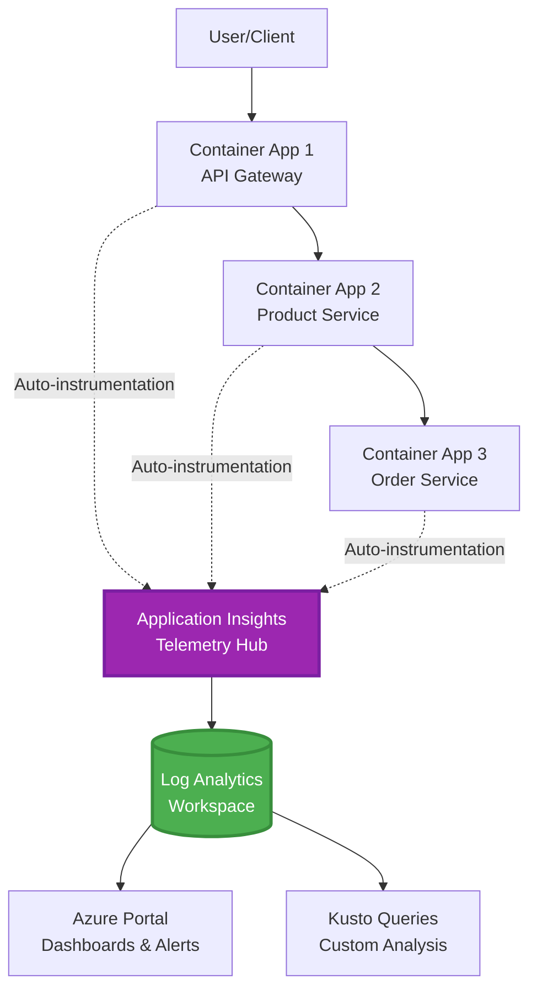
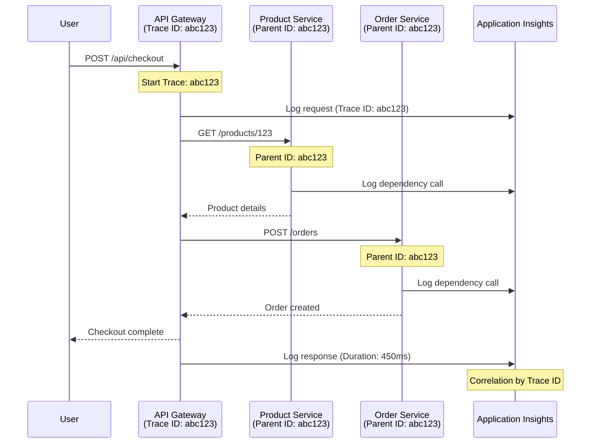

# Интеграција Application Insights са AZD

⏱️ **Процењено време**: 40-50 минута | 💰 **Утицај на трошкове**: ~$5-15/месечно | ⭐ **Сложеност**: Средњи ниво

**📚 Пут учења:**
- ← Претходно: [Прелиминарне провере](preflight-checks.md) - Валидација пре примене
- 🎯 **Тренутно сте овде**: Интеграција Application Insights (Надгледање, телеметрија, отклањање грешака)
- → Следеће: [Водич за примену](../chapter-04-infrastructure/deployment-guide.md) - Примена на Azure
- 🏠 [Почетна страница курса](../../README.md)

---

## Шта ћете научити

Завршетком ове лекције ћете:
- Декларисати **Application Insights** у AZD инфраструктури и конфигурисати SDK инструментализацију
- Конфигурисати **дистрибуирано праћење** за микросервисе
- Имплементирати **прилагођену телеметрију** (метрике, догађаје, зависности)
- Подесити **метрике у реалном времену** за надгледање уживо
- Креирати **аларме и контролне таблице** из AZD примене
- Отклањати проблеме у продукцији помоћу **телеметријских упита**
- Оптимизовати **трошкове и стратегије узорковања**
- Надгледати **AI/LLM апликације** (токене, латенцију, трошкове)

## Зашто је Application Insights са AZD важан

### Изазов: Производна посматрање

**Без Application Insights:**
```
❌ No visibility into production behavior
❌ Manual log aggregation across services
❌ Reactive debugging (wait for customer complaints)
❌ No performance metrics
❌ Cannot trace requests across services
❌ Unknown failure rates and bottlenecks
```

**Са Application Insights + AZD:**
```
✅ Automatic telemetry collection
✅ Centralized logs from all services
✅ Proactive issue detection
✅ End-to-end request tracing
✅ Performance metrics and insights
✅ Real-time dashboards
✅ AZD provisions the monitoring declared in your templates
```

**Аналогија**: Application Insights је као да имате „црну кутију“ летачког сниматеља + инструмент таблу у пилотској кабини за вашу апликацију. Видите све што се дешава у реалном времену и можете репродуковати било који инцидент.

---

## Преглед архитектуре

### Application Insights у AZD архитектури



### Шта се аутоматски надгледа

Подржана аутоматска инструментализација бележи захтеве/зависности за инструменталне библиотеке. Прилагођени догађаји и метрике захтевају код апликације; тестове доступности треба посебно подесити. Не сакупља сваки ред испод само зато што ресурс постоји.

| Тип телеметрије | Шта бележи | Коришћење |
|----------------|------------------|----------|
| **Захтеви** | HTTP захтеви, статус кодови, трајање | Надгледање перформанси API-ја |
| **Зависности** | Спољашњи позиви (БД, API-ји, складиште) | Идентификовање грла боце |
| **Изузеци** | Неразрешене грешке са праћењем стек трага | Откривање квара |
| **Прилагођени догађаји** | Пословни догађаји (пријава, куповина) | Аналитика и левци |
| **Метрике** | Бројачи перформанси, прилагођене метрике | Планирање капацитета |
| **Трагови** | Лог поруке са ознакама важности | Откривање грешака и ревизија |
| **Доступност** | Тестови времена рада и одговора | Надгледање SLA |

---

## Предуслови

### Потребни алати

```bash
# Verify Azure Developer CLI
azd version
# Command reference baseline: azd 1.37.2

# Verify Azure CLI
az --version
# ✅ Expected: azure-cli 2.50.0 or higher
```

### Захтеви за Azure

- Активна Azure претплата
- Дозволе за креирање:
  - Application Insights ресурси
  - Log Analytics радни простори
  - Container Apps
  - Ресурсне групе

### Предзнање

Требало би да сте завршили:
- [AZD Основе](../chapter-01-foundation/azd-basics.md) - Основни AZD појмови
- [Конфигурација](../chapter-03-configuration/configuration.md) - Подешавање окружења
- [Први пројекат](../chapter-01-foundation/first-project.md) - Основна примена

---

## Лекција 1: Аутоматски Application Insights са AZD

### Како AZD обезбеђује Application Insights

AZD обезбеђује Application Insights **само када пројектна инфраструктура то декларише**. `azure.yaml` сам по себи не креира надзор нити инструментализује апликациони код.

> **Пример обима:** Ова лекција садржи фрагменте интеграције, а не комплетан `monitored-app` пројекат у овом репозиторијуму. Потребни су главни темплејт и мапирање параметара, Container Apps окружење, регистар/слика и конфигурација идентитета, Dockerfile, и ознаке сервиса пре примене. Накнадне лекције показују алтернативне/проширене фрагменте, а не фајлове које све можете налепити непромењене. Почните са радиони од [пример микросервиса](../../../../examples/microservices) ако вам је потребна покретна основа.

### Структура пројекта

```
monitored-app/
├── azure.yaml                     # AZD configuration
├── infra/
│   ├── main.bicep                # Main infrastructure
│   ├── core/
│   │   └── monitoring.bicep      # Application Insights + Log Analytics
│   └── app/
│       └── api.bicep             # Container App with monitoring
└── src/
    ├── app.py                    # Application with telemetry
    ├── requirements.txt
    └── Dockerfile
```

---

### Корак 1: Конфигуришите AZD (azure.yaml)

**Фајл: `azure.yaml`**

```yaml
name: monitored-app
metadata:
  template: monitored-app@1.0.0

services:
  api:
    project: ./src
    language: python
    host: containerapp

# Monitoring must be declared in infra/ and enabled in application code.
```

Ово декларише сервис који се примењује. Следећи Bicep и SDK конфигурације обезбеђују надзор; azd их не додаје имплицитно.

---

### Корак 2: Инфраструктура за надгледање (Bicep)

**Фајл: `infra/core/monitoring.bicep`**

```bicep
param logAnalyticsName string
param applicationInsightsName string
param location string = resourceGroup().location
param tags object = {}

// Log Analytics Workspace (required for Application Insights)
resource logAnalytics 'Microsoft.OperationalInsights/workspaces@2022-10-01' = {
  name: logAnalyticsName
  location: location
  tags: tags
  properties: {
    sku: {
      name: 'PerGB2018'  // Pay-as-you-go pricing
    }
    retentionInDays: 30  // Keep logs for 30 days
    features: {
      enableLogAccessUsingOnlyResourcePermissions: true
    }
  }
}

// Application Insights
resource applicationInsights 'Microsoft.Insights/components@2020-02-02' = {
  name: applicationInsightsName
  location: location
  tags: tags
  kind: 'web'
  properties: {
    Application_Type: 'web'
    WorkspaceResourceId: logAnalytics.id
    IngestionMode: 'LogAnalytics'
    publicNetworkAccessForIngestion: 'Enabled'
    publicNetworkAccessForQuery: 'Enabled'
  }
}

// Outputs for Container Apps
output logAnalyticsWorkspaceId string = logAnalytics.id
output logAnalyticsWorkspaceName string = logAnalytics.name
output applicationInsightsConnectionString string = applicationInsights.properties.ConnectionString
output applicationInsightsInstrumentationKey string = applicationInsights.properties.InstrumentationKey
output applicationInsightsName string = applicationInsights.name
output applicationInsightsId string = applicationInsights.id
```

---

### Корак 3: Повежите Container App са Application Insights

**Фајл: `infra/app/api.bicep`**

```bicep
param name string
param location string
param tags object = {}
param containerAppsEnvironmentId string
param containerImage string
param applicationInsightsConnectionString string

resource containerApp 'Microsoft.App/containerApps@2023-05-01' = {
  name: name
  location: location
  tags: tags
  properties: {
    managedEnvironmentId: containerAppsEnvironmentId
    configuration: {
      ingress: {
        external: true
        targetPort: 8000
      }
      secrets: [
        {
          name: 'appinsights-connection-string'
          value: applicationInsightsConnectionString
        }
      ]
    }
    template: {
      containers: [
        {
          name: 'api'
          image: containerImage // Supply an accessible image and registry authentication
          resources: {
            cpu: json('0.5')
            memory: '1Gi'
          }
          env: [
            {
              name: 'APPLICATIONINSIGHTS_CONNECTION_STRING'
              secretRef: 'appinsights-connection-string'
            }
            {
              name: 'APPLICATIONINSIGHTS_ENABLED'
              value: 'true'
            }
          ]
        }
      ]
    }
  }
}

output uri string = 'https://${containerApp.properties.configuration.ingress.fqdn}'
```

---

### Корак 4: Апликациони код са телеметријом

**Фајл: `src/app.py`**

```python
from flask import Flask, request, jsonify
from azure.monitor.opentelemetry import configure_azure_monitor
import logging
import os

app = Flask(__name__)

# Get Application Insights connection string
connection_string = os.environ.get('APPLICATIONINSIGHTS_CONNECTION_STRING')

if connection_string:
    # Azure Monitor OpenTelemetry instruments supported libraries, including Flask.
    configure_azure_monitor(
        connection_string=connection_string,
        logger_name=__name__,
        enable_live_metrics=True
    )
    logger = logging.getLogger(__name__)
    logger.setLevel(logging.INFO)
    
    print("✅ Application Insights enabled")
else:
    logger = logging.getLogger(__name__)
    logger.setLevel(logging.INFO)
    print("⚠️ Application Insights not configured")

@app.route('/health')
def health():
    logger.info('Health check endpoint called')
    return jsonify({'status': 'healthy', 'monitoring': 'enabled' if connection_string else 'disabled'})

@app.route('/api/products')
def get_products():
    logger.info('Fetching products')
    
    # In-memory fixture: this is not a database dependency call.
    products = [
        {'id': 1, 'name': 'Laptop', 'price': 999.99},
        {'id': 2, 'name': 'Mouse', 'price': 29.99},
        {'id': 3, 'name': 'Keyboard', 'price': 79.99}
    ]
    
    logger.info(f'Returned {len(products)} products')
    return jsonify(products)

@app.route('/api/error-test')
def error_test():
    """Test error tracking"""
    logger.error('Testing error tracking')
    try:
        raise ValueError('This is a test exception')
    except Exception as e:
        logger.exception('Exception occurred in error-test endpoint')
        return jsonify({'error': str(e)}), 500

@app.route('/api/slow')
def slow_endpoint():
    """Test performance tracking"""
    import time
    logger.info('Slow endpoint called')
    time.sleep(3)  # Simulate slow operation
    logger.warning('Endpoint took 3 seconds to respond')
    return jsonify({'message': 'Slow operation completed'})

if __name__ == '__main__':
    app.run(host='0.0.0.0', port=8000)
```

**Фајл: `src/requirements.txt`**

```txt
Flask
azure-monitor-opentelemetry
gunicorn
requests
openai
```

Решите ове зависности у вашем пројекту, тестирајте их заједно и закључајте добијене верзије. Нови пројекти треба да користе Azure Monitor OpenTelemetry, а не обустављене OpenCensus Python експортере.

---

### Корак 5: Примена и провера

```bash
# Deploy only after completing and wiring the infrastructure fragments above
azd up

# Get app URL
APP_URL=$(azd env get-value API_URL) # Requires this output in main.bicep

# Generate telemetry
curl $APP_URL/health
curl $APP_URL/api/products
curl $APP_URL/api/error-test
curl $APP_URL/api/slow
```

**✅ Очекује се излаз:**
```json
{
  "status": "healthy",
  "monitoring": "enabled"
}
```

---

### Корак 6: Погледајте телеметрију у Azure порталу

```bash
# Get Application Insights details
azd env get-values | grep APPLICATIONINSIGHTS

# Open in Azure Portal
az monitor app-insights component show \
  --app $(azd env get-values | grep APPLICATIONINSIGHTS_NAME | cut -d '=' -f2 | tr -d '"') \
  --resource-group $(azd env get-values | grep AZURE_RESOURCE_GROUP | cut -d '=' -f2 | tr -d '"') \
  --query "appId" -o tsv
```

**Навигирајте у Azure Portal → Application Insights → Transaction Search**

Требало би да видите:
- ✅ HTTP захтеве са статус кодовима
- ✅ Трајање захтева (3+ секунде за `/api/slow`)
- ✅ Детаљи изузетака из `/api/error-test`
- ✅ Прилагођене лог поруке

---

## Лекција 2: Прилагођена телеметрија и догађаји

### Праћење пословних догађаја

Додајмо прилагођену телеметрију за пословно критичне догађаје.

**Фајл: `src/telemetry.py`**

```python
from contextlib import contextmanager
from azure.monitor.opentelemetry import configure_azure_monitor
from opentelemetry import metrics, trace
from opentelemetry.trace import SpanKind
import logging
import os

class TelemetryClient:
    """Custom telemetry client for Application Insights"""
    
    def __init__(self, connection_string=None):
        self.connection_string = connection_string or os.environ.get('APPLICATIONINSIGHTS_CONNECTION_STRING')
        
        # Configure once per process. If app.py already calls this, keep only
        # one configure_azure_monitor call and use logger_name='telemetry'.
        if self.connection_string:
            configure_azure_monitor(
                connection_string=self.connection_string,
                logger_name=__name__,
                enable_live_metrics=True
            )
        self.logger = logging.getLogger(__name__)
        self.logger.setLevel(logging.INFO)
        self.tracer = trace.get_tracer(__name__)
        self.meter = metrics.get_meter(__name__)
        self.instruments = {}
    
    def track_event(self, event_name: str, properties: dict = None):
        """Track custom business event"""
        properties = properties or {}
        self.logger.info(
            f"CustomEvent: {event_name}",
            extra={
                # OTel log attributes become customDimensions in App Insights.
                    'event_name': event_name,
                    **properties
            }
        )
    
    def track_metric(self, metric_name: str, value: float, properties: dict = None):
        """Track custom metric"""
        properties = properties or {}
        if metric_name not in self.instruments:
            self.instruments[metric_name] = self.meter.create_histogram(metric_name)
        self.instruments[metric_name].record(value, attributes=properties)
    
    @contextmanager
    def track_dependency(self, name: str):
        """Time the real operation inside a client span; exceptions mark failure."""
        with self.tracer.start_as_current_span(name, kind=SpanKind.CLIENT) as span:
            yield span

# Global telemetry client
telemetry = TelemetryClient()
```

### Ажурирање апликације са прилагођеним догађајима

**Фајл: `src/app.py` (побољшано)**

Додајте ове руте у постојећу Flask апликацију; задржите раније health/test руте. Скроћени блок испод показује посебну апликацију за јасноћу. Иницијализација телеметрије сада живи у `telemetry.py` — не иницијализујте извознике два пута.

```python
from flask import Flask, request, jsonify
from telemetry import telemetry
import time
import random
import os

app = Flask(__name__)

@app.route('/api/purchase', methods=['POST'])
def purchase():
    """Track purchase event with custom telemetry"""
    data = request.get_json(silent=True) or {}
    product_id = data.get('product_id')
    quantity = data.get('quantity', 1)
    price = data.get('price', 0)
    if not isinstance(quantity, int) or quantity < 1 or \
       not isinstance(price, (int, float)) or price < 0:
        return jsonify({'error': 'quantity and price must be non-negative numbers; quantity >= 1'}), 400
    
    # Track business event
    telemetry.track_event('Purchase', {
        'product_id': product_id,
        'quantity': quantity,
        'total_amount': price * quantity,
        'user_id': request.headers.get('X-User-Id', 'anonymous')
    })
    
    # Track revenue metric
    telemetry.track_metric('Revenue', price * quantity, {
        'product_id': product_id,
        'currency': 'USD'
    })
    
    return jsonify({
        'order_id': f'ORD-{random.randint(1000, 9999)}',
        'status': 'confirmed',
        'total': price * quantity
    })

@app.route('/api/search')
def search():
    """Track search queries"""
    query = request.args.get('q', '')
    
    start_time = time.time()
    
    # Simulate search (would be real database query)
    results = [{'id': 1, 'name': f'Result for {query}'}]
    
    duration = (time.time() - start_time) * 1000  # Convert to ms
    
    # Track search event
    telemetry.track_event('Search', {
        'query': query,
        'results_count': len(results),
        'duration_ms': duration
    })
    
    # Track search performance metric
    telemetry.track_metric('SearchDuration', duration, {
        'query_length': len(query)
    })
    
    return jsonify({'results': results, 'count': len(results)})

@app.route('/api/external-call')
def external_call():
    """Track external API dependency"""
    import requests
    
    try:
        # Set an actual test endpoint; api.example.com is not a working API.
        with telemetry.track_dependency('ExternalAPI'):
            response = requests.get(os.environ['EXTERNAL_API_URL'], timeout=5)
            response.raise_for_status()
            result = response.json()
    except Exception as e:
        return jsonify({'error': 'External dependency failed'}), 502
    
    return jsonify(result)

if __name__ == '__main__':
    app.run(host='0.0.0.0', port=8000)
```

### Тестирање прилагођене телеметрије

```bash
# Track purchase event
curl -X POST $APP_URL/api/purchase \
  -H "Content-Type: application/json" \
  -H "X-User-Id: user123" \
  -d '{"product_id": 1, "quantity": 2, "price": 29.99}'

# Track search event
curl "$APP_URL/api/search?q=laptop"

# Track external dependency
curl $APP_URL/api/external-call
```

**Погледајте у Azure Portalu:**

Навигирајте до Application Insights → Logs, затим покрените:

```kusto
// View purchase events
traces
| where customDimensions.event_name == "Purchase"
| project 
    timestamp,
    product_id = tostring(customDimensions.product_id),
    total_amount = todouble(customDimensions.total_amount),
    user_id = tostring(customDimensions.user_id)
| order by timestamp desc

// Revenue recorded in Purchase events (not a billing ledger)
traces
| where customDimensions.event_name == "Purchase"
| summarize TotalRevenue = sum(todouble(customDimensions.total_amount)) by bin(timestamp, 1h)
| render timechart

// View search performance
traces
| where customDimensions.event_name == "Search"
| summarize 
    AvgDuration = avg(todouble(customDimensions.duration_ms)),
    SearchCount = count()
  by bin(timestamp, 5m)
| render timechart
```

---

## Лекција 3: Дистрибуирано праћење за микросервисе

### Омогућите праћење између сервиса

Са компатибилном инструментализацијом и W3C trace-context пропагацијом, Application Insights корелира захтеве кроз сервисе. Само дељење конекционог низа не успоставља родитељ-дете праћење. Следећи архитектонски фрагмент се односи на модуле које морате имплементирати.

**Фајл: `infra/main.bicep`**

```bicep
targetScope = 'subscription'

param environmentName string
param location string = 'eastus'

var tags = { 'azd-env-name': environmentName }

resource rg 'Microsoft.Resources/resourceGroups@2021-04-01' = {
  name: 'rg-${environmentName}'
  location: location
  tags: tags
}

// Monitoring (shared by all services)
module monitoring './core/monitoring.bicep' = {
  name: 'monitoring'
  scope: rg
  params: {
    logAnalyticsName: 'log-${environmentName}'
    applicationInsightsName: 'appi-${environmentName}'
    location: location
    tags: tags
  }
}

// API Gateway
module apiGateway './app/api-gateway.bicep' = {
  name: 'api-gateway'
  scope: rg
  params: {
    name: 'ca-gateway-${environmentName}'
    location: location
    tags: union(tags, { 'azd-service-name': 'gateway' })
    applicationInsightsConnectionString: monitoring.outputs.applicationInsightsConnectionString
  }
}

// Product Service
module productService './app/product-service.bicep' = {
  name: 'product-service'
  scope: rg
  params: {
    name: 'ca-products-${environmentName}'
    location: location
    tags: union(tags, { 'azd-service-name': 'products' })
    applicationInsightsConnectionString: monitoring.outputs.applicationInsightsConnectionString
  }
}

// Order Service
module orderService './app/order-service.bicep' = {
  name: 'order-service'
  scope: rg
  params: {
    name: 'ca-orders-${environmentName}'
    location: location
    tags: union(tags, { 'azd-service-name': 'orders' })
    applicationInsightsConnectionString: monitoring.outputs.applicationInsightsConnectionString
  }
}

output APPLICATIONINSIGHTS_CONNECTION_STRING string = monitoring.outputs.applicationInsightsConnectionString
output GATEWAY_URL string = apiGateway.outputs.uri
```

### Погледајте енд-то-енд трансакцију



**Упит за целокупни траг:**

```kusto
// Find complete request flow
let traceId = "abc123...";  // Copy operation_Id from a request in Application Insights
dependencies
| union requests
| where operation_Id == traceId
| project 
    timestamp,
    type = itemType,
    name,
    duration,
    success,
    cloud_RoleName
| order by timestamp asc
```

---

## Лекција 4: Метрике уживо и надгледање у реалном времену

### Омогућите струју метрика уживо

Live Metrics пружа телеметрију у готово реалном времену када је подржано и омогућено од стране SDK. Није СЛА за латенцију. Подешавање OpenTelemetry Python изнад укључује `enable_live_metrics=True`.

**Приступите Live Metrics:**

```bash
# Get Application Insights resource
APPI_NAME=$(azd env get-values | grep APPLICATIONINSIGHTS_NAME | cut -d '=' -f2 | tr -d '"')

# Get resource group
RG_NAME=$(azd env get-values | grep AZURE_RESOURCE_GROUP | cut -d '=' -f2 | tr -d '"')

echo "Navigate to: Azure Portal → Resource Groups → $RG_NAME → $APPI_NAME → Live Metrics"
```

**Шта видите у реалном времену:**
- ✅ Број долазних захтева (захтеви/сек)
- ✅ Одлазни позиви зависности
- ✅ Број изузетака
- ✅ Користење CPU и меморије
- ✅ Број активних сервера
- ✅ Узорак телеметрије

### Генеришите оптерећење за тестирање

```bash
# Generate load to see live metrics
for i in {1..100}; do
  curl --silent --max-time 10 "$APP_URL/api/products"
  curl --silent --max-time 10 "$APP_URL/api/search?q=test$i"
done

# Watch live metrics in Azure Portal
# You should see request rate spike
```

---

## Практичне вежбе

### Вежба 1: Поставите аларме ⭐⭐ (Средњи ниво)

**Циљ**: Креирајте аларме за висок ниво грешака и споре одговоре.

**Кораци:**

1. **Креирајте аларм за стопу грешака:**

```bash
# Get Application Insights resource ID
APPI_ID=$(az monitor app-insights component show \
  --app $APPI_NAME \
  --resource-group $RG_NAME \
  --query "id" -o tsv)

# Create metric alert for failed requests
az monitor metrics alert create \
  --name "High-Error-Rate" \
  --resource-group $RG_NAME \
  --scopes $APPI_ID \
  --condition "count requests/failed > 10" \
  --window-size 5m \
  --evaluation-frequency 1m \
  --description "Alert when failed request count exceeds 10 per 5 minutes"
```

2. **Креирајте аларм за споре одговоре:**

```bash
az monitor metrics alert create \
  --name "Slow-Responses" \
  --resource-group $RG_NAME \
  --scopes $APPI_ID \
  --condition "avg requests/duration > 3000" \
  --window-size 5m \
  --evaluation-frequency 1m \
  --description "Alert when average response time exceeds 3 seconds"
```

3. **Креирајте аларм преко Bicep-а (преферирано за AZD):**

**Фајл: `infra/core/alerts.bicep`**

```bicep
param applicationInsightsId string
param actionGroupId string = ''
param location string = resourceGroup().location

// High error rate alert
resource errorRateAlert 'Microsoft.Insights/metricAlerts@2018-03-01' = {
  name: 'high-error-rate'
  location: 'global'
  properties: {
    description: 'Alert when error rate exceeds threshold'
    severity: 2
    enabled: true
    scopes: [
      applicationInsightsId
    ]
    evaluationFrequency: 'PT1M'
    windowSize: 'PT5M'
    criteria: {
      'odata.type': 'Microsoft.Azure.Monitor.SingleResourceMultipleMetricCriteria'
      allOf: [
        {
          name: 'Error rate'
          metricName: 'requests/failed'
          operator: 'GreaterThan'
          threshold: 10
          timeAggregation: 'Count'
        }
      ]
    }
    actions: actionGroupId != '' ? [
      {
        actionGroupId: actionGroupId
      }
    ] : []
  }
}

// Slow response alert
resource slowResponseAlert 'Microsoft.Insights/metricAlerts@2018-03-01' = {
  name: 'slow-responses'
  location: 'global'
  properties: {
    description: 'Alert when response time is too high'
    severity: 3
    enabled: true
    scopes: [
      applicationInsightsId
    ]
    evaluationFrequency: 'PT1M'
    windowSize: 'PT5M'
    criteria: {
      'odata.type': 'Microsoft.Azure.Monitor.SingleResourceMultipleMetricCriteria'
      allOf: [
        {
          name: 'Response duration'
          metricName: 'requests/duration'
          operator: 'GreaterThan'
          threshold: 3000
          timeAggregation: 'Average'
        }
      ]
    }
  }
}

output errorAlertId string = errorRateAlert.id
output slowResponseAlertId string = slowResponseAlert.id
```

4. **Тестирајте аларме:**

```bash
# Generate errors
for i in {1..20}; do
  curl $APP_URL/api/error-test
done

# Generate slow responses
for i in {1..10}; do
  curl $APP_URL/api/slow
done

# Check rule configuration (not fired/resolved alert-instance history)
az monitor metrics alert list \
  --resource-group $RG_NAME \
  --query "[].{Name:name, Enabled:enabled}" \
  --output table
```

**✅ Критеријуми успеха:**
- ✅ Аларми су успешно креирани
- ✅ Аларми се активирају када се пређу праг
- ✅ Историја аларма је видљива у Azure порталу
- ✅ Интегрисано са AZD применом

**Време**: 20-25 минута

---

### Вежба 2: Креирајте прилагођену контролну таблу ⭐⭐ (Средњи ниво)

**Циљ**: Направите контролну таблу која приказује кључне метрике апликације.

**Кораци:**

1. **Креирајте таблу преко Azure портала:**

Навигирајте у: Azure портал → Контролне табле → Нова контрола табла

2. **Додајте плочице за кључне метрике:**

- Број захтева (последњих 24 сата)
- Просечно време одговора
- Стопа грешака
- Топ 5 најспоријих операција
- Географска дистрибуција корисника

3. **Креирајте контролну таблу преко Bicep-а:**

**Фајл: `infra/core/dashboard.bicep`**

```bicep
param dashboardName string
param applicationInsightsId string
param location string = resourceGroup().location

resource dashboard 'Microsoft.Portal/dashboards@2020-09-01-preview' = {
  name: dashboardName
  location: location
  properties: {
    lenses: [
      {
        order: 0
        parts: [
          // Request count
          {
            position: {
              x: 0
              y: 0
              rowSpan: 4
              colSpan: 6
            }
            metadata: {
              type: 'Extension/Microsoft_OperationsManagementSuite_Workspace/PartType/LogsDashboardPart'
              inputs: [
                {
                  name: 'resourceId'
                  value: applicationInsightsId
                }
                {
                  name: 'query'
                  value: '''
                    requests
                    | summarize RequestCount = count() by bin(timestamp, 1h)
                    | render timechart
                  '''
                }
              ]
            }
          }
          // Error rate
          {
            position: {
              x: 6
              y: 0
              rowSpan: 4
              colSpan: 6
            }
            metadata: {
              type: 'Extension/Microsoft_OperationsManagementSuite_Workspace/PartType/LogsDashboardPart'
              inputs: [
                {
                  name: 'resourceId'
                  value: applicationInsightsId
                }
                {
                  name: 'query'
                  value: '''
                    requests
                    | summarize 
                        Total = count(),
                        Failed = countif(success == false)
                    | extend ErrorRate = (Failed * 100.0) / Total
                    | project ErrorRate
                  '''
                }
              ]
            }
          }
        ]
      }
    ]
  }
}

output dashboardId string = dashboard.id
```

4. **Примените контролну таблу:**

```bicep
// Add to a subscription-scoped main.bicep with rg and monitoring declared
module dashboard './core/dashboard.bicep' = {
  name: 'dashboard'
  scope: rg
  params: {
    dashboardName: 'dashboard-${environmentName}'
    applicationInsightsId: monitoring.outputs.applicationInsightsId
    location: location
  }
}
```

```bash
# Deploy
azd up
```

**✅ Критеријуми успеха:**
- ✅ Контролна табла приказује кључне метрике
- ✅ Може се прикачити на почетну страницу Azure портала
- ✅ Ажурирања у реалном времену
- ✅ Доступна за примену преко AZD

**Време**: 25-30 минута

---

### Вежба 3: Надгледање AI/LLM апликације ⭐⭐⭐ (Напредни ниво)

**Циљ**: Праћење коришћења Microsoft Foundry модела (токени, трошкови, латенција).

**Кораци:**

1. **Креирајте омотач за AI надзор:**

**Фајл: `src/ai_telemetry.py`**

```python
from telemetry import telemetry
from openai import AzureOpenAI
import time

class MonitoredAzureOpenAI:
    """Microsoft Foundry Models client with automatic telemetry"""
    
    def __init__(self, api_key, endpoint, input_usd_per_million,
                 output_usd_per_million, api_version="2024-10-21"):
        self.client = AzureOpenAI(
            api_key=api_key,
            api_version=api_version,
            azure_endpoint=endpoint
        )
        self.input_rate = input_usd_per_million
        self.output_rate = output_usd_per_million
    
    def chat_completion(self, model: str, messages: list, **kwargs):
        """Track chat completion with telemetry"""
        start_time = time.time()
        
        try:
            # Call Microsoft Foundry Models
            response = self.client.chat.completions.create(
                model=model,
                messages=messages,
                **kwargs
            )
            
            duration = (time.time() - start_time) * 1000  # ms
            
            # Extract usage
            usage = response.usage
            prompt_tokens = usage.prompt_tokens
            completion_tokens = usage.completion_tokens
            total_tokens = usage.total_tokens
            
            # Approximation: supply actual deployment/region/contract rates.
            # Cached input, batch, provisioned and other charges need separate accounting.
            prompt_cost = (prompt_tokens / 1_000_000) * self.input_rate
            completion_cost = (completion_tokens / 1_000_000) * self.output_rate
            total_cost = prompt_cost + completion_cost
            
            # Track custom event
            telemetry.track_event('OpenAI_Request', {
                'model': model,
                'prompt_tokens': prompt_tokens,
                'completion_tokens': completion_tokens,
                'total_tokens': total_tokens,
                'duration_ms': duration,
                'cost_usd': total_cost,
                'success': True
            })
            
            # Track metrics
            telemetry.track_metric('OpenAI_Tokens', total_tokens, {
                'model': model,
                'type': 'total'
            })
            
            telemetry.track_metric('OpenAI_Cost', total_cost, {
                'model': model,
                'currency': 'USD'
            })
            
            telemetry.track_metric('OpenAI_Duration', duration, {
                'model': model
            })
            
            return response
            
        except Exception as e:
            duration = (time.time() - start_time) * 1000
            
            telemetry.track_event('OpenAI_Request', {
                'model': model,
                'duration_ms': duration,
                'success': False,
                'error': str(e)
            })
            
            raise
```

2. **Користите надгледани клијент:**

```python
from flask import Flask, request, jsonify
from ai_telemetry import MonitoredAzureOpenAI
import os

app = Flask(__name__)

# Initialize monitored OpenAI client
openai_client = MonitoredAzureOpenAI(
    api_key=os.environ['AZURE_OPENAI_API_KEY'],
    endpoint=os.environ['AZURE_OPENAI_ENDPOINT'],
    input_usd_per_million=float(os.environ['INPUT_USD_PER_MILLION']),
    output_usd_per_million=float(os.environ['OUTPUT_USD_PER_MILLION'])
)

@app.route('/api/chat', methods=['POST'])
def chat():
    data = request.json
    user_message = data.get('message')
    
    # Call with automatic monitoring
    response = openai_client.chat_completion(
        model=os.environ['AZURE_OPENAI_DEPLOYMENT'], # Deployment name, not catalog ID
        messages=[
            {'role': 'user', 'content': user_message}
        ]
    )
    
    return jsonify({
        'response': response.choices[0].message.content,
        'tokens': response.usage.total_tokens
    })
```

3. **Извршите упите AI метрика:**

```kusto
// Total AI spend over time
traces
| where customDimensions.event_name == "OpenAI_Request"
| where tobool(customDimensions.success) == true
| summarize TotalCost = sum(todouble(customDimensions.cost_usd)) by bin(timestamp, 1h)
| render timechart

// Token usage by model
traces
| where customDimensions.event_name == "OpenAI_Request"
| summarize 
    TotalTokens = sum(toint(customDimensions.total_tokens)),
    RequestCount = count()
  by Model = tostring(customDimensions.model)

// Average latency
traces
| where customDimensions.event_name == "OpenAI_Request"
| summarize AvgDuration = avg(todouble(customDimensions.duration_ms))
| project AvgDurationSeconds = AvgDuration / 1000

// Cost per request
traces
| where customDimensions.event_name == "OpenAI_Request"
| extend Cost = todouble(customDimensions.cost_usd)
| summarize 
    TotalCost = sum(Cost),
    RequestCount = count(),
    AvgCostPerRequest = avg(Cost)
```

**✅ Критеријуми успеха:**
- ✅ Сваки OpenAI позив аутоматски праћен
- ✅ Видљиво коришћење токена и трошкови
- ✅ Надгледана латенција
- ✅ Могуће подесити аларме за буџет

**Време**: 35-45 минута

---

## Оптимизација трошкова

### Стратегије узорковања

Контролишите трошкове узорковањем телеметрије:

```python
import os

# Configure before the one configure_azure_monitor() call in your process.
os.environ["OTEL_TRACES_SAMPLER"] = "microsoft.fixed_percentage"
os.environ["OTEL_TRACES_SAMPLER_ARG"] = "0.1" # 10% trace sampling
```

Узорковање трагова не смањује сваки тип телеметрије за 90%. Метрике и независно емитовани лoгови захтевају своје контроле обима. Изаберите стопу према потребама посматрања, не општом забраном за производњу.

Подесите узорковање у SDK експлицитно; својство `SamplingPercentage` компоненте није замена за конфигурацију узорковања у Python OpenTelemetry.

### Чување података

```bicep
resource logAnalytics 'Microsoft.OperationalInsights/workspaces@2022-10-01' = {
  name: logAnalyticsName
  properties: {
    retentionInDays: 30  // Minimum (cheapest)
    // Options: 30, 31, 60, 90, 120, 180, 270, 365, 550, 730
  }
}
```

### Месечне процене трошкова

| Обим података | Чување | Месечни трошак |
|-------------|-----------|--------------|
| 1 GB/месечно | 30 дана | ~$2-5 |
| 5 GB/месечно | 30 дана | ~$10-15 |
| 10 GB/месечно | 90 дана | ~$25-40 |
| 50 GB/месечно | 90 дана | ~$100-150 |

Ове бројке су илустративне, не понуде. Проверите цене у вашој регији и уговору за унос, чување, аларме и тестирања; бесплатне квоте су заједничке/ограничене према цени Azure Monitor-а, а не загарантовани бесплатни СКУ по једном Application Insights ресурсу.

---

## Провера знања

### 1. Основна интеграција ✓

Тестирајте ваше разумевање:

- [ ] **П1**: Како AZD обезбеђује Application Insights?
  - **О**: Распоређује мониторинг ресурсе који су експлицитно декларисани у Bicep/Terraform темплејтима пројекта.

- [ ] **П2**: Која срединаска променљива омогућава Application Insights?
  - **О**: `APPLICATIONINSIGHTS_CONNECTION_STRING`

- [ ] **П3**: Која су три главна типа телеметрије?
  - **О**: Захтеви (HTTP позиви), Зависности (спољашњи позиви), Изузеци (грешека)

**Практична провера:**
```bash
# Check if Application Insights is configured
azd env get-values | grep APPLICATIONINSIGHTS

# Verify telemetry is flowing
az monitor app-insights metrics show \
  --app $APPI_NAME \
  --resource-group $RG_NAME \
  --metric "requests/count"
```

---

### 2. Прилагођена телеметрија ✓

Тестирајте ваше разумевање:

- [ ] **П1**: Како пратите прилагођене пословне догађаје?
  - **О**: Омотач из ове лекције пише структуриране OTel логове са `event_name` атрибутима, који се могу упитати у `traces`; ово се не бележи аутоматски као `customEvents`.

- [ ] **П2**: Која је разлика између догађаја и метрика?
  - **О**: Догађаји су дискретна дешавања, метрике су нумеричка мерења

- [ ] **П3**: Како се корелира телеметрија између сервиса?
  - **О**: Application Insights аутоматски користи `operation_Id` за корелацију

**Практична провера:**
```kusto
// Verify custom events
traces
| where customDimensions.event_name != ""
| summarize count() by tostring(customDimensions.event_name)
```

---

### 3. Производно надгледање ✓

Тестирајте ваше разумевање:

- [ ] **П1**: Шта је узорковање и зашто га користити?
  - **О**: Узорковање смањује обим података (и трошкове) бележењем само процента телеметрије

- [ ] **П2**: Како се постављају аларми?
  - **О**: Користите метрике аларме у Bicep-у или Azure Порталу на основу Application Insights метрика

- [ ] **П3**: Која је разлика између Log Analytics и Application Insights?
  - **О**: Application Insights чува податке у Log Analytics радном простору; App Insights пружа апликационо специфичне приказе

**Практична провера:**
```bash
# Check the sampler configured for the running application, not only the ARM component.
az containerapp show --name "$APP_NAME" --resource-group "$RG_NAME" \
  --query "properties.template.containers[].env[?starts_with(name, 'OTEL_TRACES_SAMPLER')]"
```

---

## Најбоље праксе

### ✅ РАДИ:

1. **Користите ИД корелације**
   ```python
   logger.info('Processing order', extra={
           'order_id': order_id,
           'user_id': user_id
   })
   ```

2. **Поставите аларме за критичне метрике**
   ```bicep
   // Error rate, slow responses, availability
   ```

3. **Користите структурирано логовање**
   ```python
   # ✅ GOOD: Structured
   logger.info('User signup', extra={'user_id': 'pseudonymous-id'})
   
   # ❌ BAD: Unstructured
   logger.info(f'User 123 signed up')
   ```

4. **Надгледајте зависности**
   ```python
   # Automatically track database calls, HTTP requests, etc.
   ```

5. **Користите Live Metrics током имплементација**

### ❌ НЕ РАДИ:

1. **Не бележите осетљиве податке**
   ```python
   # ❌ BAD
   logger.info(f'Login: {username}:{password}')
   
   # ✅ GOOD
   logger.info('Login attempt', extra={'result': 'failed'})
   ```

2. **Не бирајте узорковање без мерења волумена и дијагностичких потреба**
   ```python
   # ❌ Expensive
   # 100% traces may be appropriate for a small workload or investigation.
   
   # ✅ Cost-effective
   # A lower trace rate reduces visibility; validate coverage before enabling.
   ```

3. **Не игноришите редове мртвих порука**

4. **Не заборавите да поставите ограничења задржавања података**

---

## Решавање проблема

### Проблем: Телеметрија се не приказује

**Дијагноза:**
```bash
# Check connection string is set
azd env get-values | grep APPLICATIONINSIGHTS

# Check application logs via Azure Monitor
azd monitor --logs

# Or use Azure CLI for Container Apps:
az containerapp logs show --name $APP_NAME --resource-group $RG_NAME --tail 50
```

**Решење:**
```bash
# Verify connection string in Container App
az containerapp show \
  --name $APP_NAME \
  --resource-group $RG_NAME \
  --query "properties.template.containers[0].env" \
  | grep -i applicationinsights
```

---

### Проблем: Високи трошкови

**Дијагноза:**
```bash
# Query ingestion volume in the linked Log Analytics workspace.
# WORKSPACE_ID is the workspace customer ID (GUID), not its ARM resource ID.
az monitor log-analytics query --workspace "$WORKSPACE_ID" \
  --analytics-query "Usage | where TimeGenerated > ago(30d) | where IsBillable == true | summarize IngestedMB=sum(Quantity) by DataType"
```

**Решење:**
- Смањите стопу узорковања
- Скратите период задржавања
- Уклоните детаљно бележење

---

## Сазнајте више

### Званична документација
- [Преглед Application Insights](https://learn.microsoft.com/azure/azure-monitor/app/app-insights-overview)
- [Azure Monitor OpenTelemetry подешавање](https://learn.microsoft.com/azure/azure-monitor/app/opentelemetry-enable?tabs=python)
- [Језик упита Кусто](https://learn.microsoft.com/azure/data-explorer/kusto/query/)
- [АЗД Мониторинг](https://learn.microsoft.com/azure/developer/azure-developer-cli/monitor-your-app)

### Следећи кораци у овом курсу
- ← Претходно: [Провере пре лансирања](preflight-checks.md)
- → Следеће: [Водич за распоређивање](../chapter-04-infrastructure/deployment-guide.md)
- 🏠 [Почетна страница курса](../../README.md)

### Повезани примери
- [Пример Microsoft Foundry модела](../../../../examples/azure-openai-chat) - AI телеметрија
- [Пример микросервиса](../../../../examples/microservices) - Расподељено праћење

---

## Резиме

**Научили сте:**
- ✅ Аутоматско додељивање Application Insights преко AZD-а
- ✅ Прилагођена телеметрија (догађаји, метрике, зависности)
- ✅ Расподељено праћење кроз микросервисе
- ✅ Метрике у реалном времену и мониторинг уживо
- ✅ Аларми и контролне табле
- ✅ Мониторинг AI/LLM апликација
- ✅ Стратегије оптимизације трошкова

**Кључне поуке:**
1. **Декларишите мониторинг експлицитно** - AZD примењује ваше шаблоне; SDK инструментација шаље телеметрију
2. **Користите структурирано бележење** - Олакшава упите
3. **Пратите пословне догађаје** - Не само техничке метрике
4. **Пратите трошкове AI** - Пратите тагове и расходе
5. **Поставите аларме** - Бодите проактивни, не реактивни
6. **Оптимизујте трошкове** - Користите узорковање и ограничења задржавања

**Следећи кораци:**
1. Завршите практичне вежбе
2. Додајте Application Insights у ваше AZD пројекте
3. Креирајте прилагођене контролне табле за ваш тим
4. Научите [Водич за распоређивање](../chapter-04-infrastructure/deployment-guide.md)

---

<!-- CO-OP TRANSLATOR DISCLAIMER START -->
**Изјава о одрицању одговорности**:
Овај документ је преведен коришћењем услуге за аутоматски превод [Co-op Translator](https://github.com/Azure/co-op-translator). Иако тежимо тачности, имајте у виду да аутоматски преводи могу садржати грешке или нетачности. Оригинални документ на његовом изворном језику треба сматрати ауторитативним извором. За критичне информације препоручује се професионални људски превод. Нисмо одговорни за било каква неспоразума или погрешна тумачења која произилазе из коришћења овог превода.
<!-- CO-OP TRANSLATOR DISCLAIMER END -->