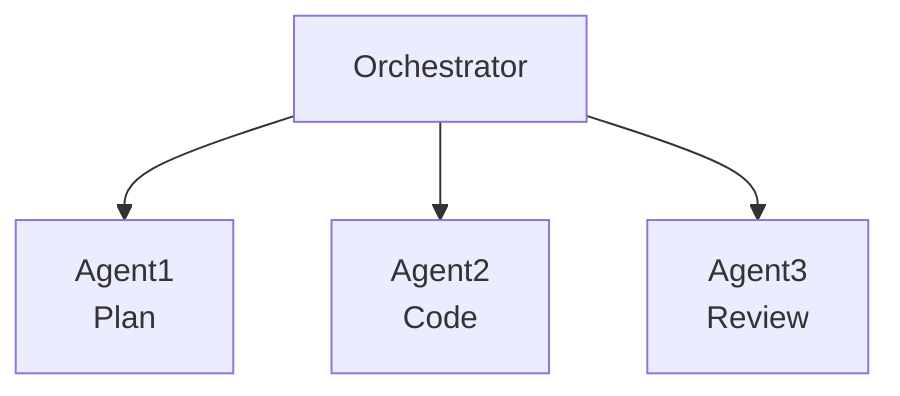
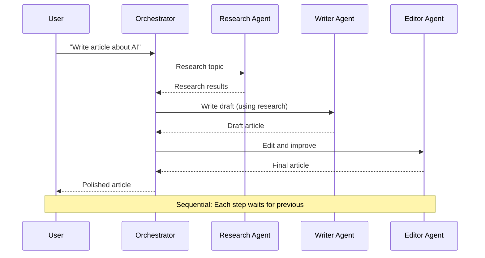
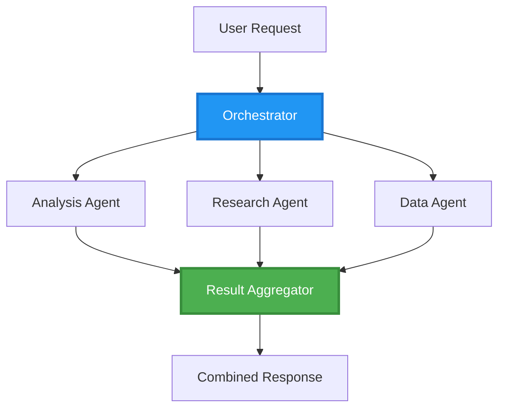
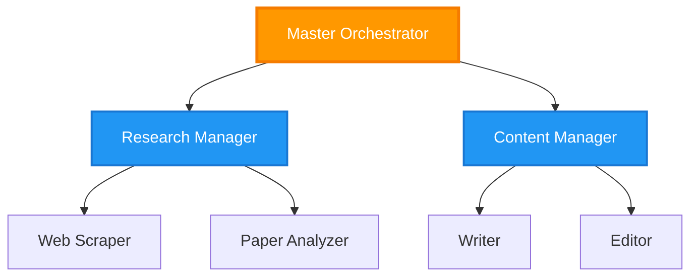
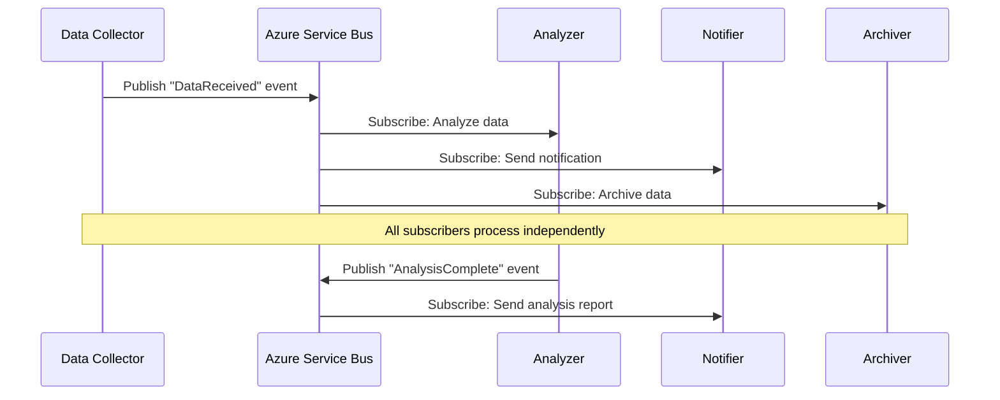
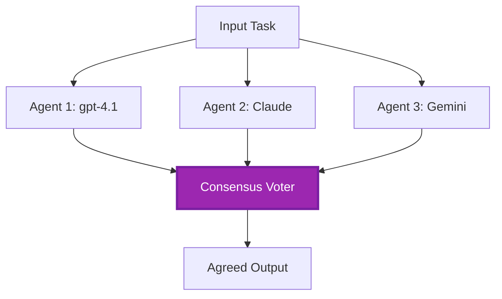
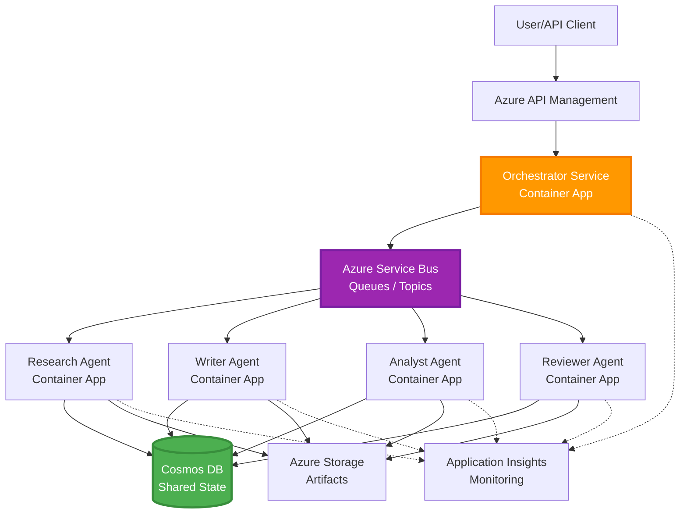

# Обрасци координације више агената

⏱️ **Процењено време**: 60-75 минута читања; неколико сати за имплементацију | 💰 **Процењени трошак**: зависи од оптерећења | ⭐ **Сложеност**: Напредни ниво

**📚 Пут учења:**
- ← Претходно: [Планирање капацитета](capacity-planning.md) - Стратегије димензионисања и скалирања ресурса
- 🎯 **Тренутно сте овде**: Обрасци координације више агената (Оркестрација, комуникација, управљање стањем)
- → Следеће: [Избор SKU](sku-selection.md) - Избор одговарајућих Azure услуга
- 🏠 [Почетак курса](../../README.md)

---

## Шта ћете научити

Завршетком ове лекције, научићете:
- Разумети обрасце **архитектуре више агената** и када их користити
- Имплементирати **обрасце оркестрације** (централизовани, децентрализовани, хијерархијски)
- Дизајнирати стратегије **комуникације агената** (синхрони, асинхрони, на догађаје засновани)
- Управљати **делјеним стањем** међу дистрибуираним агентима
- Деплојовати **системе више агената** на Azure користећи AZD
- Примeњивати **обрасце координације** за реалне AI сценарије
- Пратити и отклањати грешке у системима дистрибуираних агената

## Зашто је координација више агената важна

### Еволуција: Од једног агента до више агената

**Један агент (једноставан):**
```
User → Agent → Response
```
- ✅ Лако разумљиво и имплементирати
- ✅ Брзо за једноставне задатке
- ❌ Ограничено способностима једног модела
- ❌ Не може паралелно извршавати сложене задатке
- ❌ Нема специјализацију

**Систем више агената (напредни):**

- ✅ Специјализовани агенти за одређене задатке
- ✅ Паралелно извршавање за брзину
- ✅ Модуларно и одрживо
- ✅ Боље за сложене радне токове
- ⚠️ Захтева логику координације

**Аналогија**: Један агент је као једна особа која ради све задатке. Више агената је као тим где сваки члан има специјализоване вештине (истраживач, програмер, рецензент, писац) и сарађују.

---

## Основни обрасци координације

### Образац 1: Секвенцијална координација (Ланац одговорности)

**Када користити**: Задаци морају бити завршени у одређеном редоследу, сваки агент гради на резултату претходног.



**Предности:**
- ✅ Јасан ток података
- ✅ Лако за отклањање грешака
- ✅ Предвидив редослед извршења

**Ограничења:**
- ❌ Спорије (нema паралелизма)
- ❌ Један неуспех блокира цео ланац
- ❌ Не може се носити са међузависним задацима

**Примери коришћења:**
- Поступак креирања садржаја (истраживање → писање → уређивање → објава)
- Генерација кода (планирање → имплементација → тест → деплој)
- Генерација извештаја (прикупљање података → анализа → визуализација → резиме)

---

### Образац 2: Паралелна координација (Разграната/Ужница)

**Када користити**: Независни задаци могу истовремено да се извршавају, резултати се спајају на крају.



**Предности:**
- ✅ Брзо (паралелно извршавање)
- ✅ Отпоран на грешке (делимични резултати прихватљиви)
- ✅ Лако горизонтално скалабилно

**Ограничења:**
- ⚠️ Резултати могу стићи изван редоследа
- ⚠️ Потребна логика агрегације
- ⚠️ Комплексно управљање стањем

**Примери коришћења:**
- Прикупљање података из више извора (API-ји + базе података + веб скрапинг)
- Конкурентна анализа (више модела генеришу решења, бира се најбоље)
- Преводилачке услуге (превод на више језика истовремено)

---

### Образац 3: Хијерархијска координација (Менаџер-Радник)

**Када користити**: Сложени радни токови са подзадатцима, потребна делегација.



**Предности:**
- ✅ Се бави сложеним радним токовима
- ✅ Модуларно и одрживо
- ✅ Јасне границе одговорности

**Ограничења:**
- ⚠️ Комплекснија архитектура
- ⚠️ Већа латенција (више слојева координације)
- ⚠️ Захтева софистицирану оркестрацију

**Примери коришћења:**
- Обрада докумената у предузећу (класификовање → рутирање → обрада → архивирање)
- Вишестепене податочне линије (примање → чишћење → трансформација → анализа → извештај)
- Комплексни аутоматски радни токови (планирање → расподела ресурса → извршење → праћење)

---

### Образац 4: Координација заснована на догађајима (Објави-Претплати се)

**Када користити**: Агенти треба да реагују на догађаје, жељена слаба повезаност.



**Предности:**
- ✅ Слаба повезаност између агената
- ✅ Лако додати нове агенте (само се претплати)
- ✅ Асинхроно процесирање
- ✅ Отпоран (перзистенција порука)

**Ограничења:**
- ⚠️ Конзистентност на крају
- ⚠️ Комплексно отклањање грешака
- ⚠️ Изазови у поретку порука

**Примери коришћења:**
- Системи за праћење у реалном времену (аларми, контролне табле, дневници)
- Вишеканалне нотификације (мејл, SMS, пуш поруке, Slack)
- Подаци у обради (више потрошача истих података)

---

### Образац 5: Координација заснована на консензусу (Гласање/Кворум)

**Када користити**: Потребан је договор више агената пре наставка.



**Предности:**
- ✅ Већа тачност (више мишљења)
- ✅ Отпоран на грешке (прихватљиви мањински неуспеси)
- ✅ Уграђена контрола квалитета

**Ограничења:**
- ❌ Скупо (више позива модела)
- ❌ Спорије (чекање на све агенте)
- ⚠️ Потребно решавање конфликата

**Примери коришћења:**
- Модерација садржаја (рецензије више модела)
- Преглед кода (више линтера/аналитичара)
- Медицинска дијагноза (више AI модела, експертска валидација)

---

## Преглед архитектуре

### Комплетан систем више агената на Azure



**Кључне компоненте:**

| Компонента | Намена | Azure услуга |
|-----------|---------|---------------|
| **API Gateway** | Улазна тачка, ограничење брзине, аутентикација | API Management |
| **Оркестратор** | Координише радне токове агената | Container Apps |
| **Message Queue** | Асинхрона комуникација | Service Bus / Event Hubs |
| **Агенти** | Специјализовани AI радници | Container Apps / Functions |
| **State Store** | Делјено стање, праћење задатака | Cosmos DB |
| **Artifact Storage** | Документи, резултати, дневници | Blob Storage |
| **Monitoring** | Дистрибуирано праћење, дневници | Application Insights |

Service Bus queue/топици и Event Hubs су различите услуге са различитим моделима доставе/конзумирања; Event Hubs није замена за Service Bus раднички код доле. Паралелизам, перзистиране поруке и гласање модела сами по себи не гарантују отпорност на грешке или већу тачност.

---

## Претходни услови

### Потребни алати

```bash
# Verify Azure Developer CLI
azd version
# Command reference baseline: azd 1.37.2

# Verify Azure CLI
az --version
# ✅ Expected: azure-cli 2.50.0 or higher

# Verify Docker (for local testing)
docker --version
# ✅ Expected: Docker version 20.10 or higher
```

### Захтеви за Azure

- Активна Azure претплата
- Дозволе за креирање:
  - Container Apps
  - Service Bus namespace-ова
  - Cosmos DB рачуна
  - Рачуна за складиштење
  - Application Insights

### Захтеви за знање

Трба да сте прошли:
- [Управљање конфигурацијом](../chapter-03-configuration/configuration.md)
- [Аутентификација и безбедност](../chapter-03-configuration/authsecurity.md)
- [Пример микросервиса](../../../../examples/microservices)

---

## Водич за имплементацију

> **Фрагменти дизајна, а не лице за имплементацију:** Структура пројекта и `File:` етикете испод описују фајлове које треба направити у вашем пројекту; овај репозиторијум не садржи комплетну `multi-agent-system` апликацију. Недостају фајлови главних/параметарских шаблона, окружења/регистри за Container Apps, Dockerfile-ови и låк фајлови за зависности, конфигурација базе података/container у Cosmos-у, деплој модели, конфигурација идентитета/улога, правила за скалирање и паралелни радници/queue-ови. Не очекујте да `azd init` генерише ове фајлове или да `azd up` деплојује сегменте без измена. За извршни почетак, завршите [Основе више агената](../chapter-05-multi-agent/multi-agent-basics.md).

**Претпоставке о Runtime-у:** Python 3.10+, `azure-servicebus`, `azure-cosmos`, `openai`, Flask и (за праћење) `azure-monitor-opentelemetry`; поставите `shared` на Python пут за увоз у свакој слици сервиса. Cosmos `agent-state/tasks` контејнер већ мора постојати са partition key-јем `/id`. Везе засноване на кључу олакшавају ове фрагменте, а не производна упутства: преферирајте управљане идентитете са ограниченим Service Bus/Cosmos/OpenAI улогама на нивоу података. Не излажите кључеве у излазима или дневницима.

Достава Service Bus-а је **најмање једном**. Сачувајте идемпотентност по задатку **и кораку**, користите оперимистичку конкуренцију (ETags) за читање/модификацију/писање стања и обновите закључавање порука током дуготрајне обраде. Испод једноставни менаџер стања је само секвенцијалан и не имплементира ове производне гаранције.

### Структура пројекта

```
multi-agent-system/
├── azure.yaml                    # AZD configuration
├── infra/
│   ├── main.bicep               # Main infrastructure
│   ├── core/
│   │   ├── servicebus.bicep     # Message queue
│   │   ├── cosmos.bicep         # State store
│   │   ├── storage.bicep        # Artifact storage
│   │   └── monitoring.bicep     # Application Insights
│   └── app/
│       ├── orchestrator.bicep   # Orchestrator service
│       └── agent.bicep          # Agent template
└── src/
    ├── orchestrator/            # Orchestration logic
    │   ├── app.py
    │   ├── workflows.py
    │   └── Dockerfile
    ├── agents/
    │   ├── research/            # Research agent
    │   ├── writer/              # Writer agent
    │   ├── analyst/             # Analyst agent
    │   └── reviewer/            # Reviewer agent
    └── shared/
        ├── state_manager.py     # Shared state logic
        └── message_handler.py   # Message handling
```

---

## Лекција 1: Образац секвенцијалне координације

### Имплементација: Линија за креирање садржаја

Дизајнираћемо секвенцијалну линију: Истраживање → Писање → Уређивање. Објава је ван овог примера.

### 1. AZD конфигурација

**Фајл: `azure.yaml`**

```yaml
name: content-pipeline
metadata:
  template: multi-agent-sequential@1.0.0

services:
  orchestrator:
    project: ./src/orchestrator
    language: python
    host: containerapp
  
  research-agent:
    project: ./src/agents/research
    language: python
    host: containerapp
  
  writer-agent:
    project: ./src/agents/writer
    language: python
    host: containerapp
  
  editor-agent:
    project: ./src/agents/editor
    language: python
    host: containerapp
```

### 2. Инфраструктура: Service Bus за координацију

**Фајл: `infra/core/servicebus.bicep`**

```bicep
param name string
param location string
param tags object = {}

resource serviceBusNamespace 'Microsoft.ServiceBus/namespaces@2022-10-01-preview' = {
  name: name
  location: location
  tags: tags
  sku: {
    name: 'Standard'
    tier: 'Standard'
  }
  properties: {
    minimumTlsVersion: '1.2'
  }
}

// Queue for orchestrator → research agent
resource researchQueue 'Microsoft.ServiceBus/namespaces/queues@2022-10-01-preview' = {
  parent: serviceBusNamespace
  name: 'research-tasks'
  properties: {
    maxDeliveryCount: 3
    lockDuration: 'PT5M'
    deadLetteringOnMessageExpiration: true
  }
}

// Queue for research agent → writer agent
resource writerQueue 'Microsoft.ServiceBus/namespaces/queues@2022-10-01-preview' = {
  parent: serviceBusNamespace
  name: 'writer-tasks'
  properties: {
    maxDeliveryCount: 3
    lockDuration: 'PT5M'
  }
}

// Queue for writer agent → editor agent
resource editorQueue 'Microsoft.ServiceBus/namespaces/queues@2022-10-01-preview' = {
  parent: serviceBusNamespace
  name: 'editor-tasks'
  properties: {
    maxDeliveryCount: 3
    lockDuration: 'PT5M'
  }
}

output namespace string = serviceBusNamespace.name
// Do not output RootManageSharedAccessKey. Resolve scoped credentials
// securely or use managed identity in the application and scale rules.
```

### 3. Менаџер за делјено стање

**Фајл: `src/shared/state_manager.py`**

```python
from azure.cosmos import CosmosClient, PartitionKey
from datetime import datetime, timezone
import os

class StateManager:
    """Manages shared state across agents using Cosmos DB"""
    
    def __init__(self):
        endpoint = os.environ['COSMOS_ENDPOINT']
        key = os.environ['COSMOS_KEY']
        
        self.client = CosmosClient(endpoint, key)
        self.database = self.client.get_database_client('agent-state')
        self.container = self.database.get_container_client('tasks')
    
    def create_task(self, task_id: str, task_type: str, input_data: dict):
        """Create a new task"""
        task = {
            'id': task_id,
            'type': task_type,
            'status': 'pending',
            'input': input_data,
            'created_at': datetime.now(timezone.utc).isoformat(),
            'steps': []
        }
        self.container.create_item(task)
        return task
    
    def update_task_step(self, task_id: str, step_name: str, result: dict):
        """Update task with completed step"""
        task = self.container.read_item(task_id, partition_key=task_id)
        
        task['steps'].append({
            'name': step_name,
            'completed_at': datetime.now(timezone.utc).isoformat(),
            'result': result
        })
        
        self.container.replace_item(task_id, task)
        return task
    
    def complete_task(self, task_id: str, final_result: dict):
        """Mark task as complete"""
        task = self.container.read_item(task_id, partition_key=task_id)
        task['status'] = 'completed'
        task['result'] = final_result
        task['completed_at'] = datetime.now(timezone.utc).isoformat()
        self.container.replace_item(task_id, task)
        return task
    
    def get_task(self, task_id: str):
        """Retrieve task state"""
        return self.container.read_item(task_id, partition_key=task_id)
```

### 4. Оркестратор сервис

**Фајл: `src/orchestrator/app.py`**

```python
from flask import Flask, request, jsonify
from azure.servicebus import ServiceBusClient, ServiceBusMessage
import json
import uuid
import os
from shared.state_manager import StateManager

app = Flask(__name__)
state_manager = StateManager()

# Service Bus connection
servicebus_connection_str = os.environ['SERVICEBUS_CONNECTION_STRING']
servicebus_client = ServiceBusClient.from_connection_string(servicebus_connection_str)

@app.route('/health', methods=['GET'])
def health():
    return jsonify({'status': 'healthy', 'service': 'orchestrator'})

@app.route('/create-content', methods=['POST'])
def create_content():
    """
    Sequential workflow: Research → Write → Edit (returns a draft; no publishing)
    """
    data = request.get_json(silent=True) or {}
    topic = data.get('topic')
    
    if not topic:
        return jsonify({'error': 'Topic required'}), 400
    
    # Create task in state store
    task_id = str(uuid.uuid4())
    task = state_manager.create_task(
        task_id=task_id,
        task_type='content_creation',
        input_data={'topic': topic}
    )
    
    # Send message to research agent (first step)
    sender = servicebus_client.get_queue_sender('research-tasks')
    message = ServiceBusMessage(
        body=json.dumps({
            'task_id': task_id,
            'topic': topic,
            'next_queue': 'writer-tasks'  # Where to send results
        }),
        content_type='application/json'
    )
    
    with sender:
        sender.send_messages(message)
    
    return jsonify({
        'task_id': task_id,
        'status': 'started',
        'workflow': 'sequential',
        'steps': ['research', 'write', 'edit'],
        'message': 'Content creation pipeline initiated'
    }), 202

@app.route('/task/<task_id>', methods=['GET'])
def get_task_status(task_id):
    """Check task status"""
    try:
        task = state_manager.get_task(task_id)
        return jsonify(task)
    except Exception as e:
        return jsonify({'error': str(e)}), 404

if __name__ == '__main__':
    app.run(host='0.0.0.0', port=8080)
```

### 5. Истраживачки агент

**Фајл: `src/agents/research/app.py`**

```python
from azure.servicebus import ServiceBusClient, ServiceBusMessage
from openai import AzureOpenAI
import json
import os
import time
from shared.state_manager import StateManager

# Initialize clients
state_manager = StateManager()
servicebus_client = ServiceBusClient.from_connection_string(
    os.environ['SERVICEBUS_CONNECTION_STRING']
)

openai_client = AzureOpenAI(
    api_key=os.environ['AZURE_OPENAI_API_KEY'],
    api_version="2024-10-21",
    azure_endpoint=os.environ['AZURE_OPENAI_ENDPOINT']
)

def process_research_task(message_data):
    """Process research request and pass to writer"""
    task_id = message_data['task_id']
    topic = message_data['topic']
    next_queue = message_data['next_queue']
    
    print(f"🔬 Researching: {topic}")
    
    # Call Microsoft Foundry Models for research
    response = openai_client.chat.completions.create(
        model=os.environ['AZURE_OPENAI_DEPLOYMENT'],
        messages=[
            {"role": "system", "content": "You are a research assistant. Provide comprehensive research on the given topic."},
            {"role": "user", "content": f"Research this topic thoroughly: {topic}"}
        ],
        max_tokens=1500
    )
    
    research_results = response.choices[0].message.content
    
    # Update state
    state_manager.update_task_step(
        task_id=task_id,
        step_name='research',
        result={'research': research_results}
    )
    
    # Send to next agent (writer)
    sender = servicebus_client.get_queue_sender(next_queue)
    message = ServiceBusMessage(
        body=json.dumps({
            'task_id': task_id,
            'topic': topic,
            'research': research_results,
            'next_queue': 'editor-tasks'
        }),
        content_type='application/json'
    )
    
    with sender:
        sender.send_messages(message)
    
    print(f"✅ Research complete for task {task_id}")

def main():
    """Listen to research queue"""
    receiver = servicebus_client.get_queue_receiver('research-tasks')
    
    print("🔬 Research Agent started, listening for tasks...")
    
    with receiver:
        while True:
            messages = receiver.receive_messages(max_wait_time=5)
            for message in messages:
                try:
                    message_data = json.loads(str(message))
                    process_research_task(message_data)
                    receiver.complete_message(message)
                except Exception as e:
                    print(f"❌ Error processing message: {e}")
                    receiver.abandon_message(message)

if __name__ == '__main__':
    main()
```

### 6. Писац агент

**Фајл: `src/agents/writer/app.py`**

```python
from azure.servicebus import ServiceBusClient, ServiceBusMessage
from openai import AzureOpenAI
import json
import os
from shared.state_manager import StateManager

state_manager = StateManager()
servicebus_client = ServiceBusClient.from_connection_string(
    os.environ['SERVICEBUS_CONNECTION_STRING']
)

openai_client = AzureOpenAI(
    api_key=os.environ['AZURE_OPENAI_API_KEY'],
    api_version="2024-10-21",
    azure_endpoint=os.environ['AZURE_OPENAI_ENDPOINT']
)

def process_writing_task(message_data):
    """Write article based on research"""
    task_id = message_data['task_id']
    topic = message_data['topic']
    research = message_data['research']
    next_queue = message_data['next_queue']
    
    print(f"✍️ Writing article: {topic}")
    
    # Call Microsoft Foundry Models to write article
    response = openai_client.chat.completions.create(
        model=os.environ['AZURE_OPENAI_DEPLOYMENT'],
        messages=[
            {"role": "system", "content": "You are a professional writer. Write engaging, well-structured articles."},
            {"role": "user", "content": f"Based on this research:\n\n{research}\n\nWrite a comprehensive article about: {topic}"}
        ],
        max_tokens=2000
    )
    
    article_draft = response.choices[0].message.content
    
    # Update state
    state_manager.update_task_step(
        task_id=task_id,
        step_name='writing',
        result={'draft': article_draft}
    )
    
    # Send to editor
    sender = servicebus_client.get_queue_sender(next_queue)
    message = ServiceBusMessage(
        body=json.dumps({
            'task_id': task_id,
            'topic': topic,
            'draft': article_draft
        }),
        content_type='application/json'
    )
    
    with sender:
        sender.send_messages(message)
    
    print(f"✅ Article draft complete for task {task_id}")

def main():
    """Listen to writer queue"""
    receiver = servicebus_client.get_queue_receiver('writer-tasks')
    
    print("✍️ Writer Agent started, listening for tasks...")
    
    with receiver:
        while True:
            messages = receiver.receive_messages(max_wait_time=5)
            for message in messages:
                try:
                    message_data = json.loads(str(message))
                    process_writing_task(message_data)
                    receiver.complete_message(message)
                except Exception as e:
                    print(f"❌ Error: {e}")
                    receiver.abandon_message(message)

if __name__ == '__main__':
    main()
```

### 7. Уредник агент

**Фајл: `src/agents/editor/app.py`**

```python
from azure.servicebus import ServiceBusClient
from openai import AzureOpenAI
import json
import os
from shared.state_manager import StateManager

state_manager = StateManager()
servicebus_client = ServiceBusClient.from_connection_string(
    os.environ['SERVICEBUS_CONNECTION_STRING']
)

openai_client = AzureOpenAI(
    api_key=os.environ['AZURE_OPENAI_API_KEY'],
    api_version="2024-10-21",
    azure_endpoint=os.environ['AZURE_OPENAI_ENDPOINT']
)

def process_editing_task(message_data):
    """Edit and finalize article"""
    task_id = message_data['task_id']
    topic = message_data['topic']
    draft = message_data['draft']
    
    print(f"📝 Editing article: {topic}")
    
    # Call Microsoft Foundry Models to edit
    response = openai_client.chat.completions.create(
        model=os.environ['AZURE_OPENAI_DEPLOYMENT'],
        messages=[
            {"role": "system", "content": "You are an expert editor. Improve grammar, clarity, and structure."},
            {"role": "user", "content": f"Edit and improve this article:\n\n{draft}"}
        ],
        max_tokens=2000
    )
    
    final_article = response.choices[0].message.content
    
    # Mark task as complete
    state_manager.complete_task(
        task_id=task_id,
        final_result={
            'topic': topic,
            'final_article': final_article,
            'word_count': len(final_article.split())
        }
    )
    
    print(f"✅ Article finalized for task {task_id}")

def main():
    """Listen to editor queue"""
    receiver = servicebus_client.get_queue_receiver('editor-tasks')
    
    print("📝 Editor Agent started, listening for tasks...")
    
    with receiver:
        while True:
            messages = receiver.receive_messages(max_wait_time=5)
            for message in messages:
                try:
                    message_data = json.loads(str(message))
                    process_editing_task(message_data)
                    receiver.complete_message(message)
                except Exception as e:
                    print(f"❌ Error: {e}")
                    receiver.abandon_message(message)

if __name__ == '__main__':
    main()
```

### 8. Деплој и тестирање

Ове команде важe **само након што имплементирате недостајуће фајлове пројекта**. Интерактивна иницијализација Foundry агента је посебна радна ток, није део овог дизајна са Service Bus-ом.

```bash
# In your completed custom project
azd up

# Alternative in a SEPARATE empty folder (agents beta.23 requires azd >= 1.37)
azd extension install azure.ai.agents
azd ai agent init
azd up
```

> Погледајте [AZD AI CLI команде](../chapter-08-production/production-ai-practices.md#azd-ai-cli-commands-and-extensions) за све `azd ai` заставице и опције.

```bash
# Get orchestrator URL
ORCHESTRATOR_URL=$(azd env get-values | grep ORCHESTRATOR_URL | cut -d '=' -f2 | tr -d '"')

# Create content
curl -X POST $ORCHESTRATOR_URL/create-content \
  -H "Content-Type: application/json" \
  -d '{"topic": "The Future of AI in Healthcare"}'
```

**✅ Очекивани излаз:**
```json
{
  "task_id": "a1b2c3d4-e5f6-7890-abcd-ef1234567890",
  "status": "started",
  "workflow": "sequential",
  "steps": ["research", "write", "edit"],
  "message": "Content creation pipeline initiated"
}
```

**Провера напретка задатка:**
```bash
TASK_ID="a1b2c3d4-e5f6-7890-abcd-ef1234567890"
curl $ORCHESTRATOR_URL/task/$TASK_ID
```

**✅ Очекивани излаз (завршен):**
```json
{
  "id": "a1b2c3d4-e5f6-7890-abcd-ef1234567890",
  "type": "content_creation",
  "status": "completed",
  "steps": [
    {
      "name": "research",
      "completed_at": "2025-11-19T10:30:00Z",
      "result": {"research": "..."}
    },
    {
      "name": "writing",
      "completed_at": "2025-11-19T10:32:00Z",
      "result": {"draft": "..."}
    }
  ],
  "result": {
    "topic": "The Future of AI in Healthcare",
    "final_article": "...",
    "word_count": 1500
  }
}
```

---

## Лекција 2: Образац паралелне координације

### Имплементација: Агрегатор истраживања из више извора

Направимо паралелни систем који прикупља информације из више извора истовремено.

### Паралелни оркестратор

**Фајл: `src/orchestrator/parallel_workflow.py`**

```python
from flask import Flask, request, jsonify
from azure.servicebus import ServiceBusClient, ServiceBusMessage
import json
import uuid
import os
from shared.state_manager import StateManager

app = Flask(__name__)
state_manager = StateManager()

servicebus_client = ServiceBusClient.from_connection_string(
    os.environ['SERVICEBUS_CONNECTION_STRING']
)

@app.route('/research-parallel', methods=['POST'])
def research_parallel():
    """
    Parallel workflow: Multiple agents work simultaneously
    """
    data = request.json
    query = data.get('query')
    
    task_id = str(uuid.uuid4())
    task = state_manager.create_task(
        task_id=task_id,
        task_type='parallel_research',
        input_data={
            'query': query,
            'agents': ['web', 'academic', 'news', 'social']
        }
    )
    
    # Fan-out: publish sequentially; workers may process concurrently.
    agents = [
        ('web-research-queue', 'web'),
        ('academic-research-queue', 'academic'),
        ('news-research-queue', 'news'),
        ('social-research-queue', 'social')
    ]
    
    for queue_name, agent_type in agents:
        sender = servicebus_client.get_queue_sender(queue_name)
        message = ServiceBusMessage(
            body=json.dumps({
                'task_id': task_id,
                'query': query,
                'agent_type': agent_type,
                'result_queue': 'aggregation-queue'
            }),
            content_type='application/json'
        )
        
        with sender:
            sender.send_messages(message)
    
    return jsonify({
        'task_id': task_id,
        'status': 'started',
        'workflow': 'parallel',
        'agents_dispatched': 4,
        'message': 'Parallel research initiated'
    }), 202

if __name__ == '__main__':
    app.run(host='0.0.0.0', port=8080)
```

### Логика агрегације

**Фајл: `src/agents/aggregator/app.py`**

```python
from azure.servicebus import ServiceBusClient
import json
import os
from collections import defaultdict
from shared.state_manager import StateManager

state_manager = StateManager()
servicebus_client = ServiceBusClient.from_connection_string(
    os.environ['SERVICEBUS_CONNECTION_STRING']
)

# Single-process demo only: not durable or shared across replicas.
# Production: use durable unique (task_id, agent_type) result records.
task_results = defaultdict(dict)
expected_agents = 4  # web, academic, news, social

def process_result(message_data):
    """Aggregate results from parallel agents"""
    task_id = message_data['task_id']
    agent_type = message_data['agent_type']
    result = message_data['result']
    
    # Store result
    task_results[task_id][agent_type] = {
        'agent': agent_type,
        'data': result
    }
    
    print(f"📊 Received result from {agent_type} agent ({len(task_results[task_id])}/{expected_agents})")
    
    # Check if all agents completed (fan-in)
    if len(task_results[task_id]) == expected_agents:
        print(f"✅ All agents completed for task {task_id}. Aggregating...")
        
        # Combine results
        aggregated = {
            'query': message_data['query'],
            'sources': list(task_results[task_id].values()),
            'summary': generate_summary(list(task_results[task_id].values()))
        }
        
        # Mark complete
        state_manager.complete_task(task_id, aggregated)
        
        # Clean up
        del task_results[task_id]
        
        print(f"✅ Aggregation complete for task {task_id}")

def generate_summary(results):
    """Generate summary from all sources"""
    summaries = [r['data'].get('summary', '') for r in results]
    return '\n\n'.join(summaries)

def main():
    """Listen to aggregation queue"""
    receiver = servicebus_client.get_queue_receiver('aggregation-queue')
    
    print("📊 Aggregator started, listening for results...")
    
    with receiver:
        while True:
            messages = receiver.receive_messages(max_wait_time=5)
            for message in messages:
                try:
                    message_data = json.loads(str(message))
                    process_result(message_data)
                    receiver.complete_message(message)
                except Exception as e:
                    print(f"❌ Error: {e}")
                    receiver.abandon_message(message)

if __name__ == '__main__':
    main()
```

**Предности паралелног обрасца:**
- ⚡ **Потенцијално мања латенција** (ограничено најспоријим радником плус трошкови координације)
- 🔄 **Подршка делимичним резултатима** са експлицитним роковима и политиком пропадања (није имплементирано у основном агрегатору)
- 📈 **Скалирано** (лакша додавање нових агената)

---

## Практични задаци

### Задатак 1: Додавање управљања временским ограничењем ⭐⭐ (Средњи ниво)

**Циљ**: Имплементирати логику временског ограничења тако да агрегатор не чека бескрајно на споре агенте.

**Почетна тачка:** Покрените ову локалну симулацију рока пре интеграције у queue радника. Ограничење времена проверавано само када стигне друга порука никада неће експлодирати ако недостајући радник ништа не пошаље.

**Кораци**:

1. **Додајте праћење временског ограничења у агрегатор:**

```python
import asyncio

async def simulated_agent(name, delay):
    await asyncio.sleep(delay)
    return {'agent': name, 'result': 'done'}

async def main():
    tasks = [asyncio.create_task(simulated_agent(name, delay))
             for name, delay in [('web', 0.1), ('academic', 0.2),
                                 ('news', 0.3), ('social', 3)]]
    done, pending = await asyncio.wait(tasks, timeout=1)
    results = [task.result() for task in done]
    for task in pending:
        task.cancel()
    await asyncio.gather(*pending, return_exceptions=True)
    print({'completed_agents': len(results), 'timed_out': bool(pending)})
    assert len(results) == 3 and pending

asyncio.run(main())
```

2. **Очекујени излаз:**

```text
{'completed_agents': 3, 'timed_out': True}
```

3. **Интеграција са queue системом (задатак из дизајна):** Сачувајте крајњи рок слања и очекиване агенте приликом креирања задатка, покрените периодично проверавање рока независно од пристиглих резултата, атомски завршите делимичне резултате и игноришите касне/дупликат поруке за завршене задатке. Локално временско ограничење не отказује удаљене раднике.

Само за ваш имплементирани пројекат:

```bash
azd deploy aggregator

# Submit task
curl -X POST $ORCHESTRATOR_URL/research-parallel \
  -H "Content-Type: application/json" \
  -d '{"query": "AI safety research"}'

# Check results after 30 seconds
curl $ORCHESTRATOR_URL/task/$TASK_ID
```

**✅ Критеријуми успеха:**
- ✅ Локални тест се завршава након једносекундног рока чак и ако агент није комплетан
- ✅ Одговор указује на делимичне резултате (`"timed_out": true`)
- ✅ Враћају се расположиви резултати (3 од 4 агента)

**Време**: 20-25 минута

---

### Задатак 2: Имплементирање логике поновног покушаја ⭐⭐⭐ (Напредни)

**Циљ**: Аутоматски поново покушати неуспешне задатке агената пре одустајања.

**Кораци**:

1. **Користите бројеве достава Service Bus-а уместо сопственог рачуна поновног покушаја:**

```python
import json
import time
# Integration fragment: use a live peek-lock ServiceBusReceiver.
# Set queue maxDeliveryCount to 4 for one attempt + up to three retries.
```

2. **Додајте обраду поновног покушаја агенатима:**

```python
def process_with_retry(message, receiver, process_func):
    """Process message with automatic retry on failure"""
    try:
        message_data = json.loads(str(message))
        
        # Process the message
        process_func(message_data)
        
        # Success - complete
        receiver.complete_message(message)
        
    except Exception as e:
        if message.delivery_count < 4:
            # Bounded exponential delay: 5s, 10s, 20s.
            # Renew the lock if processing + waiting can exceed its duration.
            time.sleep(5 * 2 ** (message.delivery_count - 1))
            receiver.abandon_message(message)
        else:
            # Max retries exceeded - move to dead letter queue
            print(f"❌ Max attempts exceeded for message {message.message_id}")
            receiver.dead_letter_message(
                message,
                reason="MaxRetriesExceeded",
                error_description=str(e)
            )
```

3. **Пратите dead letter queue:**

```python
def monitor_dead_letters():
    """Check dead letter queue for failed messages"""
    receiver = servicebus_client.get_queue_receiver(
        'research-tasks',
        sub_queue='deadletter'
    )
    
    with receiver:
        messages = receiver.receive_messages(max_wait_time=5)
        for message in messages:
            print(f"☠️ Dead letter: {message.message_id}")
            print(f"Reason: {message.dead_letter_reason}")
            print(f"Description: {message.dead_letter_error_description}")
```

**✅ Критеријуми успеха:**
- ✅ Неуспели задаци се аутоматски поново покушавају (до 3 пута)
- ✅ Експоненцијални одмор између поновних покушаја (5с, 10с, 20с), са обновом закључавања порука где је потребно
- ✅ Након максималних покушаја, поруке иду у dead letter queue
- ✅ Поруке из dead letter queue могу се прегледати; препродукција захтева посебан идемпотентни опоравак

**Време**: 30-40 минута

---

### Задатак 3: Имплементирање Circuit Breaker-а ⭐⭐⭐ (Напредни)

**Циљ**: Спријечити каскадне грешке заустављајући захтеве ка неуспелим агентима.

**Кораци**:

1. **Креирајте класу circuit breaker-а:**

```python
from enum import Enum
from datetime import datetime, timedelta, timezone

class CircuitState(Enum):
    CLOSED = "closed"      # Normal operation
    OPEN = "open"          # Failing, reject requests
    HALF_OPEN = "half_open"  # Testing if recovered

class CircuitBreaker:
    def __init__(self, failure_threshold=5, timeout_seconds=60):
        self.failure_threshold = failure_threshold
        self.timeout_seconds = timeout_seconds
        self.failure_count = 0
        self.last_failure_time = None
        self.state = CircuitState.CLOSED
    
    def call(self, func):
        """Execute function with circuit breaker protection"""
        if self.state == CircuitState.OPEN:
            # Check if timeout expired
            if datetime.now(timezone.utc) - self.last_failure_time > timedelta(seconds=self.timeout_seconds):
                self.state = CircuitState.HALF_OPEN
                print("🔄 Circuit breaker: HALF_OPEN (testing)")
            else:
                raise Exception(f"Circuit breaker OPEN for agent. Try again in {self.timeout_seconds}s")
        
        try:
            result = func()
            
            # Success
            self.failure_count = 0 # Count consecutive failures only
            if self.state == CircuitState.HALF_OPEN:
                self.state = CircuitState.CLOSED
                self.failure_count = 0
                print("✅ Circuit breaker: CLOSED (recovered)")
            
            return result
            
        except Exception as e:
            self.failure_count += 1
            self.last_failure_time = datetime.now(timezone.utc)
            
            if self.failure_count >= self.failure_threshold:
                self.state = CircuitState.OPEN
                print(f"🔴 Circuit breaker: OPEN (too many failures)")
            
            raise
```

2. **Примeните на позиве агената:**

```python
# In orchestrator
agent_circuits = {
    'web': CircuitBreaker(failure_threshold=5, timeout_seconds=60),
    'academic': CircuitBreaker(failure_threshold=5, timeout_seconds=60),
    'news': CircuitBreaker(failure_threshold=5, timeout_seconds=60),
    'social': CircuitBreaker(failure_threshold=5, timeout_seconds=60)
}

def send_to_agent(agent_type, message_data):
    """Send with circuit breaker protection"""
    circuit = agent_circuits[agent_type]
    
    try:
        circuit.call(lambda: send_message(agent_type, message_data))
    except Exception as e:
        print(f"⚠️ Skipping {agent_type} agent: {e}")
        # Continue with other agents
```

Овај круг штити **операцију слања**, а не завршетак од стране удаљеног радника: успешно стављање поруке у ред ништа не говори о томе да ли је агент жив. `send_message` је функција слања у вашој апликацији. За извршавајуће кругове, унесите у приметне грешке/тайм-аутове задатака у издржљиви координациони систем. Ова класа у меморији је демонстрација са једним нитима, а не дистрибуирани прекидач круга.

3. **Тестирајте прекидач круга локално:**

```python
# Run after the class definition; no Azure changes required.
circuit = CircuitBreaker(failure_threshold=5, timeout_seconds=0)
def fail():
    raise RuntimeError("simulated failure")
for _ in range(5):
    try:
        circuit.call(fail)
    except RuntimeError:
        pass
assert circuit.state == CircuitState.OPEN
assert circuit.call(lambda: "recovered") == "recovered"
assert circuit.state == CircuitState.CLOSED
print("Circuit breaker recovery verified")
```

**✅ Критеријуми успеха:**
- ✅ Након 5 неуспеха, круг се отвара (одбацује захтеве)
- ✅ Након 60 секунди, круг прелази у полупрозирно стање (тестира опоравак)
- ✅ Остали агенти настављају нормално радити
- ✅ Круг се аутоматски затвара када се агент опорави

**Време**: 40-50 минута

---

## Надгледање и отклањање грешака

### Дистрибуирано праћење са Application Insights

**Датотека: `src/shared/tracing.py`**

```python
from azure.monitor.opentelemetry import configure_azure_monitor
from opentelemetry import trace
from opentelemetry.trace import SpanKind
import logging
import os

connection_string = os.environ.get('APPLICATIONINSIGHTS_CONNECTION_STRING')

# Configure once per process. Message send/receive trace-context propagation
# and agent attributes on exceptions need explicit instrumentation.
if connection_string:
    configure_azure_monitor(connection_string=connection_string, logger_name=__name__)
tracer = trace.get_tracer(__name__)

# Configure logging
logger = logging.getLogger(__name__)
logger.setLevel(logging.INFO)

def trace_agent_call(agent_name, task_id, operation_name, operation):
    """Trace agent operations"""
    with tracer.start_as_current_span(f'agent.{agent_name}.{operation_name}', kind=SpanKind.CLIENT) as span:
        span.set_attribute('agent', agent_name)
        span.set_attribute('task_id', task_id)
        span.set_attribute('operation', operation_name)
        
        try:
            result = operation()
            span.set_attribute('status', 'success')
            logger.info('Agent operation completed', extra={
                'agent': agent_name, 'task_id': task_id, 'operation': operation_name
            })
            return result
        except Exception as e:
            span.set_attribute('status', 'error')
            logger.exception('Agent operation failed', extra={
                'agent': agent_name, 'task_id': task_id, 'operation': operation_name
            })
            raise
```

### Application Insights упити

**Пратите више агената у радним токовима:**

```kusto
// Trace complete workflow for a task
traces
| where customDimensions.task_id == "a1b2c3d4-..."
| project timestamp, message, customDimensions.agent, customDimensions.operation
| order by timestamp asc
```

**Поређење перформанси агената:**

```kusto
// Compare agent execution times
dependencies
| where name contains "agent"
| summarize 
    avg_duration = avg(duration),
    p95_duration = percentile(duration, 95),
    count = count()
  by agent = tostring(customDimensions.agent)
| order by avg_duration desc
```

**Анализа неуспеха:**

```kusto
// Find which agents fail most
exceptions
| where customDimensions.agent != ""
| summarize 
    failure_count = count(),
    unique_errors = dcount(outerMessage)
  by agent = tostring(customDimensions.agent)
| order by failure_count desc
```

---

## Анализа трошкова

### Трошкови мулти-агентског система (месечни прегледи)

Илустративни плански подаци само, не понуде: збир испод је **$240-565/месечно**. Проверите тренутне регионалне тарифе, активне/неактивне сате реплика, мешавину улаза/излаза токена, складиштење и телеметрију. Серверлесс нема минимални гарантовани проток, али ипак се наплаћују захтеви и складиштење.

| Компонента | Конфигурација | Цена |
|-----------|--------------|------|
| **Оркестратор** | 1 Контејнер апликација (1 вCPU, 2GB) | $30-50 |
| **4 агента** | 4 Контејнер апликације (0.5 vCPU, 1GB сваки) | $60-120 |
| **Service Bus** | Стандардни ниво, 10М порука | $10-20 |
| **Cosmos DB** | Серверлесс, 5GB складиште, 1М RUs | $25-50 |
| **Blob Storage** | 10GB складиште, 100К операција | $5-10 |
| **Application Insights** | 5GB унос | $10-15 |
| **Microsoft Foundry Models** | gpt-4.1, 10M токена | $100-300 |
| **Укупно** | | **$240-565/месечно** |

### Стратегије оптимизације трошкова

1. **Користите серверлесс где год је могуће:**
   ```bicep
   // Cosmos DB serverless (no minimum cost)
   properties: {
     databaseAccountOfferType: 'Standard'
     capabilities: [{ name: 'EnableServerless' }]
   }
   ```

2. **Скалирајте агенте на нулу када су неактивни:**
   ```bicep
   scale: {
     minReplicas: 0  // Requires a Service Bus/KEDA scale rule to wake workers
     maxReplicas: 10
   }
   ```

3. **Користите батцхинг за Service Bus:**
   ```python
   # Send messages in batches (cheaper)
   sender.send_messages([message1, message2, message3])
   ```

4. **Кеширајте често коришћене резултате:**
   ```python
   # Use Azure Cache for Redis
   if cache.exists(query_hash):
       return cache.get(query_hash)
   ```

---

## Најбоље праксе

### ✅ ПОРАДИТЕ ОВО:

1. **Користите идемпотентне операције**
   ```python
   # Pseudocode: implement a durable, atomic per-step deduplication claim.
   def process_task(task_id):
       raise NotImplementedError("Claim (task_id, step) atomically, execute, persist outcome")
   ```

2. **Имплементирајте свеобухватно бележење**
   ```python
   logger.info(f"Agent: {agent_name}, Task: {task_id}, Action: {action}")
   ```

3. **Користите ИД-ове корелације**
   ```python
   # Pass task_id through entire workflow
   message_data = {
       'task_id': task_id,  # Correlation ID
       'timestamp': datetime.utcnow().isoformat()
   }
   ```

4. **Поставите TTL поруке (време живљења)**
   ```bicep
   properties: {
     defaultMessageTimeToLive: 'PT1H'  // 1 hour max
   }
   ```

5. **Надгледајте опаште редове писама**
   ```python
   # Regular monitoring of failed messages
   monitor_dead_letters()
   ```

### ❌ НЕ РАДИТЕ ОВО:

1. **Не правите кружне зависности**
   ```python
   # ❌ BAD: Agent A → Agent B → Agent A (infinite loop)
   # ✅ GOOD: Define clear directed acyclic graph (DAG)
   ```

2. **Не блокирајте нитове агената**
   ```python
   # ❌ BAD: Synchronous wait
   while not task_complete:
       time.sleep(1)
   
   # ✅ GOOD: Use message queue callbacks
   ```

3. **Не игноришите делимичне неуспехе**
   ```python
   # ❌ BAD: Fail entire workflow if one agent fails
   # ✅ GOOD: Return partial results with error indicators
   ```

4. **Не користите бесконачна поновна покушаја**
   ```python
   # ❌ BAD: retry forever
   # ✅ GOOD: max_retries = 3, then dead letter
   ```

---

## Водич за отклањање проблема

### Проблем: Поруке заглављене у реду

**Симптоми:**
- Поруке се нагомилавају у реду
- Агенти не обрађују
- Статус задатка заглављен на "на чекању"

**Дијагноза:**
```bash
# Check queue depth
az servicebus queue show \
  --resource-group "$RG_NAME" \
  --namespace-name mybus \
  --name research-tasks \
  --query "countDetails"

# Check agent logs using Azure CLI
az containerapp logs show --name research-agent --resource-group $RG_NAME --tail 50
```

**Решења:**

1. **Повећајте број реплика агената:**
   ```bash
   az containerapp update \
     --resource-group "$RG_NAME" \
     --name research-agent \
     --min-replicas 3 \
     --max-replicas 10
   ```

2. **Проверите опашти ред писама:**
   ```bash
   az servicebus queue show \
     --resource-group "$RG_NAME" \
     --namespace-name mybus \
     --name research-tasks \
     --query "countDetails.deadLetterMessageCount"
   ```

---

### Проблем: тајм-аут задатка/никда се не завршава

**Симптоми:**
- Статус задатка остаје "у току"
- Неки агенти завршавају, други не
- Нема порука о грешци

**Дијагноза:**
```bash
# Check task state
curl $ORCHESTRATOR_URL/task/$TASK_ID

# Check Application Insights
# Run query: traces | where customDimensions.task_id == "..."
```

**Решења:**

1. **Имплементирајте тајм-аут у агрегатору (Вежба 1)**

2. **Проверите неуспехе агената коришћењем Azure Monitor-а:**
   ```bash
   # View logs via azd monitor
   azd monitor --logs
   
   # Or use Azure CLI to check specific container app logs
   az containerapp logs show --name <agent-name> --resource-group $RG_NAME --follow | grep "ERROR\|FAIL"
   ```

3. **Потврдите да ли сви агенти раде:**
   ```bash
   az containerapp list \
     --resource-group rg-agents \
     --query "[].{name:name, status:properties.runningStatus}"
   ```

---

## Сазнајте више

### Званична документација
- [Azure Service Bus](https://learn.microsoft.com/azure/service-bus-messaging/service-bus-messaging-overview)
- [Cosmos DB](https://learn.microsoft.com/azure/cosmos-db/introduction)
- [Container Apps DAPR](https://learn.microsoft.com/azure/container-apps/dapr-overview)
- [AI Agent Orchestration Patterns](https://learn.microsoft.com/azure/architecture/ai-ml/guide/ai-agent-design-patterns)

### Следећи кораци у овом курсу
- ← Претходно: [Capacity Planning](capacity-planning.md)
- → Следеће: [SKU Selection](sku-selection.md)
- 🏠 [Почетак курса](../../README.md)

### Повећани примери
- [Пример микросервиса](../../../../examples/microservices) - Обрасци комуникације сервиса
- [Пример Microsoft Foundry модела](../../../../examples/azure-openai-chat) - Интеграција вештачке интелигенције

---

## Резиме

**Научили сте:**
- ✅ Пет образаца координације (серијски, паралелни, хијерархијски, вођен догађајима, консензус)
- ✅ Мулти-агентску архитектуру на Azure (Service Bus, Cosmos DB, Container Apps)
- ✅ Управљање стањем код дистрибуираних агената
- ✅ Обрада тајм-аутова, поновних покушаја и прекидача круга
- ✅ Надгледање и отклањање грешака дистрибуираних система
- ✅ Стратегије оптимизације трошкова

**Кључни закључци:**
1. **Изаберите прави образац** - Серијски за наручене токове рада, паралелни за брзину, вођен догађајима за флексибилност
2. **Пажљиво управљајте стањем** - Користите Cosmos DB или слично за дељено стање
3. **Грешке обрађујте лепо** - Тајм-аутови, поновни покушаји, прекидачи круга, опашти редови писама
4. **Надгледајте све** - Дистрибуирано праћење је кључно за отклањање грешака
5. **Оптимизујте трошкове** - Скалирање на нулу, коришћење серверлесс, имплементација кеширања

**Следећи кораци:**
1. Завршите практичне вежбе
2. Направите мулти-агентски систем за ваш случај употребе
3. Проучите [SKU Selection](sku-selection.md) да бисте оптимизовали перформансе и трошкове

---

<!-- CO-OP TRANSLATOR DISCLAIMER START -->
**Изјава о одрицању одговорности**:
Овај документ је преведен коришћењем услуге за аутоматски превод [Co-op Translator](https://github.com/Azure/co-op-translator). Иако тежимо тачности, имајте у виду да аутоматски преводи могу садржати грешке или нетачности. Оригинални документ на његовом изворном језику треба сматрати ауторитативним извором. За критичне информације препоручује се професионални људски превод. Нисмо одговорни за било каква неспоразума или погрешна тумачења која произилазе из коришћења овог превода.
<!-- CO-OP TRANSLATOR DISCLAIMER END -->